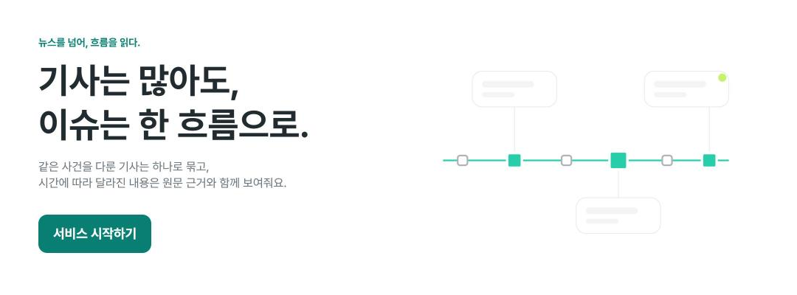
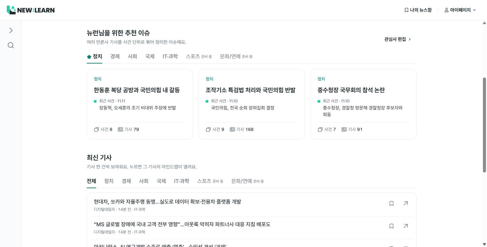
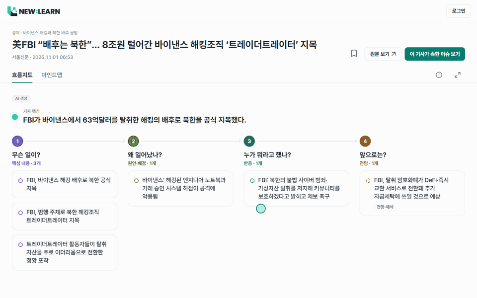
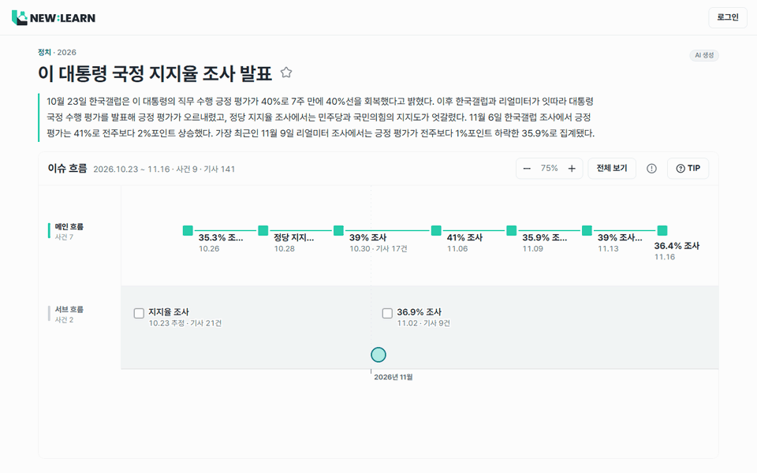
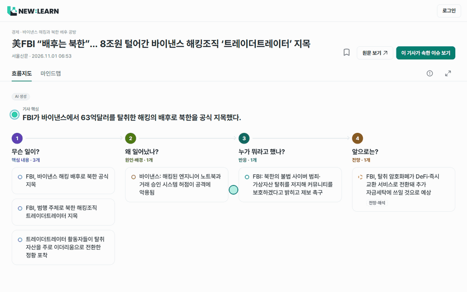
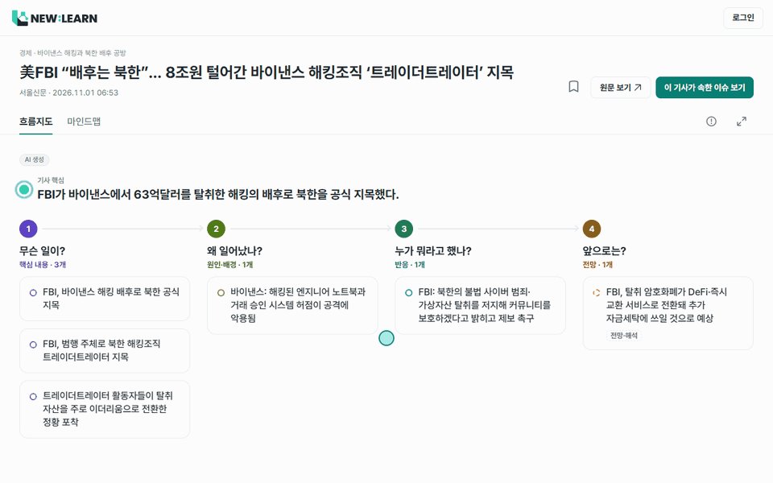
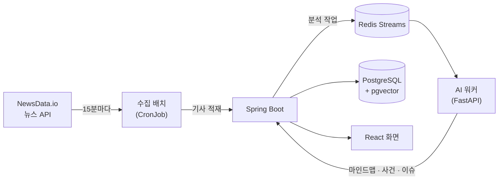
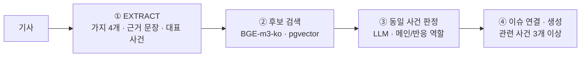
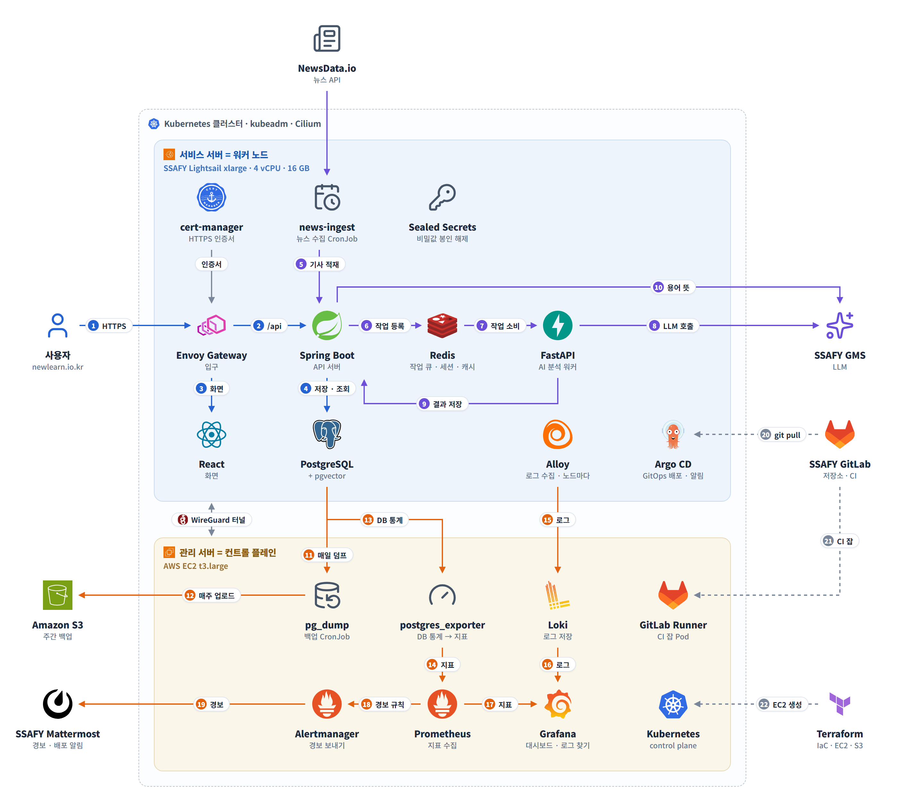

<div align="center">

<picture>
  <source media="(prefers-color-scheme: dark)" srcset="readme/newlearn-logo-dark.svg">
  
</picture>

<h3>뉴스를 넘어, 흐름을 읽다.</h3>

흩어진 뉴스 속 이슈를 빠르게 파악하고 싶은 사람을 위한<br>
**기사 이슈 타임라인 · 기사 마인드맵 AI 플랫폼**

<sub>SSAFY 15기 A102 · Team <b>SYNAPSE</b></sub>

<br><br>

[](https://newlearn.io.kr)
[](https://newlearn-issue.vercel.app/home)

<sub>Demo 는 서버 없이 도는 판입니다. 2026-11-16 실제 서비스에서 받은 기사 스냅샷(이슈 16 · 기사 1,938)에 목 서버(MSW)가 답하고, 로그인은 아무 아이디 · 비밀번호로 됩니다.</sub>

<a href="#-주요-기능">주요 기능</a> ·
<a href="#-팀원">팀원</a> ·
<a href="#-기술-스택">기술 스택</a> ·
<a href="#-서비스-흐름">서비스 흐름</a> ·
<a href="#-기술-이야기">기술 이야기</a>

<br><br>



</div>

<br>

같은 사건도 여러 언론사가 며칠에 걸쳐 나눠 보도하면, 기사 한 편만으로는 흐름이 잡히지 않습니다.
NEW:LEARN 은 기사 한 편을 **핵심 내용 · 원인·배경 · 반응 · 전망** 네 갈래로 정리해 보여 주고, 같은 사건을 다룬 기사를 묶어 **이슈가 어떻게 흘러왔는지** 한 화면으로 이어 줍니다.

<br>

## ✨ 주요 기능

### 1. 분야별 이슈 · 기사 탐색

정치 · 경제 · 사회 · 국제 · IT·과학 다섯 분야로 이슈와 최신 기사를 나눠 봅니다. 홈의 추천 이슈는 회원이 고른 **관심 분야부터** 보여 줍니다.

<p align="center"></p>

### 2. 기사 마인드맵 — 흐름지도 · 마인드맵 두 보기

기사 내용을 **핵심 내용 · 원인·배경 · 반응 · 전망**으로 나눠, 순서대로 읽는 흐름지도와 관계를 보는 마인드맵 두 가지로 보여 줍니다. 마인드맵에서 가지를 누르면 그 가지로 다가가고, 크게 보기로 화면을 꽉 채워 볼 수 있습니다.

<p align="center"></p>

### 3. 이슈 에볼루션 맵 (화면의 「이슈 흐름」)

같은 사건을 다룬 기사를 묶고, 이슈의 사건을 시간순으로 놓습니다. 상황을 바꾸는 행위는 **메인 흐름**, 반응 · 평가는 **서브 흐름**입니다. 사건을 누르면 요약과 관련 기사가 열립니다.

<p align="center"></p>

### 4. 기사 ↔ 이슈 양방향 탐색

이슈에서 사건 · 관련 기사로 내려가고, 기사에서 **「이 기사가 속한 이슈 보기」**로 다시 올라옵니다. 올라오면 그 기사가 속한 사건이 열린 채로 보입니다.

<p align="center"></p>

### 5. 개인 뉴스 관리 · 용어사전

관심 분야를 고르고 기사 북마크 · 관심 이슈를 저장합니다. 기사에서 모르는 말을 드래그해 **「의미」**를 누르면 **그 기사 문맥에 맞는 뜻**을 보여 줍니다.

<p align="center"></p>

<br>

## 👥 팀원

<div align="center">

<table>
  <tr>
    <td align="center" width="140"><a href="https://github.com/ehrud7654"><br><b>황도경</b></a><br><sub>팀장 · AI</sub></td>
    <td align="center" width="140"><a href="https://github.com/cen04088"><br><b>장민준</b></a><br><sub>PM</sub></td>
    <td align="center" width="140"><a href="https://github.com/xxj15"><br><b>안서진</b></a><br><sub>Frontend · Design</sub></td>
  </tr>
  <tr>
    <td align="center" width="140"><a href="https://github.com/reeneda"><br><b>강하린</b></a><br><sub>Backend</sub></td>
    <td align="center" width="140"><a href="https://github.com/kimzoo5676-del"><br><b>김주우</b></a><br><sub>Backend · Infra</sub></td>
    <td align="center" width="140"><a href="https://github.com/wldyu"><br><b>강유진</b></a><br><sub>AI</sub></td>
  </tr>
</table>

</div>

<br>

## 🧰 기술 스택

| 영역 | 기술 |
|:---:|---|
| **Frontend** |          |
| **Backend** |            |
| **AI** |        |
| **Data** |      |
| **Infra** |               |
| **관측** |       |
| **외부 API** |   |

<br>

## 🔄 서비스 흐름



기사 · 이슈 화면은 미리 분석해 저장한 결과를 읽기만 합니다. 화면이 AI 를 부르는 것은 용어사전 「의미」를 누를 때뿐입니다. 15분마다 들어오는 새 기사는 지금 마인드맵까지만 만들고, 사건 · 이슈 연결은 꺼 두었습니다(아래 「기술 이야기 → AI」).

<br>

## 🔍 기술 이야기

<details>
<summary><b>🤖 AI — 기사 한 편이 마인드맵 · 사건 · 이슈가 되기까지</b></summary>

<br>



| 단계 | 하는 일 |
|:---:|---|
| ① EXTRACT | SSAFY GMS(gpt-6-luna)로 핵심 내용 · 원인·배경 · 반응 · 전망을 뽑고, 원문 근거 문장을 붙이고, 사건 연결에 쓸 대표 사건을 고릅니다 |
| ② 후보 검색 | 기사 제목과 본문 앞 800자를 1024차원 벡터로 바꿔 비슷한 기존 사건을 최대 5개 찾습니다 |
| ③ 동일 사건 판정 | 후보와 비교해 기존 사건에 붙일지, 새 사건을 만들지 정합니다. 새 사건에는 이름 · 요약과 메인 · 반응 역할을 줍니다 |
| ④ 이슈 | 새 사건을 기존 이슈에 붙이거나, 관련 사건이 3개 이상이면 새 이슈를 만듭니다 |

- 사건이 일어난 때는 기사 발행 시각과 따로 읽습니다. 「어제」 같은 상대 날짜는 발행 시각을 기준으로 풀고, 「지난달」처럼 흐린 말이면 비워 두었다가 첫 기사 시각으로 채웁니다(화면에 「추정」)
- 워커는 Redis Streams 작업 큐를 소비하고, 결과는 Spring Boot 가 검사해 저장합니다(출력 형식 · 근거 문장 위치 · 대표 사건 번호 · 발생 시점 형식)
- 지금 운영 워커는 ① EXTRACT 만 돌립니다. 임베딩 워커는 발표 뒤까지 꺼 두었고(`SSOT.md` 9절 2026-11-10), ③ ④ 워커 코드는 아직 `ai` 브랜치에 있습니다
- 화면의 사건 · 이슈는 AI 팀이 10/21 ~ 11/11 최종 기사 112,700건을 벡터로 먼저 사건 · 이슈 후보로 묶고(사건 72시간 · 이슈 7일), 묶음마다 같은 EXTRACT 와 같은 판정 규칙을 돌려 미리 만든 결과입니다. 이슈 이름 · 요약은 따로 지었고, 마인드맵은 사건 기사 14,493건 전부에 있습니다([`data/README.md`](../data/README.md) 「어떻게 만들었나」)
- 기사 분야는 NewsData 분류 대신 **제목을 읽은 라벨**이 정합니다. 새 기사는 매일 한 번 라벨을 붙입니다([`infra/server/category-labels.md`](../infra/server/category-labels.md))

</details>

<details>
<summary><b>☁️ 인프라 · 운영 — 서버 두 대를 클러스터 하나로</b></summary>

<br>

<p align="center"></p>

| 무엇 | 어떻게 |
|---|---|
| **서버 두 대, 클러스터 하나** | 서비스는 SSAFY Lightsail 워커에, 관리 도구(컨트롤 플레인 · 모니터링 · CI 러너)는 AWS EC2 에 두고 WireGuard 터널로 이어 kubeadm 쿠버네티스 클러스터 하나로 운영합니다. EC2(보안 그룹 · 탄력적 IP) · 예산 알림 · 백업 S3 버킷은 Terraform 으로 만듭니다 |
| **들어오는 길** | Envoy Gateway 가 HTTPS(cert-manager · Let's Encrypt)를 받아 화면은 React, API 는 Spring Boot 로 나눕니다. 로그인 · 가입 · 용어사전(뜻 · 문맥 뜻)은 Redis 로 주소별 요청 수를 셉니다 |
| **배포** | MR 검사 → dev 머지 → 이미지 굽기(Kaniko) → 배포 태그 MR(사람이 머지) → Argo CD 자동 동기화 → 새 Pod 먼저 뜨는 롤링 교체 → Mattermost 알림. 되돌리기는 git revert 입니다 |
| **관측** | Prometheus · Grafana · Loki · Alloy, 경보는 Alertmanager → Mattermost. DB 는 매일 04:00 관리 서버에, 매주 S3 에 백업합니다 |

**숫자로 본 기술 결정**

| 무엇을 쟀나 | 전 | 후 | 바꾼 것 | 근거 |
|---|--:|--:|---|---|
| 기사 목록 응답 시간(p50) | 242ms | **22ms** | 공개 기사만 담은 부분 인덱스(V14) | [results.md](../infra/server/perf/results.md) |
| 조회 측정 한 판에 걸린 시간 | 2분 51초 | **31초** | 〃 | 〃 |
| 부하 시험에서 버틴 처리량(포화 지점) | 초당 93건 | **초당 123건** | 이슈 목록 SQL 다시 쓰기 · 기사-사건 · 사건 인덱스(V15) | [results-194.md](../infra/server/perf/results-194.md) |
| 포화 때 요청 하나가 쓴 DB CPU(약) | 37ms | **26ms** | 〃 | 〃 |
| 로그 수집기가 다시 뜬 직후 보낸 줄 | 136,313줄 | **171줄** | Alloy 책갈피를 서버 디스크로 | [SSOT](../SSOT.md) 10절 11-11 |
| 그때 Loki 가 거절한 줄 | 117,907줄 | **0줄** | 〃 | 〃 |
| 분야가 언론사 URL 섹션과 맞는 비율 | 68.2% | **77.3%** | 제목을 읽어 정한 분야 라벨 | [SSOT](../SSOT.md) 10절 11-05 |
| 배포 교체 중 사이트 health 실패 | 안 잼 | **0 / 219번** | 새 Pod 먼저 · 준비 확인 · 끝낼 때 10초 | [SSOT](../SSOT.md) 10절 10-26 · 6절 |

<sub>분야 비율은 기사 9,022건을 언론사 URL 섹션과 대조한 값이고, 나머지는 모두 운영에서 잰 값입니다. 분야 비율은 전체로는 올랐지만 IT·과학(54 → 35%) · 경제(82 → 79%)는 내려갔습니다. health 는 10-26 반영 때 관리자 PC 에서 1초마다 5분 동안 잰 값이고, 로그 줄은 다시 뜬 뒤 전은 15초, 후는 20초 동안 센 수입니다.</sub>

**조용히 깨지는 것을 막는 장치** — 성공한 것처럼 보이면서 틀리는 일을 먼저 막았습니다.

| 위험 | 왜 조용한가 | 장치 |
|---|---|---|
| AI 결과 적재가 반쯤 들어감 | SQL 이 중간에 실패해도 앞부분은 이미 바뀌어 있을 수 있음 | 한 트랜잭션, 끝이 `rollback;` 인 실행으로 수를 먼저 보고 `commit;`, 마이그레이션 판이 다르면 첫 단계에서 멈춤([`data-load.md`](../infra/server/data-load.md)) |
| 수집 · 백업 · 로그가 멈춤 | 화면은 그대로라 아무도 모름 | 수집 누락 · 백업 누락 · 디스크 · 로그 버림 · 로그 수집기 멈춤 경보 → Mattermost, 경보 규칙은 CI 에서 시험([`rules.yaml`](../infra/k8s/alerts/rules.yaml)) |
| null · 잘못된 SQL | 컴파일은 통과하고 운영에서 터짐 | Error Prone · NullAway, 실제 PostgreSQL 에 붙는 시험(로컬은 Testcontainers, CI 는 잡 옆에 띄운 PostgreSQL) |
| 배포 태그 MR 이 먼저 기다리던 영역의 태그를 지움 | 두 영역이 같은 배포 MR 을 덮어쓰면 늦게 온 쪽만 남음 | 열린 배포 MR 의 태그를 이어받아 갱신([`deploy_mr.py`](../infra/ci/deploy_mr.py)) |
| 고정한 이슈 분야가 엉뚱한 이슈에 붙음 | 다시 적재로 이슈 번호가 바뀌어도 SQL 은 성공함 | 번호와 제목이 둘 다 같을 때만 고정([`category-labels.md`](../infra/server/category-labels.md) 7절) |

자세히는 [`SSOT.md`](../SSOT.md) 1 · 6절, 인프라 코드 지도는 [`infra/README.md`](../infra/README.md)에 있습니다.

</details>

<details>
<summary><b>🎨 프론트엔드 · 디자인 시스템 — SEED 위에 NEW:LEARN 을 입히고, 문서대로 움직이게</b></summary>

<br>

**SEED 위에 브랜드 입히기**

당근의 오픈소스 디자인 시스템 [SEED](https://github.com/daangn/seed-design)(Apache 2.0)를 바탕으로 썼습니다. 글꼴 · 간격 · 모서리 · 모션 같은 기반은 SEED 를 그대로 따르고, 그 위에 NEW:LEARN 의 민트 브랜드만 얹었습니다.


- SEED 에는 브랜드 색을 바꾸는 공식 방법이 없습니다. 그래서 SEED 컴포넌트와 Tailwind 테마가 함께 읽는 `--seed-color-*` 변수를 덮어썼습니다([`newlearn-theme.css`](../frontend/src/newlearn-theme.css))
- 기본 색 11개를 정하고, SEED 역할 14개의 값을 바꾸고, SEED 에 없는 역할 3개와 마인드맵 가지 4색(채움 · 테두리 · 선 · 글자)을 더했습니다. 화면 코드는 기본 색을 직접 쓰지 않고 역할 이름으로만 씁니다
- 당근 오렌지를 직접 쓰는 SEED 레시피는 따로 찾아 브랜드 색으로 바꿨고, 테마가 디자인 문서의 색과 같은지 · 당근 팔레트가 남지 않았는지 · 라이트 테마로 고정됐는지를 시험으로 확인합니다([`newlearn-theme.test.ts`](../frontend/src/newlearn-theme.test.ts))
- 로고는 입체 면과 그라디언트를 걷어 낸 플랫 2색 벡터로 다시 정리했고, 글꼴은 Pretendard 를 쓰는 글자 조각만 내려받습니다

**디자인 문서로 만들기**

화면을 만들기 전에 BMAD UX 로 디자인 문서 두 개를 먼저 쓰고, 화면을 고칠 때마다 문서도 같이 고쳤습니다.

| 문서 | 무엇을 정하나 |
|---|---|
| [`DESIGN.md`](../_bmad-output/planning-artifacts/ux-designs/ux-S15P31A102-2026-10-15/DESIGN.md) | 어떻게 보이나 — 브랜드 · 색 · 글꼴 · 여백 · 모양 · 컴포넌트 · 하지 말 것 |
| [`EXPERIENCE.md`](../_bmad-output/planning-artifacts/ux-designs/ux-S15P31A102-2026-10-15/EXPERIENCE.md) | 어떻게 움직이나 — 화면 구조 · 말투 · 빈 화면과 오류 · 누름과 모션 · 접근성 · 좁은 화면 · 핵심 흐름 |

- 두 문서를 고친 커밋이 90개입니다. 화면을 바꾸면 그 결정과 날짜 · 티켓을 문서에 같이 남겼습니다
- 프론트엔드 파일 83개가 154곳에서 「EXPERIENCE.md Interaction Primitives 「모션」」처럼 근거가 된 문서의 절을 가리킵니다. 코드를 읽다가 왜 이 값인지 문서로 바로 찾아갈 수 있습니다

**움직임**

EXPERIENCE.md 의 모션 규칙(작은 움직임 200ms 이하 · 큰 움직임 250~300ms · 패널은 열림 300ms / 닫힘 250ms)을 기준으로, 브랜드를 보여 줄 화면에서만 예외를 두어 더 크게 움직였습니다.

| 화면 | 움직임 |
|---|---|
| 랜딩 | NEW:LEARN 글자가 줄 아래에서 올라오고, 뒤의 노드 그물이 그려진 뒤 민트 점이 선을 따라 달립니다. 기사 제목 띠는 끊김 없이 흐르고, 스크롤하면 섹션이 차례로 떠오릅니다 |
| 홈 | 인사 줄을 타자 치듯 한 글자씩 찍고 커서가 깜빡입니다. 「새로운 이슈」는 3초마다 위로 넘어가고, 뒤의 마인드맵 모양 배경은 천천히 떠다닙니다. 카드는 45ms 간격으로 차례로 떠오릅니다 |
| 기사 마인드맵 | 노드가 부모 자리에서 날아 나와 넘쳤다가 자리 잡고, 선은 시작점에서 끝점으로 뻗습니다. 마우스를 올린 길 위로는 점선이 바깥쪽으로 흐릅니다 |
| 용어사전 | 말풍선이 선택한 말 옆에서 살짝 커지며 뜨고, 뜻을 찾는 동안 점 세 개가 하나씩 통통 튑니다 |
| 랜딩 · 가입 | 마우스를 조금 늦게 따라오는 원 커서가 누를 수 있는 것 위에서 커집니다 |

- 등장 · 그리기 · 흐름 같은 키프레임은 테마 파일([`newlearn-theme.css`](../frontend/src/newlearn-theme.css))에 21개를 두고, 마인드맵 · 이슈 흐름의 확대 · 이동은 D3 transition 으로 했습니다
- **동작 줄이기**(`prefers-reduced-motion`)를 켠 사람에게는 위치 · 크기 변화를 모두 빼고 처음부터 다 그린 모양을 보여 줍니다. 원 커서도 띄우지 않습니다

**Lighthouse — 먼저 재고, 작고 확실한 것부터**

운영 사이트를 먼저 재 보니, 계획했던 화면 단위 코드 분할로 줄일 몫은 우리 번들의 14%(source map 으로 셈)뿐이었습니다. 받은 JS 491KB 가운데 42%는 사용 분석 스크립트였고, 랜딩이 느린 큰 까닭은 애니메이션이었습니다. 그래서 계획을 바꿔 한 줄로 고칠 수 있는 지적 세 가지부터 고쳤습니다.

| 지적 | 고친 것 |
|---|---|
| `robots.txt` 가 없어 nginx 가 로봇에게 화면 HTML 을 내줌(SEO 감점) | `public/robots.txt` 를 두고 `/api/` 만 막음 |
| `<head>` 의 사용 분석 스크립트가 화면 그리기를 막음 | `analytics.js` 에 `defer` |
| 빌드 때 테마 스크립트가 `<meta charset>` 을 문서 앞 1024바이트 밖으로 밀어냄 | nginx `charset utf-8;` 로 응답 머리에 문자셋을 붙임 |

배포 뒤 운영에서 다시 잰 값입니다(손님 화면, 화면마다 3번 잰 가운데 값).

| 화면 | 성능 | SEO | 권장사항 | TBT | 실제 LCP |
|---|--:|--:|--:|--:|--:|
| 랜딩 | 50 → **58** | 92 → **100** | 69 → **73** | 694 → **438ms** | 1.38 → **1.33초** |
| 로그인 | 92 → **93** | 92 → **100** | 69 → **73** | 149 → **99ms** | 0.33 → **0.29초** |
| 홈 | 82 → **85** | 92 → **100** | 69 → **73** | 155 → **103ms** | 0.39 → **0.34초** |
| 이슈 | 66 → **70** | 92 → **100** | 69 → **73** | 246 → **126ms** | 0.99 → **0.94초** |
| 기사 | 61 → **67** | 92 → **100** | 69 → **73** | 244 → **134ms** | 0.99 → **0.89초** |

- 세 가지 모두 시험을 먼저 썼습니다. 파일을 읽어 확인하는 시험 3개가 고치기 전에는 실패하고 고친 뒤 통과합니다([`page-load.test.ts`](../frontend/src/page-load.test.ts))
- **시뮬레이션 LCP 만 늘었습니다**(랜딩 8.3 → 9.1초). `defer` 로 사용 분석 요청의 우선순위가 High 에서 Low 로 내려간 탓입니다. 같은 측정 기록에서 이 우선순위만 High 로 되돌려 다시 계산하니 8.97 → 7.52초로 줄었습니다. 실제 LCP 는 다섯 화면 모두 줄어서, 도구의 계산 방식이 만든 숫자로 보고 되돌리지 않았습니다
- 이슈 · 기사 CLS(0.054 · 0.098)는 Lighthouse 가 헤더 로고를 원인으로 짚었지만, 로고에 크기를 적어도 그대로였습니다. layout-shift 기록을 열어 보니 로딩 자리보다 큰 제목 · 요약이 들어오며 아래가 61 · 95px 밀린 것이어서, 별도 작업으로 넘겼습니다

<sub>Lighthouse 13.6.0, 모바일 시뮬레이션(왕복 150ms · 1.6Mbps · CPU 4배 느림)으로 잰 실험실 값입니다. 실제 LCP 는 느린 조건 없이 Chrome 이 그린 시점입니다. SEO 100 은 기본 점검 항목 점수이지 검색 순위가 아닙니다. 자세히는 [SSOT](../SSOT.md) 10절 11-16 에 있습니다.</sub>

**그 밖에** — 서버 응답은 TanStack Query 로 다룹니다. 백엔드 없이 화면만 띄우는 목 모드(MSW, `npm run dev:mock`)가 있고, 같은 방식에 실제 기사 스냅샷을 담은 [데모](https://newlearn-issue.vercel.app/home)를 Vercel 에 올렸습니다(`--mode demo`). 홈 화면에 앱처럼 설치할 수 있습니다(PWA). 시험은 Vitest · Testing Library 입니다.

</details>

<details>
<summary><b>🧩 AI 하네스 — AI 와 같이 일하는 규칙</b></summary>

<br>

AI(Claude Code)가 이 저장소에서 일하는 방식을 [`.claude/`](../.claude/README.md) 폴더 하나에 모았습니다. AI 에게 주는 지시는 [`AGENTS.md`](../AGENTS.md) 한 곳에만 둡니다.

| 종류 | 하는 일 |
|---|---|
| **규칙 문서** | AI 가 읽고 따릅니다. 명령 · 경로는 `stack.md` 한 곳에서만 읽습니다 |
| **스킬** | `/spec` 기능 설계 → `/plan` 계획 승인 → `/verify` 실제로 돌려 확인처럼, 채팅에 치면 순서대로 일합니다 |
| **조수** | `reviewer` 가 방금 바꾼 코드를 새 눈으로 보고, `verifier` 가 명령을 돌려 증거를 가져옵니다 |
| **훅** | 아무도 부르지 않아도 커밋 때 시크릿 스캔 · 영역별 포맷 · 린트 · 테스트를 돌리고, 걸리면 커밋을 막습니다 |

**네 가지 약속** — 증거 없이 「됐다」고 하지 않는다 · 추측하지 않는다 · 한 번에 작은 작업 하나 · 같은 사실을 두 곳에 적지 않는다

큰 변경은 `/plan` 으로 다섯 칸(바꿀 파일 · 안 바꿀 것 · 리스크 · 검증 · 되돌리는 법)을 채워 승인받고 시작합니다. 작업은 Jira 티켓 → 작업 브랜치 → 분야 브랜치 → MR → `dev` → 배포 태그 MR 순서로 흐릅니다([`git-convention.md`](../docs/git-convention.md)).

</details>

<details>
<summary><b>🚀 로컬에서 실행하기</b></summary>

<br>

Docker Desktop 하나면 화면 · API · AI 워커 · DB · Redis 가 모두 뜹니다.

```bash
GIT_LFS_SKIP_SMUDGE=1 git clone https://github.com/a102-NEWLEARN/NEW-LEARN.git && cd NEW-LEARN
cp .env.example .env
docker compose --profile full up -d --wait
```

`data/` 의 기사 데이터 파일(Git LFS)은 GitHub 에 올리지 않았습니다. 앞의 `GIT_LFS_SKIP_SMUDGE=1` 은 그 파일을 받지 않고 넘어가게 합니다. 실행에는 필요 없습니다.

http://localhost:5173 에 홈이 뜨면 됩니다. Windows(WSL 2) 주의와 막힐 때는 [`docs/dev-environment.md`](../docs/dev-environment.md) 「처음 한 번」에 있습니다.

```text
frontend/   React 화면 — 기사 마인드맵 · 이슈 에볼루션 맵
backend/    Spring Boot — 조회 API, 분석 작업 등록, 결과 저장
ai/         FastAPI 워커 — EXTRACT · 임베딩 (동일 사건 판정 · 이슈 워커는 ai 브랜치)
infra/      Terraform · 쿠버네티스 매니페스트 · 운영 문서 · 측정 도구
docs/       기능 스펙 · 데이터 모델 · API · 계획
```

</details>
