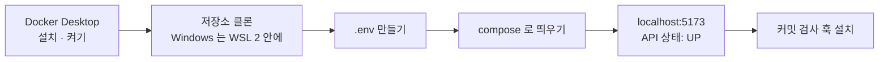

# NEW:LEARN

뉴스 기사를 AI 로 6하원칙 마인드맵으로 구조화하고, 같은 사건을 다룬 기사를 묶어 이슈의 흐름으로 보여 주는 서비스입니다.

- 무엇을 만드는지 — `docs/mvp-overview.md`
- 시스템 구성 · 정한 것 · 못 정한 것 — `SSOT.md`
- 브랜치 · 커밋 · MR 규칙 — `docs/git-convention.md`
- 로컬 개발 환경 자세히 (무엇이 뜨나 · 내 영역만 띄우기 · 막힐 때) — `docs/dev-environment.md`

## 개발 환경 세팅

**Docker Desktop 하나면 됩니다.** 저장소를 받고 `.env` 를 만든 뒤 명령 한 줄로 화면 · API · AI 워커 · DB · Redis 가 모두 뜹니다. 브라우저에서 「API 상태: UP」 이 보이면 끝입니다.

AI 도구(Claude Code · Codex · Cursor 등)에게 맡기려면 [방법 1](#방법-1-ai-에게-맡기기), 직접 치려면 [방법 2](#방법-2-직접-입력하기) 를 따릅니다. 두 방법은 같은 순서를 밟습니다.



### 시작 전에 확인할 것

- **Docker Desktop** 이 설치되어 켜져 있어야 합니다. Docker Engine 25 이상이 필요합니다 (`docker version` 으로 확인). Windows 는 WSL 2 백엔드를 씁니다.
- **Windows 는 WSL 2 의 Ubuntu 터미널에서 작업합니다.** C: 드라이브 폴더에 클론하면 코드를 고쳐도 컨테이너에 반영되지 않습니다.
- 첫 실행은 이미지(약 1.9 GB)와 Gradle · npm · Python 의존성을 받느라 몇 분 걸립니다. 의존성은 Docker 볼륨에 남아 다음부터는 금방 뜹니다.

### 방법 1. AI 에게 맡기기

아래 블록을 통째로 복사해 AI 도구에 붙여 넣습니다. 저장소를 아직 받지 않았다면 AI 가 클론부터 합니다.

```text
NEW:LEARN 저장소(https://lab.ssafy.com/s15-final/S15P31A102.git)의 로컬 개발 환경을 세팅해 줘.
저장소 README.md 의 「개발 환경 세팅」과 docs/dev-environment.md 를 먼저 읽고 그 순서대로 해.

1. 내 컴퓨터부터 확인해.
   - `docker version` 으로 Docker Desktop 이 켜져 있고 Engine 이 25 이상인지 본다.
   - Windows 면 WSL 2 와 Ubuntu 가 있는지 본다.
   - 없거나 꺼져 있으면 설치 · 실행 방법만 알려 주고 멈춰.
2. 저장소를 받아. 이미 저장소 안이면 건너뛰어.
   - Windows 면 WSL 2 Ubuntu 의 홈(~/) 아래에 클론한다. C: 드라이브에는 받지 않는다.
3. 저장소 루트에서 `cp .env.example .env` 로 환경변수 파일을 만들어.
   - 값은 바꾸지 않는다. LLM_MODE 는 mock 그대로 두고 GMS 키는 넣지 않는다.
4. `docker compose --profile full up -d --wait` 로 전부 띄워.
   - `port is already allocated` 가 나면 그 포트만 .env 의 *_PORT 에서 비어 있는 번호로 바꾸고 다시 띄운다.
5. 다 떴는지 확인해. 포트를 바꿨으면 바꾼 번호로 본다.
   - `docker compose --profile full ps` 의 STATUS 가 모두 healthy
   - http://localhost:8080/actuator/health 와 http://localhost:8000/health 가 200
   - http://localhost:5173 화면에 「API 상태: UP」
6. 커밋 검사 훅을 설치해: `bash .claude/hooks/install.sh`
   - 확인: `git commit --allow-empty -m " "` 를 쳐서 검사 배너가 뜨는지 본다 (커밋은 남지 않는다).
7. 끝나면 무엇을 했고 무엇이 안 됐는지 명령 출력과 함께 알려 줘.

하지 말 것
- .env 를 커밋하지 않는다.
- `docker compose down -v` · `docker volume rm` 처럼 데이터를 지우는 명령은 먼저 나에게 묻는다.
- 이 저장소와 상관없는 내 다른 컨테이너 · 이미지는 건드리지 않는다.
```

### 방법 2. 직접 입력하기

명령은 한 줄씩 칩니다. Windows 는 WSL 2 Ubuntu 터미널에서 칩니다.

1. 저장소를 받고 그 폴더로 들어갑니다.

   ```bash
   git clone https://lab.ssafy.com/s15-final/S15P31A102.git
   ```

   ```bash
   cd S15P31A102
   ```

2. 환경변수 파일을 만듭니다. 값은 그대로 둡니다. `.env` 는 커밋하지 않습니다.

   ```bash
   cp .env.example .env
   ```

3. 전부 띄웁니다. `--wait` 는 모든 컨테이너가 정상이 될 때까지 기다렸다가 끝납니다.

   ```bash
   docker compose --profile full up -d --wait
   ```

4. 브라우저로 http://localhost:5173 을 엽니다. 「API 상태: UP」 이 보이면 화면 · API · DB · Redis 가 다 이어진 것입니다.

5. 커밋 검사 훅을 설치합니다. 커밋할 때 포맷 · 린트 · 테스트가 자동으로 돕니다.

   ```bash
   bash .claude/hooks/install.sh
   ```

   훅이 도는지 확인합니다. 메시지가 공백 하나라 커밋은 남지 않습니다.

   ```bash
   git commit --allow-empty -m " "
   ```

### 다 쓰고 끌 때

```bash
docker compose --profile full down
```

DB 데이터와 의존성은 볼륨에 남습니다. 다음에 3번 명령으로 다시 띄웁니다.

### 막히면

| 증상 | 할 일 |
|---|---|
| `port is already allocated` | 그 포트를 다른 프로그램이 씁니다. `.env` 의 해당 `*_PORT` 를 바꾸고 다시 띄웁니다 |
| 코드를 고쳐도 반영이 안 된다 | Windows 에서 C: 드라이브에 클론했을 것입니다. WSL 2 쪽에 다시 클론합니다 |
| 그 밖의 문제 · 내 영역만 IDE 에서 띄우기 | `docs/dev-environment.md` 「자주 막히는 곳」 · 「내 영역을 호스트에서 띄울 때」 |
