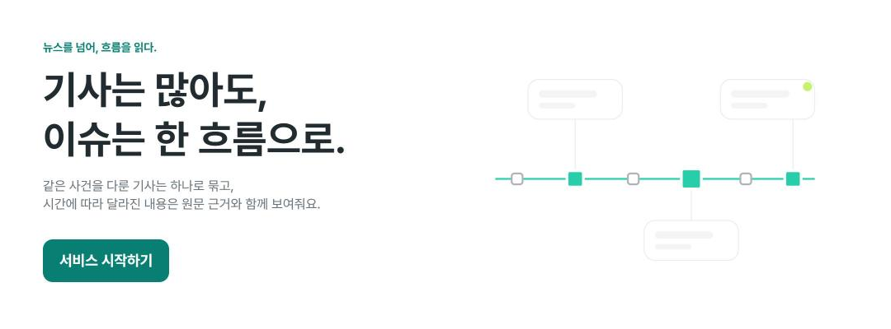
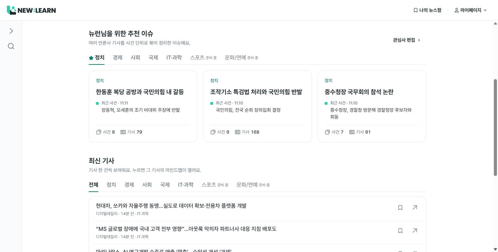
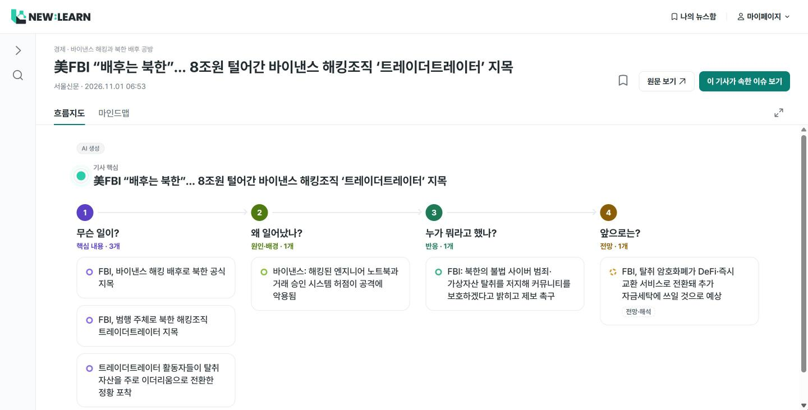
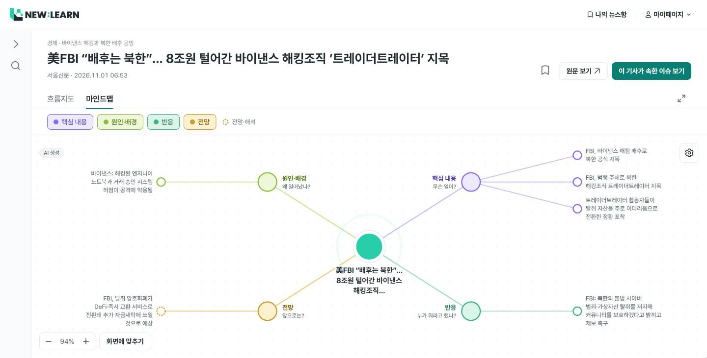
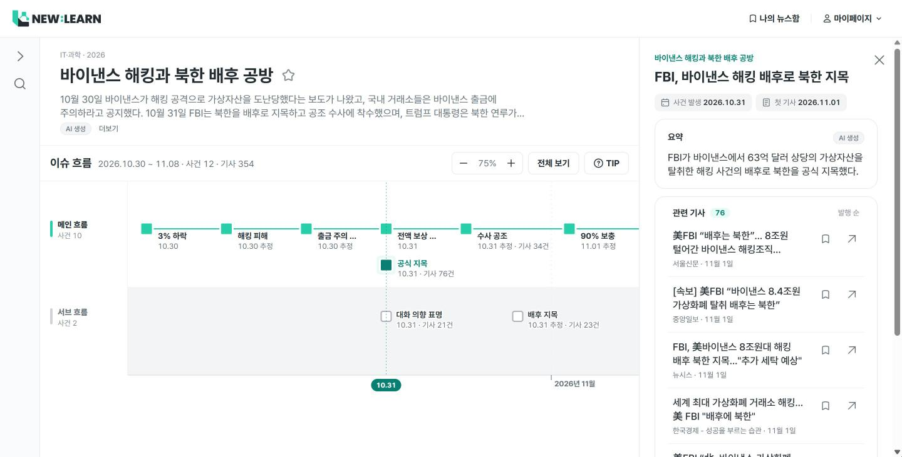
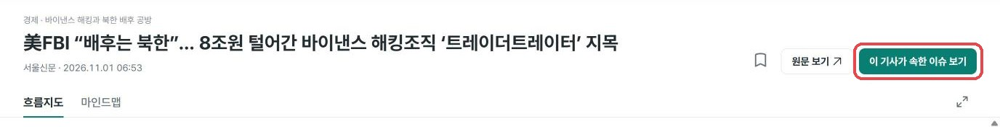
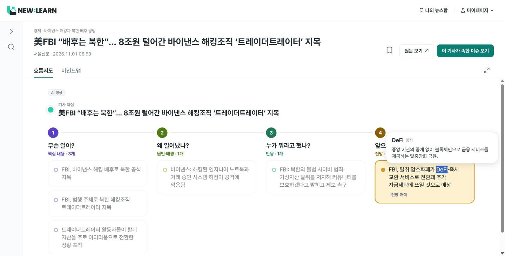
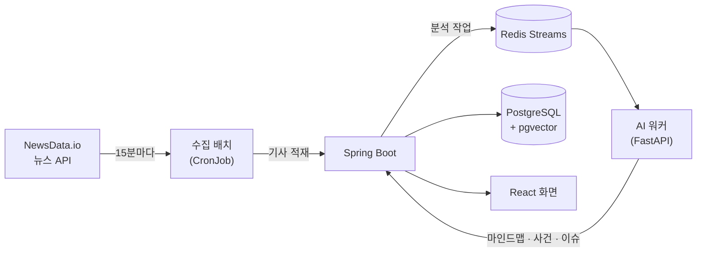
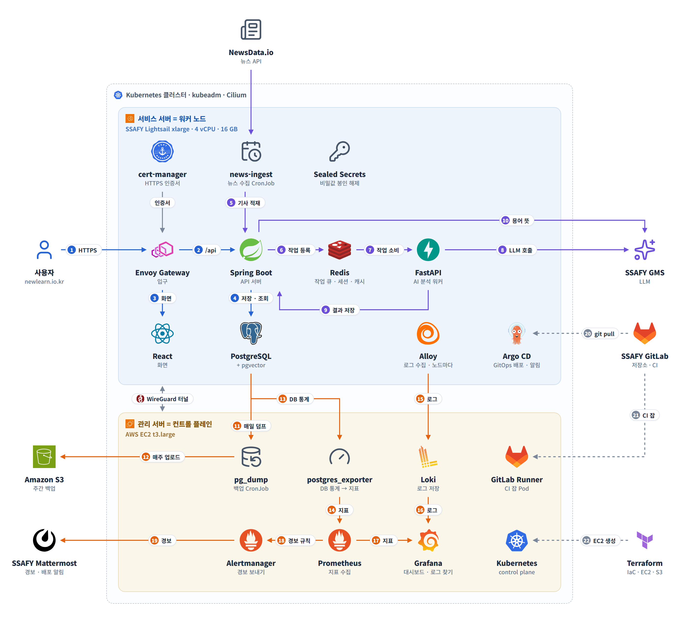
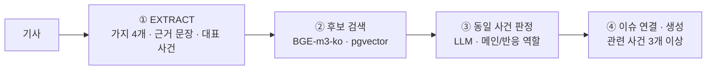

> 흩어진 뉴스 속 이슈를 빠르게 파악하고 싶은 사람을 위한 기사 이슈 타임라인 · 기사 마인드맵 AI 플랫폼

NEW:LEARN 은 뉴스 기사를 AI 로 **가지 4개(핵심 내용 · 원인·배경 · 반응 · 전망) 마인드맵**으로 구조화하고, 같은 사건을 다룬 기사를 묶어 **이슈가 어떻게 흘러왔는지** 보여 주는 AI 뉴스 서비스입니다. SSAFY 15기 A102 팀 SYNAPSE(팀장 황도경)가 만들었습니다.



| 구분 | 링크 |
|---|---|
| 서비스 | https://newlearn.io.kr |
| 무엇을 만드나 | [`docs/mvp-overview.md`](docs/mvp-overview.md) |
| 시스템 구성 · 정한 것 · 잰 것 | [`SSOT.md`](SSOT.md) |

## 목차

- [왜 만들었나](#왜-만들었나)
- [주요 기능](#주요-기능)
- [서비스 흐름](#서비스-흐름)
- [아키텍처](#아키텍처)
- [AI 파이프라인](#ai-파이프라인)
- [숫자로 본 기술 결정](#숫자로-본-기술-결정)
- [조용히 깨지는 것을 막는 장치](#조용히-깨지는-것을-막는-장치)
- [기술 스택](#기술-스택)
- [시작하기](#시작하기)
- [개발 방식](#개발-방식)
- [팀](#팀)

## 왜 만들었나

같은 사건을 여러 언론사가 며칠에 걸쳐 나눠 보도하면, 기사 한 편만 읽어서는 무슨 일이 왜 일어났고 누가 어떻게 반응했는지 한눈에 잡히지 않습니다. 흩어진 기사를 직접 모아 순서를 맞추는 일은 독자의 몫으로 남습니다.

NEW:LEARN 은 기사 한 편의 요점을 마인드맵으로 먼저 보여 주고, 그 기사가 속한 사건과 이슈로 이어 줍니다. 시사 학습 · 면접 준비 · 리서치처럼 흐름을 알아야 하는 사람이 읽는 시간을 줄이려고 만들었습니다.

## 주요 기능

### 1. 분야별 이슈 · 기사 탐색

정치 · 경제 · 사회 · 국제 · IT·과학 다섯 분야로 이슈와 최신 기사를 나눠 봅니다. 홈의 추천 이슈는 회원이 고른 관심 분야부터 보여 줍니다.



### 2. 기사 마인드맵 — 흐름지도 · 마인드맵 두 보기

기사 내용을 핵심 내용 · 원인·배경 · 반응 · 전망으로 나눠, 순서대로 읽는 흐름지도와 관계를 보는 마인드맵 두 가지로 보여 줍니다. 크게 보기로 화면을 꽉 채워 볼 수 있습니다.

| 흐름지도 | 마인드맵 |
|---|---|
|  |  |

### 3. 사건 이슈맵

같은 사건을 다룬 기사를 묶고, 이슈의 사건을 시간순으로 놓습니다. 상황을 바꾸는 행위는 메인 흐름, 반응 · 평가는 서브 흐름입니다. 사건을 누르면 요약과 관련 기사가 열립니다.



### 4. 기사 ↔ 이슈 양방향 탐색

이슈에서 사건 · 관련 기사로 내려가고, 기사에서 「이 기사가 속한 이슈 보기」로 다시 올라옵니다.



### 5. 개인 뉴스 관리 · 용어사전

관심 분야를 고르고 기사 북마크 · 관심 이슈를 저장합니다. 기사에서 모르는 말을 드래그해 「의미」를 누르면 **그 기사 문맥에 맞는 뜻**을 보여 줍니다.



## 서비스 흐름



기사 · 이슈 화면은 미리 분석해 저장한 결과를 읽기만 합니다. 화면이 AI 를 부르는 것은 용어사전 「의미」를 누를 때뿐입니다.

## 아키텍처



- **서버 두 대, 클러스터 하나** — 서비스는 SSAFY Lightsail 워커에, 관리 도구(컨트롤 플레인 · 모니터링 · CI 러너)는 AWS EC2 에 두고 WireGuard 터널로 이어 kubeadm 쿠버네티스 클러스터 하나로 운영합니다. EC2(보안 그룹 · 탄력적 IP) · 예산 알림 · 백업 S3 버킷은 Terraform 으로 만듭니다
- **들어오는 길** — Envoy Gateway 가 HTTPS(cert-manager · Let's Encrypt)를 받아 화면은 React, API 는 Spring Boot 로 나눕니다. 로그인 · 가입 · 용어사전은 Redis 로 주소별 요청 수를 셉니다
- **배포** — MR 검사 → dev 머지 → 이미지 굽기(Kaniko) → 배포 태그 MR(사람이 머지) → Argo CD 자동 동기화 → 새 Pod 먼저 뜨는 롤링 교체 → Mattermost 알림. 되돌리기는 git revert 입니다
- **관측** — Prometheus · Grafana · Loki · Alloy, 경보는 Alertmanager → Mattermost. DB 는 매일 04:00 관리 서버에, 매주 S3 에 백업합니다
- 자세히는 [`SSOT.md`](SSOT.md) 1 · 6절, 인프라 코드 지도는 [`infra/README.md`](infra/README.md), 서버를 받은 날 돌린 스크립트는 [`infra/server/README.md`](infra/server/README.md)

## AI 파이프라인



| 단계 | 하는 일 |
|---|---|
| ① EXTRACT | SSAFY GMS(gpt-6-luna)로 핵심 내용 · 원인·배경 · 반응 · 전망을 뽑고, 원문 근거 문장을 붙이고, 사건 연결에 쓸 대표 사건을 고릅니다. 사건이 일어난 때는 기사 발행 시각과 따로 읽고, 「어제」처럼 기준이 불분명하면 비워 둡니다 |
| ② 후보 검색 | 기사 제목과 본문 앞 800자를 1024차원 벡터로 바꿔 비슷한 기존 사건을 최대 5개 찾습니다 |
| ③ 동일 사건 판정 | 후보와 비교해 기존 사건에 붙일지, 새 사건을 만들지 정합니다. 새 사건에는 이름 · 요약과 메인 · 반응 역할을 줍니다 |
| ④ 이슈 | 새 사건을 기존 이슈에 붙이거나, 관련 사건이 3개 이상이면 새 이슈를 만듭니다 |

- 워커는 Redis Streams 작업 큐를 소비하고, 결과는 Spring Boot 가 검사해 저장합니다(출력 형식 · 근거 문장 위치 · 대표 사건 번호 · 발생 시점 형식)
- 지금 운영 워커는 ① EXTRACT 만 돌립니다. 임베딩 워커는 발표 뒤까지 꺼 두었고(`SSOT.md` 9절 2026-11-10), ③ ④ 워커 코드는 아직 `ai` 브랜치에 있습니다
- 화면의 사건 · 이슈는 AI 팀이 10/21 ~ 11/11 기사 112,700건을 같은 EXTRACT · 같은 판정 규칙으로 한꺼번에 돌려 미리 만든 결과입니다([`data/README.md`](data/README.md) 「어떻게 만들었나」, 적재는 `SSOT.md` 10절 2026-11-13)
- 기사 분야는 NewsData 분류 대신 **제목을 읽은 라벨**이 정합니다. 새 기사는 매일 한 번 라벨을 붙입니다([`infra/server/category-labels.md`](infra/server/category-labels.md))

## 숫자로 본 기술 결정

| 무엇을 쟀나 | 전 | 후 | 바꾼 것 | 근거 |
|---|--:|--:|---|---|
| 기사 목록 응답 시간(p50) | 242ms | **22ms** | 공개 기사만 담은 부분 인덱스(V14) | [results.md](infra/server/perf/results.md) |
| 조회 측정 한 판에 걸린 시간 | 2분 51초 | **31초** | 〃 | 〃 |
| 부하 시험에서 버틴 처리량(포화 지점) | 초당 93건 | **초당 123건** | 이슈 목록 SQL 다시 쓰기 · 기사-사건 · 사건 인덱스(V15) | [results-194.md](infra/server/perf/results-194.md) |
| 요청 하나가 쓴 DB CPU | 37ms | **26ms** | 〃 | 〃 |
| 로그 수집기가 다시 뜬 직후 보낸 줄 | 136,313줄 | **171줄** | Alloy 책갈피를 서버 디스크로 | [SSOT](SSOT.md) 10절 11-11 |
| 그때 Loki 가 거절한 줄 | 117,907줄 | **0줄** | 〃 | 〃 |
| 분야가 언론사 URL 섹션과 맞는 비율 | 68.2% | **77.3%** | 제목을 읽어 정한 분야 라벨 | [SSOT](SSOT.md) 10절 11-05 |
| 배포 교체 중 사이트 health 실패 | 안 잼 | **0 / 219번** | 새 Pod 먼저 · 준비 확인 · 끝낼 때 10초 | [SSOT](SSOT.md) 10절 10-26 · 6절 |

- 분야 비율은 기사 9,022건을 언론사 URL 섹션과 대조한 값이고, 나머지는 모두 운영에서 잰 값입니다
- 로그 줄은 다시 뜬 뒤 전은 15초, 후는 20초 동안 센 수입니다. 잰 조건과 한계는 근거 문서에 있습니다

## 조용히 깨지는 것을 막는 장치

성공한 것처럼 보이면서 틀리는 일을 먼저 막았습니다.

| 위험 | 왜 조용한가 | 장치 |
|---|---|---|
| AI 결과 적재가 반쯤 들어감 | SQL 이 중간에 실패해도 앞부분은 이미 바뀌어 있을 수 있음 | 한 트랜잭션, 끝이 `rollback;` 인 실행으로 수를 먼저 보고 `commit;`, 마이그레이션 판이 다르면 첫 단계에서 멈춤([`infra/server/data-load.md`](infra/server/data-load.md)) |
| 수집 · 백업 · 로그가 멈춤 | 화면은 그대로라 아무도 모름 | 수집 누락 · 백업 누락 · 디스크 · 로그 버림 · 로그 수집기 멈춤 경보 → Mattermost, 경보 규칙은 CI 에서 시험([`infra/k8s/alerts/rules.yaml`](infra/k8s/alerts/rules.yaml)) |
| null · 잘못된 SQL | 컴파일은 통과하고 운영에서 터짐 | Error Prone · NullAway, 실제 PostgreSQL 에 붙는 시험(로컬은 Testcontainers, CI 는 서비스 DB) |
| 비밀값 커밋 | 빌드 · 동작은 멀쩡함 | 커밋 전 시크릿 스캔 · 영역별 포맷 · 린트 · 테스트 훅([`.claude/hooks/`](.claude/hooks/)) |
| 배포 태그 MR 이 먼저 기다리던 영역의 태그를 지움 | 두 영역이 같은 배포 MR 을 덮어쓰면 늦게 온 쪽만 남음 | 열린 배포 MR 의 태그를 이어받아 갱신([`infra/ci/deploy_mr.py`](infra/ci/deploy_mr.py)) |
| 고정한 이슈 분야가 엉뚱한 이슈에 붙음 | 다시 적재로 이슈 번호가 바뀌어도 SQL 은 성공함 | 번호와 제목이 둘 다 같을 때만 고정([`infra/server/category-labels.md`](infra/server/category-labels.md) 7절) |

## 기술 스택

| 영역 | 기술 |
|---|---|
| Frontend |          |
| Backend |            |
| AI |        |
| Data |      |
| Infra |               |
| 관측 |       |
| 외부 API |   |

## 시작하기

Docker Desktop 하나면 화면 · API · AI 워커 · DB · Redis 가 모두 뜹니다.

```bash
git clone https://lab.ssafy.com/s15-final/S15P31A102.git && cd S15P31A102
cp .env.example .env
docker compose --profile full up -d --wait
```

http://localhost:5173 에 홈이 뜨면 됩니다. AI 도구에 맡기는 프롬프트 · Windows(WSL 2) 주의 · 막힐 때는 [`docs/dev-environment.md`](docs/dev-environment.md) 「처음 한 번」에 있습니다.

```text
frontend/   React 화면 — 기사 마인드맵 · 이슈 에볼루션 맵
backend/    Spring Boot — 조회 API, 분석 작업 등록, 결과 저장
ai/         FastAPI 워커 — EXTRACT · 임베딩 (동일 사건 판정 · 이슈 워커는 ai 브랜치)
infra/      Terraform · 쿠버네티스 매니페스트 · 운영 문서 · 측정 도구
docs/       기능 스펙 · 데이터 모델 · API · 계획
```

## 개발 방식

- **AI 하네스** — AI 에게 주는 지시는 [`AGENTS.md`](AGENTS.md) 한 곳에 둡니다. 큰 변경은 `/plan` 으로 다섯 칸(바꿀 파일 · 안 바꿀 것 · 리스크 · 검증 · 되돌리는 법)을 채워 승인받고, 끝나면 `/verify` 로 실제로 돌려 보고, `reviewer` 조수가 새 눈으로 봅니다. 지도는 [`.claude/README.md`](.claude/README.md)
- **네 가지 약속** — 증거 없이 「됐다」고 하지 않는다 · 추측하지 않는다 · 한 번에 작은 작업 하나 · 같은 사실을 두 곳에 적지 않는다
- **흐름** — Jira 티켓 → 작업 브랜치 → 분야 브랜치(`infra` · `backend` · `frontend` · `ai`) → MR(템플릿 [`.gitlab/merge_request_templates/Default.md`](.gitlab/merge_request_templates/Default.md)) → `dev` → 배포 태그 MR. 규칙은 [`docs/git-convention.md`](docs/git-convention.md)
- **문서** — 정한 것 · 못 정한 것 · 뒤집은 것 · 잰 것은 [`SSOT.md`](SSOT.md), 기능 스펙은 [`docs/specs/`](docs/specs/), 승인한 계획은 [`docs/plans/`](docs/plans/)

## 팀

| 역할 | 이름 |
|---|---|
| PM | 장민준 |
| Frontend · Design | 안서진 |
| Backend | 강하린 · 김주우 |
| Infra | 김주우 |
| AI | 강유진 · 황도경 |
