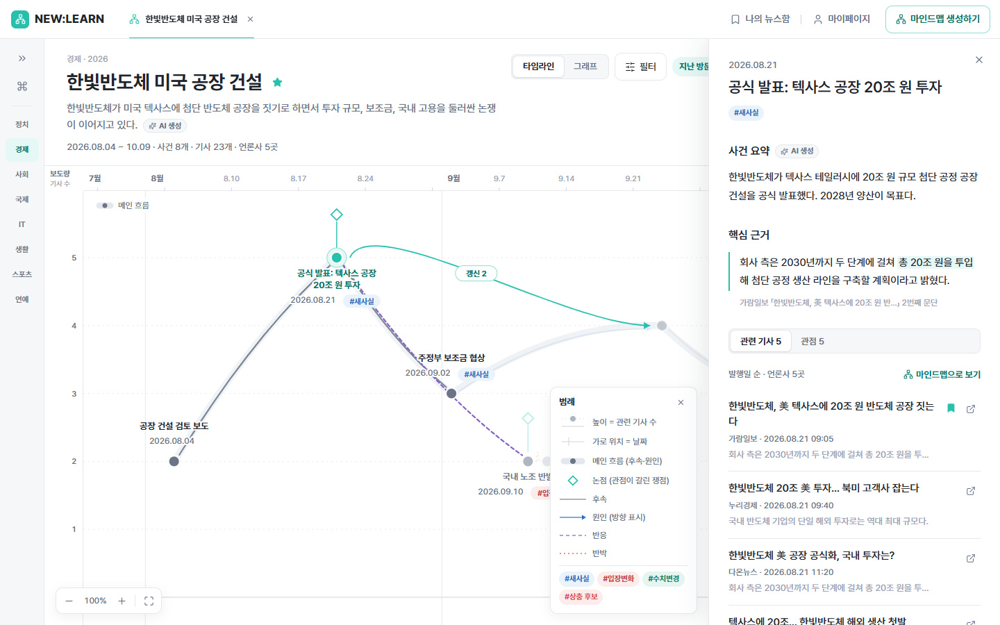
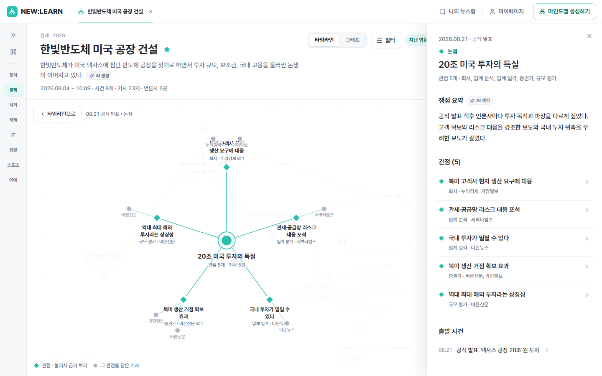
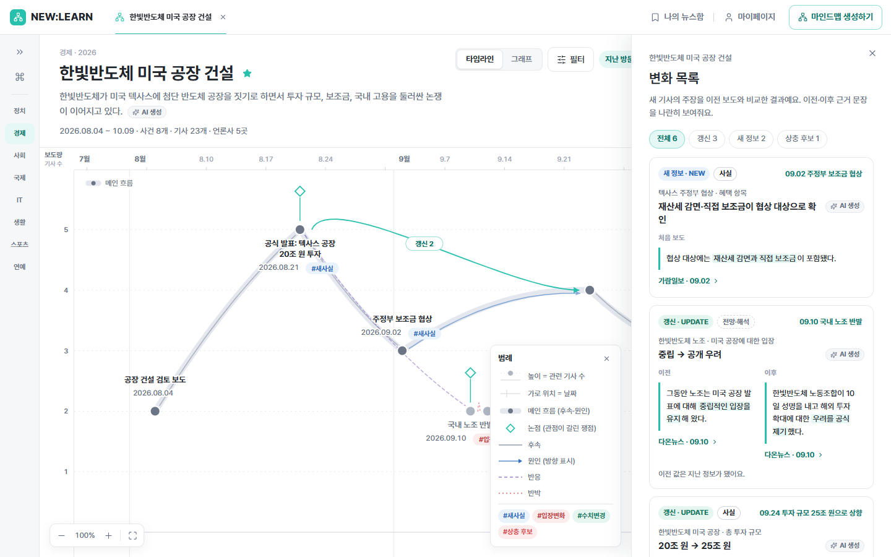

# PRD: NEW:LEARN(뉴런)

> 이슈 전체는 사건의 흐름으로, 기사 하나는 마인드맵으로. 흩어진 뉴스를 **카테고리 → 이슈 → 사건 → 기사** 순서로 정리하고, 무엇이 바뀌었는지 원문 근거와 함께 보여 주는 웹 서비스

**이 문서를 읽는 법**
- NEW:LEARN 팀이 **무엇을 만들지**에 합의하기 위한 기준 문서다. UX 설계, 아키텍처, 에픽·스토리 작성은 이 문서에서 출발한다.
- **MVP 범위는 팀의 MVP 개요(`docs/mvp-overview.md`)를 따른다.** 이 문서와 MVP 개요가 다르면 MVP 개요가 우선이다. v1.1에서 카테고리, 우선순위, 주장 관계 유형, 데이터 범위, 핵심 사용자 흐름을 MVP 개요에 맞췄다.
- 서비스는 **① 이슈를 본다 → ② 사건을 본다 → ③ 기사를 본다**의 세 단계로 되어 있다(2.2). 4장 기능과 5장 화면도 이 순서를 따른다. 무엇을 누르면 어느 화면으로 가는지는 FR-30, 분석 결과가 언제 만들어지는지는 FR-31에 있다.
- 요구사항은 FR-1부터 전역 번호를 붙였다. 장을 다시 짜도 번호는 바꾸지 않으므로, 장 안에서 번호 순서가 섞여 있을 수 있다. MVP 개요의 기능 ID(F01~F13)는 함께 적는다.
- 기능마다 우선순위(P0, P1, P2)를 붙였다. 뜻은 MVP 개요와 같다(4.0). 용어는 부록 A **용어집**의 표현만 쓴다.
- **팀이 모여서 정해야 할 것은 0장에 급한 순서로 모았다.** 회의는 0장부터 보면 된다.
- **이 PRD 뒤에 바뀐 결정(2026-10-29 정리)** — 아래는 본문보다 오른쪽 칸이 맞다. 본문은 사건 패널 관련 기사 수와 단축키 표기만 고쳤다

  | 이 PRD 본문 | 지금 | 근거 |
  |---|---|---|
  | 카테고리 7개(FR-3 등) | 5개(정치 · 경제 · 사회 · 국제 · IT·과학) | `docs/mvp-overview.md` F02, `SSOT.md` 9절 |
  | 로그인 · 북마크 · 관심 이슈는 MVP 이후(P2, FR-17 ~ FR-19) | MVP 에 넣었다. 「지난 방문 이후 새 사건」은 보류 | `SSOT.md` 9절, `docs/api-screen.md` A20 ~ A25 |
  | 가입은 이메일 · 소셜(FR-17) | 아이디 · 비밀번호 · 이름 | `docs/mvp-overview.md` F12, `docs/api-screen.md` A14 |
  | 사용자 URL 입력(FR-32, P0) | MVP 에서 뺐다(2026-10-20) | `SSOT.md` 9절, `docs/mvp-overview.md` |
  | 메인 흐름은 관계로 이은 줄기(FR-22, P1) | 사건의 역할로 메인(상황을 바꾸는 행위) · 서브(반응 · 평가 · 여론) 두 레인을 나눈다(2026-10-28) | `docs/api-screen.md` A4 |
  | 어려운 용어 자동 설명(P2) | F13 용어사전(국립국어원 표준국어대사전)을 MVP 에 넣었다 | `SSOT.md` 9절, `docs/api-screen.md` A19 |
  | 사건 패널 관련 기사 처음 4건(FR-11) | 5건 — 본문을 고쳤다 | `docs/api-screen.md` A6 |
  | 단축키 ⌘K · ⌘\ | Ctrl+K · Ctrl+\(맥 ⌘K · ⌘\) — 본문을 고쳤다 | — |
- 확인되지 않은 추정은 `[ASSUMPTION]`, 아직 정하지 못한 것은 `Q번호`로 표시했다. 추정은 부록 C에 모았다.
- 4장의 *프로토타입 상태*와 5장의 화면은 **프로토타입 v3**(`docs/prototype/NEW-LEARN 프로토타입 v3.html`, 2026-10-14) 기준이다. 프로토타입에서 디자인 담당이 먼저 정한 것은 팀 확인 전이므로 0장에 Q로 올렸다.
- AI가 만드는 결과(동일 사건 클러스터링, 핵심 정보 추출, 주장 분석)에 대한 검증 조건은 사례 하나하나가 모두 통과해야 하는 조건이 아니다. 기대 동작을 적은 것이며, 실제 통과 기준은 1.3의 AI 검증 목표다.
- **강점 1**은 근거가 붙은 변화 분석(4.3), **강점 2**는 사건 흐름을 보여 주는 이슈 에볼루션 맵(4.2)이다.
- 함께 보는 파일: `addendum.md`(팀, 데이터셋 구조, 평가 지표 메모), `research-digest.md`(비교 서비스·법률·기술 조사), `screens/v3/`(프로토타입 v3 화면 캡처).

---

## 0. 팀 논의 사항

> 팀원에게 물어볼 질문이다. 번호로 답해 주면 해당 Q를 *결정된 것*으로 옮기고 본문에 반영한다. 자세한 배경은 5장, 6.5, 부록 B에 있다.
>
> - **0.1** MVP 개요의 확인 필요 사항 (1~9)
> - **0.2** 데이터와 AI에서 함께 정할 것 (10~13)
> - **0.3** 프로토타입을 만들며 먼저 정한 것 (14~17)
> - **0.4** 프로토타입을 MVP 개요에 맞춰 고칠 것

### 0.1 MVP 개요의 확인 필요 사항

MVP 개요 8장의 표다. 제안 방향은 정해졌고, 오른쪽의 확인 필요 사항에 답하면 된다.

| # | 논의 항목 | 제안 방향 | 확인 필요 사항 | Q |
| --- | --- | --- | --- | --- |
| 1 | 지원 카테고리 | 7개 카테고리로 구성 | 데이터셋의 실제 카테고리와 매핑 가능 여부 | Q9 |
| 2 | 대표 이슈 | 전체 5~10개 | 카테고리별 데이터 및 후속 기사 확보 여부 | Q32 |
| 3 | 기사 URL 입력 | 저장 기사 및 지원 출처 우선 | 임의 URL 지원 범위 | Q26 |
| 4 | 기사 마인드맵 | 핵심 정보 + 근거 문장 | 노드 구조 및 AI 출력 스키마 | Q33 |
| 5 | 사건 클러스터링 | 임베딩 + 개체 + 시점 활용 | 동일 사건 판단 기준 | Q34 |
| 6 | 이슈맵 관계 | 시간순 연결 우선 | 후속·원인·반응·반박 관계 포함 여부 | Q25 |
| 7 | 주장 변화 분석 | 5개 유형 우선 | AI 구현 난이도 및 평가 방법 | Q36 |
| 8 | 신규 기사 반영 | 데이터셋 순차 투입 | 사건 노드 추가 및 업데이트 방식 | Q21 |
| 9 | AI 성능 목표 | 자체 평가셋 기준 | 정확도 목표 및 평가 데이터 규모 | Q7 |

### 0.2 데이터와 AI에서 함께 정할 것

10. 데이터셋에 담긴 기사는 언제부터 언제까지이고, 몇 건인가요? (Q4)
11. 데이터셋 기사의 본문을 화면에 얼마나 보여 줘도 되나요? (Q3)
12. 대표 이슈 말고도 사건을 자동으로 이슈로 묶을 일이 있나요? 있다면 그 기준은 무엇이고, 이슈 이름은 누가 붙이나요? (Q5)
13. MVP 개요에 없는 **주장 유형(사실 / 전망·해석) 구분**을 P1로 넣을까요? 전망을 확정치와 비교해 상충 후보로 잘못 판정하는 것을 막아 줘요. (Q35)

### 0.3 프로토타입을 만들며 먼저 정한 것

프로토타입에서 일단 정해 두었지만 화면만으로 정할 수 없는 것이다. "이대로", "바꾸자", "모르겠다" 중 하나로 답해 주면 된다.

14. 타임라인 세로축을 프로토타입처럼 **보도량(사건의 기사 수)**으로 할까요? 기사 분량은 빼기로 했어요. (Q15)
15. 기사 마인드맵은 **모든 기사에 미리** 만들어 두나요, 사용자가 지원 URL을 넣었을 때만 만드나요? (Q27)
16. 지원 URL로 받은 기사의 *원문 보기*에서 **본문 전체**를 보여 줘도 되나요? 저작권 문제가 있다면 근거 문장 주변만 보여 줄게요. (Q28)
17. 사건 태그를 **#새 정보, #갱신, #상충 후보** 세 가지로 줄였어요. 프로토타입은 #새사실, #수치변경, #입장변화, #상충 후보 네 가지예요. 이대로 갈까요? (Q22)

### 0.4 프로토타입을 MVP 개요에 맞춰 고칠 것

v1.1에서 PRD를 MVP 개요에 맞추며 프로토타입 v3와 달라진 점이다. 디자인·FE가 프로토타입에 반영한다.

- 카테고리 8개 → 7개 (FR-3)
- 기사 마인드맵의 가운데: 기사 요지 → 기사 제목 (FR-6)
- 홈: 추천 이슈 카드 중심 → 카테고리 선택과 최신 기사 (5.2)
- 주장 관계 표시: 영어 코드(UPDATE 등)를 빼고 한국어 이름만, 사건 태그는 세 가지 (4.3)
- MVP 이후 기능(논점 맵과 *관점* 탭, 로그인, 북마크와 나의 뉴스함, 마이페이지, 이슈 탭, 알림 벨)은 숨기거나 "MVP 이후 제공 예정"으로 안내
- P1 기능(그래프 보기와 필터, 사건 관계선과 메인 흐름, 분석 단계 표시)은 두되, P0 시연 흐름이 여기에 기대지 않게 한다

---

## 1. 프로젝트 개요

### 1.1 한눈에

| 항목 | 내용 |
| --- | --- |
| 서비스명 | **NEW:LEARN(뉴런)** — NEW(새 소식) + LEARN(배움) |
| 한 줄 소개 | 뉴스 기사를 AI로 구조화해 마인드맵으로 제공하고, 관련 기사들을 사건 단위로 연결하여 이슈의 전개 과정과 주요 변화를 시각적으로 탐색할 수 있는 AI 뉴스 서비스 |
| 1차 타깃 | 취업·면접·업무 등 목적을 가지고 특정 이슈의 맥락을 짧은 시간 안에 파악해야 하는 사용자 |
| 2차 타깃 | 여러 기사를 비교하며 조사하는 학생·리서처·기획자 |
| 플랫폼 | PC 중심 웹. 가능하면 모바일까지 반응형으로 지원 (PWA 제외) |
| 기간 | 2026-10-06 ~ 2026-11-18 (약 6주). 프로토타입을 먼저 만들고 QA로 다듬는다(1.4) |
| 규모 | 요구사항 32개(P0 핵심·차별점, P1, P2) · 핵심 사용자 흐름 2개(Flow A·B, 7.1) |

### 1.2 팀

| 역할 | 담당 |
| --- | --- |
| PM | 장민준 |
| Design, FE | 안서진 |
| AI | 강유진, 황도경 |
| BE | 강하린, 김주우 |
| Infra | 김주우 |

### 1.3 MVP 목표와 완료 기준

**MVP 목표** (MVP 개요 1-2)

정치·사회·경제·국제·스포츠·문화/연예·IT/과학 총 7개 카테고리를 기반으로 뉴스 탐색 기능을 구현하고, 대표 이슈 5~10개를 선정하여 기사 마인드맵, 사건 중심 이슈맵, 주장 변화 분석 기능을 검증한다. 최종 방향은 **기사 이해 → 사건 연결 → 이슈 흐름 탐색 → 주장 변화 확인**까지 이어지는 핵심 사용자 경험을 완성하는 것이다.

1. AI를 활용해 기사 핵심 정보를 추출하고 마인드맵으로 시각화 (FR-5, FR-6)
2. 동일 사건을 다룬 여러 기사를 하나의 사건으로 묶어 제공 (FR-9)
3. 사건의 시간적 흐름과 관련성을 이슈 에볼루션 맵으로 표현 (FR-10, FR-21)
4. 이전 보도 대비 새로운 정보 및 주장 변화와 원문 근거 제공 (FR-12, FR-13)
5. 7개 카테고리 기반 뉴스·이슈 탐색 및 기사 간 연결 지원 (FR-3, FR-4, FR-15, FR-16)

**구현 원칙** (MVP 개요 1-3)

| 항목 | 원칙 |
| --- | --- |
| 카테고리 | 7개 분야를 지원하는 공통 탐색 구조. 실제 기사·이슈 제공 범위는 데이터셋의 카테고리별 분포를 확인한 뒤 확정한다 |
| 데이터 | SSAFY NEWS 2025 상반기 데이터셋 우선 (6장) |
| 검증 범위 | 실제 뉴스 이슈 5~10개 선정 (6.3) |
| AI | 기사 구조화, 동일 사건 클러스터링, 주장 변화 분석에 집중 |
| 서비스 | 기사 마인드맵과 이슈 에볼루션 맵의 양방향 탐색 완성 |
| 수집 | 실시간 크롤링보다 데이터셋 기반 적재 및 순차 투입 방식 우선 |

팀은 이 목표를 **핵심 흐름이 동작하는 프로토타입을 최대한 빨리 만들고, QA를 거쳐 다듬는 방식**으로 진행한다(1.4). 11월 18일 공개 배포를 목표로 두지 않는다.

**MVP 완료 기준** (MVP 개요 7장)

| 구분 | 완료 기준 | 요구사항 |
| --- | --- | --- |
| 카테고리 | 7개 카테고리 선택 및 데이터가 있는 이슈 목록 조회 가능 | FR-3, FR-4 |
| 기사 조회 | 저장된 기사 목록 및 상세 조회 가능 | FR-1, FR-2 |
| 기사 분석 | 핵심 정보가 구조화된 형태로 생성 및 저장 | FR-5 |
| 기사 마인드맵 | 선택한 기사의 핵심 정보를 노드 형태로 시각화 | FR-6 |
| 원문 근거 | 주요 노드와 연결된 근거 문장 조회 가능 | FR-7 |
| 사건 클러스터링 | 동일 사건을 다룬 기사들을 하나의 사건 ID로 연결 | FR-9 |
| 이슈맵 | 대표 이슈의 사건 노드를 시간순으로 표시 | FR-10, FR-21 |
| 사건 상세 | 사건 노드 선택 시 관련 기사·출처·요약 조회 | FR-11 |
| 변화 분석 | 기존·신규 주장 간 관계 유형 판정 | FR-29, FR-12 |
| 변화 카드 | 변화 내용과 판단 근거 문장 제공 | FR-13, FR-14 |
| 연계 탐색 | 기사 마인드맵 ↔ 이슈 에볼루션 맵 양방향 이동 | FR-15, FR-16, FR-30 |
| 통합 시연 | 기사 선택부터 사건 흐름·변화 확인까지 전체 흐름 동작 | SM-1 |

**핵심 지표**
- **SM-1. 통합 시연**: P0 기능으로 Flow A와 Flow B(7.1)가 SSAFY NEWS 2025 상반기 데이터셋의 대표 이슈로 끊기지 않고 동작한다. (P0 요구사항 전체)

**AI 검증 목표** `[검증 목표 초안]`

> 정량적 목표치는 평가셋과 베이스라인 성능을 확인한 뒤 확정한다(MVP 개요 7장). 아래 수치는 그때까지 쓰는 참고 초안이며, AI 팀이 평가 방법과 최종 기준을 다시 정리한다. 수치는 모두 팀이 라벨링한 평가 데이터를 기준으로 잰다(Q7). 지표를 고른 이유는 `addendum.md`에 있다.

- **SM-2. 근거 연결**: 세 가지로 나누어 잰다. (FR-5, FR-7, FR-13, FR-29)
  - **원문 일치율 100%**: 화면에 표시되는 근거 문장이 원문에 글자 그대로 존재한다. 문자열 대조로 확인한다.
  - **출처·위치 유효율 100%**: 근거 문장에 붙은 언론사, 원문 링크, 본문 안 위치가 실제 기사와 맞는다.
  - **근거 적합률 90% 이상**: 근거 문장이 그 요약이나 판정을 실제로 뒷받침한다. 표본을 사람이 확인한다.
- **SM-3. 동일 사건 판별과 클러스터링 품질**: MVP 개요는 두 가지를 따로 잰다. 기사 두 개가 같은 사건인지 맞혔는지(동일 사건 판별)는 쌍 단위 F1로, 사건 묶음 전체의 품질(클러스터링 품질)은 B³ F1로 재고, 목표는 둘 다 **0.80 이상**이다. `[ASSUMPTION: 판별은 쌍 단위, 품질은 B³로 나누는 것은 제안]` (FR-9)
- **SM-4. 주장 관계 판정**: 주장 관계 다섯 가지(새 정보, 반복, 갱신, 상충 후보, 판단 불가)의 macro-F1 **0.70 이상**, *상충 후보* 정밀도 **0.85 이상**. MVP 개요의 "관계 판정 정확도"는 이 macro-F1로 잰다. 단순 정확도(accuracy)만 보지 않는 이유는 *반복*이 대부분인 데이터에서는 전부 반복으로 찍어도 정확도가 높게 나오기 때문이다. (FR-12, FR-14)
- **SM-6. 핵심 정보 추출** (추가 제안): 인물·기관·사건·시점·배경·결과 항목 단위 F1 **0.70 이상**. (FR-5)
- **SM-7. 주장 연결**: 새 주장을 비교해야 할 기존 주장(같은 사건·쟁점, 같은 대상·속성)에 제대로 연결했는지 잰다. 지표와 목표는 AI 팀이 정한다. (FR-29, FR-12)
- **SM-8. AI 방식 비교**: LLM 프롬프트 기반 방식과 파인튜닝 모델의 성능을 같은 평가 데이터로 비교한다(Q23).
- 요약처럼 정답이 하나로 정해지지 않는 결과는 F1로 재지 않고, QA 단계에서 팀원이 직접 평가한다.

**사용자 지표**
- **SM-5. 사용자 테스트**: QA 단계에서 1차 타깃 사용자 5명 이상이 UJ-1(Flow A)과 UJ-2(Flow B)를 수행한 뒤 아래 세 문항에 답하고, 문항마다 5점 만점 평균 **4점 이상**. `[ASSUMPTION]`
  - "이슈의 흐름을 이해하는 데 도움이 됐다"
  - "여러 관점의 정보를 빠르게 파악할 수 있었다" (기대효과 A, 7.3)
  - "근거를 보고 스스로 판단할 수 있었다" (기대효과 B, 7.3)

**함부로 늘리지 말아야 할 지표**
- **SM-C1. 상충 후보 개수**: 많으면 흥미로워 보이지만, 잘못된 상충 판정은 신뢰를 무너뜨린다. (SM-4의 상충 후보 정밀도와 짝)
- **SM-C2. 판단 불가 비율**: 판단 불가를 줄이려고 확신 없는 판정을 내리지 않는다. (SM-4와 짝)
- **SM-C3. 마인드맵 노드 수**: 노드가 많다고 이해가 쉬워지지 않는다. 핵심 정보만 남긴다. (FR-6)

### 1.4 진행 방식

프로토타입을 최대한 빨리 만들고, QA에서 나온 문제를 고치는 순서로 진행한다. `[ASSUMPTION: 단계별 범위]`

| 단계 | 하는 일 | 끝났다고 보는 기준 | 시점 |
| --- | --- | --- | --- |
| M1. 프로토타입 | P0 기능을 SSAFY NEWS 2025 상반기 데이터셋의 대표 이슈로 연결 | SM-1 충족, 근거 원문 일치율 100% | 최대한 빨리. 목표일은 논의 필요(Q17) |
| M2. QA | 팀 내부 QA, 사용자 테스트(SM-5), AI 검증(SM-2~SM-4, SM-6~SM-8) | 문제 목록과 우선순위 | M1 직후 |
| M3. 수정과 확장 | QA 결과 반영, 일정과 기술 검증 결과에 따라 P1 추가, 여유가 있으면 모바일 반응형. P2는 MVP 이후 | SM 목표 확인 | 2026-11-18까지. 그날의 최종 상태는 Q17 |

M1은 화면 흐름을 먼저 잇는 것이 목표다. 동일 사건 클러스터링나 주장 분석처럼 AI 결과가 아직 부족한 단계는 팀이 라벨링한 데이터로 채워 두고, M2에서 AI 결과로 바꿔 검증한다. `[ASSUMPTION]`

---

## 2. 서비스 소개와 기획 배경

### 2.1 기획 배경

취업을 준비하다 보면 삼성처럼 시사 이슈를 묻는 자소서 문항을 만나고, 면접을 앞두고는 지원하는 산업의 최근 흐름을 설명할 수 있어야 한다. 그런데 하나의 이슈를 다룬 기사는 수십 개 언론사에 몇 주, 몇 달에 걸쳐 흩어져 있다. 기사를 하나씩 열어 보면 같은 내용이 반복되고, 어느 기사에서 무엇이 새로 나왔는지, 처음 보도와 무엇이 달라졌는지는 직접 비교해야 알 수 있다. **흩어진 뉴스를 시간 순서로 따라가기 어렵다**는 팀원들의 경험이 출발점이다.

### 2.2 서비스 구조

NEW:LEARN은 뉴스를 **카테고리 → 이슈 → 사건 → 기사** 순서로 정리하고, 사용자는 위에서 아래로 내려가며 본다.

| 단계 | 화면 | 사용자가 알게 되는 것 | 우선순위 |
| --- | --- | --- | --- |
| ① 이슈를 본다 | 이슈 에볼루션 맵 | 어떤 사건이 일어났는지, 무엇이 바뀌었는지(변화 카드) | P0 |
| ② 사건을 본다 | 사건 화면: 관련 기사 + 이 사건의 변화 | 어떤 언론이 그 사건을 어떻게 보도했는지, 그 사건에서 무엇이 바뀌었는지 | 관련 기사·변화 P0, 관점(논점 맵) P2 |
| ③ 기사를 본다 | 기사 마인드맵 | 기사 하나의 인물·기관·사건·시점·배경·결과를 구조적으로 | P0 |

- 같은 사건을 다룬 기사들을 하나의 **사건**으로 묶고, 관련 사건들을 시간 순서로 이어 **이슈**를 만든다.
- 새 기사가 나오면 이전 보도와 주장을 비교해 무엇이 새로 나왔고 무엇이 바뀌었는지 판정하고, 그 근거 문장을 원문에서 그대로 보여 준다.
- 기사 하나에서 출발해 그 기사가 속한 이슈로 거슬러 올라갈 수도 있다(③ → ①).

뉴스를 많이 읽게 하는 것이 아니라, 한 이슈를 여러 관점에서 깊이 이해하게 하는 데 초점을 둔다. **진위는 판정하지 않는다.**

### 2.3 차별점

| 서비스 | 하는 일 | NEW:LEARN과의 차이 |
| --- | --- | --- |
| 빅카인즈 관계도 | 기사에 함께 등장한 빈도로 인물·기관을 연결 | 사건 단위 타임라인, 주장 비교, 근거 문장이 없다 |
| Particle | 기사를 스토리로 묶어 요약, 타임라인, 반대 관점 보기 | 주장 단위 변화 판정과 근거 문장이 없다. 영어 전용 |
| Google News Full Coverage | 장기 이슈의 헤드라인, 해설, 타임라인 | 기사를 모으고 정렬할 뿐 주장을 비교하지 않는다 |

**주장 하나하나의 변화를 판정하고 원문 근거 문장을 붙이는 한국어 서비스는 조사 범위에서 찾지 못했다.** (상세: `research-digest.md`)

---

## 3. 문제 정의

### 3.1 대상 사용자

**1차 타깃**: 취업·면접·업무 등 목적을 가지고 특정 이슈의 맥락을 **짧은 시간 안에** 파악해야 하는 사용자. 예: 면접을 앞둔 취준생, 회의 전에 업계 이슈를 정리해야 하는 직장인. (UJ-1)

**2차 타깃**: 여러 기사를 **비교하며 조사하는** 학생·리서처·기획자. 예: 고객사 업계를 조사하는 주니어 리서처, 과제를 준비하는 학생. (UJ-2)

**대상이 아닌 사용자 (MVP)**
- 실시간 속보를 빠르게 훑어보려는 일반 뉴스 소비자. 이들에게는 포털 뉴스가 더 맞다.
- 기사의 진위를 판정받고 싶은 사용자. NEW:LEARN은 팩트체크 서비스가 아니다.

### 3.2 문제와 해결

| 문제 | 해결 | 요구사항 | 우선순위 |
| --- | --- | --- | --- |
| 한 이슈의 기사가 수십 곳에 흩어져 있다 | 동일 사건 기사 클러스터링: 같은 사건의 기사를 하나로 | FR-9 | P0 |
| 몇 달짜리 이슈의 순서가 잡히지 않는다 | ① 이슈 에볼루션 맵: 사건을 발생 시점 순서로 연결 | FR-10, FR-20, FR-21 | P0 |
| 무엇이 새롭고 무엇이 바뀌었는지 모른다 | 변화 카드: 이전 주장과 비교한 판정 + 근거 문장 | FR-29, FR-12~FR-14 | P0 |
| 같은 사건을 어느 언론이 어떻게 보도했는지 모른다 | ② 사건 화면: 관련 기사 목록과 이 사건의 변화 | FR-11 | P0 |
| 같은 사건을 두고 입장이 어떻게 갈리는지 모른다 | ② 사건 화면의 관점: 논점 맵 | FR-24~FR-26 | P2 (MVP 이후) |
| 기사 한 개도 구조가 한눈에 들어오지 않는다 | ③ 기사 마인드맵: 인물·기관·사건·시점·배경·결과 | FR-5~FR-7 | P0 |

### 3.3 사용자가 해결하려는 일

- **기능적**: 몇 주에서 몇 달에 걸친 이슈의 흐름을 짧은 시간 안에 시간 순서대로 정리하고 싶다.
- **기능적**: 같은 내용을 반복해서 읽지 않고, 새로 나온 정보와 바뀐 정보만 골라 보고 싶다.
- **기능적**: 면접 답변이나 보고서에 쓸 내용의 출처를 원문 문장 단위로 확인하고 싶다.
- **정서적**: 면접에서 시사 질문을 받아도 흐름을 설명할 수 있다는 자신감을 얻고 싶다.
- **맥락적**: 지원하는 회사나 맡은 업무와 관련된 산업 이슈를 꾸준히 따라가고 싶다.

---

## 4. 기능 소개

### 4.0 우선순위 한눈에

**우선순위 정의** (MVP 개요 3-1과 같다)

| 우선순위 | 의미 |
| --- | --- |
| P0 | MVP 필수 기능. 통합 시연을 위해 반드시 구현 |
| P1 | 일정 및 기술 검증 결과에 따라 추가 구현 |
| P2 | MVP 이후 확장 기능 |

| 우선순위 | 기능 (MVP 개요 기능명) | 요구사항 | MVP 기능 ID | 프로토타입 v3 |
| --- | --- | --- | --- | --- |
| P0 핵심 | 뉴스 데이터 적재·조회 | FR-1, FR-2, FR-31 | F01 | 해당 없음 (목업 데이터) |
| P0 핵심 | 카테고리별 뉴스·이슈 조회 | FR-3, FR-4 | F02 | 분야별 이슈 화면(`/issues`, 홈 추천 이슈 *전체보기*) · 빠른 이동(Ctrl+K) 구현됨. 사이드바는 뺐다(2026-11-12, S15P31A102-196). 카테고리가 8개라 7개로 고쳐야 함 |
| P0 핵심 | 기사 분석 진입 (저장된 기사 선택, 지원 URL 입력) | FR-32 | F01~F02 상세 | 구현됨 (*마인드맵 생성하기*) |
| P0 핵심 | 기사 핵심 정보 구조화 | FR-5 | F03 | 해당 없음 (목업 데이터) |
| P0 핵심 | 기사 마인드맵 생성 | FR-6 | F04 | 구현됨. 가운데가 기사 요지라 기사 제목으로 고쳐야 함 |
| P0 핵심 | 노드 상세 및 근거 확인 | FR-7 | F05 | 구현됨 |
| P0 핵심 | 동일 사건 기사 클러스터링 | FR-9 | F06 | 해당 없음 (목업 데이터) |
| P0 핵심 | 사건 중심 이슈 에볼루션 맵 | FR-10, FR-20, FR-21 | F07 | 구현됨. 세로축 보도량 |
| P0 핵심 | 사건별 관련 기사 조회 | FR-11 | F08 | 구현됨 (사건 패널) |
| P0 차별점 | 주장 관계 및 변화 분석 | FR-29, FR-12 | F09 | 해당 없음 (목업 판정) |
| P0 차별점 | 근거 기반 변화 카드 | FR-13, FR-14 | F10 | 구현됨. 갱신 화살표, 변화 목록, 상충 후보 안내 |
| P0 핵심 | 기사·이슈 양방향 연결 | FR-30, FR-15, FR-16 | F11 | 구현됨 |
| P0 공통 | 근거 문장 | FR-5, FR-7, FR-13, FR-29의 근거 조건, 4.11 | F05, F10 | 구현됨. 모든 패널에 근거 문장, *원문에서 위치 보기* |
| P1 | 타임라인·그래프 뷰 전환, 정교한 그래프 인터랙션 및 필터 | FR-23, FR-6의 가지 접기·라벨·간격 조절 | MVP 개요 6장 | 구현됨 |
| P1 | 분석 진행 단계별 상태 표시 | FR-32의 단계 표시, 4.11 | MVP 개요 6장 | 구현됨 (*마인드맵 생성하기*) |
| P1 | 사건 관계(후속·반응·반박)와 메인 흐름 | FR-22 | MVP 개요 8장 (포함 여부 논의) | 구현됨 |
| P1 | 주장 유형(사실, 전망·해석) 구분 | FR-8 | MVP 개요에 없음 (Q35) | 구현됨 |
| P2 | 논점·관점 비교 (논점 맵) | FR-24, FR-25, FR-26 | MVP 개요 6장 "언론사 관점 자동 분류" | 구현됨 |
| P2 | 로그인 / 북마크 / 관심 이슈 / 새 사건 알림 | FR-17, FR-18, FR-19 | MVP 개요 6장 "관심 이슈 알림" | 구현됨. 로그인 창, 로그인 전 화면 포함 |
| P2 | 홈 추천 이슈 카드 | FR-28 | MVP 개요 6장 "개인화 뉴스 추천" | 구현됨. 카드 제목이 이슈 이름 |
| P2 | 여러 이슈를 탭으로 열기 | FR-27 | MVP 개요에 없음 | 구현됨 |

- P0 행은 MVP 개요 3-1의 F01~F11과 같다. P1·P2는 MVP 개요 6장(제외 및 확장 기능)과 8장(논의 사항)을 따랐고, MVP 개요에 없는 기능은 P1이나 P2로 두었다.
- 프로토타입 v3는 목업 데이터로 화면 흐름 전체를 보여 준다. AI가 실제로 만드는 결과(동일 사건 클러스터링, 핵심 정보, 주장 판정)는 아직 없으므로 *해당 없음*으로 적었다. 프로토타입에서 먼저 정한 부분은 0.3의 Q로, MVP 개요와 달라 고칠 부분은 0.4에서 확인한다.

### 4.1 뉴스 데이터 적재·조회와 분석 시점 (F01) · P0

**설명**: 서비스에 쓰는 모든 기사를 저장하고 조회할 수 있게 한다. 기사 분석은 기사가 들어올 때 미리 끝내 두고, 화면은 저장된 결과만 읽는다(FR-31). 데이터 소스와 범위는 6장에서 논의한다.

#### FR-1: 기사 적재

시스템은 기사의 제목, 본문, 언론사, 기자, 발행일, 카테고리, 원문 링크를 저장한다.

**검증 조건**:
- 같은 원문 링크의 기사는 한 번만 저장된다.
- 발행일은 날짜·시간 형식으로 저장되어 시간순 정렬에 쓸 수 있다.
- 필수 값(제목, 본문, 언론사, 발행일)이 빠진 기사는 저장하지 않고 이유를 기록한다.

#### FR-2: 기사 조회

사용자는 저장된 기사 목록을 보고, 기사 한 건의 제목, 언론사, 기자, 발행일, 요약, 원문 링크를 볼 수 있다.

**검증 조건**:
- 기사 목록은 카테고리별로 볼 수 있고, 기본적으로 최신 발행일 순서로 정렬된다(FR-3).
- 모든 기사 화면에 언론사명과 원문 링크가 표시된다.
- 요약에는 AI 생성 표시가 붙는다(4.11).
- 본문을 화면에 얼마나 보여 줄지는 데이터 이용 조건에 따른다(Q3).

#### FR-31: 분석 시점

시스템은 기사가 들어올 때 분석을 미리 끝내고 결과를 저장한다. 사용자가 화면을 열 때는 저장된 결과만 읽는다. `[ASSUMPTION: 팀 확인 전 제안]`

| 결과 | 만드는 때 | 필요한 것 |
| --- | --- | --- |
| 기사 마인드맵(핵심 정보, FR-5) | 기사가 들어오자마자 | 그 기사 하나 |
| 주장 기록(FR-29) | 기사가 들어오자마자, 핵심 정보와 함께 | 그 기사 하나 |
| 사건 배정(FR-9), 이슈 에볼루션 맵(FR-10) | 새 기사가 들어올 때마다 이어서 갱신 | 앞서 들어온 기사들 |
| 주장 판정과 변화 카드(FR-12, FR-13), 사건 태그 | 사건 배정 직후 | 같은 이슈의 이전 주장들 |

**검증 조건**:
- 사용자가 화면을 열 때 AI 분석을 새로 돌리지 않는다(4.11 성능).
- 새 이슈의 첫 기사는 사건 하나짜리 타임라인으로 시작하고, 변화 카드는 같은 이슈에 두 번째 보도가 들어온 뒤부터 생긴다.
- SSAFY NEWS 2025 상반기 데이터셋은 발행일 순서대로 **순차 투입**해, 각 기사를 그보다 앞선 기사들과만 비교한다. 시연에서는 기사를 차례로 넣으며 사건 노드가 추가되고 변화 카드가 갱신되는 과정을 보여 준다(6.2).
- 예외: 지원 URL로 넣은 기사(FR-32)는 그 자리에서 분석한다. `[ASSUMPTION]`

**메모**: 순차 투입 때 사건 노드를 추가하고 갱신하는 방식은 Q21에서 정한다.

### 4.2 ① 이슈 보기: 동일 사건 기사 클러스터링과 이슈 에볼루션 맵 (F06, F07) · P0 · 강점 2

**설명**: 같은 사건을 다룬 기사들을 하나로 묶고, 관련된 사건들을 시간 순서로 이어 이슈를 만든다. 사용자는 이슈 화면에서 이슈 헤더와 타임라인을 보고, 어떤 사건이 일어났고 무엇이 바뀌었는지(4.3 변화 카드) 파악한다. 화면 설명은 5.3에 있다. (UJ-1, UJ-2)

#### FR-9: 동일 사건 기사 클러스터링 (F06)

시스템은 기사 임베딩과 핵심 개체(인물·기관), 시점 정보를 활용해 같은 사건을 다룬 기사들을 하나의 **사건 ID**로 묶는다. 카테고리가 달라도 같은 사건을 다룬 기사는 한 사건으로 묶는다.

**검증 조건**:
- 하나의 사건에 여러 기사가 연결된다. 기사 하나는 사건 하나에만 속한다. `[ASSUMPTION]`
- 새 기사가 들어오면 기존 사건에 속하는지 판단해, 속하면 그 사건 ID에 붙이고 아니면 새 사건을 만든다.
- 같은 이슈 안의 사건과 기사 간 관계가 저장된다.
- 판별과 묶기 품질은 팀이 라벨링한 평가 데이터로 측정한다(SM-3, Q7).

**메모**: 동일 사건을 판단하는 기준은 Q34에서 정한다.

#### FR-10: 사건 시간순 연결 (F07)

시스템은 이슈에 속한 사건들을 **사건 발생 시점** 순서로 연결한다. 사건 발생 시점은 기사 발행일과 다르다. 기사 본문에서 추출한 시점(FR-5)으로 정하고, 발생 시점을 알 수 없을 때만 그 사건을 다룬 가장 이른 기사의 발행일을 쓴다. `[ASSUMPTION: 발생 시점을 모를 때의 대체 규칙]`

**검증 조건**:
- 이슈마다 속한 사건들이 사건 발생 시점 순서로 정렬된다. 화면 표시는 FR-21에서 다룬다.
- 사건마다 발생 시점과 관련 기사의 발행일을 구분해 저장한다.

**메모**: MVP는 대표 이슈 5~10개를 먼저 선정하고(6.3), 사건을 그 이슈에 연결한다. 사건을 자동으로 이슈로 묶는 기준은 Q5에서 정한다. `[ASSUMPTION: 주요 인물·기관을 공유하고 주제가 이어지는 사건을 같은 이슈로 묶는다]`

#### FR-20: 이슈 헤더

사용자는 이슈 화면 위쪽에서 카테고리와 연도, 이슈 이름, 한두 문장 요약, 기간·사건 수·기사 수·언론사 수를 볼 수 있다. (UJ-1)

**검증 조건**:
- 예: "경제 · 2026 / 한빛반도체 미국 공장 건설 / 2026.08.04 ~ 10.09 · 사건 8개 · 기사 23개 · 언론사 5곳".
- 이슈가 여러 카테고리와 연결되어 있으면 카테고리를 모두 표시한다.
- 이슈 이름 옆 별표로 관심 이슈를 저장·해제하는 기능은 MVP 이후다(FR-19, P2).

#### FR-21: 타임라인 차트

사용자는 사건 노드를 사건 발생 시점 순서로 가로에 배치한 타임라인을 볼 수 있다. 이슈 에볼루션 맵의 기본 보기다. (UJ-1)

**검증 조건**:
- 사건 노드마다 사건 이름과 발생 시점이 표시된다.
- 노드의 가로 위치는 사건 발생 시점을 따른다(FR-10).
- 세로축에 **기사 분량은 쓰지 않는다.** 사건의 기사 분량은 여러 기사를 합친 글자 수라 의미가 적다. 프로토타입은 세로축을 **보도량(그 사건의 기사 수)**으로 그렸다. 확정은 Q15.
- 앞 사건의 값이 *갱신*된 사건은 화살표로 이어지고, 화살표에 "갱신 2"처럼 바뀐 주장 수가 표시된다. 화살표를 누르면 변화 카드가 열린다(FR-13).
- 사건 노드에 그 사건의 대표 사건 태그(#새 정보, #갱신, #상충 후보)가 붙는다(4.3, Q22).
- 노드에 마우스를 올리면 날짜, 사건 이름, 관련 기사 수, 언론사 수가 보인다.

#### FR-22: 메인 흐름과 곁가지 사건 · P1

시스템은 사건 사이의 관계를 선으로 잇고, 이슈의 사건을 메인 흐름과 곁가지 사건으로 나누어 보여 준다.

MVP 개요 8장은 이슈맵 관계를 **시간순 연결 우선**으로 두고, 후속·원인·반응·반박 관계를 넣을지는 논의 사항으로 남겼다. 그래서 P0 이슈 에볼루션 맵은 시간순 연결(FR-10, FR-21)만으로 동작하고, 이 요구사항은 Q25 결과에 따라 P1로 추가한다. *원인* 관계는 MVP 개요 6장의 "사건 간 정교한 인과관계 추론"(P2)에 해당해 MVP 이후로 둔다.

| 사건 관계 | 뜻 | 선 |
| --- | --- | --- |
| 후속 | 앞 사건이 이어져 다음 사건이 됨 | 실선 |
| 원인 | 앞 사건이 다음 사건의 원인 | 화살표 |
| 반응 | 앞 사건에 대한 다른 주체의 반응 | 점선 |
| 반박 | 앞 사건의 주장을 반박 | 점선(붉은색) |

**검증 조건**:
- 메인 흐름은 **후속·원인 관계로 가장 길게 이어진 사건 줄기**다. 굵은 띠로 표시된다. `[프로토타입 기준, Q25]`
- 곁가지 사건(예: "국내 노조 반발", "현지 인력 수급 우려")은 메인 흐름보다 흐린 색으로, 반응·반박 점선으로 이어진다.
- 사건 관계를 어떻게 판정할지, 이슈를 묶는 기준과 함께 Q5, Q25에서 정한다.

### 4.3 변화 분석: 주장 관계 및 변화 분석과 변화 카드 (F09, F10) · P0 차별점 · 강점 1

**설명**: 새 기사의 주장을 같은 사건·쟁점에 속한 기존 주장과 비교해 관계를 판정하고, 이전 보도와 달라진 내용을 짧게 요약해 이슈 화면의 변화 카드로 보여 준다. 판정마다 원문 근거 문장을 붙이고, 판단이 불확실한 결과는 확정적으로 표시하지 않는다. 이 서비스의 가장 큰 차별점이자 가장 큰 기술 리스크다. (UJ-1)

**주장 관계 다섯 가지** (MVP 개요 3-2 ⑤)

주장 하나에 아래 다섯 가지 중 하나를 붙인다. 화면과 문서는 한국어 이름을 쓰고, 영어 코드는 개발할 때 쓰도록 괄호에 적는다.

| 관계 | 판정 기준 (MVP 개요) | 예시 | 이전 정보는 |
| --- | --- | --- | --- |
| 새 정보 (NEW) | 기존에 연결되는 주장이 없는 새로운 내용 | "착공은 2027년 상반기"가 처음 보도됨 | 그대로 유효 |
| 반복 (REPEAT) | 기존 주장과 실질적으로 동일한 내용 | 다른 언론사가 같은 "20조 원 투자"를 보도 | 그대로 유효 |
| 갱신 (UPDATE) | 시점·수치·상태 등의 변화가 확인된 내용 | "20조 원 투자" → 두 달 뒤 "25조 원으로 상향" | **지난 정보가 됨** |
| 상충 후보 (CONFLICT) | 동일 시점·조건에서 서로 양립하기 어려운 주장 | 두 언론사가 같은 날 20조 원과 25조 원을 보도 | 어느 쪽인지 사용자가 확인 |
| 판단 불가 | 근거 부족으로 관계를 확정할 수 없는 내용 | "투자가 늘어날 수 있다"처럼 비교할 수치나 시점이 없는 보도 | 판정하지 않음 |

**판정 순서**
1. **판단 불가 먼저**: 근거가 부족하거나 판정 확신이 낮으면 *판단 불가*로 둔다. 주장 유형 구분(FR-8, P1)을 넣는다면, 사실과 전망·해석처럼 유형이 다른 두 주장의 비교도 판단 불가로 둔다.
2. **나머지 네 가지**: 같은 사건·쟁점의 기존 주장 중 같은 대상의 같은 속성(예: 대상 "한빛반도체 미국 공장", 속성 "투자 규모")이 없으면 *새 정보*, 있고 내용이 같으면 *반복*, 다르면 기준 시점·조건이 다를 때 *갱신*, 같을 때 *상충 후보*다.

**기준 시점**은 기사 발행일이 아니라 주장이 가리키는 때다. "9월 24일 이사회에서 25조 원으로 상향"이면 9월 24일이다. 주장에 시점이 없으면 발행일을 쓴다. `[ASSUMPTION]`

**새 정보와 갱신을 나누는 이유**: 새 정보는 *추가*이고 갱신은 *교체*다. 새 정보가 나와도 이전 정보는 여전히 맞지만, 갱신이 나오면 이전 값은 낡은 정보가 된다. 사용자가 면접에서 이미 바뀐 "20조 원"을 말하지 않게 하려면 이 구분이 필요하다. 타임라인에서는 둘 다 사건 노드가 새로 생길 수 있지만, 갱신만 이전 사건과 화살표로 이어진다(FR-21의 추정). 판정은 사건 노드가 아니라 주장 단위로 내리므로, 한 사건 안에 새 정보와 갱신이 함께 있을 수 있다.

*상충 후보*는 어느 쪽이 맞는지 판정한 결과가 아니라, 사용자가 직접 확인해 볼 지점이라는 뜻이다.

**사건 태그**

판정은 주장 단위로 내리지만, 타임라인에서는 사건마다 대표 태그 하나를 보여 준다. 태그는 그 사건에서 나온 주장 판정을 요약한 것이다. `[ASSUMPTION: 아래 대응은 제안]`

| 사건 태그 | 대표 판정 | 예 |
| --- | --- | --- |
| #새 정보 | 새 정보 | "공식 발표: 텍사스 공장 20조 원 투자" |
| #갱신 | 갱신 | "투자 규모 25조 원으로 상향" |
| #상충 후보 | 상충 후보 | "현지 인력 수급 우려": 같은 날 부족 인원 900명과 1,500명 보도 |

한 사건에 판정이 여러 개면 상충 후보, 갱신, 새 정보 순서로 하나를 고른다. 반복과 판단 불가만 있는 사건에는 태그를 붙이지 않는다. 프로토타입 v3의 #새사실, #수치변경, #입장변화는 위 세 태그로 바꾼다(#수치변경과 #입장변화는 둘 다 #갱신). 태그 이름은 Q22에서 확정한다.

#### FR-29: 주장 추출

시스템은 기사에서 주장을 뽑아, 주장마다 대상, 속성, 값, 기준 시점, 근거 문장을 기록한다. 주장 유형(FR-8)을 넣으면 함께 기록한다. FR-12의 판정은 이 기록끼리 비교한다. (UJ-1)

**검증 조건**:
- 주장마다 근거 문장이 하나 이상 연결된다.
- 같은 사건·쟁점 안에서 같은 대상과 속성을 가리키는 주장끼리 모아 비교할 수 있다(SM-7).
- 기사에 기준 시점이 없으면 발행일을 기준 시점으로 쓴다.

**메모**: 주장을 어느 단위로 자를지(문장 하나, 수치 하나)는 Q7의 라벨 기준을 정할 때 함께 정한다.

#### FR-8: 주장 유형 구분 · P1

시스템은 주장마다 주장 유형(사실, 전망·해석)을 붙이고, 기사 마인드맵과 변화 카드에서 전망·해석을 사실과 다르게 표시한다. (UJ-2)

MVP 개요의 F01~F11에 없는 기능이라 P1로 둔다. 전망·해석이 사실과 비교되어 *상충 후보*로 잘못 판정되는 것을 막는 보조 속성으로, 판단 불가를 정할 때 쓴다(4.3). 넣을지는 Q35에서 정한다.

**검증 조건**:
- "~라는 해석도 나온다", "~할 전망이다"처럼 전망이나 평가를 담은 문장은 전망·해석으로 분류된다.
- 사용자는 사실과 전망·해석을 시각적으로 구분할 수 있다.

#### FR-12: 주장 관계 판정 (F09)

시스템은 새 주장을 같은 사건·쟁점에 속한 기존 주장과 비교해 *새 정보, 반복, 갱신, 상충 후보, 판단 불가* 중 하나를 붙이고, 이전 보도와 달라진 내용을 짧게 요약한다. (UJ-1)

**검증 조건**:
- 모든 판정에는 비교한 주장들의 근거 문장이 연결된다.
- 근거가 부족하거나 판정에 대한 확신이 낮으면 *판단 불가*로 둔다. 판단이 불확실한 결과는 확정적으로 표시하지 않는다.
- 주장 유형(FR-8, P1)을 넣는 경우, 유형이 다른 두 주장의 비교는 *판단 불가*로 둔다.
- 이전 보도에 없던 속성은 *새 정보*로, 이전 속성의 값이 기준 시점이 달라지며 바뀌면 *상충 후보*가 아니라 *갱신*으로 판정한다.

**메모**: 주장 변화 분석의 AI 구현 난이도와 평가 방법은 Q36에서 정한다.

#### FR-13: 변화 카드 (F10)

사용자는 이슈 화면에서 변화 카드를 볼 수 있다. 이슈 헤더의 *변화 N* 버튼이나 타임라인의 갱신 화살표를 누르면 오른쪽에 **변화 목록**이 열리고, 화살표로 열면 해당 카드가 강조된다. 변화 카드에는 관계, 주장 유형(FR-8, P1), 대상·속성, 바뀐 내용 요약(AI 생성 표시), 이전·이후 근거 문장, 각 문장의 언론사와 날짜, 그 변화가 나온 사건이 표시된다. 사건 패널에도 *이 사건의 변화*가 나온다. (UJ-1)

**검증 조건**:
- 이전 근거 문장과 이후 근거 문장이 나란히 표시된다. 새 정보는 *처음 보도* 근거 하나, 상충 후보는 *보도 A / 보도 B*로 표시된다.
- *갱신* 카드에는 "이전 값은 지난 정보가 됐어요"가 붙는다.
- 기본으로는 *반복*을 뺀 카드만 보여 주고, *반복*은 "같은 내용을 반복한 보도 N건은 숨겼어요"처럼 개수만 표시한다.
- *판단 불가* 주장은 목록 아래에 접어 두고 개수와 이유를 보여 준다.
- 관계별(전체, 갱신, 새 정보, 상충 후보)로 카드를 걸러 볼 수 있다.

#### FR-14: 상충 후보 안내

시스템은 *상충 후보* 변화 카드에 "어느 쪽이 맞는지 판정한 결과가 아니다"라는 안내를 표시한다. (UJ-1 예외 상황)

### 4.4 ② 사건 보기: 관련 기사와 관점 (F08) · 관련 기사 P0, 관점 P2(MVP 이후)

**설명**: 타임라인에서 사건 노드를 누르면 사건 화면이 열린다. 프로토타입은 사건 화면을 타임라인 **오른쪽 패널**로 만들었다. 패널에는 사건 요약, 핵심 근거, 그 사건을 다룬 기사 목록(P0), 이 사건의 변화(P0), 연결된 사건(이전·다음), 관점이 갈린 사건이라면 *관점* 탭과 논점 맵(P2, MVP 이후)이 있다. 논점 맵은 논점을 가운데 두고 관점(◆)과 그 관점을 담은 기사(●)를 방사형으로 펼친다. ◆는 타임라인에서는 관점이 갈린 사건 표시로, 논점 맵에서는 관점 노드로 쓰인다. 기대효과 A(정보량)를 가장 직접 보여 주는 화면이다. 화면 설명은 5.4에 있다. (UJ-1)

#### FR-11: 사건 관련 기사 (F08)

사용자는 사건 노드를 눌러 사건 화면을 열고, 그 사건을 다룬 기사 목록을 언론사, 발행일, 요약과 함께 볼 수 있다. (UJ-1)

**검증 조건**:
- 기사 목록에 해당 사건을 보도한 언론사가 모두 표시된다.
- 기사 목록은 발행일 순서로 정렬되고, 처음에는 5건을 보여 준 뒤 *더 보기*로 펼친다(2026-10-29 — 화면 구현에 맞춰 4건에서 바꿈, `docs/api-screen.md` A6).
- 기사마다 제목, 언론사, 발행 시각, 요약(또는 본문 첫 문장), 원문 링크가 있다. 북마크는 MVP 이후다(FR-18).
- 특정 언론사의 기사만 먼저 보여 주거나 순위를 매기지 않는다(4.11).

**메모**: 프로토타입의 *마인드맵으로 보기*는 이 사건과 앞뒤 사건의 기사를 한 맵에 펼친 "관련 기사 마인드맵"을 연다. MVP에 넣을지는 QA 때 정한다.

#### FR-24: 논점 맵 열기 · P2

사용자는 사건 화면에서 *관점* 탭의 논점을 눌러, 또는 타임라인에서 ◆ 표시를 눌러 그 사건의 논점 맵을 열고, *타임라인으로*를 눌러 돌아갈 수 있다. 논점 맵은 타임라인 위에 겹쳐 열린다. (UJ-1)

**검증 조건**:
- 논점 맵 위쪽에 현재 위치가 "08.21 공식 발표 › 논점"처럼 표시된다.
- 관점이 하나뿐인 사건에는 ◆ 표시가 붙지 않는다. `[ASSUMPTION]`

#### FR-25: 논점 맵 구성 · P2

사용자는 논점(가운데), 관점(◆), 그 관점을 담은 기사(●)가 연결된 방사형 맵을 볼 수 있다. (UJ-1)

**검증 조건**:
- 논점 노드에 관점 수와 기사 수가 표시된다(예: "20조 미국 투자의 득실 · 관점 5개 · 기사 5건").
- 관점 노드에 관점 요약, 출처 유형(목록은 Q14), 대표 언론사가 표시된다(예: "북미 고객사 생산 요구에 대응 · 회사 · 누리경제 외 1").
- 기사 노드에 언론사명이 표시된다.

#### FR-26: 관점 패널과 근거 · P2

사용자는 오른쪽 패널에서 쟁점 요약과 관점 목록을 보고, 관점을 눌러 그 관점의 근거 문장을 볼 수 있다. (UJ-1)

**검증 조건**:
- 관점 목록의 개수가 논점 맵의 관점 수와 같다.
- 논점 맵에서 관점 노드(◆)를 눌러도 같은 근거 문장을 볼 수 있다.
- 근거 문장에는 언론사명과 원문 링크가 붙는다(FR-7과 같은 규칙).

**메모**: 논점·관점 비교(FR-24~FR-26)는 MVP 개요의 F01~F11에 없고, MVP 개요 6장의 "언론사 관점 자동 분류"(P2)에 해당해 MVP 이후로 미뤘다(v1.1). 프로토타입의 *관점* 탭, ◆ 표시, 논점 맵은 MVP 화면에서 숨기거나 "MVP 이후 제공 예정"으로 안내한다. 프로토타입의 *관점 비교* 버튼도 같다.

### 4.5 ③ 기사 보기: 핵심 정보 추출과 기사 마인드맵 (F03, F04, F05) · P0

**설명**: 기사 한 개를 열면 핵심 정보가 마인드맵으로 펼쳐진다. 노드를 누르면 요약과 원문 근거 문장이 나온다. 주장 유형 구분(FR-8, P1)을 넣으면 기사에 섞여 있는 사실과 전망·해석을 구분해 보여 준다. 사건 화면의 논점 맵(MVP 이후)과는 별개 화면이다. 프로토타입 v3에 화면이 있다(5.6). (UJ-1, UJ-2)

#### FR-5: 핵심 정보 추출 (F03)

시스템은 기사에서 인물, 기관, 사건, 시점, 배경, 결과를 추출하고, 항목마다 근거 문장을 연결한다. 분석 결과는 구조화된 JSON으로 저장한다. 노드 구조와 출력 스키마는 Q33에서 정한다.

**검증 조건**:
- 추출한 핵심 정보마다 근거 문장이 최소 하나 연결된다.
- 근거 문장은 원문 본문에 글자 그대로 존재한다(문자열 대조로 확인).
- 근거 문장마다 출처 기사와 본문 안 위치(문단·문장 번호)가 함께 기록된다(SM-2).
- 같은 인물이나 기관이 기사 안에서 다르게 불려도(예: "김유진", "김 본부장", "신임 대표") 노드 하나로 합쳐진다.

#### FR-6: 기사 마인드맵 생성 (F04)

사용자는 기사의 핵심 정보를 노드와 관계로 연결한 기사 마인드맵을 볼 수 있다. (UJ-1, UJ-2)

**검증 조건**:
- 가운데에 **기사 제목**이 있고, 1차 가지로 종류(인물, 기관, 사건, 시점, 배경, 결과)가, 그 아래에 핵심 정보 노드가 붙는다. 프로토타입 v3는 가운데에 기사 요지를 두었으므로 고친다.
- 전망·해석 노드는 점선 원으로 표시된다(FR-8, P1).
- 같은 사건의 다른 기사와 연결된 사건의 기사가 *관련 기사* 노드(빈 원, 점선)로 붙고, 누르면 그 기사의 마인드맵이 열린다.
- 기사 원문 링크가 있다.
- P1: 1차 가지를 접고 펼 수 있고, 라벨 표시와 노드 간격을 조절할 수 있다(MVP 개요 6장 "정교한 그래프 인터랙션").
- 노드 사이의 선에는 "투자", "발표", "원인"처럼 짧은 관계 이름이 붙는다.

#### FR-7: 노드 상세와 근거 확인 (F05)

사용자는 노드를 눌러 해당 핵심 정보의 요약과 근거 문장을 볼 수 있다. (UJ-1, UJ-2)

**검증 조건**:
- 근거 문장에는 언론사명과 원문 안 위치("가람일보 2번째 문단"), 원문 링크가 함께 표시된다.
- 요약 옆에 AI가 생성한 내용이라는 표시가 붙는다. 주장 유형(FR-8, P1)을 넣으면 사실, 전망·해석도 함께 붙는다.
- *원문에서 위치 보기*를 누르면 원문 창이 열리고, 선택한 노드의 근거 문장이 진하게, 나머지 근거 문장이 옅게 칠해져 있다. 원문 창에 본문을 어디까지 보여 줄지는 Q28.
- 노드 상세에 관련 기사 3건이 붙는다.

### 4.6 들어가기와 이동: 이동 규칙, 카테고리, 기사 분석 진입, 기사 ↔ 이슈 (F02, F11)

**설명**: 사용자는 홈에서 카테고리를 골라 이슈로 들어가거나(Flow A), 기사를 고르거나 지원 URL을 넣어 기사 마인드맵에서 출발해 그 기사가 속한 이슈로 거슬러 올라간다(Flow B). 어디서 무엇을 누르든 **누른 것의 단위가 도착 화면을 정한다**(FR-30). MVP의 탐색은 로그인 없이 쓸 수 있다.

#### FR-30: 화면 이동 규칙 · P0

사용자가 누른 항목이 기사인지, 이슈인지, 사건인지에 따라 도착 화면이 정해진다. 항목에는 단위를 알 수 있는 아이콘이나 표시가 붙는다. (UJ-1, UJ-2) `[ASSUMPTION: 팀 확인 전 제안]`

| 누른 것 | 화면에 보이는 표시 | 도착 화면 |
| --- | --- | --- |
| 기사 (제목·언론사·시간) | 문서 아이콘 | ③ 기사 마인드맵 |
| 이슈 (이슈 이름·기간·사건 수) | 갈래 아이콘 | ① 이슈 에볼루션 맵 |
| 타임라인의 사건 노드 | 노드 | ② 사건 화면 |
| 지원 URL로 넣은 기사 (FR-32) | — | ③ 기사 마인드맵 (그 자리에서 분석) |

**검증 조건**:
- 홈, 카테고리 목록, 나의 뉴스함, 상단 탭 어디서든 같은 규칙이 적용된다.
- 기사 항목과 이슈 항목은 아이콘으로 구분된다. 상단 탭(FR-27)의 문서 아이콘과 갈래 아이콘을 그대로 쓴다.
- 이슈 항목의 제목은 이슈 이름이다. 최신 기사 제목은 부제로만 쓴다.
- 기사 마인드맵에서 *이 기사가 속한 이슈 보기*(FR-15)를 누르면 이슈 에볼루션 맵이 그 기사의 사건 노드를 강조한 채로 열린다. 아직 이슈로 묶이지 않은 기사라면 이 버튼 대신 "아직 이슈로 묶이지 않았다"는 안내가 나온다.

**메모**: 프로토타입 v3는 이 규칙을 따른다. 상단 탭도 이슈는 갈래 아이콘, 기사는 문서 아이콘이다.

#### FR-32: 기사 분석 진입 (F01~F02) · P0

사용자는 저장된 기사를 고르거나 지원 출처의 기사 URL을 넣어 기사 분석을 시작할 수 있다. 분석이 끝나면 기사 마인드맵(FR-6)이 열린다. 프로토타입 v3의 *마인드맵 생성하기*가 URL 입력 화면이다. (UJ-2)

**검증 조건**:
- 저장된 기사를 고르면 미리 만들어 둔 분석 결과(FR-31)로 바로 기사 마인드맵이 열린다.
- 지원 출처의 URL을 넣으면 본문을 가져와 그 자리에서 분석하고, 기다리는 동안 "분석 중" 상태를 보여 준다.
- 지원하지 않는 출처의 URL이면 "지원하지 않는 출처의 기사입니다"처럼 안내하고, 저장된 기사로 들어가는 길을 함께 보여 준다.
- P1: 분석 진행 단계("기사 본문 확인 → 인물·기관·사건 추출 → 마인드맵 구조 생성 → 관련 기사·이슈 연결")를 단계별로 보여 준다(MVP 개요 6장).

**메모**: MVP는 저장된 기사와 지원 출처를 우선한다. 임의 URL을 어디까지 받을지는 Q26에서 정한다.

#### FR-3: 카테고리 선택 (F02) · P0

사용자는 7개 카테고리 중 하나를 골라 그 카테고리의 이슈 목록(FR-4)과 기사 목록(FR-2)을 볼 수 있다. 프로토타입 v3는 왼쪽 사이드바의 *이슈 탐색*에서 카테고리를 펼쳐 연도별 이슈를 보여 주고, 이슈를 열면 그 이슈의 사건 목록까지 보여 준다. 사이드바는 접을 수 있고(Ctrl+\, 맥 ⌘\), 폭을 조절할 수 있다. (UJ-1, UJ-2)

구현은 사이드바 대신 **분야별 이슈 화면**(`/issues?category=`)으로 한다. 분야 탭을 고르면 그 분야 이슈를 마지막 사건 최신순으로 12개씩 보여 주고 *더 보기* 로 이어 본다. 홈 추천 이슈 카드 아래 *OO 이슈 N개 전체보기* 로 들어온다. 왼쪽 사이드바와 Ctrl+\ 는 두지 않는다 (2026-11-12 PM 의논, S15P31A102-195 · 196).

**검증 조건**:
- 카테고리는 MVP 개요대로 7개다: 정치, 사회, 경제, 국제, 스포츠, 문화/연예, IT/과학. 모든 카테고리가 노출된다. 프로토타입 v3는 8개(생활·문화, 연예를 따로 둠)이므로 고친다.
- 기사에는 대표 카테고리 하나를 붙인다. 이슈는 여러 카테고리와 연결될 수 있어, 여러 카테고리의 이슈 목록에 나올 수 있다.
- 카테고리별로 AI 모델을 따로 만들지 않고 공통 분석 파이프라인을 쓴다.
- *빠른 이동*(Ctrl+K, 맥 ⌘K)으로 홈 검색창에 가서 이슈, 사건, 기사 이름으로 찾아 바로 열 수 있다.
- 기사 목록은 기본적으로 최신 발행일 순서로 정렬된다.

**메모**: 데이터셋의 카테고리 경로를 7개에 대응시킬 수 있는지는 Q9에서 확인한다. 실제로 기사와 이슈를 제공하는 카테고리는 데이터셋의 카테고리별 분포를 확인한 뒤 확정한다.

#### FR-4: 이슈 목록 · P0

사용자는 카테고리를 고르면 그 카테고리의 이슈 목록에서 각 이슈의 이름, 사건 수, 기사 수, 가장 최근 사건 날짜를 볼 수 있다. 이슈를 열면 이슈 에볼루션 맵(① 이슈 화면)이 열린다. (UJ-1)

**검증 조건**:
- 데이터가 있는 이슈만 목록에 나온다. 이슈가 없는 카테고리는 빈 상태 안내를 보여 준다.
- 이슈 목록은 가장 최근 사건 날짜 순서로 정렬된다. `[ASSUMPTION]`
- 이슈별 관련 기사는 이슈 → 사건(FR-11) 경로로 본다.

**메모**: 프로토타입 v3는 카테고리별 이슈 목록을 사이드바로만 보여 준다. 사이드바로 충분한지, 별도 목록 화면이 필요한지는 UX 설계에서 정한다. → 별도 목록 화면(분야별 이슈)으로 정하고 사이드바는 뺐다 (2026-11-12, S15P31A102-196).

#### FR-15: 기사에서 이슈로 (F11) · P0

사용자는 기사 마인드맵 화면에서 그 기사가 속한 이슈의 이슈 화면으로 이동할 수 있다. (UJ-2)

**검증 조건**:
- 이동하면 해당 기사가 속한 사건 노드가 강조된 상태로 열린다.

#### FR-16: 사건에서 기사로 (F11) · P0

사용자는 사건 화면의 기사 목록에서 기사를 골라 기사 마인드맵으로 이동할 수 있다. (UJ-1)

**검증 조건**:
- 기사 마인드맵에서 원래 보던 사건 화면으로 되돌아갈 수 있다.

#### FR-28: 홈 추천 이슈 카드 · P2

사용자는 홈의 *OO님을 위한 추천 이슈*에서 관심 분야 탭별로 추천 이슈 카드를 보고, 카드를 눌러 그 이슈의 이슈 화면으로 이동할 수 있다. 홈 아래쪽 *최신 기사*에는 분야 탭별 최신 기사 목록이 있고, 기사를 누르면 기사 마인드맵이 열린다(FR-3). (5.2)

**검증 조건**:
- 카드를 누르면 해당 이슈의 이슈 헤더(FR-20)와 타임라인(FR-21)이 열린다(FR-30).
- 사용자는 *관심사 편집*(마이페이지의 관심 분야)으로 추천 탭에 보일 분야를 고른다. 하나 이상 골라야 한다.
- 카드는 한 줄에 3장이다. 카드에는 *관심 이슈* 또는 *이슈* 표시, 이슈 이름, 최근 사건, 최근 사건 날짜, 사건 수, 기사 수가 있다.
- 관심 이슈(별표, FR-19)를 먼저, 그다음 최근 사건 순으로 고른다. 그 분야의 이슈가 3개보다 적으면 다른 관심 분야의 이슈로 채우고 분야 이름을 함께 표시한다. `[프로토타입 기준]`

**메모**: MVP 개요 6장의 "개인화 뉴스 추천"(P2)에 해당해 MVP 이후로 둔다. MVP 홈은 개인화 없이 카테고리 선택과 최신 기사를 보여 준다(5.2).

**범위 밖**:
- 대규모 추천 피드. 무한 스크롤, 클릭 기록을 학습하는 개인화 추천 모델은 만들지 않는다(4.10).

### 4.7 계정과 개인화 · P2 (MVP 이후)

**설명**: 사용자가 기사와 이슈를 저장하고, 관심 이슈에 새 사건이 생기면 서비스 안에서 확인한다. 저장 기능을 쓸 때 로그인한다. MVP 개요 6장의 "관심 이슈 알림"(P2)에 해당한다. MVP는 로그인 없이 모든 탐색이 된다. (UJ-3)

#### FR-17: 회원가입과 로그인

사용자는 회원가입하고 로그인할 수 있다. `[ASSUMPTION: 이메일 가입 또는 소셜 로그인 중 하나를 지원한다]` (Q8)

**검증 조건**:
- 로그인하지 않은 사용자가 북마크나 관심 이슈 저장을 누르면 로그인 창이 뜨고, 로그인하면 보던 화면으로 돌아와 하려던 저장이 그대로 된다.
- 나의 뉴스함과 마이페이지는 로그인해야 볼 수 있다. 홈, 이슈, 기사 둘러보기는 로그인 없이 된다.
- 로그인하지 않은 홈은 인사 대신 "오늘의 이슈를 둘러보세요", 추천 이슈를 보여 준다.
- 프로토타입 로그인 창에는 이메일 로그인과 소셜 로그인이 둘 다 있다(Q8).

#### FR-18: 북마크

로그인한 사용자는 기사를 북마크하고 **나의 뉴스함**에서 목록을 볼 수 있다. (UJ-2)

**검증 조건**:
- 북마크를 다시 누르면 해제된다. 담거나 뺄 때 짧은 안내가 뜬다.
- 나의 뉴스함은 최근에 저장한 기사부터 보여 주고, 분야 탭별로 걸러 볼 수 있다.
- 프로토타입은 같은 기능을 "북마크"와 "스크랩"으로 섞어 부른다. 한 이름으로 맞춘다.

#### FR-19: 관심 이슈와 새 사건 알림

로그인한 사용자는 이슈를 관심 이슈로 저장하고, 마이페이지에서 지난 방문 이후 새로 추가된 사건 수를 볼 수 있다. (UJ-3)

**검증 조건**:
- 마이페이지의 관심 이슈 목록에 *새 사건 N*이 표시되고, 누르면 첫 새 사건으로 이동한 이슈 화면이 열린다.
- 관심 이슈를 열면 이슈 헤더에 *지난 방문 이후 새 사건 N*이 표시되고, 추가된 사건 노드에 점선 고리가 붙는다.
- 지난 방문은 그 사용자가 그 이슈를 마지막으로 연 시각이다. 이슈를 열면 그 시각이 새로 기록된다. `[ASSUMPTION]`

**범위 밖**:
- 이메일, 푸시 같은 외부 알림은 보내지 않는다. `[ASSUMPTION]` 이슈 화면의 알림 벨이 서비스 안 알림이라면 이 요구사항에 더한다(Q12).

### 4.8 편의 UX · FR-23 P1, FR-27 P2

#### FR-23: 타임라인 조작 · P1

MVP 개요 6장의 "타임라인·그래프 뷰 전환"과 "정교한 그래프 인터랙션 및 필터"(둘 다 P1)에 해당한다. P0의 이슈 에볼루션 맵은 기본 타임라인 보기 하나로 시작한다.

사용자는 타임라인을 확대·축소(배율 표시)하고, 화면에 맞추고, 범례를 열고 닫을 수 있다.

**검증 조건**:
- *타임라인 / 그래프* 전환: 그래프 보기는 날짜 대신 사건 관계(FR-22)를 기준으로 배치하고, 원 크기와 숫자로 기사 수를 보여 준다.
- *필터*: 사건 관계 유형(후속, 원인, 반응, 반박)과 언론사로 거른다. 언론사를 고르면 그 언론사 기사만으로 보도량을 다시 계산한다. 조건에 맞는 사건이 없으면 *필터 초기화*를 안내한다.

#### FR-27: 여러 이슈를 탭으로 열기 · P2

사용자는 연 기사와 이슈를 화면 상단의 탭으로 유지하고, 탭을 닫을 수 있다.

**검증 조건**:
- 기사 탭은 문서 아이콘과 기사 제목, 이슈 탭은 갈래 아이콘과 이슈 이름으로 표시된다(FR-30).
- 현재 탭에 밑줄이 그어진다.

### 4.9 MVP 범위

**MVP 필수 구현 (P0)** (MVP 개요 9장)
1. 7개 카테고리 기반 뉴스·이슈 탐색 (FR-3, FR-4, FR-32)
2. 기사 핵심 정보 추출 및 마인드맵 생성 (FR-5~FR-7)
3. 동일 사건 기사 클러스터링 (FR-9)
4. 사건 중심 이슈 에볼루션 맵 (FR-10, FR-11, FR-20, FR-21)
5. 주장 변화 분석 및 원문 근거 제공 (FR-29, FR-12~FR-14)
6. 기사·이슈 양방향 탐색 (FR-15, FR-16, FR-30)

**P1: 일정과 기술 검증 결과에 따라 추가** (M3)
- 타임라인·그래프 뷰 전환, 정교한 그래프 인터랙션 및 필터 (FR-23, FR-6의 가지 접기·라벨·간격 조절)
- 분석 진행 단계별 상태 표시 (FR-32, 4.11)
- 사건 관계(후속·반응·반박)와 메인 흐름 (FR-22, Q25)
- 주장 유형 구분 (FR-8, Q35)

**가능하면** (M3에서 여유가 있을 때)
- 모바일 반응형: PC 화면을 기준으로 만들고, 모바일 폭에서도 읽기와 이동이 되게 한다(4.11).

**MVP 이후 (P2)** (MVP 개요 6장)

| 기능 | 비고 | 이 문서의 요구사항 |
| --- | --- | --- |
| 실시간 뉴스 크롤링 | 기사 수집 정책 및 출처별 이용 조건 추가 검토 | 6.2 |
| 개인화 뉴스 추천 | 사용자 행동 데이터 및 추천 로직 필요 | FR-28 |
| 관심 이슈 알림 | 사용자별 관심 이슈 관리 및 알림 시스템 필요 | FR-17, FR-18, FR-19 |
| AI 후속 질문/RAG | 추가 검색·생성·근거 검증 과정 필요 | — |
| 어려운 용어 자동 설명 | 기사 이해를 돕는 부가 기능 | — |
| 언론사 관점 자동 분류 | 별도 라벨링 및 분류 모델 검증 필요 | FR-24~FR-26 (논점 맵) |
| 사건 간 정교한 인과관계 추론 | 관계 판정 정확도 검증 필요 | FR-22의 *원인* 관계 |
| 전체 뉴스 실시간 이슈맵 갱신 | 지속 수집 및 분석 파이프라인 운영 필요 | — |

이 밖에 이 문서에서 MVP 이후로 둔 것:
- **여러 이슈를 탭으로 열기** (FR-27)
- **자소서·면접 문항 연계**: 팀이 처음 떠올린 아이디어의 출발점이라 MVP 이후 첫 후보로 둔다.
- **PWA와 모바일 전용 화면**: PC 화면에 집중하고, 모바일은 가능하면 반응형으로 대응한다(M3).
- **외부 알림**(이메일, 푸시)

### 4.10 하지 않는 것

- **팩트체크 서비스가 아니다.** *상충 후보*는 진위 판정이 아니라 확인할 지점을 알려 주는 것이다.
- **언론사의 성향이나 신뢰도를 평가하지 않는다.** 여러 관점을 보여 주되 어느 언론사가 옳은지 말하지 않는다.
- **뉴스를 새로 쓰지 않는다.** 원문을 대신하는 기사를 생성하지 않고, 항상 원문 링크로 연결한다.
- **실시간 속보 서비스가 아니다.** 빠른 전달보다 깊은 정리에 집중한다.
- **대규모 추천 피드나 SNS 기능을 만들지 않는다.** 무한 스크롤 피드, 개인화 추천 모델, 댓글, 공유, 팔로우는 MVP에 없다. MVP 홈은 개인화 없이 카테고리 선택과 최신 기사만 보여 준다(5.2). 홈 추천 이슈 카드(FR-28)는 MVP 이후다.

### 4.11 지켜야 할 원칙

- **근거**: 근거 문장 없이 요약이나 판정을 보여 주지 않는다.
- **AI 표시**: AI가 만든 요약과 판정에는 AI 생성 표시를 붙인다.
- **적용 범위**: 위 두 원칙은 요약이나 판정을 보여 주는 모든 요구사항(FR-7, FR-11, FR-13, FR-20, FR-25, FR-26, FR-28)의 검증 조건에 포함된다. 해당 화면마다 AI 생성 표시와, 근거 문장 또는 근거 문장으로 가는 링크가 보여야 한다.
- **보수적 판정**: 확신이 낮으면 판정을 내리지 않고 판단 불가로 둔다.
- **중립성**: 사건 관련 기사 목록과 논점 맵에서 특정 언론사를 우선 노출하지 않는다. 변화 카드는 이전과 이후의 근거를 같은 무게로 보여 준다.
- **성능**: 사용자가 화면을 열 때 AI 분석이 끝나기를 기다리지 않는다(분석은 FR-31에 따라 미리 끝낸다). 맵은 화면을 연 뒤 **3초 안에** 표시된다. `[ASSUMPTION]`
- **화면 크기**: PC(가로 1280px 이상)를 기준으로 설계한다. 가능하면 모바일(가로 360~430px)에서도 레이아웃이 깨지지 않고 읽기와 이동이 되게 한다. 맵의 확대·드래그 같은 조작은 PC 기준이다. 프로토타입 v3는 이미 반응형이다(1024px 이하는 사이드바가 메뉴로, 768px 이하는 오른쪽 패널이 아래에서 올라오는 시트로 바뀜). `[ASSUMPTION: 화면 폭 기준]`
- **상태 화면**: 불러오는 중(뼈대 화면), 불러오기 실패(*다시 시도*), 결과 없음을 화면마다 보여 준다(P0). 분석 진행 중 화면은 P0에서는 "분석 중"만 표시하고, 단계별 상태 표시는 P1이다(MVP 개요 6장).
- **브라우저**: 최신 Chrome, Edge. `[ASSUMPTION]`
- **계정 정보**: 비밀번호는 해시로 저장하고, 로그인에 필요한 정보만 수집한다.

---

## 5. UI와 화면

프로토타입 v3(`docs/prototype/NEW-LEARN 프로토타입 v3.html`)의 화면을 ① 이슈 → ② 사건 → ③ 기사 구조에 맞춰 정리했다. 캡처는 `screens/v3/`에 있다. 요구사항은 모두 4장에 있고, 이 장은 화면과 요구사항을 이어 준다. 화면 예시는 모두 목업 데이터("한빛반도체 미국 공장 건설")다.

### 5.1 화면 구조

MVP 화면은 P0 요구사항이 쓰는 화면이다. P1과 MVP 이후(P2) 화면·요소도 표에 남겨 두되 따로 표시했다.

| 단계 | 화면 | 구성 | 프로토타입 v3 |
| --- | --- | --- | --- |
| 들어가기 | 홈 | 7개 카테고리 선택(FR-3), *최신 기사*(분야 탭, FR-2). MVP 이후: *OO님을 위한 추천 이슈*(FR-28) | 구현됨. 추천 이슈 중심이라 고쳐야 함 |
| 들어가기 | 왼쪽 사이드바 | *빠른 이동*(Ctrl+K, 맥 ⌘K), *이슈 탐색*: 카테고리 7개 → 연도 → 이슈 → 사건(FR-3, FR-4) | 사이드바는 뺐다 — 분야별 이슈 화면(`/issues`) · Ctrl+K 로 대신한다 (2026-11-12, S15P31A102-196) |
| ① 이슈 | 이슈 화면 (이슈 에볼루션 맵) | 이슈 헤더(FR-20), 타임라인(FR-21), *변화 N*(FR-13). P1: 사건 관계선과 메인 흐름(FR-22), *타임라인 / 그래프*·*필터*(FR-23). MVP 이후: *지난 방문 이후 새 사건*(FR-19), *관점 비교*, 알림 벨 | 구현됨 |
| ① 이슈 | 변화 목록 | 오른쪽 패널. 관계별 칩, 변화 카드, 숨긴 반복 수, 판단 불가(FR-13, FR-14) | 구현됨 |
| ② 사건 | 사건 패널 | 오른쪽 패널. 사건 요약, 핵심 근거, 관련 기사(FR-11), 이 사건의 변화(FR-13), 연결된 사건. MVP 이후: *관점* 탭 | 구현됨 |
| ② 사건 | 논점 맵 (MVP 이후) | 타임라인 위에 겹쳐 열림. 오른쪽에 쟁점 요약과 관점 목록(FR-24~FR-26) | 구현됨 |
| ③ 기사 | 기사 마인드맵 | 마인드맵(FR-6), 노드 상세와 근거(FR-7), *원문 보기*, *이 기사가 속한 이슈 보기*(FR-15) | 구현됨. 가운데를 기사 제목으로 고쳐야 함 |
| ③ 기사 | 마인드맵 생성하기 | 지원 URL 입력 창, 분석 중 화면, 지원하지 않는 기사 안내(FR-32). P1: 단계별 진행 표시 | 구현됨 |
| 공통 | 상단 바 | 로고 NEW:LEARN, *마인드맵 생성하기*. MVP 이후: 열린 기사·이슈 탭(FR-27), *나의 뉴스함*, *마이페이지* | 구현됨 |
| 개인 (MVP 이후) | 나의 뉴스함 | 북마크한 기사, 분야 탭(FR-18) | 구현됨 |
| 개인 (MVP 이후) | 마이페이지 | 관심 이슈와 새 사건 수(FR-19), 관심 분야, 자주 보는 언론사, 다크 모드, 개인정보, 로그아웃(Q30) | 구현됨 |
| 개인 (MVP 이후) | 로그인 | 북마크·관심 이슈 저장 때 뜨는 로그인 창, 뉴스함·마이페이지 로그인 안내(FR-17) | 구현됨 |

**이동 규칙**: 기사를 누르면 ③ 기사 마인드맵, 이슈를 누르면 ① 이슈 에볼루션 맵, 사건 노드를 누르면 ② 사건 패널이 열린다(FR-30). 기사와 이슈는 문서 아이콘과 갈래 아이콘으로 구분한다.

### 5.2 들어가기: 홈

- **MVP 홈 (P0)**: 7개 카테고리 선택(FR-3)과 *최신 기사*(분야 탭별 기사 목록, FR-2). 개인화 없이 모든 사용자에게 같은 화면이다. 상단 바의 *마인드맵 생성하기*로 지원 URL을 넣어 들어갈 수도 있다(FR-32).
- 프로토타입 v3 홈은 *서진님을 위한 추천 이슈*(관심 분야 탭 경제, 생활·문화, 스포츠마다 이슈 카드 3장, FR-28)가 중심이다. 추천 이슈 카드는 MVP 이후(P2)이고, 분야 탭도 7개 카테고리 기준으로 고친다.
- *최신 기사*: 분야 탭별 기사 목록. *마인드맵* 배지는 마인드맵이 만들어진 기사 표시다. 모든 기사에 미리 만들면 배지의 의미가 없어진다(Q27).
- 기사 옆 북마크로 나의 뉴스함에 담는 기능은 MVP 이후다(FR-18).

### 5.3 ① 이슈 화면

- 이슈 헤더: "경제 · 2026 / 한빛반도체 미국 공장 건설 ★ / 요약(AI 생성) / 2026.08.04 ~ 10.09 · 사건 8개 · 기사 23개 · 언론사 5곳"(FR-20).
- 가로축은 사건 발생 시점, 세로축은 **보도량(사건의 기사 수)**이다(FR-21, Q15). 굵은 띠가 메인 흐름이고, 반응·반박으로 갈라진 사건은 흐리게 이어진다(FR-22, P1, Q25).
- "갱신 2" 화살표는 E2 공식 발표(20조 원) → E6 상향(25조 원)의 갱신이다. 누르면 변화 목록이 해당 카드로 열린다(FR-13).
- ◆는 관점이 갈린 논점이다. 누르면 논점 맵이 열린다(FR-24, MVP 이후).
- 점선 고리는 관심 이슈의 지난 방문 이후 새 사건이다(FR-19, MVP 이후).
- 오른쪽 아래 범례에는 높이·가로 위치의 뜻, 메인 흐름, 논점, 사건 관계 네 가지, 사건 태그 네 가지가 있다. MVP 범례는 높이·가로 위치의 뜻과 사건 태그 세 가지(4.3)만 남기고, 메인 흐름과 사건 관계는 P1, 논점은 MVP 이후에 넣는다.
- *그래프* 보기는 사건 관계를 기준으로 배치하고, *필터*는 관계 유형과 언론사로 거른다(FR-23, P1).

### 5.4 ② 사건 패널과 논점 맵

- 사건 노드를 누르면 오른쪽에 사건 패널이 열린다. 날짜, 사건 이름, 사건 태그, 사건 요약(AI 생성), 핵심 근거(원문 문장, 언론사, 몇 번째 문단).
- *관련 기사 5 / 관점 5* 탭: 관련 기사는 발행일 순, 언론사 수 표시(FR-11). *관점* 탭은 MVP 이후다. *마인드맵으로 보기*는 관련 기사 마인드맵을 연다.
- 아래에 *이 사건의 변화*, *연결된 사건*(이전·다음과 관계 종류)이 있다. 관계 종류 표시는 FR-22(P1)를 따른다.

논점 맵은 MVP 이후(P2)다(4.4). 아래는 프로토타입 v3 화면 설명이다.

- "08.21 공식 발표 › 논점". 가운데 논점 "20조 미국 투자의 득실 · 관점 5개 · 기사 5건", ◆ 관점마다 출처 유형과 대표 언론사, ● 그 관점을 담은 기사(FR-25).
- 오른쪽 패널: 쟁점 요약, 관점 목록, 출발 사건. 관점을 누르면 요약, 핵심 근거, 이 관점을 담은 기사가 나온다(FR-26).
- 출처 유형 값: 회사, 업계 분석, 업계 일각, 증권가, 규모 평가(Q14).

### 5.5 ① 변화 목록

- 이슈 헤더의 *변화 6*을 누르면 열린다. 칩: 전체 6, 갱신 3, 새 정보 2, 상충 후보 1.
- 카드: 관계(예: *갱신*), 주장 유형(*사실*, *전망·해석*, P1), 그 변화가 나온 사건, 대상·속성, 요약(AI 생성), 이전·이후 근거 문장과 언론사·날짜. 프로토타입 v3는 *갱신 · UPDATE*처럼 영어 코드를 함께 쓰므로 한국어 이름만 남긴다.
- 상충 후보 카드는 *보도 A / 보도 B*와 "어느 쪽이 맞는지 판정한 결과가 아니에요" 안내를 단다(FR-14).
- 목록 아래: "같은 내용을 반복한 보도 7건은 숨겼어요", *판단 불가 1건*(접힘. 전망과 확정치는 주장 유형이 달라 비교하지 않음).

### 5.6 ③ 기사 마인드맵

- 헤더: 카테고리 · 이슈 이름, 기사 제목, 언론사 · 발행 시각 · 기자, *스크랩*(MVP 이후), *원문 보기*, *이 기사가 속한 이슈 보기*(FR-15).
- 가운데 기사 요지, 1차 가지 인물·기관·사건·시점·배경·결과, 선 위에 관계 이름, 점선 원은 전망·해석(P1), 빈 원은 관련 기사(FR-6). MVP는 가운데를 기사 제목으로 바꾼다.
- 노드를 누르면 오른쪽에 요약(AI 생성, 사실/전망·해석), 원문 근거, *원문에서 위치 보기*, 관련 기사 3건(FR-7).
- *원문에서 위치 보기*는 본문 전체를 띄우고 근거 문장을 칠한다(Q28).

**마인드맵 생성하기** (상단 바 버튼, FR-32): 기사 URL을 붙여넣으면 "기사 본문 확인 → 인물·기관·사건 추출 → 마인드맵 구조 생성 → 관련 기사·이슈 연결" 단계를 보여 준 뒤 기사 마인드맵을 연다. 단계별 표시는 P1이고, P0는 "분석 중"만 보여 준다. 지원 언론사(가람일보, 누리경제, 다온뉴스) 기사가 아니면 "지원하지 않는 출처의 기사입니다"를 보여 준다(Q26).

### 5.7 화면 관련 질문

0.3의 14~17번 외에 화면에서 정할 것(사건 화면을 오른쪽 패널로 둘지, 카테고리별 이슈 목록 화면이 필요한지, 사건 태그 이름 등)은 디자인·FE가 프로토타입으로 정하고 QA에서 확인한다. 프로토타입이 정한 값은 4장 각 요구사항에 적었다.

**결정된 것**
- **Q13 (2026-10-14, 2026-10-15 변경)**: 기사 마인드맵과 논점 맵을 둘 다 만들기로 했으나, MVP 개요에 맞춰 논점 맵은 MVP 이후(P2)로 미뤘다. 기사 마인드맵은 기사 한 개의 인물·기관·사건을 잇는 개체 중심 맵(4.5), 논점 맵은 한 사건을 두고 갈린 관점을 펼치는 관점 중심 맵(4.4)이다.
- **타임라인 세로축에서 기사 분량 제외 (2026-10-14)**: 사건의 기사 분량은 여러 기사를 합친 글자 수라 의미가 적다.
- **Q10 (2026-10-14)**: 서비스 이름 표기는 NEW:LEARN이다. 프로토타입 v3 로고에 반영됐다.

---

## 6. 데이터셋과 대표 이슈

### 6.1 SSAFY NEWS 2025 상반기 데이터셋

MVP의 서비스·시연과 학습·평가에 모두 쓰는 데이터셋이다(MVP 개요 1-3, 4장). 필드 상세와 샘플은 `addendum.md`에 있다.

| 필드 | 의미 | 메모 |
| --- | --- | --- |
| company | 언론사 | |
| title | 기사 제목 | |
| link | 원문 링크 | 기사 ID가 없어 고유 키 후보 |
| published | 발행일 | `2023-07-12 15:53` 형식의 문자열. 날짜 형식으로 변환 필요 |
| category / category_str | 세부 카테고리 / 전체 카테고리 경로 | 상위 분류를 7개 서비스 카테고리에 대응시킨다(Q9) |
| reporter | 기자명 | |
| article | 본문 전체 | 근거 문장 추출에 필요 |

**확인된 것**: 본문 전체가 들어 있어 근거 문장 기능을 만들 수 있다.

### 6.2 데이터 투입 방식

MVP는 실시간 크롤링 대신 **데이터셋을 적재하고 순차 투입**한다(MVP 개요 1-3).

- 데이터셋의 기사를 제목, 본문, 발행일, 언론사, URL, 카테고리와 함께 적재한다(FR-1).
- 발행일 순서대로 기사를 차례로 넣으며 분석한다(FR-31). 새 기사가 들어올 때 사건 노드가 추가되고 변화 카드가 갱신되는 과정을 이 방식으로 시연한다.
- 사건 노드를 추가하고 갱신하는 방식은 Q21에서 정한다.

**MVP 이후로 미룬 데이터 소스** (MVP 개요 6장)

| 방식 | 걸리는 점 |
| --- | --- |
| 빅카인즈 API | 학생 팀 키 발급 여부, 본문 제공 범위(검색 화면은 앞 200자까지) |
| 직접 크롤링 (실시간 뉴스 크롤링, P2) | 기사 수집 정책과 출처별 이용 조건 검토, 저작권·부정경쟁 분쟁 위험, 수집 인프라 부담 |

전체 뉴스의 실시간 이슈맵 갱신도 MVP 이후다(P2). MVP는 데이터셋 기간 안에서만 동작하므로, 관심 이슈의 새 사건 수(FR-19)나 UJ-3 같은 MVP 이후 기능을 시연하려면 데이터셋 기간 안에서 시점을 정해야 한다.

### 6.3 대표 이슈 선정

MVP는 대표 이슈를 **전체 합산 5~10개** 먼저 선정한다. 카테고리마다 5~10개씩 고르는 것은 아니다(MVP 개요 4장).

**선정 기준**
1. 기사 본문이 확보되어 AI 분석 가능한 이슈
2. 동일 사건을 다룬 기사가 여러 건 존재하는 이슈
3. 시간에 따른 후속 보도가 존재하는 이슈
4. 기존 보도 대비 주요 정보·주장 변화가 있는 이슈
5. 출처 및 근거 확인이 가능한 이슈

사건의 발생·변경·후속 보도가 충분한 주제를 우선한다(MVP 개요 2-2). 카테고리별로 데이터와 후속 기사를 확보할 수 있는지는 Q32에서 확인한다. "한빛반도체 미국 공장 건설"은 프로토타입 화면의 예시 이슈이며, 실제 시연 이슈는 이 기준으로 데이터셋에서 고른다.

### 6.4 저작권과 이용 조건

- 근거 문장은 짧게 인용하고, 언론사명과 원문 링크를 항상 함께 표시한다.
- 데이터셋 기사의 본문을 서비스 화면에 얼마나 노출할 수 있는지는 이용 조건을 확인한 뒤 정한다(Q3).
- 지원 URL로 넣은 기사(FR-32)의 본문을 어디까지 보여 줄지는 Q28에서 정한다.

### 6.5 논의할 것

| Q | 질문 | 우선순위 |
| --- | --- | --- |
| Q9 | **카테고리 매핑**: 데이터셋의 카테고리 경로(category_str)를 MVP의 7개 카테고리에 대응시킬 수 있는가? | 최우선 |
| Q32 | **대표 이슈**: 선정 기준(6.3)에 맞는 이슈 5~10개를 데이터셋에서 고를 수 있는가? 카테고리별로 데이터와 후속 기사가 충분한가? | 최우선 |
| Q3 | **본문 노출 범위**: 데이터셋 기사의 본문을 서비스 화면에 얼마나 보여 줘도 되는가? | 높음 |
| Q4 | **데이터셋 기간과 규모**: 데이터셋에 담긴 기사는 언제부터 언제까지이고 몇 건인가? 이슈 에볼루션 맵을 몇 달 단위로 그릴 수 있는지와 직결된다. | 높음 |
| Q7 | **평가용 라벨 데이터와 AI 성능 목표**: 동일 사건 판별·클러스터링, 주장 연결, 주장 관계(5개 유형)를 평가할 라벨을 누가, 몇 건이나 만들 것인가? 관계마다 최소 건수와 정확도 목표를 정한다. | 높음 |
| Q21 | **신규 기사 반영**: 데이터셋을 순차 투입할 때 사건 노드를 어떻게 추가하고, 기존 사건과 변화 카드를 어떻게 갱신하는가? (FR-31) | 높음 |

---

## 7. 사용자 여정, 리스크, 기대효과

### 7.1 핵심 사용자 흐름과 사용자 여정

MVP 개요의 두 흐름이 기준이다. 두 흐름은 기사 마인드맵과 이슈 에볼루션 맵에서 만나며, 이 지점이 F11(기사·이슈 양방향 연결)이다.

| 흐름 | 순서 | 여정 |
| --- | --- | --- |
| Flow A. 카테고리 → 이슈 → 기사 | 홈 → 카테고리 선택 → 이슈 목록 → 이슈 에볼루션 맵 → 사건 선택 → 관련 기사 → 기사 마인드맵 | UJ-1 |
| Flow B. 기사 → 마인드맵 → 이슈 | 기사 선택 또는 지원 URL 입력 → AI 분석 → 기사 마인드맵 → 관련 이슈 → 이슈 에볼루션 맵 | UJ-2 |

> `[ASSUMPTION]` 아래 여정은 팀 메모와 프로토타입을 바탕으로 쓴 초안이다. 팀이 실제로 상상한 사용 장면과 다르면 고친다. "한빛반도체 미국 공장 건설"은 프로토타입 화면의 예시 이슈다(6.3). 화면 단위의 상세 흐름은 UX 설계에서 다시 정리한다.

**UJ-1. 지수, 면접 전날 반도체 이슈의 흐름을 정리한다.** (1차 타깃, Flow A: ① → ② → ③)
지수는 반도체 기업 면접을 하루 앞둔 취준생이다. "최근 해외 공장 투자 이슈를 설명해 보라"는 질문이 나올 것 같은데, 관련 기사가 너무 많아 어디서부터 봐야 할지 모른다.
- **시작 상태**: 홈 화면에 있다. 로그인하지 않아도 된다.
- **흐름**:
  1. **카테고리 선택**: 홈에서 7개 카테고리 중 *경제*를 고른다.
  2. **이슈 목록**: 경제 카테고리의 이슈 목록에서 "한빛반도체 미국 공장 건설"을 연다.
  3. **① 이슈 에볼루션 맵**: 8월 검토 보도부터 10월까지 사건 8개가 발생 시점 순서로 이어진 모습을 본다.
  4. "20조 원 투자"에서 "25조 원으로 상향"으로 이어진 갱신 화살표를 누르면 변화 카드가 열린다. *갱신* 판정과 두 기사의 근거 문장을 확인한다.
  5. **② 사건 선택**: "공식 발표" 사건 노드를 눌러 오른쪽 사건 패널을 연다. 이 사건을 다룬 기사 5건의 출처와 요약, *이 사건의 변화*를 본다.
  6. **③ 기사 마인드맵**: 기사 하나를 골라 기사 마인드맵을 열고, 면접에서 인용할 근거 문장을 확인한다.
- **가치를 느끼는 순간**: 기사 23개를 다 읽지 않고도 두 달의 흐름과 바뀐 숫자를 10분 안에 파악하고, 면접에서 인용할 근거 문장까지 확보한다.
- **예외 상황**: 변화 카드에 *상충 후보*가 뜨면, 두 언론사의 근거 문장을 나란히 보여 주고 "어느 쪽이 맞는지 판정한 결과가 아니다"라고 안내한다.
- **MVP 이후**: 홈 추천 이슈 카드로 바로 들어오기(FR-28), ◆ 표시로 논점 맵 보기(FR-24), 별표로 관심 이슈 저장(FR-19)은 모두 P2다.

**UJ-2. 도윤, 기사 한 개에서 출발해 이슈 전체를 거슬러 올라간다.** (2차 타깃, Flow B: ③ → ①)
도윤은 가구·인테리어 업계 고객사를 맡은 컨설팅사 주니어 리서처다. 팀장이 아침에 공유한 기사 「40대 여성 CEO 김유진, '실적 부진' 한샘의 구원투수될까」의 배경을 오늘 안에 정리해야 한다.
- **시작 상태**: 로그인하지 않은 상태로 홈에 있다. 팀장이 보낸 기사 URL을 갖고 있다.
- **흐름**:
  1. **기사 선택 또는 지원 URL 입력**: *마인드맵 생성하기*에 기사 URL을 붙여넣는다. 이미 저장된 기사라면 홈의 최신 기사 목록에서 바로 골라도 된다(FR-32).
  2. **AI 분석**: "분석 중" 상태를 잠시 본 뒤 기사 마인드맵이 열린다. 지원하지 않는 출처라면 안내와 함께 저장된 기사로 찾아가는 길을 본다.
  3. **③ 기사 마인드맵**: 기사 제목을 가운데 두고 김유진, IMM PE, 한샘이 노드로 연결되고, 배경 노드에 "2022년 영업손실 217억 원"이 있다. 배경 노드를 누르면 요약과 함께 원문 근거 문장이 나온다. 주장 유형 구분(FR-8, P1)을 넣으면 "실적 부진 때문에 대표가 물러나는 것 아니냐"는 노드가 **전망·해석**으로 구분된다.
  4. **관련 이슈**: 이 기사가 속한 이슈를 확인하고 *이 기사가 속한 이슈 보기*를 누른다.
  5. **① 이슈 에볼루션 맵**: 2021년 경영권 인수, 2022년 첫 적자, 2023년 대표 교체가 사건 노드로 이어져 있고, 이 기사가 속한 사건이 강조되어 있다. 그 뒤의 후속 보도를 따라간다.
- **가치를 느끼는 순간**: 기사 한 개로는 알 수 없던 2년간의 맥락을 한 화면에서 파악한다.
- **MVP 이후**: 기사를 북마크해 나의 뉴스함에 저장하기(로그인, FR-17, FR-18)는 P2다.

**UJ-3. 지수, 일주일 뒤 저장해 둔 이슈의 새 소식만 확인한다.** (1차 타깃, MVP 이후 · P2)
MVP 개요 6장의 "관심 이슈 알림"(P2)에 해당하는 MVP 이후 참고 여정이다. 면접을 마친 지수는 최종 면접을 기다리며 관심 이슈를 계속 따라가고 있다.
- **시작 상태**: 로그인한 상태로 마이페이지를 연다.
- **흐름**: 관심 이슈 목록에서 "한빛반도체 미국 공장 건설" 옆에 *새 사건 2개* 표시가 있다. 누르면 이슈 화면이 열리고, 지난 방문 이후 추가된 사건 노드가 강조되어 있다.
- **가치를 느끼는 순간**: 처음부터 다시 읽지 않고 달라진 부분만 확인한다.

### 7.2 리스크와 대응

| 리스크 | 영향 | 대응 |
| --- | --- | --- |
| 데이터셋의 카테고리·이슈 분포가 MVP 범위에 못 미침 | 7개 카테고리 중 일부가 비거나, 대표 이슈 5~10개를 채우지 못함 | 데이터셋 분포부터 확인하고(Q9, Q32), 기사·이슈 제공 범위를 그에 맞춰 확정한다. 데이터가 없는 카테고리는 빈 상태로 안내한다(FR-4) |
| 한국어 평가 데이터 없음 (동일 사건 클러스터링, 주장 분석, 핵심 정보, 근거 적합성) | AI 검증 목표를 잴 수 없음 | 팀이 직접 라벨링하고, 관계마다 최소 건수를 정한다(Q7) |
| 주장 판정 오류 (갱신을 상충 후보로, 전망·해석을 사실로) | 서비스 신뢰 하락 | 판단 불가를 먼저 판정하기(FR-12), 주장 유형 구분(FR-8, P1), 근거 문장 필수, 불확실한 결과는 확정적으로 표시하지 않기 |
| 인물·기관 이름 표기 차이 | 노드가 쪼개져 마인드맵이 지저분해짐 | 기사 안 동일 개체 합치기(FR-5) |
| 6주 안에 P0~P1 전체 | 일정 초과 | M1은 P0만으로 화면 흐름을 먼저 잇고, 부족한 AI 결과는 라벨 데이터로 채운다(1.4). QA에서 나온 문제를 우선순위대로 고치고, P1과 모바일 반응형은 그다음에 붙인다. P2는 MVP 이후다 |

### 7.3 기대효과

**A. 정보량: 여러 관점의 정보를 빠르게 습득한다**
- 수십 개 기사를 사건 단위로 묶어, 반복되는 내용을 읽지 않아도 된다(FR-9).
- 이슈 에볼루션 맵으로 몇 달짜리 이슈의 흐름을 한눈에 파악한다(FR-20, FR-21).
- 사건 화면의 관련 기사 목록으로 같은 사건을 다룬 여러 언론의 보도를 한 화면에서 본다(FR-11). 같은 사건의 관점을 펼쳐 보는 논점 맵(FR-24~FR-26)은 MVP 이후다.

**B. 사고력: 관점을 비교하며 스스로 판단한다**
- 변화 카드로 주장이 어떻게 갱신되고 어디서 엇갈리는지 근거와 함께 따라간다(FR-12~FR-14).
- 사실과 전망·해석이 구분되어 보도의 전망과 사실을 나눠 읽는 습관이 생긴다(FR-8, P1).
- MVP 이후 논점 맵(FR-24~FR-26)이 생기면 같은 사건의 관점들을 펼쳐 보고 스스로 비교할 수 있어, 이 효과에 더 직접 이어진다.
- 진위를 대신 판정해 주지 않으므로, 근거를 보고 판단하는 것은 사용자의 몫으로 남는다.

---

## 부록

### A. 용어집

| 용어 | 정의 |
| --- | --- |
| **카테고리** | 기사의 주제 분류. 서비스 구조의 맨 위 단계다. MVP 개요대로 7개다(정치, 사회, 경제, 국제, 스포츠, 문화/연예, IT/과학). 기사에는 대표 카테고리 하나를 붙이고, 데이터셋의 전체 카테고리 경로를 이 7개에 대응시킨다(Q9). |
| **이슈** | 서로 관련된 사건들을 시간 순서로 이은 묶음. 카테고리 아래 단계이며, 여러 카테고리와 연결될 수 있다. 예: "한빛반도체 미국 공장 건설". |
| **대표 이슈** | MVP에서 먼저 선정해 제공하는 이슈. 전체 합산 5~10개다(6.3). |
| **사건** | 특정 시점에 일어난 하나의 일. 같은 사건을 다룬 여러 기사가 하나의 사건 ID로 묶인다. 카테고리가 달라도 같은 사건이면 한 사건이다. 예: "공식 발표: 텍사스 공장 20조 원 투자". |
| **사건 발생 시점** | 사건이 실제로 일어난 때. 기사 본문에서 추출하며 기사 발행일과 다르다. 이슈 에볼루션 맵은 이 시점 순서로 사건을 놓는다. 알 수 없으면 그 사건을 다룬 가장 이른 기사의 발행일을 쓴다(FR-10). `[ASSUMPTION]` |
| **기사** | 언론사가 발행한 뉴스 한 건. 서비스 구조의 맨 아래 단계다. 제목, 본문, 언론사, 기자, 발행일, 카테고리, 원문 링크를 가진다. |
| **이슈 화면** | ① 단계 화면. 이슈 헤더, 이슈 에볼루션 맵, 변화 카드가 있다. |
| **이슈 헤더** | 이슈 화면 위쪽의 카테고리·연도, 이슈 이름, 요약, 기간·사건 수·기사 수·언론사 수(FR-20). |
| **이슈 에볼루션 맵** | 이슈에 속한 사건 노드를 사건 발생 시점 순서로 연결한 맵(F07). 줄여서 "이슈맵"이라고도 쓴다. |
| **타임라인** | 이슈 에볼루션 맵의 기본 보기. 사건 노드를 가로축의 발생 시점에 놓은 차트(FR-21). *그래프* 보기로 바꾸는 것은 P1이다(FR-23). |
| **메인 흐름** | 타임라인에서 이슈의 중심 줄기를 이루는 사건들의 연결(FR-22, P1). |
| **곁가지 사건** | 메인 흐름에서 갈라져 나온 사건. 예: "국내 노조 반발". 흐리게, 점선으로 이어진다(FR-22, P1). |
| **사건 화면 (사건 패널)** | ② 단계 화면. 사건 노드를 누르면 타임라인 오른쪽에 열리고, 사건 요약, 핵심 근거, 관련 기사 목록, 이 사건의 변화, 연결된 사건이 있다. 관점 보기(논점 맵)는 MVP 이후다. |
| **사건 관계** | 사건과 사건을 잇는 선의 종류. 후속, 원인, 반응, 반박(FR-22, P1). 원인은 MVP 이후다. MVP는 시간순 연결만 쓴다. |
| **변화 목록** | 이슈의 변화 카드를 모은 오른쪽 패널. 이슈 헤더의 *변화 N*이나 타임라인의 갱신 화살표로 연다(FR-13). |
| **기사 마인드맵** | ③ 단계 화면. 기사 한 개의 핵심 정보를 노드와 관계로 나타낸 시각화. |
| **핵심 정보** | 기사에서 추출한 인물, 기관, 사건, 시점, 배경, 결과. |
| **노드** | 맵에 있는 점 하나. 기사 마인드맵에서는 핵심 정보, 이슈 에볼루션 맵에서는 사건, 논점 맵에서는 논점·관점·기사를 나타낸다. |
| **근거 문장** | AI가 만든 요약이나 판정의 바탕이 된, 원문 기사에 **그대로 있는** 문장. |
| **주장** | 기사에 담긴 하나의 진술. 대상, 속성, 값, 기준 시점을 가진다. 주장 유형(P1)을 넣으면 함께 가진다(FR-29). |
| **대상** | 주장이 말하는 사물이나 주체. 예: "한빛반도체 미국 공장". |
| **속성** | 대상의 한 가지 성질. 예: "투자 규모". 주장은 같은 대상·같은 속성끼리 비교한다. |
| **기준 시점** | 주장이 가리키는 때. 기사에 없으면 발행일을 쓴다(4.3). |
| **주장 유형** | 사실(일어난 일, 수치)과 전망·해석(전망, 평가, "~라는 해석도 나온다") 중 하나(FR-8, P1). |
| **주장 관계** | 새 주장을 같은 사건·쟁점의 기존 주장과 비교해 붙이는 다섯 가지: 새 정보, 반복, 갱신, 상충 후보, 판단 불가(4.3). 줄여서 "관계"라고 쓴다. |
| **사건 태그** | 타임라인의 사건 노드에 붙는 대표 표시. #새 정보, #갱신, #상충 후보. 그 사건의 주장 판정을 요약한 것이다(4.3, Q22). |
| **변화 카드** | 주장 판정 하나를 바뀐 내용, 근거 문장과 함께 보여 주는 카드. 이슈 화면에 있다(FR-13). |
| **논점** | 한 사건을 두고 관점이 갈리는 질문. 예: "20조 미국 투자의 득실". 화면의 *쟁점 요약*은 논점의 요약이다. MVP 이후. |
| **관점** | 논점에 대한 하나의 입장. 출처 유형과 그 관점을 담은 기사를 가진다. MVP 이후. |
| **출처 유형** | 관점을 낸 주체의 종류. 예: 회사, 업계 분석, 증권가(Q14). MVP 이후. |
| **논점 맵** | 사건 화면의 관점 보기. 논점을 가운데 두고 관점과 기사를 방사형으로 펼친 시각화. MVP 이후(FR-24~FR-26). |
| **추천 이슈 카드** | 홈의 *OO님을 위한 추천 이슈*에 보이는 이슈 카드. 관심 이슈라면 *관심 이슈*로 표시된다. 누르면 그 이슈의 이슈 화면으로 이동한다. MVP 이후(FR-28). |
| **빠른 이동** | Ctrl+K(맥 ⌘K)로 여는 검색 창. 이슈, 사건, 기사 이름으로 찾아 바로 연다(FR-3). |
| **원문 보기** | 기사 본문을 띄우고 근거 문장을 칠해 보여 주는 창(FR-7, Q28). |
| **관련 기사 마인드맵** | 사건 패널의 *마인드맵으로 보기*로 여는 맵. 한 사건과 앞뒤 사건의 기사를 펼친다. MVP 포함 여부는 QA 때 정한다. |
| **기사 탭 · 이슈 탭** | 상단에 열어 둔 화면. 기사 탭은 문서 아이콘, 이슈 탭은 갈래 아이콘이다. MVP 이후(FR-27). |
| **북마크** | 사용자가 나중에 다시 보려고 저장한 기사. 상단의 **나의 뉴스함**에 모인다. 프로토타입의 "스크랩"과 같다. MVP 이후(FR-18). |
| **관심 이슈** | 사용자가 새 사건을 계속 받아 보려고 저장한 이슈. 이슈 이름 옆 별표로 저장한다. MVP 이후(FR-19). |

**팀에서 부르는 말과 문서 용어**

팀 대화에서는 여러 맵을 모두 "마인드맵"이라고 부르기도 한다. 이 문서는 오른쪽 용어만 쓴다. 기능 이름은 MVP 개요의 기능명(4.0)을 따른다.

| 팀에서 부르는 말 | 이 문서의 용어 |
| --- | --- |
| 이슈 마인드맵, 이슈 타임라인, 이슈맵 | 이슈 에볼루션 맵 (① 이슈 화면, 4.2). "타임라인"은 그 기본 보기다 |
| 동일 사건 묶기 | 동일 사건 기사 클러스터링 (FR-9) |
| 마인드맵 (관점이 방사형으로 펼쳐진 화면) | 논점 맵 (② 사건 화면, 4.4) |
| 마인드맵 (기사 한 개) | 기사 마인드맵 (③, 4.5) |
| 5종 판정, 관계 유형 | 주장 관계: 새 정보 / 반복 / 갱신 / 상충 후보 / 판단 불가 (4.3) |
| NEW / REPEAT / UPDATE / CONFLICT (영어 코드) | 새 정보 / 반복 / 갱신 / 상충 후보. 영어 코드는 개발할 때만 쓴다 |
| 스크랩 | 북마크 |
| 갈래 사건 | 곁가지 사건 |

### B. 기타 열린 질문

| Q | 질문 |
| --- | --- |
| Q5 | **사건을 이슈로 묶는 기준**: MVP는 대표 이슈를 먼저 선정하고 사건을 연결한다(FR-10). 자동으로 묶는다면 기준은 무엇인가? 이슈 이름은 AI와 사람 중 누가 붙이는가? |
| Q17 | **M1 목표일과 11월 18일의 최종 상태**: "최대한 빨리"를 날짜로 정하면 언제인가? 11월 18일에는 무엇이 어디서 동작해야 하는가(로컬 시연, 팀 서버의 비공개 URL 등)? |
| Q23 | **AI를 만드는 방식**: MVP 개요는 LLM 프롬프트 기반 방식과 파인튜닝 모델의 성능을 비교한다(SM-8). 두 방식을 어느 작업까지 만들어 비교하는가? API 비용과 키는 어떻게 마련하는가? |
| Q33 | **기사 마인드맵 노드 구조와 AI 출력 스키마**: 핵심 정보 JSON에 어떤 항목을 담고, 노드를 어떻게 구성하는가? (FR-5, FR-6) |
| Q34 | **동일 사건 판단 기준**: 임베딩, 핵심 개체, 시점을 어떻게 조합해 같은 사건으로 판단하는가? (FR-9) |
| Q35 | **주장 유형 구분**: MVP 개요에 없는 사실/전망·해석 구분(FR-8)을 P1로 넣을 것인가? |
| Q36 | **주장 변화 분석의 구현 난이도와 평가 방법**: 5개 관계 유형 판정을 AI로 어디까지 구현할 수 있고, 어떻게 평가하는가? (FR-12, SM-4) |

데이터 관련 질문(Q3, Q4, Q7, Q9, Q21, Q32)은 6.5에 있다. 팀에 물어볼 질문은 0장에 모았다.

**MVP 이후 기능에 대한 질문** (지금은 정하지 않는다)

| Q | 질문 |
| --- | --- |
| Q8 | **로그인 방식**은 이메일인가, 소셜 로그인인가? (FR-17) |
| Q14 | **관점 출처 유형**: "회사, 업계 분석, 증권가, 업계 일각, 규모 평가" 같은 목록을 고정하는가, AI가 자유롭게 붙이는가? (FR-25) |
| Q12, Q18, Q30 | 이슈 화면의 알림 벨, *관점 비교* 버튼, 마이페이지의 *자주 보는 언론사*와 *다크 모드* |

**결정된 것**
- **Q1 (2026-10-15)**: 시연과 서비스는 SSAFY NEWS 2025 상반기 데이터셋의 대표 이슈로 한다. 기사는 발행일 순서로 순차 투입한다(6.2, MVP 개요).
- **Q2 (2026-10-15)**: 빅카인즈 API와 크롤링은 MVP 이후다(6.2).
- **Q9 (2026-10-14, 2026-10-15 변경)**: 카테고리는 MVP 개요대로 7개다(정치, 사회, 경제, 국제, 스포츠, 문화/연예, IT/과학). 프로토타입의 8개에서 바꿨다. 데이터셋 카테고리 경로와 대응시킬 수 있는지는 6.5에서 확인한다.
- **Q10 (2026-10-14)**: 서비스 이름 표기는 NEW:LEARN이다(5.7).
- **Q13 (2026-10-15 변경)**: 논점 맵은 MVP 이후다. MVP는 기사 마인드맵만 만든다(5.7).
- **Q20 (2026-10-15)**: 카테고리 탐색, 사건 관련 기사, 기사 ↔ 이슈 이동은 MVP 개요의 F02, F08, F11로 P0가 확정됐다. 홈 추천 이슈 카드는 MVP 이후(P2)다.
- **Q16**: 새 정보와 갱신을 나눈다. 주장 관계는 MVP 개요의 다섯 가지(새 정보, 반복, 갱신, 상충 후보, 판단 불가)다(4.3). 2026-10-14에 정한 "세 축" 구조는 2026-10-15 MVP 개요에 맞춰 되돌렸다.
- **타임라인 세로축**: 기사 분량은 쓰지 않는다(5.7). 프로토타입은 보도량(기사 수)으로 그렸고, 확정은 Q15.
- **우선순위**: MVP 개요의 P0(MVP 필수), P1(일정·검증 결과에 따라 추가), P2(MVP 이후) 정의를 따른다(4.0).

### C. 추정 목록

| 위치 | 추정 내용 |
| --- | --- |
| 1.3 | SM-5 목표 수치. AI 검증 목표(SM-2~SM-4, SM-6~SM-8)는 `[검증 목표 초안]`으로 따로 표시하며 AI 팀이 최종 기준을 정한다. SM-3을 판별(쌍 단위 F1)과 품질(B³ F1)로 나눈 것 |
| 1.4 | 단계별 범위(M1은 P0, M3에서 P1), M1에서 부족한 AI 결과는 라벨 데이터로 채운다 |
| 4.3, FR-29 | 기준 시점은 주장이 가리키는 때이고, 없으면 발행일을 쓴다 |
| 4.3 | 사건 태그와 판정의 대응(#새 정보, #갱신, #상충 후보), 대표 태그 고르는 순서 |
| FR-4 | 이슈 목록은 가장 최근 사건 날짜 순서로 정렬된다 |
| FR-9 | 기사 하나는 사건 하나에만 속한다 |
| FR-10 | 사건 발생 시점을 모르면 가장 이른 기사의 발행일을 쓴다. 이슈를 자동으로 묶는다면 주요 인물·기관을 공유하고 주제가 이어지는 사건을 같은 이슈로 묶는다 |
| FR-11 | 사건 관련 기사 목록은 발행일 순서로 정렬된다 |
| FR-13 | 변화 목록 표시 규칙(반복은 개수만, 판단 불가는 접어 둠, 관계별 칩). 프로토타입 기준이며 팀 확인 전 |
| FR-22 | 사건 관계 네 가지, 메인 흐름은 후속·원인으로 가장 길게 이어진 줄기(Q25) |
| FR-17 | 이메일 가입 또는 소셜 로그인 중 하나를 지원한다 |
| FR-19 | 외부 알림은 보내지 않는다. 지난 방문은 그 이슈를 마지막으로 연 시각이다 |
| FR-21 | 타임라인의 화살표 연결은 갱신을 뜻한다 |
| FR-24 | 관점이 하나뿐인 사건에는 ◆ 표시가 붙지 않는다 |
| FR-28 | 추천 기준: 관심 이슈 먼저, 최근 사건 순, 3개보다 적으면 다른 관심 분야로 채움 |
| FR-30 | 누른 것의 단위가 도착 화면을 정하는 이동 규칙 |
| FR-31 | 기사가 들어올 때 미리 분석하는 방식, 지원 URL로 넣은 기사(FR-32)만 즉석 분석 |
| FR-32 | 지원하지 않는 출처의 URL이면 저장된 기사로 가는 길을 함께 보여 준다 |
| 4.11 | 맵은 화면을 연 뒤 3초 안에 표시된다, PC 1280px·모바일 360~430px 기준, 지원 브라우저는 최신 Chrome·Edge |
| 7.1 | 사용자 여정 UJ-1~UJ-3 전체 |
