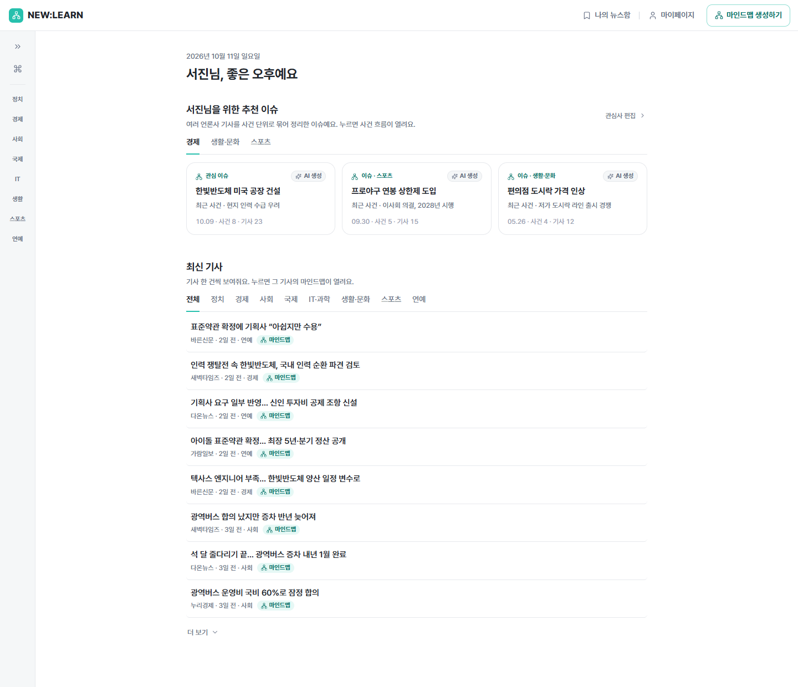
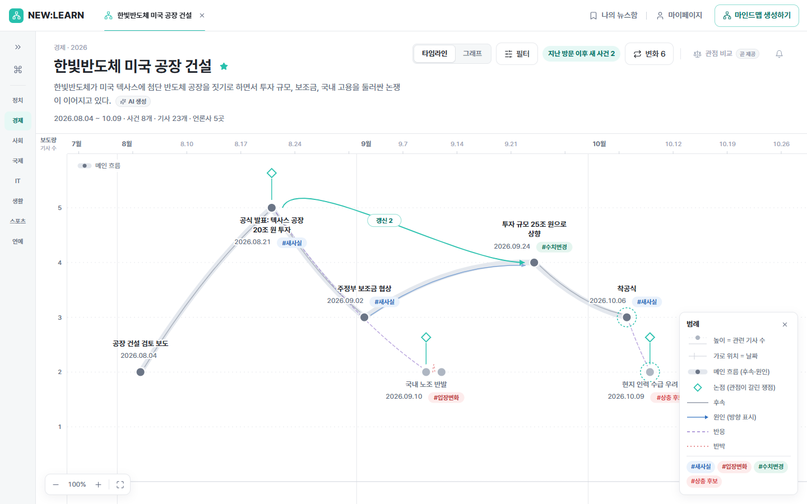
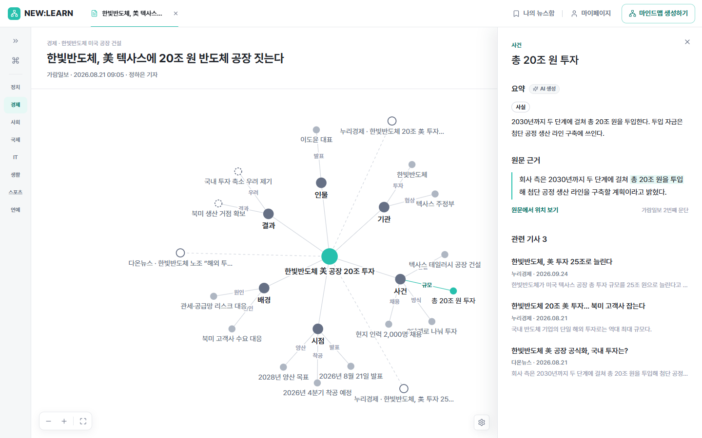

# PRD: NEW:LEARN(뉴런)

> 이슈 전체는 사건의 흐름으로, 기사 하나는 마인드맵으로. 흩어진 뉴스를 **카테고리 → 이슈 → 사건 → 기사** 순서로 정리하고, 무엇이 바뀌었는지 원문 근거와 함께 보여 주는 웹 서비스

**이 문서를 읽는 법**
- NEW:LEARN 팀이 **무엇을 만들지**에 합의하기 위한 기준 문서다. UX 설계, 아키텍처, 에픽·스토리 작성은 이 문서에서 출발한다.
- 서비스는 **① 이슈를 본다 → ② 사건을 본다 → ③ 기사를 본다**의 세 단계로 되어 있다(2.2). 4장 기능과 5장 화면도 이 순서를 따른다. 무엇을 누르면 어느 화면으로 가는지는 FR-30, 분석 결과가 언제 만들어지는지는 FR-31에 있다.
- 요구사항은 FR-1부터 전역 번호를 붙였다. 장을 다시 짜도 번호는 바꾸지 않으므로, 장 안에서 번호 순서가 섞여 있을 수 있다. 팀이 쓰던 기능 ID(F01~F11)는 함께 적는다.
- 기능마다 우선순위(P0, P1, P2)를 붙였다(4.0). 용어는 부록 A **용어집**의 표현만 쓴다.
- **팀이 모여서 정해야 할 것은 0장에 급한 순서로 모았다.** 회의는 0장부터 보면 된다.
- 확인되지 않은 추정은 `[ASSUMPTION]`, 아직 정하지 못한 것은 `Q번호`로 표시했다. 추정은 부록 C에 모았다.
- 4장의 *프로토타입 상태*와 5장의 화면은 **프로토타입 v3**(`NEW-LEARN 프로토타입 v3.html`, 2026-10-14) 기준이다. 프로토타입에서 디자인 담당이 먼저 정한 것은 팀 확인 전이므로 0장에 Q로 올렸다.
- AI가 만드는 결과(사건 묶기, 핵심 정보 추출, 주장 분석)에 대한 검증 조건은 사례 하나하나가 모두 통과해야 하는 조건이 아니다. 기대 동작을 적은 것이며, 실제 통과 기준은 1.3의 AI 검증 목표다.
- **강점 1**은 근거가 붙은 변화 분석(4.3), **강점 2**는 사건 흐름을 보여 주는 이슈 타임라인(4.2)이다.
- 함께 보는 파일: `addendum.md`(팀, 데이터셋 구조, 평가 지표 메모), `research-digest.md`(비교 서비스·법률·기술 조사), `screens/v3/`(프로토타입 v3 화면 캡처).

---

## 0. 팀 논의 사항

> 팀원에게 물어볼 질문이다. 번호로 답해 주면 해당 Q를 *결정된 것*으로 옮기고 본문에 반영한다. 자세한 배경은 5장, 6.4, 부록 B에 있다.
>
> - **0.1** 먼저 정할 것 (1~8)
> - **0.2** 프로토타입을 만들며 먼저 정한 것 (9~13)

### 0.1 먼저 정할 것

**타임라인**

1. 타임라인 세로축을 프로토타입처럼 **보도량(사건의 기사 수)**으로 할까요? 기사 분량은 빼기로 했어요. (Q15)

**데이터**

2. 서비스 데이터는 어디서 받나요? 빅카인즈 API를 쓸 수 있나요, 아니면 크롤링하나요? (Q2)
3. 시연에는 어떤 기사를 쓰나요? SSAFY 데이터셋의 과거 기사만 쓰나요, 최신 뉴스도 넣나요? (Q1)
4. SSAFY 데이터셋은 언제부터 언제까지의 기사이고, 몇 건인가요? (Q4)
5. SSAFY 데이터셋 기사의 본문을 화면에 얼마나 보여 줘도 되나요? (Q3)

**AI 분석**

6. 어떤 사건들을 한 이슈로 묶나요? 이슈 이름은 누가 붙이고, 메인 흐름과 곁가지는 어떻게 나누나요? (Q5)
7. 사건 태그(#새사실, #수치변경, #입장변화)는 무엇을 기준으로 붙이나요? (Q22)
8. 관점의 출처 유형(회사, 업계 분석, 증권가 등)은 목록을 정해 두나요, AI가 그때그때 붙이나요? (Q14)

### 0.2 프로토타입을 만들며 먼저 정한 것

프로토타입에서 일단 정해 두었지만 화면만으로 정할 수 없는 것이다. "이대로", "바꾸자", "모르겠다" 중 하나로 답해 주면 된다.

9. 이슈 타임라인에서 사건끼리 **후속 · 원인 · 반응 · 반박** 관계로 잇고, 후속·원인으로 가장 길게 이어진 줄기를 메인 흐름으로 그렸어요. AI가 이 관계를 판정할 수 있을까요? (Q25)
10. 기사 마인드맵은 **모든 기사에 미리** 만들어 두나요, 사용자가 *마인드맵 생성하기*로 기사 URL을 넣었을 때만 만드나요? (Q27)
11. *마인드맵 생성하기*로 받은 URL의 본문을 가져와 분석하고, *원문 보기*에서 **본문 전체**를 보여 줘도 되나요? 저작권 문제가 있다면 지원 언론사만 받거나 근거 문장 주변만 보여 줄게요. (Q26, Q28)
12. 로그인은 **이메일과 소셜 로그인 둘 다** 넣었어요. 둘 다 만들까요, 하나만 할까요? (Q8)
13. *관점 비교*와 *새 기사 알림*은 MVP 이후로 미뤄 두었어요. 마이페이지의 *자주 보는 언론사*(추천에서 먼저 보여 줌)와 *다크 모드*는 MVP에 넣을까요? (Q18, Q12, Q30)

---

## 1. 프로젝트 개요

### 1.1 한눈에

| 항목 | 내용 |
| --- | --- |
| 서비스명 | **NEW:LEARN(뉴런)** — NEW(새 소식) + LEARN(배움) |
| 한 줄 소개 | 이슈 전체는 사건의 흐름으로, 기사 하나는 마인드맵으로 보여 주는 뉴스 분석 서비스 |
| 1차 타깃 | 취업·면접·업무 등 목적을 가지고 특정 이슈의 맥락을 짧은 시간 안에 파악해야 하는 사용자 |
| 2차 타깃 | 여러 기사를 비교하며 조사하는 학생·리서처·기획자 |
| 플랫폼 | PC 중심 웹. 가능하면 모바일까지 반응형으로 지원 (PWA 제외) |
| 기간 | 2026-10-06 ~ 2026-11-18 (약 6주). 프로토타입을 먼저 만들고 QA로 다듬는다(1.4) |
| 규모 | 요구사항 31개(P0 핵심·차별점, P1, P2) · 사용자 여정 3개 |

### 1.2 팀

| 역할 | 담당 |
| --- | --- |
| PM | 장민준 |
| Design, FE | 안서진 |
| AI | 강유진, 황도경 |
| BE | 강하린, 김주우 |
| Infra | 김주우 |

### 1.3 목표와 성공 지표

팀의 목표는 **핵심 흐름이 동작하는 프로토타입을 최대한 빨리 만들고, QA를 거쳐 다듬는 것**이다. 11월 18일 공개 배포를 목표로 두지 않는다.

**핵심 지표**
- **SM-1. 프로토타입 완성**: P0 기능으로 UJ-1(7.1)의 흐름이 SSAFY 데이터셋 기사로 끊기지 않고 동작한다. P1인 관점 보기(4단계 일부)는 M3에서 붙인다(1.4). (P0 요구사항 전체)

**AI 검증 목표** `[검증 목표 초안]`

> 아래 수치는 검증 목표 초안이다. 데이터셋과 MVP 범위가 정해지면 AI 팀이 평가 방법과 최종 기준을 다시 정리한다. 수치는 모두 팀이 라벨링한 평가 데이터를 기준으로 잰다(Q7). 지표를 고른 이유는 `addendum.md`에 있다.

- **SM-2. 근거 연결**: 세 가지로 나누어 잰다. (FR-5, FR-7, FR-13, FR-26, FR-29)
  - **원문 일치율 100%**: 화면에 표시되는 근거 문장이 원문에 글자 그대로 존재한다. 문자열 대조로 확인한다.
  - **출처·위치 유효율 100%**: 근거 문장에 붙은 언론사, 원문 링크, 본문 안 위치가 실제 기사와 맞는다.
  - **근거 적합률 90% 이상**: 근거 문장이 그 요약이나 판정을 실제로 뒷받침한다. 표본을 사람이 확인한다.
- **SM-3. 동일 사건 묶기**: F1 **0.80 이상**. F1 계산 방식(B³ 또는 쌍 단위)은 평가 방법을 정리할 때 확정한다. (FR-9)
- **SM-4. 주장 관계 판정**: 이전 주장과의 관계 네 가지(NEW, REPEAT, UPDATE, CONFLICT)의 macro-F1 **0.70 이상**, *CONFLICT* 정밀도 **0.85 이상**. 정확도(accuracy)는 쓰지 않는다. *REPEAT*가 대부분인 데이터에서는 전부 REPEAT로 찍어도 정확도가 높게 나오기 때문이다. 주장 유형과 판정 가능 여부의 평가 방법은 AI 팀이 함께 정한다. (FR-8, FR-12, FR-14)
- **SM-6. 핵심 정보 추출** (추가 제안): 인물·기관·사건·시점·배경·결과 항목 단위 F1 **0.70 이상**. (FR-5)
- 관점 추출(FR-25)과 요약처럼 정답이 하나로 정해지지 않는 결과는 F1로 재지 않고, QA 단계에서 팀원이 직접 평가한다.

**사용자 지표**
- **SM-5. 사용자 테스트**: QA 단계에서 1차 타깃 사용자 5명 이상이 UJ-1을 수행한 뒤 아래 세 문항에 답하고, 문항마다 5점 만점 평균 **4점 이상**. `[ASSUMPTION]`
  - "이슈의 흐름을 이해하는 데 도움이 됐다"
  - "여러 관점의 정보를 빠르게 파악할 수 있었다" (기대효과 A, 7.3)
  - "근거를 보고 스스로 판단할 수 있었다" (기대효과 B, 7.3)

**함부로 늘리지 말아야 할 지표**
- **SM-C1. CONFLICT 개수**: 많으면 흥미로워 보이지만, 잘못된 상충 판정은 신뢰를 무너뜨린다. (SM-4의 CONFLICT 정밀도와 짝)
- **SM-C2. 판단 불가 비율**: 판단 불가를 줄이려고 확신 없는 판정을 내리지 않는다. (SM-4와 짝)
- **SM-C3. 마인드맵 노드 수**: 노드가 많다고 이해가 쉬워지지 않는다. 핵심 정보만 남긴다. (FR-6)

### 1.4 진행 방식

프로토타입을 최대한 빨리 만들고, QA에서 나온 문제를 고치는 순서로 진행한다. `[ASSUMPTION: 단계별 범위]`

| 단계 | 하는 일 | 끝났다고 보는 기준 | 시점 |
| --- | --- | --- | --- |
| M1. 프로토타입 | P0 기능을 SSAFY 데이터셋 기사로 연결 | SM-1 충족, 근거 원문 일치율 100% | 최대한 빨리. 목표일은 논의 필요(Q17) |
| M2. QA | 팀 내부 QA, 사용자 테스트(SM-5), AI 검증(SM-2~SM-4, SM-6) | 문제 목록과 우선순위 | M1 직후 |
| M3. 수정과 확장 | QA 결과 반영, P1(논점·관점) 추가, P2는 남는 시간만큼, 여유가 있으면 모바일 반응형 | SM 목표 확인 | 2026-11-18까지. 그날의 최종 상태는 Q17 |

M1은 화면 흐름을 먼저 잇는 것이 목표다. 사건 묶기나 주장 분석처럼 AI 결과가 아직 부족한 단계는 팀이 라벨링한 데이터로 채워 두고, M2에서 AI 결과로 바꿔 검증한다. `[ASSUMPTION]`

---

## 2. 서비스 소개와 기획 배경

### 2.1 기획 배경

취업을 준비하다 보면 삼성처럼 시사 이슈를 묻는 자소서 문항을 만나고, 면접을 앞두고는 지원하는 산업의 최근 흐름을 설명할 수 있어야 한다. 그런데 하나의 이슈를 다룬 기사는 수십 개 언론사에 몇 주, 몇 달에 걸쳐 흩어져 있다. 기사를 하나씩 열어 보면 같은 내용이 반복되고, 어느 기사에서 무엇이 새로 나왔는지, 처음 보도와 무엇이 달라졌는지는 직접 비교해야 알 수 있다. **흩어진 뉴스를 시간 순서로 따라가기 어렵다**는 팀원들의 경험이 출발점이다.

### 2.2 서비스 구조

NEW:LEARN은 뉴스를 **카테고리 → 이슈 → 사건 → 기사** 순서로 정리하고, 사용자는 위에서 아래로 내려가며 본다.

| 단계 | 화면 | 사용자가 알게 되는 것 | 우선순위 |
| --- | --- | --- | --- |
| ① 이슈를 본다 | 이슈 타임라인 | 어떤 사건이 일어났는지, 무엇이 바뀌었는지(변화 카드) | P0 |
| ② 사건을 본다 | 사건 화면: 관련 기사 + 관점 | 어떤 언론과 주체가 그 사건을 어떻게 이야기했는지 | 관련 기사 P0(추정), 관점 P1 |
| ③ 기사를 본다 | 기사 마인드맵 | 기사 하나의 인물·기관·사건·시점·배경·결과를 구조적으로 | P0 |

- 같은 사건을 다룬 기사들을 하나의 **사건**으로 묶고, 관련 사건들을 시간 순서로 이어 **이슈**를 만든다.
- 새 기사가 나오면 이전 보도와 주장을 비교해 무엇이 새로 나왔고 무엇이 바뀌었는지 판정하고, 그 근거 문장을 원문에서 그대로 보여 준다.
- 기사 하나에서 출발해 그 기사가 속한 이슈로 거슬러 올라갈 수도 있다(③ → ①).

뉴스를 많이 읽게 하는 것이 아니라, 한 이슈를 여러 관점에서 깊이 이해하게 하는 데 초점을 둔다. **진위는 판정하지 않는다.**

### 2.3 차별점

| 서비스 | 하는 일 | NEW:LEARN과의 차이 |
| --- | --- | --- |
| 빅카인즈 관계도 | 기사에 함께 등장한 빈도로 인물·기관을 연결 | 사건 단위 타임라인, 주장 비교, 근거 문장이 없다 |
| Particle | 기사를 스토리로 묶어 요약, 타임라인, 반대 관점 보기 | 주장 단위 변화 판정과 근거 문장이 없다. 영어 전용 |
| Google News Full Coverage | 장기 이슈의 헤드라인, 해설, 타임라인 | 기사를 모으고 정렬할 뿐 주장을 비교하지 않는다 |

**주장 하나하나의 변화를 판정하고 원문 근거 문장을 붙이는 한국어 서비스는 조사 범위에서 찾지 못했다.** (상세: `research-digest.md`)

---

## 3. 문제 정의

### 3.1 대상 사용자

**1차 타깃**: 취업·면접·업무 등 목적을 가지고 특정 이슈의 맥락을 **짧은 시간 안에** 파악해야 하는 사용자. 예: 면접을 앞둔 취준생, 회의 전에 업계 이슈를 정리해야 하는 직장인. (UJ-1, UJ-3)

**2차 타깃**: 여러 기사를 **비교하며 조사하는** 학생·리서처·기획자. 예: 고객사 업계를 조사하는 주니어 리서처, 과제를 준비하는 학생. (UJ-2)

**대상이 아닌 사용자 (MVP)**
- 실시간 속보를 빠르게 훑어보려는 일반 뉴스 소비자. 이들에게는 포털 뉴스가 더 맞다.
- 기사의 진위를 판정받고 싶은 사용자. NEW:LEARN은 팩트체크 서비스가 아니다.

### 3.2 문제와 해결

| 문제 | 해결 | 요구사항 | 우선순위 |
| --- | --- | --- | --- |
| 한 이슈의 기사가 수십 곳에 흩어져 있다 | 동일 사건 묶기: 같은 사건의 기사를 하나로 | FR-9 | P0 |
| 몇 달짜리 이슈의 순서가 잡히지 않는다 | ① 이슈 타임라인: 사건을 시간순으로 연결 | FR-10, FR-20~FR-22 | P0 |
| 무엇이 새롭고 무엇이 바뀌었는지 모른다 | 변화 카드: 이전 주장과 비교한 판정 + 근거 문장 | FR-29, FR-8, FR-12~FR-14 | P0 |
| 같은 사건을 두고 입장이 어떻게 갈리는지 모른다 | ② 사건 화면의 관점: 논점 맵 | FR-24~FR-26 | P1 |
| 기사 한 개도 구조가 한눈에 들어오지 않는다 | ③ 기사 마인드맵: 인물·기관·사건·시점·배경·결과 | FR-5~FR-7 | P0 |

### 3.3 사용자가 해결하려는 일

- **기능적**: 몇 주에서 몇 달에 걸친 이슈의 흐름을 짧은 시간 안에 시간 순서대로 정리하고 싶다.
- **기능적**: 같은 내용을 반복해서 읽지 않고, 새로 나온 정보와 바뀐 정보만 골라 보고 싶다.
- **기능적**: 면접 답변이나 보고서에 쓸 내용의 출처를 원문 문장 단위로 확인하고 싶다.
- **정서적**: 면접에서 시사 질문을 받아도 흐름을 설명할 수 있다는 자신감을 얻고 싶다.
- **맥락적**: 지원하는 회사나 맡은 업무와 관련된 산업 이슈를 꾸준히 따라가고 싶다.

---

## 4. 기능 소개

### 4.0 우선순위 한눈에

| 우선순위 | 기능 | 요구사항 | 팀 기능 ID | 프로토타입 v3 |
| --- | --- | --- | --- | --- |
| P0 핵심 | 뉴스 수집과 분석 시점 | FR-1, FR-2, FR-31 | F01 | 해당 없음 (목업 데이터) |
| P0 핵심 | 동일 사건 묶기 | FR-9 | F06 | 해당 없음 (목업 데이터) |
| P0 핵심 | 이슈 타임라인 | FR-10, FR-20, FR-21, FR-22 | F07 | 구현됨. 세로축 보도량, 사건 관계선, 메인 흐름 |
| P0 핵심 | 기사 핵심 정보 추출 | FR-5 | F03 | 해당 없음 (목업 데이터) |
| P0 핵심 | 기사 마인드맵 | FR-6, FR-7 | F04, F05 | 구현됨 |
| P0 차별점 | 이전 기사 비교 (주장 추출, 주장 유형, 관계 판정) | FR-29, FR-8, FR-12 | F09 | 해당 없음 (목업 판정) |
| P0 차별점 | 변화 카드 | FR-13, FR-14 | F10 | 구현됨. 갱신 화살표, 변화 목록, CONFLICT 안내 |
| P0 차별점 | 근거 문장 | FR-5, FR-7, FR-13, FR-29의 근거 조건, 4.11 | — | 구현됨. 모든 패널에 근거 문장, *원문에서 위치 보기* |
| P1 | 논점·관점 비교 | FR-24, FR-25, FR-26 | 신규 | 논점 맵 구현됨. *관점 비교* 버튼은 MVP 이후 안내(Q18) |
| P2 | 로그인 / 북마크 / 관심 이슈 / 새 사건 알림 | FR-17, FR-18, FR-19 | 신규 | 구현됨. 로그인 창, 로그인 전 화면 포함 |
| P2 | 이슈 탭 등 편의 UX | FR-27, FR-23 | 신규 | 구현됨. 그래프 보기, 필터 포함 |
| P0 (추정) | 카테고리 탐색 | FR-3, FR-4 | F02 | 사이드바, 빠른 이동 구현됨. 카테고리별 목록 화면은 없음 |
| P0 (추정) | 사건 관련 기사 목록 | FR-11 | F08 | 구현됨 (사건 패널) |
| P0 (추정) | 화면 이동 규칙, 기사 ↔ 이슈 이동 | FR-30, FR-15, FR-16 | F11 | 구현됨 |
| P2 (추정) | 홈 추천 이슈 카드 | FR-28 | 신규 | 구현됨. 카드 제목이 이슈 이름 |

- 위쪽 11행은 팀이 정한 우선순위다. 아래쪽 4행은 팀 표에 없던 기능이라 우선순위를 추정해 넣었다(Q20). 카테고리 탐색, 사건 관련 기사 목록, 기사 ↔ 이슈 이동은 카테고리 → 이슈 → 사건 → 기사 구조를 오가는 데 필요해 P0로 두었다. `[ASSUMPTION]`
- 프로토타입 v3는 목업 데이터로 화면 흐름 전체를 보여 준다. AI가 실제로 만드는 결과(사건 묶기, 핵심 정보, 주장 판정)는 아직 없으므로 *해당 없음*으로 적었다. 프로토타입에서 먼저 정한 부분은 0.2의 Q로 확인한다.

### 4.1 뉴스 수집과 분석 시점 (F01) · P0

**설명**: 서비스에 쓰는 모든 기사를 저장하고 조회할 수 있게 한다. 기사 분석은 기사가 들어올 때 미리 끝내 두고, 화면은 저장된 결과만 읽는다(FR-31). 데이터 소스와 범위는 6장에서 논의한다.

#### FR-1: 기사 적재

시스템은 기사의 제목, 본문, 언론사, 기자, 발행일, 카테고리, 원문 링크를 저장한다.

**검증 조건**:
- 같은 원문 링크의 기사는 한 번만 저장된다.
- 발행일은 날짜·시간 형식으로 저장되어 시간순 정렬에 쓸 수 있다.
- 필수 값(제목, 본문, 언론사, 발행일)이 빠진 기사는 저장하지 않고 이유를 기록한다.

#### FR-2: 기사 조회

사용자는 기사 한 건의 제목, 언론사, 기자, 발행일, 원문 링크를 볼 수 있다.

**검증 조건**:
- 모든 기사 화면에 언론사명과 원문 링크가 표시된다.
- 본문을 화면에 얼마나 보여 줄지는 데이터 이용 조건에 따른다(Q3).

#### FR-31: 분석 시점

시스템은 기사가 들어올 때 분석을 미리 끝내고 결과를 저장한다. 사용자가 화면을 열 때는 저장된 결과만 읽는다. `[ASSUMPTION: 팀 확인 전 제안]`

| 결과 | 만드는 때 | 필요한 것 |
| --- | --- | --- |
| 기사 마인드맵(핵심 정보, FR-5) | 기사가 들어오자마자 | 그 기사 하나 |
| 주장 기록(FR-29) | 기사가 들어오자마자, 핵심 정보와 함께 | 그 기사 하나 |
| 사건 배정(FR-9), 이슈 타임라인(FR-10) | 새 기사가 들어올 때마다 이어서 갱신 | 앞서 들어온 기사들 |
| 주장 판정과 변화 카드(FR-12, FR-13), 사건 태그 | 사건 배정 직후 | 같은 이슈의 이전 주장들 |

**검증 조건**:
- 사용자가 화면을 열 때 AI 분석을 새로 돌리지 않는다(4.11 성능).
- 새 이슈의 첫 기사는 사건 하나짜리 타임라인으로 시작하고, 변화 카드는 같은 이슈에 두 번째 보도가 들어온 뒤부터 생긴다.
- SSAFY 데이터셋은 발행일 순서대로 처리해, 각 기사를 그보다 앞선 기사들과만 비교한다.
- 예외: *마인드맵 생성하기*(Q26, Q27)로 사용자가 넣은 기사는 그 자리에서 분석하고, 기다리는 동안 진행 상태를 보여 준다. `[ASSUMPTION]`

**메모**: 서비스 데이터를 얼마나 자주 수집하고 갱신할지는 Q21에서 정한다. M1은 SSAFY 데이터셋 전체를 한 번에 처리한다.

### 4.2 ① 이슈 보기: 동일 사건 묶기와 이슈 타임라인 (F06, F07) · P0 · 강점 2

**설명**: 같은 사건을 다룬 기사들을 하나로 묶고, 관련된 사건들을 시간 순서로 이어 이슈를 만든다. 사용자는 이슈 화면에서 이슈 헤더와 타임라인을 보고, 어떤 사건이 일어났고 무엇이 바뀌었는지(4.3 변화 카드) 파악한다. 화면 설명은 5.2에 있다. (UJ-1, UJ-2, UJ-3)

#### FR-9: 동일 사건 기사 묶기 (F06)

시스템은 내용, 주체(인물·기관), 시점을 기준으로 같은 사건을 다룬 기사들을 사건 하나로 묶는다.

**검증 조건**:
- 기사 하나는 사건 하나에만 속한다. `[ASSUMPTION]`
- 묶기 품질은 팀이 라벨링한 평가 데이터로 측정한다(SM-3, Q7).

#### FR-10: 사건 시간순 연결 (F07)

시스템은 관련된 사건들을 하나의 이슈로 묶고, 사건 날짜 순서로 연결한다.

**검증 조건**:
- 이슈마다 속한 사건들이 사건 날짜 순서로 정렬된다. 화면 표시는 FR-21에서 다룬다.

**메모**: 사건을 어떤 기준으로 같은 이슈로 묶을지는 아직 정하지 않았다(Q5). `[ASSUMPTION: 주요 인물·기관을 공유하고 주제가 이어지는 사건을 같은 이슈로 묶는다]`

#### FR-20: 이슈 헤더

사용자는 이슈 화면 위쪽에서 카테고리와 연도, 이슈 이름, 한두 문장 요약, 기간·사건 수·기사 수·언론사 수를 볼 수 있다. (UJ-1)

**검증 조건**:
- 예: "경제 · 2026 / 한빛반도체 미국 공장 건설 / 2026.08.04 ~ 10.09 · 사건 8개 · 기사 23개 · 언론사 5곳".
- 이슈 이름 옆 별표로 관심 이슈를 저장·해제할 수 있다(FR-19, P2).

#### FR-21: 타임라인 차트

사용자는 사건 노드를 사건 날짜 순서로 가로에 배치한 타임라인을 볼 수 있다. (UJ-1)

**검증 조건**:
- 사건 노드마다 사건 이름과 날짜가 표시된다.
- 노드의 가로 위치는 사건 날짜를 따른다.
- 세로축에 **기사 분량은 쓰지 않는다.** 사건의 기사 분량은 여러 기사를 합친 글자 수라 의미가 적다. 프로토타입은 세로축을 **보도량(그 사건의 기사 수)**으로 그렸다. 확정은 Q15.
- 앞 사건의 값이 *UPDATE*된 사건은 화살표로 이어지고, 화살표에 "갱신 2"처럼 바뀐 주장 수가 표시된다. 화살표를 누르면 변화 카드가 열린다(FR-13).
- 사건 노드에 그 사건의 대표 사건 태그(#새사실, #수치변경, #입장변화, #상충 후보)가 붙는다(4.3, Q22).
- 노드에 마우스를 올리면 날짜, 사건 이름, 관련 기사 수, 언론사 수가 보인다.

#### FR-22: 메인 흐름과 곁가지 사건

시스템은 사건 사이의 관계를 선으로 잇고, 이슈의 사건을 메인 흐름과 곁가지 사건으로 나누어 보여 준다. (UJ-1)

| 사건 관계 | 뜻 | 선 |
| --- | --- | --- |
| 후속 | 앞 사건이 이어져 다음 사건이 됨 | 실선 |
| 원인 | 앞 사건이 다음 사건의 원인 | 화살표 |
| 반응 | 앞 사건에 대한 다른 주체의 반응 | 점선 |
| 반박 | 앞 사건의 주장을 반박 | 점선(붉은색) |

**검증 조건**:
- 메인 흐름은 **후속·원인 관계로 가장 길게 이어진 사건 줄기**다. 굵은 띠로 표시된다. `[프로토타입 기준, Q25]`
- 곁가지 사건(예: "국내 노조 반발", "현지 인력 수급 우려")은 메인 흐름보다 흐린 색으로, 반응·반박 점선으로 이어진다.
- 사건 관계를 어떻게 판정할지, 이슈를 묶는 기준과 함께 Q5, Q25에서 정한다.

### 4.3 변화 분석: 이전 기사 비교와 변화 카드 (F09, F10) · P0 차별점 · 강점 1

**설명**: 새 기사의 주장을 같은 이슈의 이전 주장과 비교해 판정하고, 결과를 이슈 화면의 변화 카드로 보여 준다. 이 서비스의 가장 큰 차별점이자 가장 큰 기술 리스크다. (UJ-1)

**주장 분석의 세 축**

주장 하나에 아래 세 가지를 붙인다.

| 축 | 값 | 뜻 |
| --- | --- | --- |
| 주장 유형 | 사실 / 전망·해석 | 일어난 일이나 수치인가, 전망이나 평가인가("~할 전망이다", "~라는 해석도 나온다") |
| 판정 가능 여부 | 판단 가능 / 판단 불가 | 이전 주장과 비교할 근거가 충분한가 |
| 이전 주장과의 관계 | NEW / REPEAT / UPDATE / CONFLICT | 판단 가능할 때만 붙인다. 아래 표 |

| 관계 | 뜻 | 예시 | 이전 정보는 |
| --- | --- | --- | --- |
| NEW (새 정보) | 이전 보도에 없던 속성이 처음 나옴 | "착공은 2027년 상반기"가 처음 보도됨 | 그대로 유효 |
| REPEAT (반복) | 이전에 나온 속성과 값이 같음 | 다른 언론사가 같은 "20조 원 투자"를 보도 | 그대로 유효 |
| UPDATE (갱신) | 이전에 나온 속성의 값이 나중에 바뀜 | "20조 원 투자" → 두 달 뒤 "25조 원으로 상향" | **지난 정보가 됨** |
| CONFLICT (상충 후보) | 같은 속성, 같은 기준 시점에 서로 다른 값 | 두 언론사가 같은 날 20조 원과 25조 원을 보도 | 어느 쪽인지 사용자가 확인 |

**판정 순서**
1. **판정 가능 여부**: 주장 유형이 다른 두 주장(사실과 전망·해석)을 비교하거나, 근거가 부족하거나, 확신이 낮으면 *판단 불가*로 두고 관계를 붙이지 않는다.
2. **관계**: 이전 보도에 같은 대상의 같은 속성(예: 대상 "한빛반도체 미국 공장", 속성 "투자 규모")이 없으면 *NEW*, 있고 값이 같으면 *REPEAT*, 값이 다르면 기준 시점이 다를 때 *UPDATE*, 같을 때 *CONFLICT*다.

**기준 시점**은 기사 발행일이 아니라 주장이 가리키는 때다. "9월 24일 이사회에서 25조 원으로 상향"이면 9월 24일이다. 주장에 시점이 없으면 발행일을 쓴다. `[ASSUMPTION]`

**NEW와 UPDATE를 나누는 이유**: NEW는 *추가*이고 UPDATE는 *교체*다. NEW가 나와도 이전 정보는 여전히 맞지만, UPDATE가 나오면 이전 값은 낡은 정보가 된다. 사용자가 면접에서 이미 바뀐 "20조 원"을 말하지 않게 하려면 이 구분이 필요하다. 타임라인에서는 둘 다 사건 노드가 새로 생길 수 있지만, UPDATE만 이전 사건과 화살표로 이어진다(FR-21의 추정). 판정은 사건 노드가 아니라 주장 단위로 내리므로, 한 사건 안에 NEW와 UPDATE가 함께 있을 수 있다.

*CONFLICT*는 어느 쪽이 맞는지 판정한 결과가 아니라, 사용자가 직접 확인해 볼 지점이라는 뜻이다.

**사건 태그** (프로토타입의 #새사실, #수치변경, #입장변화)

판정은 주장 단위로 내리지만, 타임라인에서는 사건마다 대표 태그 하나를 보여 준다. 태그는 그 사건에서 나온 주장 판정을 요약한 것이다. `[ASSUMPTION: 아래 대응은 제안]`

| 사건 태그 | 대표 판정 | 예 |
| --- | --- | --- |
| #새사실 | 사실 · NEW | "공식 발표: 텍사스 공장 20조 원 투자" |
| #수치변경 | 사실 · UPDATE | "투자 규모 25조 원으로 상향" |
| #입장변화 | 전망·해석 · UPDATE (주체의 입장이나 전망이 바뀜) | "국내 노조 반발" |
| #상충 후보 | CONFLICT | "현지 인력 수급 우려": 같은 날 부족 인원 900명과 1,500명 보도 |

한 사건에 판정이 여러 개면 CONFLICT, UPDATE, NEW 순서로 하나를 고른다. 프로토타입 v3는 위 네 태그를 쓴다. 태그 이름과 대응은 Q22에서 확정한다.

#### FR-29: 주장 추출

시스템은 기사에서 주장을 뽑아, 주장마다 대상, 속성, 값, 기준 시점, 주장 유형, 근거 문장을 기록한다. FR-12의 판정은 이 기록끼리 비교한다. (UJ-1)

**검증 조건**:
- 주장마다 근거 문장이 하나 이상 연결된다.
- 같은 이슈 안에서 같은 대상과 속성을 가리키는 주장끼리 모아 비교할 수 있다.
- 기사에 기준 시점이 없으면 발행일을 기준 시점으로 쓴다.

**메모**: 주장을 어느 단위로 자를지(문장 하나, 수치 하나)는 Q7의 라벨 기준을 정할 때 함께 정한다.

#### FR-8: 주장 유형 구분

시스템은 주장마다 주장 유형(사실, 전망·해석)을 붙이고, 기사 마인드맵과 변화 카드에서 전망·해석을 사실과 다르게 표시한다. (UJ-1, UJ-2)

**검증 조건**:
- "~라는 해석도 나온다", "~할 전망이다"처럼 전망이나 평가를 담은 문장은 전망·해석으로 분류된다.
- 사용자는 사실과 전망·해석을 시각적으로 구분할 수 있다.

#### FR-12: 주장 관계 판정 (F09)

시스템은 새 주장을 같은 이슈의 이전 주장과 비교해 판정 가능 여부를 정하고, 판단 가능하면 *NEW, REPEAT, UPDATE, CONFLICT* 중 하나를 붙인다. (UJ-1)

**검증 조건**:
- 모든 판정에는 비교한 두 주장의 근거 문장이 연결된다.
- 주장 유형이 다른 두 주장을 비교하는 경우는 *판단 불가*로 둔다.
- 판정에 대한 확신이 낮으면 *판단 불가*로 둔다.
- 이전 보도에 없던 속성은 *NEW*로, 이전 속성의 값이 기준 시점이 달라지며 바뀌면 *CONFLICT*가 아니라 *UPDATE*로 판정한다.

#### FR-13: 변화 카드 (F10)

사용자는 이슈 화면에서 변화 카드를 볼 수 있다. 이슈 헤더의 *변화 N* 버튼이나 타임라인의 UPDATE 화살표를 누르면 오른쪽에 **변화 목록**이 열리고, 화살표로 열면 해당 카드가 강조된다. 변화 카드에는 관계, 주장 유형, 대상·속성, 바뀐 내용 요약(AI 생성 표시), 이전·이후 근거 문장, 각 문장의 언론사와 날짜, 그 변화가 나온 사건이 표시된다. 사건 패널에도 *이 사건의 변화*가 나온다. (UJ-1)

**검증 조건**:
- 이전 근거 문장과 이후 근거 문장이 나란히 표시된다. NEW는 *처음 보도* 근거 하나, CONFLICT는 *보도 A / 보도 B*로 표시된다.
- *UPDATE* 카드에는 "이전 값은 지난 정보가 됐어요"가 붙는다.
- 기본으로는 *REPEAT*를 뺀 카드만 보여 주고, *REPEAT*는 "같은 내용을 반복한 보도 N건은 숨겼어요"처럼 개수만 표시한다.
- *판단 불가* 주장은 목록 아래에 접어 두고 개수와 이유를 보여 준다.
- 관계별(전체, 갱신, 새 정보, 상충 후보)로 카드를 걸러 볼 수 있다.

#### FR-14: CONFLICT 안내

시스템은 *CONFLICT* 변화 카드에 "어느 쪽이 맞는지 판정한 결과가 아니다"라는 안내를 표시한다. (UJ-1 예외 상황)

### 4.4 ② 사건 보기: 관련 기사와 관점 (F08) · 관련 기사 P0(추정), 관점 P1

**설명**: 타임라인에서 사건 노드를 누르면 사건 화면이 열린다. 프로토타입은 사건 화면을 타임라인 **오른쪽 패널**로 만들었다. 패널에는 사건 요약, 핵심 근거, 그 사건을 다룬 기사 목록(P0), 관점이 갈린 사건이라면 *관점* 탭과 논점 맵(P1), 이 사건의 변화, 연결된 사건(이전·다음과 관계)이 있다. 논점 맵은 논점을 가운데 두고 관점(◆)과 그 관점을 담은 기사(●)를 방사형으로 펼친다. ◆는 타임라인에서는 관점이 갈린 사건 표시로, 논점 맵에서는 관점 노드로 쓰인다. 기대효과 A(정보량)를 가장 직접 보여 주는 화면이다. 화면 설명은 5.3에 있다. (UJ-1)

#### FR-11: 사건 관련 기사 (F08)

사용자는 사건 노드를 눌러 사건 화면을 열고, 그 사건을 다룬 기사 목록을 언론사, 발행일, 요약과 함께 볼 수 있다. (UJ-1)

**검증 조건**:
- 기사 목록에 해당 사건을 보도한 언론사가 모두 표시된다.
- 기사 목록은 발행일 순서로 정렬되고, 처음에는 4건을 보여 준 뒤 *더 보기*로 펼친다.
- 기사마다 제목, 언론사, 발행 시각, 본문 첫 문장, 북마크, 원문 링크가 있다.
- 특정 언론사의 기사만 먼저 보여 주거나 순위를 매기지 않는다(4.11).

**메모**: 프로토타입의 *마인드맵으로 보기*는 이 사건과 앞뒤 사건의 기사를 한 맵에 펼친 "관련 기사 마인드맵"을 연다. MVP에 넣을지는 QA 때 정한다.

#### FR-24: 논점 맵 열기 · P1

사용자는 사건 화면에서 *관점* 탭의 논점을 눌러, 또는 타임라인에서 ◆ 표시를 눌러 그 사건의 논점 맵을 열고, *타임라인으로*를 눌러 돌아갈 수 있다. 논점 맵은 타임라인 위에 겹쳐 열린다. (UJ-1)

**검증 조건**:
- 논점 맵 위쪽에 현재 위치가 "08.21 공식 발표 › 논점"처럼 표시된다.
- 관점이 하나뿐인 사건에는 ◆ 표시가 붙지 않는다. `[ASSUMPTION]`

#### FR-25: 논점 맵 구성 · P1

사용자는 논점(가운데), 관점(◆), 그 관점을 담은 기사(●)가 연결된 방사형 맵을 볼 수 있다. (UJ-1)

**검증 조건**:
- 논점 노드에 관점 수와 기사 수가 표시된다(예: "20조 미국 투자의 득실 · 관점 5개 · 기사 5건").
- 관점 노드에 관점 요약, 출처 유형(목록은 Q14), 대표 언론사가 표시된다(예: "북미 고객사 생산 요구에 대응 · 회사 · 누리경제 외 1").
- 기사 노드에 언론사명이 표시된다.

#### FR-26: 관점 패널과 근거 · P1

사용자는 오른쪽 패널에서 쟁점 요약과 관점 목록을 보고, 관점을 눌러 그 관점의 근거 문장을 볼 수 있다. (UJ-1)

**검증 조건**:
- 관점 목록의 개수가 논점 맵의 관점 수와 같다.
- 논점 맵에서 관점 노드(◆)를 눌러도 같은 근거 문장을 볼 수 있다.
- 근거 문장에는 언론사명과 원문 링크가 붙는다(FR-7과 같은 규칙).

**메모**: 프로토타입의 *관점 비교* 버튼은 누르면 "MVP 이후 제공 예정"이라고 안내한다. MVP에서 빼는 것으로 할지는 Q18.

### 4.5 ③ 기사 보기: 핵심 정보 추출과 기사 마인드맵 (F03, F04, F05) · P0

**설명**: 기사 한 개를 열면 핵심 정보가 마인드맵으로 펼쳐진다. 노드를 누르면 요약과 원문 근거 문장이 나온다. 기사에 섞여 있는 사실과 전망·해석을 구분해 보여 준다(FR-8). 사건 화면의 논점 맵과는 별개 화면이며, MVP에서 둘 다 만든다(Q13 결정). 프로토타입 v3에 화면이 있다(5.6). (UJ-1, UJ-2)

#### FR-5: 핵심 정보 추출 (F03)

시스템은 기사에서 인물, 기관, 사건, 시점, 배경, 결과를 추출하고, 항목마다 근거 문장을 연결한다.

**검증 조건**:
- 추출한 핵심 정보마다 근거 문장이 최소 하나 연결된다.
- 근거 문장은 원문 본문에 글자 그대로 존재한다(문자열 대조로 확인).
- 근거 문장마다 출처 기사와 본문 안 위치(문단·문장 번호)가 함께 기록된다(SM-2).
- 같은 인물이나 기관이 기사 안에서 다르게 불려도(예: "김유진", "김 본부장", "신임 대표") 노드 하나로 합쳐진다.

#### FR-6: 기사 마인드맵 생성 (F04)

사용자는 기사의 핵심 정보를 노드와 관계로 연결한 기사 마인드맵을 볼 수 있다. (UJ-1, UJ-2)

**검증 조건**:
- 가운데에 기사 요지가 있고, 1차 가지로 종류(인물, 기관, 사건, 시점, 배경, 결과)가, 그 아래에 핵심 정보 노드가 붙는다.
- 전망·해석 노드는 점선 원으로 표시된다(FR-8).
- 같은 사건의 다른 기사와 연결된 사건의 기사가 *관련 기사* 노드(빈 원, 점선)로 붙고, 누르면 그 기사의 마인드맵이 열린다.
- 1차 가지를 접고 펼 수 있고, 라벨 표시와 노드 간격을 조절할 수 있다.
- 노드 사이의 선에는 "투자", "발표", "원인"처럼 짧은 관계 이름이 붙는다.

#### FR-7: 노드 상세와 근거 확인 (F05)

사용자는 노드를 눌러 해당 핵심 정보의 요약과 근거 문장을 볼 수 있다. (UJ-1, UJ-2)

**검증 조건**:
- 근거 문장에는 언론사명과 원문 안 위치("가람일보 2번째 문단"), 원문 링크가 함께 표시된다.
- 요약 옆에 AI가 생성한 내용이라는 표시와 주장 유형(사실, 전망·해석)이 붙는다.
- *원문에서 위치 보기*를 누르면 원문 창이 열리고, 선택한 노드의 근거 문장이 진하게, 나머지 근거 문장이 옅게 칠해져 있다. 원문 창에 본문을 어디까지 보여 줄지는 Q28.
- 노드 상세에 관련 기사 3건이 붙는다.

### 4.6 들어가기와 이동: 이동 규칙, 카테고리, 기사 ↔ 이슈, 홈 추천 (F02, F11)

**설명**: 사용자는 카테고리나 홈에서 이슈로 들어가거나, 기사에서 그 기사가 속한 이슈로 거슬러 올라간다. 어디서 무엇을 누르든 **누른 것의 단위가 도착 화면을 정한다**(FR-30). 탐색은 로그인하지 않아도 쓸 수 있다. `[ASSUMPTION: 탐색은 비로그인 사용자에게도 열려 있다]`

#### FR-30: 화면 이동 규칙 · P0(추정)

사용자가 누른 항목이 기사인지, 이슈인지, 사건인지에 따라 도착 화면이 정해진다. 항목에는 단위를 알 수 있는 아이콘이나 표시가 붙는다. (UJ-1, UJ-2) `[ASSUMPTION: 팀 확인 전 제안]`

| 누른 것 | 화면에 보이는 표시 | 도착 화면 |
| --- | --- | --- |
| 기사 (제목·언론사·시간) | 문서 아이콘 | ③ 기사 마인드맵 |
| 이슈 (이슈 이름·기간·사건 수) | 갈래 아이콘 | ① 이슈 타임라인 |
| 타임라인의 사건 노드 | 노드 | ② 사건 화면 |
| *마인드맵 생성하기*로 넣은 기사 (Q26) | — | ③ 기사 마인드맵 (그 자리에서 분석, FR-31) |

**검증 조건**:
- 홈, 카테고리 목록, 나의 뉴스함, 상단 탭 어디서든 같은 규칙이 적용된다.
- 기사 항목과 이슈 항목은 아이콘으로 구분된다. 상단 탭(FR-27)의 문서 아이콘과 갈래 아이콘을 그대로 쓴다.
- 이슈 항목의 제목은 이슈 이름이다. 최신 기사 제목은 부제로만 쓴다.
- 기사 마인드맵에서 *이 기사가 속한 이슈 보기*(FR-15)를 누르면 이슈 타임라인이 그 기사의 사건 노드를 강조한 채로 열린다. 아직 이슈로 묶이지 않은 기사라면 이 버튼 대신 "아직 이슈로 묶이지 않았다"는 안내가 나온다.

**메모**: 프로토타입 v3는 이 규칙을 따른다. 홈 추천 카드의 제목은 이슈 이름이고 갈래 아이콘이 붙으며, 누르면 이슈 타임라인이 열린다. 상단 탭도 이슈는 갈래 아이콘, 기사는 문서 아이콘이다.

#### FR-3: 카테고리 선택 (F02) · P0(추정)

사용자는 왼쪽 사이드바의 *이슈 탐색*에서 카테고리를 펼쳐 연도별 이슈를 보고, 이슈를 열면 그 이슈의 사건 목록까지 볼 수 있다. 카테고리별 기사 목록은 홈의 *최신 기사* 분야 탭에서 본다. 사이드바는 접을 수 있고(⌘\), 폭을 조절할 수 있다. (UJ-1, UJ-2)

**검증 조건**:
- 카테고리는 프로토타입대로 8개다(정치, 경제, 사회, 국제, IT·과학, 생활·문화, 스포츠, 연예). 모든 카테고리가 사이드바에 노출된다(Q9 결정).
- 사이드바 맨 위 *빠른 이동*(⌘K)에서 이슈, 사건, 기사 이름으로 찾아 바로 열 수 있다.
- 기사 목록은 기본적으로 최신 발행일 순서로 정렬된다.
- 카테고리별 이슈 목록 화면은 따로 없고, 사이드바로 찾는다.

#### FR-4: 이슈 목록 · P0(추정)

사용자는 카테고리별 이슈 목록에서 각 이슈의 이름, 사건 수, 기사 수, 가장 최근 사건 날짜를 볼 수 있다. (UJ-1)

**검증 조건**:
- 이슈 목록은 가장 최근 사건 날짜 순서로 정렬된다. `[ASSUMPTION]`

#### FR-15: 기사에서 이슈로 (F11) · P0(추정)

사용자는 기사 마인드맵 화면에서 그 기사가 속한 이슈의 이슈 화면으로 이동할 수 있다. (UJ-2)

**검증 조건**:
- 이동하면 해당 기사가 속한 사건 노드가 강조된 상태로 열린다.

#### FR-16: 사건에서 기사로 (F11) · P0(추정)

사용자는 사건 화면의 기사 목록에서 기사를 골라 기사 마인드맵으로 이동할 수 있다. (UJ-1)

**검증 조건**:
- 기사 마인드맵에서 원래 보던 사건 화면으로 되돌아갈 수 있다.

#### FR-28: 홈 추천 이슈 카드 · P2(추정)

사용자는 홈의 *OO님을 위한 추천 이슈*에서 관심 분야 탭별로 추천 이슈 카드를 보고, 카드를 눌러 그 이슈의 이슈 화면으로 이동할 수 있다. 홈 아래쪽 *최신 기사*에는 분야 탭별 최신 기사 목록이 있고, 기사를 누르면 기사 마인드맵이 열린다(FR-3). (5.2)

**검증 조건**:
- 카드를 누르면 해당 이슈의 이슈 헤더(FR-20)와 타임라인(FR-21)이 열린다(FR-30).
- 사용자는 *관심사 편집*(마이페이지의 관심 분야)으로 추천 탭에 보일 분야를 고른다. 하나 이상 골라야 한다.
- 카드는 한 줄에 3장이다. 카드에는 *관심 이슈* 또는 *이슈* 표시, 이슈 이름, 최근 사건, 최근 사건 날짜, 사건 수, 기사 수가 있다.
- 관심 이슈(별표, FR-19)를 먼저, 그다음 최근 사건 순으로 고른다. 그 분야의 이슈가 3개보다 적으면 다른 관심 분야의 이슈로 채우고 분야 이름을 함께 표시한다. `[프로토타입 기준]`

**메모**: 로그인하지 않은 홈은 개인화 없이 추천 이슈와 최신 기사를 보여 준다(FR-17).

**범위 밖**:
- 대규모 추천 피드. 무한 스크롤, 클릭 기록을 학습하는 개인화 추천 모델은 만들지 않는다(4.10).

### 4.7 계정과 개인화 · P2

**설명**: 사용자가 기사와 이슈를 저장하고, 관심 이슈에 새 사건이 생기면 서비스 안에서 확인한다. 저장 기능을 쓸 때 로그인한다. (UJ-2, UJ-3)

#### FR-17: 회원가입과 로그인

사용자는 회원가입하고 로그인할 수 있다. `[ASSUMPTION: 이메일 가입 또는 소셜 로그인 중 하나를 지원한다]` (Q8)

**검증 조건**:
- 로그인하지 않은 사용자가 북마크나 관심 이슈 저장을 누르면 로그인 창이 뜨고, 로그인하면 보던 화면으로 돌아와 하려던 저장이 그대로 된다.
- 나의 뉴스함과 마이페이지는 로그인해야 볼 수 있다. 홈, 이슈, 기사 둘러보기는 로그인 없이 된다.
- 로그인하지 않은 홈은 인사 대신 "오늘의 이슈를 둘러보세요", 추천 이슈를 보여 준다.
- 프로토타입 로그인 창에는 이메일 로그인과 소셜 로그인이 둘 다 있다(Q8).

#### FR-18: 북마크

로그인한 사용자는 기사를 북마크하고 **나의 뉴스함**에서 목록을 볼 수 있다. (UJ-2)

**검증 조건**:
- 북마크를 다시 누르면 해제된다. 담거나 뺄 때 짧은 안내가 뜬다.
- 나의 뉴스함은 최근에 저장한 기사부터 보여 주고, 분야 탭별로 걸러 볼 수 있다.
- 프로토타입은 같은 기능을 "북마크"와 "스크랩"으로 섞어 부른다. 한 이름으로 맞춘다.

#### FR-19: 관심 이슈와 새 사건 알림

로그인한 사용자는 이슈를 관심 이슈로 저장하고, 마이페이지에서 지난 방문 이후 새로 추가된 사건 수를 볼 수 있다. (UJ-3)

**검증 조건**:
- 마이페이지의 관심 이슈 목록에 *새 사건 N*이 표시되고, 누르면 첫 새 사건으로 이동한 이슈 화면이 열린다.
- 관심 이슈를 열면 이슈 헤더에 *지난 방문 이후 새 사건 N*이 표시되고, 추가된 사건 노드에 점선 고리가 붙는다.
- 지난 방문은 그 사용자가 그 이슈를 마지막으로 연 시각이다. 이슈를 열면 그 시각이 새로 기록된다. `[ASSUMPTION]`

**범위 밖**:
- 이메일, 푸시 같은 외부 알림은 보내지 않는다. `[ASSUMPTION]` 이슈 화면의 알림 벨이 서비스 안 알림이라면 이 요구사항에 더한다(Q12).

### 4.8 편의 UX · P2

#### FR-23: 타임라인 조작

사용자는 타임라인을 확대·축소(배율 표시)하고, 화면에 맞추고, 범례를 열고 닫을 수 있다.

**검증 조건**:
- *타임라인 / 그래프* 전환: 그래프 보기는 날짜 대신 사건 관계(FR-22)를 기준으로 배치하고, 원 크기와 숫자로 기사 수를 보여 준다.
- *필터*: 사건 관계 유형(후속, 원인, 반응, 반박)과 언론사로 거른다. 언론사를 고르면 그 언론사 기사만으로 보도량을 다시 계산한다. 조건에 맞는 사건이 없으면 *필터 초기화*를 안내한다.

#### FR-27: 여러 이슈를 탭으로 열기

사용자는 연 기사와 이슈를 화면 상단의 탭으로 유지하고, 탭을 닫을 수 있다.

**검증 조건**:
- 기사 탭은 문서 아이콘과 기사 제목, 이슈 탭은 갈래 아이콘과 이슈 이름으로 표시된다(FR-30).
- 현재 탭에 밑줄이 그어진다.

### 4.9 MVP 범위

**포함** (우선순위 순서로 만든다)
- **P0 핵심**: 뉴스 수집, 동일 사건 묶기, 이슈 타임라인, 기사 핵심 정보 추출, 기사 마인드맵. 카테고리 탐색, 사건 관련 기사, 기사 ↔ 이슈 이동(추정 P0).
- **P0 차별점**: 이전 기사 비교(주장 추출, 주장 유형, 관계 판정), 변화 카드, 근거 문장.
- **P1**: 논점·관점 비교(논점 맵).
- **P2**: 로그인, 북마크, 관심 이슈, 새 사건 알림, 이슈 탭 등 편의 UX, 홈 추천 이슈 카드(추정 P2).

**가능하면** (M3에서 여유가 있을 때)
- 모바일 반응형: PC 화면을 기준으로 만들고, 모바일 폭에서도 읽기와 이동이 되게 한다(4.11).

**제외**
- **자소서·면접 문항 연계**: 팀이 처음 떠올린 아이디어의 출발점이라 MVP 이후 첫 후보로 둔다.
- **PWA와 모바일 전용 화면**: PC 화면에 집중하고, 모바일은 가능하면 반응형으로 대응한다(M3).
- **외부 알림**(이메일, 푸시): 관심 이슈는 서비스 안에서만 확인한다.

### 4.10 하지 않는 것

- **팩트체크 서비스가 아니다.** CONFLICT는 진위 판정이 아니라 확인할 지점을 알려 주는 것이다.
- **언론사의 성향이나 신뢰도를 평가하지 않는다.** 여러 관점을 보여 주되 어느 언론사가 옳은지 말하지 않는다.
- **뉴스를 새로 쓰지 않는다.** 원문을 대신하는 기사를 생성하지 않고, 항상 원문 링크로 연결한다.
- **실시간 속보 서비스가 아니다.** 빠른 전달보다 깊은 정리에 집중한다.
- **대규모 추천 피드나 SNS 기능을 만들지 않는다.** 무한 스크롤 피드, 개인화 추천 모델, 댓글, 공유, 팔로우는 MVP에 없다. 홈에는 가벼운 추천 이슈 카드(FR-28)만 둔다.

### 4.11 지켜야 할 원칙

- **근거**: 근거 문장 없이 요약이나 판정을 보여 주지 않는다.
- **AI 표시**: AI가 만든 요약과 판정에는 AI 생성 표시를 붙인다.
- **적용 범위**: 위 두 원칙은 요약이나 판정을 보여 주는 모든 요구사항(FR-7, FR-11, FR-13, FR-20, FR-25, FR-26, FR-28)의 검증 조건에 포함된다. 해당 화면마다 AI 생성 표시와, 근거 문장 또는 근거 문장으로 가는 링크가 보여야 한다.
- **보수적 판정**: 확신이 낮으면 판정을 내리지 않고 판단 불가로 둔다.
- **중립성**: 사건 관련 기사 목록과 논점 맵에서 특정 언론사를 우선 노출하지 않는다. 변화 카드는 이전과 이후의 근거를 같은 무게로 보여 준다.
- **성능**: 사용자가 화면을 열 때 AI 분석이 끝나기를 기다리지 않는다(분석은 FR-31에 따라 미리 끝낸다). 맵은 화면을 연 뒤 **3초 안에** 표시된다. `[ASSUMPTION]`
- **화면 크기**: PC(가로 1280px 이상)를 기준으로 설계한다. 가능하면 모바일(가로 360~430px)에서도 레이아웃이 깨지지 않고 읽기와 이동이 되게 한다. 맵의 확대·드래그 같은 조작은 PC 기준이다. 프로토타입 v3는 이미 반응형이다(1024px 이하는 사이드바가 메뉴로, 768px 이하는 오른쪽 패널이 아래에서 올라오는 시트로 바뀜). `[ASSUMPTION: 화면 폭 기준]`
- **상태 화면**: 불러오는 중(뼈대 화면), 불러오기 실패(*다시 시도*), 조건에 맞는 결과 없음(*필터 초기화*), 분석 진행 중(단계 표시)을 화면마다 보여 준다.
- **브라우저**: 최신 Chrome, Edge. `[ASSUMPTION]`
- **계정 정보**: 비밀번호는 해시로 저장하고, 로그인에 필요한 정보만 수집한다.

---

## 5. UI와 화면

프로토타입 v3(`NEW-LEARN 프로토타입 v3.html`)의 화면을 ① 이슈 → ② 사건 → ③ 기사 구조에 맞춰 정리했다. 캡처는 `screens/v3/`에 있다. 요구사항은 모두 4장에 있고, 이 장은 화면과 요구사항을 이어 준다. 화면 예시는 모두 목업 데이터("한빛반도체 미국 공장 건설")다.

### 5.1 화면 구조

| 단계 | 화면 | 구성 | 프로토타입 v3 |
| --- | --- | --- | --- |
| 들어가기 | 홈 | 인사, *OO님을 위한 추천 이슈*(관심 분야 탭, 이슈 카드 3장, FR-28), *최신 기사*(분야 탭, FR-3) | 구현됨 |
| 들어가기 | 왼쪽 사이드바 | *빠른 이동*(⌘K), *이슈 탐색*: 카테고리 8개 → 연도 → 이슈(별표) → 사건(FR-3) | 구현됨 |
| ① 이슈 | 이슈 화면 | 이슈 헤더(FR-20), 타임라인(FR-21, FR-22), *타임라인 / 그래프*, *필터*(FR-23), *지난 방문 이후 새 사건*(FR-19), *변화 N*(FR-13), *관점 비교*·알림 벨(MVP 이후 안내) | 구현됨 |
| ① 이슈 | 변화 목록 | 오른쪽 패널. 관계별 칩, 변화 카드, 숨긴 REPEAT 수, 판단 불가(FR-13, FR-14) | 구현됨 |
| ② 사건 | 사건 패널 | 오른쪽 패널. 사건 요약, 핵심 근거, *관련 기사 / 관점* 탭, 이 사건의 변화, 연결된 사건(FR-11) | 구현됨 |
| ② 사건 | 논점 맵 | 타임라인 위에 겹쳐 열림. 오른쪽에 쟁점 요약과 관점 목록(FR-24~FR-26) | 구현됨 |
| ③ 기사 | 기사 마인드맵 | 마인드맵(FR-6), 노드 상세와 근거(FR-7), *원문 보기*, *이 기사가 속한 이슈 보기*(FR-15) | 구현됨 |
| ③ 기사 | 마인드맵 생성하기 | URL 입력 창, 분석 진행 화면, 지원하지 않는 기사 안내(Q26) | 구현됨 |
| 공통 | 상단 바 | 로고 NEW:LEARN, 열린 기사·이슈 탭(FR-27), *나의 뉴스함*, *마이페이지*, *마인드맵 생성하기* | 구현됨 |
| 개인 | 나의 뉴스함 | 북마크한 기사, 분야 탭(FR-18) | 구현됨 |
| 개인 | 마이페이지 | 관심 이슈와 새 사건 수(FR-19), 관심 분야, 자주 보는 언론사, 다크 모드, 개인정보, 로그아웃(Q30) | 구현됨 |
| 개인 | 로그인 | 북마크·관심 이슈 저장 때 뜨는 로그인 창, 뉴스함·마이페이지 로그인 안내(FR-17) | 구현됨 |

**이동 규칙**: 기사를 누르면 ③ 기사 마인드맵, 이슈를 누르면 ① 이슈 타임라인, 사건 노드를 누르면 ② 사건 패널이 열린다(FR-30). 기사와 이슈는 문서 아이콘과 갈래 아이콘으로 구분한다.

### 5.2 들어가기: 홈

- *서진님을 위한 추천 이슈*: 관심 분야 탭(경제, 생활·문화, 스포츠)마다 이슈 카드 3장. 관심 이슈가 먼저 온다(FR-28).
- *최신 기사*: 분야 탭별 기사 목록. *마인드맵* 배지는 마인드맵이 만들어진 기사 표시다. 모든 기사에 미리 만들면 배지의 의미가 없어진다(Q27).
- 기사 옆 북마크로 나의 뉴스함에 담는다(FR-18).

### 5.3 ① 이슈 화면

- 이슈 헤더: "경제 · 2026 / 한빛반도체 미국 공장 건설 ★ / 요약(AI 생성) / 2026.08.04 ~ 10.09 · 사건 8개 · 기사 23개 · 언론사 5곳"(FR-20).
- 가로축은 날짜, 세로축은 **보도량(사건의 기사 수)**이다(FR-21, Q15). 굵은 띠가 메인 흐름이고, 반응·반박으로 갈라진 사건은 흐리게 이어진다(FR-22, Q25).
- "갱신 2" 화살표는 E2 공식 발표(20조 원) → E6 상향(25조 원)의 UPDATE다. 누르면 변화 목록이 해당 카드로 열린다(FR-13).
- ◆는 관점이 갈린 논점이다. 누르면 논점 맵이 열린다(FR-24).
- 점선 고리는 관심 이슈의 지난 방문 이후 새 사건이다(FR-19).
- 오른쪽 아래 범례에는 높이·가로 위치의 뜻, 메인 흐름, 논점, 사건 관계 네 가지, 사건 태그 네 가지가 있다.
- *그래프* 보기는 사건 관계를 기준으로 배치하고, *필터*는 관계 유형과 언론사로 거른다(FR-23).

### 5.4 ② 사건 패널과 논점 맵

- 사건 노드를 누르면 오른쪽에 사건 패널이 열린다. 날짜, 사건 이름, 사건 태그, 사건 요약(AI 생성), 핵심 근거(원문 문장, 언론사, 몇 번째 문단).
- *관련 기사 5 / 관점 5* 탭: 관련 기사는 발행일 순, 언론사 수 표시(FR-11). *마인드맵으로 보기*는 관련 기사 마인드맵을 연다.
- 아래에 *이 사건의 변화*, *연결된 사건*(이전·다음과 관계 종류)이 있다.

- "08.21 공식 발표 › 논점". 가운데 논점 "20조 미국 투자의 득실 · 관점 5개 · 기사 5건", ◆ 관점마다 출처 유형과 대표 언론사, ● 그 관점을 담은 기사(FR-25).
- 오른쪽 패널: 쟁점 요약, 관점 목록, 출발 사건. 관점을 누르면 요약, 핵심 근거, 이 관점을 담은 기사가 나온다(FR-26).
- 출처 유형 값: 회사, 업계 분석, 업계 일각, 증권가, 규모 평가(Q14).

### 5.5 ① 변화 목록

- 이슈 헤더의 *변화 6*을 누르면 열린다. 칩: 전체 6, 갱신 3, 새 정보 2, 상충 후보 1.
- 카드: 관계(예: *갱신 · UPDATE*), 주장 유형(*사실*, *전망·해석*), 그 변화가 나온 사건, 대상·속성, 요약(AI 생성), 이전·이후 근거 문장과 언론사·날짜.
- CONFLICT 카드는 *보도 A / 보도 B*와 "어느 쪽이 맞는지 판정한 결과가 아니에요" 안내를 단다(FR-14).
- 목록 아래: "같은 내용을 반복한 보도 7건은 숨겼어요", *판단 불가 1건*(접힘. 전망과 확정치는 주장 유형이 달라 비교하지 않음).

### 5.6 ③ 기사 마인드맵

- 헤더: 카테고리 · 이슈 이름, 기사 제목, 언론사 · 발행 시각 · 기자, *스크랩*, *원문 보기*, *이 기사가 속한 이슈 보기*(FR-15).
- 가운데 기사 요지, 1차 가지 인물·기관·사건·시점·배경·결과, 선 위에 관계 이름, 점선 원은 전망·해석, 빈 원은 관련 기사(FR-6).
- 노드를 누르면 오른쪽에 요약(AI 생성, 사실/전망·해석), 원문 근거, *원문에서 위치 보기*, 관련 기사 3건(FR-7).
- *원문에서 위치 보기*는 본문 전체를 띄우고 근거 문장을 칠한다(Q28).

**마인드맵 생성하기** (상단 바 버튼): 기사 URL을 붙여넣으면 "기사 본문 확인 → 인물·기관·사건 추출 → 마인드맵 구조 생성 → 관련 기사·이슈 연결" 단계를 보여 준 뒤 기사 마인드맵을 연다. 지원 언론사(가람일보, 누리경제, 다온뉴스) 기사가 아니면 "지원하지 않는 출처의 기사입니다"를 보여 준다(Q26, FR-31).

### 5.7 화면 관련 질문

0.2의 9~13번 외에 화면에서 정할 것(사건 화면을 오른쪽 패널로 둘지, 카테고리별 이슈 목록 화면이 필요한지, 사건 태그 이름 등)은 디자인·FE가 프로토타입으로 정하고 QA에서 확인한다. 프로토타입이 정한 값은 4장 각 요구사항에 적었다.

**결정된 것**
- **Q13 (2026-10-14)**: 기사 마인드맵과 논점 맵을 **둘 다 만든다**. 기사 마인드맵은 기사 한 개의 인물·기관·사건을 잇는 개체 중심 맵(4.5), 논점 맵은 한 사건을 두고 갈린 관점을 펼치는 관점 중심 맵(4.4)이다.
- **타임라인 세로축에서 기사 분량 제외 (2026-10-14)**: 사건의 기사 분량은 여러 기사를 합친 글자 수라 의미가 적다.
- **Q10 (2026-10-14)**: 서비스 이름 표기는 NEW:LEARN이다. 프로토타입 v3 로고에 반영됐다.

---

## 6. [논의 필요] 데이터셋

### 6.1 SSAFY 뉴스 데이터셋

학습·평가에 쓸 데이터셋이다. 필드 상세와 샘플은 `addendum.md`에 있다.

| 필드 | 의미 | 메모 |
| --- | --- | --- |
| company | 언론사 | |
| title | 기사 제목 | |
| link | 원문 링크 | 기사 ID가 없어 고유 키 후보 |
| published | 발행일 | `2023-07-12 15:53` 형식의 문자열. 날짜 형식으로 변환 필요 |
| category / category_str | 세부 카테고리 / 전체 카테고리 경로 | 상위 분류에서 서비스 카테고리를 뽑는다 |
| reporter | 기자명 | |
| article | 본문 전체 | 근거 문장 추출에 필요 |

**확인된 것**: 본문 전체가 들어 있어 학습·평가 단계에서는 근거 문장 기능을 만들 수 있다.

### 6.2 서비스 데이터 소스 시나리오

| 시나리오 | 학습·평가 | 서비스 데이터 | 걸리는 점 |
| --- | --- | --- | --- |
| 희망편 | SSAFY 데이터셋 | 빅카인즈 API | 학생 팀 키 발급 여부, 본문 제공 범위(검색 화면은 앞 200자까지) |
| 절망편 | SSAFY 데이터셋 | 직접 크롤링 | 저작권·부정경쟁 분쟁 위험, 수집 인프라 부담 |

**M1 기준 데이터**: 서비스 데이터 소스가 정해지기 전까지 M1은 SSAFY 데이터셋으로 만든다(화면에 본문을 얼마나 보여 줄지는 Q3). `[ASSUMPTION]` UJ-1과 UJ-3의 "한빛반도체 미국 공장 건설"은 프로토타입 화면의 예시 이슈이며, 실제 시연 이슈는 데이터셋에서 고른다(Q1).

**희망편이 안 될 때 영향받는 기능**: 새 기사가 계속 들어오지 않으면 FR-19(새 사건 수), FR-28(최근 새 사건 기준 추천), UJ-3은 데이터셋 기간 안에서 시점을 정해 시연해야 한다. 서비스 데이터가 본문 앞 200자만 준다면 근거 문장(SM-2)은 SSAFY 데이터셋 기사로만 만들 수 있다.

### 6.3 저작권과 이용 조건

- 근거 문장은 짧게 인용하고, 언론사명과 원문 링크를 항상 함께 표시한다.
- SSAFY 데이터셋은 학습·평가 목적으로 쓴다. 서비스 화면에 본문을 얼마나 노출할 수 있는지는 이용 조건을 확인한 뒤 정한다.
- 크롤링을 하게 되면 robots.txt를 지키고 본문 전체를 다시 노출하지 않는다.

### 6.4 논의할 것

| Q | 질문 | 우선순위 |
| --- | --- | --- |
| Q1 | **데모·평가 때 어떤 기사를 보여 주는가?** SSAFY 데이터셋의 과거 기사로만 시연하는지, 최신 뉴스도 들어오는지 아직 모른다. "면접 전에 최신 흐름을 파악한다"는 핵심 가치와 직결된다. | 최우선 |
| Q2 | **서비스 데이터 소스**: 빅카인즈 API를 학생 팀이 쓸 수 있는가? 본문 전체를 주는가? 안 된다면 크롤링할 것인가? 1주 차 목표를 넘겼으므로 한국언론진흥재단에 바로 문의한다. | 최우선 |
| Q3 | **본문 노출 범위**: SSAFY 데이터셋 기사의 본문을 서비스 화면에 얼마나 보여 줘도 되는가? | 높음 |
| Q4 | **데이터셋 기간과 규모**는 어떻게 되는가? 이슈 타임라인을 몇 달 단위로 그릴 수 있는지와 직결된다. | 높음 |
| Q7 | **평가용 라벨 데이터**: 동일 사건 묶기, 주장 유형, 판정 가능 여부, 이전 주장과의 관계를 평가할 라벨을 누가, 몇 건이나 만들 것인가? 관계마다 최소 건수를 정한다. | 높음 |

---

## 7. 사용자 여정, 리스크, 기대효과

### 7.1 사용자 여정

> `[ASSUMPTION]` 아래 여정은 팀 메모와 프로토타입을 바탕으로 쓴 초안이다. 팀이 실제로 상상한 사용 장면과 다르면 고친다. "한빛반도체 미국 공장 건설"은 프로토타입 화면의 예시 이슈다(6.2).

**UJ-1. 지수, 면접 전날 반도체 이슈의 흐름을 정리한다.** (1차 타깃, ① → ② → ③)
지수는 반도체 기업 면접을 하루 앞둔 취준생이다. "최근 해외 공장 투자 이슈를 설명해 보라"는 질문이 나올 것 같은데, 관련 기사가 너무 많아 어디서부터 봐야 할지 모른다.
- **시작 상태**: 홈 화면에 있다. 로그인은 마무리 단계에서만 필요하다.
- **흐름**:
  1. 사이드바에서 *경제*를 고르고, 이슈 목록에서 "한빛반도체 미국 공장 건설"을 연다. 홈 추천 이슈 카드(P2)가 있으면 거기서 바로 들어올 수도 있다.
  2. **① 이슈**: 타임라인에서 8월 검토 보도부터 10월까지 사건 8개가 시간 순서로 이어진 모습을 본다. "국내 노조 반발" 같은 곁가지 사건은 흐리게 보인다.
  3. "20조 원 투자"에서 "25조 원으로 상향"으로 이어진 화살표를 누르면 변화 카드가 열린다. *사실 · UPDATE* 판정과 두 기사의 근거 문장을 확인한다.
  4. **② 사건**: ◆ 표시가 붙은 "공식 발표" 사건을 눌러 오른쪽 사건 패널을 연다. 이 사건을 다룬 기사 5건을 보고, *관점* 탭에서 "20조 미국 투자의 득실"을 눌러 회사, 업계 분석, 증권가 등 관점 5개를 논점 맵으로 본다(관점은 P1).
  5. **③ 기사**: 기사 하나를 골라 기사 마인드맵을 열고, 면접에서 인용할 근거 문장을 확인한다.
- **가치를 느끼는 순간**: 기사 23개를 다 읽지 않고도 두 달의 흐름, 바뀐 숫자, 갈린 관점을 10분 안에 파악하고, 면접에서 인용할 근거 문장까지 확보한다.
- **마무리**: 이슈 이름 옆 별표를 눌러 관심 이슈로 저장한다(로그인, P2).
- **예외 상황**: 변화 카드에 *CONFLICT*가 뜨면, 두 언론사의 근거 문장을 나란히 보여 주고 "어느 쪽이 맞는지 판정한 결과가 아니다"라고 안내한다.

**UJ-2. 도윤, 기사 한 개에서 출발해 이슈 전체를 거슬러 올라간다.** (2차 타깃, ③ → ①)
도윤은 가구·인테리어 업계 고객사를 맡은 컨설팅사 주니어 리서처다. 팀장이 아침에 공유한 기사 「40대 여성 CEO 김유진, '실적 부진' 한샘의 구원투수될까」의 배경을 오늘 안에 정리해야 한다.
- **시작 상태**: 로그인하지 않은 상태로 *경제* 카테고리의 기사 목록에 있다.
- **흐름**:
  1. **③ 기사**: 해당 기사를 열면 기사 마인드맵이 나온다. 김유진, IMM PE, 한샘이 노드로 연결되고, 배경 노드에 "2022년 영업손실 217억 원"이 있다.
  2. "실적 부진 때문에 대표가 물러나는 것 아니냐"는 노드는 **전망·해석**으로 구분되어 표시된다.
  3. 배경 노드를 누르면 요약과 함께 원문 근거 문장이 나온다.
  4. **① 이슈**: "이 기사가 속한 이슈 보기"를 눌러 이슈 화면으로 이동한다. 2021년 경영권 인수, 2022년 첫 적자, 2023년 대표 교체가 사건 노드로 이어져 있다.
- **가치를 느끼는 순간**: 기사 한 개로는 알 수 없던 2년간의 맥락을 한 화면에서 파악한다.
- **마무리**: 북마크하려고 하자 로그인을 요청받고, 가입한 뒤 기사를 나의 뉴스함에 저장한다(P2).

**UJ-3. 지수, 일주일 뒤 저장해 둔 이슈의 새 소식만 확인한다.** (1차 타깃, P2)
면접을 마친 지수는 최종 면접을 기다리며 관심 이슈를 계속 따라가고 있다.
- **시작 상태**: 로그인한 상태로 마이페이지를 연다.
- **흐름**: 관심 이슈 목록에서 "한빛반도체 미국 공장 건설" 옆에 *새 사건 2개* 표시가 있다. 누르면 이슈 화면이 열리고, 지난 방문 이후 추가된 사건 노드가 강조되어 있다.
- **가치를 느끼는 순간**: 처음부터 다시 읽지 않고 달라진 부분만 확인한다.

### 7.2 리스크와 대응

| 리스크 | 영향 | 대응 |
| --- | --- | --- |
| 서비스 데이터 소스 미정 (빅카인즈 API 접근, 본문 제공 범위) | 근거 문장 기능, 최신 기사 제공 불가 | 한국언론진흥재단에 바로 문의하고, 그동안 M1은 SSAFY 데이터셋으로 만든다(6.2). 결과에 따라 시연 범위 조정(Q1, Q2) |
| 한국어 평가 데이터 없음 (사건 묶기, 주장 분석, 핵심 정보, 근거 적합성) | AI 검증 목표를 잴 수 없음 | 팀이 직접 라벨링하고, 관계마다 최소 건수를 정한다(Q7) |
| 주장 판정 오류 (UPDATE를 CONFLICT로, 전망·해석을 사실로) | 서비스 신뢰 하락 | 주장 유형 구분(FR-8), 판정 가능 여부를 먼저 정하기(FR-12), 근거 문장 필수 |
| 관점 추출 품질 (같은 관점이 쪼개지거나, 다른 관점이 합쳐짐) | 논점 맵이 부정확해짐 | 관점 출처 유형 기준을 정하고(Q14), 관점마다 근거 문장 필수(FR-26) |
| 인물·기관 이름 표기 차이 | 노드가 쪼개져 마인드맵이 지저분해짐 | 기사 안 동일 개체 합치기(FR-5) |
| 6주 안에 P0~P2 전체 | 일정 초과 | M1은 P0만으로 화면 흐름을 먼저 잇고, 부족한 AI 결과는 라벨 데이터로 채운다(1.4). QA에서 나온 문제를 우선순위대로 고치고, P1·P2와 모바일 반응형은 그다음에 붙인다 |

### 7.3 기대효과

**A. 정보량: 여러 관점의 정보를 빠르게 습득한다**
- 수십 개 기사를 사건 단위로 묶어, 반복되는 내용을 읽지 않아도 된다(FR-9).
- 이슈 타임라인으로 몇 달짜리 이슈의 흐름을 한눈에 파악한다(FR-20~FR-22).
- 사건 화면의 논점 맵으로 같은 사건에 대한 여러 주체의 관점을 한 화면에서 본다(FR-24~FR-26).

**B. 사고력: 관점을 비교하며 스스로 판단한다**
- 변화 카드로 주장이 어떻게 갱신되고 어디서 엇갈리는지 근거와 함께 따라간다(FR-12~FR-14).
- 사실과 전망·해석이 구분되어 보도의 전망과 사실을 나눠 읽는 습관이 생긴다(FR-8).
- 논점 맵으로 같은 사건의 관점들을 펼쳐 보고 스스로 비교한다(FR-24~FR-26). 관점 비교 버튼(Q18)이 따로 생기면 이 효과에 더 직접 이어진다.
- 진위를 대신 판정해 주지 않으므로, 근거를 보고 판단하는 것은 사용자의 몫으로 남는다.

---

## 부록

### A. 용어집

| 용어 | 정의 |
| --- | --- |
| **카테고리** | 기사의 주제 분류. 서비스 구조의 맨 위 단계다. 프로토타입대로 8개다(정치, 경제, 사회, 국제, IT·과학, 생활·문화, 스포츠, 연예). 데이터셋의 전체 카테고리 경로를 이 8개에 대응시킨다. |
| **이슈** | 서로 관련된 사건들을 시간 순서로 이은 묶음. 카테고리 아래 단계다. 예: "한빛반도체 미국 공장 건설". |
| **사건** | 특정 시점에 일어난 하나의 일. 같은 사건을 다룬 여러 기사가 한 사건으로 묶인다. 예: "공식 발표: 텍사스 공장 20조 원 투자". 사건 날짜는 그 사건을 다룬 첫 기사의 발행일이다. `[ASSUMPTION]` |
| **기사** | 언론사가 발행한 뉴스 한 건. 서비스 구조의 맨 아래 단계다. 제목, 본문, 언론사, 기자, 발행일, 카테고리, 원문 링크를 가진다. |
| **이슈 화면** | ① 단계 화면. 이슈 헤더, 타임라인, 변화 카드가 있다. |
| **이슈 헤더** | 이슈 화면 위쪽의 카테고리·연도, 이슈 이름, 요약, 기간·사건 수·기사 수·언론사 수(FR-20). |
| **이슈 타임라인** | 이슈에 속한 사건 노드를 사건 날짜 순서로 연결한 차트. 문서에서 "타임라인"은 이것을 말한다. 팀 기능표의 "이슈 에볼루션 맵"과 같다. |
| **메인 흐름** | 타임라인에서 이슈의 중심 줄기를 이루는 사건들의 연결. |
| **곁가지 사건** | 메인 흐름에서 갈라져 나온 사건. 예: "국내 노조 반발". 흐리게, 점선으로 이어진다. |
| **사건 화면 (사건 패널)** | ② 단계 화면. 사건 노드를 누르면 타임라인 오른쪽에 열리고, 사건 요약, 핵심 근거, 관련 기사 목록, 관점 보기(논점 맵), 이 사건의 변화, 연결된 사건이 있다. |
| **사건 관계** | 사건과 사건을 잇는 선의 종류. 후속, 원인, 반응, 반박(FR-22). |
| **변화 목록** | 이슈의 변화 카드를 모은 오른쪽 패널. 이슈 헤더의 *변화 N*이나 타임라인의 갱신 화살표로 연다(FR-13). |
| **기사 마인드맵** | ③ 단계 화면. 기사 한 개의 핵심 정보를 노드와 관계로 나타낸 시각화. |
| **핵심 정보** | 기사에서 추출한 인물, 기관, 사건, 시점, 배경, 결과. |
| **노드** | 맵에 있는 점 하나. 기사 마인드맵에서는 핵심 정보, 이슈 타임라인에서는 사건, 논점 맵에서는 논점·관점·기사를 나타낸다. |
| **근거 문장** | AI가 만든 요약이나 판정의 바탕이 된, 원문 기사에 **그대로 있는** 문장. |
| **주장** | 기사에 담긴 하나의 진술. 대상, 속성, 값, 기준 시점, 주장 유형을 가진다(FR-29). |
| **대상** | 주장이 말하는 사물이나 주체. 예: "한빛반도체 미국 공장". |
| **속성** | 대상의 한 가지 성질. 예: "투자 규모". 주장은 같은 대상·같은 속성끼리 비교한다. |
| **기준 시점** | 주장이 가리키는 때. 기사에 없으면 발행일을 쓴다(4.3). |
| **주장 유형** | 사실(일어난 일, 수치)과 전망·해석(전망, 평가, "~라는 해석도 나온다") 중 하나(FR-8). |
| **판정 가능 여부** | 이전 주장과 비교할 수 있는지. 판단 가능 또는 판단 불가(FR-12). |
| **이전 주장과의 관계** | 판단 가능한 주장에 붙는 NEW, REPEAT, UPDATE, CONFLICT 중 하나(4.3). 줄여서 "관계"라고 쓴다. |
| **사건 태그** | 타임라인의 사건 노드에 붙는 대표 표시. #새사실, #수치변경, #입장변화. 그 사건의 주장 판정을 요약한 것이다(4.3, Q22). |
| **변화 카드** | 주장 판정 하나를 바뀐 내용, 근거 문장과 함께 보여 주는 카드. 이슈 화면에 있다(FR-13). |
| **논점** | 한 사건을 두고 관점이 갈리는 질문. 예: "20조 미국 투자의 득실". 화면의 *쟁점 요약*은 논점의 요약이다. |
| **관점** | 논점에 대한 하나의 입장. 출처 유형과 그 관점을 담은 기사를 가진다. |
| **출처 유형** | 관점을 낸 주체의 종류. 예: 회사, 업계 분석, 증권가(Q14). |
| **논점 맵** | 사건 화면의 관점 보기. 논점을 가운데 두고 관점과 기사를 방사형으로 펼친 시각화. |
| **추천 이슈 카드** | 홈의 *OO님을 위한 추천 이슈*에 보이는 이슈 카드. 관심 이슈라면 *관심 이슈*로 표시된다. 누르면 그 이슈의 이슈 화면으로 이동한다(FR-28). |
| **빠른 이동** | ⌘K로 여는 검색 창. 이슈, 사건, 기사 이름으로 찾아 바로 연다(FR-3). |
| **원문 보기** | 기사 본문을 띄우고 근거 문장을 칠해 보여 주는 창(FR-7, Q28). |
| **관련 기사 마인드맵** | 사건 패널의 *마인드맵으로 보기*로 여는 맵. 한 사건과 앞뒤 사건의 기사를 펼친다. MVP 포함 여부는 QA 때 정한다. |
| **기사 탭 · 이슈 탭** | 상단에 열어 둔 화면. 기사 탭은 문서 아이콘, 이슈 탭은 갈래 아이콘이다(FR-27). |
| **북마크** | 사용자가 나중에 다시 보려고 저장한 기사. 상단의 **나의 뉴스함**에 모인다. 프로토타입의 "스크랩"과 같다. |
| **관심 이슈** | 사용자가 새 사건을 계속 받아 보려고 저장한 이슈. 이슈 이름 옆 별표로 저장한다. |

**팀에서 부르는 말과 문서 용어**

팀 대화에서는 여러 맵을 모두 "마인드맵"이라고 부르기도 한다. 이 문서는 오른쪽 용어만 쓴다.

| 팀에서 부르는 말 | 이 문서의 용어 |
| --- | --- |
| 이슈 마인드맵, 이슈 에볼루션 맵 | 이슈 타임라인 (① 이슈 화면, 4.2) |
| 마인드맵 (관점이 방사형으로 펼쳐진 화면) | 논점 맵 (② 사건 화면, 4.4) |
| 마인드맵 (기사 한 개) | 기사 마인드맵 (③, 4.5) |
| 5종 판정 | 주장 분석의 세 축: 주장 유형, 판정 가능 여부, 이전 주장과의 관계 (4.3) |
| 새 정보 / 반복 / 갱신 / 상충 후보 | NEW / REPEAT / UPDATE / CONFLICT |
| 스크랩 | 북마크 |
| 갈래 사건 | 곁가지 사건 |

### B. 기타 열린 질문

| Q | 질문 |
| --- | --- |
| Q5 | **사건을 이슈로 묶는 기준**은 무엇인가? 이슈 이름은 AI와 사람 중 누가 붙이는가? 메인 흐름과 곁가지 사건을 나누는 기준도 함께 정한다. |
| Q8 | **로그인 방식**은 이메일인가, 소셜 로그인인가? |
| Q14 | **관점 출처 유형**: "회사, 업계 분석, 증권가, 업계 일각, 규모 평가" 같은 목록을 고정하는가, AI가 자유롭게 붙이는가? |
| Q17 | **M1 목표일과 11월 18일의 최종 상태**: "최대한 빨리"를 날짜로 정하면 언제인가? 11월 18일에는 무엇이 어디서 동작해야 하는가(로컬 시연, 팀 서버의 비공개 URL 등)? |
| Q21 | **수집·갱신 주기**: 서비스 데이터가 정해지면 새 기사를 얼마나 자주 수집하고 사건·이슈·변화 카드를 갱신하는가(하루 한 번, 몇 시간마다 등)? (FR-31) |
| Q23 | **AI를 만드는 방식**: LLM API에 프롬프트로 시키는가, 공개 모델을 직접 학습하는가, 둘을 섞는가? API 비용과 키는 어떻게 마련하는가? |
| Q20 | **우선순위 표에 없던 기능**: 카테고리 탐색, 사건 관련 기사 목록, 기사 ↔ 이슈 이동(추정 P0)과 홈 추천 이슈 카드(추정 P2)의 우선순위가 맞는가? |

데이터 관련 질문(Q1~Q4, Q7)은 6.4에 있다. 팀에 물어볼 질문은 0장에 모았다.

**결정된 것**
- **Q9 (2026-10-14)**: 카테고리는 프로토타입대로 8개다(정치, 경제, 사회, 국제, IT·과학, 생활·문화, 스포츠, 연예).
- **Q10 (2026-10-14)**: 서비스 이름 표기는 NEW:LEARN이다(5.7).
- **Q13**: 기사 마인드맵과 논점 맵을 둘 다 만든다(5.7).
- **Q16**: NEW와 UPDATE를 나눈다. 주장 분석의 세 축 구조(4.3)에서 둘을 따로 둔다.
- **타임라인 세로축**: 기사 분량은 쓰지 않는다(5.7). 프로토타입은 보도량(기사 수)으로 그렸고, 확정은 Q15.
- **우선순위**: P0 핵심·차별점, P1, P2 구분(4.0).

### C. 추정 목록

| 위치 | 추정 내용 |
| --- | --- |
| 1.3 | SM-5 목표 수치. AI 검증 목표(SM-2~SM-4, SM-6)는 `[검증 목표 초안]`으로 따로 표시하며 AI 팀이 최종 기준을 정한다 |
| 1.4 | 단계별 범위(M1은 P0, M3에서 P1·P2), M1에서 부족한 AI 결과는 라벨 데이터로 채운다 |
| 4.0 | 팀 표에 없던 기능의 우선순위(카테고리 탐색·사건 관련 기사·기사 ↔ 이슈 이동은 P0, 홈 추천 카드는 P2) |
| 4.3, FR-29 | 기준 시점은 주장이 가리키는 때이고, 없으면 발행일을 쓴다 |
| 4.3 | 사건 태그와 판정의 대응, 대표 태그 고르는 순서 |
| 4.6 | 탐색은 비로그인 사용자에게도 열려 있다 |
| FR-4 | 이슈 목록은 가장 최근 사건 날짜 순서로 정렬된다 |
| FR-9 | 기사 하나는 사건 하나에만 속한다 |
| FR-10 | 주요 인물·기관을 공유하고 주제가 이어지는 사건을 같은 이슈로 묶는다 |
| FR-11 | 사건 관련 기사 목록은 발행일 순서로 정렬된다 |
| FR-13 | 변화 목록 표시 규칙(REPEAT는 개수만, 판단 불가는 접어 둠, 관계별 칩). 프로토타입 기준이며 팀 확인 전 |
| FR-22 | 사건 관계 네 가지, 메인 흐름은 후속·원인으로 가장 길게 이어진 줄기(Q25) |
| FR-17 | 이메일 가입 또는 소셜 로그인 중 하나를 지원한다 |
| FR-19 | 외부 알림은 보내지 않는다. 지난 방문은 그 이슈를 마지막으로 연 시각이다 |
| FR-21 | 타임라인의 화살표 연결은 UPDATE를 뜻한다 |
| FR-24 | 관점이 하나뿐인 사건에는 ◆ 표시가 붙지 않는다 |
| FR-28 | 추천 기준: 관심 이슈 먼저, 최근 사건 순, 3개보다 적으면 다른 관심 분야로 채움 |
| FR-30 | 누른 것의 단위가 도착 화면을 정하는 이동 규칙 |
| FR-31 | 기사가 들어올 때 미리 분석하는 방식, 마인드맵 생성하기만 즉석 분석 |
| 4.11 | 맵은 화면을 연 뒤 3초 안에 표시된다, PC 1280px·모바일 360~430px 기준, 지원 브라우저는 최신 Chrome·Edge |
| 6.2 | M1은 SSAFY 데이터셋으로 만든다 |
| 7.1 | 사용자 여정 UJ-1~UJ-3 전체 |
| 부록 A | 사건 날짜는 그 사건을 다룬 첫 기사의 발행일이다 |
