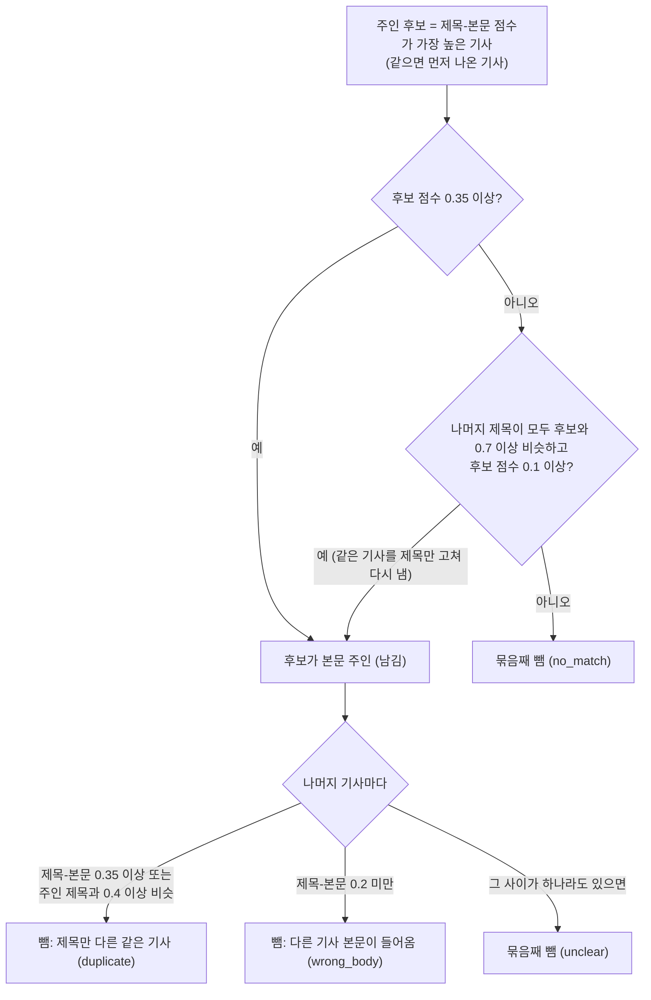

# NewsData 3개월 이슈 묶기 (실험)

NewsData.io 기사(지금부터 90일 전까지)를 사건 · 이슈로 묶고, 이슈마다 GMS 로 제목 · 요약을 지어 CSV 로 낸다.
F07 사건 중심 이슈 에볼루션 맵의 「이슈 판단」 단계(`SSOT.md` 3절, 「어떤 사건을 묶을지는 실험」)를 한 번에 돌려 보는 배치다. 워커 코드(`app/`)와는 따로 돈다.

## 돌리는 곳

GPU 개발 서버(JupyterHub)에서 노트북 하나로 돈다. 노트북은 저장소에 올리지 않고 만들어 쓴다.

```bash
uv run python experiments/issue_backfill/build_notebook.py
```

`issue_backfill.ipynb` 를 서버에 올리고 GPU 커널에서 위에서부터 실행한다. NewsData · GMS 키는 입력창으로 넣는다(환경변수 `NEWSDATA_API_KEY` · `GMS_API_KEY` 가 있으면 그 값). 결과는 노트북 옆 `issue_backfill_out/` 에 쌓인다.

## 단계

| 단계 | 하는 일 | 기본값 |
|---|---|---|
| 수집 | 과거 기사(archive)를 최근 날부터 하루씩 받는다. 막히면(무료 요금제) 최근 48시간(latest)만. 끝에 latest 를 한 번 더 불러 마지막 몇 시간을 채운다 | 한국 · 한국어, NewsData 중복 제거, 스포츠 · 연예 · 생활 · 음식 · 여행 분류 제외, 이번 실행 크레딧 상한 2,000 |
| 벡터 | `dragonkue/BGE-m3-ko`, 제목 + 줄바꿈 + 본문 앞 800자. 본문이 없으면(요금제) 설명 | GPU, 만든 벡터는 SQLite 에 저장 |
| 사건 | 72시간 안의 기사끼리 평균 연결, 코사인 거리 0.20 이하 | 0.20 · 72시간 |
| 이슈 | 사건을 첫 기사 시각순으로 보며, 최근 7일 안에 사건이 있던 이슈 중 평균 거리가 가장 가까운 곳이 0.40 이하면 붙인다 | 0.40 · 7일 |
| 이슈 조건 | 사건 3개 이상 | 3 |
| 요약 | 이슈 하나에 GMS 요청 하나. 기사 수가 많은 사건 30개까지 보낸다 | gpt-6-luna, 동시 4개 |

- 사건은 거리 0.20 이하 쌍으로 이은 덩어리마다 계산한다. 다른 덩어리끼리는 모든 쌍이 0.20 보다 멀어 평균도 멀다. 그래서 전체를 한 번에 계산한 결과와 같다(테스트로 확인). 예전 파이프라인의 3일 · 3,000건 구간 경계에서 같은 사건이 갈리던 문제가 없다
- 이슈는 실시간 사이트가 새 사건을 붙이는 순서대로 하나씩 붙인다. 한 번 갈린 두 이슈를 나중에 합치지는 않는다
- 요약 모델은 사건들이 한 흐름인지(`이슈`), 같은 분야의 별개 사건 모음인지(`주제 모음`)도 판정한다. 날마다 다른 날씨 · 시황이 한 이슈로 묶이는 경우를 거르려는 것이다. 판정은 표시만 하고 지우지 않는다
- 요약은 뉴스 브리핑 문체로 쓴다(프롬프트 v2, 2026-11-02 팀 논의). 발단 → 기사가 가장 많은 사건 중심의 전개 → 최근 상황 순서이고, 문장은 '~했다'처럼 '-다'로 끝낸다. '~습니다 · ~해요'로 끝나면 형식 오류로 보고 다시 묻는다. 제목은 발단 하나가 아니라 기사가 가장 많은 사건들의 쟁점과 그 중심 인물을 담는다. v3(2026-11-03)에서 두 가지를 더했다: 사건 제목에 되풀이되는 쟁점 낱말(문제가 된 행동 · 도구 · 발언)을 제목에 넣고, 공인이 아닌 피의자 · 피고인 · 피해자 실명은 제목 · 요약에 쓰지 않는다
- 「메인 사건 1개 이상」 조건은 아직 넣지 않았다. 사건마다 main · reaction 을 정하는 단계가 없다

## 크레딧

- NewsData: latest 는 요청 한 번에 1크레딧, **archive 는 5크레딧**이다(공식 문서). Basic 은 한 달 20,000, 15분에 1,800크레딧까지. 하루를 다 받을 때마다 「남은 날 예상 크레딧」을 찍는다. 상한에 닿으면 멈추고, 다시 돌리면 끝난 날은 건너뛰고 멈춘 쪽부터 잇는다
  - 2026-10-28 실제로 받은 양: 위 조건 · 요청당 50건으로 UTC 하루에 요청 63 ~ 311번 · 기사 3,150 ~ 15,535건(주말이 적다). 10-22 ~ 10-28 일곱 날에 archive 요청 1,416번(7,080크레딧) · 기사 70,690건(본문 있는 기사 88%). 이때는 archive 요청 1,503번 = 약 7,515크레딧(10-21 일부 포함, 75,040건)에서 멈추고 그 기간만 묶었다. 처음에 이것을 1,503크레딧으로 잘못 셌다(2026-11-04 고침)
- GMS: 이슈 하나에 요청 하나. 결과는 `summary_cache.json` 에 쌓여 같은 이슈는 다시 부르지 않는다

## 하루 단위 수집 (10/29 ~ 11/11)

10/21~28 뒤의 기사를 팀 수집 계획대로 한국 날짜(00:00~24:00) 하루씩 받는다. 11/4 에 10/29~11/3 을 받았고, 11/9 에 11/4~11/8, 11/12 에 11/9~11/11 을 같은 DB 에 더 받았다(GitLab 에 11/4 뒤 기사 파일이 없어 직접 받기로 함). 노트북은 `build_notebook.py newsdata_collect` 로 만들고, 결과는 노트북 옆 `newsdata_collect/newsdata.sqlite` 에 쌓인다. 수집 조건(`QUERY`)은 10/21~28 과 같다.

| 날짜 | 방식 | 하는 일 |
|---|---|---|
| 48시간이 지난 날(10/29~11/2 · 11/4~11/7 · 11/9~11/10) | archive | 하루를 1시간 칸 24개로 나눠 칸마다 첫 쪽을 받고, 첫 쪽의 `totalResults` 로 칸별 기사 수를 안다. 하루 목표 7,000건을 칸의 기사 비율대로 나눠 나머지 쪽을 받는다. 목표보다 적은 날(주말)은 다 받는다 |
| 48시간 안의 날(11/3 · 11/8 · 11/11) | latest | 그날을 다 받는다. `timeframe` 은 '그날 00:00부터 지금까지 분 + 15분'으로 매번 계산한다(36시간 고정이면 낮 12시 넘어 다시 받을 때 그날 새벽이 빠진다). `sort=pubdateasc` 로 그날 00:00 부터 읽고, 첫 쪽이 오래된 순이 아니면 최신순으로 처음부터 다시 받는다 |

- **최신순으로 7,000건에서 자르지 않는 이유:** 10/22~27 평일 4일로 시험하니 가장 이른 기사가 11:08~14:36 이었고 오전(06~12시) 기사가 0~11%만 남았다(전체는 33~38%). 1시간 칸 비율로 고르면 오전 비율이 전체와 같고, 분야 분포 차이가 최신순의 1/2~1/5 로 준다
- **하루 데이터셋(`newsdata_dataset.py`):** 중복 제거(article_id · 링크) → 원본 7,000건 고르기 → 불량 본문 거르기(아래 「불량 본문 규칙」) → 숨긴 기사 빼기(아래 「숨긴 기사」). 7,000건은 받은 원본 기준 상한이라 거른 뒤 건수는 날마다 다르다(2026-11-04 팀 합의). 원본은 1시간 칸마다 최신순으로 몫만큼 고른다. archive 로 받은 날은 받을 때 정한 칸별 몫을 그대로 쓰고(칸마다 마지막 쪽까지 받아 몫보다 많다), 다 받은 날(11/3 latest · 10/21~28)은 칸의 기사 비율로 나눈다. 불량 본문은 고른 원본 안에서만 찾아, 날을 넘겨 다시 낸 같은 본문은 못 잡는다
- **요청 기록:** 요청마다 `requests` 표에 남긴다(실패한 시도는 크레딧 0 으로 따로). 15분 1,800크레딧을 넘지 않게 기다린다. 날마다 팀방에 올릴 한 줄(요청 수 · 크레딧 · 받은 건수 · 그날 기사 · 중복 제거 후 · 원본 · 거른 뒤)을 찍는다

### 불량 본문 규칙 (2026-11-02 팀 합의)

NewsData 는 일부 언론사(채널A · 뉴스핌 · 이투데이 · 국민일보 등) 본문 자리에 약관 · 광고 · 다른 기사 본문을 넣어 보낸다. DB 에 넣기 전에 아래 순서로 뺀다. 구현은 `newsdata_dataset.py`(`bad_bodies` · `same_body_groups` · `decide`, 값은 머리의 상수), 판단 예시 7개는 `tests/test_newsdata_collect.py` 의 `test_bad_body_*` 다. 배치로 옮긴 뒤 같은 결과가 나오는지 이 예시로 맞춰 본다.

1. **본문이 비면 뺀다**(`empty_body`). 공백만 있어도 빈 본문이다
2. **같은 언론사 · 같은 본문 묶음을 찾는다**
   - 같은 언론사(`source_name`)끼리만 본다. 다른 언론사끼리 본문이 같은 것은 통신 기사를 받아 쓴 정상 보도라 둔다
   - 같은 본문: 연속 공백을 정리한 본문이 똑같거나, 짧은 쪽 본문 전체가 긴 쪽 본문의 앞부분과 똑같다(본문 뒤에 다른 글이 덧붙은 것). 앞 몇 줄만 같은 상투 문구(SBS RSS 안내 등)는 같은 본문이 아니다
   - 제목이 둘 이상인 묶음만 본다. 앞 50자가 같은 기사끼리만 비교하고, 50자보다 짧은 본문은 비교하지 않는다
3. **묶음마다 남길 기사를 정한다.** 점수 두 가지는 낱말의 이웃한 두 글자 조각(예: "다이소" → 다이 · 이소)으로 센다
   - 제목-본문 점수: `[속보]` · `(종합)` 같은 괄호 꼬리표와 언론사 이름을 뗀 제목의 조각 중 본문 앞 300자에도 나오는 비율. 길게 보면 본문 뒤 "많이 본 뉴스" 목록에 엉뚱한 제목이 맞는다
   - 제목-제목 점수: 두 제목의 조각 중 겹치는 비율(조각이 적은 쪽 기준)



14일 데이터셋(10/21~11/3, 고른 원본 83,134건)에서 뺀 수: `empty_body` 10,404 · `no_match` 280 · `duplicate` 46 · `wrong_body` 2 · `unclear` 0.

**알려진 빈틈 (2026-11-05 잼)**
- **비교 범위가 그날 고른 원본뿐이다.** 같은 본문의 짝이 다른 날 기사이거나 고르기에서 빠진 기사면 못 잡는다. 14일 기사 120,744건 전체로 다시 비교하면 최종 72,402건 중 54건이 더 걸린다(`no_match` 22 · `duplicate` 25 · `unclear` 5 · `wrong_body` 2, 국민일보 23 · 경향신문 5건 순). 그날 받은 기사 전체(고르기 전)와만 비교해도 14건이 더 걸린다. 같은 본문 묶음 143개 중 55개가 날을 넘는다. 수집 배치에 넣을 때는 그날 것끼리만 말고 그동안 받은 기사와 견주는 편이 낫다
- **같은 본문 짝이 없는 기사는 못 잡는다.** 본문 뒤에 다른 기획기사가 길게 붙은 국민일보 기사(앞부분만 다른 기사와 같다), 본문이 8,000자를 넘는데 제목-본문 점수가 0.2 미만인 기사(10/21~28 원본 75,040건 중 50건, 노컷뉴스 26 · 국민일보 7건 순)가 그렇다. 필요하면 "본문 길이 + 제목 불일치" 규칙을 따로 둔다

### 숨긴 기사 (운영 라벨, 2026-11-09)

운영에서 라벨로 숨긴 기사(주우님)의 URL 목록을 받아 데이터셋에서 뺀다(사유 `hidden`). 구현은 `newsdata_dataset.py`(`add_hidden_urls` · `build_day`), 예시는 `tests/test_newsdata_collect.py` 의 `test_hidden_*` 와 `test_bad_body_reason_stays_when_the_article_is_also_hidden` 다.

- 원본 7,000건을 고르고 불량 본문을 거른 **뒤에** 뺀다. 빈자리를 다른 기사로 채우지 않는다. 불량 본문 사유가 먼저 붙은 기사는 그 사유를 둔다
- URL 은 그대로 비교한다(팀 규칙: 같은 URL = 같은 기사). 1105 목록은 scheme · 끝 `/` 를 맞춰도 더 맞는 것이 없었다
- 목록 파일은 저장소에 넣지 않는다. 서버 노트북 옆 `hidden_urls/*.txt` 에 두고 수집 노트북 5절로 넣는다. 같은 목록을 다시 넣어도 늘지 않는다

2026-11-09 서버에서 10/21~11/8 에 넣은 결과(수집 노트북 5절):

| 목록 | 무엇 | URL | DB 와 맞음 | 이번에 뺌(`hidden`) | 불량 본문 규칙이 이미 뺌 | 원본에 안 뽑힘 | DB 에 없음 |
|---|---|---|---|---|---|---|---|
| `hidden-urls-1105.txt` | 운영에서 숨긴 기사 | 3,500 | 3,466 | 3,152(10/21~11/3 3,149) | 26(`no_match` 22 · `wrong_body` 2 · `unclear` 2) | 288 | 34 |
| `hidden-urls-1109.txt` | 잘못된 본문 중 운영 수집 규칙에 안 걸린 것 | 15 | 13 | 4 | 9(`no_match` 8 · `duplicate` 1) | 0 | 2 |
| `hidden-urls-1112.txt` | 운영에서 숨긴 11/9~11/11 기사(화면 문구 본문 · 내용 없음 · 제목과 다른 본문 · 두 제목 같은 본문) | 12 | 8 | 2 | 5(`no_match` 5) | 1 | 4 |

- 1109 목록 13건 중 9건은 이 실험의 불량 본문 규칙이 이미 뺐다. 나머지 4건(경향신문 1 · 뉴스핌 1 · 이투데이 2)은 이 규칙에 안 걸렸다. 뉴스핌 1건은 같은 본문 묶음에서 본문 주인으로 남은 기사다(짝은 `duplicate` 로 빠짐)
- 숨긴 뒤 최종: 10/21~11/3 72,402 → 69,253건
- 1112 목록(2026-11-12 서버에서 넣음)은 12건 모두 최종 데이터셋에 없다. 「DB 에 없음」 4건(11/10 SBS 2 · 경향신문 2)은 11/10 archive 가 칸별 몫만 받아 처음부터 받지 않은 기사다

최종 덤프 뒤에도 운영이 더 숨기면, 그 목록을 같은 방법으로 넣고 데이터셋 · 분류를 다시 만든다.

2026-11-04 10:01~10:33 실제로 받은 결과(서버 `minjun/issue_backfill/newsdata_collect/newsdata.sqlite`, 실패 요청 0번):

| 날짜 | 방식 | 요청 · 크레딧 | 그날 기사 | 받음 | 원본 | 거른 뒤 |
|---|---|---|---|---|---|---|
| 10/29(목) | archive | 153 · 765 | 15,747 | 7,650 | 7,000 | 6,114 |
| 10/30(금) | archive | 151 · 755 | 11,811 | 7,539 | 7,000 | 6,020 |
| 10/31(토) | archive | 78 · 390 | 3,320 | 3,320 | 3,320 | 2,838 |
| 11/1(일) | archive | 126 · 630 | 5,694 | 5,694 | 5,694 | 5,111 |
| 11/2(월) | archive | 151 · 755 | 13,939 | 7,532 | 7,000 | 6,110 |
| 11/3(화) | latest | 280 · 280 | 13,960 | 13,960 | 7,000 | 6,140 |
| 합계 | | 939 · 3,575 | | 45,695 | 37,014 | 32,333 |

- archive 의 시각 칸(from_date · to_date 에 UTC 시각)은 요청한 대로 읽혔고 `totalResults` 도 왔다. 몫보다 덜 나온 칸 · 기사가 없는 시간은 없었다
- latest 는 `sort=pubdateasc` 가 먹었다(11/2 23:44 부터 11/4 00:00 까지 280쪽). 최신순이었다면 11/4 0~10시 기사도 넘겨야 했다
- 15분 한도에는 10/31 을 받는 중 한 번 닿아 343초 쉬었다. NewsData 쪽 429 는 없었다
- archive 는 칸마다 마지막 쪽을 다 받아 몫보다 하루 500~650건 더 받는다(쪽당 50건). 데이터셋 원본은 칸별 몫만큼만 쓴다

같은 날 10/21~28 기사(75,040건, `issue_backfill_out/newsdata.sqlite`)를 이 DB 로 옮겨 같은 기준으로 정리했다(그때 노트북 4절, 커밋 4d6906f. 한 번만 돌리는 칸이라 11/9 노트북에서는 뺐다). 겹치는 기사는 없었고, 합친 DB 는 기사 120,744건이다. 합치기 전 DB 는 서버 `minjun/_archive_20261104/` 에 있다.

| 날짜 | 기사 | 원본 | 거른 뒤 |
|---|---|---|---|
| 10/21(18:50~) | 1,879 | 1,879 | 1,557 |
| 10/22 | 15,354 | 7,000 | 6,038 |
| 10/23 | 11,397 | 7,000 | 6,017 |
| 10/24(토) | 3,393 | 3,393 | 2,812 |
| 10/25(일) | 5,848 | 5,848 | 5,300 |
| 10/26 | 13,672 | 7,000 | 6,188 |
| 10/27 | 14,897 | 7,000 | 6,052 |
| 10/28(~14:42) | 8,600 | 7,000 | 6,105 |
| 10/29~11/3 | 45,695 | 37,014 | 32,333 |
| **합계 (14일)** | **120,735** | **83,134** | **72,402** |

- 원본 7,000건(상한)은 10/21~28 · 11/3 은 그날 기사의 1시간 칸 비율로, 10/29~11/2 는 받을 때 정한 칸별 몫으로 골랐다. 불량 본문은 고른 원본 안에서 뺐다
- 2026-11-04 오후, 7,000건을 원본 기준 상한으로 정한 팀 합의에 맞춰 14일을 다시 만들었다. 그 전에는 거른 뒤에 7,000건을 골라 최종이 79,335건이었다. 옛 `selection` · `days` 표는 서버 `minjun/_archive_20261104/derived_before_rawcap.sqlite` 에 있다
- 10/28 은 오후 3시 이후 기사가 없어 원본 7,000건이 0~14시 기사뿐이다

2026-11-09 10:47~11:10 에 11/4~11/8 을 같은 DB 에 더 받았다(노트북 `newsdata_collect_1109.ipynb`, 실패 요청 0번). 받기 전 DB 는 서버 `minjun/_archive_20261109/` 에 있다. 받기 전에 10/21~11/3 을 지금 코드로 다시 만들어 원본 83,134 · 최종 72,402 가 그대로인 것을 확인했다. 아래 `거른 뒤` 는 숨긴 기사까지 뺀 값이다.

| 날짜 | 방식 | 요청 · 크레딧 | 그날 기사 | 받음 | 원본 | 거른 뒤 |
|---|---|---|---|---|---|---|
| 11/4(수) | archive | 153 · 765 | 14,457 | 7,650 | 7,000 | 5,944 |
| 11/5(목) | archive | 152 · 760 | 13,620 | 7,550 | 7,000 | 6,014 |
| 11/6(금) | archive | 151 · 755 | 11,247 | 7,528 | 7,000 | 6,128 |
| 11/7(토) | archive | 78 · 390 | 3,302 | 3,302 | 3,302 | 2,774 |
| 11/8(일) | latest | 100 · 100 | 4,944 | 5,000 | 4,944 | 4,474 |
| 합계 | | 634 · 2,770 | | 31,030 | 29,246 | 25,334 |

- 몫보다 덜 나온 칸은 없었다. 15분 한도에 한 번 닿아 343초 쉬었다
- latest 는 `sort=pubdateasc` 로 11/7 23:45 부터 11/9 00:03 까지 100쪽을 읽었다
- 11/4 는 중복 제거 후 7,659건이다. 11/3 latest 가 11/4 0시대 기사 9건을 미리 받아 두었다

2026-11-12 15:47~16:06 에 11/9~11/11 을 같은 DB 에 더 받았다(노트북 `newsdata_collect_1112.ipynb` — Claude 가 노트북 커널로 셀을 차례로 실행했고 출력은 서버 `newsdata_collect/run_1112.log`). 받기 전 DB 는 서버 `minjun/_archive_20261112/` 에 있다. 받기 전에 10/21~11/8 을 지금 코드 · 숨김 목록 둘로 다시 만들어 원본 112,380 · 최종 94,587 이 그대로인 것을 확인했고, 받은 뒤에도 그대로다. 같은 노트북 7절이 받은 날 선정 기사의 BGE-m3-ko 벡터(`vectors_1109_1111.sqlite`, 18,113건)를, 8절이 내려받을 DB 사본(`VACUUM INTO`)을 만든다.

| 날짜 | 방식 | 요청 · 크레딧 | 그날 기사 | 받음 | 원본 | 거른 뒤 |
|---|---|---|---|---|---|---|
| 11/9(월) | archive | 149 · 745 | 11,552 | 7,393 | 7,000 | 6,116 |
| 11/10(화) | archive | 154 · 770 | 14,226 | 7,700 | 7,000 | 6,093 |
| 11/11(수) | latest | 296 · 296 | 14,741 | 14,800 | 7,000 | 5,904 |
| 합계 | | 599 · 1,811 | | 29,893 | 21,000 | 18,113 |

- 11/9 archive 요청 1번이 NewsData 500 으로 실패해 크레딧 0 으로 따로 남았다(다시 받아 몫보다 덜 나온 칸은 없다)
- latest 는 `sort=pubdateasc` 로 11/10 23:44 부터 11/12 00:01 까지 296쪽을 읽었다
- 11/9 는 중복 제거 후 7,437건이다. 11/8 latest 가 11/9 0시대 기사를 미리 받아 두었다

| 기간 | 날 | 원본 | 거른 뒤(숨김 포함) |
|---|---|---|---|
| 10/21~11/3 | 14 | 83,134 | 69,253 |
| 11/4~11/8 | 5 | 29,246 | 25,334 |
| 11/9~11/11 | 3 | 21,000 | 18,113 |
| **합계** | **22** | **133,380** | **112,700** |

## 결과

| 파일 | 한 줄 |
|---|---|
| `issues.csv` | 이슈. `이슈제목, 요약, 사건, 사건수, 기사수, 시작, 끝, 이슈판정, 판정근거, 이슈ID`. 사건 수 → 기사 수가 많은 순 |
| `issue_events.csv` | 이슈에 든 사건. 대표 기사(사건 평균에 가장 가까운 기사) 제목 · 링크 |
| `issue_articles.csv` | 이슈에 든 기사 |
| `newsdata.sqlite` | 받은 기사 · 벡터 · 날짜별 수집 진행 |

`사건` 칸은 사건마다 `날짜 대표 기사 제목 (기사 수)` 한 줄씩이다.

## 파일

| 파일 | 내용 |
|---|---|
| `newsdata_fetch.py` | NewsData 요청 · 저장 · 이어 받기 |
| `newsdata_daily.py` | 하루 단위 수집(archive 1시간 칸 · latest 전날) · 요청 기록 · 15분 한도 |
| `newsdata_dataset.py` | 하루 데이터셋(중복 · 7,000건 고르기 · 불량 본문 · 숨긴 기사) · 기록 한 줄 |
| `collect_source.py` | 수집 노트북 셀 순서와 설정값 |
| `issue_grouping.py` | 벡터 · 사건 · 이슈 · CSV |
| `issue_summary.py` | GMS 프롬프트 · 요약 캐시 |
| `notebook_source.py` | 노트북 셀 순서와 설정값 |
| `build_notebook.py` | 위 넷을 노트북 하나로 묶는다 |
| `regroup.py` | 저장한 기사 · 벡터로 다시 묶는다. 2주 · 19일 결과를 만든 설정(사건 0.25 · 기사 5건 이상 사건 · 이슈 0.40)이 기본값 |
| `regroup_input.py` | 데이터셋 선정 기사와 벡터로 `regroup.py` 입력 DB 를 만든다 |

테스트는 `tests/test_issue_backfill.py` · `tests/test_newsdata_collect.py` 다(네트워크 · 모델 없이 돈다).
