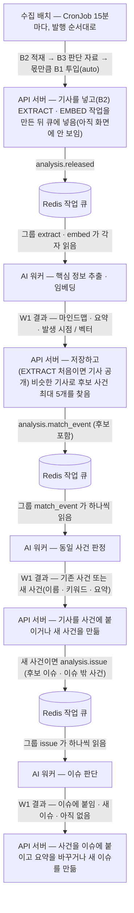
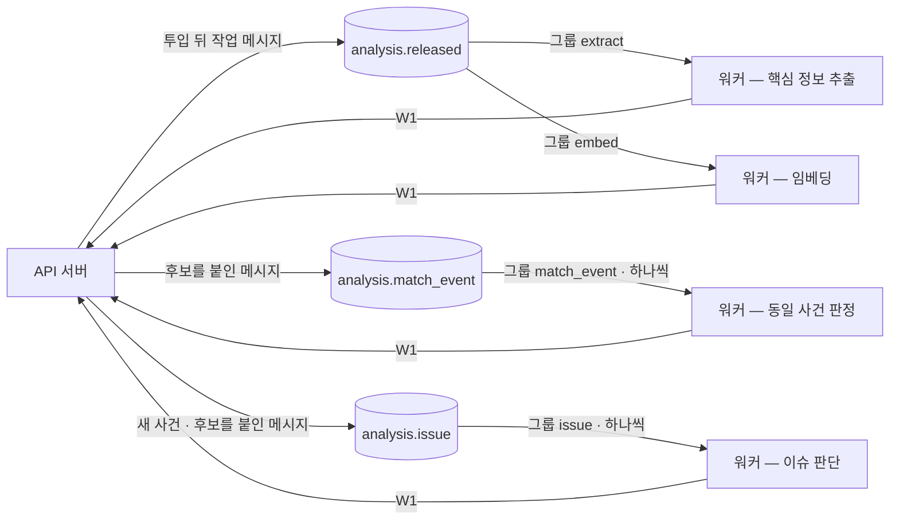
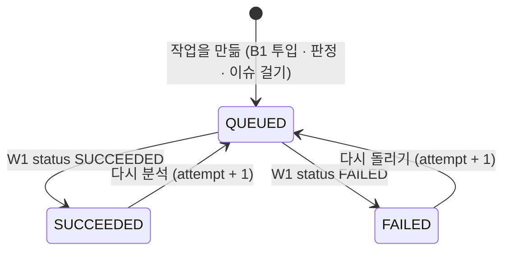

# 내부 API · 작업 큐 (v1)

수집 배치 · AI 워커가 API 서버와 주고받는 모양이다. 공통 규칙 · 오류 코드는 `docs/api.md`, 테이블은 `docs/data-model.md`, 용어는 `docs/glossary.md`.

SSOT 2절 3~6번(배치가 적재 · 투입, 작업 큐 등록, 워커 분석, 결과 저장)을 이렇게 하자고 제안한다. 큐에 넣는 코드는 API 한 곳에만 두고(SSOT 4절), 워커는 DB 를 직접 쓰지 않고 결과를 HTTP(W1)로 API 에 보낸다. DB 구조와 규칙(후보 확인 · 이슈 겹침)을 API 한 곳만 알고, 틀린 결과 · 겹침을 응답(400 · 409)으로 바로 알려 주려는 것이다. 결과용 스트림은 API 쪽에 소비자가 하나 더 생기고 이런 답을 워커에게 돌려줄 길이 없어 쓰지 않는다(2026-10-21 BE 안). pgvector 후보 검색과 저장은 API 가 한다. AI 담당이 2026-10-23 에 이 안에 동의했다.

- **v1 (2026-10-21, Jira S15P31A102-99)**: 마인드맵 결과를 가지 4개로 바꾸고(10-21), 사건에 키워드(`label`)를 더하고(10-20), 이슈를 붙이고 만드는 단계 `ISSUE` 를 더했다(제안 — 10-20 「이슈는 사건 3개가 모이면 생성」을 이루는 길). 사용자 URL 분석은 지웠다
- **v1.1 (2026-10-26, Jira S15P31A102-111)**: AI 답(2026-10-23)을 반영했다. 대표 사건 표시(`primaryCoreIndex`)와 대표 사건이 없는 기사는 판정을 건너뛰는 규칙, 분석할 수 없는 입력, 후보 사건의 원문 근거, 판정 기록, GMS 연결 실패를 더했다
- **v1.2 (2026-10-26, Jira S15P31A102-30)**: 출입증(`X-Internal-Key`), 스트림 길이 상한 · 그룹 만들기 · 큐에 못 넣은 작업 다시 넣기, W1 의 401 · 403 · 봉투를 못 읽을 때, 워커 쪽 숫자(BE 안)를 정했다. 다시 걸기 간격은 `api.md` 2절
- **v1.3 (2026-10-26, Jira S15P31A102-34)**: B1 은 분석만 건다 — 기사가 보이는 때(`released_at`)는 EXTRACT 결과를 처음 저장한 때로 옮겼다(사용자 결정). 202 본문을 정했다
- **v1.4 (2026-11-03, Jira S15P31A102-153)**: 기사 적재 B2 를 더했다. 수집 배치는 기사를 B2 로 넣고 돌려받은 id 로 B1 을 부른다 — DB 에 직접 쓰지 않는다(`SSOT.md` 8절에 미정으로 있던 적재 길)

표 읽는 법은 `docs/api-screen.md` 머리와 같다. 「저장하는 곳」은 API 가 그 값을 어느 칸에 넣는지다.

---

## 1. 한눈에

주고받는 순서 — 선 위 글자가 오가는 계약 · 메시지다



큐 지도 — 스트림 셋을 consumer group 넷이 읽는다



---

## 2. 수집 배치 — B2 기사 적재 · B1 기사 투입

실서비스 수집 배치는 NewsData.io 를 k8s CronJob 으로 15분마다 돌아 최근 30분 기사를 받는다(2026-11-13 10:00 수집 뒤, Jira 156 — 앞서 매일 10시 전날치, 처음 2026-10-20 에는 하루 두 번 00 · 12시). 기사마다 B2 로 넣고, 돌려받은 id 로 B1 을 부른다. 다만 AI 결과 덤프가 들어갈 때까지는 B2 만 부르는 넣기만 모드(`INGEST_MODE=load-only`)로 돈다 — B1 을 걸면 운영 AI 워커가 덤프와 같은 기사를 따로 분석한다(`infra/server/ingest.md`). DB 에 직접 쓰지 않는다 — 필수 값 검사 · 언론사 등록 · 같은 URL 처리를 API 한 곳이 시험으로 지키려는 것이다(2026-11-02 인프라 담당, Jira 153). 실행 한 번의 받은 수 · 넣은 수 · B1 결과는 배치 Job 로그 한 줄로 남기고, `ingest_run` 은 지금 쓰지 않는다.

배치가 B2 를 부르기 전에 거르는 기사(2026-11-03 인프라 담당)

- 본문(`content`)이 없는 기사 — B2 도 400 으로 거절하지만 헛 요청을 줄인다. 2026-11-03 최신 기사 50건 중 6건이 null 이었다
- 스포츠 · 연예 · 생활 · 음식 · 여행 — `category` 에 `sports` · `entertainment` · `lifestyle` · `food` · `tourism` 이 있는 기사(2026-11-04 팀장 조건 — 처음 2026-11-03 은 연예 · 스포츠 둘, `SSOT.md` 9절 2026-10-20 「카테고리 7개 → 5개」, `data-model.md` 2절 category_mapping). B2 는 분류를 보고 거절하지 않는다
- NewsData 가 `duplicate=true` 로 표시한 기사 — 쿼리의 `removeduplicate=1` 과 같이 겹친 기사를 뺀다(2026-11-04 팀장 조건, 팀원 수집과 같게)
- `pubDateTZ` 가 UTC 가 아닌 기사 — 지금까지 받은 응답은 모두 UTC 였다. 다른 값이 오면 배치가 시각을 바로 붙이지 못하니 세고 넘긴다
- 다른 기사 본문을 달고 온 기사 — 다 받은 뒤 기사끼리 견주어 뺀다. 규칙은 `infra/server/ingest.md`(2026-11-05 Jira S15P31A102-183)

### B2. 기사 적재 — `POST /internal/v1/articles`

기사 하나를 `article` 에 넣고 id 를 돌려준다. `released_at` 은 비워 둔다 — 공개는 B1 으로 분석을 건 뒤 API 가 한다. 지금은 NewsData 기사만 받는다(소스가 늘면 `source` 칸을 더한다).

| 칸 | 타입 | 필수 | 규칙 | NewsData 에서 | 저장하는 곳 |
|---|---|---|---|---|---|
| `url` | string | 예 | `http://` · `https://` 로 시작하고 그 뒤에 주소가 한 글자 이상 있다. 경로는 보지 않는다(퍼센트 인코딩 안 된 한글도 받는다). 2048자까지. 받은 그대로 둔다 — 정규화하지 않는다 | `link` | `article.url` |
| `pressSourceId` | string | 예 | 100자까지 | `source_id` | 언론사를 고르는 대응 키(`press_mapping.source_value`). 처음 보는 언론사면 `press.code` |
| `pressName` | string | 예 | 100자까지. 언론사를 처음 등록할 때만 쓴다 — 있는 언론사의 이름은 바꾸지 않는다 | `source_name` | 처음이면 `press.name` |
| `title` | string | 예 | 300자까지 | `title` | `article.title`. HTML 조각(`quot;` · `hellip;` 등)은 글자로 되돌려 저장한다(`data-model.md` article) |
| `reporter` | string | 아니오 | 200자까지. 빈 값은 없는 것으로 둔다 | `creator[]` — 잇는 법은 배치가 정한다 | `article.reporter` |
| `body` | string | 예 | 공백만은 안 된다. 10만 자까지 | `content` | `article.body` |
| `publishedAt` | string(시각) | 예 | 오프셋이 있어야 한다(`docs/api.md` 1절 「시간」). `pubDate` 는 시간대가 없어 배치가 `pubDateTZ`(UTC)를 붙여 `2026-11-02T23:15:46Z` 로 보낸다 | `pubDate` + `pubDateTZ` | `article.published_at` |
| `sourceCategories` | string[] | 아니오 | 20개 · 항목마다 100자까지, 빈 항목은 안 된다. 없으면 빈 목록 | `category[]` | `article.source_categories`. 대표 카테고리는 `category_mapping` 으로 고르고, 정치로 고른 기사는 제목으로 해외 정치를 가려 국제로 옮긴다(`data-model.md` 2절) |
| `sourceTags` | string[] | 아니오 | 같은 규칙. 없으면 비운다 | `ai_tag[]` | `article.source_tags` |

- 글자 칸 · 목록 항목에 U+0000 이 있으면 400 이다(PostgreSQL 이 글자로 받지 못한다). 길이 · 개수 상한은 우리 제안이다 — 2026-11-03 응답 50건의 최댓값은 제목 57자 · 링크 197자 · 본문 7,157자였다
- 언론사는 `press_mapping(NEWSDATA, pressSourceId)` 가 가리키는 곳이다. 대응 행이 없으면 처음 보는 언론사로 등록한다 — 규칙은 `data-model.md` 2절 press

| 응답 | 뜻 |
|---|---|
| 201 | 새로 넣었다 — `{ "articleId": 123, "created": true }` |
| 200 | 같은 URL 의 기사가 이미 있다 — `{ "articleId": 123, "created": false }`. 아무 칸도 바꾸지 않는다. 같은 URL 둘이 동시에 와도 한 행만 생기고 둘 다 그 id 를 받는다 |
| 400 `VALIDATION_FAILED` | 필수 값이 없거나 규칙에 어긋난다. `errors[]` 에 칸(`url` · `sourceCategories[1]` 처럼)과 이유가 있다. 다시 보내도 같다 — 배치는 세고 다음 기사로 |
| 401 `UNAUTHORIZED` · 403 `FORBIDDEN` | B1 과 같다(배치 출입증만 연다) |
| 500 `INTERNAL_ERROR` | 저장이 URL 이 아닌 까닭으로 실패했다 — 정한 id 로 데이터를 넣은 뒤 시퀀스가 낮게 남았거나, 인코딩 안 된 한글 · 기호가 많은 링크가 DB 고유 색인 상한(UTF-8 약 2,700바이트)을 넘었다(지금까지 받은 링크는 197자까지). 같은 URL 로 읽지 않는다 |

auto 모드의 배치는 회차의 기사를 모두 B2 로 넣은 뒤, B3 로 오늘 건 수 · EXTRACT 대기 · 후보를 읽어 몫만큼 B1 을 건다(아래 B3). 409 `ALREADY_RELEASED` 는 건너뛴다. B1 이 연결 실패 · 5xx 로 끝난 기사는 그 회차에 다시 걸지 않는다 — 다음 회차 B3 가 작업 행이 없는 기사만 후보로 주니 서버가 받았으면 빠지고 못 받았으면 다시 나온다(2026-11-10 AI 팀장, Jira 156). 그 전 full 모드(그 회차 기사를 상한 없이 모두 B1 · 끝에 한 번 더)는 없앴다.

### B1. 기사 투입 — `POST /internal/v1/articles/{articleId}/release`

B2 로 적재해 둔 기사에 분석을 건다. 적재할 때 `released_at` 은 비워 둔다 — 공개는 API 가 한다. API 는 `EXTRACT` · `EMBED` 작업 행을 만들고 커밋 뒤 큐에 넣는다 — 분석만 건다. **기사가 화면에 보이는 때(`article.released_at`)는 EXTRACT 결과를 처음 저장한 때다.** 분석이 끝난 기사부터 보이게 하려는 것이다(2026-10-26 사용자, Jira 34). EXTRACT 가 끝내 실패한 기사(분석할 내용 없음 · 거절 등)는 화면에 나오지 않는다. 같은 기사 투입 둘이 동시에 와도 기사 행을 잠그고 보아 하나만 202 다.

| 인자 | 타입 | 용도 |
|---|---|---|
| `articleId` | number | 주소. 투입할 기사(`article.id`) |

| 응답 | 뜻 |
|---|---|
| 202 | 분석을 걸었다. 본문은 건 작업 — `{ "articleId": 456, "jobs": [{ "jobId": 789, "stage": "EXTRACT", "attempt": 1 }, { "jobId": 790, "stage": "EMBED", "attempt": 1 }] }`. 사람 · AI 가 시험할 때 W1 에 넣을 작업 ID 를 보라고 준다. 배치는 읽지 않아도 된다 |
| 401 `UNAUTHORIZED` | 배치 출입증(`X-Internal-Key`)이 없거나 틀렸다. 다시 보내도 같다 — 설정을 고친다 |
| 403 `FORBIDDEN` | 배치 출입증이 아니다(워커 키 등) |
| 404 `ARTICLE_NOT_FOUND` | 그런 기사가 없다 |
| 409 `ALREADY_RELEASED` | 이미 투입했다(그 기사의 분석 작업이 있다) 또는 이미 화면에 있다(`released_at` 이 있다). 배치는 건너뛴다. 분야 라벨로 숨겨 `released_at` 이 빈 기사는 작업이 없으면 409 가 아니다 — 202 로 분석이 걸리고 다시 공개된다(`infra/server/category-labels.md` 5절) |

- 데이터셋은 검증용이라(SSOT 5절) 서비스에 투입할지는 정하지 않았다(`data-model.md` 5절 17번)

## 3. 큐 모양과 순서

- 스트림 `analysis.released` 하나를 consumer group `extract` · `embed` 가 각자 읽는다. SSOT 4절의 「단계마다 consumer group」 모양이다. 단계마다 스트림을 따로 두지 않는 것은 본문을 한 번만 저장하려는 것이다. 한 단계만 다시 돌릴 때는 그 단계 ID 만 싣고, 다른 그룹은 읽고 건너뛰고 ack 한다(2026-10-21 BE 안)
- 스트림 `analysis.match_event` 는 그룹 `match_event`, `analysis.issue` 는 그룹 `issue` 하나가 읽는다. 후보를 API 가 붙여 넣어야 해서 따로 둔다
- ack 해도 메시지는 스트림에 남는다 — `XACK` 은 그룹의 처리 중 목록(PEL)에서만 지운다. 그래서 API 는 넣을 때마다 `XADD … ACKED MAXLEN ~ N` 으로 길이를 자른다. `ACKED` 는 모든 그룹이 읽고 ack 한 메시지만 잘라 내서, 밀린 그룹이 아직 안 읽은 메시지는 남는다(Redis 8.2 부터, 우리는 8.10.2). N 은 스트림마다 10000 이다 — 본문 10KB 로 잡아도 약 100MB 라 Redis `maxmemory 1gb`(로그인 세션 · 잠금 키와 같이 씀) 안이다. `~` 는 정확히 N 개가 아니라 내부 덩어리(100개) 단위로 자른다. 실제 본문 크기는 NewsData 구독 뒤 재서 고친다(2026-10-26 Jira 30)
- 스트림 셋 · 그룹 넷은 API 가 뜰 때 만든다(`XGROUP CREATE <스트림> <그룹> 0 MKSTREAM`, 있으면 그대로). 시작 위치가 0 이라 그룹이 생기기 전에 들어온 메시지도 읽는다. 워커는 그룹을 만들지 않는다(2026-10-26 Jira 30)
- API 는 DB 를 커밋한 **뒤** 큐에 넣는다. 그래서 정상 흐름에서 W1 이 404 를 받는 일은 없다. 큐에 넣었으면 그 시도의 `published_at` 을 적는다. 넣다 실패해(Redis 끊김) `QUEUED` 인데 `published_at` 이 빈 지 1분이 넘은 작업은 API 스케줄러가 다시 넣는다. 넣은 작업은 워커가 느리거나 꺼져 있어도 다시 넣지 않는다 — 같은 메시지를 또 넣어 GMS 를 두 번 부르지 않게(2026-10-26 Jira 30). 드문 예외가 둘 있다: 큐에 넣은 뒤 `published_at` 을 적다 실패하면 1분 뒤 한 번 더 들어간다(두 번째 결과는 409). 스케줄러가 「내가 넣는다」를 적은 뒤 넣기 전에 API Pod 가 죽으면 그 작업은 `QUEUED` 로 남는다 — 손으로 다시 건다
- 처리 중에 죽은 워커의 메시지는 20분 넘게 ack 가 없으면 다른 워커가 `XAUTOCLAIM` 으로 가져간다. 워커는 메시지 하나를 15분 안에 끝낸다 — GMS 를 다시 부르는 시간(한 번에 최대 180초, 끊김 · 한도 초과면 몇 번 더)과 W1 다시 보내기(약 1분, 5절)를 합친 상한이고, 넘으면 그 시점의 코드로 실패를 보낸다. 다시 가져가기는 이 상한보다 길게 잡아, 살아 있는 워커의 메시지를 다른 워커가 가져가 GMS 를 두 번 부르지 않게 한다(2026-10-28 AI 제안 · BE 확인, Jira 130 — 전에는 10분. `api.md` 4절 AI 9번)
- 워커가 메시지를 읽을 때(2026-10-28 AI 제안 · BE 확인, Jira 130). `jobs` 에 내 단계의 작업이 없으면 다른 단계만 다시 돌리는 메시지라 건너뛰고 ack 한다(위 첫 줄). payload JSON 이 깨졌거나 `jobs` · `attempt` 자체가 없어 작업 번호를 알 수 없으면 W1 을 보낼 수 없으니, 오류 로그에 스트림 이름 · 메시지 ID 를 남기고 ack 한다 — ack 하지 않으면 다시 가져가기마다 같은 메시지가 끝없이 돈다. 그 작업은 `QUEUED` 로 남는다(판정이면 아래 WARN 과 같은 방법으로 푼다). API 가 만든 메시지라 정상 흐름에서는 나오지 않는다
- `MATCH_EVENT` 는 한 번에 하나씩 발행 순서대로 돈다. API 는 앞 기사의 판정이 끝난 뒤 다음 기사의 판정을 건다. 같은 사건 기사 둘이 동시에 판정되면 서로를 후보로 못 봐 사건이 둘로 갈라지기 때문이다(PRD FR-31 「앞선 기사들과만 비교」)
  - 고르는 규칙(2026-10-27 BE 안, Jira 35). 판정을 거는 곳은 「다음 판정 고르기」 한 군데다. W1 결과를 처리한 뒤(성공 · 실패 모두)와 1분 스케줄러가 커밋이 끝난 상태만 보고 고른다 — EXTRACT · EMBED 가 동시에 끝나도 한 번만 건다
  - 판정 작업이 하나라도 진행 중이면 기다린다. 진행 중 = `QUEUED`, 또는 `FAILED` 인데 다시 걸 예정(`retry_at` 있음). 다시 걸지 않는 실패는 진행 중이 아니라 다음 기사로 넘어간다. 다시 걸 예정인 실패는 간격을 다 써도 약 20분 뒤 멈춘 실패가 된다(5분 + 15분, `api.md` 2절)
  - **`QUEUED` 인 판정에 W1 이 끝내 오지 않으면 판정 줄 전체가 멈춘다.** 넣은 뒤 메시지를 잃었거나(위 「드문 예외」, Redis 장애), 워커가 W1 없이 ack 한 경우다. 다른 단계는 기사 하나만 멈추지만 판정은 한 줄이라 뒤가 모두 기다린다. 그래서 워커는 판정 메시지를 **실패여도 반드시 W1 으로 끝내고**, ack 는 W1 을 보낸 뒤에 한다(5절 「API 응답」)
  - 같은 판정 작업이 40분 넘게 `QUEUED` 면 고르기가 WARN 「판정 줄이 멈췄을 수 있다: 판정 작업 N」을 남긴다. 건강한 판정은 워커 상한(15분) 안에 끝나고, 처리 중 워커가 죽어도 다시 가져가기(20분) + 다른 워커의 처리(15분) 안에 끝난다(2026-10-28 30분 → 40분, Jira 130). 푸는 법: 워커 로그로 그 작업에 W1 을 보냈는지 본다. 메시지를 잃었으면 그 작업의 `published_at` 을 비운다 — 1분 스케줄러가 같은 시도로 다시 넣는다(늦게 온 옛 결과는 409). 시간이 지나면 저절로 실패로 돌리는 일은 하지 않는다 — 늦게 온 결과를 버리고 GMS 를 두 번 부를 수 있어서다(2026-10-27 Jira 35 리뷰)
  - 진행 중인 판정이 없으면 판정할 기사 중 **발행 시각이 가장 이른 것** 하나를 고른다. 판정할 기사 = `EXTRACT` · `EMBED` 모두 `SUCCEEDED`, 대표 사건 번호가 있음, 판정 작업이 아직 없음, 사건에 안 묶임. 앞 기사가 아직 `EXTRACT` 중이면 기다리지 않고 다음 기사를 판정한다 — 기다리면 실패로 멈춘 기사 하나가 뒤를 모두 막는다. 나중에 더 이른 기사가 붙으면 사건 시점을 당긴다(5절 「MATCH_EVENT 결과를 받을 때」)
  - API Pod 둘이 같이 골라도 트랜잭션 잠금 하나(`pg_advisory_xact_lock`)로 줄을 선다. 기사 · 작업 행은 잠그지 않는다
- `ISSUE` 도 한 번에 하나씩 돈다. API 는 앞 `ISSUE` 결과를 저장한 뒤 다음 작업을 걸고, **그때** 후보를 계산한다. 다시 돌릴 때(`attempt + 1`)도 후보를 새로 계산한다. 같은 사건들로 이슈가 둘 생기거나, 이미 이슈에 든 사건을 다른 이슈가 가져가지 않게 하려는 것이다
  - 고르는 규칙(2026-10-29 BE 안, Jira 40). ISSUE 를 거는 곳은 「다음 ISSUE 고르기」 한 군데다. W1 결과를 처리한 뒤(성공 · 실패 모두)와 1분 스케줄러가 부른다. 판정 고르기와 따로 돌고 트랜잭션 잠금(`pg_advisory_xact_lock`)의 키도 다르다 — 판정은 ISSUE 를 기다리지 않는다
  - ISSUE 작업이 하나라도 진행 중이면 기다린다. 진행 중 = 후보(`candidates`)가 있는 `QUEUED`, 또는 `FAILED` 인데 다시 걸 예정(`retry_at` 있음). 후보가 빈 `QUEUED` 는 아직 고르지 않은 대기 작업이다(아래 「`ISSUE` 는 … 때만 건다」)
  - 진행 중이 없으면 대기 작업 중 작업 번호가 가장 작은 것 — 사건이 생긴 순서 — 하나를 골라 후보를 계산해 `candidates` 에 남기고 큐에 넣는다(4절). 고를 때 `queued_at` 도 지금으로 적는다 — 대기 작업은 판정 때 만들어져 오래됐을 수 있어서, 그대로 두면 아래 멈춤 WARN 이 방금 고른 작업에 나고 「못 넣은 작업 넣기」의 1분 기다림이 먹히지 않는다. 기다린 시간은 `created_at` 에 남는다. 그 기사의 사건이 없거나 이미 이슈 안이면(사람이 고친 경우) 묻지 않고 그 작업을 `SUCCEEDED` 로 끝내고 다음 대기 작업을 본다
  - `QUEUED` 인 ISSUE 에 W1 이 끝내 오지 않으면 ISSUE 줄 전체가 멈춘다 — 판정과 같다. 그래서 워커는 ISSUE 메시지도 실패여도 반드시 W1 으로 끝내고, ack 는 W1 을 보낸 뒤에 한다. 같은 ISSUE 작업이 고른 뒤 40분 넘게 `QUEUED` 면 고르기가 WARN 「ISSUE 줄이 멈췄을 수 있다: ISSUE 작업 N」을 남긴다. 푸는 법은 판정과 같다(위)
- `MATCH_EVENT` 는 `EXTRACT` 와 `EMBED` 가 둘 다 끝나고 `EXTRACT` 결과의 `primaryCoreIndex` 가 null 이 아닐 때만 건다. 판정에 기사의 대표 사건 · 발생 시점과 벡터가 다 필요하다. 대표 사건이 없는 기사(운세 · 시세표 · 축사 · 해설)는 판정 · 이슈를 걸지 않는다 — 가짜 사건이 생기지 않고 GMS 호출이 두 번 준다. AI 실험 117건 중 10건이 이랬다. 이 기사는 마인드맵만 갖고, 화면에는 `eventMatchStatus` 가 `NO_EVENT` 로 보인다(6절). `EMBED` 는 대표 사건과 상관없이 그대로 돈다 — 사건이 없는 기사는 후보 사건 계산에서 저절로 빠진다
- **다시 분석(재분석)은 마인드맵만 바꾼다**(2026-10-26 BE 결정). 프롬프트 · 모델을 바꿔 이미 분석한 기사를 다시 돌릴 때, 이미 사건에 붙은 기사(`article_event` 가 있음)는 `MATCH_EVENT` 를 다시 걸지 않고 사건 연결도 그대로 둔다. 새 `primaryCoreIndex` 가 null 이거나 다른 잎을 가리켜도 연결은 남기고, 새 결과와 기존 연결이 어긋난 기사는 프롬프트 판끼리 비교하는 데 쓴다(`article_mindmap.prompt_version` · `analysis_job.result`). 사건에 다시 묶는 일은 판정을 따로 다시 돌릴 때만 한다(Jira 30)
- `ISSUE` 는 `MATCH_EVENT` 가 새 사건을 만들었을 때만 건다(`decision` 이 `NEW`). 이슈 요약은 이슈에 **사건**이 붙을 때 다시 만들기 때문에(2026-10-20), 이미 있는 사건에 기사만 붙을 때는 걸지 않는다
  - `NEW` 결과를 저장할 때 API 는 `ISSUE` 작업을 후보 없이 `QUEUED` 로 만들어 두고 큐에는 넣지 않는다(2026-10-27 Jira 35) — 「걸 차례를 기다리는」 대기 작업이다. 위 「`ISSUE` 도 한 번에 하나씩」의 고르기가 하나씩 골라 그때 후보를 계산해 넣는다(2026-10-29 Jira 40)
- 1분 스케줄러의 「못 넣은 작업 넣기」는 넣을 작업만 읽는다 — 메시지를 만들 수 있는 단계이고, `ISSUE` 면 고르기가 후보를 남긴 작업이다(2026-10-27 Jira 35, 2026-10-29 Jira 40). 후보가 빈 `ISSUE` 대기 작업은 고르기만 넣는다. 한 번에 오래된 순서로 100개를 읽는데, 넣지 않을 작업이 그 자리를 채우면 Redis 가 잠깐 끊겨 못 넣은 판정 작업이 다시 들어가지 못하고 판정 줄 전체가 멈춘다

## 4. 작업 메시지 — API → 큐 → 워커

항목 하나에 `payload` 필드 하나를 두고 JSON 문자열을 넣는다. `analysis.released` 에는 기사 본문을 통째로 넣는다 — 워커가 DB 나 API 를 따로 읽지 않고 메시지만으로 분석하게. 기사 본문은 바뀌지 않아 낡을 걱정이 없다. 대신 Redis 메모리를 쓰므로 3절의 길이 상한을 건다(2026-10-21 BE 안).

`analysis.released`

| 필드 | 타입 | 용도 | 어디서 |
|---|---|---|---|
| `articleId` | number | 어느 기사인지 | `article.id` |
| `jobs` | object | 단계별 작업 ID `{ "EXTRACT": 789, "EMBED": 790 }`. 그룹은 자기 단계 ID 가 없으면 넘어간다. 한 단계만 다시 돌릴 때는 그 단계만 싣는다 | `analysis_job.id` |
| `attempt` | number | 이번 시도 번호. W1 에 그대로 돌려준다. 두 단계를 같이 실을 때는 둘 다 첫 시도(1)다 | `analysis_job.attempt` |
| `article.title` · `publisher` · `publishedAt` · `body` | string · 시각 | 분석에 넣을 기사 내용. `publisher` 는 언론사 이름 | `article` · `press.name` |

```json
{
  "articleId": 456, "jobs": { "EXTRACT": 789, "EMBED": 790 }, "attempt": 1,
  "article": { "title": "…", "publisher": "가람일보", "publishedAt": "2026-10-06T10:12:00+09:00", "body": "…" }
}
```

`analysis.match_event`

| 필드 | 타입 | 용도 | 어디서 |
|---|---|---|---|
| `articleId` · `jobId` · `attempt` | number | 어느 기사 · 판정 작업 · 몇 번째 시도인지 | `article.id` · `analysis_job` |
| `article.title` · `publisher` · `publishedAt` | string · 시각 | 판정할 새 기사 | `article` · `press.name` |
| `extracted.summary` | string · null | 새 기사의 우리 요약. 끈 동안은 null | `article_mindmap.summary` |
| `extracted.occurredAt` | 시각 · null | 새 기사에서 뽑은 발생 시점 | `article_mindmap.occurred_at` |
| `extracted.mindmap` | object | 핵심 정보 추출 결과(가지 4개, 근거 포함). 판정에 핵심 내용(`CORE`)을 쓴다 | `article_mindmap.content` |
| `extracted.primaryEvent` | `{ text, evidence[] }` | 이 기사의 대표 사건. `CORE` 가지에서 `primaryCoreIndex` 번째 잎을 그대로 꺼낸다(근거 모양은 `api-screen.md` 3절, 지워졌으면 없음). 판정은 이 사건이 후보와 같은지 본다 | `article_mindmap.content` 의 그 잎 |
| `candidates[].eventId` · `title` · `label` · `summary` · `occurredAt` | 사건 | 같은 사건일지도 모르는 후보 | `event` |
| `candidates[].evidence` | array(string) | 후보 사건을 만든 기사(첫 기사)의 대표 사건 잎 근거 원문, 최대 3문장. 지은 글(`title` · `label` · `summary`)만으로 판정하지 않게 한다 — AI 실험의 판정 점수가 이 근거를 넣은 조건에서 나왔다(2026-10-23). 근거가 없으면(뽑지 않았거나 대조에서 지워짐) 빈 배열 `[]` | 그 사건을 만든 기사의 `article_mindmap.content` 대표 잎 |
| `candidates[].similarity` | number | 비슷한 정도(0~1, 클수록 비슷). 높은 순서로 싣는다 | 계산 — pgvector 로 기사 벡터끼리 비교 |

보낸 후보 사건 ID 는 `analysis_job.candidates` 에 남긴다. 판정이 후보 밖 사건을 고르면 거절하려는 것이다.

후보 고르기(2026-10-27 BE 안, Jira 35)

- 새 기사 벡터와 사건에 묶인 기사 벡터의 코사인 거리(pgvector `<=>`)를 인덱스 없이 정확 검색으로 잰다. 사건마다 가장 가까운 기사로 대표하고, 가까운 순서로 최대 5개를 싣는다. 1만 7천 건에 약 77ms(`SSOT.md` 10절)
- `similarity` = 1 − 코사인 거리를 0 ~ 1 로 자른 값이다(반대 방향 벡터 · 영벡터는 0)
- 후보 근거는 그 사건에 **가장 먼저 묶인 기사**(`article_event.linked_at`)의 대표 잎 근거다. 그 기사의 대표 사건이 지금 비었으면 `[]`
- 후보가 0개여도 판정을 건다. 새 사건의 이름 · 키워드 · 요약은 판정이 지어야 해서다
- 후보는 판정 작업을 만들 때 한 번 계산해 `candidates` 에 `[{ "eventId": 97, "similarity": 0.83 }, …]` 로 남긴다. 다시 걸 때 · 못 넣은 작업을 다시 넣을 때도 이 후보로 메시지를 다시 만든다

```json
{
  "articleId": 456, "jobId": 791, "attempt": 1,
  "article": { "title": "…", "publisher": "가람일보", "publishedAt": "2026-10-06T10:12:00+09:00" },
  "extracted": { "summary": "…", "occurredAt": "2026-10-06T00:00:00+09:00", "mindmap": { },
    "primaryEvent": { "text": "한빛반도체가 10월 6일 텍사스 공장 착공식을 열었다",
      "evidence": [{ "text": "한빛반도체는 6일 텍사스 공장 착공식을 열었다.", "paragraphIndex": 0, "sentenceIndex": 0 }] } },
  "candidates": [{ "eventId": 97, "title": "한빛반도체 텍사스 공장 착공식", "label": "착공식", "summary": "…", "occurredAt": "2026-10-06T00:00:00+09:00",
    "evidence": ["한빛반도체가 6일(현지시간) 텍사스에서 공장 착공식을 열었다."], "similarity": 0.83 }]
}
```

`analysis.issue` (제안)

새 사건 하나를 두고 「어느 이슈에 붙일까, 새 이슈를 만들까」를 묻는다. 어떤 사건들을 한 이슈로 묶을지는 실험으로 정한다(`data-model.md` 5절 2번). 아래 후보 고르기는 시작점이다.

새 사건마다 AI 가 판단하는 것은 묶는 기준을 실험하며 프롬프트로 고치려는 것이다. 유사도 임계값 같은 규칙으로 API 가 묶으면 `NONE` 일 때 GMS 호출을 아끼지만, 비슷하지만 다른 이야기를 묶을 수 있고 기준을 바꿀 때마다 API 코드를 고쳐야 한다. 후보 수는 시작값이고 실험하며 조정한다 — 숫자가 있어야 프롬프트 길이(GMS 비용)를 가늠할 수 있다(2026-10-21 BE 안).

| 필드 | 타입 | 용도 | 어디서 |
|---|---|---|---|
| `articleId` · `jobId` · `attempt` | number | 새 사건을 만든 기사 · 이 작업 · 몇 번째 시도인지 | `article.id` · `analysis_job` |
| `event` | `{ id, title, label, summary, occurredAt }` | 이번에 새로 생긴 사건 | `event` |
| `candidateIssues[]` | `{ issueId, title, summary, events[] }` | 붙일지도 모르는 이슈. 최대 5개(시작값), 비슷한 순서. `events[]` 는 그 이슈의 최근 사건 5개의 `{ title, label, occurredAt }` 를 발생 시점 순서로(오래된 것부터) — 사건이 많은 이슈도 프롬프트 길이가 일정하게 | 계산 — 비슷한 기사들의 사건이 속한 이슈 |
| `candidateEvents[]` | `{ eventId, title, label, summary, occurredAt, similarity }` | 아직 이슈 밖에 있고 이번 사건보다 먼저 생긴 비슷한 사건. 새 이슈를 만들 때 함께 묶을 후보. 최대 10개(시작값), 비슷한 순서 | 계산 — 비슷한 기사들의 사건 중 `issue_id` 가 비고 `id` 가 이번 사건보다 작은 것 |

후보 고르기(2026-10-29 BE 안, Jira 40)

- 이번 사건을 만든 기사(`analysis_job.article_id`)의 벡터로 판정 후보와 같이 잰다 — 사건에 묶인 기사 벡터와의 코사인 거리를 인덱스 없이 정확 검색으로 재고, 사건은 그 사건 기사 중 가장 가까운 것, 이슈는 그 이슈 사건들의 기사 중 가장 가까운 것으로 대표한다. `similarity` 도 판정 후보와 같다
- 기사는 이번 사건이 생길 때까지 묶인 것만 잰다(`article_event.linked_at` 이 이번 기사를 묶은 때 이하). 판정 줄이 앞서 나가 나중에 붙인 기사까지 재면 판정이 얼마나 앞섰느냐에 따라 후보가 달라진다
- `candidateEvents` 는 이번 사건보다 먼저 생긴(`event.id` 가 작은) 사건만 싣는다(2026-10-29 사용자). ISSUE 는 사건이 생긴 순서로 하나씩 돌아서, 「그때까지 생긴 사건」만 보고 판단해야 다시 돌려도 같은 결과가 나온다(발행순 재실행, `SSOT.md` 2절). 판정 줄이 앞서 만든 나중 사건은 자기 ISSUE 차례에 이번 사건을 후보로 본다
- 후보가 0개여도 건다
- 후보는 고를 때 계산해 `candidates` 에 `{ "issues": [{ "issueId": 3, "similarity": 0.81 }], "events": [{ "eventId": 97, "similarity": 0.77 }] }` 로 남긴다. 결과가 후보 안인지 이 칸으로 본다. 큐에 못 넣은 작업을 다시 넣을 때(같은 시도)는 이 후보로 메시지를 다시 만든다
- 다시 걸 때(`attempt + 1`)는 후보를 비워 대기 작업으로 돌려보내고, 고르기가 다시 골라 그때 후보를 새로 계산한다. 앞 작업은 모두 끝났으니 번호가 가장 작아 맨 앞이다. 판정은 다시 걸 때도 처음 후보를 쓰지만, ISSUE 후보는 그사이 이슈가 생기고 사건이 묶여 낡는다

```json
{
  "articleId": 512, "jobId": 905, "attempt": 1,
  "event": { "id": 120, "title": "해경, 북항 상어 포획 작전 시작", "label": "포획 작전", "summary": "…", "occurredAt": "2026-10-07T09:00:00+09:00" },
  "candidateIssues": [{ "issueId": 3, "title": "부산 북항 상어 출몰", "summary": "…",
    "events": [{ "title": "북항친수공원 수로에 상어 출몰", "label": "첫 목격", "occurredAt": "2026-10-05T14:00:00+09:00" }] }],
  "candidateEvents": [{ "eventId": 97, "title": "…", "label": "…", "summary": "…", "occurredAt": "2026-10-06T00:00:00+09:00", "similarity": 0.77 }]
}
```

## 5. W1. 결과 전달 — `POST /internal/v1/analysis-jobs/{jobId}/result`

모든 단계가 같은 봉투를 쓰고 `result` 만 단계마다 다르다.

봉투

| 필드 | 타입 | 용도 | 저장하는 곳 |
|---|---|---|---|
| `attempt` | number | 받은 메시지의 값 그대로. 지금 시도와 다르면 409 — 늦게 온 옛 결과가 새 결과를 덮지 않게 | 대조만 한다 |
| `status` | enum | `SUCCEEDED` · `FAILED` | `analysis_job.status` |
| `model` | string | 쓴 모델 이름(`gpt-6-luna` 등). 결과를 비교 · 다시 돌릴 때(`/evals`) | `EXTRACT` 는 `article_mindmap.model`, `MATCH_EVENT` · `ISSUE` 는 `analysis_job.result` |
| `promptVersion` | string · null | 쓴 프롬프트 버전. 임베딩처럼 프롬프트가 없으면 null | `EXTRACT` 는 `article_mindmap.prompt_version`, `MATCH_EVENT` · `ISSUE` 는 `analysis_job.result` |
| `startedAt` · `finishedAt` | 시각 | 워커가 처리를 시작 · 끝낸 때 | `analysis_job.started_at` · `finished_at`. `EXTRACT` 의 `finishedAt` 은 `article_mindmap.generated_at` 에도 |
| `result` | object · null | 단계별 결과(아래). 실패면 null | 단계마다 다름 |
| `error` | object · null | 실패했을 때 `{ code, message }`. 성공이면 null. 다시 할지는 API 가 `code` 와 시도 횟수로 정해서 워커는 `retryable` 을 보내지 않는다(2026-10-21 BE 안, `api.md` 2절) | `code` → `analysis_job.error_code`, `message` → `error_message` |

```json
{
  "attempt": 1, "status": "SUCCEEDED", "model": "gpt-6-luna", "promptVersion": "extract-v1",
  "startedAt": "2026-10-06T10:12:30+09:00", "finishedAt": "2026-10-06T10:13:05+09:00",
  "result": { }, "error": null
}
```

- 실패(`FAILED`)면 API 는 봉투의 `model` · `promptVersion` 을 저장하지 않는다. 그래서 GMS 를 부르지 않은 실패(`INPUT_NOT_ANALYZABLE` 등)에 쓸 예정이던 값을 채워 보내도 된다(2026-10-28 AI 제안 · BE 확인, Jira 130)

`EXTRACT` 결과 — 기사 핵심 정보 추출

| 필드 | 타입 | 용도 | 저장하는 곳 |
|---|---|---|---|
| `summary` | string · null | 우리 AI 기사 요약. GMS 토큰을 아끼려고 끈 동안은 null(2026-10-19) | `article_mindmap.summary` |
| `schemaVersion` | string | `mindmap` 모양의 버전(`mindmap-v1`) | `article_mindmap.schema_version` |
| `mindmap` | object | 가지 4개와 잎, 잎마다 선택 칸인 근거(`api-screen.md` 3절). API 가 근거를 본문과 대조해 맞지 않는 근거만 지운 뒤 저장한다. 가지가 하나도 없으면 400 | `article_mindmap.content` |
| `primaryCoreIndex` | number · null | 이 기사의 대표 사건 — `CORE` 가지 `items[]` 중 몇 번째 잎인가(0부터). 가리킨 잎은 이미 일어난 행위 하나를 적은 문장이다. 특정 사건이 없는 기사(운세 · 시세표 · 축사 · 해설)는 null 이고, 그러면 판정 · 이슈를 걸지 않는다(3절). 번호가 범위 밖이거나 `CORE` 가지 없이 번호가 오면 400. 근거가 지워져도 잎이 남으므로 번호도 그대로 둔다(2026-10-23 AI 안) | `article_mindmap.primary_core_index` |
| `occurredAt` | 시각 · null | 대표 사건(`primaryCoreIndex` 가 가리킨 잎)의 발생 시점. `primaryCoreIndex` 가 null 이면 null. 시각까지 있으면 시각까지, 날짜까지만 있으면 그날 0시(`+09:00`). 「지난 6일」 · 「어제」 같은 상대 날짜는 메시지의 `publishedAt` 을 기준으로 푼다. 「현지시간 6일」처럼 해외 날짜는 한국 시간으로 옮기지 않고 적힌 날짜 그대로. 「지난달」 · 「올해 초」처럼 날짜보다 흐리거나 못 뽑았으면 null — API 가 첫 기사 발행 시각으로 채운다(2026-10-21 BE 안). 이미 일어난 일인데 계산한 시점이 발행일보다 뒤면 잘못 뽑은 것으로 보고 null(2026-10-23 AI 안) | `article_mindmap.occurred_at` |

- 본문은 있지만 분석할 문장이 없으면(저작권 · 안내 문구뿐, 너무 짧음) 워커가 GMS 를 부르기 전에 거르고 `status: FAILED` · `error.code: INPUT_NOT_ANALYZABLE` 로 보낸다. 기준 값(안내 문구를 뺀 뒤 남은 문장 수 · 길이)은 워커 한 곳에서 데이터로 정한다. `[영상]` · `[포토]` 같은 제목 표시만으로는 거르지 않는다 — NewsData 의 `[영상]` 기사에도 본문이 1,255자 있었다(2026-10-23 AI 안). 본문이 아예 빈 기사는 수집 배치가 저장하지 않아 워커까지 오지 않는다
- API 가 EXTRACT 결과를 받을 때 보는 것(2026-10-27 BE 안, Jira 56). 위 표와 `api-screen.md` 3절이 정하지 않은 경우를 한 기준으로 정했다 — 화면을 그리거나 판정에 쓸 값을 못 읽으면 400 `RESULT_SCHEMA_INVALID`(한 번 다시 건다), 버려도 화면이 같으면 고쳐서 받는다. 다시 걸면 GMS 를 한 번 더 부르기 때문이다

| 경우 | API |
|---|---|
| `schemaVersion` 이 없거나 `mindmap-v1` 이 아님 | 400 |
| `mindmap` 이 없음 · `branches` 가 빔 · 모르는 `type` · 같은 `type` 두 번 · `items` 가 빔 · 잎 `text` 가 없거나 공백뿐 | 400 |
| `primaryCoreIndex` 가 정수가 아님(`"0"` 같은 글자 포함) | 400 |
| `primaryCoreIndex` 가 있는데 `occurredAt` 을 시각으로 못 읽음 | 400 — 흐린 날짜는 null 로 보내기로 했다(위 표) |
| `summary` 가 문자열도 null 도 아님 | 400 |
| 저장하는 글자(`summary` · `mindmap.title` · 잎 `text` · 봉투의 `model` · `promptVersion`)에 U+0000 | 400 — PostgreSQL text · jsonb 가 받지 않아 그대로 두면 저장 때 500 이다 |
| `occurredAt` 의 연도가 1 ~ 9999 밖 | 400 — 같은 까닭(timestamptz 범위) |
| 성공인데 봉투의 `model` · `promptVersion` 이 없음 | 400 — `article_mindmap` 에서 필수 칸이다 |
| 가지 순서가 `api-screen.md` 3절 표와 다름 | 표 순서로 바꿔 저장 |
| `evidence` 가 배열이 아님, 또는 근거 하나에 `text`(글자) · `paragraphIndex` · `sentenceIndex`(정수) 중 빠지거나 타입이 틀린 칸 | 그 근거만 지운다. 본문과 맞지 않는 근거와 같이 세어 로그에 남긴다 |
| `primaryCoreIndex` 가 null 인데 `occurredAt` 이 옴 | `occurredAt` 을 읽지 않고 null 로 저장 |
| `mindmap.title` 이 문자열이 아님 | null 로 저장 — 화면은 기사 제목을 쓴다 |
| 위 모양에 없는 칸 | 저장하지 않는다. 모양이 바뀌면 `schemaVersion` 을 올린다 |

`EMBED` 결과

| 필드 | 타입 | 용도 | 저장하는 곳 |
|---|---|---|---|
| `model` | string | 임베딩 모델 이름 | `article_embedding.model` |
| `dimension` | number | 벡터 길이. 칸의 차원과 다르면 400. BGE-m3-ko 라 1024(2026-10-23, SSOT 3절). 384 는 시험 모델(SSOT 10절) 값이었다 | 대조만 한다 |
| `vector` | array(number) | 기사 벡터 | `article_embedding.embedding` |

- API 가 EMBED 결과를 받을 때(2026-10-27 BE 안, Jira 35): `model` 이 비었거나 U+0000 이 있거나(2026-11-02 Jira 143, 전에는 저장 때 500), `dimension` 이 정수 1024 가 아니거나, `vector` 가 배열이 아니거나 길이가 1024 가 아니거나, 유한한 숫자가 아닌 값(글자 · 무한대 · `1e400` 처럼 넘치는 수)이나 float4 범위(약 ±3.4e38)를 넘는 수가 있으면 400 이다. 칸이 float4 라 double 로는 유한한 `3.5e38` 도 DB 가 받지 않는다. float4 아래로 내려가는 작은 수(`1e-50`)는 받는다. 고쳐 받을 칸이 없다 — 벡터가 하나라도 틀리면 후보 비교가 틀린다. 같은 기사에 다시 오면 덮어쓴다

`MATCH_EVENT` 결과

| 필드 | 타입 | 용도 | 저장하는 곳 |
|---|---|---|---|
| `decision` | enum | `EXISTING`(후보 중 하나와 같은 사건) · `NEW`(새 사건) | — |
| `eventId` | number · null | `EXISTING` 일 때 고른 후보 사건. 후보에 없으면 400 | `article_event.event_id` |
| `newEvent` | object · null | `NEW` 일 때 `{ title, label, summary, role, reactsTo, reactsToEventId }` — 사건 이름 · 키워드(「첫 목격」) · 요약 · 역할 · 반응 대상 한 줄 · 반응 대상 사건 번호. 판정과 같은 호출에서 짓는다. `role` 은 행위의 역할로 나눈다(주체가 아니라) — `MAIN` 상황을 바꾸는 행위(발생 · 결정 · 발표 · 결과 · 공식 조치), `REACTION` 다른 사건에 대한 반응 · 평가 · 여론(논평 · 성명 · 여론조사 발표 등). `reactsTo` 는 `REACTION` 일 때 무엇에 대한 반응인지 한 줄(이슈 전반이면 「이슈 전반」), `MAIN` 이면 null(2026-10-28 AI 제안, Jira 130). `reactsToEventId` 는 `REACTION` 이 이번 메시지의 후보 사건(`candidates`) 가운데 하나에 대한 반응이면 그 사건 번호, 아니면 null(이슈 전반 · 후보 밖 사건에 대한 반응). 화면이 반응 점선을 그리는 데 쓴다(2026-10-28 합의 「이어서 넣기」, Jira 134). 길이(제안): 키워드 2 ~ 10자 명사구, 이름 한 줄 40자 안, 요약 1 ~ 2문장. 길이는 프롬프트로 맞추고 API 는 막지 않는다(넘치면 화면이 줄임표로 자름). 셋 중 빈 값이 있으면 400 | `event.title` · `label` · `summary` · `role` · `reacts_to` · `reacts_to_event_id` 로 사건을 만든다. `issue_id` 는 비워 둔다 |
| `reason` | string | 판정 까닭 한두 문장. 잘못 묶인 사건을 찾고 프롬프트 버전끼리 비교할 때 쓴다 | 봉투의 `model` · `promptVersion` 과 함께 `analysis_job.result` 에 `{ reason, model, promptVersion }` 로 |

- `NEW` 면 API 가 사건을 만들고 `ISSUE` 작업을 건다. 발생 시점은 `EXTRACT` 의 `occurredAt`, 없으면 그 기사의 발행 시각이다(`occurred_at_basis` 로 구분)
- 사건에 기사가 늘어도 이름 · 키워드 · 요약 · 역할 · 반응 대상은 처음 지은 그대로 둔다. 사건은 한 번 일어난 일이라 크게 바뀌지 않고, 다시 쓰면 거의 모든 판정의 출력이 길어진다. 첫 기사가 짧은 속보라 요약이 부족한지는 평가하며 다시 본다(2026-10-21 BE 안, `data-model.md` 5절 13번)
- 역할은 이 표대로 판정이 새 사건을 만들 때 정한다(2026-10-28 합의). DB 에 기본값이 없어(V10) 역할 없이는 사건을 만들 수 없다. 운영 전 기반도 같은 판정을 발행 순서대로 돌려 만든다(`SSOT.md` 2절)
- `EXISTING` 으로 붙는 기사가 사건의 지금 시점보다 이르고, 그 시점이 발행 시각으로 채운 것(`FIRST_PUBLISHED`)이면 그 기사의 발행 시각으로 당긴다(`data-model.md` event 「다시 계산한다」). 본문에서 뽑은 시점(`EXTRACTED`)은 그대로 두고, 늦은 기사가 붙어도 늦추지 않는다(2026-10-27 Jira 35)
- API 가 MATCH_EVENT 결과를 받을 때(2026-10-27 BE 안, Jira 35). EXTRACT 와 같은 기준이다 — 저장할 수 없으면 400(한 번 다시 건다), 버려도 같으면 받는다

| 경우 | API |
|---|---|
| `decision` 이 없거나 `EXISTING` · `NEW` 가 아님(소문자 포함) | 400 |
| `EXISTING` 인데 `eventId` 가 없거나 정수가 아님(`"97"` · `97.5` 포함), 또는 보낸 후보에 없음 | 400 |
| `NEW` 인데 `newEvent` 가 없거나 `title` · `label` · `summary` 중 없거나 공백뿐인 값 | 400 |
| `NEW` 인데 `newEvent.role` 이 없거나 `MAIN` · `REACTION` 이 아님(소문자 포함) | 400 — 타임라인 레인을 정할 수 없다 |
| `REACTION` 인데 `reactsTo` 가 없거나 공백뿐이거나 U+0000 이 있음 | null 로 받는다 — 화면 API 로 내보내지 않는 칸이라 버려도 화면이 같다 |
| `MAIN` 의 `reactsTo` · `reactsToEventId` | 읽지 않는다(null 로 저장) |
| `REACTION` 인데 `reactsToEventId` 가 정수가 아님(`"97"` · `97.5` 포함) 또는 보낸 후보에 없음 | null 로 받고 경고 로그를 남긴다 — 선택 값이라 거절하면 판정을 다시 걸어 GMS 를 한 번 더 부르게 된다. 화면은 점선만 안 그린다(2026-10-28 AI 팀장 제안, Jira 134) |
| `REACTION` 인데 `reactsToEventId` 가 없거나 null | null 로 받는다(이슈 전반에 대한 반응) |
| `reason` 이 없거나 공백뿐 | 400 |
| 저장하는 글자(`reason` · `newEvent` 셋 · 봉투의 `model` · `promptVersion`)에 U+0000 | 400 — PostgreSQL text · jsonb 가 받지 않는다 |
| 맞지 않는 짝 칸(`EXISTING` 의 `newEvent` — `role` · `reactsTo` · `reactsToEventId` 포함, `NEW` 의 `eventId`) | 읽지 않는다 |
| 봉투의 `model` · `promptVersion` 이 없음 | 받는다. 판정 기록에 null 로 남긴다 |

`ISSUE` 결과 (제안)

| 필드 | 타입 | 용도 | 저장하는 곳 |
|---|---|---|---|
| `decision` | enum | `ATTACH`(후보 이슈에 붙임) · `CREATE`(새 이슈) · `NONE`(아직 이슈 없음) | — |
| `issueId` | number · null | `ATTACH` 일 때 고른 후보 이슈. 후보에 없으면 400 | `event.issue_id` |
| `eventIds` | array(number) · null | `CREATE` 일 때 새 이슈에 넣을 사건. **이번 사건을 꼭 넣고** 나머지는 `candidateEvents` 중에서 고른다. 모두 합쳐 **3개 이상**이어야 한다(2026-10-20). 아니면 400 | 그 사건들의 `event.issue_id` |
| `issueTitle` | string · null | `CREATE` 일 때 이슈 이름. 한 번 짓고 바꾸지 않는다 | `issue.title` |
| `issueSummary` | string · null | `ATTACH` · `CREATE` 일 때 이슈 요약. `ATTACH` 면 새 사건까지 넣어 다시 지은 요약으로 덮어쓴다 | `issue.summary` |
| `reason` | string | 판단 까닭 한두 문장. 평가 · 디버깅용 | `MATCH_EVENT` 와 같이 `analysis_job.result` 에 |

- `NONE` 이면 사건은 이슈 밖에 남는다. 그 기사들은 개별 기사로 보인다(`data-model.md` 2절 issue)
- `ATTACH` · `CREATE` 를 저장할 때 API 가 다시 확인한다 — 이번 사건이 있고, 이번 사건과 `eventIds` 의 사건이 모두 아직 이슈 밖(`issue_id` 가 빔)이고, `ATTACH` 의 이슈가 있어야 한다. 아니면 409 `JOB_STATE_CONFLICT` 로 거절하고, 그 시도를 `FAILED` · `error_code` `JOB_STATE_CONFLICT` 로 적은 뒤 후보를 새로 계산해 바로 다시 건다(시도 3까지, `api.md` 2절). 확인과 바꾸기는 한 문장이다 — `issue_id` 가 빈 사건만 바꾸고, 바뀐 행 수가 사건 수와 다르면 되돌린다(2026-10-29 Jira 40). ISSUE 는 한 번에 하나씩이라 정상 흐름에서는 나오지 않고, 사람이 사건 · 이슈를 고쳤을 때 나온다
- `issue_category` 는 이슈를 만들 때와 사건을 붙일 때 API 가 다시 채운다(규칙은 `data-model.md` issue 절). 워커 결과에는 넣지 않는다
- API 가 ISSUE 결과를 받을 때(2026-10-29 BE 안, Jira 40). EXTRACT · MATCH_EVENT 와 같은 기준이다 — 저장할 수 없으면 400(한 번 다시 건다), 버려도 같으면 받는다

| 경우 | API |
|---|---|
| `decision` 이 없거나 `ATTACH` · `CREATE` · `NONE` 이 아님(소문자 포함) | 400 |
| `ATTACH` 인데 `issueId` 가 없거나 정수가 아님(`"3"` · `3.5` 포함), 또는 보낸 후보에 없음 | 400 |
| `CREATE` 인데 `eventIds` 가 배열이 아니거나, 정수가 아닌 값 · 같은 사건 두 번 · 보낸 후보 밖 사건이 있거나, 이번 사건이 없거나, 합쳐 3개가 안 됨 | 400 |
| `CREATE` 인데 `issueTitle` · `issueSummary` 가 없거나 공백뿐, `ATTACH` 인데 `issueSummary` 가 없거나 공백뿐 | 400 — 화면에 그릴 글이다 |
| `reason` 이 없거나 공백뿐 | 400 |
| 저장하는 글자(`reason` · `issueTitle` · `issueSummary` · 봉투의 `model` · `promptVersion`)에 U+0000 | 400 — PostgreSQL text · jsonb 가 받지 않는다 |
| 맞지 않는 짝 칸(`ATTACH` 의 `eventIds` · `issueTitle`, `CREATE` 의 `issueId`, `NONE` 의 `issueId` · `eventIds` · `issueTitle` · `issueSummary`) | 읽지 않는다 |
| 봉투의 `model` · `promptVersion` 이 없음 | 받는다. 판정 기록에 null 로 남긴다 |

API 응답

| 상태 | 뜻 | 워커가 할 일 |
|---|---|---|
| 204 | 저장했다 | 메시지를 ack 한다 |
| 401 `UNAUTHORIZED` · 403 `FORBIDDEN` | 워커 출입증(`X-Internal-Key`)이 없거나 틀렸다(401), 워커 출입증이 아니다(403). 2026-10-26 Jira 30 | ack 하지 않고 오류 로그를 남긴다 — 설정을 고치면 메시지가 다시 온다 |
| 400 `RESULT_SCHEMA_INVALID` | 형식이 틀렸다. 봉투 안끼리 안 맞는 것(`status` 없음 · 성공인데 `result` 없음 · 실패인데 `error.code` 없음)과 실패 봉투의 `error.code` · `message` 에 든 U+0000(2026-11-02 Jira 143, 전에는 실패를 남기다 500. 워커가 보낸 실패 코드 대신 `RESULT_SCHEMA_INVALID` 로 남는다)도 여기다. 가지가 없는 마인드맵, 범위 밖이거나 `CORE` 가지 없이 온 `primaryCoreIndex`, 후보에 없는 `eventId` · `issueId`, 사건이 3개 안 되는 새 이슈도 여기 | ack 한다. API 는 그 시도를 `FAILED` · `error_code` `RESULT_SCHEMA_INVALID` 로 적고 바로 한 번 더 건다(`attempt + 1`). 두 번째도 400 이면 `FAILED` 로 멈춘다 — GMS 를 끝없이 부르지 않게(2026-10-26 BE 결정). 봉투를 JSON 으로 못 읽었거나(모르는 `status` 등) `attempt` 가 없으면 시도 번호를 몰라 작업은 그대로 두고 400 만 준다 — 워커 쪽 잘못이라 로그로 찾는다 |
| 404 `ANALYSIS_JOB_NOT_FOUND` | 그런 작업이 없다. 정상 흐름에서는 나오지 않는다 | ack 하고 로그를 남긴다 |
| 409 `JOB_STATE_CONFLICT` | 이미 끝난 작업이거나 `attempt` 가 다르다. `ISSUE` 결과의 사건이 그사이 다른 이슈에 들어간 때도 여기다(API 가 작업을 다시 건다) | ack 하고 넘어간다 |
| 5xx · 연결 실패 | API 가 배포 중이거나 죽었다. API 가 결과를 저장하다 예상 밖 오류가 났으면 그 시도를 `INTERNAL` 실패로 적은 뒤 500 을 준다(1분 뒤 한 번만 더 — 다시 보낸 결과는 409) | 결과를 들고 간격을 늘려 가며 몇 번 더 보낸다 — 배포 같은 짧은 끊김에 GMS 를 다시 부르지 않게(2026-10-21 BE 안). 그래도 안 되면 ack 하지 않는다. 메시지가 다시 오고 그때는 GMS 를 다시 부른다. 2 · 4 · 8 · 16 · 32초 간격으로 5번 더(약 1분, BE 안, AI 확인 — `api.md` 4절 AI 9번) |

코드마다 왜 그 상태인지는 `api.md` 2절.

## 6. 작업 상태와 화면용 상태

분석 작업(`analysis_job`) 한 행의 상태가 바뀌는 길이다. 워커가 처리 시작을 알리지 않아서 「처리 중」을 따로 두지 않았다.



화면에는 작업 상태를 그대로 주지 않고 아래처럼 계산해 준다. 기사가 화면에 보이는 때가 EXTRACT 결과를 처음 저장한 때라(2절), 목록 · 상세에 보이는 기사의 `mindmapStatus` 는 사실상 늘 `SUCCEEDED` 다. 다른 값은 보이는 때를 다시 바꿀 때를 대비해 계약에 둔다.

| 화면 필드 | 어떻게 정하나 | 쓰는 곳 |
|---|---|---|
| `mindmapStatus` | 마인드맵 결과(`article_mindmap`)가 있으면 다시 분석하는 중이어도 `SUCCEEDED`. 없으면 `EXTRACT` 작업 상태를 그대로 반환한다(`QUEUED` · `SUCCEEDED` · `FAILED`). 결과 없이 작업만 성공이어도 `SUCCEEDED`이며 별도 저장 금지 규칙은 추가하지 않는다(2026-10-23 팀장 확인). 마인드맵 결과가 없는데 `EXTRACT` 가 `INPUT_NOT_ANALYZABLE` 로 실패했으면 `FAILED` 대신 `NOT_ANALYZABLE` — 「분석하지 못했어요」와 「분석할 내용이 없는 기사」를 가른다. 그래서 `NOT_ANALYZABLE` 은 첫 분석에서만 나온다. 다시 분석이 실패하면(이 코드 포함) 옛 마인드맵을 그대로 보이고 실패는 작업 장부(`analysis_job.error_code`)에만 남긴다 — GMS 여유가 있을 때 한꺼번에 다시 돌린다(2026-10-26 BE 결정). 작업도 없으면 `NONE` | A6 · A7 · A8 |
| `eventMatchStatus` | `MATCH_EVENT` 작업의 상태. 작업이 없을 때, 마인드맵 결과(`article_mindmap`)가 있고 그 `primary_core_index` 가 null 이며 사건에 묶이지 않았으면 `NO_EVENT`(대표 사건이 없어 판정을 걸지 않음), 그 밖에는 `NONE`(아직 걸지 않음 — `EXTRACT` · `EMBED` 를 기다리는 중) (2026-10-26, 조건은 2026-10-27 Jira 56). 다시 분석하는 중에는 옛 결과로 정한다 — `mindmapStatus` 와 같다 | A8 |
