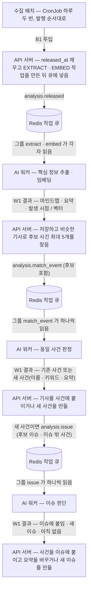
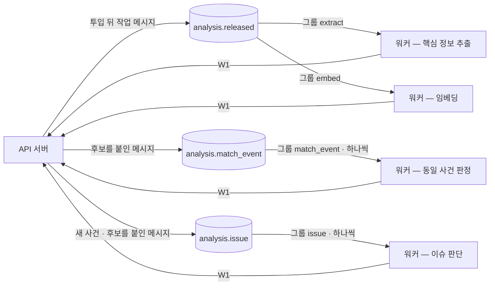
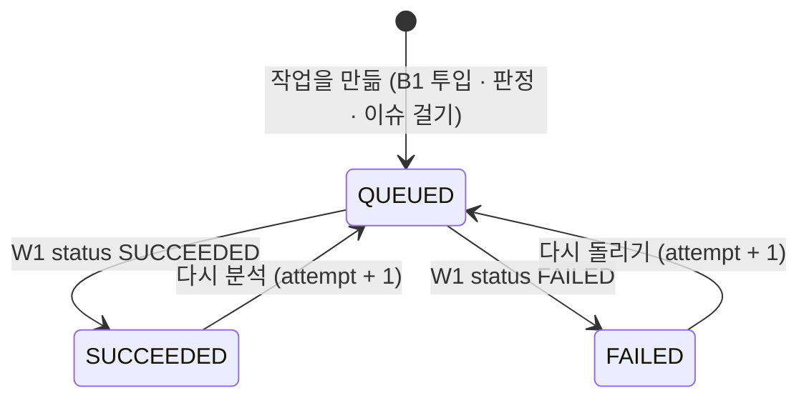

# 내부 API · 작업 큐 (v1)

수집 배치 · AI 워커가 API 서버와 주고받는 모양이다. 공통 규칙 · 오류 코드는 `docs/api.md`, 테이블은 `docs/data-model.md`, 용어는 `docs/glossary.md`.

SSOT 2절 3~6번(배치가 적재 · 투입, 작업 큐 등록, 워커 분석, 결과 저장)을 이렇게 하자고 제안한다. 큐에 넣는 코드는 API 한 곳에만 두고(SSOT 4절), 워커는 DB 를 직접 쓰지 않고 결과를 HTTP(W1)로 API 에 보낸다. DB 구조와 규칙(후보 확인 · 이슈 겹침)을 API 한 곳만 알고, 틀린 결과 · 겹침을 응답(400 · 409)으로 바로 알려 주려는 것이다. 결과용 스트림은 API 쪽에 소비자가 하나 더 생기고 이런 답을 워커에게 돌려줄 길이 없어 쓰지 않는다(2026-10-21 BE 안). pgvector 후보 검색과 저장은 API 가 한다. 모두 AI 팀 확인 전이다(`api.md` 4절 질문).

- **v1 (2026-10-21, Jira S15P31A102-99)**: 마인드맵 결과를 가지 4개로 바꾸고(10-21), 사건에 키워드(`label`)를 더하고(10-20), 이슈를 붙이고 만드는 단계 `ISSUE` 를 더했다(제안 — 10-20 「이슈는 사건 3개가 모이면 생성」을 이루는 길). 사용자 URL 분석은 지웠다

표 읽는 법은 `docs/api-screen.md` 머리와 같다. 「저장하는 곳」은 API 가 그 값을 어느 칸에 넣는지다.

---

## 1. 한눈에

주고받는 순서 — 선 위 글자가 오가는 계약 · 메시지다



큐 지도 — 스트림 셋을 consumer group 넷이 읽는다



---

## 2. B1. 기사 투입 — `POST /internal/v1/articles/{articleId}/release`

수집 배치가 적재해 둔 기사를 서비스에 내놓는다. 실서비스 수집 배치는 NewsData.io 를 k8s CronJob 으로 하루 두 번(00 · 12시, `Asia/Seoul`) 돈다(2026-10-20). API 가 `article.released_at` 을 채우고 `EXTRACT` · `EMBED` 작업 행을 만든 뒤 큐에 넣는다.

| 인자 | 타입 | 용도 |
|---|---|---|
| `articleId` | number | 주소. 투입할 기사(`article.id`) |

| 응답 | 뜻 |
|---|---|
| 202 | 투입하고 작업을 걸었다. 본문은 아직 정하지 않았다 |
| 404 `ARTICLE_NOT_FOUND` | 그런 기사가 없다 |
| 409 `ALREADY_RELEASED` | 이미 투입했다. 배치는 건너뛴다 |

- 기사를 적재하는 길(배치가 DB 에 바로 넣나, API 를 부르나)은 수집 배치 구현 언어와 같이 정한다(`SSOT.md` 8절)
- 실행 한 번의 기록은 `ingest_run` 에 남긴다(`data-model.md` 2절). 데이터셋은 검증용이라(SSOT 5절) 서비스에 투입할지는 정하지 않았다(`data-model.md` 5절 17번)

## 3. 큐 모양과 순서

- 스트림 `analysis.released` 하나를 consumer group `extract` · `embed` 가 각자 읽는다. SSOT 4절의 「단계마다 consumer group」 모양이다. 단계마다 스트림을 따로 두지 않는 것은 본문을 한 번만 저장하려는 것이다. 한 단계만 다시 돌릴 때는 그 단계 ID 만 싣고, 다른 그룹은 읽고 건너뛰고 ack 한다(2026-10-21 BE 안)
- 스트림 `analysis.match_event` 는 그룹 `match_event`, `analysis.issue` 는 그룹 `issue` 하나가 읽는다. 후보를 API 가 붙여 넣어야 해서 따로 둔다
- ack 해도 메시지는 스트림에 남는다 — `XACK` 은 그룹의 처리 중 목록(PEL)에서만 지운다. 그래서 API 는 넣을 때마다 `XADD … ACKED MAXLEN ~ N` 으로 길이를 자른다. `ACKED` 는 모든 그룹이 읽고 ack 한 메시지만 잘라 내서, 밀린 그룹이 아직 안 읽은 메시지는 남는다(Redis 8.2 부터, 우리는 8.10.2). N 은 Jira 30 에서 Infra 와 정한다(2026-10-21 BE 안)
- API 는 DB 를 커밋한 **뒤** 큐에 넣는다. 그래서 정상 흐름에서 W1 이 404 를 받는 일은 없다. 큐에 넣다 실패해 오래 `QUEUED` 로 남은 작업은 다시 넣는다. 그 기준 시간 · 스트림 길이 상한 · 다시 가져가기 기준 시간은 Jira 30
- `MATCH_EVENT` 는 한 번에 하나씩 발행 순서대로 돈다. API 는 앞 기사의 판정이 끝난 뒤 다음 기사의 판정을 건다. 같은 사건 기사 둘이 동시에 판정되면 서로를 후보로 못 봐 사건이 둘로 갈라지기 때문이다(PRD FR-31 「앞선 기사들과만 비교」)
- `ISSUE` 도 한 번에 하나씩 돈다. API 는 앞 `ISSUE` 결과를 저장한 뒤 다음 작업을 걸고, **그때** 후보를 계산한다. 다시 돌릴 때(`attempt + 1`)도 후보를 새로 계산한다. 같은 사건들로 이슈가 둘 생기거나, 이미 이슈에 든 사건을 다른 이슈가 가져가지 않게 하려는 것이다
- `MATCH_EVENT` 는 `EXTRACT` 와 `EMBED` 가 둘 다 끝난 뒤에 건다. 판정에 기사의 핵심 내용 · 발생 시점과 벡터가 다 필요하다
- `ISSUE` 는 `MATCH_EVENT` 가 새 사건을 만들었을 때만 건다(`decision` 이 `NEW`). 이슈 요약은 이슈에 **사건**이 붙을 때 다시 만들기 때문에(2026-10-20), 이미 있는 사건에 기사만 붙을 때는 걸지 않는다

## 4. 작업 메시지 — API → 큐 → 워커

항목 하나에 `payload` 필드 하나를 두고 JSON 문자열을 넣는다. `analysis.released` 에는 기사 본문을 통째로 넣는다 — 워커가 DB 나 API 를 따로 읽지 않고 메시지만으로 분석하게. 기사 본문은 바뀌지 않아 낡을 걱정이 없다. 대신 Redis 메모리를 쓰므로 3절의 길이 상한을 건다(2026-10-21 BE 안).

`analysis.released`

| 필드 | 타입 | 용도 | 어디서 |
|---|---|---|---|
| `articleId` | number | 어느 기사인지 | `article.id` |
| `jobs` | object | 단계별 작업 ID `{ "EXTRACT": 789, "EMBED": 790 }`. 그룹은 자기 단계 ID 가 없으면 넘어간다. 한 단계만 다시 돌릴 때는 그 단계만 싣는다 | `analysis_job.id` |
| `attempt` | number | 이번 시도 번호. W1 에 그대로 돌려준다. 두 단계를 같이 실을 때는 둘 다 첫 시도(1)다 | `analysis_job.attempt` |
| `article.title` · `publisher` · `publishedAt` · `body` | string · 시각 | 분석에 넣을 기사 내용. `publisher` 는 언론사 이름 | `article` · `press.name` |

```json
{
  "articleId": 456, "jobs": { "EXTRACT": 789, "EMBED": 790 }, "attempt": 1,
  "article": { "title": "…", "publisher": "가람일보", "publishedAt": "2026-10-06T10:12:00+09:00", "body": "…" }
}
```

`analysis.match_event`

| 필드 | 타입 | 용도 | 어디서 |
|---|---|---|---|
| `articleId` · `jobId` · `attempt` | number | 어느 기사 · 판정 작업 · 몇 번째 시도인지 | `article.id` · `analysis_job` |
| `article.title` · `publisher` · `publishedAt` | string · 시각 | 판정할 새 기사 | `article` · `press.name` |
| `extracted.summary` | string · null | 새 기사의 우리 요약. 끈 동안은 null | `article_mindmap.summary` |
| `extracted.occurredAt` | 시각 · null | 새 기사에서 뽑은 발생 시점 | `article_mindmap.occurred_at` |
| `extracted.mindmap` | object | 핵심 정보 추출 결과(가지 4개, 근거 포함). 판정에 핵심 내용(`CORE`)을 쓴다 | `article_mindmap.content` |
| `candidates[].eventId` · `title` · `label` · `summary` · `occurredAt` | 사건 | 같은 사건일지도 모르는 후보 | `event` |
| `candidates[].similarity` | number | 비슷한 정도(0~1, 클수록 비슷). 높은 순서로 싣는다 | 계산 — pgvector 로 기사 벡터끼리 비교 |

보낸 후보 사건 ID 는 `analysis_job.candidates` 에 남긴다. 판정이 후보 밖 사건을 고르면 거절하려는 것이다.

```json
{
  "articleId": 456, "jobId": 791, "attempt": 1,
  "article": { "title": "…", "publisher": "가람일보", "publishedAt": "2026-10-06T10:12:00+09:00" },
  "extracted": { "summary": "…", "occurredAt": "2026-10-06T00:00:00+09:00", "mindmap": { } },
  "candidates": [{ "eventId": 97, "title": "한빛반도체 텍사스 공장 착공식", "label": "착공식", "summary": "…", "occurredAt": "2026-10-06T00:00:00+09:00", "similarity": 0.83 }]
}
```

`analysis.issue` (제안)

새 사건 하나를 두고 「어느 이슈에 붙일까, 새 이슈를 만들까」를 묻는다. 어떤 사건들을 한 이슈로 묶을지는 실험으로 정한다(`data-model.md` 5절 2번). 아래 후보 고르기는 시작점이다.

| 필드 | 타입 | 용도 | 어디서 |
|---|---|---|---|
| `articleId` · `jobId` · `attempt` | number | 새 사건을 만든 기사 · 이 작업 · 몇 번째 시도인지 | `article.id` · `analysis_job` |
| `event` | `{ id, title, label, summary, occurredAt }` | 이번에 새로 생긴 사건 | `event` |
| `candidateIssues[]` | `{ issueId, title, summary, events[] }` | 붙일지도 모르는 이슈. `events[]` 는 그 이슈 사건들의 `{ title, label, occurredAt }` | 계산 — 비슷한 기사들의 사건이 속한 이슈 |
| `candidateEvents[]` | `{ eventId, title, label, summary, occurredAt, similarity }` | 아직 이슈 밖에 있는 비슷한 사건. 새 이슈를 만들 때 함께 묶을 후보 | 계산 — 비슷한 기사들의 사건 중 `issue_id` 가 빈 것 |

보낸 이슈 · 사건 ID 는 `analysis_job.candidates` 에 남긴다.

## 5. W1. 결과 전달 — `POST /internal/v1/analysis-jobs/{jobId}/result`

모든 단계가 같은 봉투를 쓰고 `result` 만 단계마다 다르다.

봉투

| 필드 | 타입 | 용도 | 저장하는 곳 |
|---|---|---|---|
| `attempt` | number | 받은 메시지의 값 그대로. 지금 시도와 다르면 409 — 늦게 온 옛 결과가 새 결과를 덮지 않게 | 대조만 한다 |
| `status` | enum | `SUCCEEDED` · `FAILED` | `analysis_job.status` |
| `model` | string | 쓴 모델 이름(`gpt-5-mini` 등). 결과를 비교 · 다시 돌릴 때(`/evals`) | `EXTRACT` 는 `article_mindmap.model`. 다른 단계는 저장할 칸이 없다 |
| `promptVersion` | string · null | 쓴 프롬프트 버전. 임베딩처럼 프롬프트가 없으면 null | `EXTRACT` 는 `article_mindmap.prompt_version` |
| `startedAt` · `finishedAt` | 시각 | 워커가 처리를 시작 · 끝낸 때 | `analysis_job.started_at` · `finished_at`. `EXTRACT` 의 `finishedAt` 은 `article_mindmap.generated_at` 에도 |
| `result` | object · null | 단계별 결과(아래). 실패면 null | 단계마다 다름 |
| `error` | object · null | 실패했을 때 `{ code, message, retryable }`. 성공이면 null | `code` → `analysis_job.error_code`, `message` → `error_message`. `retryable` 은 저장하지 않고 다시 돌릴지 정할 때 쓴다(Jira 30) |

```json
{
  "attempt": 1, "status": "SUCCEEDED", "model": "gpt-5-mini", "promptVersion": "extract-v1",
  "startedAt": "2026-10-06T10:12:30+09:00", "finishedAt": "2026-10-06T10:13:05+09:00",
  "result": { }, "error": null
}
```

`EXTRACT` 결과 — 기사 핵심 정보 추출

| 필드 | 타입 | 용도 | 저장하는 곳 |
|---|---|---|---|
| `summary` | string · null | 우리 AI 기사 요약. GMS 토큰을 아끼려고 끈 동안은 null(2026-10-19) | `article_mindmap.summary` |
| `schemaVersion` | string | `mindmap` 모양의 버전(`mindmap-v1`) | `article_mindmap.schema_version` |
| `mindmap` | object | 가지 4개와 잎, 잎마다 선택 칸인 근거(`api-screen.md` 3절). API 가 근거를 본문과 대조해 맞지 않는 근거만 지운 뒤 저장한다. 가지가 하나도 없으면 400 | `article_mindmap.content` |
| `occurredAt` | 시각 · null | 본문에서 뽑은 사건 발생 시점. 못 뽑았으면 null | `article_mindmap.occurred_at` |

`EMBED` 결과

| 필드 | 타입 | 용도 | 저장하는 곳 |
|---|---|---|---|
| `model` | string | 임베딩 모델 이름 | `article_embedding.model` |
| `dimension` | number | 벡터 길이. 칸의 차원과 다르면 400. 384 는 시험 모델(SSOT 10절) 값일 뿐이고 쓸 모델은 미정 | 대조만 한다 |
| `vector` | array(number) | 기사 벡터 | `article_embedding.embedding` |

`MATCH_EVENT` 결과

| 필드 | 타입 | 용도 | 저장하는 곳 |
|---|---|---|---|
| `decision` | enum | `EXISTING`(후보 중 하나와 같은 사건) · `NEW`(새 사건) | — |
| `eventId` | number · null | `EXISTING` 일 때 고른 후보 사건. 후보에 없으면 400 | `article_event.event_id` |
| `newEvent` | object · null | `NEW` 일 때 `{ title, label, summary }` — 사건 이름 · 키워드(「첫 목격」) · 요약 | `event.title` · `label` · `summary` 로 사건을 만든다. `issue_id` 는 비워 둔다 |
| `reason` | string | 판정 까닭 한두 문장. 평가 · 디버깅용 | 저장할 칸이 없다. 판정 기준(Q34)이 정해지면 칸을 더할지 본다 |

- `NEW` 면 API 가 사건을 만들고 `ISSUE` 작업을 건다. 발생 시점은 `EXTRACT` 의 `occurredAt`, 없으면 그 기사의 발행 시각이다(`occurred_at_basis` 로 구분)
- 사건에 기사가 늘 때 사건 이름 · 키워드 · 요약을 고칠지는 미정이다(`data-model.md` 5절 13번)

`ISSUE` 결과 (제안)

| 필드 | 타입 | 용도 | 저장하는 곳 |
|---|---|---|---|
| `decision` | enum | `ATTACH`(후보 이슈에 붙임) · `CREATE`(새 이슈) · `NONE`(아직 이슈 없음) | — |
| `issueId` | number · null | `ATTACH` 일 때 고른 후보 이슈. 후보에 없으면 400 | `event.issue_id` |
| `eventIds` | array(number) · null | `CREATE` 일 때 새 이슈에 넣을 사건. **이번 사건을 꼭 넣고** 나머지는 `candidateEvents` 중에서 고른다. 모두 합쳐 **3개 이상**이어야 한다(2026-10-20). 아니면 400 | 그 사건들의 `event.issue_id` |
| `issueTitle` | string · null | `CREATE` 일 때 이슈 이름. 한 번 짓고 바꾸지 않는다 | `issue.title` |
| `issueSummary` | string · null | `ATTACH` · `CREATE` 일 때 이슈 요약. `ATTACH` 면 새 사건까지 넣어 다시 지은 요약으로 덮어쓴다 | `issue.summary` |
| `reason` | string | 판단 까닭 한두 문장. 평가 · 디버깅용 | 저장할 칸이 없다 |

- `NONE` 이면 사건은 이슈 밖에 남는다. 그 기사들은 개별 기사로 보인다(`data-model.md` 2절 issue)
- 저장할 때 API 가 다시 확인한다 — 이번 사건과 `eventIds` 의 사건이 모두 아직 이슈 밖(`issue_id` 가 빔)이고, `ATTACH` 의 이슈가 있어야 한다. 아니면 409 `JOB_STATE_CONFLICT` 로 거절하고 이 작업을 후보를 새로 계산해 다시 건다
- `issue_category` 는 API 가 이슈 기사들의 대표 카테고리로 채운다(가정, `data-model.md` 5절 2번). 워커 결과에는 넣지 않는다

API 응답

| 상태 | 뜻 | 워커가 할 일 |
|---|---|---|
| 204 | 저장했다 | 메시지를 ack 한다 |
| 400 `RESULT_SCHEMA_INVALID` | 형식이 틀렸다. 가지가 없는 마인드맵, 후보에 없는 `eventId` · `issueId`, 사건이 3개 안 되는 새 이슈도 여기 | ack 한다. 다시 생성할지는 Jira 30 재처리 정책 |
| 404 `ANALYSIS_JOB_NOT_FOUND` | 그런 작업이 없다. 정상 흐름에서는 나오지 않는다 | ack 하고 로그를 남긴다 |
| 409 `JOB_STATE_CONFLICT` | 이미 끝난 작업이거나 `attempt` 가 다르다. `ISSUE` 결과의 사건이 그사이 다른 이슈에 들어간 때도 여기다(API 가 작업을 다시 건다) | ack 하고 넘어간다 |
| 5xx · 연결 실패 | API 가 배포 중이거나 죽었다 | 결과를 들고 간격을 늘려 가며 몇 번 더 보낸다 — 배포 같은 짧은 끊김에 GMS 를 다시 부르지 않게(2026-10-21 BE 안). 그래도 안 되면 ack 하지 않는다. 메시지가 다시 오고 그때는 GMS 를 다시 부른다. 횟수 · 간격은 Jira 30 |

코드마다 왜 그 상태인지는 `api.md` 2절.

## 6. 작업 상태와 화면용 상태

분석 작업(`analysis_job`) 한 행의 상태가 바뀌는 길이다. 워커가 처리 시작을 알리지 않아서 「처리 중」을 따로 두지 않았다.



화면에는 작업 상태를 그대로 주지 않고 아래처럼 계산해 준다.

| 화면 필드 | 어떻게 정하나 | 쓰는 곳 |
|---|---|---|
| `mindmapStatus` | 마인드맵 결과(`article_mindmap`)가 있으면 다시 분석하는 중이어도 `SUCCEEDED`. 없으면 `EXTRACT` 작업의 상태(`QUEUED` · `FAILED`). 작업도 없으면 `NONE` | A6 · A7 · A8 |
| `eventMatchStatus` | `MATCH_EVENT` 작업의 상태. 작업이 없으면 `NONE` | A8 |
