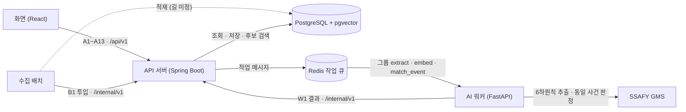
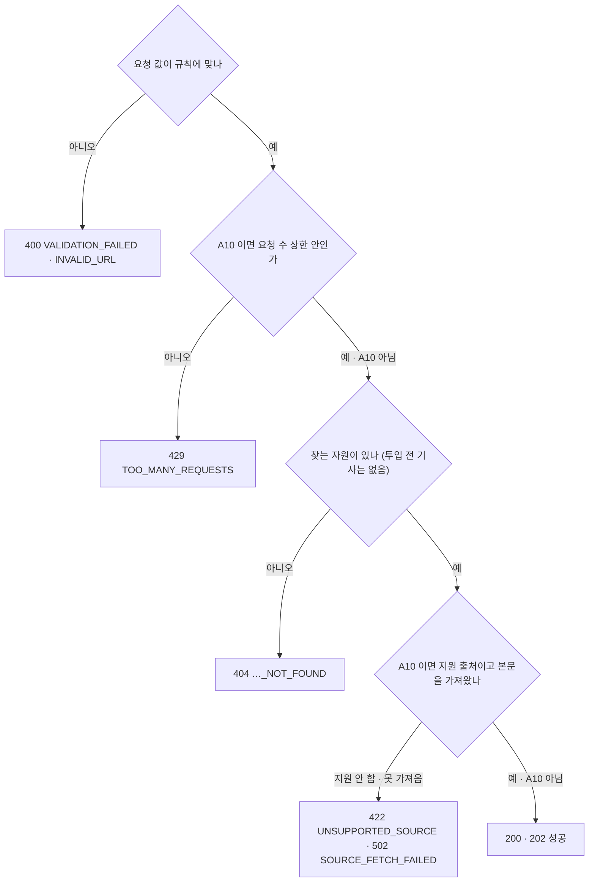
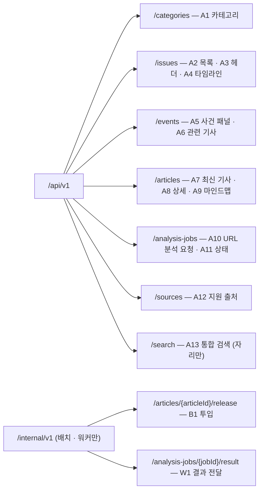
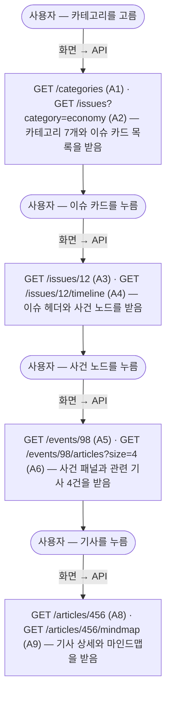
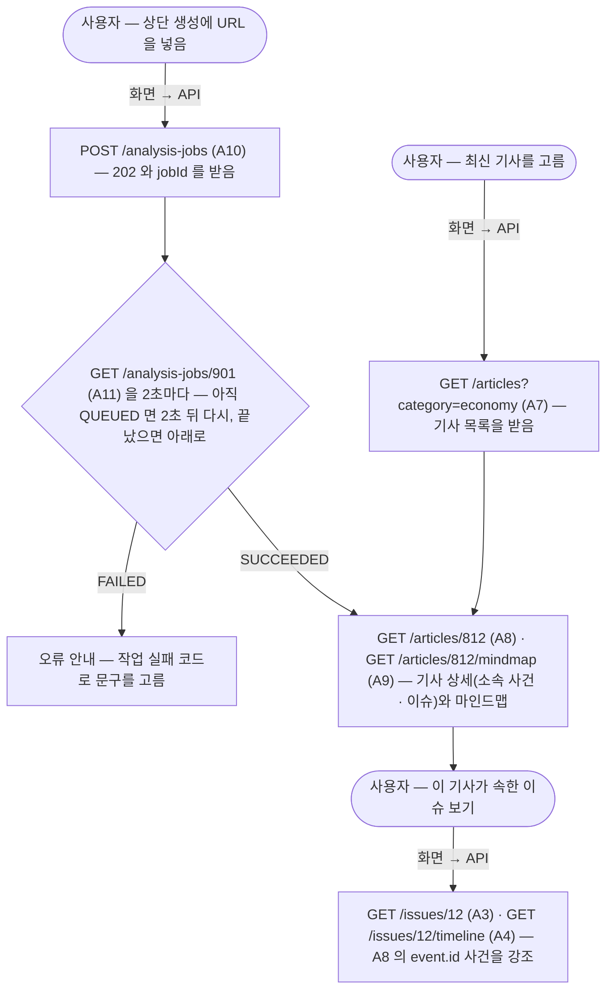

# API 계약 (v0)

화면(FE) · 수집 배치 · AI 워커가 API 서버와 주고받는 모양이다. 테이블 설계는 `docs/data-model.md`, 용어는 `docs/glossary.md`.

- **v0 (2026-10-19, Jira S15P31A102-28 · 80)**: 확정 기능(F01~F08 · F11)의 흐름 A · B 에 필요한 것만 담았다. 아직 코드가 없다
- 1절 공통 규칙은 나중에 바꾸면 비싸서 v0 에서 먼저 정한다. FE · AI 와 합의하기 전까지는 제안이다(`SSOT.md` 8절)
- 응답 필드 · 엔드포인트는 기능 티켓마다 더한다. 구현이 생기면 그 MR 에서 이 문서들을 같이 고친다
- 그림을 한 보드에 모은 보기용 사본이 Figma NEW:LEARN 팀 FigJam 에 있다. 원본은 이 md 들이다

| 문서 | 담는 것 |
|---|---|
| `docs/api.md` (이 문서) | 계약 지도, 공통 규칙, 오류 코드, 엔드포인트 목록과 흐름, 질문, Jira 대조 |
| `docs/api-screen.md` | 화면용 A1~A13 의 인자 · 응답 필드(용도 · 어디서 오나) · 예시, 마인드맵 근거 모양 |
| `docs/api-internal.md` | 수집 배치 투입(B1) · 작업 큐 · 워커 결과(W1)의 필드, 작업 상태 |

계약 지도 — 누가 누구와 어떤 계약으로 주고받나



---

## 1. 공통 규칙

| 항목 | 규칙 |
|---|---|
| 주소 | 화면용 `/api/v1/…`, 배치 · 워커용 `/internal/v1/…`. 내부 주소는 Gateway 밖에 열지 않는다 |
| 형식 | JSON, UTF-8. 필드 이름은 camelCase |
| 값 목록 | 대문자 밑줄(`SUCCEEDED`). 카테고리 코드만 소문자(`economy`) — URL 에 쓰는 식별자라서 |
| 식별자 | JSON 숫자(DB `bigint`). FE 는 계산하지 않고 그대로 넘긴다. 카테고리는 문자열 코드 |
| 시간 | ISO 8601 에 오프셋을 붙인다. 보낼 때는 `+09:00` 으로 맞춘다(`2026-10-06T09:30:00+09:00`). 받는 쪽은 `Z` 를 포함해 어떤 오프셋도 읽게 짠다. 요청으로 받은 시각에 오프셋이 없으면 400. 필드 이름은 `…At` 로 끝난다 |
| 성공 응답 | 감싸지 않고 자원 그대로 보낸다. 성공 여부는 HTTP 상태 코드가 말한다 |
| 목록 응답 | 아래 모양. Spring Data 의 `Page` 를 그대로 내보내지 않고 이 모양으로 옮긴다. 페이지를 나누지 않는 목록(카테고리 7개 같은)은 `items` 만. 한 화면에 쓸 것을 묶어 주는 응답(A4 타임라인 · A13 검색)은 이 모양을 따르지 않는다 |
| 목록 요청 | `page`(0부터, 기본 0) · `size`(기본 20, 최대 100). 범위를 벗어나면 400. 정렬은 엔드포인트마다 정해 두고 바꾸는 인자는 아직 없다 |
| 빈 결과 | 목록은 200 과 빈 `items`. 찾는 단건이 없으면 404 |
| 없는 값 | 필드를 빼지 않고 `null` 로 보낸다 |
| 투입 전 기사 | `released_at` 이 빈 기사(`data-model.md` 2절)는 모든 조회 · 집계 · 검색에서 없는 것으로 본다. 단건 조회도 404 다 |
| 오류 | RFC 9457 Problem Details(`application/problem+json`) + `code`. Spring 의 `ProblemDetail` 타입을 쓴다. 컨트롤러 예외는 `@RestControllerAdvice`, 인증 · 권한 오류는 Security 진입점에서 같은 모양으로 만든다 — 그래야 모든 오류에 `code` 가 붙는다 |
| 인증 | 화면용 API 는 로그인 없이 쓴다(PRD 4.6). 내부 API 를 막는 법과 A10 요청 수 상한은 `SSOT.md` 8절 「API 인증」 |

목록 응답

| 필드 | 타입 | 용도 |
|---|---|---|
| `items` | array | 이번 쪽의 항목들. 없으면 빈 배열 |
| `page` | number | 지금 쪽 번호(0부터). 요청의 `page` 그대로 |
| `size` | number | 한 쪽 크기. 요청의 `size` 그대로 |
| `totalElements` | number | 전체 항목 수. 「기사 23개」 같은 개수 표시에 쓴다 |
| `totalPages` | number | 전체 쪽 수. *더 보기* 를 보일지 가른다(`page + 1 < totalPages`) |

---

## 2. 오류 코드

HTTP 상태는 「어떤 종류의 실패인가」를, `code` 는 「정확히 어떤 경우인가」를 말한다. 같은 404 라도 화면 문구가 다르고(이슈를 못 찾음 · 마인드맵이 아직 없음), 같은 400 이라도 받는 쪽이 할 일이 달라서 둘을 같이 보낸다.

오류 응답 필드

| 필드 | 타입 | 용도 |
|---|---|---|
| `type` | string | 오류 종류를 가리키는 주소. 문서 주소를 아직 두지 않아 늘 `about:blank` |
| `title` | string | 상태 코드의 이름(`Not Found`). Spring 이 채운다 |
| `status` | number | HTTP 상태 코드. 본문만 받아도 알 수 있게 다시 적는다 |
| `detail` | string | 개발자용 설명. 내부 사정이 들어갈 수 있어 화면에 그대로 보이지 않는다 |
| `instance` | string | 오류가 난 요청 주소. 로그를 찾을 때 쓴다 |
| `code` | string | 이 프로젝트의 오류 코드(아래 표). 화면 · 워커는 이것으로 갈라 처리한다 |
| `errors` | array · 없을 수 있음 | `VALIDATION_FAILED` 일 때만. `{ "field", "reason" }` — 어느 칸이 왜 틀렸나 |

```json
{
  "type": "about:blank", "title": "Not Found", "status": 404,
  "detail": "기사를 찾을 수 없다: 456", "instance": "/api/v1/articles/456",
  "code": "ARTICLE_NOT_FOUND"
}
```

어느 검사에서 어느 코드가 나가나 — 화면용 요청



### 화면용 · 공통

| code | 상태 | 뜻 · 언제 나오나 | 왜 이 상태인가 | 받는 쪽이 할 일 |
|---|---|---|---|---|
| `VALIDATION_FAILED` | 400 | 요청 값이 규칙에 안 맞는다. 예: `size=101`, 오프셋 없는 시각, 숫자 자리에 글자 | 400 Bad Request 는 「요청이 잘못돼 그대로는 처리 못 한다」는 뜻이다. 요청을 고쳐 보내면 된다 | 화면: 대개 화면 코드의 버그다. 일반 오류 안내를 띄우고 `errors` 를 로그에 남긴다 |
| `INVALID_URL` | 400 | A10 에 넣은 값이 URL 모양이 아니다 | 위와 같은 400. 사용자가 직접 입력한 값이라 `VALIDATION_FAILED` 와 코드를 나눴다 — 화면이 입력칸 옆에 안내를 띄우게 | 화면: 입력칸 옆에 「URL 을 확인해 주세요」 |
| `UNSUPPORTED_SOURCE` | 422 | URL 모양은 맞는데 지원하지 않는 언론사다(PRD FR-32) | 422 Unprocessable Content 는 「형식은 맞지만 내용 때문에 처리할 수 없다」는 뜻이다. 형식 오류(400)와 갈라야 화면 안내가 달라진다 | 화면: 「지원하지 않는 출처」 안내, A12 지원 출처 목록, 저장된 기사로 가는 길 |
| `SOURCE_FETCH_FAILED` | 502 | 지원 출처인데 그 언론사 서버에서 본문을 받아 오지 못했다 | 502 Bad Gateway 는 「우리 서버가 다른 서버에 부탁했는데 제대로 된 답을 못 받았다」는 뜻이다. 사용자 잘못도 우리 서버 고장도 아니다 | 화면: 잠시 뒤 다시 해 보라고 안내 |
| `TOO_MANY_REQUESTS` | 429 | A10 요청이 상한을 넘었다 | 429 는 이 경우를 위한 표준 상태다. URL 분석마다 GMS 비용이 들어 상한을 둔다(SSOT 3절 예산). 상한 값과 다시 해도 되는 때를 알릴지는 `SSOT.md` 8절 | 화면: 「잠시 뒤 다시 시도해 주세요」 |
| `CATEGORY_NOT_FOUND` · `ISSUE_NOT_FOUND` · `EVENT_NOT_FOUND` · `ARTICLE_NOT_FOUND` · `ANALYSIS_JOB_NOT_FOUND` | 404 | 그 코드 · ID 가 없다. 아직 투입하지 않은 기사도 없는 것으로 본다 | 404 Not Found 는 「그런 자원이 없다」는 뜻이다. 자원마다 코드를 나눈 까닭: 한 화면이 여러 자원을 부를 때 어느 것이 없는지 알 수 있고, 화면 문구도 다르다 | 화면: 「이슈를 찾을 수 없어요」 같은 안내와 홈으로 가는 길 |
| `MINDMAP_NOT_FOUND` | 404 | 기사는 있는데 마인드맵 결과가 아직 없다 | 「없는 단건은 404」(1절)를 지킨다. 다만 `ARTICLE_NOT_FOUND` 와 코드를 나눠 「기사가 없음」과 「결과가 아직 없음」을 가른다 | 화면: A8 의 `mindmapStatus` 를 보고 분석 중이면 기다리고, 실패면 실패 안내 |
| `UNAUTHORIZED` · `FORBIDDEN` | 401 · 403 | 내부 API 를 인증 없이(401) · 권한 없이(403) 불렀다. 인증 방식은 `SSOT.md` 8절에서 정한다 | 401 은 「누구인지 모른다」, 403 은 「누군지는 알지만 허락되지 않았다」는 뜻이다 | 배치 · 워커: 설정한 키를 확인한다. 화면용 API 는 로그인이 없어 나오지 않는다 |
| `INTERNAL_ERROR` | 500 | 그 밖의 서버 오류 | 500 은 서버 쪽 잘못이다. 받는 쪽이 고칠 것이 없다 | 화면: 일반 오류 안내와 *다시 시도*. 서버는 로그를 남긴다 |

### 내부 API 전용 (B1 · W1)

| code | 상태 | 뜻 · 언제 나오나 | 왜 이 상태인가 | 받는 쪽이 할 일 |
|---|---|---|---|---|
| `RESULT_SCHEMA_INVALID` | 400 | W1 결과가 약속한 모양이 아니다. 빠진 필드, 후보에 없는 `eventId` · `issueId` 도 여기 | 워커가 보낸 요청이 잘못됐으니 400 이다. 같은 내용을 다시 보내도 또 실패한다는 신호다 | 워커: ack 하고 로그를 남긴다. 다시 생성할지는 Jira 30 재처리 정책 |
| `EVIDENCE_NOT_IN_BODY` | 400 | 근거를 본문과 대조해 맞지 않는 것을 뺐더니 남는 노드가 없다(`api-screen.md` 마인드맵 근거) | v0 는 워커 쪽 실패를 400 으로 모아 「같은 것을 다시 보내지 말라」로 쓴다. `RESULT_SCHEMA_INVALID` 와 코드를 나눈 까닭은 근거 정확도(PRD SM-2)를 따로 세어 프롬프트를 고치는 데 쓰려는 것이다. 형식은 맞고 내용이 문제라 422 가 더 맞을 수 있다 — 바꿀지 MR 에서 묻는다 | 워커: ack 하고 로그를 남긴다. 다시 생성할지는 Jira 30 |
| `JOB_STATE_CONFLICT` | 409 | 이미 끝난 작업이거나 `attempt` 가 지금 시도와 다르다. 같은 메시지를 두 번 받았거나 옛 시도의 결과가 늦게 왔을 때다 | 409 Conflict 는 「요청은 맞는데 지금 자원 상태와 부딪친다」는 뜻이다. 오류라기보다 「이미 처리됐으니 신경 쓰지 말라」는 신호다 | 워커: ack 하고 넘어간다 |
| `ALREADY_RELEASED` | 409 | B1 로 이미 투입한 기사를 또 투입했다 | 위와 같은 409 | 배치: 건너뛰고 다음 기사로 |

### 작업 실패 코드

오류 응답이 아니라, 분석 작업이 실패했을 때 A11 · W1 의 `error.code` 에 담는 값이다. `retryable`(다시 하면 될 것 같은가)은 워커가 판단해 보낸다.

| code | 뜻 | 다시 하면 되나 | 화면 안내 |
|---|---|---|---|
| `LLM_TIMEOUT` | GMS 가 정한 시간 안에 답하지 않았다 | 대개 된다 | 「분석이 늦어지고 있어요」 · *다시 시도* |
| `LLM_RATE_LIMITED` | GMS 호출 한도에 걸렸다 | 잠시 뒤에 된다 | 위와 같음 |
| `LLM_OUTPUT_INVALID` | GMS 출력이 약속한 JSON 모양이 아니다 | 몇 번은 될 수 있다 | 「분석하지 못했어요」 |
| `SOURCE_FETCH_FAILED` | 기사 본문을 가져오지 못했다 | 언론사 서버에 달렸다 | 「기사를 가져오지 못했어요」 |
| `INTERNAL` | 그 밖의 워커 · 서버 오류 | 모른다 | 일반 오류 안내 |

---

## 3. 엔드포인트

주소 지도 — 화면용 상세는 `docs/api-screen.md`, 내부용 상세는 `docs/api-internal.md`



| # | 엔드포인트 | 쓰는 곳 |
|---|---|---|
| A1 | `GET /api/v1/categories` | 카테고리 선택 (F02 카테고리별 뉴스·이슈 조회) |
| A2 | `GET /api/v1/issues` | 카테고리별 이슈 목록 · 홈 이슈 카드 (F02, Jira 41) |
| A3 | `GET /api/v1/issues/{issueId}` | 이슈 헤더 (F07 사건 중심 이슈 에볼루션 맵) |
| A4 | `GET /api/v1/issues/{issueId}/timeline` | 타임라인의 사건 노드 (F07, Jira 48) |
| A5 | `GET /api/v1/events/{eventId}` | 사건 패널 (F08 사건별 관련 기사 조회, Jira 49) |
| A6 | `GET /api/v1/events/{eventId}/articles` | 사건 관련 기사 (F08) |
| A7 | `GET /api/v1/articles` | 최신 기사 (F01 뉴스 데이터 적재·조회, Jira 42) |
| A8 | `GET /api/v1/articles/{articleId}` | 기사 상세와 소속 사건 · 이슈 (F01, F11 기사·이슈 양방향 연결) |
| A9 | `GET /api/v1/articles/{articleId}/mindmap` | 기사 마인드맵 · 근거 (F04 기사 마인드맵 생성 · F05 노드 상세 및 근거 확인, Jira 56) |
| A10 | `POST /api/v1/analysis-jobs` | 지원 URL 분석 요청 (Jira 57) |
| A11 | `GET /api/v1/analysis-jobs/{jobId}` | 분석 상태 (Jira 57) |
| A12 | `GET /api/v1/sources` | 지원 출처 목록 (Jira 57, Q26) |
| A13 | `GET /api/v1/search` | 통합 검색 — 자리만 (Jira 43) |
| B1 | `POST /internal/v1/articles/{articleId}/release` | 수집 배치의 기사 투입 — `docs/api-internal.md` |
| W1 | `POST /internal/v1/analysis-jobs/{jobId}/result` | 워커의 분석 결과 전달 — `docs/api-internal.md` |

흐름 A — 카테고리에서 시작 (MVP 개요 5장). 둥근 상자는 사용자 행동, 네모 상자는 그때 화면이 부르는 API 와 받는 것이다. 홈은 따로 두지 않고 A1 · A2 · A7 을 쓴다.



흐름 B — 기사에서 시작. URL 을 넣었으면 분석이 끝날 때까지 2초마다 상태를 본다. 「화면 → API」 선 아래 상자가 그때 부르는 API 와 받는 것이다.



---

## 4. FE · AI 에게 물을 것

답을 받으면 해당 절을 고치고 이 목록에서 지운다. 데이터 모델 쪽 미정은 `data-model.md` 5절.

FE

1. 1절 공통 규칙 — 봉투 없음 · Problem Details 와 `code` · 숫자 ID · `+09:00` · `page` 0부터 — 과 카테고리 코드 7개(`data-model.md` 2절)를 그대로 써도 되나
2. 분석 상태를 2초마다 불러 보는 방식(A11)이면 되나. 단계 표시(P1)를 넣을 때 SSE 로 바꿀지 그때 본다
3. 타임라인(A4)을 페이지 없이 한 번에 받아도 되나. 이슈 하나에 사건이 몇 개까지 그려지나
4. 홈 「7개 분야 탭 + 이슈 카드」(user-flow 팀 확인 1)를 P0 로 두나. 두면 A2 정렬을 「최근 업데이트 순」으로 바꿀지 같이 본다
5. 통합 검색(A13)을 MVP 에 넣나
6. 기사 목록 요약이 `null`(분석 전)일 때 화면에 무엇을 보이나
7. user-flow 의 「데이터가 아직 없는 이슈 — 준비 중 + 사건 · 기사 수」 상태는 언제 나오나. A2 는 사건이 있는 이슈만 준다

AI

1. 결과를 HTTP 내부 API(W1)로 보내고 DB 는 직접 안 쓰는 방식이면 되나. 결과용 스트림이 낫다면 까닭
2. 큐 모양(`api-internal.md` — 스트림 둘, 그룹 셋)과 메시지에 본문을 통째로 넣는 것
3. 근거 모양(`api-screen.md` 마인드맵 근거) — 문단 · 문장 번호를 0부터 세고 문장 나누기 규칙을 워커가 갖는 것, 맞지 않는 근거는 API 가 빼고 저장하는 것
4. 본문에서 뽑은 발생 시점이 날짜까지만 있을 때 어떻게 보낼지 (`data-model.md` 5절 12번)
5. `MATCH_EVENT` 결과 모양 — 새 사건 이름 · 요약을 워커가 짓고, 이슈를 후보 사건의 이슈 중에서 고르는 것
6. 작업 실패 코드 목록(2절)과 `retryable` 을 워커가 판단해 보내는 것
7. 임베딩 모델 · 차원 (`SSOT.md` 8절)

---

## 5. Jira 티켓 대조

BE API 티켓의 「출력」 칸과 완료 기준이 어디에 들어갔는지다.

| Jira | 출력 · 완료 기준 | 들어간 곳 |
|---|---|---|
| 41 홈 이슈·카테고리·업데이트 조회 | 이슈 카드 · 사건 수 · 기사 수 · 업데이트 정보, 0건 결과 | A1 · A2 (`eventCount` · `articleCount` · `lastEvent`), 빈 `items` |
| 42 최신 기사·미리보기 조회 | 기사 목록 · 언론사 · 발행일 · 요약 · 분석 여부, 목록과 상세가 같은 기사 ID | A7 · A8 (`id` 같음, `mindmapStatus`) |
| 43 이슈·사건·기사 통합 검색 | 유형별 결과 · 이동 대상 ID, 0건 | A13 (자리만) |
| 48 타임라인·관계·필터 조회 | 사건 · 관계 · 관련 기사 수, 발생 시각 · 발행일 구분 | A4 (`occurredAt` 과 기사 쪽 `publishedAt` 은 다른 필드). 언론사 필터는 P1(PRD FR-23)이라 뺐다 |
| 49 사건 상세·기사·관점·변화 조회 | 요약 · 관련 기사 · 관점 · 변화 전후 근거 | A5 · A6. 관점은 P2, 변화는 F09 · F10 이라 뺐다 |
| 56 마인드맵 결과 저장·조회 | 노드 · 관계 · 근거 · 유형 · 관련 콘텐츠, 기존 결과 재사용 여부 | A9 `content`, 관련 기사는 A8 → A6, 저장은 W1. 재사용은 A10 의 200(이미 있는 결과)과 `mindmapStatus` 로 읽었다 — 이 해석은 티켓 원문 작성자에게 확인한다 |
| 57 기사 URL 분석 요청·지원 출처·상태 | 분석 요청 ID · 진행/완료/실패 상태 · 결과 ID, 잘못된 · 미지원 URL 구분 | A10 · A11 · A12, `INVALID_URL` · `UNSUPPORTED_SOURCE` |
| 62~64 로그인 · 북마크 · 관심 이슈 | — | 범위 미정이라 v0 에 없다(`data-model.md` 5절 6번) |

---

## 6. 바꾸는 법

- 응답에 필드를 더하는 것은 언제든 된다. 화면은 모르는 필드를 무시한다
- 필드 이름 · 뜻을 바꾸거나 지우는 것은 FE 와 같은 MR 에서 고친다. 배포 중에는 옛 화면과 새 API 가 같이 돌 수 있다(SSOT 6절 「무중단 배포 조건」)
- 1절 공통 규칙을 바꾸면 `SSOT.md` 9절 「뒤집은 것」에 한 줄 남긴다
- 첫 API 티켓은 `+09:00` 직렬화와 `ProblemDetail` 의 `code` 를 테스트로 확인한다. Spring Boot 4 · Jackson 3 에서 기본값으로 나오는지는 아직 돌려 보지 않았다
- md 를 고치면 FigJam 보기용 사본에서 같은 그림만 다시 만든다
