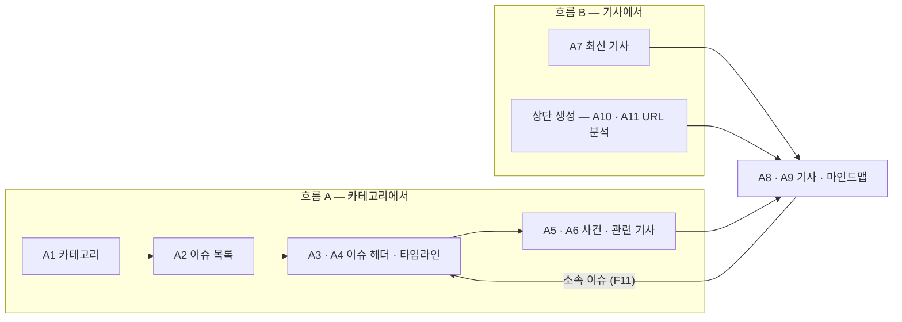
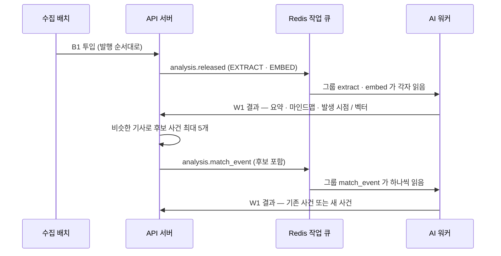

# API 계약 (v0)

화면(FE) · 수집 배치 · AI 워커가 API 서버와 주고받는 모양이다. 테이블 설계는 `docs/data-model.md`.

- **v0 (2026-10-19, Jira S15P31A102-28)**: 확정 기능(F01~F08 · F11)의 흐름 A · B 에 필요한 것만 담았다. 아직 코드가 없다
- 1절 공통 규칙은 나중에 바꾸면 비싸서 v0 에서 먼저 정한다. FE · AI 와 합의하기 전까지는 제안이다(`SSOT.md` 8절)
- 응답 필드 · 엔드포인트는 기능 티켓마다 더한다. 구현이 생기면 그 MR 에서 이 문서를 같이 고친다

---

## 1. 공통 규칙

| 항목 | 규칙 |
|---|---|
| 주소 | 화면용 `/api/v1/…`, 배치 · 워커용 `/internal/v1/…`. 내부 주소는 Gateway 밖에 열지 않는다 |
| 형식 | JSON, UTF-8. 필드 이름은 camelCase |
| 값 목록 | 대문자 밑줄(`SUCCEEDED`). 카테고리 코드만 소문자(`economy`) — URL 에 쓰는 식별자라서 |
| 식별자 | JSON 숫자(DB `bigint`). FE 는 계산하지 않고 그대로 넘긴다. 카테고리는 문자열 코드 |
| 시간 | ISO 8601 에 오프셋을 붙인다. 보낼 때는 `+09:00` 으로 맞춘다(`2026-10-06T09:30:00+09:00`). 받는 쪽은 `Z` 를 포함해 어떤 오프셋도 읽게 짠다. 요청으로 받은 시각에 오프셋이 없으면 400. 필드 이름은 `…At` 로 끝난다 |
| 성공 응답 | 감싸지 않고 자원 그대로 보낸다. 성공 여부는 HTTP 상태 코드가 말한다 |
| 목록 응답 | 아래 모양. Spring Data 의 `Page` 를 그대로 내보내지 않고 이 모양으로 옮긴다. 페이지를 나누지 않는 목록(카테고리 7개 같은)은 `items` 만. 한 화면에 쓸 것을 묶어 주는 응답(A4 타임라인 · A13 검색)은 이 모양을 따르지 않는다 |
| 목록 요청 | `page`(0부터, 기본 0) · `size`(기본 20, 최대 100). 범위를 벗어나면 400. 정렬은 엔드포인트마다 정해 두고 바꾸는 인자는 아직 없다 |
| 빈 결과 | 목록은 200 과 빈 `items`. 찾는 단건이 없으면 404 |
| 없는 값 | 필드를 빼지 않고 `null` 로 보낸다 |
| 투입 전 기사 | `released_at` 이 빈 기사(`data-model.md` 2절)는 모든 조회 · 집계 · 검색에서 없는 것으로 본다. 단건 조회도 404 다 |
| 오류 | RFC 9457 Problem Details(`application/problem+json`) + `code`. Spring 의 `ProblemDetail` 타입을 쓴다. 컨트롤러 예외는 `@RestControllerAdvice`, 인증 · 권한 오류는 Security 진입점에서 같은 모양으로 만든다 — 그래야 모든 오류에 `code` 가 붙는다 |
| 인증 | 화면용 API 는 로그인 없이 쓴다(PRD 4.6). 내부 API 를 막는 법과 A10 요청 수 상한은 `SSOT.md` 8절 「API 인증」 |

목록 응답

```json
{ "items": [], "page": 0, "size": 20, "totalElements": 0, "totalPages": 0 }
```

오류 응답 — 화면은 `code` 로 갈라 안내 문구를 고르고, `detail` 은 개발자용이다.

```json
{
  "type": "about:blank",
  "title": "Not Found",
  "status": 404,
  "detail": "기사를 찾을 수 없다: 456",
  "instance": "/api/v1/articles/456",
  "code": "ARTICLE_NOT_FOUND"
}
```

입력 검증 오류는 `errors` 에 칸마다 까닭을 담는다.

```json
{ "status": 400, "code": "VALIDATION_FAILED", "errors": [{ "field": "size", "reason": "100 이하여야 한다" }] }
```

### 오류 코드

| code | 상태 | 언제 |
|---|---|---|
| `VALIDATION_FAILED` | 400 | 요청 값이 규칙에 안 맞을 때 |
| `INVALID_URL` | 400 | 분석 요청의 URL 이 URL 형식이 아닐 때 |
| `UNSUPPORTED_SOURCE` | 422 | 지원하지 않는 출처의 기사 URL (PRD FR-32). 화면은 A12 로 지원 출처를 보여 준다 |
| `SOURCE_FETCH_FAILED` | 502 | 지원 출처인데 본문을 가져오지 못했을 때. URL 본문을 누가 가져오는지 정해지면 바뀔 수 있다(`data-model.md` 5절 11번) |
| `TOO_MANY_REQUESTS` | 429 | A10 요청이 상한을 넘었을 때. 상한 값은 `SSOT.md` 8절 |
| `CATEGORY_NOT_FOUND` · `ISSUE_NOT_FOUND` · `EVENT_NOT_FOUND` · `ARTICLE_NOT_FOUND` · `ANALYSIS_JOB_NOT_FOUND` | 404 | 그 ID 가 없을 때 |
| `MINDMAP_NOT_FOUND` | 404 | 기사는 있는데 마인드맵이 아직 없을 때. 화면은 A8 의 `mindmapStatus` 로 분석 중인지 실패했는지 본다 |
| `UNAUTHORIZED` · `FORBIDDEN` | 401 · 403 | 내부 API 인증을 정하면(`SSOT.md` 8절) 쓴다 |
| `INTERNAL_ERROR` | 500 | 그 밖의 서버 오류 |
| `RESULT_SCHEMA_INVALID` · `EVIDENCE_NOT_IN_BODY` · `JOB_STATE_CONFLICT` · `ALREADY_RELEASED` | 400 · 400 · 409 · 409 | 내부 API(B1 · W1)에서만. 4절 |

### 작업 실패 코드

A11 과 W1 의 `error.code` 에 쓴다. `message` 는 개발자용이라 화면에 그대로 보이지 않고, 화면은 `code` 로 문구를 고른다.

| code | 뜻 |
|---|---|
| `LLM_TIMEOUT` · `LLM_RATE_LIMITED` | GMS 가 제때 답하지 않았거나 호출 한도에 걸렸다 |
| `LLM_OUTPUT_INVALID` | GMS 출력이 약속한 형식에 안 맞았다 |
| `SOURCE_FETCH_FAILED` | 기사 본문을 가져오지 못했다 |
| `INTERNAL` | 그 밖의 워커 · 서버 오류 |

---

## 2. 화면용 엔드포인트

두 흐름(MVP 개요 5장)이 어느 엔드포인트를 부르는지다. 홈은 따로 두지 않고 A1 · A2 · A7 을 쓴다.



| # | 엔드포인트 | 쓰는 곳 |
|---|---|---|
| A1 | `GET /api/v1/categories` | 카테고리 선택 (F02 카테고리별 뉴스·이슈 조회) |
| A2 | `GET /api/v1/issues` | 카테고리별 이슈 목록 · 홈 이슈 카드 (F02, Jira 41) |
| A3 | `GET /api/v1/issues/{issueId}` | 이슈 헤더 (F07 사건 중심 이슈 에볼루션 맵) |
| A4 | `GET /api/v1/issues/{issueId}/timeline` | 타임라인의 사건 노드 (F07, Jira 48) |
| A5 | `GET /api/v1/events/{eventId}` | 사건 패널 (F08 사건별 관련 기사 조회, Jira 49) |
| A6 | `GET /api/v1/events/{eventId}/articles` | 사건 관련 기사 (F08) |
| A7 | `GET /api/v1/articles` | 최신 기사 (F01 뉴스 데이터 적재·조회, Jira 42) |
| A8 | `GET /api/v1/articles/{articleId}` | 기사 상세와 소속 사건 · 이슈 (F01, F11 기사·이슈 양방향 연결) |
| A9 | `GET /api/v1/articles/{articleId}/mindmap` | 기사 마인드맵 · 근거 (F04 기사 마인드맵 생성 · F05 노드 상세 및 근거 확인, Jira 56) |
| A10 | `POST /api/v1/analysis-jobs` | 지원 URL 분석 요청 (Jira 57) |
| A11 | `GET /api/v1/analysis-jobs/{jobId}` | 분석 상태 (Jira 57) |
| A12 | `GET /api/v1/sources` | 지원 출처 목록 (Jira 57, Q26) |
| A13 | `GET /api/v1/search` | 통합 검색 — 자리만 (Jira 43) |

### A1. 카테고리

7개를 MVP 개요 2-1 순서로 준다. 투입한 기사와 사건이 있는 이슈만 센다.

```json
{ "items": [{ "code": "economy", "name": "경제", "issueCount": 3, "articleCount": 1520 }] }
```

### A2. 이슈 목록

- 인자: `category`(없으면 전체) · `page` · `size`
- 사건이 하나라도 있는 이슈만 준다(PRD FR-4). 정렬은 마지막 사건 발생 시점 최신순(PRD FR-4 가정), 같으면 `id` 내림차순
- 없는 카테고리 코드면 404 `CATEGORY_NOT_FOUND`. 이슈가 없는 카테고리는 200 과 빈 `items`

```json
{
  "items": [{
    "id": 12,
    "title": "한빛반도체 미국 공장 건설",
    "summary": "한빛반도체가 텍사스 공장 투자를 늘리고 착공했다",
    "categories": [{ "code": "economy", "name": "경제" }],
    "eventCount": 8, "articleCount": 23, "publisherCount": 5,
    "firstEventAt": "2026-08-04T00:00:00+09:00",
    "lastEventAt": "2026-10-09T08:41:00+09:00",
    "lastEvent": { "id": 98, "title": "인력 수급 우려" }
  }],
  "page": 0, "size": 20, "totalElements": 1, "totalPages": 1
}
```

### A3. 이슈 헤더

A2 의 항목과 같은 모양에서 `lastEvent` 만 뺀다. 기간은 `firstEventAt` ~ `lastEventAt` 이다(PRD FR-20).

### A4. 타임라인

- 이슈의 사건을 전부 한 번에 준다(페이지 없음). 정렬은 `occurredAt` 오름차순, 같으면 `id` 오름차순
- `relations` 는 P0 에서 늘 빈 배열이다. 후속 · 반응 · 반박(PRD FR-22, Q25)을 넣으면 `{ "fromEventId", "toEventId", "type" }` 로 채운다
- 세로축 보도량은 아직 정하지 않았다(Q15). 프로토타입처럼 기사 수로 그린다면 `articleCount` 를 쓴다. 사건 태그(#새 정보 등)는 F09 · F10 이라 없다. 언론사 필터(PRD FR-23)는 P1 이다

```json
{
  "issueId": 12,
  "events": [{
    "id": 91, "title": "공식 발표",
    "occurredAt": "2026-08-21T00:00:00+09:00", "occurredAtBasis": "EXTRACTED",
    "articleCount": 5, "publisherCount": 3
  }],
  "relations": []
}
```

`occurredAtBasis` 가 `FIRST_PUBLISHED` 면 본문에서 시점을 못 뽑아 가장 이른 기사의 발행 시각을 썼다(`data-model.md` 2절 event).

### A5. 사건 패널

- `issue` 가 `null` 이면 아직 이슈로 묶이지 않은 사건이다
- `previousEvent` · `nextEvent` 는 같은 이슈 안에서 발생 시점 순서로 앞뒤 사건이다. 없으면 `null`
- 관점(PRD FR-24~26, P2)과 이 사건의 변화(F09 · F10)는 빠져 있다. 사건 요약의 AI 표시와 「핵심 근거」(PRD 5.4)는 `data-model.md` 5절 13번이 정해지면 더한다

```json
{
  "id": 98, "title": "인력 수급 우려", "summary": "텍사스 공장에 필요한 엔지니어 수를 두고 보도가 엇갈렸다",
  "occurredAt": "2026-10-09T08:41:00+09:00", "occurredAtBasis": "FIRST_PUBLISHED",
  "issue": { "id": 12, "title": "한빛반도체 미국 공장 건설" },
  "articleCount": 4, "publishers": ["바른신문", "새벽타임즈"],
  "previousEvent": { "id": 97, "title": "착공식", "occurredAt": "2026-10-06T00:00:00+09:00" },
  "nextEvent": null
}
```

### A6. 사건 관련 기사

- 인자: `page` · `size`. 화면은 처음 4건(PRD FR-11)을 `size=4` 로 부르고 *더 보기* 에서 다음 쪽을 부른다
- 정렬은 발행 시각 오름차순, 같으면 `id` 오름차순. 특정 언론사를 앞세우지 않는다(PRD 4.11)
- 항목 모양(기사 요약)은 A7 과 같다

### A7. 최신 기사

- 인자: `category`(없으면 전체) · `page` · `size`
- 정렬은 발행 시각 최신순(PRD FR-2), 같으면 `id` 내림차순
- `summary` 는 마인드맵의 요약이라 분석 전이면 `null` 이다. 본문 첫 문장으로 대신할지는 본문 노출 범위(Q3)가 정해진 뒤에 본다
- `mindmapStatus` 로 마인드맵 유무를 가른다(Jira 42). 마인드맵 결과가 있으면 다시 분석하는 중이어도 `SUCCEEDED` 다. 결과가 없으면 6하원칙 추출 작업의 상태(`QUEUED` · `FAILED`), 작업도 없으면 `NONE`

```json
{
  "items": [{
    "id": 456, "title": "한빛반도체 텍사스 공장 첫 삽… \"2028년 양산 변함없다\"",
    "publisher": "가람일보", "publishedAt": "2026-10-06T10:12:00+09:00",
    "category": { "code": "economy", "name": "경제" },
    "summary": "한빛반도체가 텍사스 공장을 착공했다", "url": "https://news.example.com/a/456",
    "mindmapStatus": "SUCCEEDED"
  }],
  "page": 0, "size": 20, "totalElements": 1, "totalPages": 1
}
```

### A8. 기사 상세

A7 항목에 기자 · 소속 사건 · 소속 이슈를 더한다. 본문(`body`)은 노출 범위(Q3 · Q28)가 정해질 때까지 내보내지 않는다.

```json
{
  "id": 456, "title": "…", "publisher": "가람일보", "reporter": "김민정 기자",
  "publishedAt": "2026-10-06T10:12:00+09:00", "url": "https://news.example.com/a/456",
  "category": { "code": "economy", "name": "경제" },
  "summary": "…", "mindmapStatus": "SUCCEEDED", "eventMatchStatus": "SUCCEEDED",
  "event": { "id": 97, "title": "착공식", "occurredAt": "2026-10-06T00:00:00+09:00" },
  "issue": { "id": 12, "title": "한빛반도체 미국 공장 건설" }
}
```

- *이 기사가 속한 이슈 보기*(PRD FR-15)는 `issue.id` 로 A3 · A4 를 열고 `event.id` 사건을 강조한다
- `eventMatchStatus` 는 동일 사건 판정 작업의 상태다(`NONE` · `QUEUED` · `SUCCEEDED` · `FAILED`). 화면은 이것으로 「사건을 찾는 중」과 「묶이지 않음」을 가른다
- 판정이 끝났는데 `issue` 가 `null` 이면 「아직 이슈로 묶이지 않았다」고 안내한다(PRD FR-30)

### A9. 기사 마인드맵

- 마인드맵이 없으면 404 `MINDMAP_NOT_FOUND`
- `content` 는 저장한 jsonb 를 그대로 준다. 모양은 3절. `generatedAt` 은 워커가 결과를 만든 시각이다
- 노드 상세의 관련 기사(PRD FR-7)는 A8 의 `event.id` 로 A6 을 불러 채운다

```json
{
  "articleId": 456, "schemaVersion": "mindmap-v0",
  "generatedAt": "2026-10-06T10:13:05+09:00", "aiGenerated": true,
  "content": { }
}
```

### A10 · A11. 지원 URL 분석

요청 `POST /api/v1/analysis-jobs`

```json
{ "url": "https://news.example.com/a/812" }
```

| 결과 | 상태 | 본문 |
|---|---|---|
| 새로 분석을 건다 | 202 · `Location: /api/v1/analysis-jobs/{jobId}` | `{ "jobId": 901, "articleId": 812, "status": "QUEUED" }` |
| 같은 URL 기사가 이미 있다 | 200 | 그 기사의 6하원칙 추출 작업. 끝났으면 `status` 가 `SUCCEEDED` 라 바로 A9 를 연다 |
| URL 이 아님 · 지원하지 않는 출처 · 본문을 못 가져옴 · 요청이 너무 많음 | 400 · 422 · 502 · 429 | 1절 오류 |

- 같은 기사인지는 원문 링크가 같은지로 가른다(`article.url` 고유). 링크 정규화는 Jira 34
- 아직 투입하지 않은 데이터셋 기사의 URL 이면 그 자리에서 투입하고 분석을 건다(202). 제안이다(`data-model.md` 5절 8번)
- 본문은 A12 목록의 도메인일 때만 가져온다. 다른 호스트로 가는 리다이렉트는 따라가지 않는다 — 서버가 엉뚱한 주소를 부르게 하는 요청을 막으려는 것이다

상태 `GET /api/v1/analysis-jobs/{jobId}` — 화면은 2초마다 불러 `SUCCEEDED` 면 A9 를, `FAILED` 면 오류 안내를 연다. 이 작업은 6하원칙 추출(`EXTRACT`) 단계다. 사건 · 이슈 연결은 그 뒤에 이어서 돌고, 화면은 A8 의 `eventMatchStatus` 로 본다.

```json
{
  "jobId": 901, "articleId": 812, "stage": "EXTRACT", "status": "FAILED",
  "createdAt": "2026-10-19T11:00:00+09:00", "finishedAt": "2026-10-19T11:00:40+09:00",
  "error": { "code": "LLM_TIMEOUT", "message": "GMS 응답이 60초 안에 오지 않았다" }
}
```

`status` 는 `QUEUED`(대기 또는 처리 중) · `SUCCEEDED` · `FAILED` 셋이다. 분석 단계별 진행 표시(PRD FR-32 P1)를 넣으면 이 응답에 단계 목록을 더한다.

### A12. 지원 출처

어느 언론사 URL 을 받을지는 Q26 이다. 모양만 정한다.

```json
{ "items": [{ "publisher": "가람일보", "domain": "news.example.com" }] }
```

### A13. 통합 검색 — 자리만

인자 `q`(검색어). 이슈 · 사건 · 기사를 나눠 돌려준다(PRD FR-3 빠른 이동, Jira 43). 검색 범위 · 검색어 길이 제한 · 유형별 개수는 Jira 43 에서 합의한다.

```json
{ "issues": [{ "id": 12, "title": "…" }], "events": [{ "id": 98, "title": "…", "issueId": 12 }], "articles": [{ "id": 456, "title": "…" }] }
```

---

## 3. 마인드맵 `content` (제안)

노드 구조와 AI 출력 스키마는 Q33 에서 AI · FE 가 정한다. 그 전에 화면과 검증에 꼭 필요한 **근거 한 개의 모양**만 먼저 제안한다.

```json
{ "text": "13일 이사회에서 선임될 예정이다.", "paragraphIndex": 3, "sentenceIndex": 1 }
```

- `paragraphIndex` 는 본문을 줄바꿈으로 나누고 빈 줄을 뺀 순서, `sentenceIndex` 는 그 문단 안의 문장 순서다. 둘 다 0부터. 화면은 1을 더해 「4번째 문단」으로 보여 준다(PRD FR-7)
- `text` 는 그 문단에 글자 그대로 있어야 한다(PRD FR-5). API 가 저장 전에 대조해 맞지 않는 근거는 빼고, 근거가 하나도 남지 않은 노드도 뺀다(Jira 54 「근거 없는 항목을 채우지 않는다」). 노드가 하나도 안 남으면 W1 이 400 `EVIDENCE_NOT_IN_BODY` 를 돌려준다
- 근거 하나 때문에 추출 전체를 다시 돌리면 GMS 비용이 든다. 그래서 통째로 거절하지 않고 빼고 저장하자고 제안한다. 뺀 개수는 로그에 남겨 평가에 쓴다
- 문장을 나누는 규칙은 AI 쪽 코드 하나에만 둔다

아래는 6하원칙(F03) 기준으로 그려 본 예시일 뿐 계약이 아니다.

```json
{
  "root": { "title": "40대 여성 CEO 김유진, '실적 부진' 한샘의 구원투수될까" },
  "branches": [{
    "type": "WHO",
    "nodes": [{ "id": "n1", "label": "김유진", "summary": "IMM오퍼레이션즈본부장, 한샘 신임 대표 내정", "evidence": [] }]
  }],
  "edges": [{ "from": "n1", "to": "n2", "label": "내정" }]
}
```

`type` 후보: `WHO` · `WHEN` · `WHERE` · `WHAT` · `HOW` · `WHY`. 근거 없는 항목은 채우지 않는다(Jira 54).

---

## 4. 내부 계약 — 수집 배치 · AI 워커

SSOT 2절 3~6번(배치가 적재 · 투입, 작업 큐 등록, 워커 분석, 결과 저장)을 이렇게 하자고 제안한다. 큐에 넣는 코드는 API 한 곳에만 두고(SSOT 4절), 워커는 DB 를 직접 쓰지 않는다. pgvector 후보 검색과 저장은 API 가 한다.



### B1. 기사 투입 — `POST /internal/v1/articles/{articleId}/release`

- 수집 배치가 적재해 둔 기사를 서비스에 넣는다. API 가 `released_at` 을 채우고 `EXTRACT` · `EMBED` 작업 행을 만든다
- 기사를 적재하는 길(배치가 DB 에 바로 넣나, API 를 부르나)은 수집 배치 구현 언어와 같이 정한다(`SSOT.md` 8절)
- 응답: 202(작업을 걸었다) · 404 `ARTICLE_NOT_FOUND` · 409 `ALREADY_RELEASED`

### 큐 모양과 순서

- 스트림 `analysis.released` 하나를 consumer group `extract` · `embed` 가 각자 읽는다. SSOT 4절의 「단계마다 consumer group」 모양이다
- 스트림 `analysis.match_event` 는 그룹 `match_event` 하나가 읽는다. 후보를 API 가 붙여 넣어야 해서 따로 둔다
- API 는 DB 를 커밋한 **뒤** 큐에 넣는다. 그래서 정상 흐름에서 W1 이 404 를 받는 일은 없다. 큐에 넣다 실패해 오래 `QUEUED` 로 남은 작업은 다시 넣는다. 그 기준 시간 · 스트림 길이 상한 · 다시 가져가기 기준 시간은 Jira 30
- `MATCH_EVENT` 는 한 번에 하나씩 발행 순서대로 돈다. API 는 앞 기사의 판정이 끝난 뒤 다음 기사의 판정을 건다. 같은 사건 기사 둘이 동시에 판정되면 서로를 후보로 못 봐 사건이 둘로 갈라지기 때문이다(PRD FR-31 「앞선 기사들과만 비교」)
- `MATCH_EVENT` 는 `EXTRACT` 와 `EMBED` 가 둘 다 끝난 뒤에 건다. 판정에 기사의 주체 · 시점(MVP 개요 F06)과 벡터가 다 필요하다

### 작업 메시지 — API → 큐 → 워커

항목 하나에 `payload` 필드 하나를 두고 JSON 문자열을 넣는다. `analysis.released` 메시지는 단계별 작업 ID 를 같이 싣는다. 한 단계만 다시 돌릴 때는 그 단계만 싣고, 다른 그룹은 자기 단계가 없으면 넘어간다.

```json
{
  "articleId": 456, "jobs": { "EXTRACT": 789, "EMBED": 790 }, "attempt": 1,
  "article": { "title": "…", "publisher": "가람일보", "publishedAt": "2026-10-06T10:12:00+09:00", "body": "…" }
}
```

`analysis.match_event` 메시지

```json
{
  "articleId": 456, "jobId": 791, "attempt": 1,
  "article": { "title": "…", "publisher": "가람일보", "publishedAt": "2026-10-06T10:12:00+09:00" },
  "extracted": { "summary": "…", "occurredAt": "2026-10-06T00:00:00+09:00", "mindmap": { } },
  "candidates": [{ "eventId": 97, "title": "착공식", "summary": "…", "occurredAt": "2026-10-06T00:00:00+09:00", "issueId": 12, "similarity": 0.83 }]
}
```

`extracted.mindmap` 은 3절 `content` 그대로다. 판정에 쓸 주체(`WHO`) · 시점이 여기에 있다.

### W1. 결과 전달 — `POST /internal/v1/analysis-jobs/{jobId}/result`

모든 단계가 같은 봉투를 쓰고 `result` 만 단계마다 다르다. `attempt` 는 받은 메시지의 값을 그대로 돌려준다.

```json
{
  "attempt": 1, "status": "SUCCEEDED",
  "model": "gpt-5-mini", "promptVersion": "extract-v1",
  "startedAt": "2026-10-06T10:12:30+09:00", "finishedAt": "2026-10-06T10:13:05+09:00",
  "result": { },
  "error": null
}
```

실패면 `status` 가 `FAILED`, `result` 는 `null`, `error` 는 `{ "code": "LLM_TIMEOUT", "message": "…", "retryable": true }` 다. 코드는 1절 「작업 실패 코드」.

| 단계 | `result` |
|---|---|
| `EXTRACT` | `{ "summary": "…", "schemaVersion": "mindmap-v0", "mindmap": { 3절 }, "occurredAt": "…" 또는 null }` |
| `EMBED` | `{ "model": "…", "dimension": 384, "vector": [0.012, -0.034] }` — 384 는 시험 모델(SSOT 10절) 값일 뿐이고 쓸 모델은 미정 |
| `MATCH_EVENT` | 기존 사건 `{ "decision": "EXISTING", "eventId": 97, "newEvent": null, "reason": "…" }` · 새 사건 `{ "decision": "NEW", "eventId": null, "newEvent": { "title": "…", "summary": "…", "issueId": 12 또는 null }, "reason": "…" }` |

- `NEW` 면 API 가 사건을 만든다. 발생 시점은 `EXTRACT` 의 `occurredAt`(`article_mindmap.occurred_at`), 없으면 그 기사의 발행 시각이다
- `newEvent.issueId` 는 워커가 후보 사건들의 이슈 중에서 고른다. 맞는 이슈가 없으면 `null` 이고 사건은 이슈 밖에 남는다. 대표 이슈와 첫 사건을 사람이 넣는 길(관리용 내부 API · 초기 데이터)은 Q5 와 같이 정한다. 모두 제안이다
- 사건에 기사가 늘 때 사건 이름 · 요약을 고칠지는 Q21

API 응답

| 상태 | 뜻 | 워커가 할 일 |
|---|---|---|
| 204 | 저장했다 | 메시지를 ack 한다 |
| 400 `RESULT_SCHEMA_INVALID` · `EVIDENCE_NOT_IN_BODY` | 형식이 틀렸거나 남는 노드가 없다. 후보에 없는 `eventId` · `issueId` 도 여기 | ack 한다. 다시 생성할지는 Jira 30 재처리 정책 |
| 404 `ANALYSIS_JOB_NOT_FOUND` | 그런 작업이 없다. 정상 흐름에서는 나오지 않는다 | ack 하고 로그를 남긴다 |
| 409 `JOB_STATE_CONFLICT` | 이미 끝난 작업이거나 `attempt` 가 지금 시도와 다르다. 같은 메시지를 두 번 받았거나 옛 시도의 결과가 늦게 왔을 때 | ack 하고 넘어간다 |
| 5xx · 연결 실패 | API 가 배포 중이거나 죽었다 | ack 하지 않는다. 메시지가 다시 온다 |

---

## 5. FE · AI 에게 물을 것

답을 받으면 해당 절을 고치고 이 목록에서 지운다. 데이터 모델 쪽 미정은 `data-model.md` 5절.

FE

1. 1절 공통 규칙 — 봉투 없음 · Problem Details 와 `code` · 숫자 ID · `+09:00` · `page` 0부터 — 과 카테고리 코드 7개(`data-model.md` 2절)를 그대로 써도 되나
2. 분석 상태를 2초마다 불러 보는 방식(A11)이면 되나. 단계 표시(P1)를 넣을 때 SSE 로 바꿀지 그때 본다
3. 타임라인(A4)을 페이지 없이 한 번에 받아도 되나. 이슈 하나에 사건이 몇 개까지 그려지나
4. 홈 「7개 분야 탭 + 이슈 카드」(user-flow 팀 확인 1)를 P0 로 두나. 두면 A2 정렬을 「최근 업데이트 순」으로 바꿀지 같이 본다
5. 통합 검색(A13)을 MVP 에 넣나
6. 기사 목록 요약이 `null`(분석 전)일 때 화면에 무엇을 보이나
7. user-flow 의 「데이터가 아직 없는 이슈 — 준비 중 + 사건 · 기사 수」 상태는 언제 나오나. A2 는 사건이 있는 이슈만 준다

AI

1. 결과를 HTTP 내부 API(W1)로 보내고 DB 는 직접 안 쓰는 방식이면 되나. 결과용 스트림이 낫다면 까닭
2. 큐 모양(4절 — 스트림 둘, 그룹 셋)과 메시지에 본문을 통째로 넣는 것
3. 근거 모양(3절) — 문단 · 문장 번호를 0부터 세고 문장 나누기 규칙을 워커가 갖는 것, 맞지 않는 근거는 API 가 빼고 저장하는 것
4. 본문에서 뽑은 발생 시점이 날짜까지만 있을 때 어떻게 보낼지 (`data-model.md` 5절 12번)
5. `MATCH_EVENT` 결과 모양 — 새 사건 이름 · 요약을 워커가 짓고, 이슈를 후보 사건의 이슈 중에서 고르는 것
6. 실패 코드 목록과 `retryable` 을 워커가 판단해 보내는 것
7. 임베딩 모델 · 차원 (`SSOT.md` 8절)

---

## 6. Jira 티켓 대조

BE API 티켓의 「출력」 칸과 완료 기준이 어디에 들어갔는지다.

| Jira | 출력 · 완료 기준 | 들어간 곳 |
|---|---|---|
| 41 홈 이슈·카테고리·업데이트 조회 | 이슈 카드 · 사건 수 · 기사 수 · 업데이트 정보, 0건 결과 | A1 · A2 (`eventCount` · `articleCount` · `lastEvent`), 빈 `items` |
| 42 최신 기사·미리보기 조회 | 기사 목록 · 언론사 · 발행일 · 요약 · 분석 여부, 목록과 상세가 같은 기사 ID | A7 · A8 (`id` 같음, `mindmapStatus`) |
| 43 이슈·사건·기사 통합 검색 | 유형별 결과 · 이동 대상 ID, 0건 | A13 (자리만) |
| 48 타임라인·관계·필터 조회 | 사건 · 관계 · 관련 기사 수, 발생 시각 · 발행일 구분 | A4 (`occurredAt` 과 기사 쪽 `publishedAt` 은 다른 필드). 언론사 필터는 P1(PRD FR-23)이라 뺐다 |
| 49 사건 상세·기사·관점·변화 조회 | 요약 · 관련 기사 · 관점 · 변화 전후 근거 | A5 · A6. 관점은 P2, 변화는 F09 · F10 이라 뺐다 |
| 56 마인드맵 결과 저장·조회 | 노드 · 관계 · 근거 · 유형 · 관련 콘텐츠, 기존 결과 재사용 여부 | A9 `content`(3절), 관련 기사는 A8 → A6, 저장은 W1. 재사용은 A10 의 200(이미 있는 결과)과 `mindmapStatus` 로 읽었다 — 이 해석은 티켓 원문 작성자에게 확인한다 |
| 57 기사 URL 분석 요청·지원 출처·상태 | 분석 요청 ID · 진행/완료/실패 상태 · 결과 ID, 잘못된 · 미지원 URL 구분 | A10 · A11 · A12, `INVALID_URL` · `UNSUPPORTED_SOURCE` |
| 62~64 로그인 · 북마크 · 관심 이슈 | — | 범위 미정이라 v0 에 없다(`data-model.md` 5절 6번) |

---

## 7. 바꾸는 법

- 응답에 필드를 더하는 것은 언제든 된다. 화면은 모르는 필드를 무시한다
- 필드 이름 · 뜻을 바꾸거나 지우는 것은 FE 와 같은 MR 에서 고친다. 배포 중에는 옛 화면과 새 API 가 같이 돌 수 있다(SSOT 6절 「무중단 배포 조건」)
- 1절 공통 규칙을 바꾸면 `SSOT.md` 9절 「뒤집은 것」에 한 줄 남긴다
- 첫 API 티켓은 `+09:00` 직렬화와 `ProblemDetail` 의 `code` 를 테스트로 확인한다. Spring Boot 4 · Jackson 3 에서 기본값으로 나오는지는 아직 돌려 보지 않았다
