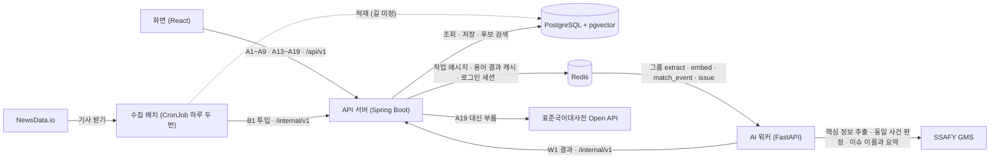
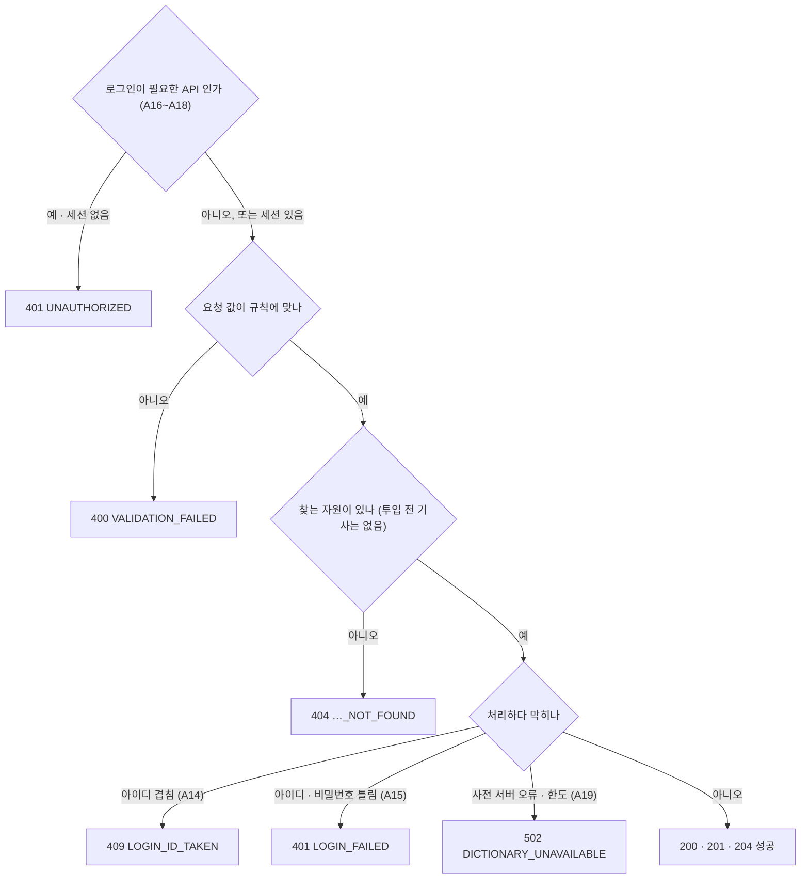
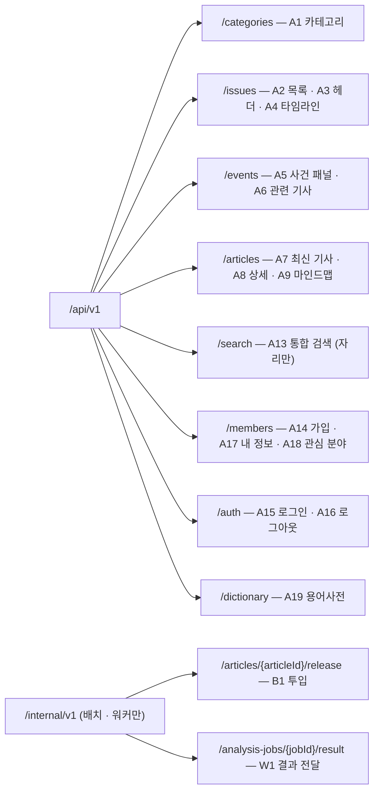
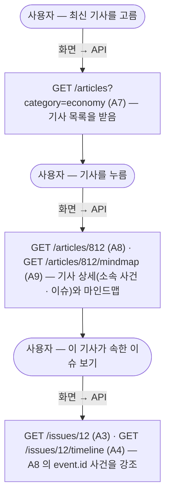

# API 계약 (v1)

화면(FE) · 수집 배치 · AI 워커가 API 서버와 주고받는 모양이다. 테이블 설계는 `docs/data-model.md`, 용어는 `docs/glossary.md`.

- **v0 (2026-10-19, Jira S15P31A102-28 · 80)**: 확정 기능(F01~F08 · F11)의 흐름 A · B 에 필요한 것만 담았다
- **v1 (2026-10-21, Jira S15P31A102-99)**: 10-20 팀 회의 · 10-21 마인드맵 회의 결과를 더했다. 사용자 URL 분석(A10 · A11 · A12)을 지우고, 회원(A14 ~ A18) · 용어사전(A19) · 이슈를 만드는 분석 단계(`ISSUE`, 제안)를 더했다. 아직 코드가 없다
- 1절 공통 규칙은 나중에 바꾸면 비싸서 먼저 정한다. FE · AI 와 합의하기 전까지는 제안이다(`SSOT.md` 8절)
- 응답 필드 · 엔드포인트는 기능 티켓마다 더한다. 구현이 생기면 그 MR 에서 이 문서들을 같이 고친다
- 그림을 한 보드에 모은 보기용 사본이 Figma NEW:LEARN 팀 FigJam 에 있다. 원본은 이 md 들이다

| 문서 | 담는 것 |
|---|---|
| `docs/api.md` (이 문서) | 계약 지도, 공통 규칙, 오류 코드, 엔드포인트 목록과 흐름, 질문, Jira 대조 |
| `docs/api-screen.md` | 화면용 A1 ~ A9 · A13 ~ A19 의 인자 · 응답 필드(용도 · 어디서 오나) · 예시, 마인드맵 `content` 모양 |
| `docs/api-internal.md` | 수집 배치 투입(B1) · 작업 큐 · 워커 결과(W1)의 필드, 작업 상태 |

번호 A10 · A11 · A12 는 지운 사용자 URL 분석이 쓰던 번호라 비워 둔다. 옛 문서 · Jira 의 번호와 헷갈리지 않게 새 엔드포인트는 A14 부터 붙였다.

계약 지도 — 누가 누구와 어떤 계약으로 주고받나



---

## 1. 공통 규칙

| 항목 | 규칙 |
|---|---|
| 주소 | 화면용 `/api/v1/…`, 배치 · 워커용 `/internal/v1/…`. 내부 주소는 Gateway 밖에 열지 않는다 |
| 형식 | JSON, UTF-8. 필드 이름은 camelCase |
| 값 목록 | 대문자 밑줄(`SUCCEEDED`). 카테고리 · 언론사 코드만 소문자(`economy`) — URL 에 쓰는 식별자라서 |
| 식별자 | JSON 숫자(DB `bigint`). FE 는 계산하지 않고 그대로 넘긴다. 카테고리 · 언론사는 문자열 코드 |
| 시간 | ISO 8601 에 오프셋을 붙인다. 보낼 때는 `+09:00` 으로 맞춘다(`2026-10-06T09:30:00+09:00`). 받는 쪽은 `Z` 를 포함해 어떤 오프셋도 읽게 짠다. 요청으로 받은 시각에 오프셋이 없으면 400. 필드 이름은 `…At` 로 끝난다 |
| 성공 응답 | 감싸지 않고 자원 그대로 보낸다. 성공 여부는 HTTP 상태 코드가 말한다 |
| 목록 응답 | 아래 모양. Spring Data 의 `Page` 를 그대로 내보내지 않고 이 모양으로 옮긴다. 페이지를 나누지 않는 목록(카테고리 5개 같은)은 `items` 만. 한 화면에 쓸 것을 묶어 주는 응답(A4 타임라인 · A13 검색)은 이 모양을 따르지 않는다 |
| 목록 요청 | `page`(0부터, 기본 0) · `size`(기본 20, 최대 100). 범위를 벗어나면 400. 정렬은 엔드포인트마다 정해 둔다. 바꾸는 인자는 A2 `sort` 하나다 |
| 빈 결과 | 목록은 200 과 빈 `items`. 찾는 단건이 없으면 404 |
| 없는 값 | 필드를 빼지 않고 `null` 로 보낸다 |
| 투입 전 기사 | `released_at` 이 빈 기사(`data-model.md` 2절)는 모든 조회 · 집계 · 검색에서 없는 것으로 본다. 단건 조회도 404 다 |
| 오류 | RFC 9457 Problem Details(`application/problem+json`) + `code`. Spring 의 `ProblemDetail` 타입을 쓴다. 컨트롤러 예외는 `@RestControllerAdvice`, 인증 · 권한 오류는 Security 진입점에서 같은 모양으로 만든다 — 그래야 모든 오류에 `code` 가 붙는다 |
| 인증 | 둘러보기(A1 ~ A9 · A13) · 가입 · 로그인 · 용어사전은 로그인 없이 쓴다. 로그아웃 · 내 정보 · 관심 분야(A16 ~ A18)는 로그인이 필요하다. 로그인 유지는 세션 쿠키이고 세션은 Redis 에 둔다 — 배포로 API Pod 가 바뀌어도 로그인이 남는다. JWT 는 쓰지 않는다: 화면이 하나 · 주소가 같고, 로그아웃하면 바로 끊겨야 해서다(2026-10-21). CSRF 는 번호표 쿠키(Spring Security `csrf.spa()`)로 막는다 — 서버가 `XSRF-TOKEN` 쿠키를 주고, 화면은 POST · PUT · DELETE 때 그 값을 `X-XSRF-TOKEN` 헤더로 돌려보낸다. axios 기본값과 같은 이름이라 화면이 헤더를 직접 붙이지 않는다. 번호표가 없거나 틀리면 403 이다. 쿠키 이름 · 수명, 첫 POST 전에 번호표 쿠키를 받는 법은 인증 티켓(Jira 62)에서 정하고 사람이 최종 확인한다. 로그인 없이 부르는 A14 · A15 · A19 의 요청 수 상한과 로그인 실패 잠금, 내부 API 를 막는 법은 `SSOT.md` 8절 「API 인증」 |

목록 응답

| 필드 | 타입 | 용도 |
|---|---|---|
| `items` | array | 이번 쪽의 항목들. 없으면 빈 배열 |
| `page` | number | 지금 쪽 번호(0부터). 요청의 `page` 그대로 |
| `size` | number | 한 쪽 크기. 요청의 `size` 그대로 |
| `totalElements` | number | 전체 항목 수. 「기사 23개」 같은 개수 표시에 쓴다 |
| `totalPages` | number | 전체 쪽 수. *더 보기* 를 보일지 가른다(`page + 1 < totalPages`) |

---

## 2. 오류 코드

HTTP 상태는 「어떤 종류의 실패인가」를, `code` 는 「정확히 어떤 경우인가」를 말한다. 같은 404 라도 화면 문구가 다르고(이슈를 못 찾음 · 마인드맵이 아직 없음), 같은 400 이라도 받는 쪽이 할 일이 달라서 둘을 같이 보낸다.

오류 응답 필드

| 필드 | 타입 | 용도 |
|---|---|---|
| `type` | string | 오류 종류를 가리키는 주소. 문서 주소를 아직 두지 않아 늘 `about:blank` |
| `title` | string | 상태 코드의 이름(`Not Found`). Spring 이 채운다 |
| `status` | number | HTTP 상태 코드. 본문만 받아도 알 수 있게 다시 적는다 |
| `detail` | string | 개발자용 설명. 내부 사정이 들어갈 수 있어 화면에 그대로 보이지 않는다 |
| `instance` | string | 오류가 난 요청 주소. 로그를 찾을 때 쓴다 |
| `code` | string | 이 프로젝트의 오류 코드(아래 표). 화면 · 워커는 이것으로 갈라 처리한다 |
| `errors` | array · 없을 수 있음 | `VALIDATION_FAILED` 일 때만. `{ "field", "reason" }` — 어느 칸이 왜 틀렸나. `reason` 은 화면에 그대로 보일 한국어 문장이다(「아이디는 4자 이상이에요」, 2026-10-21) |

```json
{
  "type": "about:blank", "title": "Not Found", "status": 404,
  "detail": "기사를 찾을 수 없다: 456", "instance": "/api/v1/articles/456",
  "code": "ARTICLE_NOT_FOUND"
}
```

어느 검사에서 어느 코드가 나가나 — 화면용 요청. 로그인 검사는 Security 필터라 값 검사보다 먼저 돈다



### 화면용 · 공통

| code | 상태 | 뜻 · 언제 나오나 | 왜 이 상태인가 | 받는 쪽이 할 일 |
|---|---|---|---|---|
| `VALIDATION_FAILED` | 400 | 요청 값이 규칙에 안 맞는다. 예: `size=101`, 오프셋 없는 시각, 숫자 자리에 글자, 4자 미만 아이디, 관심 분야 0개 | 400 Bad Request 는 「요청이 잘못돼 그대로는 처리 못 한다」는 뜻이다. 요청을 고쳐 보내면 된다 | 화면: 가입 · 로그인 입력은 `errors` 의 `reason` 을 그 칸 옆에 그대로 보인다. 그 밖은 대개 화면 코드의 버그라 일반 오류 안내를 띄우고 `errors` 를 로그에 남긴다 |
| `CATEGORY_NOT_FOUND` · `ISSUE_NOT_FOUND` · `EVENT_NOT_FOUND` · `ARTICLE_NOT_FOUND` | 404 | 그 코드 · ID 가 없다. 아직 투입하지 않은 기사도 없는 것으로 본다 | 404 Not Found 는 「그런 자원이 없다」는 뜻이다. 자원마다 코드를 나눈 까닭: 한 화면이 여러 자원을 부를 때 어느 것이 없는지 알 수 있고, 화면 문구도 다르다 | 화면: 「이슈를 찾을 수 없어요」 같은 안내와 홈으로 가는 길 |
| `MINDMAP_NOT_FOUND` | 404 | 기사는 있는데 마인드맵 결과가 아직 없다 | 「없는 단건은 404」(1절)를 지킨다. 다만 `ARTICLE_NOT_FOUND` 와 코드를 나눠 「기사가 없음」과 「결과가 아직 없음」을 가른다 | 화면: A8 의 `mindmapStatus` 를 보고 분석 중이면 기다리고, 실패면 실패 안내 |
| `LOGIN_ID_TAKEN` | 409 | 가입(A14)하려는 아이디를 이미 누가 쓴다 | 409 Conflict 는 「요청은 맞는데 지금 자원 상태와 부딪친다」는 뜻이다. 형식 오류(400)와 갈라야 화면이 「다른 아이디」를 안내한다 | 화면: 아이디 칸 옆에 「이미 쓰는 아이디예요」 |
| `LOGIN_FAILED` | 401 | 로그인(A15)의 아이디가 없거나 비밀번호가 틀렸다. 둘 중 무엇인지는 알려 주지 않는다 | 401 은 「누구인지 확인하지 못했다」는 뜻이다. 아이디가 있는지 없는지 새지 않게 한 코드로 묶었다 | 화면: 「아이디나 비밀번호를 확인해 주세요」 |
| `UNAUTHORIZED` · `FORBIDDEN` | 401 · 403 | 로그인이 필요한 API(A16 ~ A18)를 세션 없이 불렀거나, 내부 API 를 인증 없이(401) · 권한 없이(403) 불렀다. 화면의 POST · PUT · DELETE 에 CSRF 번호표가 없거나 틀려도 403 이다(1절 「인증」). 내부 API 인증 방식은 `SSOT.md` 8절 | 401 은 「누구인지 모른다」, 403 은 「누군지는 알지만 허락되지 않았다」는 뜻이다 | 화면: 401 이면 로그인 화면으로 보내고, 로그인하면 보던 화면으로 돌아온다. 다만 앱이 뜰 때 부른 A17 의 401 은 「손님」이라는 뜻이라 보내지 않는다. 배치 · 워커: 설정한 키를 확인한다 |
| `DICTIONARY_UNAVAILABLE` | 502 | 용어사전(A19)이 부른 표준국어대사전 Open API 가 답하지 않거나, 오류 · 하루 한도 초과를 돌려줬다 | 502 Bad Gateway 는 「우리 서버가 다른 서버에 부탁했는데 제대로 된 답을 못 받았다」는 뜻이다. 사용자 잘못도 우리 서버 고장도 아니다 | 화면: 사전 창에 「지금은 찾을 수 없어요」 |
| `INTERNAL_ERROR` | 500 | 그 밖의 서버 오류 | 500 은 서버 쪽 잘못이다. 받는 쪽이 고칠 것이 없다 | 화면: 일반 오류 안내와 *다시 시도*. 서버는 로그를 남긴다 |

### 내부 API 전용 (B1 · W1)

| code | 상태 | 뜻 · 언제 나오나 | 왜 이 상태인가 | 받는 쪽이 할 일 |
|---|---|---|---|---|
| `RESULT_SCHEMA_INVALID` | 400 | W1 결과가 약속한 모양이 아니다. 빠진 필드, 후보에 없는 `eventId` · `issueId`, 가지가 하나도 없는 마인드맵, 사건이 3개 안 되는 새 이슈도 여기 | 워커가 보낸 요청이 잘못됐으니 400 이다. 같은 내용을 다시 보내도 또 실패한다는 신호다 | 워커: ack 하고 로그를 남긴다. 다시 생성할지는 Jira 30 재처리 정책 |
| `ANALYSIS_JOB_NOT_FOUND` | 404 | W1 의 `jobId` 작업이 없다 | 「없는 단건은 404」(1절) | 워커: ack 하고 로그를 남긴다 |
| `JOB_STATE_CONFLICT` | 409 | 이미 끝난 작업이거나 `attempt` 가 지금 시도와 다르다. 같은 메시지를 두 번 받았거나 옛 시도의 결과가 늦게 왔을 때다. `ISSUE` 결과의 사건이 그사이 다른 이슈에 들어간 때도 여기다(API 가 작업을 다시 건다) | 409 Conflict 는 「요청은 맞는데 지금 자원 상태와 부딪친다」는 뜻이다. 오류라기보다 「이미 처리됐으니 신경 쓰지 말라」는 신호다 | 워커: ack 하고 넘어간다 |
| `ALREADY_RELEASED` | 409 | B1 로 이미 투입한 기사를 또 투입했다 | 위와 같은 409 | 배치: 건너뛰고 다음 기사로 |

v0 에 있던 `EVIDENCE_NOT_IN_BODY` 는 지웠다. 근거가 선택 칸이 되어(2026-10-21) 근거가 맞지 않아도 잎을 버리지 않기 때문이다(`api-screen.md` 3절).

### 작업 실패 코드

오류 응답이 아니라, 분석 작업이 실패했을 때 W1 의 `error.code` 에 담는 값이다. `retryable`(다시 하면 될 것 같은가)은 워커가 판단해 보낸다. 화면은 A8 의 `mindmapStatus` 로 결과만 본다.

| code | 뜻 | 다시 하면 되나 | 화면 안내 |
|---|---|---|---|
| `LLM_TIMEOUT` | GMS 가 정한 시간 안에 답하지 않았다 | 대개 된다 | 「분석이 늦어지고 있어요」 |
| `LLM_RATE_LIMITED` | GMS 호출 한도에 걸렸다 | 잠시 뒤에 된다 | 위와 같음 |
| `LLM_OUTPUT_INVALID` | GMS 출력이 약속한 JSON 모양이 아니다 | 몇 번은 될 수 있다 | 「분석하지 못했어요」 |
| `INTERNAL` | 그 밖의 워커 · 서버 오류 | 모른다 | 일반 오류 안내 |

---

## 3. 엔드포인트

주소 지도 — 화면용 상세는 `docs/api-screen.md`, 내부용 상세는 `docs/api-internal.md`



| # | 엔드포인트 | 쓰는 곳 |
|---|---|---|
| A1 | `GET /api/v1/categories` | 카테고리 선택 (F02 카테고리별 뉴스·이슈 조회) |
| A2 | `GET /api/v1/issues` | 카테고리별 이슈 목록 · 홈 이슈 카드 · 검색창 아래 「새로 생성된 이슈」(`sort=createdAt`) (F02, Jira 41) |
| A3 | `GET /api/v1/issues/{issueId}` | 이슈 헤더 (F07 사건 중심 이슈 에볼루션 맵) |
| A4 | `GET /api/v1/issues/{issueId}/timeline` | 타임라인의 사건 노드 · 메인 · 서브 레인 (F07, Jira 48) |
| A5 | `GET /api/v1/events/{eventId}` | 사건 패널 — 사건 요약 (F08 사건별 관련 기사 조회, Jira 49) |
| A6 | `GET /api/v1/events/{eventId}/articles` | 사건 관련 기사 (F08) |
| A7 | `GET /api/v1/articles` | 최신 기사 (F01 뉴스 데이터 적재·조회, Jira 42) |
| A8 | `GET /api/v1/articles/{articleId}` | 기사 상세와 소속 사건 · 이슈 (F01, F11 기사·이슈 양방향 연결) |
| A9 | `GET /api/v1/articles/{articleId}/mindmap` | 기사 마인드맵 — 흐름지도 · 마인드맵 두 보기 (F04 기사 마인드맵 생성, Jira 56) |
| A13 | `GET /api/v1/search` | 통합 검색 — 자리만 (Jira 43) |
| A14 | `POST /api/v1/members` | 가입 — 아이디 · 비밀번호 · 이름 · 관심 분야 (F12 회원 · 관심 분야, Jira 62) |
| A15 | `POST /api/v1/auth/login` | 로그인 (F12, Jira 62) |
| A16 | `POST /api/v1/auth/logout` | 로그아웃 (F12, Jira 62) |
| A17 | `GET /api/v1/members/me` | 내 정보와 관심 분야 (F12, Jira 65) |
| A18 | `PUT /api/v1/members/me/categories` | 관심 분야 바꾸기 (F12, Jira 65) |
| A19 | `GET /api/v1/dictionary` | 용어사전 — 표준국어대사전 검색 (F13 용어사전, Jira 102) |
| B1 | `POST /internal/v1/articles/{articleId}/release` | 수집 배치의 기사 투입 — `docs/api-internal.md` |
| W1 | `POST /internal/v1/analysis-jobs/{jobId}/result` | 워커의 분석 결과 전달 — `docs/api-internal.md` |

흐름 A — 카테고리에서 시작 (MVP 개요 5장). 둥근 상자는 사용자 행동, 네모 상자는 그때 화면이 부르는 API 와 받는 것이다. 홈은 따로 두지 않고 A1 · A2 · A7 을 쓴다.


흐름 B — 기사에서 시작. 사용자 URL 입력은 2026-10-20 에 뺐다. 저장된 기사를 골라서만 시작한다.



회원 · 용어사전은 흐름 A · B 어디서든 쓴다. 로그인하지 않아도 흐름 A · B 와 용어사전(A19)은 그대로 쓸 수 있다.

---

## 4. FE · AI 에게 물을 것

답을 받으면 해당 절을 고치고 이 목록에서 지운다. 데이터 모델 쪽 미정은 `data-model.md` 5절.

FE

1. 1절 공통 규칙 — 봉투 없음 · Problem Details 와 `code` · 숫자 ID · `+09:00` · `page` 0부터 — 과 카테고리 코드 5개 · 탭 순서(`data-model.md` 2절)를 그대로 써도 되나
2. 타임라인(A4)을 페이지 없이 한 번에 받아도 되나. 이슈 하나에 사건이 몇 개까지 그려지나. 레인 기준이 정해지기 전 `lane` 이 `null` 이면 어떻게 그리나
3. 홈에서 관심 분야를 먼저 보여 주는 방식(생각 중, 2026-10-20)을 A2 의 `category` 여러 번 부르기로 할지, 한 번에 받는 인자를 둘지
4. 통합 검색(A13)을 MVP 에 넣나. 검색창 아래 「새로 생성된 이슈」는 A2 `sort=createdAt&size=…` 로 정했다. 몇 개 보일지는 미정
5. 기사 목록 요약이 `null` 일 때 화면에 무엇을 보이나. 우리 요약이 없으면 NewsData 요약으로 대신하고(`summarySource`, 2026-10-21) 둘 다 없을 때만 `null` 이다
6. user-flow 의 「데이터가 아직 없는 이슈 — 준비 중 + 사건 · 기사 수」 상태는 언제 나오나. 이슈는 사건이 3개 모여야 생긴다
7. 회원 API(A14 ~ A18) 응답 모양과 로그인 방식(세션 쿠키 + CSRF 번호표, 1절 「인증」 — 화면은 axios 기본값 그대로), 손님이 A17 을 부르면 401, 입력 오류 `errors[].reason` 은 한국어 문장(2절), 용어사전(A19) 응답 모양(`api-screen.md`)을 그대로 써도 되나

AI

1. 결과를 HTTP 내부 API(W1)로 보내고 DB 는 직접 안 쓰는 방식, API 가 잠깐 답하지 않으면 결과를 들고 몇 번 다시 보내는 것(BE 안, `api-internal.md` 머리 · 5절)이면 되나. 결과용 스트림이 낫다면 까닭
2. 큐 모양(`api-internal.md` 3절 — 스트림 셋, 그룹 넷)과 메시지에 본문을 통째로 넣고 `XADD … ACKED MAXLEN ~` 으로 길이를 자르는 것(BE 안, 3 · 4절)
3. 마인드맵 출력(`api-screen.md` 3절) — 가지 4개 중 내용 있는 것만, 잎은 문장. 근거는 뽑고 출력 토큰은 문장 번호 방식으로 아끼며, 대조는 「그 문단에 글자 그대로」, 틀린 근거만 지우고 잎은 남기는 것(BE 안, 3절)이면 되나
4. 본문에서 뽑은 발생 시점 — 날짜까지만 있으면 그날 0시(정밀도 칸 없음), 상대 날짜는 `publishedAt` 기준으로 풀기, 현지 날짜는 적힌 그대로, 날짜보다 흐리면 null(BE 안, `api-internal.md` 5절 `EXTRACT` · `data-model.md` 5절 12번)이면 되나
5. `MATCH_EVENT` 결과 — 새 사건의 이름 · 키워드(`label`) · 요약을 판정과 같은 호출에서 짓고(길이 제안: 키워드 2 ~ 10자 · 이름 한 줄 40자 안 · 요약 1 ~ 2문장), 기사가 더 붙어도 고치지 않는 것(BE 안, `api-internal.md` 5절)이면 되나
6. `ISSUE` 단계(제안) — 이슈에 붙이기 · 새 이슈 만들기(사건 3개 이상, 이름 · 요약) · 이슈 요약 다시 만들기. 어떤 사건을 묶을지는 실험(`data-model.md` 5절 2번)
7. 작업 실패 코드 목록(2절)과 `retryable` 을 워커가 판단해 보내는 것
8. 임베딩 모델 · 차원 (`SSOT.md` 8절)

---

## 5. Jira 티켓 대조

엔드포인트마다 어느 BE 구현 티켓이 맡는지다. 2026-10-21 에 티켓 제목 · 범위를 이 v1 에 맞춰 정리했다(티켓마다 바뀐 까닭은 댓글). 담당자 · 구현 방법 · 완료 기준은 Jira 에 있고, 모든 티켓이 따르는 코드 약속은 Jira 100 에 있다.

| Jira | 맡는 것 | 메모 |
|---|---|---|
| 100 API 공통 기반 | 1절 공통 규칙 · 2절 오류 모양, 둘러보기 API 를 로그인 없이 열기, 코드 약속 | 다른 API 티켓보다 먼저 |
| 101 핵심 테이블 | `data-model.md` v1 실선 테이블 14개 마이그레이션 · 엔티티 | 다른 API 티켓보다 먼저 |
| 41 | A1 · A2 (`eventCount` · `articleCount` · `lastEvent`, 새로 생성된 이슈 순 `sort=createdAt`), 빈 `items` | |
| 42 | A7 · A8 (목록과 상세가 같은 `id`, `mindmapStatus` · `eventMatchStatus`) | |
| 48 | A3 · A4 (`occurredAt` 과 기사 쪽 `publishedAt` 은 다른 필드, `label` · `lane`) | 사건 사이 선은 그리지 않기로 했고(2026-10-20) 언론사 필터는 P1(PRD FR-23)이라 뺐다 |
| 49 | A5 · A6 | 사건 패널은 요약과 관련 기사만(2026-10-20). 관점은 P2, 변화는 F09 · F10 이라 뺐다 |
| 56 | A9 `content`(가지 4개, 근거는 저장만) 조회와 W1 `EXTRACT` 결과 저장 | 옛 완료 기준의 「기존 결과 재사용」은 `mindmapStatus` 로 읽었다 — 티켓 원문 작성자에게 확인한다 |
| 62 | A14 · A15 · A16 (가입 · 로그인 · 로그아웃, 세션) | Redis 세션 · CSRF 번호표를 설정하고, 요청 수 상한 · 실패 잠금도 여기서 정한다 |
| 65 | A17 · A18 (내 정보 · 관심 분야) | 선호 언론사 · 추천은 뺐다 |
| 102 | A19 용어사전 | |
| 34 | B1 투입 · 수집 배치 | |
| 30 | 작업 큐 · W1 공통 봉투 · 작업 상태 · 재처리 | |
| 35 | W1 `EMBED` · `MATCH_EVENT` 결과 저장, 후보 사건 찾기 | |
| 40 | W1 `ISSUE` 결과 저장 (제안) | AI 합의 뒤 |
| 43 | A13 (자리만) | 보류 — MVP 여부 미정(4절 FE 4번) |
| 57 기사 URL 분석 | — | 2026-10-20 팀 회의로 MVP 에서 빼서 티켓을 닫았다 |
| 63 · 64 북마크 · 관심 이슈 | — | 보류 — MVP 여부 미정(`data-model.md` 5절 6번) |

---

## 6. 바꾸는 법

- 응답에 필드를 더하는 것은 언제든 된다. 화면은 모르는 필드를 무시한다
- 필드 이름 · 뜻을 바꾸거나 지우는 것은 FE 와 같은 MR 에서 고친다. 배포 중에는 옛 화면과 새 API 가 같이 돌 수 있다(SSOT 6절 「무중단 배포 조건」)
- 1절 공통 규칙을 바꾸면 `SSOT.md` 9절 「뒤집은 것」에 한 줄 남긴다
- 첫 API 티켓은 `+09:00` 직렬화와 `ProblemDetail` 의 `code` 를 테스트로 확인한다. Spring Boot 4 · Jackson 3 에서 기본값으로 나오는지는 아직 돌려 보지 않았다
- md 를 고치면 FigJam 보기용 사본에서 같은 그림만 다시 만든다
