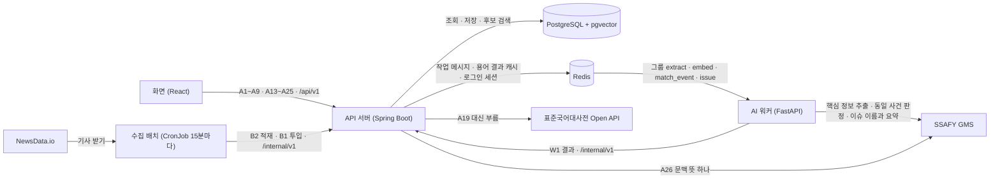
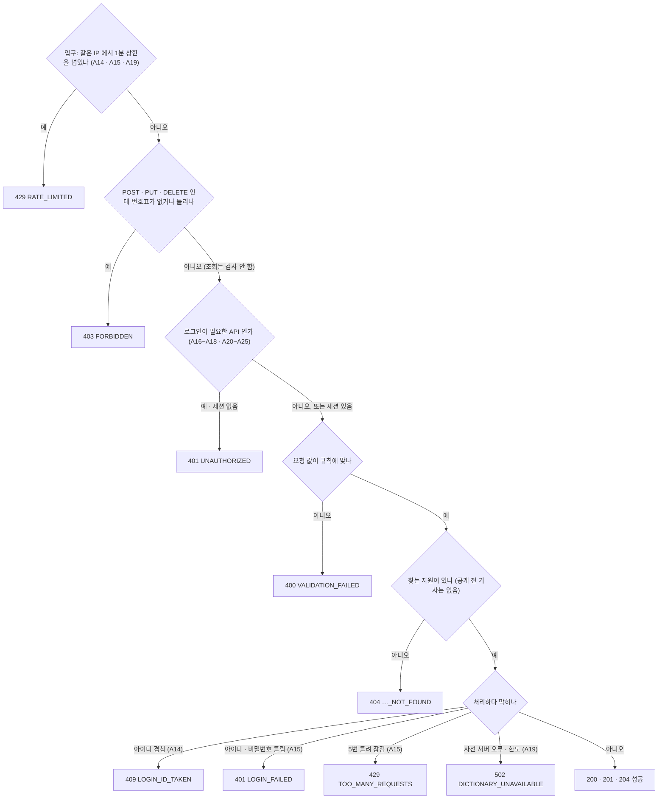
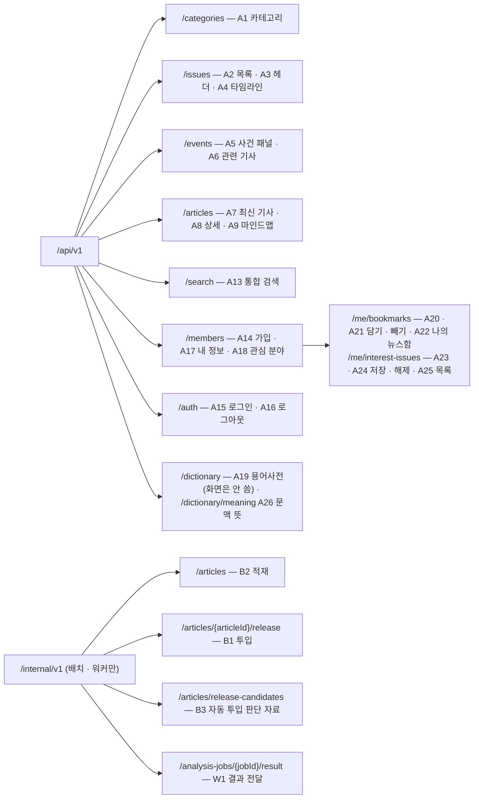
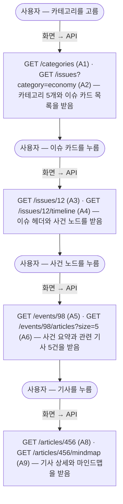

# API 계약 (v1)

화면(FE) · 수집 배치 · AI 워커가 API 서버와 주고받는 모양이다. 테이블 설계는 `docs/data-model.md`, 용어는 `docs/glossary.md`.

- **v0 (2026-10-19, Jira S15P31A102-28 · 80)**: 확정 기능(F01~F08 · F11)의 흐름 A · B 에 필요한 것만 담았다
- **v1 (2026-10-21, Jira S15P31A102-99)**: 10-20 팀 회의 · 10-21 마인드맵 회의 결과를 더했다. 사용자 URL 분석(A10 · A11 · A12)을 지우고, 회원(A14 ~ A18) · 용어사전(A19) · 이슈를 만드는 분석 단계(`ISSUE`, 제안)를 더했다. 이때는 아직 코드가 없었다 — 지금 구현 상태는 5절 Jira 표
- **v1.2 (2026-10-26, Jira S15P31A102-114)**: 북마크 · 관심 이슈(A20 ~ A25)를 더하고, 기사 · 이슈 응답에 회원 기준 `bookmarked` · `interested` 칸을 더했다(1절 「내 상태 칸」). 담기 · 빼기는 바뀐 상태를 200 으로 돌려주고 화면 문구를 고정했다. FE 질문 7 · 8번은 정한 약속으로 바꿨다
- **v1.1 (2026-10-26, Jira S15P31A102-111)**: AI 답(2026-10-23)을 반영했다. 작업 실패 코드 `INPUT_NOT_ANALYZABLE` · `LLM_UNAVAILABLE` · `RESULT_SCHEMA_INVALID`(API 가 적음)를 더하고 4절 AI 질문을 닫았다. 워커 계약의 바뀐 곳은 `api-internal.md` v1.1
- 1절 공통 규칙은 나중에 바꾸면 비싸서 먼저 정했다. AI(2026-10-23) · FE(2026-11-12, Jira S15P31A102-32 — 화면이 이 규칙대로 운영 데이터를 읽는다)가 동의해 합의됐다
- 응답 필드 · 엔드포인트는 기능 티켓마다 더한다. 구현이 생기면 그 MR 에서 이 문서들을 같이 고친다
- 그림을 한 보드에 모은 보기용 사본이 Figma NEW:LEARN 팀 FigJam 에 있다. 원본은 이 md 들이다

| 문서 | 담는 것 |
|---|---|
| `docs/api.md` (이 문서) | 계약 지도, 공통 규칙, 오류 코드, 엔드포인트 목록과 흐름, 질문, Jira 대조 |
| `docs/api-screen.md` | 화면용 A1 ~ A9 · A13 ~ A25 의 인자 · 응답 필드(용도 · 어디서 오나) · 예시, 마인드맵 `content` 모양 |
| `docs/api-internal.md` | 수집 배치 적재(B2) · 투입(B1) · 자동 투입 판단 자료(B3) · 작업 큐 · 워커 결과(W1)의 필드, 작업 상태 |

번호 A10 · A11 · A12 는 지운 사용자 URL 분석이 쓰던 번호라 비워 둔다. 옛 문서 · Jira 의 번호와 헷갈리지 않게 새 엔드포인트는 A14 부터 붙였다.

계약 지도 — 누가 누구와 어떤 계약으로 주고받나



---

## 1. 공통 규칙

| 항목 | 규칙 |
|---|---|
| 주소 | 화면용 `/api/v1/…`, 배치 · 워커용 `/internal/v1/…`. 내부 주소는 Gateway 밖에 열지 않는다 |
| 형식 | JSON, UTF-8. 필드 이름은 camelCase |
| 값 목록 | 대문자 밑줄(`SUCCEEDED`). 카테고리 · 언론사 코드만 소문자(`economy`) — URL 에 쓰는 식별자라서 |
| 식별자 | JSON 숫자(DB `bigint`). FE 는 계산하지 않고 그대로 넘긴다. 카테고리 · 언론사는 문자열 코드 |
| 시간 | ISO 8601 에 오프셋을 붙인다. 보낼 때는 `+09:00` 으로 맞춘다(`2026-10-06T09:30:00+09:00`). 받는 쪽은 `Z` 를 포함해 어떤 오프셋도 읽게 짠다. 요청으로 받은 시각에 오프셋이 없으면 400. 필드 이름은 `…At` 로 끝난다 |
| 성공 응답 | 감싸지 않고 자원 그대로 보낸다. 성공 여부는 HTTP 상태 코드가 말한다 |
| 목록 응답 | 아래 모양. Spring Data 의 `Page` 를 그대로 내보내지 않고 이 모양으로 옮긴다. 페이지를 나누지 않는 목록(카테고리 5개 같은)은 `items` 만. 한 화면에 쓸 것을 묶어 주는 응답(A4 타임라인 · A13 검색)은 이 모양을 따르지 않는다 |
| 목록 요청 | `page`(0부터, 기본 0) · `size`(기본 20, 최대 100). 범위를 벗어나면 400. 정렬은 엔드포인트마다 정해 둔다. 바꾸는 인자는 A2 · A6 의 `sort` 둘이다(A6 는 2026-11-13 Jira 201) |
| 빈 결과 | 목록은 200 과 빈 `items`. 찾는 단건이 없으면 404 |
| 없는 값 | 필드를 빼지 않고 `null` 로 보낸다 |
| 공개 전 기사 | `released_at` 이 빈 기사(`data-model.md` 2절)는 모든 조회 · 집계 · 검색에서 없는 것으로 본다. 단건 조회도 404 다. 투입(B1)했어도 EXTRACT 결과가 처음 저장되기 전까지는 공개 전이다(2026-10-26, Jira 34). 분야 라벨로 숨긴 기사도 같다 — 무엇을 숨기는지는 `infra/server/category-labels.md`(2026-11-05, Jira 177) |
| 공개 기사가 없는 이슈 · 사건 | 공개 기사가 하나도 없는 사건, 그런 사건뿐인(또는 사건이 없는) 이슈는 화면 조회 · 집계 · 검색에서 없는 것으로 본다. 단건 조회는 404 다(A3 · A4 `ISSUE_NOT_FOUND`, A5 · A6 `EVENT_NOT_FOUND`). A23 관심 이슈 저장도 404 이고 A24 해제는 그대로 200 이다. 일부 기사만 숨겨진 사건은 그대로 두고 숨긴 기사만 셈에서 뺀다. 행은 지우지 않아 기사가 다시 공개되면 이슈 · 사건 · 관심 이슈가 돌아온다(2026-11-09, Jira S15P31A102-179). 판정 조각은 `backend/src/main/java/kr/io/newlearn/common/PublicEventSql.java` |
| 오류 | RFC 9457 Problem Details(`application/problem+json`) + `code`. Spring 의 `ProblemDetail` 타입을 쓴다. 컨트롤러 예외는 `@RestControllerAdvice`, 인증 · 권한 오류는 Security 진입점에서 같은 모양으로 만든다 — 그래야 모든 오류에 `code` 가 붙는다 |
| 인증 | 둘러보기(A1 ~ A9 · A13) · 가입 · 로그인 · 용어사전은 로그인 없이 쓴다. 로그아웃 · 내 정보 · 관심 분야(A16 ~ A18) · 북마크 · 관심 이슈(A20 ~ A25)는 로그인이 필요하다. 로그인 유지는 세션 쿠키이고 세션은 Redis 에 둔다 — 배포로 API Pod 가 바뀌어도 로그인이 남는다. JWT 는 쓰지 않는다: 화면이 하나 · 주소가 같고, 로그아웃하면 바로 끊겨야 해서다(2026-10-21). CSRF 는 번호표 쿠키(Spring Security `csrf.spa()`)로 막는다 — 서버가 `XSRF-TOKEN` 쿠키를 주고, 화면은 POST · PUT · DELETE 때 그 값을 `X-XSRF-TOKEN` 헤더로 돌려보낸다. axios 기본값과 같은 이름이라 화면이 헤더를 직접 붙이지 않는다. 번호표가 없거나 틀리면 403 이다. 번호표 쿠키가 없는 요청이면 어느 응답에든 새 번호표 쿠키가 붙는다 — 화면은 앱이 뜰 때 부르는 GET(A1 · A17 등) 응답으로 첫 번호표를 받고, 가입 · 로그인 · 로그아웃 때 번호표가 새로 바뀐다. 세션 쿠키 이름은 `SESSION`(`HttpOnly`)이고 로그인한 때부터 하루 남는다(쿠키 `Max-Age` 1일 · Redis 세션 비활동 만료 1일) — 브라우저를 닫아도 하루는 로그인이 남는다. 두 쿠키 모두 `SameSite=Lax` 이고 사이트에서는 `Secure` 다(2026-10-26 Jira 62). 어느 주소를 로그인 없이 여는지는 `backend` 의 `SecurityConfig` 한 곳에 있다(Jira 100). Swagger 화면(`/swagger-ui.html`)과 OpenAPI 문서(`/v3/api-docs`)도 개발하는 동안 로그인 없이 연다 — 코드에서 만든 사본이라 계약의 원본은 이 문서다. 내부 API 는 문서에서도 뺀다. 다시 잠글지는 `SSOT.md` 8절(Jira 107). 로그인 실패 잠금(5번 틀리면 1분)은 `api-screen.md` A15. 내부 API(`/internal/v1`)는 세션 · CSRF 번호표 없이 출입증 두 장으로 연다 — 워커 키는 W1, 배치 키는 B2 · B1 · B3 만 열고(2026-11-03 Jira 153, B3 는 2026-11-11 Jira 156), `X-Internal-Key` 헤더로 보낸다. 출입증이 없거나 틀리면 401, 남의 문 출입증이면 403 이다. 키는 env `INTERNAL_WORKER_KEY` · `INTERNAL_BATCH_KEY` 로 받는다 — 사이트는 봉인 Secret `internal-api` 를 Jira 30 의 Infra 작업에서 넣고, 넣기 전에는 비어 모두 막힌다(2026-10-26 Jira 30, `backend` 의 `InternalApiSecurityConfig`). 로그인 없이 부르는 A14 가입 · A15 로그인 · A19 용어사전은 입구(Envoy)가 손님 IP 마다 1분 100 · 300 · 100건으로 막는다(가입 · 로그인은 처음 10 · 20, 2026-10-30 Jira 137) — 넘으면 429 `RATE_LIMITED`(2절, `SSOT.md` 6절 「외부 입구」, 2026-10-29 Jira 135) |
| 내 상태 칸 | 기사 응답(A6 · A7 · A8 · A22)의 `bookmarked`, 이슈 응답(A2 · A3 · A25)의 `interested` 는 세션 회원 기준이고 손님이면 false 다(2026-10-26 Jira 114). 같은 주소라도 로그인 여부로 응답이 다르다. 응답을 캐시하게 되면 회원 공통 부분만 캐시하고 두 칸은 캐시 밖에서 덧씌운다 |

목록 응답

| 필드 | 타입 | 용도 |
|---|---|---|
| `items` | array | 이번 쪽의 항목들. 없으면 빈 배열 |
| `page` | number | 지금 쪽 번호(0부터). 요청의 `page` 그대로 |
| `size` | number | 한 쪽 크기. 요청의 `size` 그대로 |
| `totalElements` | number | 전체 항목 수. 「기사 23개」 같은 개수 표시에 쓴다 |
| `totalPages` | number | 전체 쪽 수. *더 보기* 를 보일지 가른다(`page + 1 < totalPages`) |

---

## 2. 오류 코드

HTTP 상태는 「어떤 종류의 실패인가」를, `code` 는 「정확히 어떤 경우인가」를 말한다. 같은 404 라도 화면 문구가 다르고(이슈를 못 찾음 · 마인드맵이 아직 없음), 같은 400 이라도 받는 쪽이 할 일이 달라서 둘을 같이 보낸다.

오류 응답 필드

| 필드 | 타입 | 용도 |
|---|---|---|
| `type` | string · 없을 수 있음 | 오류 종류를 가리키는 주소. 문서 주소를 아직 두지 않아 칸을 빼고 보낸다. RFC 9457 은 `type` 이 없으면 `about:blank` 로 보므로 받는 쪽도 둘을 같게 다룬다(2026-10-22 실제 응답으로 확인) |
| `title` | string | 상태 코드의 이름(`Not Found`). Spring 이 채운다 |
| `status` | number | HTTP 상태 코드. 본문만 받아도 알 수 있게 다시 적는다 |
| `detail` | string | 개발자용 설명. 내부 사정이 들어갈 수 있어 화면에 그대로 보이지 않는다 |
| `instance` | string | 오류가 난 요청 주소. 로그를 찾을 때 쓴다 |
| `code` | string | 이 프로젝트의 오류 코드(아래 표). 화면 · 워커는 이것으로 갈라 처리한다 |
| `errors` | array · 없을 수 있음 | `VALIDATION_FAILED` 일 때만. `{ "field", "reason" }` — 어느 칸이 왜 틀렸나. `reason` 은 화면에 그대로 보일 한국어 문장이다(「아이디는 영문 소문자 · 숫자 · _ 로 4~20자여야 해요」, 2026-10-21) |

```json
{
  "title": "Not Found", "status": 404,
  "detail": "기사를 찾을 수 없다: 456", "instance": "/api/v1/articles/456",
  "code": "ARTICLE_NOT_FOUND"
}
```

어느 검사에서 어느 코드가 나가나 — 화면용 요청. 번호표 검사와 로그인 검사는 Security 필터라 값 검사보다 먼저 돈다. 번호표 검사가 가장 먼저라, 세션도 번호표도 없는 로그아웃은 401 이 아니라 403 이다



### 화면용 · 공통

| code | 상태 | 뜻 · 언제 나오나 | 왜 이 상태인가 | 받는 쪽이 할 일 |
|---|---|---|---|---|
| `VALIDATION_FAILED` | 400 | 요청 값이 규칙에 안 맞는다. 예: `size=101`, 오프셋 없는 시각, 숫자 자리에 글자, 4자 미만 아이디, 관심 분야 0개, UTF-8 로 읽을 수 없는 쿼리 인자(cp949 로 인코딩한 한글 `?q=%B3%AA` · 깨진 퍼센트 `%ZZ`). 쿼리 인자를 못 읽은 때는 어느 칸인지 짚지 못해 `errors` 가 없다(2026-10-30) | 400 Bad Request 는 「요청이 잘못돼 그대로는 처리 못 한다」는 뜻이다. 요청을 고쳐 보내면 된다 | 화면: 가입 · 로그인 입력은 `errors` 의 `reason` 을 그 칸 옆에 그대로 보인다. 그 밖은 대개 화면 코드의 버그라 일반 오류 안내를 띄우고 `errors` 를 로그에 남긴다 |
| `CATEGORY_NOT_FOUND` · `ISSUE_NOT_FOUND` · `EVENT_NOT_FOUND` · `ARTICLE_NOT_FOUND` | 404 | 그 코드 · ID 가 없다. 아직 공개하지 않은 기사, 공개 기사가 하나도 없는 이슈 · 사건도 없는 것으로 본다 | 404 Not Found 는 「그런 자원이 없다」는 뜻이다. 자원마다 코드를 나눈 까닭: 한 화면이 여러 자원을 부를 때 어느 것이 없는지 알 수 있고, 화면 문구도 다르다 | 화면: 「이슈를 찾을 수 없어요」 같은 안내와 홈으로 가는 길 |
| `MINDMAP_NOT_FOUND` | 404 | 기사는 있는데 마인드맵 결과가 아직 없다 | 「없는 단건은 404」(1절)를 지킨다. 다만 `ARTICLE_NOT_FOUND` 와 코드를 나눠 「기사가 없음」과 「결과가 아직 없음」을 가른다 | 화면: A8 의 `mindmapStatus` 를 보고 분석 중이면 기다리고, 실패면 실패 안내 |
| `LOGIN_ID_TAKEN` | 409 | 가입(A14)하려는 아이디를 이미 누가 쓴다 | 409 Conflict 는 「요청은 맞는데 지금 자원 상태와 부딪친다」는 뜻이다. 형식 오류(400)와 갈라야 화면이 「다른 아이디」를 안내한다 | 화면: 아이디 칸 옆에 「이미 쓰는 아이디예요」 |
| `LOGIN_FAILED` | 401 | 로그인(A15)의 아이디가 없거나 비밀번호가 틀렸다. 둘 중 무엇인지는 알려 주지 않는다 | 401 은 「누구인지 확인하지 못했다」는 뜻이다. 아이디가 있는지 없는지 새지 않게 한 코드로 묶었다 | 화면: 「아이디나 비밀번호를 확인해 주세요」 |
| `TOO_MANY_REQUESTS` | 429 | 로그인(A15)을 같은 아이디로 5번 연속 틀려 1분 동안 잠겼다. 잠긴 동안은 비밀번호가 맞아도 이 코드다(`api-screen.md` A15) | 429 Too Many Requests 는 「너무 자주 보냈으니 잠시 뒤에」라는 뜻이다. 틀린 비밀번호(401)와 갈라야 화면이 「잠시 뒤에」를 안내한다 | 화면: 「로그인을 5번 틀려 1분 뒤에 다시 할 수 있어요」 |
| `RATE_LIMITED` | 429 | A14 가입 · A15 로그인 · A19 용어사전 · A26 문맥 뜻을 같은 IP 에서 1분에 100 · 300 · 100 · 100번 넘게 불렀다(A26 은 2026-11-10 Jira 187, 따로 센다)(가입 · 로그인은 2026-10-30 Jira 137 에서 10 · 20 → 100 · 300 — QA · 발표 때 같은 와이파이). **백엔드가 아니라 입구(Envoy)가 만든다** — 그래서 `instance` 칸이 없고 응답 머리에 `Retry-After: 60` 이 붙는다. 이 주소들의 응답에는 429 가 아니어도 `x-ratelimit-limit` · `x-ratelimit-remaining` · `x-ratelimit-reset`(이번 1분 칸이 끝날 때까지 남은 초)이 붙는다 — `Retry-After` 는 늘 60 이라 실제로 풀리는 때는 `x-ratelimit-reset` 이 더 정확하다(2026-10-29 Jira 135, `SSOT.md` 6절 「외부 입구」) | 429 는 같다. 다만 `TOO_MANY_REQUESTS`(같은 아이디 5번 틀림)와 코드를 나눈다 — 그 코드는 화면이 「로그인을 5번 틀려 1분 뒤에」로 안내해서, 같은 코드를 쓰면 엉뚱한 안내가 뜬다 | 화면: 「요청이 많아요. 잠시 뒤 다시 시도해 주세요」. 바로 다시 보내지 않는다 |
| `UNAUTHORIZED` · `FORBIDDEN` | 401 · 403 | 로그인이 필요한 API(A16 ~ A18 · A20 ~ A25)를 세션 없이 불렀거나, 내부 API 를 인증 없이(401) · 권한 없이(403) 불렀다. 화면의 POST · PUT · DELETE 에 CSRF 번호표가 없거나 틀려도 403 이다(1절 「인증」). 내부 API 출입증은 1절 「인증」 | 401 은 「누구인지 모른다」, 403 은 「누군지는 알지만 허락되지 않았다」는 뜻이다 | 화면: 회원이던 사람이 401 을 받으면 세션이 끝난 것이라 로그인 화면으로 보내고, 로그인하면 보던 화면으로 돌아온다. 앱이 뜰 때 부른 A17 의 401 은 「손님」이라는 뜻이라 보내지 않는다 — 손님도 둘러보기는 다 한다(2026-11-13, Jira 205). A16 로그아웃의 401 은 세션이 이미 끊겼다는 뜻이라 로그아웃한 것과 같이 랜딩으로 간다(EXPERIENCE.md 이동 규칙, Jira 66). 배치 · 워커: 설정한 키를 확인한다 |
| `DICTIONARY_UNAVAILABLE` | 502 | 용어사전(A19)이 부른 표준국어대사전 Open API · 문맥 뜻(A26)이 부른 SSAFY GMS 가 답하지 않거나, 오류 · 하루 한도 초과 · 읽을 수 없는 응답을 돌려줬다. 키를 넣기 전에도 이 코드다. A26 은 그날 호출 수를 셀 수 없을 때(Redis 실패)도 이 코드다. 결과 없음은 오류가 아니라 200 이다 — A19 빈 `items`, A26 세 칸 null(`api-screen.md` A19 · A26) | 502 Bad Gateway 는 「우리 서버가 다른 서버에 부탁했는데 제대로 된 답을 못 받았다」는 뜻이다. 사용자 잘못도 우리 서버 고장도 아니다 | 화면: 용어사전 말풍선에 「지금은 찾을 수 없어요」 |
| `INTERNAL_ERROR` | 500 | 그 밖의 서버 오류 | 500 은 서버 쪽 잘못이다. 받는 쪽이 고칠 것이 없다 | 화면: 일반 오류 안내와 *다시 시도*. 서버는 로그를 남긴다 |
| `NOT_FOUND` · `METHOD_NOT_ALLOWED` · `NOT_ACCEPTABLE` · `UNSUPPORTED_MEDIA_TYPE` | 404 · 405 · 406 · 415 | 우리 코드에 닿기 전에 스프링이 막은 요청이다. 그런 주소가 없음 · 주소는 있는데 HTTP 메서드가 다름 · `Accept` 가 JSON 을 받지 않음 · 본문 형식(`Content-Type`)이 JSON 이 아님. code 는 상태 이름 그대로 붙인다(2026-10-22) | 각 상태의 표준 뜻 그대로다. `NOT_FOUND` 는 「주소 자체가 없다」는 뜻이라 자원 코드(`ISSUE_NOT_FOUND` 등 — 주소는 있는데 그 ID 가 없음)와 나눈다 | 화면: 대개 화면 코드의 버그라 일반 오류 안내를 띄우고 로그를 남긴다 |

스프링이 내는 그 밖의 4xx 는 `VALIDATION_FAILED`, 5xx 는 `INTERNAL_ERROR` 를 붙인다. 그래서 모든 오류 응답에 `code` 가 있다. 다만 보안 필터 단계에서 터진 오류가 스프링 기본 `/error` 로 가면 `code` 가 없다(`docs/backend-convention.md` 4절).

### 내부 API 전용 (B1 · W1)

| code | 상태 | 뜻 · 언제 나오나 | 왜 이 상태인가 | 받는 쪽이 할 일 |
|---|---|---|---|---|
| `RESULT_SCHEMA_INVALID` | 400 | W1 결과가 약속한 모양이 아니다. 빠진 필드, 후보에 없는 `eventId` · `issueId`, 가지가 하나도 없는 마인드맵, 사건이 3개 안 되는 새 이슈도 여기 | 워커가 보낸 요청이 잘못됐으니 400 이다. 같은 내용을 다시 보내도 또 실패한다는 신호다 | 워커: ack 하고 로그를 남긴다. 다시 생성할지는 Jira 30 재처리 정책 |
| `ANALYSIS_JOB_NOT_FOUND` | 404 | W1 의 `jobId` 작업이 없다 | 「없는 단건은 404」(1절) | 워커: ack 하고 로그를 남긴다 |
| `JOB_STATE_CONFLICT` | 409 | 이미 끝난 작업이거나 `attempt` 가 지금 시도와 다르다. 같은 메시지를 두 번 받았거나 옛 시도의 결과가 늦게 왔을 때다. `ISSUE` 결과의 사건이 그사이 다른 이슈에 들어간 때도 여기다(API 가 작업을 다시 건다) | 409 Conflict 는 「요청은 맞는데 지금 자원 상태와 부딪친다」는 뜻이다. 오류라기보다 「이미 처리됐으니 신경 쓰지 말라」는 신호다 | 워커: ack 하고 넘어간다 |
| `ALREADY_RELEASED` | 409 | B1 로 이미 투입한 기사를 또 투입했거나, 이미 공개된 기사를 투입했다 | 위와 같은 409 | 배치: 건너뛰고 다음 기사로 |

v0 에 있던 `EVIDENCE_NOT_IN_BODY` 는 지웠다. 근거가 선택 칸이 되어(2026-10-21) 근거가 맞지 않아도 잎을 버리지 않기 때문이다(`api-screen.md` 3절).

### 작업 실패 코드

오류 응답이 아니라, 분석 작업이 실패했을 때 W1 의 `error.code` 에 담는 값이다. 화면은 A8 의 `mindmapStatus` 로 결과만 본다.

- **다시 할지는 API 가 이 표와 시도 횟수로 정한다.** 워커는 `retryable` 을 보내지 않는다. 다시 걸지 · 몇 번까지를 한 곳에서 정하려는 것이다. 워커는 몇 번째 시도인지 · 최대 시도 수를 모른다(2026-10-21 BE 안. Google AIP-194 도 부르는 쪽이 코드로 정한다)
- **짧은 끊김은 워커 안에서.** 시간 초과 · 한도 초과 · 연결 실패는 워커가 같은 시도 안에서 간격을 늘려 가며 몇 번 다시 부른다. GMS 가 대기 시간을 알려 주면 따른다. 그래도 안 되면 그 코드로 실패를 보낸다. 횟수 · 간격은 AI 가 정한다
- **최대 시도 수는 3(첫 시도 포함), 「한 번만 더」는 시도 2 까지.** 늦춰 거는 코드는 API 가 실패를 받은 때부터 아래 간격 뒤를 다시 걸 때(`analysis_job.retry_at`)로 적고, 스케줄러가 1분마다 그때가 지난 것을 `attempt + 1` 로 다시 건다. 워커가 보낸 시각이 아니라 API 가 받은 때로 재서 워커 시계가 틀려도 밀리지 않는다. 표에 없는 코드는 다시 걸지 않는다 — 모르는 실패를 계속 다시 걸면 GMS 예산만 쓴다(2026-10-26 Jira 30, `backend` 의 `RetryPolicy`)

| code | 뜻 | API 가 다시 거나 | 화면 안내 |
|---|---|---|---|
| `LLM_TIMEOUT` | GMS 가 정한 시간 안에 답하지 않았다 | 예 — 1분 뒤, 또 실패하면 5분 뒤 | 「분석이 늦어지고 있어요」 |
| `LLM_RATE_LIMITED` | GMS 호출 한도에 걸렸다 | 예, 더 늦춰서 — 5분 뒤, 또 실패하면 15분 뒤 | 위와 같음 |
| `LLM_UNAVAILABLE` | GMS 에 닿지 못했다 — 502 를 받았거나 응답 없이 연결이 끊겼다. 워커 안에서 간격을 늘려 몇 번 다시 불러도 안 될 때 보낸다. 횟수 · 간격은 AI 가 정한다(AI 실험에서 둘 다 나왔고 3번 안에 이어졌다, 2026-10-23) | 예, 더 늦춰서 — 5분 뒤, 또 실패하면 15분 뒤 | 「분석이 늦어지고 있어요」 |
| `LLM_OUTPUT_INVALID` | GMS 출력이 약속한 JSON 모양이 아니다 | 한 번만 더 — 1분 뒤 | 「분석하지 못했어요」 |
| `LLM_INPUT_TOO_LONG` | 기사가 모델이 받을 수 있는 입력 길이를 넘었다 | 아니오 — 워커가 자르는 법을 고쳐야 한다 | 「분석하지 못했어요」 |
| `LLM_REFUSED` | 모델이 답을 거절했거나 내용 필터에 걸렸다 | 아니오 | 「분석하지 못했어요」 |
| `INPUT_NOT_ANALYZABLE` | 본문에 분석할 문장이 없다(저작권 · 안내 문구뿐, 너무 짧음). 워커가 GMS 를 부르기 전에 거른다(`api-internal.md` 5절) | 아니오 | A8 `mindmapStatus` 가 `NOT_ANALYZABLE` — 문구는 FE 와 정한다 |
| `EVENT_CLUSTER_TOO_SMALL` | 기반 분석에서 기사 5건 미만 묶음이라 사건을 만들지 않았다. MATCH_EVENT 에만, AI 결과 덤프로만 들어온다 — 워커는 보내지 않는다(`infra/server/data-load.md` 3절) | 아니오 | A8 `eventMatchStatus` 가 `FAILED` — 사건 · 이슈 쪽에 아무것도 두지 않는다 |
| `RESULT_SCHEMA_INVALID` | 워커가 보낸 결과가 약속한 모양이 아니라 API 가 저장을 거절했다(W1 400 — 범위 밖 `primaryCoreIndex` 등). 워커가 아니라 API 가 적는다 | 예, 바로 한 번만(`api-internal.md` 5절) | 「분석하지 못했어요」 |
| `JOB_STATE_CONFLICT` | `ISSUE` 결과를 저장하려는데 그사이 사건이 다른 이슈에 들어갔거나 고른 이슈가 없어졌다(W1 409). 워커가 아니라 API 가 적는다(2026-10-29 Jira 40) | 예, 바로 — 후보를 새로 계산해 시도 3까지(`api-internal.md` 5절) | 없음 — ISSUE 상태는 화면에 보이지 않는다 |
| `INTERNAL` | 그 밖의 워커 · 서버 오류. API 가 결과를 저장하다 예상 밖 오류가 나도 API 가 이 코드로 적는다(W1 은 500) | 한 번만 더 — 1분 뒤 | 일반 오류 안내 |

---

## 3. 엔드포인트

주소 지도 — 화면용 상세는 `docs/api-screen.md`, 내부용 상세는 `docs/api-internal.md`



| # | 엔드포인트 | 쓰는 곳 |
|---|---|---|
| A1 | `GET /api/v1/categories` | 카테고리 선택 (F02 카테고리별 뉴스·이슈 조회) |
| A2 | `GET /api/v1/issues` | 카테고리별 이슈 목록 · 홈 이슈 카드 · 검색창 아래 「새로 생성된 이슈」(`sort=createdAt`) (F02, Jira 41) |
| A3 | `GET /api/v1/issues/{issueId}` | 이슈 헤더 (F07 사건 중심 이슈 에볼루션 맵) |
| A4 | `GET /api/v1/issues/{issueId}/timeline` | 타임라인의 사건 노드 · 메인 · 서브 레인 (F07, Jira 48) |
| A5 | `GET /api/v1/events/{eventId}` | 사건 패널 — 사건 요약 (F08 사건별 관련 기사 조회, Jira 49) |
| A6 | `GET /api/v1/events/{eventId}/articles` | 사건 관련 기사 (F08) |
| A7 | `GET /api/v1/articles` | 최신 기사 (F01 뉴스 데이터 적재·조회, Jira 42) |
| A8 | `GET /api/v1/articles/{articleId}` | 기사 상세와 소속 사건 · 이슈 (F01, F11 기사·이슈 양방향 연결) |
| A9 | `GET /api/v1/articles/{articleId}/mindmap` | 기사 마인드맵 — 흐름지도 · 마인드맵 두 보기 (F04 기사 마인드맵 생성, Jira 56) |
| A13 | `GET /api/v1/search` | 통합 검색 — 이슈 · 사건 · 기사 제목 (F02 카테고리별 뉴스·이슈 조회, Jira 43) |
| A14 | `POST /api/v1/members` | 가입 — 아이디 · 비밀번호 · 이름 · 관심 분야 (F12 회원 · 관심 분야, Jira 62) |
| A15 | `POST /api/v1/auth/login` | 로그인 (F12, Jira 62) |
| A16 | `POST /api/v1/auth/logout` | 로그아웃 (F12, Jira 62) |
| A17 | `GET /api/v1/members/me` | 내 정보와 관심 분야 (F12, Jira 65) |
| A18 | `PUT /api/v1/members/me/categories` | 관심 분야 바꾸기 (F12, Jira 65) |
| A19 | `GET /api/v1/dictionary` | 용어사전 — 표준국어대사전 검색 (F13 용어사전, Jira 102). 2026-11-10 부터 화면은 A26 을 쓴다 |
| A20 | `PUT /api/v1/members/me/bookmarks/{articleId}` | 북마크 담기 — 기사 옆 북마크 아이콘 (F12 회원 · 관심 분야, Jira 63) |
| A21 | `DELETE /api/v1/members/me/bookmarks/{articleId}` | 북마크 빼기 (F12, Jira 63) |
| A22 | `GET /api/v1/members/me/bookmarks` | 나의 뉴스함 — 담은 기사 전부, 최근 담은 순 (F12, Jira 63) |
| A23 | `PUT /api/v1/members/me/interest-issues/{issueId}` | 관심 이슈 저장 — 이슈 이름 옆 별표 (F12, Jira 64) |
| A24 | `DELETE /api/v1/members/me/interest-issues/{issueId}` | 관심 이슈 해제 (F12, Jira 64) |
| A25 | `GET /api/v1/members/me/interest-issues` | 마이페이지 관심 이슈 — 저장한 이슈 전부, 최근 저장 순 (F12, Jira 64) |
| A26 | `POST /api/v1/dictionary/meaning` | 드래그한 말의 문맥 뜻 하나 — 기사 · 이슈 · 사건 화면의 「의미」 말풍선, SSAFY GMS (F13 용어사전, Jira 187) |
| B2 | `POST /internal/v1/articles` | 수집 배치의 기사 적재 — `docs/api-internal.md` (F01 뉴스 데이터 적재·조회, Jira 153) |
| B1 | `POST /internal/v1/articles/{articleId}/release` | 수집 배치의 기사 투입 — `docs/api-internal.md` |
| B3 | `GET /internal/v1/articles/release-candidates` | 수집 배치의 자동 투입 판단 자료(오늘 건 수 · EXTRACT 대기 · 후보) — `docs/api-internal.md` (Jira 156) |
| W1 | `POST /internal/v1/analysis-jobs/{jobId}/result` | 워커의 분석 결과 전달 — `docs/api-internal.md` |

흐름 A — 카테고리에서 시작 (MVP 개요 5장). 둥근 상자는 사용자 행동, 네모 상자는 그때 화면이 부르는 API 와 받는 것이다. 홈은 따로 두지 않고 A1 · A2 · A7 을 쓴다.



흐름 B — 기사에서 시작. 사용자 URL 입력은 2026-10-20 에 뺐다. 저장된 기사를 골라서만 시작한다.


회원 · 용어사전은 흐름 A · B 어디서든 쓴다. 로그인하지 않아도 흐름 A · B 와 용어사전(A19)은 그대로 쓸 수 있다.

---

## 4. FE · AI 에게 물을 것

답을 받으면 해당 절을 고치고 이 목록에서 지운다. 데이터 모델 쪽 미정은 `data-model.md` 5절.

FE

1. (풀림, 2026-11-12) 1절 공통 규칙 — 봉투 없음 · Problem Details 와 `code` · 숫자 ID · `+09:00` · `page` 0부터 — 을 그대로 쓴다. 화면이 이 규칙대로 운영 데이터를 읽는 것을 확인했다(Jira S15P31A102-32). 카테고리 코드·순서는 `data-model.md` 2절로 확정했다(2026-10-23)
2. (풀림, 2026-10-28) A4 이슈 타임라인은 페이지 없이 한 번에 준다. `lane` 은 사건 역할로 늘 값이 있고(Jira 130), 그려질 사건 수는 화면이 레인마다 고른다(`api-screen.md` A4)
3. (풀림, 2026-11-12) 홈 추천 이슈는 관심 분야를 앞 탭으로 두고, 고른 탭 하나만 A2 `category` 로 부른다. 한 번에 받는 인자는 두지 않는다(`api-screen.md` A2)
4. (풀림, 2026-10-29) A13 통합 검색은 MVP 다(PRD FR-3 P0 「빠른 이동」, 사용자). 응답 모양과 찾는 규칙은 `api-screen.md` A13(규칙은 2026-10-30 Jira 43 에서 정함). 검색창 아래 「새로 생성된 이슈」는 A2 `sort=createdAt&size=3` 이다 — 3개는 프로토타입 v21(2026-11-12 FE, `api-screen.md` A2)
5. (풀림, 2026-11-12) 화면은 기사 목록에 요약을 보이지 않는다 — `summary` 가 `null` 이어도 화면이 할 일은 없다(`api-screen.md` A7). NewsData 요약으로 대신하던 길은 없앴다(2026-10-26)
6. (풀림, 2026-11-09) user-flow 의 「데이터가 아직 없는 이슈 — 준비 중 + 사건 · 기사 수」는 API 로 오지 않는다. 공개 기사가 없는 이슈는 없는 이슈로 답한다(1절, Jira S15P31A102-179). 정상 생성의 사건 3개 조건은 유지한다

7 · 8번(회원 · 로그인 · 용어사전 응답 모양, 북마크 · 관심 이슈)은 묻지 않고 정한 약속으로 바꿨다(2026-10-26 사용자) — 1절 「인증」 · 「내 상태 칸」, 2절 오류 코드 · 화면 할 일, `api-screen.md` A14 ~ A25(화면 문구 · 손님 처리 포함). FE 에는 알리기만 한다. UX 문서의 「나의 뉴스함 · 관심 이슈 = 곧 제공」은 MVP 기능이 됐다(UX 문서는 FE · UX 가 고친다)

AI

9. 워커 쪽 숫자 · 이름(2026-10-26 BE 안, Jira 30) — W1 이 5xx · 연결 실패면 2 · 4 · 8 · 16 · 32초 간격으로 5번 더 보내고, 처리 중 죽은 워커의 메시지는 20분 넘게 ack 가 없으면 `XAUTOCLAIM` 으로 가져간다(`api-internal.md` 3 · 5절. 2026-10-28 AI 제안으로 10분에서 늘림 — 워커는 메시지 하나를 15분 안에 끝낸다, Jira 130). W1 에는 워커 출입증을 `X-Internal-Key` 헤더로 붙인다. 워커가 읽을 env 는 `INTERNAL_API_KEY`(출입증) · `BACKEND_URL`(API 주소)로 하려 한다. 이대로 써도 되나

AI 질문 1~8 은 2026-10-23 AI 담당의 답으로 풀었다. 반영한 곳은 `api-internal.md` v1.1 · 이 문서 2절 작업 실패 코드 · `data-model.md` v1.1 이다. 「같은 사건」 판정 기준은 AI 팀 회의(Jira S15P31A102-70) 뒤에 따로 받는다

---

## 5. Jira 티켓 대조

엔드포인트마다 어느 BE 구현 티켓이 맡는지다. 2026-10-21 에 티켓 제목 · 범위를 이 v1 에 맞춰 정리했다(티켓마다 바뀐 까닭은 댓글). 담당자 · 구현 방법 · 완료 기준은 Jira 에 있고, 모든 티켓이 따르는 코드 약속은 Jira 100 에 있다.

| Jira | 맡는 것 | 메모 |
|---|---|---|
| 100 API 공통 기반 | 1절 공통 규칙 · 2절 오류 모양, 둘러보기 API 를 로그인 없이 열기, 코드 약속 | 다른 API 티켓보다 먼저 |
| 101 핵심 테이블 | `data-model.md` v1 의 V2 실선 테이블 14개 마이그레이션 · 엔티티 | 다른 API 티켓보다 먼저 |
| 41 | A1 · A2 (`eventCount` · `articleCount` · `lastEvent`, 새로 생성된 이슈 순 `sort=createdAt`), 빈 `items` | |
| 42 | A7 · A8 (목록과 상세가 같은 `id`, `mindmapStatus` · `eventMatchStatus`) | |
| 48 | A3 · A4 (`occurredAt` 과 기사 쪽 `publishedAt` 은 다른 필드, `label` · `lane`) | 관계 종류 선은 그리지 않기로 했고(2026-10-20, 반응 점선은 2026-10-28 에 `reactsToEventId` 로 더함) 언론사 필터는 P1(PRD FR-23)이라 뺐다 |
| 49 | A5 · A6 | 사건 패널은 요약과 관련 기사만(2026-10-20). 관점은 P2, 변화는 F09 · F10 이라 뺐다 |
| 56 | A9 `content`(가지 4개, 근거는 저장만) 조회와 W1 `EXTRACT` 결과 저장 | 2026-10-27 구현(`docs/specs/F03-F04-mindmap.md`). 받을 때 보는 것은 `api-internal.md` 5절 「API 가 EXTRACT 결과를 받을 때」. 옛 완료 기준의 「기존 결과 재사용」은 `mindmapStatus` 로 읽었다 — 티켓 원문 작성자에게 확인한다 |
| 62 | A14 · A15 · A16 (가입 · 로그인 · 로그아웃, 세션) | Redis 세션(하루) · CSRF 번호표 · 실패 잠금(5번 틀리면 1분). 주소별 요청 수 상한은 앱에서 뺐다 — 입구(Envoy)에서 건다(`SSOT.md` 6절 「외부 입구」) |
| 65 | A17 · A18 (내 정보 · 관심 분야) | 선호 언론사 · 추천은 뺐다 |
| 63 | A20 · A21 · A22 (북마크 담기 · 빼기 · 나의 뉴스함), A6 · A7 · A8 의 `bookmarked` | 2026-10-28 구현(`docs/specs/F12-bookmark-interest-api.md`). 표 `bookmark` 는 V7. 담기는 한 문장(`insert … on conflict do update … returning`)이라 동시에 담거나 빼도 500 이 나지 않고 처음 담은 시각이 남는다 |
| 64 | A23 · A24 · A25 (관심 이슈 저장 · 해제 · 목록), A2 · A3 의 `interested` | 같음. 표 `interest_issue`. 「지난 방문 이후 새 사건」은 보류 |
| 102 | A19 용어사전 | 2026-10-29 구현 · 사이트 반영(`docs/specs/F13-dictionary-api.md`). 키는 봉인 Secret `stdict-api`(SSOT 5절) |
| 187 | A26 문맥 뜻 | 2026-11-10 구현(`docs/specs/F13-dictionary-api.md` AC-10 ~). GMS 키는 봉인 Secret `gms-api`(app 네임스페이스, SSOT 5절). 번호표 필요(로그인은 2026-11-13 Jira 205 부터 필요 없음), 하루 한도 · 저장은 Redis |
| 34 | B1 투입 | 분석만 걸고, 공개는 EXTRACT 결과를 처음 저장할 때(2026-10-26 사용자). 수집 배치는 Jira 154 · 156 — 2026-11-04 부터 B2 만(넣기만), 2026-11-13 최종 파일 적재 · 확인 직후부터 B3 로 몫을 보고 B1(auto) |
| 153 | B2 적재 | 2026-11-03 구현(`docs/specs/F01-article-ingest-api.md`). 같은 URL 이면 그 기사 id, 처음 보는 언론사는 `source_id` 로 등록. 수집 배치(Jira 154)가 부른다 — 넣기만 모드(2026-11-04, Jira 156)는 B2 만, 2026-11-13 부터 auto 는 B2 → B3 → B1 |
| 170 | NewsData 원본 분류 → 카테고리 대응 행 | 2026-11-04 — 마이그레이션 V11(`data-model.md` 2절 category_mapping). B2 대표 카테고리가 차고, 이미 들어온 기사도 다시 계산. A1 · A7 은 대표 카테고리 기준 그대로 |
| 171 | 해외 정치 기사 → 국제 | 2026-11-05 — B2 기사 적재 제목 규칙 · 마이그레이션 V12(`data-model.md` 2절 category_mapping). API 모양은 그대로, A1 분야별 기사 수 · A7 최신 기사는 대표 카테고리 기준 그대로 |
| 177 | 분야 라벨 · 스포츠 / 문화·연예 숨김 | 2026-11-05 — 대표 카테고리를 제목을 읽은 라벨이 덮고, 숨긴 기사는 공개 전과 같다(`infra/server/category-labels.md`). API 모양은 그대로, A1 분야별 기사 수 · A7 최신 기사 값이 바뀐다 |
| 179 | 공개 기사가 없는 이슈 · 사건 | 2026-11-09 — 없는 것으로 본다(1절). 응답 모양은 그대로이고 A3 · A4 · A5 · A6 · A23 은 404 가 늘며, A1 · A2 · A13 · A25 는 그런 이슈 · 사건이 빠진다. A2 · A3 의 사건 수 · 기간은 공개 기사가 있는 사건만 센다 |
| 178 | 제목의 HTML 조각 고치기 | 2026-11-05 — B2 기사 적재 · 마이그레이션 V13(`data-model.md` article). API 모양은 그대로, 제목 값이 바뀐다 |
| 30 | 작업 큐 · W1 공통 봉투 · 작업 상태 · 재처리 | 2026-10-26 구현(`docs/specs/F03-F07-analysis-job-queue.md`) |
| 35 | W1 `EMBED` · `MATCH_EVENT` 결과 저장, 후보 사건 찾기 | 2026-10-27 구현(`docs/specs/F06-event-match.md`) |
| 40 | W1 `ISSUE` 결과 저장, ISSUE 고르기 · 후보 (제안) | 2026-10-29 계약(제안)대로 구현 · 사이트 반영(`docs/specs/F07-issue-assign.md`). AI 가 모양을 바꾸면 다시 고친다 |
| 43 | A13 통합 검색 | MVP(2026-10-29 사용자, PRD FR-3 P0). 2026-10-30 구현 · 사이트 반영(`docs/specs/F02-search-api.md`, 규칙은 `api-screen.md` A13) |
| 57 기사 URL 분석 | — | 2026-10-20 팀 회의로 MVP 에서 빼서 티켓을 닫았다 |

---

## 6. 바꾸는 법

- 응답에 필드를 더하는 것은 언제든 된다. 화면은 모르는 필드를 무시한다
- 필드 이름 · 뜻을 바꾸거나 지우는 것은 FE 와 같은 MR 에서 고친다. 배포 중에는 옛 화면과 새 API 가 같이 돌 수 있다(SSOT 6절 「무중단 배포 조건」)
- 1절 공통 규칙을 바꾸면 `SSOT.md` 9절 「뒤집은 것」에 한 줄 남긴다
- 1 · 2절 규칙은 Jira 100 이 코드와 테스트로 옮겼다(2026-10-22). Spring Boot 4 · Jackson 3 기본값으로 `+09:00` 이 그대로 나가고 오프셋 없는 요청 시각은 400 이다(`TimeFormatTest`). `code` 는 컨트롤러 오류는 `GlobalExceptionHandler`, 로그인 · 권한 오류는 `SecurityErrorHandler` 가 붙인다(`ErrorResponseTest` · `SecurityRulesTest`). 코드로 옮기는 법은 `docs/backend-convention.md`
- md 를 고치면 FigJam 보기용 사본에서 같은 그림만 다시 만든다
