# 서비스 데이터 모델 (v1)

NEW:LEARN 서비스 테이블의 설계다. 기능 티켓이 테이블을 만들 때 이 문서를 따르고 같은 MR 에서 이 문서도 고친다.

- **v0 (2026-10-19, Jira S15P31A102-28)**: 확정 기능(F01~F08 · F11)만으로 짤 수 있는 것만 담았다
- **v1 (2026-10-21, Jira S15P31A102-99)**: 10-19 테이블 검토 · 10-20 팀 회의 · 10-21 마인드맵 회의에서 정한 것을 더했다. 카테고리 5개 · 원본 분류 대응 · 언론사 명부 · 회원과 관심 분야 · 이슈를 만드는 길 · 사건 키워드 · 마인드맵 가지 4개 · 수집 실행 기록 · 사용자 URL 입력 삭제. 아직 정하지 못한 것은 5절 「미정 목록」에 있다
- **v1.3 (2026-10-27, Jira S15P31A102-35)**: 기사 벡터 표(`article_embedding`)를 V6 으로 만들었다. 판정 작업의 후보 칸 모양(`[{ eventId, similarity }]`)을 정하고, 판정 결과로 사건을 만들고 붙이고 발생 시점을 당기는 일을 구현했다
- **v1.2 (2026-10-26, Jira S15P31A102-114)**: 북마크(`bookmark`) · 관심 이슈(`interest_issue`) 칸을 프로토타입 v21 과 대조해 확정했다. `last_visited_at` 은 만들지 않는다
- **v1.1 (2026-10-26, Jira S15P31A102-111)**: AI 답(2026-10-23)을 반영했다. 대표 사건 칸(`article_mindmap.primary_core_index`) · 판정 기록 칸(`analysis_job.result`)을 다음 마이그레이션 예정으로 더하고, NewsData 실제 응답(2026-10-22)에서 본 것을 적고, AI 가 동의한 미정 항목(4 · 12번)을 닫았다
- 테이블은 아직 하나도 없다. 만들어진 테이블은 Flyway 마이그레이션(`backend/src/main/resources/db/migration/`)이 진실이다. 이 문서와 어긋나면 이 문서를 고친다
- 화면 · 워커와 주고받는 모양은 `docs/api.md`(필드 상세는 `docs/api-screen.md` · `docs/api-internal.md`), 용어는 `docs/glossary.md`. 데이터셋 원본 필드는 PRD 폴더의 `addendum.md` 「데이터셋 구조」
- 기능 번호와 이름은 `docs/mvp-overview.md` 3-1 표가 기준이다. F12 회원 · 관심 분야, F13 용어사전은 MVP 개요 MR(따로 올림)에서 제안하는 번호다

---

## 1. 한눈에

실선은 정한 관계다. 점선은 아직 정하지 못했거나 P1 에 쓸 자리다(5절). 일반 ER 표기의 점선(비식별 관계)과 뜻이 다르다.
F09 주장 관계 및 변화 분석 · F10 근거 기반 변화 카드의 주장 테이블은 추후 논의라 그리지 않았다. 용어사전(F13)은 테이블이 없다(2절 끝).

```mermaid
erDiagram
  %% 점선: event_relation(P1)
  category |o--o{ article : "대표 카테고리"
  category |o--o{ category_mapping : "대응"
  press ||--o{ article : "언론사"
  press ||--o{ press_mapping : "대응"
  category ||--o{ issue_category : "분류"
  issue ||--o{ issue_category : "분류"
  issue |o--o{ event : "포함"
  event ||--o{ article_event : "묶음"
  article ||--o| article_event : "소속"
  event ||..o{ event_relation : "출발 (P1)"
  event ||..o{ event_relation : "도착 (P1)"
  article ||--o{ analysis_job : "분석 단계"
  article ||--o| article_mindmap : "마인드맵"
  article ||--o| article_embedding : "임베딩"
  member ||--o{ member_category : "관심 분야"
  category ||--o{ member_category : "관심 분야"
  member ||--o{ bookmark : "북마크 (Jira 63)"
  article ||--o{ bookmark : "북마크 (Jira 63)"
  member ||--o{ interest_issue : "관심 이슈 (Jira 64)"
  issue ||--o{ interest_issue : "관심 이슈 (Jira 64)"

  category {
    text code PK "economy 같은 영문 코드"
    text name "정치 같은 화면 이름"
    smallint sort_order "화면 순서"
  }
  category_mapping {
    text source PK "SSAFY 또는 NEWSDATA"
    text source_value PK "원본 분류 값"
    text category_code FK "비면 건너뜀"
    smallint priority "대표를 고르는 순서"
  }
  press {
    text code PK "언론사 코드"
    text name "화면 이름"
  }
  press_mapping {
    text source PK "SSAFY 또는 NEWSDATA"
    text source_value PK "원본 언론사 표기"
    text press_code FK
  }
  article {
    bigint id PK
    text source "어느 소스에서 왔나"
    text url UK "원문 링크"
    text press_code FK "언론사"
    text title
    text reporter "없을 수 있음"
    text body "본문, 문단은 줄바꿈"
    timestamptz published_at "발행 시각"
    text category_code FK "대표 카테고리"
    text_array source_categories "원본 분류 목록"
    text_array source_tags "NewsData AI 태그"
    timestamptz released_at "공개 시각, EXTRACT 결과를 처음 저장한 때"
    timestamptz created_at "적재 시각"
  }
  ingest_run {
    bigint id PK
    text source "NEWSDATA"
    timestamptz started_at
    timestamptz finished_at
    int fetched_count "받은 기사 수"
    text next_cursor "다음에 이어 받을 위치"
    text status "실행 결과"
  }
  issue {
    bigint id PK
    text title "이슈 이름, 만들 때 한 번"
    text summary "사건이 붙을 때마다 다시"
    timestamptz created_at "새 이슈 순"
    timestamptz updated_at
  }
  issue_category {
    bigint issue_id PK, FK
    text category_code PK, FK
  }
  event {
    bigint id PK
    bigint issue_id FK "없으면 아직 이슈 밖"
    text title "사건 이름"
    text label "사건 키워드"
    text summary
    timestamptz occurred_at "사건 발생 시점"
    text occurred_at_basis "발생 시점을 어디서 얻었나"
    timestamptz created_at
    timestamptz updated_at
  }
  article_event {
    bigint article_id PK, FK "기사 하나는 사건 하나"
    bigint event_id FK
    timestamptz linked_at
  }
  event_relation {
    bigint id PK
    bigint from_event_id FK
    bigint to_event_id FK
    text relation_type "P1"
    timestamptz created_at
  }
  analysis_job {
    bigint id PK
    bigint article_id FK
    text stage "분석 단계"
    text status "작업 상태"
    text requested_by "누가 요청했나"
    int attempt "몇 번째 시도"
    jsonb candidates "MATCH_EVENT, ISSUE 에 보낸 후보"
    jsonb result "판정 기록 MATCH_EVENT, ISSUE"
    text error_code
    text error_message
    timestamptz created_at "작업을 만든 시각"
    timestamptz started_at
    timestamptz finished_at
    timestamptz queued_at "이번 시도가 QUEUED 가 된 때"
    timestamptz published_at "이번 시도를 큐에 넣은 때"
    timestamptz retry_at "실패한 시도를 다시 걸 때"
  }
  article_mindmap {
    bigint article_id PK, FK
    text summary "우리 AI 기사 요약, 비워도 됨"
    jsonb content "가지 4개, 잎, 근거"
    int primary_core_index "대표 사건 잎 번호 (V5)"
    timestamptz occurred_at "대표 사건의 발생 시점"
    text schema_version "content 형식 버전"
    text model "LLM 모델 이름"
    text prompt_version
    timestamptz generated_at "결과를 만든 시각"
  }
  article_embedding {
    bigint article_id PK, FK
    text model "임베딩 모델 이름"
    vector embedding "1024차원 (BGE-m3-ko)"
    timestamptz created_at
  }
  member {
    bigint id PK
    text login_id UK "로그인 아이디"
    text password_hash "비밀번호 해시"
    text name "이름"
    timestamptz created_at "가입 시각"
  }
  member_category {
    bigint member_id PK, FK
    text category_code PK, FK
  }
  bookmark {
    bigint member_id PK, FK
    bigint article_id PK, FK
    timestamptz created_at
  }
  interest_issue {
    bigint member_id PK, FK
    bigint issue_id PK, FK
    timestamptz created_at
  }
```

그림의 `text_array` 는 PostgreSQL `text[]` 이다(Mermaid 그림에 `[]` 를 쓸 수 없어 이름만 바꿨다). `ingest_run` 은 다른 표와 잇지 않는다.

---

## 2. 테이블마다 칸

칸마다 타입 · 필수 · 용도 · 규칙이다. 그림의 칸 설명은 이 표를 줄인 이름표다. 표 아래 글은 칸 하나에 붙지 않는 규칙이다.
「필수」 칸의 「예」는 비어 있으면 안 된다(NOT NULL)는 뜻이다. 「(제안)」은 FE · AI 와 합의하기 전이다.

### category — 카테고리 5개 (F02 카테고리별 뉴스·이슈 조회)

| 칸 | 타입 | 필수 | 용도 · 규칙 |
|---|---|---|---|
| `code` | text | 기본 키 | URL · API 에 쓰는 코드. `politics` 정치 · `economy` 경제 · `society` 사회 · `world` 국제 · `it_science` IT·과학. 현재 DB 값을 사용하기로 팀장 승인(2026-10-23) |
| `name` | text | 예 | 화면 이름. 표기는 「IT·과학」(2026-10-20) |
| `sort_order` | smallint | 예 | 화면에 보이는 순서. 정치 1 · 경제 2 · 사회 3 · 국제 4 · IT·과학 5. 카테고리 목록과 이슈 카드의 카테고리 모두 이 순서를 따른다(2026-10-23 팀장 승인) |

- 5행을 마이그레이션에 넣어 두고 화면에서 바꾸지 않는다. 스포츠 · 문화/연예는 MVP 뒤 확장 후보다(2026-10-20 팀 회의)

### category_mapping — 원본 분류를 5개에 맞추는 표 (F01 · F02)

| 칸 | 타입 | 필수 | 용도 · 규칙 |
|---|---|---|---|
| `source` | text | 기본 키 | `SSAFY` · `NEWSDATA` |
| `source_value` | text | 기본 키 | 원본 분류 값. 데이터셋은 「경제 일반」 같은 경로의 마디, NewsData 는 `business` 같은 영문 코드 |
| `category_code` | text | 아니오 · 외래 키 | 맞춘 카테고리. **비어 있으면 대표 카테고리를 고를 때 건너뛴다**(NewsData `top` · `other` 처럼 주제가 아닌 값) |
| `priority` | smallint | 예 | 기사에 원본 값이 여럿일 때 대표를 고르는 순서. 작을수록 먼저 |

- 표에 없는 원본 값은 「처음 보는 값」이다. 그 기사의 대표 카테고리는 비우고 로그를 남긴다. 행을 더하면 다시 계산할 수 있다(`article.source_categories` 가 남아 있어서)
- 「표에 행은 있고 칸만 빈 값」은 일부러 무시하는 값이고, 「표에 없는 값」은 아직 아무도 대응을 정하지 않은 값이다
- 행은 실제 데이터를 본 뒤 채운다(2026-10-20). 5개 밖 기사는 수집할 때부터 받지 않지만(2026-10-20), 한 기사에 `["sports", "business"]` 처럼 같이 붙어 오는 5개 밖 값은 비워 둔 행으로 건너뛴다

### press · press_mapping — 언론사 명부와 표기 대응 (F01, 2026-10-21)

| 칸 | 타입 | 필수 | 용도 · 규칙 |
|---|---|---|---|
| `press.code` | text | 기본 키 | 언론사 코드. API 에 이 코드와 이름이 같이 나간다 |
| `press.name` | text | 예 | 화면에 보이는 언론사 이름 |
| `press_mapping.source` | text | 기본 키 | `SSAFY` · `NEWSDATA` |
| `press_mapping.source_value` | text | 기본 키 | 원본 언론사 표기. 데이터셋 `company`, NewsData 는 `source_name`(예: 뉴시스). 언론사 ID 는 `source_id`(예: `newsis` · `hani` · `kbs_kr`)로 따로 온다(2026-10-22 응답, AI 확인) |
| `press_mapping.press_code` | text | 예 · 외래 키 | 어느 언론사인가 |

- 소스마다 같은 언론사를 다르게 적어 와도 한 언론사로 묶으려고 명부와 대응 표를 나눴다. 언론사 수(`publisherCount`)를 세거나 언론사 필터(P1)를 걸 때 같은 곳이 둘로 갈리지 않는다
- 처음 보는 표기는 수집할 때 `press` 행과 대응 행을 새로 만든다. 새 코드를 짓는 규칙은 5절 15번. 같은 언론사로 묶을 때는 대응 행의 `press_code` 를 고치고, 옛 코드를 쓰던 기사들의 `article.press_code` 도 새 코드로 바꾼 뒤 옛 `press` 행을 지운다(제안). 그래야 이미 들어온 기사의 언론사 수가 둘로 세어지지 않는다
- 로고는 지금 두지 않는다. 쓰게 되면 `press` 에 칸을 더한다

### article — 기사 (F01 뉴스 데이터 적재·조회)

| 칸 | 타입 | 필수 | 용도 · 규칙 |
|---|---|---|---|
| `id` | bigint | 기본 키 | 기사 ID. 목록 · 상세 · 마인드맵이 같은 ID 를 쓴다(Jira 42) |
| `source` | text | 예 | 어느 소스에서 왔나. `SSAFY_2025H1` · `SSAFY_2024H1` · `SSAFY_2024H2` · `NEWSDATA` (SSOT 5절) |
| `url` | text | 예 · 고유 | 원문 링크. 데이터셋에 기사 ID 가 없어서 고유 키로 쓴다(addendum). 같은 링크를 두 번 넣지 않는다. 정규화(끝 `/` · 쿼리)는 Jira 34 |
| `press_code` | text | 예 · 외래 키 | 언론사(`press`). 모든 기사 화면에 보인다(PRD FR-2) |
| `title` | text | 예 | 기사 제목. 마인드맵 · 흐름지도 가운데에도 쓴다 |
| `reporter` | text | 아니오 | 기자명. 없는 기사가 있다 |
| `body` | text | 예 | 본문 전체(데이터셋 `article`). 문단은 줄바꿈. 분석 · 근거 대조에 쓰고 API 로는 내보내지 않는다(Q3 · Q28) |
| `published_at` | timestamptz | 예 | 발행 시각(데이터셋 `published`, `2023-07-12 15:53`). 시간대가 없어 한국 시간으로 읽자고 제안한다(addendum 에 없는 가정). 사건 발생 시점과 다른 값이다 |
| `category_code` | text | 아니오 · 외래 키 | 대표 카테고리 하나(MVP 개요 2-2). `category_mapping` 으로 고른다. 맞출 값이 없으면 비운다 |
| `source_categories` | text[] | 예 | 원본 분류 목록. 데이터셋 `category_str` 은 한 줄, NewsData `category` 는 여러 개. 대응 규칙을 바꾸면 다시 계산하려고 남긴다. 없으면 빈 목록 |
| `source_tags` | text[] | 아니오 | NewsData `ai_tag`. 데이터셋은 비운다 |
| `released_at` | timestamptz | 아니오 | 공개 시각 — 화면에 보이기 시작한 때. EXTRACT 결과를 처음 저장한 때 API 가 채운다(분석이 끝난 기사부터 보인다, 2026-10-26 사용자, Jira 34). 다시 분석해도 그대로다. 비어 있으면 모든 조회 · 집계 · 검색에서 없는 것으로 본다(`docs/api.md` 1절). 투입(B1)은 분석만 건다(`docs/api-internal.md` 2절) |
| `created_at` | timestamptz | 예 | 적재 시각 |

- 필수 값이 빠진 기사는 저장하지 않고 이유를 남긴다(PRD FR-1). 실행 한 번에 몇 건 받았는지는 `ingest_run`, 기사마다의 이유는 수집 티켓(Jira 34)이 정한다
- NewsData Basic 요금제는 본문 전체(`content`)를 준다(가격표, 2026-10-19 확인). 실제 응답(2026-10-22, 한국어 최신 50건, AI 확인)에서는 49건에 오고 1건은 비었다. 본문에 줄바꿈이 없어 문단이 하나라 근거의 `paragraphIndex` 는 늘 0이다. 저작권 · 안내 문구가 본문 앞뒤에 붙어 오지만 원문 그대로 저장한다(워커가 문장을 나눌 때 그 구간을 뺀다). `pubDate` 에는 시간대가 없고 `pubDateTZ` 가 50건 모두 UTC 라 적재할 때 `+09:00` 으로 바꾼다. `duplicate: true` 가 2건 있었다. 2024 데이터셋 필드는 아직 못 봤다
- 언제 공개하나(무엇이 끝나야 화면에 보이나)는 5절 8번 — 분석이 끝난 뒤(EXTRACT 결과를 처음 저장할 때). 적재할 때는 `released_at` 을 비워 둔다

### ingest_run — 수집 실행 기록 (F01, 2026-10-19)

| 칸 | 타입 | 필수 | 용도 · 규칙 |
|---|---|---|---|
| `id` | bigint | 기본 키 | 수집 실행 한 번 |
| `source` | text | 예 | 지금은 `NEWSDATA` 하나. 소스가 늘면 값이 는다 |
| `started_at` · `finished_at` | timestamptz | 예 · 아니오 | 시작 · 끝 시각. 끝나지 않았으면 `finished_at` 이 비어 있다 |
| `fetched_count` | int | 아니오 | 이번에 받은 기사 수 |
| `next_cursor` | text | 아니오 | 다음에 이어 받을 위치(NewsData 의 다음 쪽 값) |
| `status` | text | 예 | `RUNNING` → `SUCCEEDED` · `FAILED` |

- 실서비스 기사는 NewsData.io 를 k8s CronJob 으로 하루 두 번(00 · 12시, `Asia/Seoul`) 받는다(2026-10-20). 실행 한 번이 한 행이다
- 실패하면 다음 실행이 마지막 성공 행의 `next_cursor` 부터 이어 받는다(제안). 데이터셋 적재는 이 표에 남기지 않는다(데이터셋은 검증용, SSOT 5절)

### issue — 이슈 · issue_category — 이슈와 카테고리 연결 (F07 사건 중심 이슈 에볼루션 맵)

| 칸 | 타입 | 필수 | 용도 · 규칙 |
|---|---|---|---|
| `issue.id` | bigint | 기본 키 | 이슈 ID. 이슈 화면 주소에 쓴다 |
| `issue.title` | text | 예 | 이슈 이름(「한빛반도체 미국 공장 건설」). 이슈를 만들 때 AI 가 한 번 짓고 그 뒤 바꾸지 않는다(2026-10-20) |
| `issue.summary` | text | 아니오 | 한두 문장 요약(AI 생성). 이슈에 사건이 붙을 때마다 AI 가 다시 만들어 덮어쓴다. 지난 요약은 화면에 보이지 않아 남기지 않는다(2026-10-20). 만들다 실패하면 비어 있을 수 있다 |
| `issue.created_at` · `updated_at` | timestamptz | 예 | 만든 · 고친 시각. 검색창 아래 「새로 생성된 이슈」는 `created_at` 최신순이다(2026-10-20) |
| `issue_category.issue_id` | bigint | 기본 키 · 외래 키 | 어느 이슈 |
| `issue_category.category_code` | text | 기본 키 · 외래 키 | 어느 카테고리. 이슈 하나가 카테고리 여러 개에 걸칠지는 실제 데이터를 본 뒤 정한다(2026-10-20). 테이블은 여러 개를 받을 수 있게 둔다 |

- **이슈는 사건 3개가 모이면 만든다**(2026-10-20 팀 회의). **새 사건이 생기면** 분석 단계 `ISSUE` 가 판단해, 이슈에 붙이거나(요약을 다시 만듦), 이슈 밖 사건들과 새 이슈를 만들거나(이름 · 요약을 함께 지음), 아직 두기로 한다. 이미 있는 사건에 기사만 붙을 때는 걸지 않는다. 어떤 사건들을 한 이슈로 묶을지는 실험으로 정한다(5절). 단계 모양은 `docs/api-internal.md` 5절(제안)
- 사건이 1~2개뿐이라 이슈가 없는 동안 그 사건의 기사는 개별 기사로 보인다(최신 기사 목록 · 기사 상세)
- `issue_category` 는 이슈를 만들거나 사건을 붙일 때 API 가 그 이슈 기사들의 대표 카테고리로 채운다고 가정한다(5절 2번). 대표 카테고리가 없는 기사는 셈에서 뺀다. 채우지 않으면 AI 가 만든 이슈가 카테고리별 목록(F02)에 나오지 않는다
- 이슈 헤더의 기간 · 사건 수 · 기사 수 · 언론사 수 · 최근 사건 날짜(PRD FR-20 · FR-4)는 저장하지 않고 조회할 때 계산한다. 느리면 잰 뒤에 캐시를 둔다(Jira 41)

### event — 사건 (F06 동일 사건 기사 클러스터링 · F07)

| 칸 | 타입 | 필수 | 용도 · 규칙 |
|---|---|---|---|
| `id` | bigint | 기본 키 | 사건 ID |
| `issue_id` | bigint | 아니오 · 외래 키 | 속한 이슈. 비어 있으면 아직 이슈로 묶이지 않은 사건이다(사건 3개가 모이기 전). 화면은 「아직 이슈로 묶이지 않았다」고 안내한다(PRD FR-30) |
| `title` | text | 예 | 사건 이름(「부산 북항친수공원 수로에 상어 출몰」). 새 사건이면 동일 사건 판정(AI)이 짓는다. 사건 패널 제목에 쓴다 |
| `label` | text | 예 | 사건 키워드(「첫 목격」). 새 사건이면 동일 사건 판정(AI)이 이름과 함께 짓는다(2026-10-20). 타임라인 점 · 이슈 카드의 「최근 · 키워드」에 쓴다 |
| `summary` | text | 아니오 | 사건 요약. 새 사건이면 동일 사건 판정(AI)이 이름과 함께 짓는다(v0 부터의 제안). 사건 패널에 쓴다. 기사가 붙어도 다시 쓰지 않는다(5절 13번) |
| `occurred_at` | timestamptz | 예 | 사건이 실제로 일어난 때. 첫 기사에서 뽑은 시점(`article_mindmap.occurred_at`)을 쓰고, 모르면 그 사건 기사 중 가장 이른 발행 시각을 쓴다(PRD FR-10 가정) |
| `occurred_at_basis` | text | 예 | `occurred_at` 을 어디서 얻었나. `EXTRACTED`(본문에서 뽑음) · `FIRST_PUBLISHED`(가장 이른 발행 시각으로 채움). 뒤의 것은 더 이른 기사가 붙으면 다시 계산한다 |
| `created_at` · `updated_at` | timestamptz | 예 | 만든 · 고친 시각 |

- 타임라인은 사건을 발생 시점 순서로 놓고 **메인 흐름 · 서브 흐름 두 레인**으로 나눈다(2026-10-20). 사건 사이 선의 종류와 새 정보 같은 태그는 그리지 않는다. 나누는 기준은 미정이라(5절) 레인을 저장할지 조회할 때 계산할지도 기준을 정할 때 같이 정한다
- 사건 핵심 근거는 화면에 보이지 않는다(2026-10-20). 그래서 사건에 근거 칸을 두지 않는다

### article_event — 기사와 사건 연결 (F06)

| 칸 | 타입 | 필수 | 용도 · 규칙 |
|---|---|---|---|
| `article_id` | bigint | 기본 키 · 외래 키 | 어느 기사. 기본 키가 이것 하나라 기사 하나는 사건 하나에만 속한다(PRD FR-9 가정) |
| `event_id` | bigint | 예 · 외래 키 | 어느 사건 |
| `linked_at` | timestamptz | 예 | 동일 사건 판정이 붙인 시각 |

- `article` 에 `event_id` 칸을 두지 않고 연결 테이블로 뺐다. 여러 사건에 속하게 바뀌면 테이블은 기본 키를 (`article_id`, `event_id`)로 바꾸는 마이그레이션 하나면 된다. 다만 기사 상세(A8)의 `event` · `issue` 와 판정 결과(W1)의 `eventId` 가 하나에서 여럿으로 바뀐다. 그 응답 모양은 FE · AI 와 같은 MR 에서 고친다
- 판정 점수 · 근거를 남길지, 기사가 몇 개 모여야 사건으로 보일지는 실험으로 정한다(5절)

### event_relation — 사건 사이 관계 (P1, Q25)

| 칸 | 타입 | 필수 | 용도 · 규칙 |
|---|---|---|---|
| `id` | bigint | 기본 키 | 관계 ID |
| `from_event_id` | bigint | 예 · 외래 키 | 앞 사건 |
| `to_event_id` | bigint | 예 · 외래 키 | 뒤 사건 |
| `relation_type` | text | 예 | 관계 종류 후보 `FOLLOW_UP` 후속 · `REACTION` 반응 · `REBUTTAL` 반박. `CAUSE` 원인은 P2(MVP 개요 6장 「정교한 인과관계 추론」) |
| `created_at` | timestamptz | 예 | 만든 시각 |

- 화면은 사건 사이 선을 그리지 않는다(2026-10-20). 메인 · 서브 레인을 나누는 기준에 사건 관계를 쓰기로 하면 그 티켓에서 이 테이블을 만든다. 그 전에는 점선이다
- (`from_event_id`, `to_event_id`, `relation_type`) 은 고유하다. 두 사건은 같은 이슈에 속한다

### analysis_job — 분석 작업 (F03 · F06 · F07)

| 칸 | 타입 | 필수 | 용도 · 규칙 |
|---|---|---|---|
| `id` | bigint | 기본 키 | 작업 ID. 메시지에 `jobId` 로 나간다 |
| `article_id` | bigint | 예 · 외래 키 | 분석할 기사. `ISSUE` 는 이 기사의 사건을 본다 |
| `stage` | text | 예 | 분석 단계. `EXTRACT` 기사 핵심 정보 추출(가지 4개) · `EMBED` 임베딩 · `MATCH_EVENT` 동일 사건 판정 · `ISSUE` 이슈 붙이기 · 만들기 · 요약(제안, 2026-10-21). 주장 추출(F09)은 추후 논의라 값이 없다 |
| `status` | text | 예 | `QUEUED`(대기 또는 처리 중) → `SUCCEEDED` · `FAILED`. 바뀌는 길은 `docs/api-internal.md` 6절 |
| `requested_by` | text | 예 | 누가 요청했나. 지금은 `BATCH`(수집 배치가 투입) 하나. 사용자 URL 입력은 뺐다(2026-10-20) |
| `attempt` | int | 예 | 몇 번째 시도인가(1부터). 다시 돌리면 올린다. 늦게 온 옛 결과를 가르는 데 쓴다 |
| `candidates` | jsonb | 아니오 | `MATCH_EVENT` · `ISSUE` 에 보낸 후보(사건 · 이슈 ID). 판정이 후보 밖을 고르면 거절하려고 남긴다. `MATCH_EVENT` 는 `[{ eventId, similarity }]`(가까운 순서) — 다시 걸 때 이 후보로 메시지를 다시 만든다(2026-10-27 Jira 35) |
| `result` | jsonb | 아니오 | `MATCH_EVENT` · `ISSUE` 의 판정 기록 `{ reason, model, promptVersion }`. 잘못 묶인 사건을 찾고 프롬프트 버전끼리 비교할 때 쓴다(2026-10-26, AI 답). 칸은 V4 에서 더했고(Jira 30) `MATCH_EVENT` 는 Jira 35 가, `ISSUE` 는 Jira 40 이 쓴다 |
| `error_code` | text | 아니오 | 실패했을 때 작업 실패 코드(`docs/api.md` 2절) |
| `error_message` | text | 아니오 | 실패 설명. 개발자용이라 화면에 그대로 보이지 않는다 |
| `created_at` | timestamptz | 예 | 작업을 만든 시각 |
| `started_at` · `finished_at` | timestamptz | 아니오 | 워커가 결과와 함께 보낸 시작 · 끝 시각 |
| `queued_at` | timestamptz | 예 | 이번 시도가 `QUEUED` 가 된 때 — 처음 만들 때와 다시 걸 때. 큐에 못 넣은 작업을 찾는 기준(V4, Jira 30) |
| `published_at` | timestamptz | 아니오 | 이번 시도를 큐에 넣은 때. 비어 있으면 아직 못 넣었다 — 1분 지나면 스케줄러가 다시 넣는다(메시지를 만들 수 있는 단계만. Jira 40 전의 `ISSUE` 대기 작업은 그대로 둔다, `api-internal.md` 3절). 다시 걸면 비운다(V4, Jira 30) |
| `retry_at` | timestamptz | 아니오 | 실패한 시도를 다시 걸 때 — API 가 실패를 받은 때 + 간격(`docs/api.md` 2절). 다시 걸지 않으면 비운다. 스케줄러는 이 시각이 지난 실패만 읽어, 멈춘 실패가 아무리 쌓여도 앞을 막지 않는다(V4, Jira 30) |

- 기사 하나 · 단계 하나에 한 행이다. 다시 돌리면 같은 행의 `attempt` 를 올리고 `status` 를 `QUEUED` 로 되돌린다. 몇 번까지 · 언제 다시 돌릴지는 `docs/api.md` 2절 「작업 실패 코드」(최대 3번)
- 워커가 처리 시작을 알리지 않아서 「처리 중」 상태를 따로 두지 않았다. 단계별 진행 표시(PRD FR-32, P1)를 넣을 때 더한다
- 데이터셋 검증용 실행을 따로 셀지는 AI 평가 방식과 같이 정한다(5절)

### article_mindmap — 마인드맵 결과 (F03 기사 핵심 정보 구조화 · F04 기사 마인드맵 생성)

| 칸 | 타입 | 필수 | 용도 · 규칙 |
|---|---|---|---|
| `article_id` | bigint | 기본 키 · 외래 키 | 어느 기사의 결과인가. 기사 하나에 결과 하나다 |
| `summary` | text | 아니오 | 우리 AI 가 만든 기사 요약. 기사 목록 · 사건 패널에 쓰려고 jsonb 밖에 둔다. GMS 토큰을 아끼려고 나중에 만들지 않을 수 있어 비워도 된다(2026-10-19). 화면은 AI 생성 표시를 붙인다(PRD FR-2) |
| `content` | jsonb | 예 | 가지 4개(핵심 내용 · 원인·배경 · 반응 · 전망)와 그 아래 잎(문장), 잎마다 선택 칸인 근거. 내용이 있는 가지만 들어간다(2026-10-21). 모양은 `docs/api-screen.md` 3절 |
| `primary_core_index` | int | 아니오 | 대표 사건 — `content` 의 `CORE` 가지 잎 중 몇 번째인가(0부터). 비어 있으면 특정 사건이 없는 기사라 동일 사건 판정을 걸지 않는다(`docs/api-internal.md` 3절, 2026-10-26). V5 에서 더했다(2026-10-27, Jira 56). 0 이상 |
| `occurred_at` | timestamptz | 아니오 | 대표 사건의 발생 시점. 새 사건을 만들 때와 동일 사건 판정에 쓴다. 날짜까지만 있으면 그날 0시(`+09:00`)로 넣고 정밀도 칸은 두지 않는다 — 화면이 날짜만 보여서다. 시각을 보이는 화면이 생기면 더한다(2026-10-23 AI 동의). 못 뽑았거나 대표 사건이 없으면 비운다. 뽑는 규칙은 `docs/api-internal.md` 5절 `EXTRACT` |
| `schema_version` | text | 예 | `content` 모양의 버전(`mindmap-v1`) |
| `model` | text | 예 | 결과를 만든 LLM 모델 이름 |
| `prompt_version` | text | 예 | 쓴 프롬프트 버전. `model` 과 함께 결과를 비교하고 다시 돌릴 대상을 고를 때 쓴다(`/evals`) |
| `generated_at` | timestamptz | 예 | 결과를 만든 시각(워커의 `finishedAt`) |

- 같은 `content` 를 화면이 두 보기로 그린다 — 흐름지도(위에서 아래로 읽는 목록, 질문형 가지 이름)와 마인드맵(가운데에서 퍼지는 그림, 명사형 가지 이름). 둘 다 가제다(2026-10-21)
- 근거 문장은 화면에 보이지 않고 데이터로만 남긴다. AI 가 기사에 없는 말을 지었는지 평가할 때 쓰고, 나중에 노드 상세 창을 만들면 그때 쓴다(2026-10-21)
- 다시 분석해 성공하면 덮어쓴다. 실패하면(분석할 내용 없음 포함) 옛 결과를 그대로 두고 실패는 `analysis_job` 에만 남긴다. 다시 분석은 사건 연결(`article_event`)을 건드리지 않는다 — 새 `primary_core_index` 와 기존 연결이 어긋나면 프롬프트 판 비교에 쓴다(2026-10-26, `docs/api-internal.md` 3 · 6절). 지난 결과를 따로 남길지는 프롬프트를 바꿀 일이 생기면 정한다

### article_embedding — 기사 임베딩

| 칸 | 타입 | 필수 | 용도 · 규칙 |
|---|---|---|---|
| `article_id` | bigint | 기본 키 · 외래 키 | 어느 기사의 벡터 |
| `model` | text | 예 | 임베딩 모델 이름. 모델이 바뀌면 다시 만든다 |
| `embedding` | vector | 예 | 기사 벡터. `vector(1024)` — 임베딩 모델 BGE-m3-ko 의 차원이다(2026-10-23 AI 결정, SSOT 3절). 차원을 고정해 DB 가 막아 주고 인덱스를 바로 걸 수 있게 한다(2026-10-21 BE 안) |
| `created_at` | timestamptz | 예 | 만든 시각 |

- 같은 사건 후보를 pgvector 로 찾을 때 쓴다(SSOT 3절). 후보 검색은 기사 임베딩끼리 비교해 그 기사의 사건으로 모은다
- 모델을 바꾸면 차원이 바뀌므로 `article` 에 넣지 않고 따로 둔다. 바꿀 때는 새 마이그레이션으로 칸을 바꾸고 모든 기사를 다시 임베딩한다
- 검색은 처음엔 인덱스 없이 정확 검색으로 한다 — pgvector 의 기본이고 재현율이 100% 다. 실제 데이터로 재서 느리면 HNSW 인덱스를 건다(`vector` 는 2,000차원까지). 예산 기준 기사는 최대 약 1만 7천 건이다(2026-10-21 BE 안). 1만 7천 건으로 잰 후보 찾기는 약 77ms 라 인덱스 없이 둔다(2026-10-27, SSOT 10절)
- 표는 V6(2026-10-27 Jira 35). 벡터 칸은 엔티티로 매핑하지 않고 SQL(`JdbcClient`, pgvector 글자 표기 `'[0.1,0.2,…]'` 와 `cast`)로 저장 · 비교한다. EMBED 결과가 다시 오면 덮어쓴다

### member · member_category — 회원과 관심 분야 (F12, 2026-10-20)

| 칸 | 타입 | 필수 | 용도 · 규칙 |
|---|---|---|---|
| `member.id` | bigint | 기본 키 | 회원 ID |
| `member.login_id` | text | 예 · 고유 | 로그인 아이디. 4자 이상(프로토타입 v17 가입 화면 — 팀 공유 파일이고 저장소 `docs/prototype/` 에는 v15 까지 있다). 검사는 가입 API(A14) |
| `member.password_hash` | text | 예 | 비밀번호를 해시한 값만 둔다. 원문은 저장하지 않는다. 8자 이상 입력은 가입 API 가 검사한다 |
| `member.name` | text | 예 | 이름 |
| `member.created_at` | timestamptz | 예 | 가입 시각 |
| `member_category.member_id` | bigint | 기본 키 · 외래 키 | 누구의 관심 분야 |
| `member_category.category_code` | text | 기본 키 · 외래 키 | 어느 카테고리. 둘을 합친 기본 키라 같은 분야를 두 번 담지 못한다 |

- 가입할 때 관심 분야를 1개 이상 고르고(v17), 나중에 고칠 수 있다. 고칠 때는 그 회원의 행을 통째로 바꾼다(A18)
- 관심 언론사 · 탈퇴 · 비밀번호 변경 · 이름 변경은 두지 않는다(2026-10-20 · 21)
- 로그인 유지는 세션 방식이다(2026-10-21). 세션은 테이블이 아니라 Redis 에 둔다 — 배포로 API Pod 가 바뀌어도 로그인이 남게. 인증 코드는 사람이 최종 확인한다(AGENTS.md)
- 둘러보기(이슈 · 기사 · 용어사전)는 로그인 없이 쓴다. 홈에서 관심 분야를 먼저 보여 주는 방식은 아직 생각 중이다(2026-10-20)

### bookmark · interest_issue — 회원이 저장한 것 (확정 2026-10-26)

기사 북마크와 관심 이슈(별표)다. 프로토타입 v21 과 대조해 정했다(Jira 114). API 는 `api-screen.md` A20 ~ A25 다. 표는 Jira 63 · 64 가 새 마이그레이션으로 만든다 — 번호는 만들 때 dev 의 가장 큰 번호 다음이다.

| 칸 | 타입 | 필수 | 용도 · 규칙 |
|---|---|---|---|
| `bookmark.member_id` | bigint | 기본 키 · 외래 키 | 누가. 회원이 지워지면 같이 지운다(`on delete cascade`) |
| `bookmark.article_id` | bigint | 기본 키 · 외래 키 | 어느 기사. 둘을 합친 기본 키라 같은 기사를 두 번 담지 못한다. 기사가 지워지면 같이 지운다 |
| `bookmark.created_at` | timestamptz | 예 | 담은 시각. 나의 뉴스함(A22) 정렬. 이미 담긴 기사를 또 담아도 바꾸지 않는다(뺐다가 담으면 새 행) |
| `interest_issue.member_id` | bigint | 기본 키 · 외래 키 | 누가. 회원이 지워지면 같이 지운다 |
| `interest_issue.issue_id` | bigint | 기본 키 · 외래 키 | 어느 이슈. 이슈가 지워지면 같이 지운다 — 이슈를 지우는 기능이 생기면 그 이슈의 별표도 같이 사라진다(한계) |
| `interest_issue.created_at` | timestamptz | 예 | 저장한 시각. 관심 이슈 목록(A25) 정렬 |

- 「지난 방문 이후 새 사건」(`last_visited_at`)은 보류라 칸을 만들지 않는다(2026-10-26). 다시 넣게 되면 새 마이그레이션으로 칸을 더한다
- 정렬용 인덱스는 두지 않는다. 회원 한 명의 행은 많아야 수십 ~ 수백이고, 기본 키 앞자리(`member_id`)로 찾는다. 기사 · 이슈 응답의 `bookmarked` · `interested` 는 그 쪽의 id 들을 모아 기본 키로 한 번에 찾는다(`member_id = ? and article_id in (…)`)
- 넣을 때는 `insert … on conflict do nothing` 한 문장으로 한다. 먼저 읽고 넣거나 JPA `save()` 로 하면 동시 요청이 기본 키에 부딪치거나 `created_at` 을 덮는다(`api-screen.md` A20)
- 다른 표와 달리 외래 키에 `on delete cascade` 를 단다. 회원이 저장한 것은 대상이 없어지면 남길 까닭이 없어서다. 지금은 회원 · 기사 · 이슈를 지우는 기능이 없다
- 투입 전 기사는 담을 수 없다(A20 이 404)

### 용어사전 — 테이블 없음 (F13, 2026-10-21)

- 국립국어원 표준국어대사전 Open API 를 우리 API(A19)가 대신 부른다. 인증 키를 화면에 드러내지 않으려고서다
- 검색 기록을 남기지 않아서(2026-10-21) 테이블이 없다. 같은 검색어 결과는 Redis 에 하루 동안 둔다(제안). 결과를 얼마나 둬도 되는지 · 출처를 어떻게 표시할지는 인증 키를 신청할 때 약관으로 확인한다

---

## 3. 시간 규칙

- 시각은 모두 `timestamptz` 로 둔다. 화면에 어떻게 내보내는지는 `docs/api.md` 1절
- 시간대가 없는 원본은 한국 시간(`Asia/Seoul`)으로 읽자고 제안한다(2절 article)
- 기사 **발행 시각**(`article.published_at`)과 사건 **발생 시점**(`event.occurred_at`)은 다른 칸이다. 이슈 타임라인은 발생 시점으로 정렬한다(MVP 개요 3-2 ④)

## 4. 정한 것과 까닭

| 정한 것 | 까닭 |
|---|---|
| 기본 키는 `bigint` 자동 증가(`generated by default as identity`). 카테고리 · 언론사만 코드 문자열 | 분석 규모가 약 1만 7천 건이라(SSOT 3절) UUID 로 얻는 것이 없고 URL 이 짧다. `by default` 라 초기 데이터 · 테스트에 정한 ID 를 넣을 수 있다 |
| 관계 다중성 — 기사:사건 = N:1(연결 테이블), 사건:이슈 = N:1, 이슈:카테고리 = N:M, 언론사:기사 = 1:N, 회원:카테고리 = N:M, 회원:기사(북마크) · 회원:이슈(관심 이슈) = N:M | MVP 개요 2-2 · 3-2 와 PRD FR-9 가정, 10-20 회의(관심 분야 여러 개). 바뀌기 쉬운 쪽(기사:사건)은 연결 테이블로 뺐다 |
| 집계 값(사건 수 · 기사 수 · 기간)과 시간순 정렬은 저장하지 않는다 | 같은 사실을 두 곳에 두면 어긋난다. 느리면 잰 뒤에 캐시를 더한다 |
| 원본 분류는 원본을 남기고 대응 표로 맞춘다. 언론사는 명부와 표기 대응 표로 묶는다 (v1) | 소스마다 모양이 다르다. 분류는 규칙을 바꿔도 원본(`source_categories`)에서 다시 계산한다. 언론사는 묶을 때 기사의 코드를 같이 바꾼다(2절) |
| 마인드맵은 jsonb 한 칸 | 가지 4개 · 잎 모양은 정해졌지만(10-21) 화면이 한 번에 읽고 AI 가 한 번에 쓴다. 따로 찾을 부분이 생기면 그때 칸이나 테이블로 뺀다 |
| 근거는 마인드맵 안 선택 칸, 화면 응답에는 없음 (v1) | 화면 표시는 추후로 미뤘고(10-21) 평가 · 추후 상세 창에 쓰려고 데이터만 남긴다 |
| 임베딩은 별도 테이블 | 모델 · 차원이 바뀌어도 `article` 을 건드리지 않는다 |
| 정해진 값만 받는 칸(단계 · 상태 · 소스 등)은 Java enum(`@Enumerated(STRING)`)과 DB `CHECK` 제약 두 겹으로 막는다. 제약 이름은 PostgreSQL 기본 규칙대로 적는다(`analysis_job_stage_check`) (2026-10-21, Jira 101) | 기사 적재를 묶음 SQL 로 해도(Jira 34) DB 가 막는다. 값을 더할 때는 새 마이그레이션에서 그 이름으로 제약을 지우고 다시 건다 |
| `analysis_job` 은 (기사, 단계)가 유일하다 (Jira 101) | 「기사 하나 · 단계 하나에 한 행」을 DB 가 지킨다. 다시 돌릴 때는 행을 더하지 않고 `attempt` 를 올린다 |

데이터셋 적재처럼 한꺼번에 많이 넣는 일은 JPA 로 한 행씩 넣으면 느리다(자동 증가 키는 묶어 넣기가 꺼진다). 적재 방법은 수집 티켓(Jira 34)이 정한다.

---

## 5. 미정 목록

정하면 해당 절을 고치고 이 표에서 지운다. 「SSOT 8절」이라고 적은 것은 팀 결정이 필요해 그쪽에 질문이 있고, 여기에는 지금 문서가 한 가정만 둔다.

| # | 무엇 | 지금 가정 | 어디서 정하나 |
|---|---|---|---|
| 1 | 한 기사가 여러 사건에 속하나 | 하나 (PRD FR-9) | SSOT 8절 |
| 2 | 어떤 사건 3개를 한 이슈로 묶나, 사건이 여러 이슈에 속하나, `issue_category` 를 무엇으로 채우나 | `ISSUE` 단계가 판단(제안). 사건 하나는 이슈 하나. `issue_category` 는 이슈 기사들의 대표 카테고리 | AI 실험 · SSOT 8절 |
| 3 | 동일 사건 판정 기준, 기사가 몇 개 모여야 사건으로 보이나 | 판정 점수 칸 없음(판정 기록은 `analysis_job.result`). 대표 사건이 있는 기사는 하나로도 사건을 만든다 | AI 실험 (Q34) |
| 7 | 원본 분류 → 5개 대응 행, 이슈가 카테고리 여러 개에 걸치나 | 행 없음. 맞출 값이 없으면 `category_code` 비움. NewsData 에서 본 값(2026-10-22 응답 50건, 여러 개가 같이 옴): `top` · `politics` · `business` · `technology` · `world` · `crime` · `domestic` · `health` · `environment` · `lifestyle` · `sports` · `entertainment`. `top` 은 주제가 아니라 비운다 | BE — 이 값으로 행을 채울 때 |
| 8 | 기사가 언제 화면에 보이나(`released_at`) | **정함(2026-10-26 사용자, Jira 34)** — 분석이 끝난 뒤부터. EXTRACT 결과를 처음 저장한 때 `released_at` 을 채운다(2절). B1 은 분석만 건다 | Q21 |
| 9 | 받은 기사 전부에 마인드맵을 만드나, 한 번에 몇 건 받나 | 투입한 기사 전부에 `EXTRACT` 를 건다(PRD FR-31 가정). GMS 예산 상한은 약 1만 7천 건(SSOT 3절). 몇 건 받을지는 AI 파트와 | Q27 · Q4 |
| 10 | 본문을 화면에 얼마나 보여 주나 | `body` 는 저장만 하고 API 로 안 내보냄 | Q3 · Q28 |
| 11 | 메인 · 서브 레인을 나누는 기준, 레인을 저장하나 | 기준 전에는 레인 값 없음(`docs/api-screen.md` A4) | 팀 |
| 13 | 사건 요약을 기사가 붙을 때 다시 쓰나, 사건 · 이슈 요약에 AI 표시를 붙이나 | 사건 이름 · 키워드 · 요약은 새 사건 때 판정과 같은 호출에서 한 번 짓고 고정한다(2026-10-21 BE 안, 평가 뒤 다시 볼 수 있음). AI 표시는 UX `EXPERIENCE.md` 의 「AI 가 만든 요약 · 마인드맵에는 AI 생성 표시를 붙인다」를 사건 · 이슈 요약에도 따른다 | AI · FE |
| 14 | F09 · F10 주장 · 변화 카드 테이블 | 그리지 않음 | 추후 논의 |
| 15 | 언론사 표기 대응을 누가 맞추나, 처음 보는 언론사의 코드를 어떻게 짓나 | 처음 보는 표기는 수집 때 새 언론사로 등록하고, 묶기는 사람이 한다. 코드는 NewsData `source_id`(예: `newsis`)를 쓰는 쪽이 유력하다 — 응답에서 안정적으로 보였다(2026-10-22, AI 확인) | BE |
| 17 | 데이터셋을 서비스 DB 에 넣나(검증용), 검증 실행을 따로 세나 | 정하지 않음. 넣지 않으면 서비스 첫 며칠은 비교할 기사가 적다 | AI · BE |

---

## 6. 기능 대조표

기능마다 쓰는 테이블과 API 다. A · B1 · W1 번호는 `docs/api.md` 3절 목록에 있고, 상세는 A 가 `docs/api-screen.md`, B1 · W1 이 `docs/api-internal.md` 다. F12 · F13 은 MVP 개요 MR 에서 제안하는 번호다.

| 기능 | 테이블 | API |
|---|---|---|
| F01 뉴스 데이터 적재·조회 | `article` · `press` · `press_mapping` · `category_mapping` · `ingest_run` · `analysis_job` | A7 · A8, 투입 B1 |
| F02 카테고리별 뉴스·이슈 조회 | `category` · `issue_category` · `issue` · `article` | A1 · A2(새로 생성된 이슈 순 포함) · A7, 빠른 이동 A13 |
| F03 기사 핵심 정보 구조화 | `analysis_job`(`EXTRACT`) · `article_mindmap` | W1 (`EXTRACT`) |
| F04 기사 마인드맵 생성 | `article_mindmap.content` | A9 (흐름지도 · 마인드맵 두 보기) |
| F05 노드 상세 및 근거 확인 | 추후(2026-10-21). 근거는 `article_mindmap.content` 에 데이터로만 | — |
| F06 동일 사건 기사 클러스터링 | `article_embedding`(V6) · `analysis_job`(`EMBED` · `MATCH_EVENT`) · `event` · `article_event` | W1 (`EMBED` · `MATCH_EVENT`) |
| F07 사건 중심 이슈 에볼루션 맵 | `issue` · `issue_category` · `event` · `analysis_job`(`ISSUE`) · `event_relation`(P1) | A3 · A4, W1 (`ISSUE`) |
| F08 사건별 관련 기사 조회 | `event` · `article_event` · `article` · `article_mindmap.summary` | A5 · A6 |
| F11 기사·이슈 양방향 연결 | `article_event` → `event` → `issue` | A8(소속 사건 · 이슈) · A6 |
| F12 회원 · 관심 분야 (제안) | `member` · `member_category` · `bookmark` · `interest_issue` | A14 ~ A18 · A20 ~ A25 |
| F13 용어사전 (제안) | 없음(Redis 에 결과를 잠깐 둔다) | A19 |

---

## 7. 바꾸는 법

- 처음 한 번은 Jira 101 에서 실선 표 14개를 `V2__core_tables.sql` 하나로 한꺼번에 만들었다. 두 사람이 따로 만들면 번호가 겹치고 같은 표를 다르게 만들 수 있어서다
- 칸 · 테이블을 더할 때: 그 기능 티켓 MR 에 새 마이그레이션 파일과 이 문서 수정을 같이 넣는다. 이미 적용된 마이그레이션은 고치지 않는다(AGENTS.md)
- 두 사람의 새 마이그레이션 번호가 겹치면 나중에 머지하는 쪽이 번호를 올린다. Flyway 가 같은 번호를 거부해 CI 가 잡는다
- 배포 중에는 옛 버전과 새 버전이 같이 돈다(SSOT 6절 「무중단 배포 조건」). 칸 이름 바꾸기 · 지우기는 하위 호환이 되게 두 번에 나눈다
- Jira 113은 읽기·쓰기 제거(Jira 112) 후 `V3__drop_article_source_summary.sql`로 `article.source_summary`를 삭제한다. 데이터 손실·잠금·운영 적용 전 확인과 복구 한계는 [113번 계획](plans/2026-10-26-drop-source-summary.md#위험과-운영-적용-전-확인)에 적었다.
- 4절의 정한 것을 뒤집으면 FE · AI 에 알리고 `SSOT.md` 9절 「뒤집은 것」에 한 줄 남긴다
