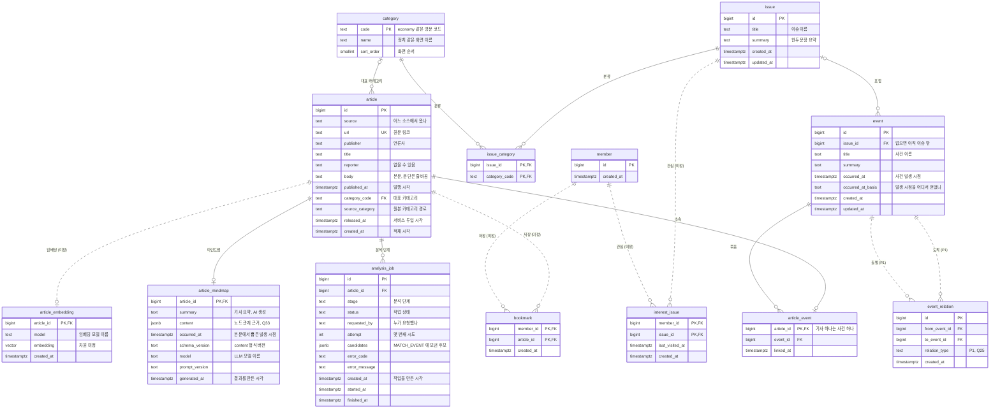

# 서비스 데이터 모델 (v0)

NEW:LEARN 서비스 테이블의 설계다. 기능 티켓이 테이블을 만들 때 이 문서를 따르고 같은 MR 에서 이 문서도 고친다.

- **v0 (2026-10-19, Jira S15P31A102-28)**: 확정 기능(F01~F08 · F11)만으로 짤 수 있는 것만 담았다. 정하지 못한 것은 5절 「미정 목록」에 있다
- 테이블은 아직 하나도 없다. 만들어진 테이블은 Flyway 마이그레이션(`backend/src/main/resources/db/migration/`)이 진실이다. 이 문서와 어긋나면 이 문서를 고친다
- 화면 · 워커와 주고받는 모양은 `docs/api.md`(필드 상세는 `docs/api-screen.md` · `docs/api-internal.md`), 용어는 `docs/glossary.md`. 데이터셋 원본 필드는 PRD 폴더의 `addendum.md` 「데이터셋 구조」
- 기능 번호와 이름은 `docs/mvp-overview.md` 3-1 표가 기준이다

---

## 1. 한눈에

실선은 v0 에서 정한 관계다. 점선은 아직 정하지 못했거나 P1 에 쓸 자리다(5절). 일반 ER 표기의 점선(비식별 관계)과 뜻이 다르다.
F09 주장 관계 및 변화 분석 · F10 근거 기반 변화 카드의 주장 테이블은 추후 논의라 그리지 않았다.

---

## 2. 테이블마다 칸

칸마다 타입 · 필수 · 용도 · 규칙이다. 그림의 칸 설명은 이 표를 줄인 이름표다. 표 아래 글은 칸 하나에 붙지 않는 규칙이다.
「필수」 칸의 「예」는 비어 있으면 안 된다(NOT NULL)는 뜻이다.

### category — 카테고리 7개 (F02 카테고리별 뉴스·이슈 조회)

| 칸 | 타입 | 필수 | 용도 · 규칙 |
|---|---|---|---|
| `code` | text | 기본 키 | URL · API 에 쓰는 코드. 제안: `politics` 정치 · `society` 사회 · `economy` 경제 · `world` 국제 · `sports` 스포츠 · `culture` 문화/연예 · `it_science` IT/과학. 코드는 새로 지었고 URL 식별자라 FE 확인을 받는다(`docs/api.md` 4절) |
| `name` | text | 예 | 화면 이름(MVP 개요 2-1) |
| `sort_order` | smallint | 예 | 화면에 보이는 순서 |

- 7행을 마이그레이션에 넣어 두고 화면에서 바꾸지 않는다

### article — 기사 (F01 뉴스 데이터 적재·조회)

| 칸 | 타입 | 필수 | 용도 · 규칙 |
|---|---|---|---|
| `id` | bigint | 기본 키 | 기사 ID. 목록 · 상세 · 마인드맵이 같은 ID 를 쓴다(Jira 42) |
| `source` | text | 예 | 어느 소스에서 왔나. `SSAFY_2025H1` · `SSAFY_2024H1` · `SSAFY_2024H2` · `NEWSDATA` · `USER_URL` (데이터셋 3개와 NewsData — SSOT 5절 — 에 사용자가 넣은 URL 을 더했다) |
| `url` | text | 예 · 고유 | 원문 링크. 데이터셋에 기사 ID 가 없어서 고유 키로 쓴다(addendum). 같은 링크를 두 번 넣지 않는다. 정규화(끝 `/` · 쿼리)는 Jira 34 |
| `publisher` | text | 예 | 언론사(데이터셋 `company`). 모든 기사 화면에 보인다(PRD FR-2) |
| `title` | text | 예 | 기사 제목 |
| `reporter` | text | 아니오 | 기자명. 없는 기사가 있다 |
| `body` | text | 예 | 본문 전체(데이터셋 `article`). 문단은 줄바꿈. 분석 · 근거 대조에 쓰고 API 로는 내보내지 않는다(Q3 · Q28) |
| `published_at` | timestamptz | 예 | 발행 시각(데이터셋 `published`, `2023-07-12 15:53`). 시간대가 없어 한국 시간으로 읽자고 제안한다(addendum 에 없는 가정). 사건 발생 시점과 다른 값이다 |
| `category_code` | text | 아니오 · 외래 키 | 대표 카테고리 하나(MVP 개요 2-2). 원본 경로를 7개로 대응시키지 못하면 비워 둔다(Q9) |
| `source_category` | text | 아니오 | 원본 카테고리 경로(데이터셋 `category_str`). 대응 규칙을 바꾸면 다시 계산하려고 남긴다 |
| `released_at` | timestamptz | 아니오 | 서비스 투입 시각. 비어 있으면 모든 조회 · 집계 · 검색에서 없는 것으로 본다(`docs/api.md` 1절). 투입은 수집 배치가 B1 을 불러서 한다(`docs/api-internal.md` 2절) |
| `created_at` | timestamptz | 예 | 적재 시각 |

- 필수 값이 빠진 기사는 저장하지 않고 이유를 남긴다(PRD FR-1). 어디에 남길지는 수집 티켓(Jira 34)이 정한다
- 이 규칙은 2025 상반기 데이터셋 필드(addendum)만 보고 정했다. 2024 데이터셋 · NewsData 필드는 아직 못 봤다. NewsData 가 본문 전체를 주지 않으면 `body` 필수에 걸리므로 수집 티켓(Jira 34)에서 먼저 확인한다
- 언제 투입하나는 Q21 에서 정한다. `released_at` 칸 자체는 제안이다. NewsData 기사는 받자마자, 사용자 URL 기사는 만들 때 채운다고 가정한다

### issue — 이슈 · issue_category — 이슈와 카테고리 연결 (F07 사건 중심 이슈 에볼루션 맵)

| 칸 | 타입 | 필수 | 용도 · 규칙 |
|---|---|---|---|
| `issue.id` | bigint | 기본 키 | 이슈 ID. 이슈 화면 주소에 쓴다 |
| `issue.title` | text | 예 | 이슈 이름(「한빛반도체 미국 공장 건설」) |
| `issue.summary` | text | 아니오 | 한두 문장 요약. 누가 쓰는지는 미정(5절 13번) |
| `issue.created_at` · `updated_at` | timestamptz | 예 | 만든 · 고친 시각 |
| `issue_category.issue_id` | bigint | 기본 키 · 외래 키 | 어느 이슈 |
| `issue_category.category_code` | text | 기본 키 · 외래 키 | 어느 카테고리. 이슈 하나가 카테고리 여러 개에 걸칠 수 있어(MVP 개요 2-2) 연결 테이블로 둔다 |

- 이슈 헤더의 기간 · 사건 수 · 기사 수 · 언론사 수 · 최근 사건 날짜(PRD FR-20 · FR-4)는 저장하지 않고 조회할 때 계산한다. 느리면 잰 뒤에 캐시를 둔다(Jira 41)
- 이슈를 누가 만드는지는 근거 문서에 없다(Q5). v0 는 대표 이슈 5~10개(MVP 개요 4장)를 사람이 고르고 첫 사건도 사람이 붙인다고 가정한다. 그 뒤 새 사건은 동일 사건 판정이 후보 사건의 이슈를 고른다(`docs/api-internal.md` 5절, 제안)

### event — 사건 (F06 동일 사건 기사 클러스터링 · F07)

| 칸 | 타입 | 필수 | 용도 · 규칙 |
|---|---|---|---|
| `id` | bigint | 기본 키 | 사건 ID |
| `issue_id` | bigint | 아니오 · 외래 키 | 속한 이슈. 비어 있으면 아직 이슈로 묶이지 않은 사건이다. 화면은 「아직 이슈로 묶이지 않았다」고 안내한다(PRD FR-30) |
| `title` | text | 예 | 사건 이름. 새 사건이면 동일 사건 판정이 짓는다(제안) |
| `summary` | text | 아니오 | 사건 요약. 누가 쓰고 기사가 늘 때 고칠지는 미정(5절 13번 · Q21) |
| `occurred_at` | timestamptz | 예 | 사건이 실제로 일어난 때. 첫 기사에서 뽑은 시점(`article_mindmap.occurred_at`)을 쓰고, 모르면 그 사건 기사 중 가장 이른 발행 시각을 쓴다(PRD FR-10 가정) |
| `occurred_at_basis` | text | 예 | `occurred_at` 을 어디서 얻었나. `EXTRACTED`(본문에서 뽑음) · `FIRST_PUBLISHED`(가장 이른 발행 시각으로 채움). 뒤의 것은 더 이른 기사가 붙으면 다시 계산한다 |
| `created_at` · `updated_at` | timestamptz | 예 | 만든 · 고친 시각 |

- 타임라인의 시간순 연결(P0)은 `occurred_at` 정렬로 계산한다. 같은 사실을 두 곳에 두지 않으려고 따로 저장하지 않는다

### article_event — 기사와 사건 연결 (F06)

| 칸 | 타입 | 필수 | 용도 · 규칙 |
|---|---|---|---|
| `article_id` | bigint | 기본 키 · 외래 키 | 어느 기사. 기본 키가 이것 하나라 기사 하나는 사건 하나에만 속한다(PRD FR-9 가정) |
| `event_id` | bigint | 예 · 외래 키 | 어느 사건 |
| `linked_at` | timestamptz | 예 | 동일 사건 판정이 붙인 시각 |

- `article` 에 `event_id` 칸을 두지 않고 연결 테이블로 뺐다. 여러 사건에 속하게 바뀌면 테이블은 기본 키를 (`article_id`, `event_id`)로 바꾸는 마이그레이션 하나면 된다. 다만 기사 상세(A8)의 `event` · `issue` 와 판정 결과(W1)의 `eventId` 가 하나에서 여럿으로 바뀐다. 그 응답 모양은 FE · AI 와 같은 MR 에서 고친다
- 판정 점수 · 근거를 남길지는 동일 사건 판정 기준(Q34)이 정해진 뒤 칸으로 더한다

### event_relation — 사건 사이 관계 (P1, Q25)

| 칸 | 타입 | 필수 | 용도 · 규칙 |
|---|---|---|---|
| `id` | bigint | 기본 키 | 관계 ID |
| `from_event_id` | bigint | 예 · 외래 키 | 앞 사건 |
| `to_event_id` | bigint | 예 · 외래 키 | 뒤 사건 |
| `relation_type` | text | 예 | 관계 종류 후보 `FOLLOW_UP` 후속 · `REACTION` 반응 · `REBUTTAL` 반박. `CAUSE` 원인은 P2(MVP 개요 6장 「정교한 인과관계 추론」) |
| `created_at` | timestamptz | 예 | 만든 시각 |

- P0 에는 행이 없어서 점선으로 그렸다. 후속 · 반응 · 반박 관계(PRD FR-22)를 넣기로 하면 그 티켓에서 테이블을 만든다
- (`from_event_id`, `to_event_id`, `relation_type`) 은 고유하다. 두 사건은 같은 이슈에 속한다

### analysis_job — 분석 작업 (F03 · F06)

| 칸 | 타입 | 필수 | 용도 · 규칙 |
|---|---|---|---|
| `id` | bigint | 기본 키 | 작업 ID. 화면 · 메시지에 `jobId` 로 나간다 |
| `article_id` | bigint | 예 · 외래 키 | 분석할 기사 |
| `stage` | text | 예 | 분석 단계. `EXTRACT` 6하원칙 추출 · `EMBED` 임베딩 · `MATCH_EVENT` 동일 사건 판정(SSOT 3절의 세 단계). 주장 추출(F09)은 추후 논의라 값이 없다 |
| `status` | text | 예 | `QUEUED`(대기 또는 처리 중) → `SUCCEEDED` · `FAILED`. 바뀌는 길은 `docs/api-internal.md` 6절 |
| `requested_by` | text | 예 | 누가 요청했나. `BATCH`(순차 투입) · `USER_URL`(사용자가 넣은 URL) |
| `attempt` | int | 예 | 몇 번째 시도인가(1부터). 다시 돌리면 올린다. 늦게 온 옛 결과를 가르는 데 쓴다 |
| `candidates` | jsonb | 아니오 | `MATCH_EVENT` 에 보낸 후보 사건 ID. 판정이 후보 밖 사건을 고르면 거절하려고 남긴다 |
| `error_code` | text | 아니오 | 실패했을 때 작업 실패 코드(`docs/api.md` 2절) |
| `error_message` | text | 아니오 | 실패 설명. 개발자용이라 화면에 그대로 보이지 않는다 |
| `created_at` | timestamptz | 예 | 작업을 만든 시각 |
| `started_at` · `finished_at` | timestamptz | 아니오 | 워커가 결과와 함께 보낸 시작 · 끝 시각 |

- 기사 하나 · 단계 하나에 한 행이다. 다시 돌리면 같은 행의 `attempt` 를 올리고 `status` 를 `QUEUED` 로 되돌린다. 몇 번까지 다시 돌릴지는 Jira 30
- 워커가 처리 시작을 알리지 않아서 「처리 중」 상태를 따로 두지 않았다. 단계별 진행 표시(PRD FR-32, P1)를 넣을 때 더한다
- 사용자 URL 기사도 `article` 행을 먼저 만든 뒤 작업을 건다. URL 본문을 누가 가져오는지(API · 워커 · 수집 배치) 정해지면 바뀔 수 있다(5절 11번)

### article_mindmap — 마인드맵 결과 (F03 기사 핵심 정보 구조화 · F04 · F05)

| 칸 | 타입 | 필수 | 용도 · 규칙 |
|---|---|---|---|
| `article_id` | bigint | 기본 키 · 외래 키 | 어느 기사의 결과인가. 기사 하나에 결과 하나다 |
| `summary` | text | 예 | 기사 요약(AI 생성). 기사 목록 · 사건 패널에 쓰려고 jsonb 밖에 둔다. 화면은 AI 생성 표시를 붙인다(PRD FR-2) |
| `content` | jsonb | 예 | 노드 · 관계 · 근거를 통째로. 노드 구조가 미정(Q33)이라 칸으로 쪼개지 않았다. 근거 모양은 `docs/api-screen.md` 3절 |
| `occurred_at` | timestamptz | 아니오 | 본문에서 뽑은 사건 발생 시점. 새 사건을 만들 때와 동일 사건 판정에 쓴다. 못 뽑았으면 비운다 |
| `schema_version` | text | 예 | `content` 모양의 버전(`mindmap-v0`) |
| `model` | text | 예 | 결과를 만든 LLM 모델 이름 |
| `prompt_version` | text | 예 | 쓴 프롬프트 버전. `model` 과 함께 결과를 비교하고 다시 돌릴 대상을 고를 때 쓴다(`/evals`) |
| `generated_at` | timestamptz | 예 | 결과를 만든 시각(워커의 `finishedAt`) |

- 다시 분석하면 덮어쓴다. 지난 결과를 남길지는 프롬프트를 바꿀 일이 생기면 정한다

### article_embedding — 기사 임베딩 (미정)

| 칸 | 타입 | 필수 | 용도 · 규칙 |
|---|---|---|---|
| `article_id` | bigint | 기본 키 · 외래 키 | 어느 기사의 벡터 |
| `model` | text | 예 | 임베딩 모델 이름. 모델이 바뀌면 다시 만든다 |
| `embedding` | vector | 예 | 기사 벡터. 차원은 임베딩 모델이 정해지면 정한다(SSOT 8절) |
| `created_at` | timestamptz | 예 | 만든 시각 |

- 같은 사건 후보를 pgvector 로 찾을 때 쓴다(SSOT 3절). 후보 검색은 기사 임베딩끼리 비교해 그 기사의 사건으로 모은다
- 모델을 바꾸면 차원이 바뀌므로 `article` 에 넣지 않고 따로 둔다

### member · bookmark · interest_issue — 회원 쪽 (미정)

범위부터 미정이다(5절 6번). 칸은 PRD FR-17~FR-19 를 읽고 그린 자리일 뿐이다.

| 칸 | 용도 |
|---|---|
| `member.id` · `created_at` | 회원. 나머지 칸은 로그인 방식(Q8)에 달렸다 |
| `bookmark.member_id` · `article_id` | 누가 어느 기사를 저장했나. 둘이 기본 키라 같은 기사를 두 번 담지 못한다(Jira 63) |
| `bookmark.created_at` | 담은 시각. 나의 뉴스함을 최근 순으로 보여 줄 때(PRD FR-18) |
| `interest_issue.member_id` · `issue_id` | 누가 어느 이슈를 관심 이슈로 저장했나 |
| `interest_issue.last_visited_at` | 그 이슈를 마지막으로 연 시각. 「지난 방문 이후 새 사건 N」을 셀 때(PRD FR-19 가정) |
| `interest_issue.created_at` | 저장한 시각 |

---

## 3. 시간 규칙

- 시각은 모두 `timestamptz` 로 둔다. 화면에 어떻게 내보내는지는 `docs/api.md` 1절
- 시간대가 없는 원본은 한국 시간(`Asia/Seoul`)으로 읽자고 제안한다(2절 article)
- 기사 **발행 시각**(`article.published_at`)과 사건 **발생 시점**(`event.occurred_at`)은 다른 칸이다. 이슈 타임라인은 발생 시점으로 정렬한다(MVP 개요 3-2 ④)

## 4. v0 에서 정한 것과 까닭

| 정한 것 | 까닭 |
|---|---|
| 기본 키는 `bigint` 자동 증가(`generated by default as identity`). 카테고리만 코드 문자열 | 분석 규모가 약 1만 7천 건이라(SSOT 3절) UUID 로 얻는 것이 없고 URL 이 짧다. `by default` 라 초기 데이터 · 테스트에 정한 ID 를 넣을 수 있다 |
| 관계 다중성 — 기사:사건 = N:1(연결 테이블), 사건:이슈 = N:1, 이슈:카테고리 = N:M | MVP 개요 2-2 · 3-2 와 PRD FR-9 가정. 바뀌기 쉬운 쪽(기사:사건)은 테이블이라도 쉽게 바뀌게 연결 테이블로 뺐다 |
| 집계 값(사건 수 · 기사 수 · 기간)과 시간순 연결은 저장하지 않는다 | 같은 사실을 두 곳에 두면 어긋난다. 느리면 잰 뒤에 캐시를 더한다 |
| 마인드맵은 jsonb 한 칸 | 노드 구조가 미정(Q33)이다. 확정되면 자주 찾는 부분만 칸이나 테이블로 뺀다 |
| 임베딩은 별도 테이블 | 모델 · 차원이 바뀌어도 `article` 을 건드리지 않는다 |

데이터셋 적재처럼 한꺼번에 많이 넣는 일은 JPA 로 한 행씩 넣으면 느리다(자동 증가 키는 묶어 넣기가 꺼진다). 적재 방법은 수집 티켓(Jira 34)이 정한다.

---

## 5. 미정 목록

정하면 해당 절을 고치고 이 표에서 지운다. 「SSOT 8절」이라고 적은 것은 팀 결정이 필요해 그쪽에 질문이 있고, 여기에는 v0 가 한 가정만 둔다.

| # | 무엇 | v0 가 한 가정 | 어디서 정하나 |
|---|---|---|---|
| 1 | 한 기사가 여러 사건에 속하나 | 하나 (PRD FR-9) | SSOT 8절 |
| 2 | 이슈를 만들고 사건을 이슈에 붙이는 길, 사건이 여러 이슈에 속하나 | 대표 이슈 · 첫 사건은 사람이, 그 뒤는 판정이 후보 사건의 이슈를 고른다. 사건 하나는 이슈 하나 | SSOT 8절, Q5 |
| 3 | 동일 사건 판정 기준 | 판정 점수 · 근거 칸 없음 | Q34 |
| 4 | 마인드맵 노드 구조 · AI 출력 스키마, 근거를 테이블로 뺄지 | jsonb 한 칸 | Q33 |
| 5 | 임베딩 모델 · 벡터 차원 | `article_embedding` 점선 | SSOT 8절 |
| 6 | 회원 · 북마크 · 관심 이슈를 MVP 에 넣나 | 점선, 칸은 자리만 | SSOT 8절 |
| 7 | 데이터셋 카테고리 경로 → 7개 대응 규칙, 규칙을 테이블로 둘지 코드로 둘지 | 못 맞추면 `category_code` 비움 | Q9 |
| 8 | 순차 투입 때 무엇이 언제 보이나 | `released_at` 제안. NewsData · 사용자 URL 기사는 바로 채움. 사용자 URL 기사도 최신 기사 목록에 모두에게 보임. 아직 투입하지 않은 데이터셋 기사의 URL 이 들어오면 그 자리에서 투입 | Q21 |
| 9 | 모든 기사에 마인드맵을 미리 만드나, 몇 건을 투입하나 | 투입한 기사 전부에 6하원칙 추출을 건다(PRD FR-31 가정). GMS 예산 상한은 약 1만 7천 건(SSOT 3절) | Q27 · Q4 |
| 10 | 본문을 화면에 얼마나 보여 주나 | `body` 는 저장만 하고 API 로 안 내보냄 | Q3 · Q28 |
| 11 | 지원 URL 기사 본문을 누가 가져오나 | API 가 가져와 `article` 을 만든 뒤 작업을 건다 | SSOT 8절 |
| 12 | 본문에서 뽑은 발생 시점이 날짜까지만 있을 때 | 그날 0시(한국 시간)로 넣는다. 정밀도 칸은 아직 없다 | AI (`docs/api.md` 4절) |
| 13 | 사건 · 이슈 요약을 누가 쓰나(AI 면 AI 표시), 사건 패널 「핵심 근거」를 어디서 가져오나 (PRD 4.11 · 5.4) | 응답에 자리 없음. 정해지면 필드를 더한다 | AI · FE |
| 14 | F09 · F10 주장 · 변화 카드 테이블 | 그리지 않음 | 추후 논의 |

---

## 6. 기능 대조표

확정 기능마다 쓰는 테이블과 API 다. A · B1 · W1 번호는 `docs/api.md` 3절 목록에 있고, 상세는 A 가 `docs/api-screen.md`, B1 · W1 이 `docs/api-internal.md` 다.

| 기능 | 테이블 | API |
|---|---|---|
| F01 뉴스 데이터 적재·조회 | `article` · `analysis_job` | A7 · A8, URL 분석 A10 · A11 · A12, 투입 B1 |
| F02 카테고리별 뉴스·이슈 조회 | `category` · `issue_category` · `issue` · `article` | A1 · A2 · A7, 빠른 이동 A13 |
| F03 기사 핵심 정보 구조화 | `analysis_job`(`EXTRACT`) · `article_mindmap` | W1 (`EXTRACT`) |
| F04 기사 마인드맵 생성 | `article_mindmap.content` | A9 |
| F05 노드 상세 및 근거 확인 | `article_mindmap.content`(근거) | A9 |
| F06 동일 사건 기사 클러스터링 | `article_embedding`(미정) · `analysis_job`(`EMBED` · `MATCH_EVENT`) · `event` · `article_event` | W1 (`EMBED` · `MATCH_EVENT`) |
| F07 사건 중심 이슈 에볼루션 맵 | `issue` · `event` · `event_relation`(P1) | A3 · A4 |
| F08 사건별 관련 기사 조회 | `event` · `article_event` · `article` · `article_mindmap.summary` | A5 · A6 |
| F11 기사·이슈 양방향 연결 | `article_event` → `event` → `issue` | A8(소속 사건 · 이슈) · A6 |

---

## 7. 바꾸는 법

- 칸 · 테이블을 더할 때: 그 기능 티켓 MR 에 새 마이그레이션 파일과 이 문서 수정을 같이 넣는다. 이미 적용된 마이그레이션은 고치지 않는다(AGENTS.md)
- 배포 중에는 옛 버전과 새 버전이 같이 돈다(SSOT 6절 「무중단 배포 조건」). 칸 이름 바꾸기 · 지우기는 하위 호환이 되게 두 번에 나눈다
- 4절의 정한 것을 뒤집으면 FE · AI 에 알리고 `SSOT.md` 9절 「뒤집은 것」에 한 줄 남긴다
