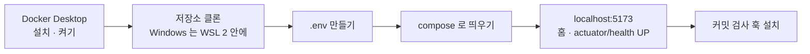
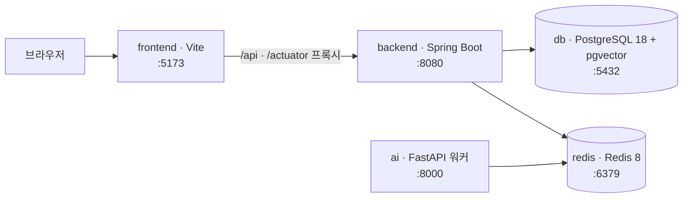

# 로컬 개발 환경

**Docker Desktop 하나면 된다.** 저장소를 받고 `.env.example` 을 `.env` 로 복사한 뒤 `docker compose --profile full up -d` 를 치면 화면 · API · 워커가 뜬다.
왜 이렇게 정했는지는 `SSOT.md` 7절, 영역별 명령은 `.claude/stack.md` 3절에 있다.

## 처음 한 번

브라우저에 홈이 뜨고 http://localhost:5173/actuator/health 가 `UP` 이면 끝입니다.

AI 도구(Claude Code · Codex · Cursor 등)에게 맡기려면 [방법 1](#방법-1-ai-에게-맡기기), 직접 치려면 [방법 2](#방법-2-직접-입력하기) 를 따릅니다. 두 방법은 같은 순서를 밟습니다.



### 시작 전에 확인할 것

- **Docker Desktop** 이 설치되어 켜져 있어야 합니다. Docker Engine 25 이상이 필요합니다 (`docker version` 으로 확인). Windows 는 WSL 2 백엔드를 씁니다.
- **Windows 는 WSL 2 의 Ubuntu 터미널에서 작업합니다.** C: 드라이브 폴더에 클론하면 코드를 고쳐도 컨테이너에 반영되지 않습니다.
- 첫 실행은 이미지(약 1.9 GB)와 Gradle · npm · Python 의존성을 받느라 몇 분 걸립니다. 의존성은 Docker 볼륨에 남아 다음부터는 금방 뜹니다.

### 방법 1. AI 에게 맡기기

아래 블록을 통째로 복사해 AI 도구에 붙여 넣습니다. 저장소를 아직 받지 않았다면 AI 가 클론부터 합니다.

```text
NEW:LEARN 저장소(https://lab.ssafy.com/s15-final/S15P31A102.git)의 로컬 개발 환경을 세팅해 줘.
저장소 docs/dev-environment.md 를 먼저 읽고 「처음 한 번」 순서대로 해.

1. 내 컴퓨터부터 확인해.
   - `docker version` 으로 Docker Desktop 이 켜져 있고 Engine 이 25 이상인지 본다.
   - Windows 면 WSL 2 와 Ubuntu 가 있는지 본다.
   - 없거나 꺼져 있으면 설치 · 실행 방법만 알려 주고 멈춰.
2. 저장소를 받아. 이미 저장소 안이면 건너뛰어.
   - Windows 면 WSL 2 Ubuntu 의 홈(~/) 아래에 클론한다. C: 드라이브에는 받지 않는다.
3. 저장소 루트에서 `cp .env.example .env` 로 환경변수 파일을 만들어.
   - 값은 바꾸지 않는다. LLM_MODE 는 mock 그대로 두고 GMS 키는 넣지 않는다.
4. `docker compose --profile full up -d --wait` 로 전부 띄워.
   - `port is already allocated` 가 나면 그 포트만 .env 의 *_PORT 에서 비어 있는 번호로 바꾸고 다시 띄운다.
5. 다 떴는지 확인해. 포트를 바꿨으면 바꾼 번호로 본다.
   - `docker compose --profile full ps` 의 STATUS 가 모두 healthy
   - http://localhost:8080/actuator/health 와 http://localhost:8000/health 가 200
   - http://localhost:5173 에 홈(「오늘의 이슈를 탐색해 보세요」)이 뜨고, http://localhost:5173/actuator/health 가 `UP` — 화면 서버를 거쳐 API 까지 이어졌다는 뜻이다
6. 커밋 검사 훅을 설치해: `bash .claude/hooks/install.sh`
   - 확인: `git commit --allow-empty -m " "` 를 쳐서 검사 배너가 뜨는지 본다 (커밋은 남지 않는다).
7. 끝나면 무엇을 했고 무엇이 안 됐는지 명령 출력과 함께 알려 줘.

하지 말 것
- .env 를 커밋하지 않는다.
- `docker compose down -v` · `docker volume rm` 처럼 데이터를 지우는 명령은 먼저 나에게 묻는다.
- 이 저장소와 상관없는 내 다른 컨테이너 · 이미지는 건드리지 않는다.
```

### 방법 2. 직접 입력하기

명령은 한 줄씩 칩니다. Windows 는 WSL 2 Ubuntu 터미널에서 칩니다.

1. 저장소를 받고 그 폴더로 들어갑니다.

   ```bash
   git clone https://lab.ssafy.com/s15-final/S15P31A102.git
   ```

   ```bash
   cd S15P31A102
   ```

2. 환경변수 파일을 만듭니다. 값은 그대로 둡니다. `.env` 는 커밋하지 않습니다.

   ```bash
   cp .env.example .env
   ```

3. 전부 띄웁니다. `--wait` 는 모든 컨테이너가 정상이 될 때까지 기다렸다가 끝납니다.

   ```bash
   docker compose --profile full up -d --wait
   ```

4. 브라우저로 http://localhost:5173 을 열어 홈이 뜨는지 봅니다. 이어서 http://localhost:5173/actuator/health 가 `UP` 이면 화면 · API · DB · Redis 가 다 이어진 것입니다. 백엔드 화면용 API(S15P31A102-41)가 들어오기 전에는 홈의 이슈 칸에 「…불러오지 못했어요」가 뜨는데, 정상입니다.

5. 커밋 검사 훅을 설치합니다. 커밋할 때 포맷 · 린트 · 테스트가 자동으로 돕니다.

   ```bash
   bash .claude/hooks/install.sh
   ```

   훅이 도는지 확인합니다. 메시지가 공백 하나라 커밋은 남지 않습니다.

   ```bash
   git commit --allow-empty -m " "
   ```

### 다 쓰고 끌 때

```bash
docker compose --profile full down
```

DB 데이터와 의존성은 볼륨에 남습니다. 다음에 3번 명령으로 다시 띄웁니다.

### 막히면

| 증상 | 할 일 |
|---|---|
| `port is already allocated` | 그 포트를 다른 프로그램이 씁니다. `.env` 의 해당 `*_PORT` 를 바꾸고 다시 띄웁니다 |
| 코드를 고쳐도 반영이 안 된다 | Windows 에서 C: 드라이브에 클론했을 것입니다. WSL 2 쪽에 다시 클론합니다 |
| 그 밖의 문제 · 내 영역만 IDE 에서 띄우기 | 아래 「자주 막히는 곳」 · 「내 영역을 호스트에서 띄울 때」 |

### 알아 둘 것

- Docker Engine 25 이상이 필요한 까닭은 healthcheck 의 `start_interval` 이다 (Engine 29.6.2 · Compose v5.3.1 에서 확인했다)
- WSL 2 리눅스 쪽(`~/` 아래)에 클론해야 하는 까닭은 C: 드라이브 폴더를 연결하면 고친 파일이 컨테이너에 반영되지 않아서다
- 첫 실행에 받는 것은 이미지 약 1.9 GB 와 의존성(볼륨에 약 1.8 GB)이다. 걸린 시간은 `SSOT.md` 10절에 적었다

## 무엇이 뜨나



포트는 이 컴퓨터(127.0.0.1)에만 열린다. 이미 쓰는 포트가 있으면 `.env` 의 `*_PORT` 를 바꾼다.

| 명령 | 뜨는 것 | 이럴 때 |
|---|---|---|
| `docker compose up -d` | DB · Redis | 내 영역을 IDE · 터미널에서 띄울 때 (백엔드 개발자 기본) |
| `docker compose up -d backend ai` | DB · Redis · API · 워커 | 화면만 내 컴퓨터에서 띄울 때 |
| `docker compose --profile full up -d` | 전부 | 언어 런타임을 설치하지 않고 전체를 볼 때 |

다 됐는지는 `docker compose --profile full ps` 의 STATUS 가 모두 `healthy` 인지로 본다.
헬스 주소는 API http://localhost:8080/actuator/health · 워커 http://localhost:8000/health 다. 둘 다 Redis 연결을 포함해서 Redis 가 멈추면 503 을 낸다.

## 내 영역을 호스트에서 띄울 때

DB · Redis 만 compose 로 띄우고 내 영역은 IDE 나 터미널에서 띄운다. 띄우는 명령은 `.claude/stack.md` 3절의 `<영역>_RUN` 이다.

- **API** — IDE 에서 `BackendApplication` 을 실행한다. 저장소 루트의 `.env` 를 읽어서 compose 의 DB 와 같은 접속 정보를 쓴다. JDK 25 가 없으면 Gradle 이 받아 쓴다 (첫 빌드가 몇 분 더 걸린다).
- **워커** — `uv run --env-file ../.env` 로 같은 `.env` 를 읽는다. Python 3.14 가 없으면 uv 가 받아 쓴다.
- **화면** — Vite 개발 서버가 루트 `.env` 의 `BACKEND_PORT` 로 API 를 찾아 `/api` 요청을 넘긴다.

커밋 전 검사(포맷 · 린트 · 테스트)는 호스트에서 바꾼 영역만 돈다. 바꾼 영역의 런타임은 호스트에도 있어야 한다.
`.gitignore` · `compose.yaml` · `.env.example` 처럼 영역 폴더 밖 파일만 바꾼 커밋은 영역 검사를 돌지 않는다. 어느 영역이 도는지는 `.claude/stack.md` 4절에 있다.

| 영역 | 호스트에 필요한 것 | 확인한 버전 |
|---|---|---|
| 화면 | Node 24 줄은 24.22.1 이상, 26 줄은 26.12.1 이상 — 25 와 26.12.0 까지는 Node2Shell 영향 판이다(Jira S15P31A102-158. 도구들의 최소 버전은 24.15) | Node 24.22.1 · 컨테이너는 `node:26-alpine`(판 고정 없음) |
| API | JDK 21 이상. 컴파일에 쓰는 25 는 Gradle 이 받는다 | JDK 21.0.11 |
| 워커 | uv. Python 3.14 는 uv 가 받는다 | uv 0.12.5 · 컨테이너는 0.13.1 |
| 인프라 | Terraform 1.16.6 이상 1.17 미만 (`infra/terraform/versions.tf`). promtool 3.15.0 — 경보 규칙 시험(`infra/ci/alert_rules.sh`), Prometheus 릴리스 파일에 들어 있다 | Terraform 1.16.6 · promtool 3.15.0 |

compose 의 화면 이미지 `node:26-alpine` 은 판을 고정하지 않는다. 예전에 받아 둔 PC 는 `docker compose --profile full pull` 로 새로 받아야 26.12.1 이상이 된다. 화면은 `full` 프로필 안이라 `--profile full` 없이 pull 하면 받지 않고, `up` 은 이미 받아 둔 이미지를 그대로 쓴다.

API 테스트는 Testcontainers 로 DB · Redis 컨테이너를 따로 띄우므로 Docker Desktop 이 켜져 있어야 한다.

## 코드를 고치면

| 영역 | 반영 |
|---|---|
| 화면 | Vite 가 바로 바꾼다 |
| API | 컨테이너 안의 연속 빌드가 컴파일하고, devtools 가 앱을 다시 띄운다 (몇 초) |
| 워커 | uvicorn 이 다시 읽는다 |

의존성 파일(`package-lock.json` · `uv.lock` · `build.gradle`)이 바뀌면 그 컨테이너만 다시 띄운다. 잠금 파일에 맞춰 다시 깐다.

```bash
docker compose restart frontend   # backend · ai 도 같다
```

## 자주 막히는 곳

- **`port is already allocated`** — 그 포트를 다른 프로그램이 쓰고 있다. `.env` 의 해당 `*_PORT` 를 바꾸고 다시 띄운다.
- **API 가 DB 비밀번호 오류로 안 뜬다** — `.env` 의 DB 값을 바꾼 뒤일 것이다. DB 볼륨은 처음 만들 때의 값을 쓴다. `docker compose down` 뒤 `docker volume rm newlearn_db-data` 로 DB 볼륨만 지우고 다시 띄운다 (로컬 DB 데이터가 지워진다).
- **고쳐도 컨테이너에 반영이 안 된다** — Windows 에서 C: 드라이브에 클론했을 것이다. WSL 2 쪽에 다시 클론한다.
- **API 가 401 을 낸다** — 로그인이 필요한 주소다(내 정보 · 북마크 · 관심 이슈 등, `docs/api.md`). A15 로그인으로 세션을 연 뒤 부른다. Spring Security 의 기본 계정은 만들지 않아 띄울 때 `generated security password` 줄도 없다(2026-11-02 Jira 144).
- **처음부터 다시 받고 싶다** — `docker compose --profile full down -v` 는 DB 데이터와 의존성 캐시까지 지운다.

## LLM 모의 응답

`.env` 의 `LLM_MODE` 가 `mock` 이면 워커가 SSAFY GMS 를 부르지 않고 정해진 응답을 돌려준다. 기본값이다.
실제로 부를 때만 `gms` 로 바꾸고 `GMS_API_KEY` · `GMS_BASE_URL` 을 채운다. 토큰 비용이 든다 (`SSOT.md` 3절 예산).
