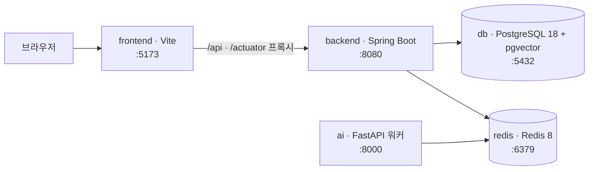

# 로컬 개발 환경

**Docker Desktop 하나면 된다.** 저장소를 받고 `.env.example` 을 `.env` 로 복사한 뒤 `docker compose --profile full up -d` 를 치면 화면 · API · 워커가 뜬다.
왜 이렇게 정했는지는 `SSOT.md` 7절, 영역별 명령은 `.claude/stack.md` 3절에 있다.

## 처음 한 번

처음 세팅하는 순서(AI 에게 맡기는 프롬프트 · 직접 치는 명령)는 저장소 루트 `README.md` 「개발 환경 세팅」에 있다. 이 문서는 그 뒤에 알아 둘 것을 다룬다.

- Docker Engine 25 이상이 필요한 까닭은 healthcheck 의 `start_interval` 이다 (Engine 29.6.2 · Compose v5.3.1 에서 확인했다)
- WSL 2 리눅스 쪽(`~/` 아래)에 클론해야 하는 까닭은 C: 드라이브 폴더를 연결하면 고친 파일이 컨테이너에 반영되지 않아서다
- 첫 실행에 받는 것은 이미지 약 1.9 GB 와 의존성(볼륨에 약 1.8 GB)이다. 걸린 시간은 `SSOT.md` 10절에 적었다

## 무엇이 뜨나



포트는 이 컴퓨터(127.0.0.1)에만 열린다. 이미 쓰는 포트가 있으면 `.env` 의 `*_PORT` 를 바꾼다.

| 명령 | 뜨는 것 | 이럴 때 |
|---|---|---|
| `docker compose up -d` | DB · Redis | 내 영역을 IDE · 터미널에서 띄울 때 (백엔드 개발자 기본) |
| `docker compose up -d backend ai` | DB · Redis · API · 워커 | 화면만 내 컴퓨터에서 띄울 때 |
| `docker compose --profile full up -d` | 전부 | 언어 런타임을 설치하지 않고 전체를 볼 때 |

다 됐는지는 `docker compose --profile full ps` 의 STATUS 가 모두 `healthy` 인지로 본다.
헬스 주소는 API http://localhost:8080/actuator/health · 워커 http://localhost:8000/health 다. 둘 다 Redis 연결을 포함해서 Redis 가 멈추면 503 을 낸다.

## 내 영역을 호스트에서 띄울 때

DB · Redis 만 compose 로 띄우고 내 영역은 IDE 나 터미널에서 띄운다. 띄우는 명령은 `.claude/stack.md` 3절의 `<영역>_RUN` 이다.

- **API** — IDE 에서 `BackendApplication` 을 실행한다. 저장소 루트의 `.env` 를 읽어서 compose 의 DB 와 같은 접속 정보를 쓴다. JDK 25 가 없으면 Gradle 이 받아 쓴다 (첫 빌드가 몇 분 더 걸린다).
- **워커** — `uv run --env-file ../.env` 로 같은 `.env` 를 읽는다. Python 3.14 가 없으면 uv 가 받아 쓴다.
- **화면** — Vite 개발 서버가 루트 `.env` 의 `BACKEND_PORT` 로 API 를 찾아 `/api` 요청을 넘긴다.

커밋 전 검사(포맷 · 린트 · 테스트)는 호스트에서 바꾼 영역만 돈다. 바꾼 영역의 런타임은 호스트에도 있어야 한다.
`.gitignore` · `compose.yaml` · `.env.example` 처럼 영역 폴더 밖 파일만 바꾼 커밋은 영역 검사를 돌지 않는다. 어느 영역이 도는지는 `.claude/stack.md` 4절에 있다.

| 영역 | 호스트에 필요한 것 | 확인한 버전 |
|---|---|---|
| 화면 | Node 24.22.1 이상 또는 26.12.1 이상 (Node2Shell 보안 판, Jira S15P31A102-158 — 도구들의 최소 버전은 24.15) | Node 24.18(보안 판 전) · 컨테이너는 26.12.1 |
| API | JDK 21 이상. 컴파일에 쓰는 25 는 Gradle 이 받는다 | JDK 21.0.11 |
| 워커 | uv. Python 3.14 는 uv 가 받는다 | uv 0.12.5 · 컨테이너는 0.13.1 |
| 인프라 | Terraform 1.16.6 이상 1.17 미만 (`infra/terraform/versions.tf`). promtool 3.15.0 — 경보 규칙 시험(`infra/ci/alert_rules.sh`), Prometheus 릴리스 파일에 들어 있다 | Terraform 1.16.6 · promtool 3.15.0 |

API 테스트는 Testcontainers 로 DB · Redis 컨테이너를 따로 띄우므로 Docker Desktop 이 켜져 있어야 한다.

## 코드를 고치면

| 영역 | 반영 |
|---|---|
| 화면 | Vite 가 바로 바꾼다 |
| API | 컨테이너 안의 연속 빌드가 컴파일하고, devtools 가 앱을 다시 띄운다 (몇 초) |
| 워커 | uvicorn 이 다시 읽는다 |

의존성 파일(`package-lock.json` · `uv.lock` · `build.gradle`)이 바뀌면 그 컨테이너만 다시 띄운다. 잠금 파일에 맞춰 다시 깐다.

```bash
docker compose restart frontend   # backend · ai 도 같다
```

## 자주 막히는 곳

- **`port is already allocated`** — 그 포트를 다른 프로그램이 쓰고 있다. `.env` 의 해당 `*_PORT` 를 바꾸고 다시 띄운다.
- **API 가 DB 비밀번호 오류로 안 뜬다** — `.env` 의 DB 값을 바꾼 뒤일 것이다. DB 볼륨은 처음 만들 때의 값을 쓴다. `docker compose down` 뒤 `docker volume rm newlearn_db-data` 로 DB 볼륨만 지우고 다시 띄운다 (로컬 DB 데이터가 지워진다).
- **고쳐도 컨테이너에 반영이 안 된다** — Windows 에서 C: 드라이브에 클론했을 것이다. WSL 2 쪽에 다시 클론한다.
- **API 가 401 을 낸다** — 로그인이 필요한 주소다(내 정보 · 북마크 · 관심 이슈 등, `docs/api.md`). A15 로그인으로 세션을 연 뒤 부른다. Spring Security 의 기본 계정은 만들지 않아 띄울 때 `generated security password` 줄도 없다(2026-11-02 Jira 144).
- **처음부터 다시 받고 싶다** — `docker compose --profile full down -v` 는 DB 데이터와 의존성 캐시까지 지운다.

## LLM 모의 응답

`.env` 의 `LLM_MODE` 가 `mock` 이면 워커가 SSAFY GMS 를 부르지 않고 정해진 응답을 돌려준다. 기본값이다.
실제로 부를 때만 `gms` 로 바꾸고 `GMS_API_KEY` · `GMS_BASE_URL` 을 채운다. 토큰 비용이 든다 (`SSOT.md` 3절 예산).
