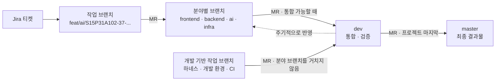

# Git 규칙

NEW:LEARN(S15P31A102) 팀의 브랜치 전략과 커밋·MR 규칙입니다. 저장소에 코드를 올리기 전에 한 번 읽어 주세요.

> **핵심 흐름:** Jira 티켓 생성 → 작업 브랜치에서 개발·커밋 → 분야별 브랜치로 MR → `dev`에서 통합·검증 → 프로젝트 마지막에 `master`로 병합



---

## 1. 브랜치 전략

### 기본 구조

```
master ← dev ← 분야별 브랜치 ← Jira 티켓별 작업 브랜치
```

| 브랜치 | 역할 | 병합 대상 |
| --- | --- | --- |
| `master` | 프로젝트 최종 결과물 보관 | 프로젝트 마지막에 `dev` 병합 |
| `dev` | 분야별 기능을 모아 통합·검증 | `master` |
| 분야별 브랜치 | 담당 영역의 작업을 모아 검증 | `dev` |
| 작업 브랜치 | Jira 티켓 하나를 처리 | 해당 분야별 브랜치 |

분야별 브랜치는 프로젝트에 필요한 영역만 만듭니다. `master`, `dev`, 분야별 브랜치는 유지하고, **작업 브랜치는 병합 후 삭제**합니다.

**NEW:LEARN의 분야별 브랜치**

분야 하나에 폴더 · 분야 브랜치 · 커밋 scope 를 같은 이름으로 씁니다. 어디서 봐도 같은 분야로 읽히게 하려는 것입니다. Jira 는 이미 쓰는 라벨과 머리말을 그대로 둡니다.

| 분야 | 폴더 | 분야 브랜치 | 커밋 scope | Jira 라벨 · 머리말 | 담당 |
| --- | --- | --- | --- | --- | --- |
| 화면 | `frontend/` | `frontend` | `frontend` | `fe` · [FE] | 기사 마인드맵 · 이슈 에볼루션 맵 화면 |
| 백엔드 | `backend/` | `backend` | `backend` | `be` · [BE] | 기사 적재, API, DB |
| AI | `ai/` | `ai` | `ai` | `ai` · [AI] | 6하원칙 추출, 동일 사건 묶기 |
| 인프라 | `infra/` | `infra` | `infra` | `infra` · [INFRA] | 쿠버네티스 · Argo CD · Terraform · CI |

폴더는 개발 환경을 만들 때(Jira S15P31A102-74) 생기고, `infra/` 는 첫 인프라 코드가 들어올 때 생깁니다.

### 작업 흐름

1. Jira 티켓을 생성하고 담당 분야를 정합니다.
2. 해당 **분야별 브랜치에서 작업 브랜치**를 생성합니다.
3. 작업 브랜치에서 개발하고 커밋한 뒤 GitLab에 푸시합니다.
4. **작업 브랜치 → 분야별 브랜치**로 Merge Request(MR)를 열어 병합합니다.
5. 분야별 기능이 통합 가능한 상태가 되면 **분야별 브랜치 → `dev`**로 MR을 엽니다.
6. `dev`에서 전체 기능을 통합·검증합니다. `dev`의 변경 사항은 **`dev` → 분야별 브랜치** MR로 분야별 브랜치에도 주기적으로 반영합니다.
7. 프로젝트 마지막에 **`dev` → `master`**로 MR을 열어 최종 결과물을 확정합니다.

### 작업 브랜치 이름

```
type/분야/Jira티켓번호-작업내용
```

```
feat/ai/S15P31A102-37-event-clustering
feat/frontend/S15P31A102-50-issue-timeline
fix/backend/S15P31A102-34-duplicate-article
chore/infra/S15P31A102-74-local-dev-env
docs/common/S15P31A102-72-mvp-scope-update
```

- Jira 티켓 키는 `S15P31A102-번호` 형식입니다.
- 분야 칸에는 1절 분야 표의 이름을 쓰고, 문서처럼 여러 분야에 걸치면 `common` 을 씁니다.
- 작업 내용은 짧은 영문 소문자와 하이픈으로 작성합니다.
- 한 Jira 티켓당 작업 브랜치 하나를 기본으로 합니다.
- 브랜치 이름에 작성자 이름을 넣지 않습니다.
- `type`은 아래 커밋 메시지의 Type과 같은 것을 씁니다.

### MR 규칙

- `master`, `dev`, 분야별 브랜치에는 직접 푸시하지 않고 MR로 병합합니다. GitLab 보호 브랜치 설정이 직접 푸시를 막습니다.
- MR의 **대상 브랜치**가 위 작업 흐름과 맞는지 확인합니다.
- **개발 기반 작업**(하네스 · 개발 환경 · CI · 저장소 설정)은 분야 브랜치를 거치지 않고 `dev` 로 바로 MR 을 엽니다. 분야 브랜치를 `dev` 에서 따기 때문에, 모든 분야가 딛는 기반은 `dev` 에 먼저 있어야 합니다.
- MR 제목은 커밋과 같은 `type(scope): 작업 내용` 형식으로 씁니다.
- MR 설명은 MR 템플릿(`.gitlab/merge_request_templates/Default.md`)의 목차를 따릅니다. 관련 Jira 티켓 링크, 작업 내용, 테스트 방법, 리뷰 포인트가 들어가고, 쓰는 법은 템플릿 머리 주석에 있습니다.
- 관련 없는 변경을 한 MR에 섞지 않습니다.
- 리뷰 승인은 당분간 병합 조건으로 두지 않습니다. 필요해지면 팀에서 다시 정합니다.
- 병합 후 작업 브랜치를 삭제합니다.
- 그 밖에 예외적인 병합 경로가 필요하면 팀에 먼저 공유하고 MR에 이유를 남깁니다.

---

## 2. 커밋 메시지 규칙

### 기본 형식

```
type(scope): 작업 내용
```

- `type`: 작업 종류
- `scope`: 작업한 영역
- `작업 내용`: 실제로 변경한 내용을 구체적으로 작성

### Type 종류

| Type | 사용 상황 |
| --- | --- |
| `feat` | 새로운 기능 추가 |
| `fix` | 오류 또는 버그 수정 |
| `refactor` | 기능 변화 없이 코드 구조 개선 |
| `docs` | README, 기획서 등 문서 수정 |
| `test` | 테스트 코드 작성 및 수정 |
| `style` | 들여쓰기, 공백, 주석 등 코드 형식 수정 |
| `chore` | 설정, 패키지, 폴더 구조 등 기타 작업 |
| `perf` | 성능 개선 |
| `merge` | 브랜치 병합 |

타입은 하네스 커밋 훅이 검사합니다(`.claude/stack.md` §3 `COMMIT_TYPES`). 타입을 바꾸면 그 줄도 같이 바꿉니다.

### Scope

```
frontend
backend
ai
infra
docs
common
```

분야 scope 는 1절 분야 표의 이름과 같고, DB 작업은 `backend` 를 씁니다. 문서 작업처럼 대상을 더 구체적으로 표현하는 편이 좋다면 `plan`, `readme` 등을 scope로 사용할 수 있습니다.

### 작성 규칙

- 커밋 메시지는 **한국어로 통일**합니다.
- 한 커밋에는 하나의 작업만 포함합니다.
- 작성자 이름은 넣지 않습니다.
- `수정`, `업데이트`처럼 모호하게 쓰지 않고 변경 내용을 구체적으로 적습니다.
- 메시지 끝에 마침표를 붙이지 않습니다.
- MR 제목도 `type(scope): 작업 내용` 형식으로 작성합니다.
- GitLab에서 병합 커밋을 만들 때도 메시지를 확인하고, 필요하면 `merge(scope): 병합 내용` 형식으로 작성합니다.

### 올바른 예시

```
feat(ai): 같은 사건을 다룬 기사 묶기 모델 추가
feat(frontend): 이슈 타임라인 화면 구현
fix(backend): 같은 원문 링크 기사가 두 번 저장되는 문제 수정
refactor(ai): 기사 본문 전처리 코드 분리
docs(plan): PRD에 팀 논의 사항 추가
docs(readme): 로컬 실행 방법 추가
chore(common): 프로젝트 폴더 구조 정리
chore(infra): 로컬 개발용 compose 파일 추가
merge(ai): 사건 묶기 기능을 ai 브랜치에 병합
```

### 잘못된 예시

```
강하린_코드수정
하린_업데이트
feat: 수정
작업 완료
최종 수정
진짜 최종 수정
```

---

## 3. 자주 쓰는 명령어

### 작업 시작부터 MR까지

```bash
# 1. 분야별 브랜치를 최신으로 받기
git switch ai
git pull origin ai

# 2. 작업 브랜치 만들기
git switch -c feat/ai/S15P31A102-37-event-clustering

# 3. 작업 후 커밋
git add <바꾼 파일>
git commit -m "feat(ai): 같은 사건을 다룬 기사 묶기 모델 추가"

# 4. 푸시하면서 ai 브랜치로 가는 MR 만들기 (병합 후 작업 브랜치 자동 삭제)
git push -u origin feat/ai/S15P31A102-37-event-clustering \
  -o merge_request.create \
  -o merge_request.target=ai \
  -o merge_request.remove_source_branch
```

4번의 `-o` 옵션 없이 푸시하고 GitLab 화면에서 MR을 만들어도 됩니다. 화면에서 만들면 MR 템플릿이 설명에 채워집니다. `-o` 로 만들면 설명이 커밋 메시지로 채워지니 템플릿 목차로 바꿔 씁니다.

### 작업 중에 분야별 브랜치가 바뀌었을 때

```bash
git switch ai
git pull origin ai
git switch feat/ai/S15P31A102-37-event-clustering
git merge ai
```

### 병합이 끝난 뒤 정리

```bash
git switch ai
git pull origin ai
git branch -d feat/ai/S15P31A102-37-event-clustering
```

---

## 4. 처음 한 번만 (저장소 관리자)

### 브랜치 만들기

```bash
git switch master
git pull origin master
git switch -c dev
git push -u origin dev

# 분야별 브랜치는 dev에서 만든다
git switch -c frontend dev && git push -u origin frontend
git switch -c backend dev && git push -u origin backend
git switch -c ai dev && git push -u origin ai
git switch -c infra dev && git push -u origin infra
```

### GitLab 설정

- **Settings → Repository → Protected branches**: `master`, `dev`, `frontend`, `backend`, `ai`, `infra`를 보호 브랜치로 등록합니다. *Allowed to push*는 `No one`, *Allowed to merge*는 `Developers + Maintainers`로 둡니다. 직접 푸시를 막아 MR로만 병합되게 합니다.
- **Settings → Merge requests**: *Enable "Delete source branch" option by default*를 켭니다. 병합 후 작업 브랜치가 자동으로 지워집니다.
- **Settings → Merge requests → Merge request approvals**: 리뷰 승인은 당분간 병합 조건으로 걸지 않습니다 (1절 MR 규칙). 필요해지면 팀에서 다시 정합니다.
