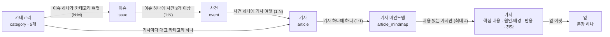

# 용어 정리

서비스 용어가 테이블 · API 에서 어떤 이름으로 쓰이는지, PRD 에 없는 개발 용어, 헷갈리는 말을 모았다.

- 제품 용어의 정의는 PRD 부록 A 「용어집」(`_bmad-output/planning-artifacts/prds/prd-S15P31A102-2026-10-14/prd.md`)이 진실이다. 여기에는 한 줄 뜻과 이름 대응만 둔다
- 테이블 설계는 `docs/data-model.md`, API 는 `docs/api.md`
- 2026-10-21 v1: 10-20 팀 회의 · 10-21 마인드맵 회의로 바뀐 용어를 고쳤다(카테고리 5개, 마인드맵 가지 4개 · 두 보기, 사건 키워드, 메인 · 서브 흐름, 언론사 명부, 회원 · 관심 분야, 용어사전, 수집 실행)
- 2026-10-26: 북마크 · 나의 뉴스함 · 관심 이슈(별표) 를 더했다(Jira S15P31A102-114). 「스크랩」은 「북마크」로 맞춘다
- 2026-10-28: 메인 · 서브 흐름을 사건 역할로 나눈다고 고쳤다(Jira S15P31A102-130)
- 2026-10-29: 반응 대상 · 반응 점선을 더했다(Jira S15P31A102-134)

---

## 1. 서비스 구조 한눈에

오른쪽으로 갈수록 작은 단위다. 선 위 글자는 몇 대 몇으로 이어지는지다.

- 기사 하나는 사건 하나에만 속한다고 가정했다(`data-model.md` 5절 1번). 사건 하나는 이슈 하나에만 속한다(5절 2번)
- 사건은 이슈 없이 있을 수 있다. 이슈는 사건 3개가 모여야 생기므로(2026-10-20) 그 전의 사건은 이슈 밖에 있다
- 잎의 근거 문장은 데이터로만 남기고 화면에는 보이지 않는다(2026-10-21)

## 2. 서비스 용어와 이름

| 용어 | 한 줄 뜻 | 테이블 · 칸 | API 이름 |
|---|---|---|---|
| 카테고리 | 기사의 주제 분류 5개(정치 · 경제 · 사회 · 국제 · IT·과학). 서비스 구조의 맨 위 | `category` | `category` · `categories`. 값은 `economy` 같은 코드 |
| 원본 분류 | 소스가 기사에 붙여 준 분류(데이터셋 경로, NewsData `business` 같은 코드). 대응 표로 카테고리에 맞춘다 | `article.source_categories`, `category_mapping` | — |
| 이슈 | 서로 관련된 사건들을 시간 순서로 이은 묶음. 사건 3개가 모이면 AI 가 만든다. 예: 「한빛반도체 미국 공장 건설」 | `issue` | `issue` · `issueId` |
| 새로 생성된 이슈 | 검색창 아래에 보이는 이슈 목록. 만들어진 최신순 | `issue.created_at` | A2 `sort=createdAt` |
| 대표 이슈 | MVP 에서 먼저 검증하는 이슈 5~10개(MVP 개요 4장) | 따로 칸이 없다 | — |
| 사건 | 특정 시점에 일어난 하나의 일. 같은 사건을 다룬 기사들이 사건 하나로 묶인다 | `event` | `event` · `eventId` · `events` |
| 사건 이름 · 사건 키워드 | 사건 이름은 문장(「부산 북항친수공원 수로에 상어 출몰」), 키워드는 짧은 이름표(「첫 목격」). 둘 다 AI 가 짓는다 | `event.title` · `event.label` | `title` · `label` |
| 사건 발생 시점 | 사건이 실제로 일어난 때 | `event.occurred_at` | `occurredAt` |
| 기사 | 언론사가 발행한 뉴스 한 건 | `article` | `article` · `articleId` |
| 발행 시각 | 언론사가 기사를 낸 때 | `article.published_at` | `publishedAt` |
| 언론사 | 기사를 낸 곳. 소스마다 다른 표기를 명부 하나로 묶는다 | `press` · `press_mapping`, `article.press_code` | `publisher` · `publishers` (`{ code, name }`) |
| 이슈 에볼루션 맵 · 타임라인 | 이슈의 사건을 발생 시점 순서로 놓은 화면과 그 기본 보기. 메인 흐름 · 서브 흐름 두 레인 | 저장하지 않는다. `event` 를 정렬해 그린다 | A4 타임라인 |
| 메인 흐름 · 서브 흐름 | 타임라인의 두 레인. 사건의 역할로 나눈다 — 상황을 바꾸는 행위(`MAIN`)는 메인, 다른 사건에 대한 반응 · 평가 · 여론(`REACTION`)은 서브(2026-10-28, Jira S15P31A102-130). 역할은 새 사건을 만들 때 판정이 정한다 | `event.role` 로 계산 | A4 `lane` = `MAIN` · `SUB` |
| 반응 대상 · 반응 점선 | 반응 사건(서브 흐름)이 무엇에 대한 반응인지. 한 줄 글과 사건 번호 둘로 둔다. 번호가 같은 이슈의 사건이면 화면이 반응 사건 → 대상 사건 점선을 그린다(둘 다 보일 때만, 2026-10-28) | `event.reacts_to`(한 줄, 내보내지 않음) · `event.reacts_to_event_id` | A4 `reactsToEventId` · W1 `newEvent.reactsToEventId` |
| 사건 패널 | 사건 노드를 누르면 열리는 오른쪽 패널. 사건 요약과 관련 기사를 보인다 | — (화면) | A5 · A6 |
| 기사 마인드맵 | 기사 하나의 핵심 정보를 가지 4개로 정리한 결과. 화면은 흐름지도 · 마인드맵 두 보기로 그린다 | `article_mindmap` | A9 `title` · `branches` |
| 흐름지도 · 마인드맵 (보기) | 같은 결과를 위에서 아래로 읽는 목록(흐름지도), 가운데에서 퍼지는 그림(마인드맵)으로 보는 두 탭. 둘 다 가제 | — (화면) | A9 |
| 가지 | 마인드맵의 큰 갈래 4개. 마인드맵에서는 핵심 내용 · 원인·배경 · 반응 · 전망, 흐름지도에서는 무슨 일이? · 왜 일어났나? · 누가 뭐라고 했나? · 앞으로는? | `article_mindmap.content` 안 | `branches[].type` = `CORE` · `CAUSE` · `REACTION` · `OUTLOOK` |
| 잎 | 가지 아래 문장 하나 | `article_mindmap.content` 안 | `branches[].items[].text` |
| 근거 문장 | 잎의 바탕이 된, 원문에 글자 그대로 있는 문장. 화면에 보이지 않고 저장만 한다 | `article_mindmap.content` 안 | `evidence` (A9 에는 없음) |
| 요약 | 한두 문장으로 줄인 설명. 기사 · 사건 · 이슈마다 따로 있다. 기사 요약은 우리 AI 요약 하나다(NewsData 요약은 쓰지 않는다, 2026-10-26) | `article_mindmap.summary` · `event.summary` · `issue.summary` | `summary` |
| 사건 관계 | 후속 · 원인 · 반응 · 반박처럼 종류가 있는 사건 사이 선 (P1). 화면은 관계 선 가운데 반응 점선(위 「반응 대상」)만 그리고 다른 종류는 그리지 않는다. 메인 레인 사건을 시간순으로 잇는 선(메인 흐름 띠)은 관계가 아니라 늘 그린다 | `event_relation`(만들지 않음) | 없음 (그리기로 하면 `relations`) |
| 회원 · 관심 분야 | 아이디 · 비밀번호 · 이름으로 가입한 사용자와 그가 고른 카테고리(여러 개, 고칠 수 있음) | `member` · `member_category` | A14 ~ A18, `categories` |
| 북마크 · 나의 뉴스함 | 회원이 기사 옆 북마크 아이콘으로 담아 둔 기사와 그 목록 화면. 화면 문구는 「북마크」다 — 「스크랩」은 쓰지 않는다(2026-10-26) | `bookmark` | A20 ~ A22, `bookmarked` · `bookmarkedAt` |
| 관심 이슈(별표) | 회원이 이슈 이름 옆 별표로 저장한 이슈. 마이페이지에서 모아 본다. 관심 분야(카테고리)와 다르다 | `interest_issue` | A23 ~ A25, `interested` · `interestedAt` |
| 용어사전 | 기사 · 이슈 · 사건 화면의 글을 드래그하면 뜨는 말풍선. 고른 말의 그 글 문맥에 맞는 뜻 하나를 AI(SSAFY GMS)가 사전 모양으로 준다(2026-11-10 — 전에는 표준국어대사전을 찾는 작은 창, A19) | 없음 | A26 |

## 3. 개발 용어 — PRD 에 없는 것

| 용어 | 뜻 | 이름 |
|---|---|---|
| 적재 | NewsData · 데이터셋 기사를 DB 에 넣는 것. 화면에는 아직 안 보인다 | `article` 행이 생긴다 (`created_at`). NewsData 는 B2 로 넣는다 |
| 수집 실행 | CronJob 이 NewsData 를 한 번 부르는 일. 15분마다 최근 30분(2026-11-13 적재 · 확인 직후, 앞서 매일 10시 전날치). 같은 회차에서 몫만큼 B1 을 자동으로 건다(자동 투입) | 배치 Job 로그 한 줄. `ingest_run` 은 지금 쓰지 않는다(Jira 153) |
| 투입 | 적재한 기사에 분석을 거는 것(B1). 기사는 아직 화면에 안 보인다 — 보이는 것은 「공개」 | B1, `ALREADY_RELEASED` |
| 공개 | 기사가 화면에 보이기 시작하는 것. EXTRACT 결과(마인드맵)를 처음 저장할 때 API 가 한다 — 분석이 끝난 기사부터 보인다(2026-10-26, Jira 34). 공개 전 기사는 모든 조회 · 집계에서 없는 것으로 본다 | `article.released_at`, `Article.markReleased` |
| 분석 작업 | 기사 하나의 분석 단계 하나 | `analysis_job` 한 행, 메시지의 `jobId` |
| 분석 단계 | 분석 작업의 종류 넷 | `stage` = `EXTRACT` · `EMBED` · `MATCH_EVENT` · `ISSUE` |
| 핵심 정보 추출 | 기사에서 가지 4개(핵심 내용 · 원인·배경 · 반응 · 전망)를 뽑아 마인드맵을 만드는 단계 | `EXTRACT` |
| 임베딩 | 기사를 숫자 목록(벡터)으로 바꿔 비슷한 기사를 찾게 하는 것 | `EMBED`, `article_embedding` |
| 후보 사건 | 비슷한 기사들이 속한 사건 최대 5개. 동일 사건 판정에 넘긴다 | `analysis_job.candidates`, 메시지의 `candidates` |
| 동일 사건 판정 | 새 기사가 후보 사건 중 하나와 같은 사건인지, 새 사건인지 가르는 단계. 새 사건이면 이름 · 키워드 · 요약을 짓는다 | `MATCH_EVENT`, 결과 `decision` = `EXISTING` · `NEW` |
| 이슈 판단 | 새 사건을 이슈에 붙일지, 이슈 밖 사건들과 새 이슈(3개 이상)를 만들지, 아직 두지 가르는 단계(제안) | `ISSUE`, 결과 `decision` = `ATTACH` · `CREATE` · `NONE` |
| 대응 표 | 소스마다 다른 값(분류 · 언론사 표기)을 우리 값에 맞추는 표 | `category_mapping` · `press_mapping` |
| 시도 | 같은 작업을 몇 번째 돌리는지 | `attempt` |
| 작업 큐 · 스트림 · consumer group | Redis 에 쌓는 작업 줄 · 그 줄 하나 · 같은 줄을 각자 따로 읽는 무리 | 스트림 `analysis.released` · `analysis.match_event` · `analysis.issue`, 그룹 `extract` · `embed` · `match_event` · `issue` |
| ack | 워커가 메시지를 다 처리했다고 Redis 에 알리는 것. 안 하면 그 메시지가 다시 온다 | Redis `XACK` |
| 내부 API | 수집 배치 · 워커만 부르는 주소. Gateway 밖에 열지 않는다 | `/internal/v1` |
| 세션 | 로그인한 사용자를 기억하는 서버 쪽 기록. 브라우저는 쿠키로 들고 다닌다 | Redis, A15 |
| CSRF 번호표 | 다른 사이트가 사용자의 로그인 쿠키를 빌려 요청을 보내는 공격(CSRF)을 막는 값. 서버가 쿠키로 주고 화면이 POST · PUT · DELETE 때 헤더로 돌려보낸다 | 쿠키 `XSRF-TOKEN`, 헤더 `X-XSRF-TOKEN` |
| 봉투 | 응답을 `{success, data}` 처럼 한 번 더 감싸는 껍데기. 이 프로젝트는 성공 응답에 쓰지 않는다 | `docs/api.md` 1절 |
| Problem Details | 오류 응답의 표준 모양(RFC 9457) | `application/problem+json` + `code` |

## 4. 헷갈리는 말

| 말 | 이 프로젝트에서는 |
|---|---|
| 이슈 | 문서 · 코드의 「이슈」는 뉴스 이슈(`issue` 테이블)다. Jira · GitLab 의 작업 단위는 「티켓」이라고 부른다 |
| 사건 · 이벤트 | 「사건」은 뉴스 사건(`event` 테이블)이다. 큐에 넣는 것은 「메시지」라고 부른다. SSOT 4절의 「이벤트를 다시 발행」은 메시지를 다시 넣는다는 뜻이다 |
| 발행 시각 · 발생 시점 | 발행 시각은 기사가 나온 때, 발생 시점은 사건이 일어난 때다. 타임라인은 발생 시점으로 줄을 세운다 |
| 마인드맵 | 세 가지로 쓰인다. ① 기사 분석 결과 전체(`article_mindmap`) ② 그 결과를 방사형으로 그린 보기 탭(흐름지도의 짝) ③ 팀에서 이슈 화면을 부르는 말(PRD 부록 A 「팀에서 부르는 말」). 문서에서 보기 탭을 말할 때는 「마인드맵 보기」라고 쓴다 |
| 가지 · 노드 | v0 의 「노드(6하원칙 항목)」는 v1 에서 「가지」와 「잎」으로 바뀌었다. 타임라인의 점(사건)은 「사건 노드」라고 부른다 |
| 키워드 | 「사건 키워드」는 사건의 짧은 이름표(`event.label`)다. 검색어나 태그 목록이 아니다 |
| 요약 | 이슈 요약은 AI 가 쓰고 사건이 붙을 때마다 다시 쓴다(2026-10-20). 사건 요약은 새 사건 때 동일 사건 판정(AI)이 짓는다(제안). 기사 요약은 우리 AI 요약 하나다(끌 수 있음). NewsData 요약은 쓰지 않는다(2026-10-26) |
| 용어사전 · 용어 정리 | 「용어사전」은 사용자가 단어를 찾는 기능(A19)이다. 이 문서(「용어 정리」)와 다르다 |
| 작업 · 단계 | 「작업」은 `analysis_job` 한 행(기사 하나 · 단계 하나), 「단계」는 `EXTRACT` 같은 종류다 |
| 상태 | 작업 상태(`status`)와 화면용 상태(`mindmapStatus` · `eventMatchStatus`)는 다르다. 화면용은 작업 상태와 결과가 있는지로 계산한다(`docs/api-internal.md` 6절) |
