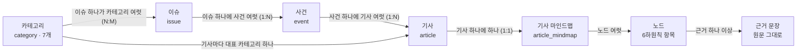

# 용어 정리

서비스 용어가 테이블 · API 에서 어떤 이름으로 쓰이는지, PRD 에 없는 개발 용어, 헷갈리는 말을 모았다.

- 제품 용어의 정의는 PRD 부록 A 「용어집」(`_bmad-output/planning-artifacts/prds/prd-S15P31A102-2026-10-14/prd.md`)이 진실이다. 여기에는 한 줄 뜻과 이름 대응만 둔다
- 테이블 설계는 `docs/data-model.md`, API 는 `docs/api.md`

---

## 1. 서비스 구조 한눈에

오른쪽으로 갈수록 작은 단위다. 선 위 글자는 몇 대 몇으로 이어지는지다.

- 기사 하나는 사건 하나에만 속한다고 가정했다(`data-model.md` 5절 1번). 사건 하나는 이슈 하나에만 속한다(5절 2번)
- 사건은 이슈 없이 있을 수 있다. 이슈로 아직 묶이지 않은 사건이다

## 2. 서비스 용어와 이름

| 용어 | 한 줄 뜻 | 테이블 · 칸 | API 이름 |
|---|---|---|---|
| 카테고리 | 기사의 주제 분류 7개. 서비스 구조의 맨 위 | `category` | `category` · `categories`. 값은 `economy` 같은 코드 |
| 이슈 | 서로 관련된 사건들을 시간 순서로 이은 묶음. 예: 「한빛반도체 미국 공장 건설」 | `issue` | `issue` · `issueId` |
| 대표 이슈 | MVP 에서 먼저 골라 제공하는 이슈 5~10개 | 따로 칸이 없다. 지금은 `issue` 행 전부가 대표 이슈다 | — |
| 사건 | 특정 시점에 일어난 하나의 일. 같은 사건을 다룬 기사들이 사건 하나로 묶인다 | `event` | `event` · `eventId` · `events` |
| 사건 발생 시점 | 사건이 실제로 일어난 때 | `event.occurred_at` | `occurredAt` |
| 기사 | 언론사가 발행한 뉴스 한 건 | `article` | `article` · `articleId` |
| 발행 시각 | 언론사가 기사를 낸 때 | `article.published_at` | `publishedAt` |
| 언론사 | 기사를 낸 곳 | `article.publisher` | `publisher` · `publishers` |
| 이슈 에볼루션 맵 · 타임라인 | 이슈의 사건을 발생 시점 순서로 놓은 화면과 그 기본 보기 | 저장하지 않는다. `event` 를 정렬해 그린다 | A4 타임라인 |
| 사건 패널 | 사건 노드를 누르면 열리는 오른쪽 패널 | — (화면) | A5 · A6 |
| 기사 마인드맵 | 기사 하나의 핵심 정보를 노드와 관계로 그린 화면 | `article_mindmap` | `mindmap` · `content` |
| 노드 | 마인드맵의 점 하나. 6하원칙 항목 하나 | `article_mindmap.content` 안 | `content` 안. 모양은 Q33 |
| 근거 문장 | 요약 · 노드의 바탕이 된, 원문에 글자 그대로 있는 문장 | `article_mindmap.content` 안 | `evidence` |
| 요약 | 한두 문장으로 줄인 설명. 기사 · 사건 · 이슈마다 따로 있다 | `article_mindmap.summary` · `event.summary` · `issue.summary` | `summary` |
| 사건 관계 | 후속 · 반응 · 반박 같은 사건 사이 선 (P1) | `event_relation` | `relations` |
| 지원 출처 | URL 분석을 받아 주는 언론사 | 미정 (Q26) | A12 |

- 마인드맵 1차 가지는 MVP 개요 F03 대로 6하원칙(누가 · 언제 · 어디서 · 무엇을 · 어떻게 · 왜)이다. PRD 부록 A 「핵심 정보」는 인물 · 기관 · 사건 · 시점 · 배경 · 결과로 적혀 있어 서로 다르다. MVP 개요가 이기므로(`.claude/stack.md` 7절) 6하원칙을 따르고, PRD 를 고칠지는 PM 확인이 필요하다

## 3. 개발 용어 — PRD 에 없는 것

| 용어 | 뜻 | 이름 |
|---|---|---|
| 적재 | 데이터셋 · NewsData 기사를 DB 에 넣는 것. 화면에는 아직 안 보인다 | `article` 행이 생긴다 (`created_at`) |
| 투입 | 적재한 기사를 서비스에 내놓는 것. 이때 분석이 시작된다 | `article.released_at`, B1 |
| 순차 투입 | 발행일 순서로 하나씩 투입하는 것(SSOT 2절). 새 기사가 들어올 때 사건이 붙는 과정을 시연한다 | 수집 배치가 B1 을 차례로 부른다 |
| 분석 작업 | 기사 하나의 분석 단계 하나 | `analysis_job` 한 행, API 의 `jobId` |
| 분석 단계 | 분석 작업의 종류 셋 | `stage` = `EXTRACT` · `EMBED` · `MATCH_EVENT` |
| 6하원칙 추출 | 기사에서 누가 · 언제 … 를 뽑아 요약 · 마인드맵을 만드는 단계 | `EXTRACT` |
| 임베딩 | 기사를 숫자 목록(벡터)으로 바꿔 비슷한 기사를 찾게 하는 것 | `EMBED`, `article_embedding` |
| 후보 사건 | 비슷한 기사들이 속한 사건 최대 5개. 동일 사건 판정에 넘긴다 | `analysis_job.candidates`, 메시지의 `candidates` |
| 동일 사건 판정 | 새 기사가 후보 사건 중 하나와 같은 사건인지, 새 사건인지 가르는 단계 | `MATCH_EVENT`, 결과 `decision` = `EXISTING` · `NEW` |
| 시도 | 같은 작업을 몇 번째 돌리는지 | `attempt` |
| 작업 큐 · 스트림 · consumer group | Redis 에 쌓는 작업 줄 · 그 줄 하나 · 같은 줄을 각자 따로 읽는 무리 | 스트림 `analysis.released` · `analysis.match_event`, 그룹 `extract` · `embed` · `match_event` |
| ack | 워커가 메시지를 다 처리했다고 Redis 에 알리는 것. 안 하면 그 메시지가 다시 온다 | Redis `XACK` |
| 내부 API | 수집 배치 · 워커만 부르는 주소. Gateway 밖에 열지 않는다 | `/internal/v1` |
| 봉투 | 응답을 `{success, data}` 처럼 한 번 더 감싸는 껍데기. 이 프로젝트는 성공 응답에 쓰지 않는다 | `docs/api.md` 1절 |
| Problem Details | 오류 응답의 표준 모양(RFC 9457) | `application/problem+json` + `code` |

## 4. 헷갈리는 말

| 말 | 이 프로젝트에서는 |
|---|---|
| 이슈 | 문서 · 코드의 「이슈」는 뉴스 이슈(`issue` 테이블)다. Jira · GitLab 의 작업 단위는 「티켓」이라고 부른다 |
| 사건 · 이벤트 | 「사건」은 뉴스 사건(`event` 테이블)이다. 큐에 넣는 것은 「메시지」라고 부른다. SSOT 4절의 「이벤트를 다시 발행」은 메시지를 다시 넣는다는 뜻이다 |
| 발행 시각 · 발생 시점 | 발행 시각은 기사가 나온 때, 발생 시점은 사건이 일어난 때다. 타임라인은 발생 시점으로 줄을 세운다 |
| 마인드맵 | 팀에서는 이슈 화면도 마인드맵이라 부르기도 한다(PRD 부록 A 「팀에서 부르는 말」). 문서 · 코드의 마인드맵은 기사 마인드맵(`article_mindmap`)뿐이다 |
| 요약 | 기사 요약만 AI 생성이 확정이다. 사건 · 이슈 요약을 누가 쓰는지는 미정이다(`data-model.md` 5절 13번) |
| 작업 · 단계 | 「작업」은 `analysis_job` 한 행(기사 하나 · 단계 하나), 「단계」는 `EXTRACT` 같은 종류다 |
| 상태 | 작업 상태(`status`)와 화면용 상태(`mindmapStatus` · `eventMatchStatus`)는 다르다. 화면용은 작업 상태와 결과가 있는지로 계산한다(`docs/api-internal.md` 6절) |
