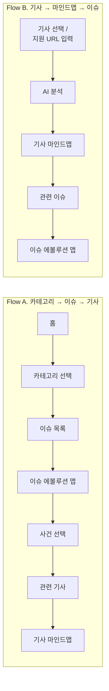

# MVP 개요

NEW:LEARN MVP의 목표, 범위, 핵심 기능, 완료 기준을 정리한 문서입니다. PRD와 별개로, 팀이 MVP 범위를 한눈에 확인할 때 사용합니다.

> **최종 방향:** 7개 카테고리를 기반으로 서비스를 구성하되, 대표 이슈 5~10개를 우선 선정하여 **기사 이해 → 사건 연결 → 이슈 흐름 탐색**까지 이어지는 핵심 사용자 경험을 완성한다. 주장 변화 확인은 추후 논의한다.

---

## 1. MVP 개요

### 1-1. 서비스 소개

**NEW:LEARN(뉴런)** 은 뉴스 기사를 AI로 구조화해 마인드맵으로 제공하고, 관련 기사들을 사건 단위로 연결하여 이슈의 전개 과정과 주요 변화를 시각적으로 탐색할 수 있는 AI 뉴스 서비스입니다.

### 1-2. MVP 목표

정치·사회·경제·국제·스포츠·문화/연예·IT/과학 총 7개 카테고리를 기반으로 뉴스 탐색 기능을 구현하고, 대표 이슈 5~10개를 선정하여 기사 마인드맵, 사건 중심 이슈맵 기능을 검증한다 (주장 변화 분석은 추후 논의).

**핵심 목표**

1. AI를 활용해 기사 핵심 정보를 추출하고 마인드맵으로 시각화
2. 동일 사건을 다룬 여러 기사를 하나의 사건으로 묶어 제공
3. 사건의 시간적 흐름과 관련성을 이슈 에볼루션 맵으로 표현
4. 이전 보도 대비 새로운 정보 및 주장 변화와 원문 근거 제공 **(추후 논의)**
5. 7개 카테고리 기반 뉴스·이슈 탐색 및 기사 간 연결 지원

### 1-3. MVP 구현 원칙

| 항목 | 원칙 |
| --- | --- |
| 카테고리 | 7개 분야를 지원하는 공통 탐색 구조 구현 |
| 데이터 | SSAFY NEWS 2025 상반기·2024 상반기·2024 하반기 데이터셋과 NewsData.io News API 활용 |
| 검증 범위 | 실제 뉴스 이슈 5~10개 선정 |
| AI | 기사 구조화, 동일 사건 클러스터링에 집중 (주장 변화 분석은 추후 논의) |
| 서비스 | 기사 마인드맵과 이슈 에볼루션 맵의 양방향 탐색 완성 |
| 수집 | 데이터셋 3개는 적재 후 순차 투입, 신규 기사는 NewsData.io News API로 수집 |

> 7개 카테고리 모두 탐색 구조를 제공하되, 실제 기사·이슈 제공 범위는 데이터셋의 카테고리별 분포를 확인한 후 확정한다.

---

## 2. 뉴스 카테고리 정의

### 2-1. 카테고리 구성

| 카테고리 | 세부 분야 | 이슈 예시 |
| --- | --- | --- |
| 정치 | 국회, 정부, 선거, 정당, 정책, 법안 | 법안 발의 → 논의 → 수정 → 통과 |
| 사회 | 사건·사고, 교육, 노동, 복지, 법원, 환경 | 사건 발생 → 조사 → 후속 조치 |
| 경제 | 금융, 기업, 산업, 부동산, 증시, 물가 | 투자 발표 → 계획 변경 → 사업 진행 |
| 국제 | 외교, 국제 분쟁, 해외 정치, 국제기구 | 정상회담 → 협상 → 합의 → 후속 반응 |
| 스포츠 | 야구, 축구, 농구, 올림픽, 선수 이적 | 이적설 → 협상 → 계약 발표 |
| 문화/연예 | 영화, 드라마, 음악, 공연, 미술, 출판 | 작품 발표 → 공개 → 후속 소식 |
| IT/과학 | AI, 반도체, 우주, 로봇, 과학 연구, 신기술 | 기술 발표 → 검증 → 상용화 |

### 2-2. 카테고리 적용 방식

- 기사에는 대표 카테고리를 부여한다.
- 하나의 이슈는 여러 카테고리와 연결될 수 있도록 설계한다.
- 카테고리별 별도 AI 모델을 구축하기보다 공통 분석 파이프라인을 활용한다.
- 동일 사건을 다룬 기사는 카테고리가 달라도 하나의 사건으로 연결할 수 있도록 설계한다.
- 초기 대표 이슈는 사건의 발생·변경·후속 보도가 충분한 주제를 우선 선정한다.

---

## 3. MVP 핵심 기능 정의

### 3-1. 기능 목록

| ID | 구분 | 기능명 | MVP 구현 범위 | 우선순위 |
| --- | --- | --- | --- | --- |
| F01 | 데이터 | 뉴스 데이터 적재·조회 | 기사 제목·본문·언론사·발행일·카테고리 저장 및 조회 | P0 |
| F02 | 탐색 | 카테고리별 뉴스·이슈 조회 | 7개 카테고리 선택 및 관련 기사·이슈 목록 제공 | P0 |
| F03 | AI | 기사 핵심 정보 구조화 | 6하원칙(누가·언제·어디서·무엇을·어떻게·왜)에 따라 핵심 정보 추출 | P0 |
| F04 | 기사 마인드맵 | 기사 마인드맵 생성 | 추출 정보를 노드·관계 구조로 변환하여 시각화 | P0 |
| F05 | 기사 마인드맵 | 노드 상세 및 근거 확인 | 노드 클릭 시 핵심 요약 및 원문 근거 문장 제공 | P0 |
| F06 | AI | 동일 사건 기사 클러스터링 | 내용·주체·시점 등을 기준으로 동일 사건 기사 묶기 | P0 |
| F07 | 이슈맵 | 사건 중심 이슈 에볼루션 맵 | 사건 노드를 생성하고 발생 시점 기준으로 연결 | P0 |
| F08 | 이슈맵 | 사건별 관련 기사 조회 | 사건 노드 선택 시 해당 사건의 기사 목록·출처·요약 제공 | P0 |
| F09 | AI | 주장 관계 및 변화 분석 | 이전·신규 주장을 비교해 새 정보·반복·갱신·상충 후보·판단 불가 판정 | 추후 논의 |
| F10 | 변화 분석 | 근거 기반 변화 카드 | 변경된 핵심 내용과 해당 원문 근거 문장 제공 | 추후 논의 |
| F11 | 탐색 | 기사·이슈 양방향 연결 | 기사 마인드맵 ↔ 이슈 에볼루션 맵 이동 | P0 |

**우선순위 정의**

| 우선순위 | 의미 |
| --- | --- |
| P0 | MVP 필수 기능. 통합 시연을 위해 반드시 구현 |
| P1 | 일정 및 기술 검증 결과에 따라 추가 구현 |
| P2 | MVP 이후 확장 기능 |

### 3-2. 기능별 상세 범위

#### ① 뉴스 탐색 및 기사 조회 (F01~F02)

- 7개 카테고리 선택 UI 제공
- 카테고리별 이슈 목록 조회
- 이슈별 관련 기사 조회
- 기사 제목·언론사·발행일·요약 등 기본 정보 제공
- 저장된 기사 또는 지원 가능한 URL을 통한 기사 분석 진입

#### ② 기사 마인드맵 (F03~F05)

- 기사 내 6하원칙(누가·언제·어디서·무엇을·어떻게·왜) 추출
- AI 분석 결과를 구조화된 JSON으로 생성
- 기사 제목을 중심으로 핵심 정보를 마인드맵 노드로 표시
- 노드 클릭 시 상세 요약 및 원문 근거 확인
- 기사 원문 링크 제공

#### ③ 동일 사건 기사 연결 (F06)

- 기사 임베딩 및 핵심 개체·시점 정보 활용
- 같은 사건을 다룬 기사들을 하나의 사건 ID로 관리
- 하나의 사건에 여러 기사 연결
- 신규 기사가 기존 사건에 속하는지 판단
- 동일 이슈 내 사건과 기사 간 관계 저장

#### ④ 이슈 에볼루션 맵 (F07~F08)

- 카테고리에서 이슈 선택
- 이슈에 속한 사건들을 노드 형태로 표시
- 기사 발행일과 실제 사건 발생 시점 구분
- 사건 발생 시점을 기준으로 시간순 정렬
- 사건 노드 선택 시 관련 기사 목록 제공
- 사건 상세에서 기사 마인드맵으로 이동

#### ⑤ 주장 변화 분석 (F09~F10) — 추후 논의

> 2026-10-18 팀 결정에 따라 추후 논의한다. 아래는 기존 안이다.

- 동일 사건·쟁점에 속한 기존 주장과 신규 주장 비교
- 아래 5개 관계 유형으로 판정
- 이전 보도와 달라진 내용을 짧게 요약
- 분석 결과에 대한 원문 근거 문장 표시
- 판단이 불확실한 결과는 확정적으로 표시하지 않음

| 관계 유형 | 판정 기준 |
| --- | --- |
| 새 정보 | 기존에 연결되는 주장이 없는 새로운 내용 |
| 반복 | 기존 주장과 실질적으로 동일한 내용 |
| 갱신 | 시점·수치·상태 등의 변화가 확인된 내용 |
| 상충 후보 | 동일 시점·조건에서 서로 양립하기 어려운 주장 |
| 판단 불가 | 근거 부족으로 관계를 확정할 수 없는 내용 |

#### ⑥ 기사·이슈 연계 탐색 (F11)

- 기사 마인드맵에서 소속 이슈 확인
- 기사 상세 화면에서 이슈 전체 보기
- 이슈맵에서 사건 선택
- 사건에 속한 기사 선택
- 기사 마인드맵으로 이동

---

## 4. MVP 데이터 및 분석 범위

| 항목 | MVP 범위 |
| --- | --- |
| 카테고리 | 정치·사회·경제·국제·스포츠·문화/연예·IT/과학 |
| 대표 이슈 | 전체 5~10개 우선 선정 |
| 뉴스 출처 | SSAFY NEWS 2025 상반기·2024 상반기·2024 하반기 데이터셋, NewsData.io News API |
| 기사 저장 | 제목·본문·발행일·언론사·URL·카테고리 |
| 기사 분석 | 6하원칙(누가·언제·어디서·무엇을·어떻게·왜)·근거 추출 (주장 추출은 추후 논의) |
| 사건 연결 | 동일 사건 기사 클러스터링 |
| 이슈맵 | 사건 단위 노드 및 시간순 관계 그래프 |
| 변화 분석 | 주요 주장 관계 판정 및 변화 카드 **(추후 논의)** |
| 신규 기사 | 데이터셋 3개 순차 투입과 NewsData.io API 수집으로 갱신 과정 시연 |
| 원문 제공 | 근거 문장 및 원문 링크 연결 |

**데이터 선정 기준**

1. 기사 본문이 확보되어 AI 분석 가능한 이슈
2. 동일 사건을 다룬 기사가 여러 건 존재하는 이슈
3. 시간에 따른 후속 보도가 존재하는 이슈
4. 기존 보도 대비 주요 정보 변화가 있는 이슈 (주장 변화는 추후 논의)
5. 출처 및 근거 확인이 가능한 이슈

> 대표 이슈 5~10개는 전체 합산 기준이며, 카테고리마다 반드시 5~10개씩 선정하는 것은 아니다.

---

## 5. 핵심 사용자 흐름

두 흐름은 기사 마인드맵과 이슈 에볼루션 맵에서 서로 만나며, 이 지점이 F11(양방향 연결)입니다.

### Flow A. 카테고리 → 이슈 → 기사

**홈 → 카테고리 선택 → 이슈 목록 → 이슈 에볼루션 맵 → 사건 선택 → 관련 기사 → 기사 마인드맵**

1. 사용자가 7개 카테고리 중 관심 분야 선택
2. 해당 카테고리에 속한 이슈 목록 확인
3. 관심 이슈 선택 후 사건별 전개 흐름 확인
4. 사건 노드 선택 시 관련 기사 확인 (변화 정보는 추후 논의)
5. 특정 기사 선택 후 마인드맵으로 상세 내용 탐색

### Flow B. 기사 → 마인드맵 → 이슈

**기사 선택 또는 지원 URL 입력 → AI 분석 → 기사 마인드맵 → 관련 이슈 → 이슈 에볼루션 맵**

1. 사용자가 분석할 기사 선택
2. AI가 기사의 핵심 정보를 구조화
3. 생성된 마인드맵에서 핵심 내용 및 근거 확인
4. 현재 기사가 속한 이슈 확인
5. 이슈맵으로 이동해 관련 사건 및 후속 보도 탐색

---

## 6. MVP 제외 및 확장 기능

### P1: 일정과 기술 검증 결과에 따라 추가

| 기능 | 비고 |
| --- | --- |
| 타임라인·그래프 뷰 전환 | 기본 그래프 완성 후 추가 |
| 정교한 그래프 인터랙션 및 필터 | 핵심 탐색 기능 완성 후 UX 고도화 |
| 분석 진행 단계별 상태 표시 | 비동기 처리 및 로딩 UX 고도화 |

### P2: MVP 이후 확장

| 기능 | 비고 |
| --- | --- |
| 실시간 뉴스 크롤링 | 기사 수집 정책 및 출처별 이용 조건 추가 검토. NewsData.io API 수집은 MVP 포함 |
| 개인화 뉴스 추천 | 사용자 행동 데이터 및 추천 로직 필요 |
| 관심 이슈 알림 | 사용자별 관심 이슈 관리 및 알림 시스템 필요 |
| AI 후속 질문/RAG | 추가 검색·생성·근거 검증 과정 필요 |
| 어려운 용어 자동 설명 | 기사 이해를 돕는 부가 기능 |
| 언론사 관점 자동 분류 | 별도 라벨링 및 분류 모델 검증 필요 |
| 사건 간 정교한 인과관계 추론 | 관계 판정 정확도 검증 필요 |
| 전체 뉴스 실시간 이슈맵 갱신 | 지속 수집 및 분석 파이프라인 운영 필요 |

---

## 7. MVP 완료 기준

| 구분 | 완료 기준 |
| --- | --- |
| 카테고리 | 7개 카테고리 선택 및 데이터가 있는 이슈 목록 조회 가능 |
| 기사 조회 | 저장된 기사 목록 및 상세 조회 가능 |
| 기사 분석 | 핵심 정보가 구조화된 형태로 생성 및 저장 |
| 기사 마인드맵 | 선택한 기사의 핵심 정보를 노드 형태로 시각화 |
| 원문 근거 | 주요 노드와 연결된 근거 문장 조회 가능 |
| 사건 클러스터링 | 동일 사건을 다룬 기사들을 하나의 사건 ID로 연결 |
| 이슈맵 | 대표 이슈의 사건 노드를 시간순으로 표시 |
| 사건 상세 | 사건 노드 선택 시 관련 기사·출처·요약 조회 |
| 변화 분석 | 기존·신규 주장 간 관계 유형 판정 **(추후 논의)** |
| 변화 카드 | 변화 내용과 판단 근거 문장 제공 **(추후 논의)** |
| 연계 탐색 | 기사 마인드맵 ↔ 이슈 에볼루션 맵 양방향 이동 |
| 통합 시연 | 기사 선택부터 사건 흐름 확인까지 전체 흐름 동작 (변화 확인은 추후 논의) |

### AI 성능 검증

- 동일 사건 판별 성능 측정
- 사건 클러스터링 품질 평가
- 주장 연결 및 관계 판정 정확도 측정 **(추후 논의)**
- 원문 근거 연결 정확도 평가
- LLM 프롬프트 기반 방식과 파인튜닝 모델의 성능 비교 **(추후 논의 — GPU 서버 없음)**

> 정량적 목표치는 평가셋 및 베이스라인 성능 확인 후 확정한다.

---

## 8. 팀 미팅 논의 및 확정 사항

| 논의 항목 | 제안 방향 | 확인 필요 사항 |
| --- | --- | --- |
| 지원 카테고리 | 7개 카테고리로 구성 | 데이터셋의 실제 카테고리와 매핑 가능 여부 |
| 대표 이슈 | 전체 5~10개 | 카테고리별 데이터 및 후속 기사 확보 여부 |
| 기사 URL 입력 | 저장 기사 및 지원 출처 우선 | 임의 URL 지원 범위 |
| 기사 마인드맵 | 핵심 정보 + 근거 문장 | 노드 구조 및 AI 출력 스키마 |
| 사건 클러스터링 | 임베딩 + 개체 + 시점 활용 | 동일 사건 판단 기준 |
| 이슈맵 관계 | 시간순 연결 우선 | 후속·원인·반응·반박 관계 포함 여부 |
| 주장 변화 분석 | 추후 논의 (기존 안: 5개 유형 우선) | AI 구현 난이도 및 평가 방법 |
| 신규 기사 반영 | 데이터셋 순차 투입 | 사건 노드 추가 및 업데이트 방식 |
| AI 성능 목표 | 자체 평가셋 기준 | 정확도 목표 및 평가 데이터 규모 |

---

## 9. 최종 MVP 범위 요약

| MVP 필수 구현 | MVP 제외 |
| --- | --- |
| 7개 카테고리 기반 뉴스·이슈 탐색 | 실시간 전체 뉴스 수집 |
| 기사 핵심 정보 추출 및 마인드맵 생성 | 개인화 추천 및 관심 이슈 알림 |
| 동일 사건 기사 클러스터링 | AI 후속 질문 및 용어 설명 |
| 사건 중심 이슈 에볼루션 맵 | 정교한 관점 자동 분류·인과관계 분석 |
| 주장 변화 분석 및 원문 근거 제공 **(추후 논의)** | |
| 기사·이슈 양방향 탐색 | |
