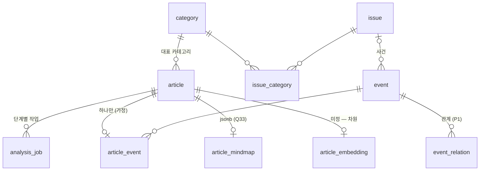

# Jira 28 — 데이터 모델 · API 계약 v0 문서

## 무엇을 / 왜

확정 기능(F01 뉴스 데이터 적재·조회 ~ F08 사건별 관련 기사 조회, F11 기사·이슈 양방향 연결)만으로 짤 수 있는 데이터 모델과 API 계약을 문서로 먼저 낸다.
나중에 고치면 비싼 것(식별자 · 관계 다중성 · 공통 응답 · 오류 · 시간 필드)은 v0 에서 정해 FE · AI 와 합의하고, 컬럼 · 응답 필드 · 엔드포인트는 기능 티켓마다 더한다.
테이블(Flyway 마이그레이션)은 이번에 만들지 않는다. 기능 티켓마다 그 기능 테이블만 새 파일로 만든다.

## 먼저 판단해 주실 것 — v0 에서 정하는 비싼 것 (제안)

| 항목 | 제안 | 고른 까닭 |
|---|---|---|
| 식별자 | DB `bigint` 자동 증가, API 에서는 JSON 숫자. 카테고리만 문자열 코드(`economy` 같은) | UUID 는 URL 이 길고 이 규모(분석 약 1만 7천 건)에서 얻는 것이 없다. FE 는 숫자로 계산하지 않고 그대로 넘긴다 |
| 공통 응답 | 성공은 감싸지 않고 자원 그대로. 목록만 `{items, page, size, totalElements, totalPages}` | `{success, data}` 봉투는 모든 응답에 한 층을 더한다. 성공 여부는 HTTP 상태 코드가 이미 말한다 |
| 오류 형식 | RFC 9457 Problem Details(`application/problem+json`) + 우리 `code` 칸 (`ARTICLE_NOT_FOUND` 같은) | Spring 이 기본으로 지원하는 표준이다(`ProblemDetail`). 화면은 `code` 로 갈라 안내 문구를 고른다 |
| 시간 | DB `timestamptz`, API 는 ISO 8601 에 `+09:00` 을 붙인다. 데이터셋 `published`(시간대 없음)는 한국 시간으로 읽는다 | 사용자와 데이터가 모두 한국이다. 오프셋이 붙어 있으면 FE 가 그대로 `Date` 로 읽는다 |
| 목록 | 쪽 번호 방식 `?page=0&size=20` (0부터, 최대 100) | 무한 스크롤이 없고(PRD 4.10) 데이터가 수만 건 안쪽이라 커서 방식이 필요 없다 |
| 빈 결과 | 목록은 200 과 빈 `items`. 단건이 없으면 404 와 `code` | 「이 분야의 이슈가 아직 없어요」 같은 빈 상태(user-flow)를 FE 가 오류와 구분한다 |
| 관계 다중성 | 기사–사건은 연결 테이블에 「기사 하나는 사건 하나」 고유 제약을 건다. 사건–이슈는 N:1, 이슈–카테고리는 N:M | PRD FR-9 가정을 따르되, 여러 사건으로 바뀌면 제약 하나만 풀면 된다. 사건이 여러 이슈에 속하는지는 미정으로 묻는다 |
| 경로 | 화면용 `/api/v1/…`, 워커용 `/internal/v1/…` (Gateway 밖에 열지 않는다) | 내부 API 를 어떻게 막을지는 SSOT 8절 「API 인증」 행에 붙인다 |
| 워커 → API | 워커가 HTTP 내부 API 로 결과를 보낸다. 워커는 DB 를 직접 쓰지 않고, pgvector 후보 검색은 API 가 한다 | API 가 받는 즉시 형식을 검사해 400 으로 돌려줄 수 있다. 결과용 스트림을 하나 더 두면 소비 코드가 API 에도 생긴다. AI 팀 확인 필요 |

## 데이터 모델 v0 한눈에

- 확정으로 그리는 것: `category`(7행 고정) · `article`(데이터셋 필드, 출처, 원문 링크 고유, 서비스 투입 시각) · `issue` · `issue_category` · `event`(발생 시점과 그 근거 — 본문 추출인지 첫 기사 발행일인지) · `article_event` · `event_relation`(관계 종류 칸. P0 시간순은 정렬로 계산하고 저장하지 않는다) · `analysis_job` · `article_mindmap`
- 점선(미정)으로 그리는 것: `article_embedding`(임베딩 모델 미정이라 차원 미정) · `member` · `bookmark` · `interest_issue`(Jira 28 · 62~64 는 만들게 돼 있고 MVP 개요 9절 · PRD 4.7 은 MVP 이후라 어긋남)
- 그리지 않는 것: F09 주장 관계 및 변화 분석 · F10 근거 기반 변화 카드의 주장 테이블 (추후 논의)
- 미정 목록에 둘 것: 이슈를 사람이 고르는지 AI 가 만드는지(Q5), 한 기사가 여러 사건에 속하는지, 동일 사건 판정 기준(Q34), 마인드맵 노드 구조(Q33), 본문 노출 범위(Q3 · Q28), 순차 투입 때 갱신 방식(Q21), 카테고리 매핑(Q9)

## API 계약 v0 엔드포인트

| 흐름 | 엔드포인트 | 쓰는 곳 |
|---|---|---|
| A | `GET /api/v1/categories` | 카테고리 7개 (F02 카테고리별 뉴스·이슈 조회) |
| A | `GET /api/v1/issues?category=` | 이슈 목록 · 홈 이슈 카드 (F02, Jira 41) |
| A | `GET /api/v1/issues/{issueId}` | 이슈 헤더 (F07 사건 중심 이슈 에볼루션 맵) |
| A | `GET /api/v1/issues/{issueId}/timeline` | 사건 노드 시간순 + 관계(P0 은 빈 배열) (F07, Jira 48) |
| A | `GET /api/v1/events/{eventId}` | 사건 패널 (F08, Jira 49 중 사건 요약 · 기사) |
| A | `GET /api/v1/events/{eventId}/articles` | 사건 관련 기사, 발행일 순 (F08) |
| A · B | `GET /api/v1/articles?category=` | 최신 기사 (F01, Jira 42) |
| A · B | `GET /api/v1/articles/{articleId}` | 기사 상세 + 소속 사건 · 이슈 (F01, F11) |
| A · B | `GET /api/v1/articles/{articleId}/mindmap` | 마인드맵 · 근거 (F04 기사 마인드맵 생성 · F05 노드 상세 및 근거 확인, Jira 56) |
| B | `POST /api/v1/analysis-jobs` · `GET /api/v1/analysis-jobs/{jobId}` | 지원 URL 분석 요청 · 상태 (Jira 57) |
| B | `GET /api/v1/sources` | 지원 출처 목록 (Q26) |
| — | `GET /api/v1/search?q=` | 자리만. 범위 · 길이 제한 미정 (Jira 43) |
| 워커 | `POST /internal/v1/analysis-jobs/{jobId}/result` | 단계별 결과 전달 (SSOT 2절 6번). 작업 메시지 형식 · 단계 순서(6하원칙 추출 → 임베딩 → API 의 후보 검색 → 동일 사건 판정)를 같이 적는다 |

## 바꿀 파일

worktree `.claude/worktrees/S15P31A102-28` (브랜치 `docs/common/S15P31A102-28-data-model-api-v0`, `dev` 에서 땀) 안에서만 고친다.

- `docs/data-model.md` — 새 파일. erDiagram, 테이블마다 칸 표, 미정 목록, 기능 대조표
- `docs/api.md` — 새 파일. 공통 규칙, 엔드포인트별 요청 · 응답 예, 오류 코드, 워커 계약(sequenceDiagram 한 장), FE · AI 질문
- `SSOT.md` 8절 — 팀 결정이 필요한 행 추가(공통 규칙 합의, 워커 결과 전달 방식, 이슈를 누가 만드나 · 사건이 여러 이슈에 속하나, 기사가 여러 사건에 속하나, 회원 범위, URL 본문을 누가 가져오나). 기존 「임베딩 모델」 · 「API 인증」 행에 한 마디씩
- `.claude/stack.md` 7절 — 「서비스 데이터 모델」 · 「API 명세」 두 칸
- `docs/plans/2026-10-19-data-model-api-v0.md` — 이 계획 (plan mode 가 이 폴더에 만든 파일을 worktree 로 옮긴다)

저장소 밖 (커밋하지 않는다)

- ERD 로컬 화면 — 스크래치패드의 `erd-viewer.html` · `serve_erd.py`. md 의 mermaid 블록을 그대로 읽어 그린다(확대 · 테이블을 누르면 연결 강조 · 미정은 점선). 브라우저 창에 띄우려고 이 폴더에 `.claude/launch.json` 을 만들고 `.git/info/exclude` 로 뺀다
- Figma — 새 팀 NEW:LEARN(무료 Starter)을 브라우저 창에서 만들고, Figma MCP 로 FigJam ERD 보드를 만든다. 보드 제목에 「보기용 사본 · 원본 docs/data-model.md · 날짜」

## 안 바꿀 것

- Flyway 마이그레이션과 `backend/` · `ai/` · `frontend/` 코드 — 문서만 쓴다
- `docs/mvp-overview.md` · PRD · `docs/user-flow.md` · 프로토타입 — PM 확인 문서다. 어긋난 곳은 질문으로만 남긴다
- F09 · F10 테이블과 API
- 이 폴더의 `infra` 브랜치와 terraform-pc 세션이 쓰는 파일 — 브랜치를 바꾸지 않는다
- 커밋 · push · MR — 시키실 때 한다

## 리스크

- 제안한 공통 규칙을 FE · AI 가 뒤집을 수 있다. 아직 코드가 없어 api.md 1절만 고치면 된다. 합의 전까지 SSOT 8절에 「합의 대기」로 둔다
- Mermaid 가 GitLab 에서 안 그려질 수 있다. 기본 문법만 쓰고(erDiagram 은 별칭 · 스타일 없이) 미정 표시는 `%%` 주석 한 줄로 둔다. GitLab 의 mermaid 버전은 확인하지 못해 MR 화면에서 한 번 더 본다
- FigJam 은 md 의 사본이라 어긋날 수 있다. md 를 고칠 때 다시 만든다
- Figma 팀 만들기에서 유료 플랜 · 결제 화면이 나오면 멈추고 여쭙는다
- 문서 크기 500줄 상한(HARNESS 5절). 넘으면 api.md 를 화면용 · 워커용 두 파일로 나눈다

## 어떻게 검증하나

- 확정 기능 F01~F08 · F11 마다 테이블과 엔드포인트가 있는지 대조표를 두고 빈칸이 없는지 본다
- Jira 41 · 42 · 43 · 48 · 49 · 56 · 57 의 「출력」 칸 항목이 응답 필드에 다 있는지 대조한다. F09 · F10 · P2 에 속하는 항목(관점 · 변화 전후 근거)은 「제외 — 이유」로 적는다
- 로컬 화면에서 erDiagram · sequenceDiagram 을 `mermaid.parse()` · `render()` 로 돌려 오류가 없는지 보고 스크린샷을 남긴다
- reviewer 조수에게 두 문서를 새 눈으로 맡긴다 (모순 · 빠진 것 · 근거 없는 추측)
- 커밋할 때 커밋 게이트의 시크릿 스캔 · 문서 크기 출력을 확인한다

## 되돌리는 법

- 커밋 전이라 worktree 를 지우면 끝난다 (`git worktree remove` 후 브랜치 삭제)
- Jira 28 담당자 · 상태는 되돌릴 수 있다
- Figma 팀 · FigJam 파일은 Figma 에서 지울 수 있다
