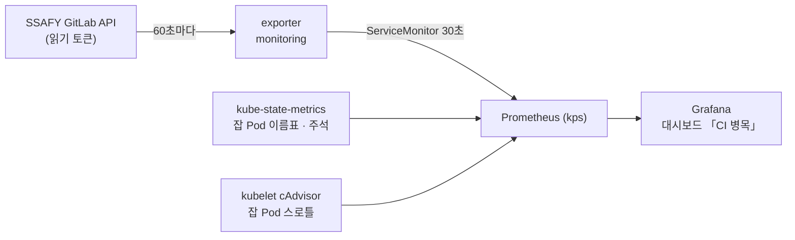

# CI 병목 대시보드 — gitlab-ci-pipelines-exporter (Jira S15P31A102-98)

## 무엇을 / 왜

잡마다 얼마나 기다렸고 · 얼마나 걸렸고 · 어느 러너가 받았는지를 Grafana 한 화면에서 보게 한다. 지금은 이 값을 GitLab 잡 기록에서 손으로 모았다(`SSOT.md` 10절의 CI 값이 전부 그렇다).
gitlab-ci-pipelines-exporter **v0.6.0**(2026-01-14, 최신 릴리스)을 관리 서버 monitoring 네임스페이스에 올려 GitLab API 의 잡 기록을 Prometheus 지표로 바꾸고, 대시보드 「CI 병목」 하나에 갈래 · 러너 · 서버 CPU 를 모은다. 추가 과금 없음.

## 정한 것 — 권고와 근거

| 항목 | 권고 | 근거 (2026-10-21 확인) |
|---|---|---|
| 설치 방식 | 공식 Helm 차트 대신 매니페스트(kustomize) | 차트 0.3.5 는 앱 v0.5.10 에 멈춰 있고 Bitnami Redis 를 기본으로 켠다. 자원 · 노드 · 보안 설정을 어차피 다 바꿔야 한다 |
| 이미지 | Docker Hub `mvisonneau/gitlab-ci-pipelines-exporter:v0.6.0`, digest 고정 | amd64 포함. busybox 바탕 · uid 65534 로 돈다(Dockerfile) |
| 모으는 범위 | 이 프로젝트 하나 · `dev` 브랜치 · 최근 MR 10개(3일 안). 태그 · 환경은 끔 | 파이프라인은 MR 과 dev 에서만 돈다(`.gitlab-ci.yml` workflow) |
| 간격 | 잡 지표 60초, ref 목록 300초(기본), API 초당 1회 상한(기본) | SSAFY 공용 GitLab 부담을 줄인다. 잡 시간이 분 단위라 60초로 충분 |
| 켤 지표 | 잡(기다림 · 시간 · 러너 · 상태), 테스트 리포트(스위트 = 잡 단위 JUnit 시간). 테스트 케이스 단위는 끔 | 케이스 단위는 MR 마다 시계열이 수백 개 생긴다 |
| GitLab 헬스 검사 | 끔 | `lab.ssafy.com/-/health` · `/-/readiness` 가 밖에서 404. 켜면 Pod 가 Ready 가 되지 않는다 |
| 토큰 | 프로젝트 액세스 토큰 · 역할 Reporter · `read_api` · 만료 2026-11-30 | 이 프로젝트만 읽는다. **사용자가 만들고 서버에서 `read -rsp` 로 Secret 에 넣는다.** Claude 는 키 이름 · 길이만 본다 |
| 잡 이름으로 스로틀 보기 | kube-state-metrics 에 잡 Pod 이름표(`newlearn.io/workload`) · 주석(`job.runner.gitlab.com/id` · `name` · `ref`) 허용 | 잡 Pod 에 이 주석이 이미 있다(서버에서 확인). 이게 없으면 스로틀 패널 범례가 `runner-hodejcrvm-…` 같은 Pod 이름뿐이다 |
| 자원 | 요청 CPU 10m · 메모리 32Mi, 상한 메모리 128Mi | 노드 CPU 예약 1190m → 1200m. CI 잡 550m 를 더해도 2000m 안 |

## 바꿀 파일

- `infra/k8s/bootstrap/ci-exporter/kustomization.yaml` (새) — 네임스페이스 monitoring. 설정 ConfigMap 은 내용이 바뀌면 이름이 바뀌어 Pod 가 다시 뜬다. 대시보드 ConfigMap 은 이름 고정 · 이름표 `grafana_dashboard: "1"` (Grafana 사이드카가 모든 네임스페이스에서 읽는 것 확인)
- `infra/k8s/bootstrap/ci-exporter/exporter.yaml` (새) — Deployment(관리 서버 고정 · toleration, root 아님 · 읽기 전용 루트 · 권한 상승 막기 · 서비스 계정 토큰 안 넣음, `/health/live` · `/health/ready`), Service(8080), ServiceMonitor
- `infra/k8s/bootstrap/ci-exporter/config.yml` (새) — exporter 설정. 토큰은 여기 없다 — 환경변수 `GCPE_GITLAB_TOKEN` 을 Secret `gitlab-ci-exporter` 에서 읽는다
- `infra/k8s/bootstrap/ci-exporter/ci-dashboard.json` (새) — 대시보드 (아래 표)
- `infra/k8s/bootstrap/monitoring-values.yaml` — `kube-state-metrics.metricLabelsAllowlist` · `metricAnnotationsAllowList` 두 줄 (하위 차트 8.6.0 의 값 이름 확인)
- `infra/server/README.md` 「모니터링」 — 새 단계 「CI 잡 지표」: GitLab 화면에서 토큰 만들기(칸 표) → Secret → `kubectl apply -k` → kps `helm upgrade` → 확인 표 · 되돌리기 줄
- `SSOT.md` 6절 「모니터링」 — 위 결정 요약으로 「CI 파일이 생긴 뒤 더한다」 문장을 바꾼다. 10절 — 잰 값(자원 · 시간당 API 요청 · API 대조)
- `docs/plans/2026-10-21-ci-exporter.md` — 이 계획 (승인 뒤 날짜 이름으로 옮긴다)

## 대시보드 「CI 병목」

| 줄 | 패널 | 지표 |
|---|---|---|
| 최근 파이프라인 | 잡 표 — MR · 잡 · 갈래 · 러너 · 기다림 · 걸린 시간 · 상태 · 잡 ID · 만든 시각 | `gitlab_ci_pipeline_job_*` 지금 값, ref 고르기 |
| 갈래 | 갈래(w0 · w12 · w3 · w4)별 · 잡별 걸린 시간 평균 · 최대, 잡별 JUnit 시간 | 기간 안에 만든 잡만(`job_timestamp`), `test_suite_total_time` |
| 러너 | 러너별 잡 수 · 기다림 평균 · 최대, EC2 러너 자리 사용 | `runner_description` 별, `gitlab_runner_jobs` ÷ `concurrent` |
| 서버 | 노드 CPU(사용자 · 시스템 · 대기), CPU 예약 합, 잡 Pod CPU 사용 · 상한 · 스로틀 비율(범례는 잡 이름) | node-exporter · kube-state-metrics · cAdvisor |

알고 쓸 한계 세 가지.
- exporter 는 ref(MR · 브랜치)마다 **가장 최근 잡의 값만** 지표로 낸다. 한 MR 에서 파이프라인이 여러 번 돌면 기간 집계는 마지막 값 위주가 된다. 잡 하나하나의 이력은 GitLab API 가 진실이다
- 잡이 다른 러너로 다시 돌면 옛 러너 이름의 시계열이 지워지지 않고 남는다(exporter 코드 확인). 쿼리에서 잡 ID 가 가장 큰 것만 고른다
- 노트북 러너는 클러스터 밖이라 「서버」 줄(CPU · 스로틀)에는 EC2 잡만 나온다. 나머지 줄은 두 러너 모두

## 작업 순서

- [x] Jira S15P31A102-98 (작업 · 상위 27 · 라벨 infra newlearn-mvp · 스프린트 1차 개발 · 스토리 포인트 3) → 브랜치 `chore/infra/S15P31A102-98-ci-exporter` (infra 에서)
- [x] 매니페스트 · 설정 작성 → 서버에서 `kubectl kustomize` 렌더링 · `kubectl apply -k --dry-run=server`
- [x] **사용자**: GitLab 에서 토큰 만들기 → 서버에서 `read -rsp` 로 Secret. 단계표를 본문에 쓰고, 끝났다는 말을 받으면 Secret 의 키 이름 · 길이부터 확인
- [x] `kubectl apply -k` → Pod Running · 대상 up · 로그에 오류 없음 · `gcpe_refs_count`
- [x] kps: 서버에서 지금 값 · 새 값으로 `helm template` 두 벌 diff → kube-state-metrics Deployment 인자만 다른지 → `helm upgrade` (같은 92.10.1)
- [x] 대시보드 작성 → 패널 쿼리를 서버 Prometheus API 로 먼저 돌려 봄 → SSH 터널 + 브라우저 창에서 화면 확인 · 캡처
- [x] GitLab 잡 API 대조 → 10절
- [ ] 문서 → `/verify` → 커밋(게이트) → MR(→ infra) → 머지 직전 원격 확인 → 머지 → Jira 완료. infra → dev 반영은 따로 묻는다
- [ ] zoo_docs: learn(exporter 가 무엇을 지표로 바꾸나 · 게이지 한계), decisions, 캡처 · 화면 가이드

계획과 달라진 것 (2026-10-21)

- **열린 MR 만 읽는다** (`exclude_non_opened: true`). 머지된 MR 까지 최근 10개를 읽으니 exporter 가 주기마다 프로젝트 전체 잡 목록을 넘겨 가며 다시 찾아 초당 0.75번 — 상한(1)에 거의 붙었다. 바꾼 뒤 약 290/시간. 리스크 칸에 적어 둔 대응이다
- **exporter Pod 이름표를 버린다** (ServiceMonitor `metricRelabelings` 의 `labeldrop pod|instance`, 쿼리는 `max without (pod, instance)`). 설정을 바꿔 Pod 가 다시 뜨자 같은 잡이 두 줄로 세졌다
- **dev 줄 한계** — GitLab API 가 `ref=dev` 에 dev 에서 연 MR 파이프라인도 돌려준다(API 로 확인). 반영 MR 을 dev push 직후 열면 dev push 값이 덮인다. v0.6.0 의 `pipeline.per_ref` 는 코드를 보니 잡 지표 · 실행 횟수가 엉킬 수 있어 쓰지 않고, 대시보드 머리말 · SSOT 6절에 한계로 적었다
- 대시보드의 상태 칸은 뺐다. exporter 가 상태를 지금 것만 내서(sparse) 기간으로 고르면 옛 상태가 섞인다. 실패한 잡은 「실패 까닭」 칸으로 본다

## 안 바꿀 것

- `.gitlab-ci.yml` · 러너 값 — 지표를 보기만 한다
- 알림(Alertmanager) · Grafana 공개 주소(Jira 93)
- webhook 방식 — GitLab 이 우리 서버로 들어올 정문이 아직 없다
- exporter 용 Redis — 한 대라 메모리에 둔다. Pod 가 다시 뜨면 exporter 는 처음부터 다시 모으고, 이미 긁은 Prometheus 데이터는 남는다
- 노트북 러너 지표 수집 · Argo CD 로 옮기기(Jira 91 뒤)

## 리스크

- **SSAFY GitLab 요청 증가** — 60초 간격 · ref 약 11개 · 초당 1회 상한. 설치 뒤 `gcpe_gitlab_api_requests_count` 로 시간당 요청 수를 재서 10절에 적고, 많으면 간격을 늘린다
- **프로젝트 액세스 토큰이 막혀 있을 수 있다** — SSAFY 가 꺼 두었으면 멈추고 묻는다. 개인 토큰은 내 모든 프로젝트를 읽어 범위가 넓다
- **`read_api` 로 모자랄 수 있다** — exporter 문서 한 곳이 `api` 를 적었다. 읽기만 하므로 `read_api` 로 시작하고, 403 이 나면 멈추고 묻는다
- **kps helm upgrade** — 같은 판이고 바뀌는 값은 두 줄이다. 렌더링 diff 로 kube-state-metrics 만 바뀌는지 먼저 본다
- **시계열 수** — 잡 지표 약 800개 + 잡 Pod 주석. 보존 상한 8GB 에 견주면 작다(재서 10절)
- **대조용 GitLab API 호출** — 이 세션은 PC 에 저장된 GitLab 자격 증명 사용이 자동 권한 검사에 막혔다. 그래서 클러스터 안에서 exporter 와 같은 Secret 을 환경변수로 넣은 일회용 curl Pod 로 잡 API 를 부른다(토큰은 화면에 안 찍힌다). 이것도 막히면 GitLab 잡 화면의 Queued · Duration · Runner 와 견준다
- **MR 만들기** — 같은 까닭으로 API 대신 `git push -o merge_request.create` 로 만들고, 본문은 GitLab 화면에서 템플릿으로 채운다. 머지는 원래대로 화면의 Merge 버튼

## 어떻게 검증하나

- exporter Pod Running · 노드는 관리 서버 · 재시작 0, 로그에 `error` 없음
- 수집 대상 14개 모두 up(지금 13 + exporter), `gcpe_projects_count` 1, `gcpe_refs_count` 2 이상(dev + MR)
- **완료 기준**: 최근 MR 파이프라인 하나의 모든 잡에서 Prometheus 의 기다림 · 걸린 시간 · 러너 · 잡 ID 가 GitLab 잡 API(`/projects/1457113/pipelines/<id>/jobs`)의 `queued_duration` · `duration` · `runner.description` · `id` 와 같다. 대조표를 10절에
- Grafana(터널 + 브라우저 창): 「CI 병목」이 뜨고 네 줄이 값으로 찬다. 스로틀 범례가 잡 이름(예: `w3:backend`). 캡처
- kube-state-metrics: `kube_pod_annotations` 에 `annotation_job_runner_gitlab_com_name` 이 있다
- 노드 CPU 예약 + CI 잡 550m ≤ 2000m, exporter 30분 CPU · 메모리(쿼리)
- 커밋 게이트(infra 린트 · 테스트), MR 템플릿, MR 파이프라인 초록

## 되돌리는 법

- `kubectl delete -k infra/k8s/bootstrap/ci-exporter` → `kubectl -n monitoring delete secret gitlab-ci-exporter` → GitLab 에서 토큰 Revoke
- kube-state-metrics: 값 두 줄을 되돌리고 같은 `helm upgrade`
- 문서: MR 병합 커밋 Revert
- 되돌릴 수 없는 것: 없음. 밖으로 나가는 것은 GitLab 읽기 요청뿐이고 과금이 없다
