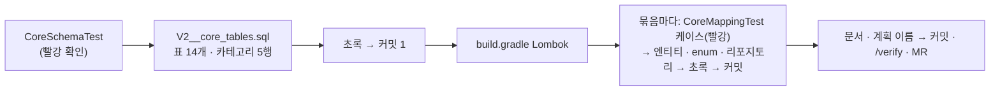

# 핵심 테이블 14개 — V2 마이그레이션 · 엔티티 (Jira S15P31A102-101)

## 무엇을 / 왜

`docs/data-model.md` v1 의 실선 표 14개를 Flyway 마이그레이션 `V2__core_tables.sql` 하나로 만들고, 표마다 JPA 엔티티와 `JpaRepository` 를 둔다. 두 사람이 따로 만들면 `V2` 번호가 겹치고 같은 표를 다르게 만들 수 있어서 처음 한 번은 한꺼번에 만든다(Jira 101). BE 구현 티켓(41 · 42 · 48 · 49 · 65 · 56 · 30 · 35 · 40 · 62)이 이 표를 기다린다.

지금 백엔드에는 `BackendApplication` · `QuerydslConfig` 와 `V1__enable_pgvector.sql` 뿐이다. `application.yaml` 이 `ddl-auto: validate` 라서 엔티티와 표가 한 칸이라도 다르면 앱이 뜨지 않는다 — 이것을 테스트로 쓴다.

## 배우는 방식

사용자가 파일 하나씩 만들며 배운다. 파일마다 ① 무엇을 하는 파일인가(비유부터) ② 줄 단위로 무엇을 · 왜 ③ 돌려 보기 순서로 가고, 이해가 안 되면 거기서 멈춰 더 푼다. 같은 모양이 되풀이되는 파일은 대표 파일 하나를 자세히 보고 나머지는 차이만 본다. 커밋 게이트가 백엔드 커밋마다 포맷 검사와 테스트 전체를 돌리므로, 「실패하는 테스트」는 빨간 것을 눈으로 확인만 하고 커밋은 초록이 된 뒤에 한다.

## 정한 것 (2026-10-21)

| 항목 | 정한 것 | 까닭 |
|---|---|---|
| 엔티티 보조 | Lombok `@Getter` · `@NoArgsConstructor(access = AccessLevel.PROTECTED)` 만. `@Setter` · `@Data` 는 쓰지 않는다. 행을 만드는 생성자는 필수 칸을 받는 public 생성자 하나 | 사용자 결정. Boot 4.1.1 이 Lombok 1.18.46 으로 고정(JDK 25 는 1.18.40 부터 지원). 코드 약속(Jira 100)에 한 줄 더한다 |
| 정해진 값 칸 | Java enum `@Enumerated(EnumType.STRING)` + DB `CHECK` 제약. 제약 이름은 PostgreSQL 기본 규칙대로 적는다(`analysis_job_stage_check`) | 사용자 결정. 적재를 묶음 SQL 로 해도(Jira 34) DB 가 막는다. 값을 더할 때 새 마이그레이션에서 이름으로 지우고 다시 건다 |
| 시각 | 엔티티는 `Instant`, 칸은 `timestamptz`. `created_at` · `updated_at` 은 `@CreationTimestamp` · `@UpdateTimestamp`, 나머지 시각은 생성자로 받는다 | 사용자 결정. DB 는 순간만 저장한다. `+09:00` 은 응답 DTO 에서(Jira 100) |
| 기본 키 | `bigint generated by default as identity` + `@GeneratedValue(strategy = IDENTITY)`. 카테고리 · 언론사는 코드 문자열 | `data-model.md` 4절 |
| 연관관계 | `@ManyToOne(fetch = LAZY)` 만. 양방향은 필요할 때 기능 티켓에서 | Jira 101 |
| 연결 표 복합 키 | `@EmbeddedId` + 일반 클래스 키(`@Embeddable` · `Serializable` · `@EqualsAndHashCode`). record 는 쓰지 않는다 | `@MapsId` 와 record 를 함께 쓰는 경우를 확인하지 못했다 |
| 기사와 1:1 인 표 | article_event · article_mindmap 은 `@Id Long articleId` + `@MapsId @OneToOne(fetch = LAZY)`. 생성자에서 `articleId` 를 넣지 않는다. 기사 쪽에 역방향을 두지 않는다 | 키를 넣으면 `save()` 가 merge 로 바뀌고, 역방향 `@OneToOne(mappedBy)` 는 지연 로딩이 듣지 않는다 |
| `text[]` | `List<String>` + `@JdbcTypeCode(SqlTypes.ARRAY)`. `source_categories` 는 필드를 빈 목록으로 초기화 | Hibernate 는 INSERT 때 값을 직접 넣어 DB 기본값 `'{}'` 이 쓰이지 않는다 |
| `jsonb` | `String` + `@JdbcTypeCode(SqlTypes.JSON)` (`analysis_job.candidates` · `article_mindmap.content`) | 문자열은 Jackson 을 거치지 않고 그대로 들어간다. 모양 있는 타입은 기능 티켓(30 · 56)이 정한다 |
| 정수 | `smallint` → `short`, `int` → `Integer`, `bigint` → `Long` | `smallint` 를 `Integer` 로 받으면 validate 가 실패한다 |
| 한 기사 · 한 단계 한 행 | `analysis_job` 에 `unique (article_id, stage)` | `data-model.md` 2절 「기사 하나 · 단계 하나에 한 행」 |
| 카테고리 5행 | `politics` 정치 1 · `economy` 경제 2 · `society` 사회 3 · `world` 국제 4 · `it_science` IT·과학 5 | `data-model.md` 2절 제안. FE 1번 답으로 바뀌면 새 마이그레이션 |
| 작업 자리 | 작업 폴더 `../S15P31A102-wt-101`, 브랜치 `feat/backend/S15P31A102-101-core-tables` (원격 `backend` 에서. `backend` 의 `backend/` 는 dev 와 같다) | 메인 폴더는 infra 세션이 쓴다. `docs/git-convention.md` 작업 브랜치 → 분야 브랜치 |

## 표 · 엔티티 · 매핑 모양

| 묶음 (만드는 순서) | 표 → 엔티티 (패키지 `kr.io.newlearn.…`) | 처음 배우는 것 |
|---|---|---|
| ① 코드 키 | category → `category.Category` · press → `press.Press` | `@Entity` · `@Id` · `@Column`, 리포지토리 |
| ② 자동 증가 키 · enum · 다대일 | ingest_run → `ingest.IngestRun` · member → `member.Member` · issue → `issue.Issue` · event → `event.Event` | `@GeneratedValue(IDENTITY)`, enum + CHECK, `@ManyToOne(LAZY)`, 유일 제약 |
| ③ 배열 칸 | article → `article.Article` | `text[]` ↔ `List<String>`, 다대일 둘 |
| ④ 복합 키 | category_mapping · press_mapping · issue_category · member_category | `@EmbeddedId`, `@MapsId` |
| ⑤ jsonb · 공유 키 | analysis_job → `analysis.AnalysisJob` · article_event → `event.ArticleEvent` · article_mindmap → `mindmap.ArticleMindmap` | `@JdbcTypeCode(JSON)`, 1:1 공유 키 |

enum: `common.MappingSource`(SSAFY · NEWSDATA, 대응 표 둘이 같이 씀) · `article.ArticleSource` · `ingest.IngestSource`(NEWSDATA) · `ingest.IngestRunStatus` · `event.OccurredAtBasis` · `analysis.AnalysisStage` · `analysis.AnalysisJobStatus` · `analysis.RequestedBy`(BATCH). 값은 `data-model.md` 2절 그대로.

## 바꿀 파일

- `backend/build.gradle` — Lombok `compileOnly` · `annotationProcessor` 두 줄(판은 BOM, `annotationProcessor` 는 querydsl-apt 보다 위). 테스트도 쓰면 `testCompileOnly` · `testAnnotationProcessor`
- `backend/src/main/resources/db/migration/V2__core_tables.sql` (새) — 표 14개. 외래 키가 가리키는 표를 먼저(기준표 4 → 기사 · 수집 → 이슈 · 이슈 카테고리 · 사건 · 기사-사건 → 분석 작업 · 마인드맵 → 회원 · 회원 카테고리), 키 · 유일 · CHECK · 외래 키, 카테고리 5행 `insert`
- `backend/src/main/java/kr/io/newlearn/{category, press, article, ingest, issue, event, analysis, mindmap, member, common}/` (새) — 엔티티 14 · 복합 키 클래스 4 · enum 8 · 리포지토리 14. 대표 경로: `category/Category.java` · `category/CategoryRepository.java` · `issue/IssueCategoryId.java` · `mindmap/ArticleMindmap.java`
- `backend/src/test/java/kr/io/newlearn/CoreSchemaTest.java` (새) — `@DataJpaTest` + `@AutoConfigureTestDatabase(replace = NONE)` + `@Import(TestcontainersConfiguration.class)`. Flyway 이력에 V2 성공, 표 14개가 있다(`information_schema`), 카테고리 5행 · 순서
- `backend/src/test/java/kr/io/newlearn/CoreMappingTest.java` (새) — 같은 설정. 묶음마다 저장 → `flush()` · `clear()` → 다시 읽기. 배열 · jsonb(파싱해서 비교) · 복합 키 · 공유 키, `article.url` · `member.login_id` 유일 위반(`DataIntegrityViolationException`, 케이스마다 메서드 따로), CHECK 위반(SQL 로 직접 넣기)
- `docs/data-model.md` — 7절에 「처음 한 번은 Jira 101 에서 한꺼번에. 번호가 겹치면 나중에 머지하는 쪽이 번호를 올린다(Flyway 가 거부해 CI 가 잡는다)」, 4절 표에 「정해진 값 칸은 CHECK 제약 + enum」 · 「`analysis_job` 은 (기사, 단계) 유일」 한 줄씩
- `docs/plans/2026-10-21-core-tables.md` — 이 계획(승인 뒤 날짜 이름으로 옮긴다)
- Jira — 101 진행 중 · 머지 뒤 완료. 100 「코드 약속」에 Lombok · `Instant` · enum + CHECK 세 줄

## 작업 순서

- [x] Jira 101 진행 중. 작업 폴더 · 브랜치 만들기, Docker Desktop 이 켜져 있는지
- [x] 커밋 1 「V2 마이그레이션」 — `CoreSchemaTest` 를 먼저 쓰고 돌려 빨강(표 없음)을 본다 → V2 를 표 묶음마다 써 가며 설명 → 초록 → `spotlessApply` → 커밋
- [x] Lombok — `build.gradle` 두 줄, 컴파일이 되는지 확인(커밋 2 에 같이)
- [x] 커밋 2 ~ 6 「엔티티 ①~⑤」 — 묶음마다 `CoreMappingTest` 에 그 묶음 케이스를 먼저 더해 빨강을 보고 → 엔티티 · enum · 키 클래스 · 리포지토리 → 묶음 테스트와 전체 테스트(validate 를 보는 `contextLoads` 포함) 초록 → 커밋. validate 는 매핑된 엔티티만 보므로 묶음마다 끊어도 깨지지 않는다
- [x] ~~커밋 7 「문서」~~ → 문서는 dev 에서 딴 docs MR 로 따로 낸다(2026-10-22 사용자 결정). `backend` 분야 브랜치의 `data-model.md` 가 아직 v0 라서, 작업 브랜치에서 고치면 dev 의 v1 과 부딪친다
- [x] `/verify` — 아래 「어떻게 검증하나」
- [x] 코드 MR → `backend` (템플릿대로). 머지는 사용자 지시 뒤, 머지 직전 원격 `backend` · 열린 MR 다시 확인. Jira 100 코드 약속 세 줄. `backend` → `dev` MR 은 이 계획 밖(사용자가 정한다)

## 진행 중 바뀐 것 · 알게 된 것 (2026-10-22)

- V2 에 `analysis_job_attempt_check (attempt >= 1)` 을 더했다. `data-model.md` 의 「1부터」를 DB 가 지키게 한 것
- `@JdbcTypeCode(SqlTypes.ARRAY)` 는 빼도 테스트가 통과했다. Hibernate 7.4 는 `List<String>` 을 원래 배열로 다룬다 → 칸 타입을 보이게 하는 표시로 남긴다. 반면 `@JdbcTypeCode(SqlTypes.JSON)` 은 빼면 validate 가 「found jsonb, expecting varchar(255)」로 멈춘다
- 복합 키 클래스의 `equals` · `hashCode` 는 빼도 Hibernate 가 돌아가지만 경고 HHH000038 을 낸다. JPA 규칙이라 둔다
- `article_event.linked_at` 은 행을 만든 시각이라 `@CreationTimestamp` 로 채운다
- 대응 표 둘이 같이 쓰는 `MappingSource` 는 `common` 패키지(코드 약속 「여러 기능이 같이 쓰는 것은 common」)
- 실제 기동 확인은 로컬 개발 DB 대신 확인용 컨테이너(포트 55432)로 했다. 이 컴퓨터의 8080 을 다른 프로그램이 써서 `SERVER_PORT=18080`
- 되돌림 확인: 새 엔티티 파일을 빼면 컴파일부터 깨져서, 매핑을 일부러 틀리는 방법(칸 이름 · 타입 · enum · `@MapsId` · LAZY · jsonb 표시)으로 대신했다

## 안 바꿀 것

- 점선 표 4개(article_embedding · event_relation · bookmark · interest_issue)와 그 엔티티
- 컨트롤러 · 서비스 · DTO · 쿼리 메서드, 상태를 바꾸는 엔티티 메서드(투입 · 작업 성공 · 실패 등) — 기능 티켓
- 조회용 인덱스 — 기본 키 · 유일 제약이 만드는 것만. 나머지는 기능 티켓이 잰 뒤
- 양방향 연관관계, 기사 쪽 `@OneToOne(mappedBy)`
- `V1__enable_pgvector.sql`, `application.yaml`(validate 그대로), `TestcontainersConfiguration`, `.gitlab-ci.yml`, `.env`
- Querydsl 의존성 · `QuerydslConfig` — 코드 약속(「QueryDSL 은 쓰지 않는다」)과 어긋나지만 Jira 100 에서 정리한다. 엔티티가 생기면 Q 클래스가 만들어지는 것은 그대로 둔다
- category_mapping · press 의 행 — 실제 데이터를 본 뒤(Jira 34, `data-model.md` 5절 7 · 15번)

## 리스크

- jsonb — Hibernate 7.4.5 는 클래스패스에 Jackson 3 만 있으면 `Jackson3JsonFormatMapper` 를 고르고(부트 jar 확인), `String` 칸은 Jackson 을 거치지 않는다. 테스트가 실패하면 `tools.jackson.databind.JsonNode` 로 바꾸는 안을 들고 멈춰서 다시 승인받는다
- Lombok 1.18.46 은 아직 받지 않아 첫 빌드 때 내려받는다. 컴파일이 안 되면 멈추고 다시 승인받는다
- validate 타입 — `smallint` ↔ `short` 를 지키지 않으면 앱이 뜨지 않는다(`contextLoads` 가 잡는다)
- 적용된 마이그레이션 — 머지 전에는 V2 를 고쳐도 되지만, 로컬 DB(compose 볼륨)에 옛 V2 가 들어가 있으면 Flyway 가 체크섬 오류로 멈춘다 → 로컬 DB 를 지우고 다시(데이터 삭제라 사용자 확인 뒤). 머지 뒤 바꿀 것은 V3 로
- 카테고리 코드 · 순서는 FE 1번 답 전 제안값이다. 바뀌면 새 마이그레이션
- BE 팀원이 이 MR 머지 전에 `V2` 를 만들면 번호가 겹친다 → Flyway 가 거부하고 나중에 머지하는 쪽이 번호를 올린다(7절에 적는다)
- 테스트 함정 — jsonb 는 키 순서 · 공백이 바뀌어 파싱해서 비교, `Instant` 는 마이크로초로 자르거나 고정값, 유일 위반은 `saveAndFlush`. 복합 키 엔티티의 `save()` 는 SELECT 뒤 INSERT(merge)로 돈다 — 동작에는 문제없다

## 어떻게 검증하나

- 1단계 기계 검사(verifier) — `./gradlew spotlessCheck`, `./gradlew test`: `CoreSchemaTest` · `CoreMappingTest` · `BackendApplicationTests` 통과 개수
- 1-2단계 되돌림 확인 — ① V2 파일을 잠시 빼면 `CoreSchemaTest` 가 단언에서 빨강 ② `AnalysisJob.candidates` 의 `@JdbcTypeCode` 를 빼면 jsonb 케이스가 빨강 ③ 엔티티 칸 이름 하나를 틀리면 `contextLoads`(validate)가 빨강. 각각 되돌려 초록 확인
- 2단계 실제 실행 — `docker compose up -d postgres` → `./gradlew bootRun` 로그에 Flyway 가 V2 를 적용하고 앱이 뜬다 → `psql` 로 `\dt`(표 14개 + `flyway_schema_history`) · `select code, name, sort_order from category order by sort_order`(5행) → 앱 끄기
- 3단계 Jira 101 완료 기준 대조 — 14개 표 · 키 · 제약(`article.url` · `member.login_id` 유일, 연결 표 복합 키), 카테고리 5행, 엔티티 · 리포지토리와 맞음 테스트, 빈 DB 에서 처음부터(CI services), `data-model.md` 7절 한 줄
- CI — MR 파이프라인의 `w3:backend` 잡 통과(빈 services DB 에 V1 · V2)

## 되돌리는 법

- 머지 전: 작업 브랜치 · 작업 폴더를 지우면 끝. 로컬 DB 에 V2 가 들어갔으면 로컬 볼륨을 지운다(`docker compose down -v` — 로컬 데이터 삭제라 사용자 확인 뒤)
- `backend` 머지 뒤: MR 을 revert 한다. 그 사이 V2 를 적용한 DB(팀원 로컬)는 「적용됐는데 파일이 없다」로 Flyway 가 멈추므로 그 DB 를 다시 만들거나 V3 로 표를 지운다
- 운영 DB 는 아직 없다(Lightsail 연결 전). 그래서 지금은 되돌릴 수 없는 곳이 없다. 운영 DB 에 들어간 뒤로는 V2 를 고치지 않고 새 마이그레이션으로만 바꾼다
