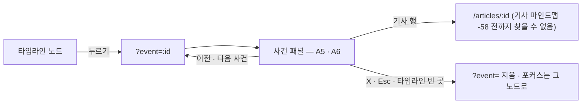

# S15P31A102-52 사건 패널 — 사건 요약 · 관련 기사 · 이전 · 다음 사건

## 무엇을 / 왜

이슈 화면(-50)에서 사건 노드를 누르면 지금은 주소에 `?event=` 만 붙는다. 그 자리에 F08 사건별 관련 기사 조회 패널을 연다 — 사건 제목 · 날짜 · 요약(A5)과 관련 기사(A6), 이전 · 다음 사건. 백엔드 A5 · A6(Jira 49)은 끝났다.
모양은 프로토타입 v21 `EventPanel` · `DetailPanel`, 자리와 닫기는 EXPERIENCE.md 「오른쪽 패널」 행을 따른다.



## 만들 구조

```
frontend/src/
├─ api/event.ts (+test)                  🆕 A5 — fetchEvent(id) · eventQuery(id) · EventDetail 타입
├─ api/eventArticles.ts (+test)          🆕 A6 — 쪽 단위 fetchEventArticles(id, page, size) · eventArticlesQuery(무한 쪽)
├─ api/types.ts                          ✏️ 기사 요약 · 언론사 참조 타입 (A7 · A22 도 쓴다)
├─ mocks/handlers.ts                     ✏️ A5 · A6 가짜 — 사건마다 요약 · 언론사 · 이전 · 다음, 기사 목록(쪽 나눔)
├─ lib/date.ts (+test)                   ✏️ 기사 날짜 — 오늘 · 어제는 상대 시간, 그 밖은 「10월 14일」
├─ components/AiBadge.tsx                🆕 「AI 생성」 표시 (EXPERIENCE Voice and Tone)
├─ components/ArticleRow.tsx (+test)     🆕 기사 행 — 제목 두 줄 · 언론사 · 날짜 · 분석 중 · 원문 보기 (홈 최신 기사 -45 도 쓴다)
├─ components/issue/EventPanel.tsx (+test) 🆕 패널 내용 — 이슈 이름 · 제목 · 날짜 칩 · 요약 · 관련 기사 · 이전 · 다음
├─ pages/IssuePage.tsx (+test)           ✏️ 넓은 화면은 오른쪽에 붙는 패널, 좁은 화면은 SEED BottomSheet. 닫기 · 포커스 · 다른 이슈의 사건
├─ components/issue/Timeline.tsx         ✏️ 노드에 data-event-id(닫을 때 포커스 돌려주기), TIP Esc 를 캡처 단계로(패널보다 먼저)
└─ components/shell/AppShell.tsx         ✏️ 화면이 사이드바를 접을 수 있게 Outlet context 로 collapseSidebar
_bmad-output/…/EXPERIENCE.md             ✏️ 사건 패널 관련 기사 수 · 날짜 칩 · 요약 없음 · 다른 이슈의 사건
docs/plans/2026-10-28-event-panel.md     ✏️ 이 계획
```

## 정한 것 (사용자가 볼 것)

| 무엇 | 정한 값 | 근거 |
| --- | --- | --- |
| 자리 | lg · md: 본문 오른쪽에 붙는 420px 패널(본문을 덮지 않고 타임라인이 좁아진다). sm 이하: 아래에서 올라오는 시트(화면 높이 85%, 뒤는 딤) — SEED BottomSheet | EXPERIENCE 오른쪽 패널 · Responsive. 폭 420px 은 프로토타입 |
| 열면 | 사이드바를 접는다. 넓은 화면은 포커스를 패널 제목으로, 시트는 SEED 가 시트 안으로 | EXPERIENCE 오른쪽 패널 · Accessibility Floor `[가정]` |
| 닫기 | X(「상세 패널 닫기」) · Esc · 타임라인 빈 곳 · 시트 바깥 → `?event=` 를 지운다(기록 안 쌓기). 닫으면 포커스를 그 사건 노드로 | EXPERIENCE 오른쪽 패널 · Accessibility Floor |
| Esc 순서 | TIP(팝오버)이 열려 있으면 TIP 만 닫는다. 그다음 Esc 가 패널을 닫는다 | EXPERIENCE Interaction Primitives(팝오버 → … → 오른쪽 패널) |
| 머리 | 이슈 이름(청록 작은 글자) · 사건 제목(h2) · 칩 「사건 발생 2026.10.06」(추정이면 「추정」) · 「첫 기사 2026.10.09」(관련 기사가 있을 때) | 프로토타입. 「첫 기사」는 내가 정함 — A6 의 첫 쪽이 발행 순이라 맨 앞이 첫 기사다 |
| 요약 | 「요약」 카드 + 「AI 생성」 표시. `summary` 가 null 이면 카드를 두지 않는다 | 프로토타입 · EXPERIENCE Voice and Tone. null 처리는 내가 정함 |
| 관련 기사 | 「관련 기사 4」 · 「발행 순」. 처음 5건(A6 `size=5`), 더 있으면 「기사 N개 더 보기」로 다음 쪽을 아래에 붙인다. 없으면 「아직 이 사건을 다룬 기사가 없어요.」 | IA 표(5건) · 프로토타입. A6 문서의 4건과 다르다 — EXPERIENCE 「아직 정하지 않은 것」에서 화면이 고르기로 한 값 |
| 기사 행 | 행 전체가 기사 마인드맵 링크. 제목 두 줄 · 「바른신문 · 3시간 전」 · `QUEUED` 면 「분석 중」. 오른쪽에 원문 보기(새 탭) | EXPERIENCE 기사 행 · 날짜 표 · 프로토타입. 북마크 버튼은 -67 |
| 이전 · 다음 사건 | 패널 맨 아래 두 버튼(사건 키워드 · 날짜). 누르면 패널을 연 채 `?event=` 만 바꾼다. 없으면 그쪽 버튼을 두지 않는다 | EXPERIENCE 오른쪽 패널 · A5 |
| 상태 | 패널: 스켈레톤 · 「사건을 불러오지 못했어요」 + 다시 시도 · 404 「사건을 찾을 수 없어요」. 관련 기사: 스켈레톤 · 「관련 기사를 불러오지 못했어요」 + 다시 시도 | EXPERIENCE State Patterns. 사건 404 를 화면 전체로 바꾸지 않는 것은 내가 정함(주소의 이슈는 있다) |
| 다른 이슈의 사건 | A5 의 `issue.id` 가 주소의 이슈와 다르면 그 이슈 주소로 바꾼다(기록 안 쌓기). `issue` 가 null 이면 패널은 보이고 이전 · 다음은 없다 | 내가 정함 (-50 리뷰의 「확인 필요」) |

## 안 바꿀 것

- *기사들을 마인드맵으로 보기* — EXPERIENCE 「QA 때」
- 북마크(-67) · 관점(P2) · 변화(F09 · F10) · 사건 패널의 언론사 목록 표시
- 기사 마인드맵 화면(-58) — 기사 행은 `/articles/:id` 로만 간다
- `docs/api*.md`

## 리스크

- md 768px 근처는 사이드바 64 + 패널 420 을 빼면 타임라인이 284px 다 — EXPERIENCE 가 「구현하며 확인한다」고 둔 일. 화면을 재 보고 좁으면 적는다
- 패널이 열리고 닫히며 타임라인 폭이 바뀐다 — 배치는 폭을 따라 다시 계산된다(-50). 고른 사건이 화면 밖으로 밀리면 옮겨야 한다
- Esc 를 받는 곳이 셋(TIP · 패널 · SEED 시트 · 서랍)이다 — 캡처 순서와 `defaultPrevented` 로 맞추고 테스트한다
- A6 쪽 나눔에서 더 보기 중 사건이 바뀌면 앞 사건 쪽이 섞이지 않게 query key 를 사건마다 둔다

## 어떻게 검증하나

- `frontend/` 포맷 · 린트 · 타입 · 테스트(Node 24 · 26) · 빌드
- 새 테스트: A5 · A6 가짜(404, 쪽 나눔), 기사 날짜, 기사 행(링크 · 분석 중 · 원문 보기), 패널(머리 · 칩 · 요약 · AI · 요약 없음 · 관련 기사 5건 · 더 보기 · 빈 기사 · 실패와 다시 시도 · 이전 · 다음), 이슈 화면(노드 → 패널, X · Esc · 빈 곳 닫기와 포커스 복귀, TIP 이 먼저 닫힘, 사이드바 접힘, 좁은 화면 시트, 다른 이슈의 사건 → 주소 바꿈, 사건 404)
- 되돌림 확인: 기록 안 쌓기 · 포커스 복귀 · Esc 순서 · 다른 이슈 이동 · 더 보기 쪽 붙이기를 각각 깨면 실패하는지
- 화면: `dev:mock` 을 헤드리스 Chrome 으로 1280 · 900 · 375 — 패널 폭과 타임라인, 시트, 콘솔 오류 → `.notes/mr/S15P31A102-52/`
- 리뷰: `reviewer` 조수

## 되돌리는 법

이 MR 을 revert 하면 노드를 눌러도 `?event=` 만 바뀌는 -50 상태로 돌아간다. 데이터 · 배포 · 인증과는 상관없다.

## 작업 순서

- [x] `feat(frontend)`: A5 사건 패널 · A6 관련 기사를 부르는 함수와 가짜 응답 — `84f82af`. 테스트가 먼저 실패(모듈 없음)하는 것을 확인. 기사 요약 · 언론사 · 사건 참조 타입을 `api/types.ts` 로
- [x] `feat(frontend)`: 기사 날짜 · 사건 발생 날짜 표기 — `bcb8bb6`
- [x] `feat(frontend)`: 기사 행과 AI 생성 표시 — `0721068`
- [x] `feat(frontend)`: 사건 패널 내용 — `c28447e`. 「요약 없음」 테스트가 불러오는 중의 h2 를 기다려 아무것도 지키지 않던 것을 되돌림 확인이 잡아 고침
- [x] `feat(frontend)`: 이슈 화면에 사건 패널 — `1143bfb`. 패널 틀은 `EventDetailPane.tsx` 로 따로(계획에 없던 파일), 셸은 `useShell.ts` 의 Outlet context 로 사이드바를 접는다. 되돌림 확인: 포커스 복귀 · 다른 이슈 이동 · 사이드바 접기 · TIP 캡처 · 패널 defaultPrevented(TIP 창 밖 노드에서 Esc 테스트를 더해서야 잡힘)
- [x] 화면 확인(헤드리스 Chrome) — 고친 것 `987fb06`
  - SEED 테마에 `top-x*` · `right-x*` 위치 클래스가 없어 패널 닫기 버튼이 이슈 이름을 가리고, 머지된 -50 의 TIP 창이 타임라인 맨 아래 왼쪽에 붙었다 → px
  - 패널이 열려 타임라인이 좁아지면 고른 사건이 오른쪽 끝에 걸렸다 → 폭이 바뀔 때도 다시 보이게
- [x] `docs(frontend)`: EXPERIENCE 사건 패널 · 오른쪽 패널 행 — `4dd0600`
- [x] 리뷰(`reviewer` 조수) 반영 — 꼭 고칠 것 2건 · 선택 10건 · 확인 필요 6건. 꼭 고칠 것 2건과 선택 7건을 고쳤다
  - `90e8286` 이전 · 다음에서 버튼째 사라져 포커스를 잃던 것(keepPreviousData, 없어진 쪽이면 남은 버튼으로) · 더 보기 마지막 쪽 뒤 포커스(붙인 첫 기사로) · 「더 보기」의 N · 닫을 노드가 없으면 이슈 제목으로 · 사이드바는 열릴 때만 접기 · 시트 닫힘 애니메이션과 시트 본문 맨 위로 · 원문 보기 이름 · 카드 포커스 윤곽 · SEED enter 곡선
  - `114da23` EXPERIENCE 「없는 사건은 패널 안에」 예외
  - 테스트 빈틈 메움 — 주소로 처음 열 때 포커스 안 옮김, 사건 다시 시도, 사건마다 관련 기사 따로, Esc 닫기 포커스, 시트 닫기
  - 진짜 Chrome: 키보드로 다음 사건(마지막) → 포커스가 남은 「이전 사건」 버튼
- [x] 고친 커밋 다시 보기(`reviewer` 조수) — 꼭 고칠 것 2건 · 선택 5건. 꼭 고칠 것 2건과 선택 4건을 고쳤다 — `ce87dca`, `e1f7aff`
  - 이전 · 다음 사이 앞 사건 제목 아래로 새 사건의 기사 · 첫 기사가 섞여 보이고 눌렸다 → 앞 사건을 보이는 동안 관련 기사는 스켈레톤, 첫 기사 · 개수 · 더 보기 숨김
  - 닫힌 패널에서도 타임라인 빈 곳 클릭이 포커스를 이슈 제목으로 보냈다 → 열려 있을 때만 닫기
  - 받는 동안 옮긴 포커스를 빼앗음 → 포커스를 잃었을 때만, 사건이 바뀌면 관련 기사 상태를 새로, 패널 안에 포커스가 있으면 맨 위로 안 올림, 테스트 정규식 오타
  - 이 커밋은 다시 리뷰하지 않았다(테스트 · 되돌림 확인 · 진짜 Chrome 으로 갈음)

## 하지 않은 것 · 남은 것

- **관련 기사 수** — IA 표 · 프로토타입은 5건이라 5건으로 했다. PRD FR-11 검증 조건 · `api-screen.md` A6 · `api.md` 는 「처음 4건」이다. 화면 동작은 EXPERIENCE 가 이기지만(`stack.md` §7) PRD · API 문서를 맞출지는 PM · 백엔드와 정한다
- PRD FR-11 의 「언론사가 모두 표시된다」 · 「요약과 함께」 — 사건 패널에 언론사 목록과 기사별 요약은 넣지 않았다. 기사 요약(summary null) 문구도 「그 화면을 만들 때」로 남아 있다
- 어제 기사는 시각과 상관없이 「1일 전」이다(00:10 에 어제 23:50 기사도). EXPERIENCE 의 「오늘 · 어제는 상대 시간」을 이렇게 읽었다
- 넓은 화면 패널은 닫힐 때 250ms(exit) 없이 바로 사라진다
- md 구간 — 900px 에서 타임라인 · 패널 418px 씩. 768px 은 보지 않았다(352px 씩이 된다). 오버레이로 바꿀지는 화면을 보고 정한다
- DESIGN.md EventDetailPanel 의 「원문 근거 · 관련 기사/관점 탭」은 API 결정(근거 안 보임 · 관점 P2)과 다르다. DESIGN.md 는 고치지 않았다
- 시트 안에 h2 가 둘이다(SEED 시트 제목 「사건 상세」 sr-only 와 사건 제목). 열자마자 포커스한 패널 제목은 그때 「사건 불러오는 중」이라 제목이 와도 다시 읽어 주지 않는다
- 없는 사건일 때도 관련 기사(A6)를 함께 부른다(같이 불러 빠르게 보이려고)
- 북마크(-67) · *기사들을 마인드맵으로 보기*(QA 때) · 관점(P2) · 기사 마인드맵 화면(-58)
- 좁은 화면 시트가 닫히는 동안 마지막 사건을 남기는 것(sheetEventId)은 jsdom 에 애니메이션이 없어 테스트가 지키지 못한다. 좁은 화면에서 없는 사건을 열고 닫으면 포커스는 SEED 가 여는 때의 자리로 돌린다(제목이 아니라)
- 더 보기가 실패해도(받아 둔 쪽이 있으면) 화면에 표시가 없다 — 앞에서부터 있던 것
- Safari 는 버튼을 눌러도 포커스를 주지 않아 이전 · 다음을 마우스로 누르면 매번 남은 첫 버튼으로 포커스가 간다(해는 작다)
- 실제 스크린 리더 · Safari · Firefox · 터치 기기(iOS 에서 탭이 노드에 포커스를 주는지)로는 보지 않았다
