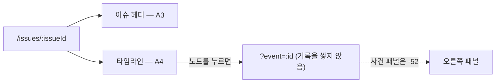

# S15P31A102-50 이슈 화면 — 헤더 · 타임라인(시간축 · 레인)

## 무엇을 / 왜

`/issues/:issueId` 이슈 화면을 만든다. 맨 위 이슈 헤더(A3)와 F07 사건 중심 이슈 에볼루션 맵 타임라인(A4)이다.
홈 카드 · 「새로운 이슈」 · 검색 · 사이드바가 모두 이 주소로 오는데 지금은 찾을 수 없음 화면이 뜬다. 백엔드 A3 · A4(Jira 48)는 끝났다.

화면 모양은 프로토타입 v21 `IssueScreen` · `LaneTimeline` 을 따른다. `DESIGN.md` 는 맵 배치(시간축 · 레인)를 정하지 않았다.
A4 에 관계 칸이 없어 사건 사이 선은 그리지 않는다(2026-10-20). 백엔드는 레인 기준을 정하기 전이라 `lane` 을 늘 null 로 보낸다.



## 만들 구조

```
frontend/src/
├─ api/issue.ts (+test)                 🆕 A3 — fetchIssue(id) · issueQuery(id) · IssueDetail 타입
├─ api/timeline.ts (+test)              🆕 A4 — fetchTimeline(id) · timelineQuery(id) · TimelineEvent 타입
├─ mocks/handlers.ts                    ✏️ A3 · A4 가짜. 이슈마다 사건 목록, 없는 이슈는 404 ISSUE_NOT_FOUND.
│                                          A2 의 사건 · 기사 수를 이 목록에서 센다
├─ lib/date.ts (+test)                  ✏️ 이슈 기간 「2026.08.04 ~ 10.09」, 타임라인 날짜(해가 바뀌는 첫 사건에만 연도)
├─ components/issue/
│  ├─ IssueHeader.tsx                   🆕 분야 · 연도, h1 제목, 요약 2줄 + 더보기
│  ├─ timelineLayout.ts (+test)         🆕 사건 → 레인 · 가로 위치 · 세로 위치 · 날짜 표기 (그리기와 떼어 시험)
│  ├─ Timeline.tsx (+test)              🆕 SVG — 레인 · 월 눈금 · 노드 · 라벨 · 툴팁 · 확대·축소 · 전체 보기 · TIP
│  └─ useElementSize.ts                 🆕 타임라인 자리의 폭 · 높이 (ResizeObserver)
├─ pages/IssuePage.tsx (+test)          🆕 헤더 + 타임라인 + 상태(불러오는 중 · 실패 · 빈 이슈 · 없음)
├─ routes.tsx (+ routes.test.tsx)       ✏️ /issues/:issueId
└─ components/shell/IssueExplorer.tsx   ✏️ 「-50 전까지 찾을 수 없음」 주석
_bmad-output/…/EXPERIENCE.md            ✏️ 이슈 화면 행 · 빈 이슈 문구 · 레인 null 처리
docs/plans/2026-10-28-issue-timeline.md ✏️ 이 계획
```

d3 는 확대 · 축소(d3-zoom)에만 쓴다. 노드 · 라벨은 React 가 SVG 로 그린다 — 프로토타입과 같은 방식이고 테스트에서 역할(button)로 찾을 수 있다.

## 정한 것 (사용자가 볼 것)

| 무엇 | 정한 값 | 근거 |
| --- | --- | --- |
| 레인 | `MAIN` 메인 흐름 · `SUB` 서브 흐름. **`lane` 이 null(이나 모르는 값)이면 메인 흐름에 둔다.** 서브 흐름 레인은 `SUB` 사건이 있을 때만 | A4 · 프로토타입(메인 레인은 늘 보임). null 처리는 내가 정함 — 기준이 정해질 때까지 모든 사건이 한 흐름이다 |
| 가로 배치 | 사건 시각 순서. 간격은 시각 차이에 비례하지 않고 앞 사건과 같은 레인이면 170px, 다르면 110px. 월 눈금은 그 사이를 나눠 찍는다 | 프로토타입 v21(빈 기간이 길어도 화면을 낭비하지 않게) |
| 같은 시각 · 같은 레인 | 첫 사건을 레인 선 위에 두고 30px 씩 아래로 쌓는다. 셋째부터 레인을 늘린다 | 프로토타입의 「같은 날 사건 펼치기」를 펼친 모양으로 고정. 아래로 쌓는 것은 화면을 보고 바꿈(위쪽 라벨이 레인 선에 걸렸다) |
| 노드 | 메인 흐름 20px 사각(모서리 3px) `bg-brand-accent` + 3px 흰 링, 서브 흐름 16px 빈 사각 2px `palette-gray-600`. 고르면 `bg-brand-solid` 채움 + 둘레 `bg-brand-weak`, `aria-current` | DESIGN.md 타임라인 노드의 색 · 모양, 크기는 프로토타입(DESIGN.md 는 세로 목록용 12 · 10px — 아래 「남은 것」) |
| 메인 흐름 선 | 메인 흐름 첫 사건부터 끝 사건까지 2px `stroke-brand-weak` 가로선 하나 | DESIGN.md `timeline-rail`. 사건 사이 관계선이 아니라 레인 선이다 |
| 라벨 | 노드 오른쪽에 `label` 한 줄(넘치면 「…」) + 「10.06 · 기사 5건」. 노드 가운데보다 6px 아래에서 시작해 레인 선에 걸리지 않게. 오른쪽 자리가 64px 보다 좁으면 노드 아래. 개수가 0이면 그 항목을 뺀다 | 프로토타입. `label` 은 필수 칸이라 `title` 대체는 두지 않았다 |
| 날짜 | `MM.DD`. 앞 사건과 해가 다르면 연도를 붙인다(맨 앞 사건은 올해가 아니면). `occurredAtBasis` 가 `FIRST_PUBLISHED` 면 날짜 뒤 「추정」 | EXPERIENCE 날짜 표. 맨 앞 사건 규칙은 내가 정함 |
| 시간축 | 맨 아래 월 눈금 「9월」. 맨 앞 눈금과 1월은 「2026년 1월」. 고른 사건이 있으면 축에 그 날짜 표시 | 프로토타입 + 연도 표기는 내가 정함 |
| 확대 · 축소 | 50 ~ 400%. − · + 버튼(0.8배 · 1.25배)과 배율 글자, 휠 · 끌기, *전체 보기*. 처음에는 다 들어가면 100%, 아니면 들어가게 줄이되 75% 아래로는 줄이지 않는다 | 프로토타입 |
| 고르기 | 노드를 누르거나 Enter · Space → `?event=:id` (기록을 쌓지 않는다). 타임라인 빈 곳을 누르면 푼다. `?event=` 로 열면 그 사건이 화면 안에 오게 옮긴다 | EXPERIENCE IA · Component Patterns. 패널은 -52 |
| 키보드로 옮기기 | Tab 으로 노드에 포커스가 가면 화면 밖일 때 그 노드가 보이게 옮긴다 | EXPERIENCE 「핀치 · 드래그의 대체 수단」 — 버튼과 이것으로 |
| 툴팁 | 마우스를 올리거나 키보드 포커스 — 제목 · 날짜 · 기사 N건 · 언론사 N곳 · 레인 | EXPERIENCE 사건 노드 |
| 헤더 | 「경제 · 2026」(분야 · 첫 사건 연도), h1 제목, 요약 두 줄 + *더보기*(두 줄에서 잘렸는지는 화면에서 잰다, 요약이 없으면 줄 없음) | 프로토타입 IssueHeader. AI 배지 · 고정 핀 · 관점 비교 · 알림은 뺀다 |
| 도구줄 | 「이슈 흐름」 · 「2026.08.04 ~ 10.09 · 사건 8 · 기사 31」(0인 개수는 뺀다) · 확대 · 축소 · 전체 보기 · TIP | 프로토타입 |
| TIP | 레인 뜻 두 줄, 「추정」 뜻, 「기사 수는 숫자로만 보여 줘요」. 열면 포커스가 창 안으로, Esc · 닫기로 닫으면 TIP 버튼으로 | 프로토타입 범례 · Jira 50 출력의 범례 · EXPERIENCE Accessibility Floor |
| 상태 | 헤더: 불러오는 중 스켈레톤(h1 은 첫 렌더에 그린다) · 실패 「이슈를 불러오지 못했어요」. 타임라인: 스켈레톤 · 「타임라인을 불러오지 못했어요」 · 사건 0개면 「아직 이 이슈에 정리된 사건이 없어요」. 둘 중 하나라도 404 면 화면 전체 「이슈를 찾을 수 없어요」(제목에 포커스가 있었으면 새 제목으로 넘긴다). 숫자가 아니거나 16자리를 넘는 id 는 서버에 묻지 않고 같은 화면 | EXPERIENCE State Patterns. 빈 이슈 문구는 내가 정함 |

## 안 바꿀 것

- 사건 패널(-52) · 필터 · 「메인 흐름만」 · 새 사건 표시(-51) · 관심 이슈 핀(-68)
- 관계선 · 논점 · 변화 표시(F09 · F10 추후 논의) · 언론사 필터(P1)
- `docs/api*.md` — 백엔드 문서
- 홈 · 셸의 동작

## 리스크

- d3-zoom 이 jsdom 에서 SVG 크기(`width.baseVal`)를 못 읽는다 → `extent` 를 직접 준다
- 셸의 「화면을 옮기면 h1 에 포커스」는 h1 이 첫 렌더에 있어야 한다. 제목은 A3 를 기다려야 해서 h1 안에 스켈레톤을 둔다
- 같은 레인에 같은 시각 사건이 많으면 레인이 길어진다 — 레인 높이를 쌓인 수만큼 늘린다
- 빌드 크기가 늘어난다(d3-zoom · d3-selection · d3-transition). 늘어난 만큼 MR 에 적는다
- 진짜 서버에는 이슈를 만드는 AI 단계(-40)가 아직이라 이슈 · 사건이 없을 수 있다 — 가짜 API 로 만든다

## 어떻게 검증하나

- `frontend/` 포맷 · 린트 · 타입 · 테스트(Node 24 · 26) · 빌드
- 새 테스트
  - A3 · A4: 가짜에서 받기 · 404 를 `ApiError` 의 `ISSUE_NOT_FOUND` 로
  - 배치: 시각 순서 · null → 메인 · `SUB` 없으면 서브 레인 없음 · 같은 레인 170 / 다른 레인 110 · 같은 시각 쌓기 · 연도 표기 · 추정
  - 타임라인: 노드가 이름 있는 버튼 · 누르기 · Enter · Space 로 고르기 · 고른 노드 `aria-current` · 빈 곳 누르면 풀기 · − + 로 배율 글자 · 전체 보기 · 포커스에 툴팁
  - 화면: 헤더 · 기간 · 개수, `?event=` 읽기 · 쓰기 · 기록 안 쌓기, 빈 이슈 문구, A4 실패와 다시 시도, 404 · 숫자 아닌 id 는 찾을 수 없음, 화면을 옮기면 h1 포커스
- 되돌림 확인: null → 메인 · 간격 규칙 · 기록 안 쌓기 · 404 처리를 각각 깨면 실패하는지
- 화면: `dev:mock` 을 헤드리스 Chrome 으로 1280 · 375 — 레인 · 노드 · 라벨 · 축, 확대 · 축소 · 전체 보기, 끌기, 고르기 → 주소, 콘솔 오류 없음 → `.notes/mr/S15P31A102-50/`
- 리뷰: `reviewer` 조수

## 되돌리는 법

이 MR 을 revert 하면 `/issues/:issueId` 가 다시 찾을 수 없음 화면이 된다. 데이터 · 배포 · 인증과는 상관없다.

## 작업 순서

- [x] `feat(frontend)`: A3 이슈 헤더 · A4 타임라인을 부르는 함수와 가짜 응답 — `fcd466b`. 테스트가 먼저 실패(모듈 없음)하는 것을 확인. A2 의 사건 · 기사 수와 마지막 사건을 A4 사건 목록에서 센다
- [x] `feat(frontend)`: 이슈 기간 · 타임라인 사건 날짜 표기 — `ec249ac`
- [x] `feat(frontend)`: 타임라인 배치 계산 — `b5820d6`. 되돌림 확인: null → 메인 · 170 / 110 간격 · 같은 시각 쌓기를 각각 깨면 실패
- [x] `feat(frontend)`: 이슈 타임라인 — 레인 · 월 눈금 · 노드 · 고르기 · 확대 · 축소 · TIP — `b7e912c` (계획의 두 줄을 한 커밋으로). 빠르게 + 를 두 번 누르면 앞 전환이 끊겨 한 번이 사라지던 것을 테스트가 잡아 노리는 배율(targetScale)로 고침. 되돌림 확인: 노드 click 의 stopPropagation · targetScale
- [x] `feat(frontend)`: 이슈 화면 — 헤더 · 타임라인 · 요청 상태, /issues/:issueId — `17a6cfd`. 404 로 바뀌면 포커스를 새 제목으로(`NotFoundPage` 의 `focusTitle`). 되돌림 확인: replace · 404 처리 · 포커스 넘기기
- [x] 화면 확인(헤드리스 Chrome) — 고친 것 셋
  - `72cc54f` 처음 배율이 폭을 재기 전 어림값(1000px)으로만 정해져 넓은 화면 75%, 375px 에서 고른 사건이 화면 밖 → 폭을 잰 뒤 다시 맞춤. 되돌리면 「717.5 < 375」 에서 실패
  - `82ef631` 레인 선이 라벨 글자를 지나감 · 같은 시각 위쪽 라벨이 선에 걸림 → 라벨을 6px 아래에서 시작, 같은 시각은 아래로 쌓기. 마우스로 누른 노드에 키보드용 테두리 · 툴팁이 남음 → 누르는 중 받은 포커스는 빼기
- [x] `docs(frontend)`: EXPERIENCE 이슈 화면 행 — `8ddec80`
- [x] 리뷰(`reviewer` 조수) 반영 — 꼭 고칠 것 7건 · 선택 12건 · 확인 필요 5건. 꼭 고칠 것 7건과 선택 5건(모르는 레인 · 큰 id · 전환 멈춤 · aria-current · 테스트 빈틈)을 고쳤다
  - `ba85c93` 고른 노드를 SVG 맨 뒤로 옮겨 Tab 순서가 깨지던 것 · TIP Esc 와 포커스 · 처음 배율 99% · 월 눈금 key 겹침 · 끌기 뒤 키보드 포커스 · 0개 항목 · 모르는 레인
  - `b43a593` 요약 *더보기* 를 글자 수 대신 화면에서 잰 잘림으로 — 좁은 화면에서 잘렸는데 버튼이 없었다
  - `af3c1b7` 도구줄 0개 항목 · 16자리 넘는 id 는 서버에 묻지 않음
  - `e13cb7f` EXPERIENCE 의 내가 정한 세 가지에 `[가정]`
  - 진짜 Chrome: 고른 뒤 Tab → 다음 사건, 키보드 포커스 툴팁, TIP 열면 닫기에 포커스 · Esc 로 TIP 버튼, 사건 4개 이슈 100%
- [x] 고친 커밋 다시 보기(`reviewer` 조수) — 꼭 고칠 것 2건 · 선택 5건. 꼭 고칠 것 2건과 선택 1건(id 검사 겹침)을 고쳤다
  - 터치 탭은 손을 뗀(pointerup) 뒤에 포커스가 와서 「누르는 중」으로는 못 가렸다 → 마지막 입력이 키보드였는지(window keydown · pointerdown)로 가린다
  - TIP 의 window Esc 가 서랍 안에서 누른 Esc 에도 닫혔다(둘 다 닫힘) → 타임라인 안이나 body 에서 누른 Esc 만, 한글 조합 중은 거른다
  - id 검사는 안전한 정수 하나로. 16자리지만 안전하지 않은 id 도 테스트

## 하지 않은 것 · 남은 것

- 사건 패널(-52), 필터 · 새 사건 표시(-51), 관심 이슈 핀(-68), 관계선 · 논점 · 변화(F09 · F10)
- 레인을 나누는 기준 — 팀이 정한다(`SSOT.md` 8절). 그때까지 모든 사건이 메인 흐름 한 레인이다
- 노드 크기 — DESIGN.md 타임라인 노드는 세로 목록용 12 · 10px 이고 화면은 프로토타입 맵의 20 · 16px 다. DESIGN.md 를 고칠지 정해야 한다
- 누르기만 하는 사용자의 가로 이동 — 버튼은 확대 · 축소 · 전체 보기뿐이다. 50% 에서도 다 안 들어오면(1280 폭에서 사건 약 12개 넘게) 끌기 · 휠 · 키보드 없이는 화면 밖 사건에 닿지 못한다
- `?event=` 가 이 이슈의 사건이 아닐 때 — 지금은 아무것도 안 고르고 주소에 남는다. -52 에서 A5 를 부를 때 정한다
- 월 눈금 솎기 — 몇 달 떨어진 두 사건 사이(170px)에 눈금이 몰리면 글자가 겹친다
- 배율 65% 아래에서 라벨이 노드 아래로 내려가면 같은 시각에 쌓인 다음 노드를 덮을 수 있다
- 배율 글자 `aria-live`, 확대 · 축소 버튼 32px · TIP 닫기 28px(Accessibility Floor 는 아이콘 버튼 40px), `useEffectEvent` 로 eslint-disable 두 곳 없애기
- 사이드바 이슈 탐색의 사건 단계(분야 → 연도 → 이슈 → 사건)
- 좁은 화면의 레인 이름 칸 140px — 375px 에서는 그리는 자리가 235px 이다
- 실제 스크린 리더 · Safari · Firefox · 터치 기기로는 보지 않았다(터치 탭 순서는 jsdom 과 명세로만)
- 요약 *더보기*: 웹 글꼴이 늦게 바뀌어 줄 수가 늘면 다시 재지 않는다. 펼친 채 창을 넓혀 두 줄에 들어오게 된 뒤 접으면 버튼이 사라진다
- 고른 노드를 맨 위에 그리지 않는다(Tab 순서 때문). 배율이 낮아 겹치면 고른 노드가 덮일 수 있다
