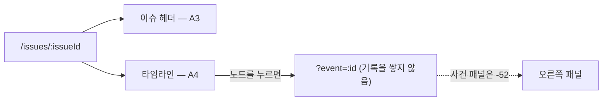

# S15P31A102-50 이슈 화면 — 헤더 · 타임라인(시간축 · 레인)

## 무엇을 / 왜

`/issues/:issueId` 이슈 화면을 만든다. 맨 위 이슈 헤더(A3)와 F07 사건 중심 이슈 에볼루션 맵 타임라인(A4)이다.
홈 카드 · 「새로운 이슈」 · 검색 · 사이드바가 모두 이 주소로 오는데 지금은 찾을 수 없음 화면이 뜬다. 백엔드 A3 · A4(Jira 48)는 끝났다.

화면 모양은 프로토타입 v21 `IssueScreen` · `LaneTimeline` 을 따른다. `DESIGN.md` 는 맵 배치(시간축 · 레인)를 정하지 않았다.
A4 에 관계 칸이 없어 사건 사이 선은 그리지 않는다(2026-10-20). 백엔드는 레인 기준을 정하기 전이라 `lane` 을 늘 null 로 보낸다.



## 만들 구조

```
frontend/src/
├─ api/issue.ts (+test)                 🆕 A3 — fetchIssue(id) · issueQuery(id) · IssueDetail 타입
├─ api/timeline.ts (+test)              🆕 A4 — fetchTimeline(id) · timelineQuery(id) · TimelineEvent 타입
├─ mocks/handlers.ts                    ✏️ A3 · A4 가짜. 이슈마다 사건 목록, 없는 이슈는 404 ISSUE_NOT_FOUND.
│                                          A2 의 사건 · 기사 수를 이 목록에서 센다
├─ lib/date.ts (+test)                  ✏️ 이슈 기간 「2026.08.04 ~ 10.09」, 타임라인 날짜(해가 바뀌는 첫 사건에만 연도)
├─ components/issue/
│  ├─ IssueHeader.tsx                   🆕 분야 · 연도, h1 제목, 요약 2줄 + 더보기
│  ├─ timelineLayout.ts (+test)         🆕 사건 → 레인 · 가로 위치 · 세로 위치 · 날짜 표기 (그리기와 떼어 시험)
│  ├─ Timeline.tsx (+test)              🆕 SVG — 레인 · 월 눈금 · 노드 · 라벨 · 툴팁 · 확대·축소 · 전체 보기 · TIP
│  └─ useElementSize.ts                 🆕 타임라인 자리의 폭 · 높이 (ResizeObserver)
├─ pages/IssuePage.tsx (+test)          🆕 헤더 + 타임라인 + 상태(불러오는 중 · 실패 · 빈 이슈 · 없음)
├─ routes.tsx (+ routes.test.tsx)       ✏️ /issues/:issueId
└─ components/shell/IssueExplorer.tsx   ✏️ 「-50 전까지 찾을 수 없음」 주석
_bmad-output/…/EXPERIENCE.md            ✏️ 이슈 화면 행 · 빈 이슈 문구 · 레인 null 처리
docs/plans/2026-10-28-issue-timeline.md ✏️ 이 계획
```

d3 는 확대 · 축소(d3-zoom)에만 쓴다. 노드 · 라벨은 React 가 SVG 로 그린다 — 프로토타입과 같은 방식이고 테스트에서 역할(button)로 찾을 수 있다.

## 정한 것 (사용자가 볼 것)

| 무엇 | 정한 값 | 근거 |
| --- | --- | --- |
| 레인 | `MAIN` 메인 흐름 · `SUB` 서브 흐름. **`lane` 이 null 이면 메인 흐름에 둔다.** 서브 흐름 레인은 `SUB` 사건이 있을 때만 | A4 · 프로토타입(메인 레인은 늘 보임). null 처리는 내가 정함 — 기준이 정해질 때까지 모든 사건이 한 흐름이다 |
| 가로 배치 | 사건 시각 순서. 간격은 시각 차이에 비례하지 않고 앞 사건과 같은 레인이면 170px, 다르면 110px. 월 눈금은 그 사이를 나눠 찍는다 | 프로토타입 v21(빈 기간이 길어도 화면을 낭비하지 않게) |
| 같은 시각 · 같은 레인 | 위아래로 30px 씩 벌려 놓는다 | 프로토타입의 「같은 날 사건 펼치기」를 펼친 모양으로 고정 |
| 노드 | 메인 흐름 20px 사각(모서리 3px) `bg-brand-accent` + 3px 흰 링, 서브 흐름 16px 빈 사각 2px `palette-gray-600`. 고르면 `bg-brand-solid` 채움 + 둘레 `bg-brand-weak` | DESIGN.md 타임라인 노드 · 프로토타입 크기 |
| 메인 흐름 선 | 메인 흐름 첫 사건부터 끝 사건까지 2px `stroke-brand-weak` 가로선 하나 | DESIGN.md `timeline-rail`. 사건 사이 관계선이 아니라 레인 선이다 |
| 라벨 | 노드 오른쪽에 `label`(없으면 `title`) 두 줄까지 + 「10.06 · 기사 5건」. 오른쪽 자리가 64px 보다 좁으면 노드 아래 | 프로토타입 |
| 날짜 | `MM.DD`. 앞 사건과 해가 다르면 연도를 붙인다(맨 앞 사건은 올해가 아니면). `occurredAtBasis` 가 `FIRST_PUBLISHED` 면 날짜 뒤 「추정」 | EXPERIENCE 날짜 표. 맨 앞 사건 규칙은 내가 정함 |
| 시간축 | 맨 아래 월 눈금 「9월」. 맨 앞 눈금과 1월은 「2026년 1월」. 고른 사건이 있으면 축에 그 날짜 표시 | 프로토타입 + 연도 표기는 내가 정함 |
| 확대 · 축소 | 50 ~ 400%. − · + 버튼(0.8배 · 1.25배)과 배율 글자, 휠 · 끌기, *전체 보기*. 처음에는 다 들어가면 100%, 아니면 들어가게 줄이되 75% 아래로는 줄이지 않는다 | 프로토타입 |
| 고르기 | 노드를 누르거나 Enter · Space → `?event=:id` (기록을 쌓지 않는다). 타임라인 빈 곳을 누르면 푼다. `?event=` 로 열면 그 사건이 화면 안에 오게 옮긴다 | EXPERIENCE IA · Component Patterns. 패널은 -52 |
| 키보드로 옮기기 | Tab 으로 노드에 포커스가 가면 화면 밖일 때 그 노드가 보이게 옮긴다 | EXPERIENCE 「핀치 · 드래그의 대체 수단」 — 버튼과 이것으로 |
| 툴팁 | 마우스를 올리거나 키보드 포커스 — 제목 · 날짜 · 기사 N건 · 언론사 N곳 · 레인 | EXPERIENCE 사건 노드 |
| 헤더 | 「경제 · 2026」(분야 · 첫 사건 연도), h1 제목, 요약 두 줄 + *더보기*(요약이 없으면 줄 없음) | 프로토타입 IssueHeader. AI 배지 · 고정 핀 · 관점 비교 · 알림은 뺀다 |
| 도구줄 | 「이슈 흐름」 · 「2026.08.04 ~ 10.09 · 사건 8 · 기사 30」 · 확대 · 축소 · 전체 보기 · TIP | 프로토타입 |
| TIP | 레인 뜻 두 줄, 「추정」 뜻, 「기사 수는 숫자로만 보여 줘요」 | 프로토타입 범례 · Jira 50 출력의 범례 |
| 상태 | 헤더: 불러오는 중 스켈레톤(h1 은 첫 렌더에 그린다) · 실패 「이슈를 불러오지 못했어요」. 타임라인: 스켈레톤 · 「타임라인을 불러오지 못했어요」 · 사건 0개면 「아직 이 이슈에 정리된 사건이 없어요」. 둘 중 하나라도 404 면 화면 전체 「이슈를 찾을 수 없어요」. 숫자가 아닌 id 도 같다 | EXPERIENCE State Patterns. 빈 이슈 문구는 내가 정함 |

## 안 바꿀 것

- 사건 패널(-52) · 필터 · 「메인 흐름만」 · 새 사건 표시(-51) · 관심 이슈 핀(-68)
- 관계선 · 논점 · 변화 표시(F09 · F10 추후 논의) · 언론사 필터(P1)
- `docs/api*.md` — 백엔드 문서
- 홈 · 셸의 동작

## 리스크

- d3-zoom 이 jsdom 에서 SVG 크기(`width.baseVal`)를 못 읽는다 → `extent` 를 직접 준다
- 셸의 「화면을 옮기면 h1 에 포커스」는 h1 이 첫 렌더에 있어야 한다. 제목은 A3 를 기다려야 해서 h1 안에 스켈레톤을 둔다
- 같은 레인에 같은 시각 사건이 많으면 레인이 길어진다 — 레인 높이를 쌓인 수만큼 늘린다
- 빌드 크기가 늘어난다(d3-zoom · d3-selection · d3-transition). 늘어난 만큼 MR 에 적는다
- 진짜 서버에는 이슈를 만드는 AI 단계(-40)가 아직이라 이슈 · 사건이 없을 수 있다 — 가짜 API 로 만든다

## 어떻게 검증하나

- `frontend/` 포맷 · 린트 · 타입 · 테스트(Node 24 · 26) · 빌드
- 새 테스트
  - A3 · A4: 가짜에서 받기 · 404 를 `ApiError` 의 `ISSUE_NOT_FOUND` 로
  - 배치: 시각 순서 · null → 메인 · `SUB` 없으면 서브 레인 없음 · 같은 레인 170 / 다른 레인 110 · 같은 시각 쌓기 · 연도 표기 · 추정
  - 타임라인: 노드가 이름 있는 버튼 · 누르기 · Enter · Space 로 고르기 · 고른 노드 `aria-pressed` · 빈 곳 누르면 풀기 · − + 로 배율 글자 · 전체 보기 · 포커스에 툴팁
  - 화면: 헤더 · 기간 · 개수, `?event=` 읽기 · 쓰기 · 기록 안 쌓기, 빈 이슈 문구, A4 실패와 다시 시도, 404 · 숫자 아닌 id 는 찾을 수 없음, 화면을 옮기면 h1 포커스
- 되돌림 확인: null → 메인 · 간격 규칙 · 기록 안 쌓기 · 404 처리를 각각 깨면 실패하는지
- 화면: `dev:mock` 을 헤드리스 Chrome 으로 1280 · 375 — 레인 · 노드 · 라벨 · 축, 확대 · 축소 · 전체 보기, 끌기, 고르기 → 주소, 콘솔 오류 없음 → `.notes/mr/S15P31A102-50/`
- 리뷰: `reviewer` 조수

## 되돌리는 법

이 MR 을 revert 하면 `/issues/:issueId` 가 다시 찾을 수 없음 화면이 된다. 데이터 · 배포 · 인증과는 상관없다.

## 작업 순서

- [ ] `feat(frontend)`: A3 이슈 헤더 · A4 타임라인을 부르는 함수와 가짜 응답
- [ ] `feat(frontend)`: 이슈 기간 · 타임라인 날짜 표기
- [ ] `feat(frontend)`: 타임라인 배치 계산 — 레인 · 가로 간격 · 같은 시각 쌓기
- [ ] `feat(frontend)`: 이슈 화면 — 헤더와 요청 상태, /issues/:issueId
- [ ] `feat(frontend)`: 타임라인 — 레인 · 월 눈금 · 사건 노드 · 고르기
- [ ] `feat(frontend)`: 타임라인 확대 · 축소 · 전체 보기 · TIP
- [ ] `docs(frontend)`: EXPERIENCE 이슈 화면 행
- [ ] 화면 확인 · 리뷰 반영

## 하지 않은 것 · 남은 것

(끝나면 채운다)
