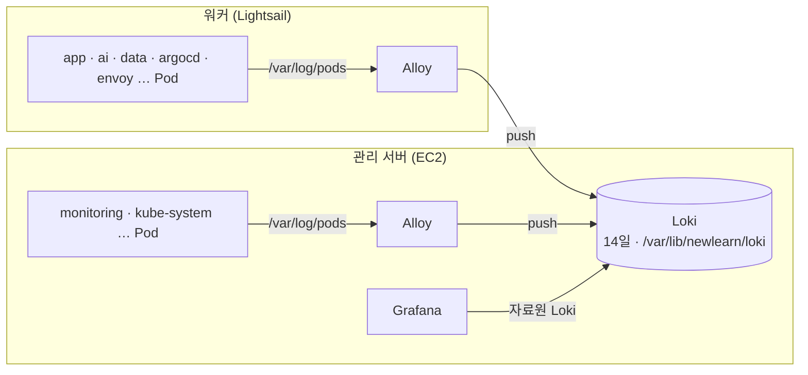

# Jira 128 — 로그 창고 Loki (Pod 로그를 모아 Grafana 에서 찾기)

## 무엇을 / 왜

Pod 로그를 관리 서버의 Loki 에 14일 모아 Grafana 에서 찾는다. 지금 로그는 Pod 안에만 있어 배포로 Pod 가 바뀌면 사라진다 — Jira 29 반영 때 옛 backend Pod 의 종료 로그를 두 번 다 못 잡았고, Jira 35 의 30분 WARN 도 다음 배포에 사라진다.

## 정한 것 (2026-10-28 사용자)

- 모을 범위: CI 잡(`gitlab-runner` · `gitlab-runner-build`)만 빼고 전부 — 검사 스크립트가 찍은 값이 그대로 남을 수 있고 GitLab 화면에 이미 있다
- 보관 14일 — Prometheus 15일과 비슷하게. 양이 하루 20MB 안팎이라 디스크 부담이 거의 없다
- backend 시작 로그의 스프링 기본 비밀번호 줄은 수집기에서 버린다(backend 코드는 그대로 — 남은 것 ⑨)
- 설치는 모니터링과 같이 EC2 에서 사람이 helm 으로(결정: 러너 · 모니터링은 helm 그대로, SSOT 6절 · 2026-10-22). 차트 판 고정 — `grafana/loki` 7.5.0(이미지는 차트가 고정한 3.6.11 — 아래 「계획과 달라진 것」) · `grafana/alloy` 1.14.3(Alloy v1.21.2)
- 로그 모양은 지금 글자 그대로. 이번에 Loki 로 찾아 본 결과로 결론만 남긴다(JSON 으로 바꾸는 것은 backend 작업이라 범위 밖)

## 구성

- **Loki** — `monitoring` 네임스페이스, 단일 실행(single binary) 1개, 파일 저장. 관리 서버에 둔다(다른 모니터링과 같은 control-plane nodeSelector · toleration). 정적 local PV `loki-local` 5Gi(`/var/lib/newlearn/loki`, Loki 사용자 uid 10001). 보관 336시간(compactor 가 지움). 차트가 기본으로 켜는 무거운 것 — 캐시(memcached) · gateway(nginx) · canary · 시험 Pod — 는 끈다. 요청 CPU 50m · 메모리 256Mi, 상한 메모리 512Mi
- **Alloy(수집기)** — DaemonSet(서버마다 하나, control-plane toleration). `/var/log` 읽기 전용. 같은 노드의 Pod 를 찾아(`discovery.kubernetes`) 라벨(namespace · pod · container · app · node)을 붙이고, CI 네임스페이스는 찾을 때 뺀다 → 파일을 읽어 CRI 형식을 풀고 → 비밀번호 줄을 버리고 → Loki 로 보낸다. 요청 CPU 20m · 메모리 64Mi, 상한 메모리 256Mi
- **Grafana** — `monitoring-values.yaml` 의 `grafana.additionalDataSources` 에 Loki 한 줄 → 같은 판(92.10.1)으로 `helm upgrade kps`
- 관리 서버 CPU 예약: 지금 1250m + Loki 50m + Alloy 20m = 1320m. CI 잡 550m 를 더해도 1870m ≤ 2000m(`infra/server/README.md` 「모니터링」 5번 기준)

## 바꿀 파일

- `infra/k8s/bootstrap/loki-values.yaml` (새) — 위 Loki 설정
- `infra/k8s/bootstrap/loki-pv.yaml` (새) — PV 하나. StorageClass 는 `prometheus-pv.yaml` 의 `newlearn-local-manual` 을 같이 쓴다
- `infra/k8s/bootstrap/alloy-values.yaml` (새) — Alloy DaemonSet 값과 수집 설정
- `infra/k8s/bootstrap/monitoring-values.yaml` — Grafana 자료원에 Loki
- `infra/server/logging.md` (새) — 까는 법(폴더 · PV · 차트 창고 · 설치 셋) · 확인 표 · 로그 찾는 법(LogQL 몇 줄) · 되돌리기. `infra/server/README.md` 가 500줄 상한이라 따로 둔다
- `infra/server/README.md` — 「모니터링」 첫 문단에 「로그는 `infra/server/logging.md`」(줄 수 그대로)
- `SSOT.md` — 6절 「모니터링」 줄에 Loki · Alloy, 10절 「잰 것」에 설치 뒤 자원 · 수집 결과
- `docs/plans/2026-10-28-loki.md` — 이 계획

## 작업 순서

- [x] 값 파일 · PV · 문서 커밋 — 작업 브랜치 `chore/infra/S15P31A102-128-loki`(infra 에서). 확인: 두 차트를 `helm template` 로 펼쳐 만들어지는 자원 목록(캐시 · gateway 없음, Service 이름)과 `kubectl apply --dry-run=server`
- [x] MR → infra 를 연다(설치 결과를 같은 브랜치에 더한 뒤 머지)
- [x] EC2 에 설치 — 파일 보내기(`tar … | ssh`) → 폴더 · PV → `helm install loki` → `helm install alloy` → `helm upgrade kps`. 단계마다 출력 확인
- [ ] 반영 확인(아래 2단계) → SSOT 10절 잰 것을 커밋 → MR 머지 → infra → dev → 분야 브랜치 맞추기 → Jira 128 댓글 · 완료

## 안 바꿀 것

- backend 로그 모양(JSON) · 남은 것 ⑨ 의 backend 코드
- Argo CD 앱 목록 — Loki 는 helm 으로 둔다
- 경보(alertmanager 꺼짐 그대로) — 로그로 알림 보내기는 하지 않는다
- Grafana 공개 방식 · 권한(보는 사람 = 팝업 계정), 네트워크 정책
- metrics-server(`kubectl top`) — 따로 정할 일

## 리스크

- **관리 서버 CPU 예약** — CI 잡 자리를 잡아먹으면 잡 Pod 가 Pending. 계산상 1870m ≤ 2000m, 설치 뒤 `kubectl describe node` 로 확인
- **Loki 차트 기본값이 무겁다** — 캐시(memcached)가 기본으로 켜져 메모리를 GB 단위로 요청한다. 값 파일로 끄고 `helm template` 자원 목록으로 확인한 뒤 설치
- **디스크** — 관리 서버 9.3G 남음. local PV 는 크기 상한을 강제하지 않는다 — 하루 20MB · 14일이라 작다고 보고, `du` 확인 명령을 `logging.md` 에 둔다
- **보는 범위가 넓어짐** — 팝업 계정이면 Grafana 에서 모든 네임스페이스 로그를 14일치 본다(Envoy 접근 기록의 손님 IP, Argo CD 로그 포함). 지금도 Argo CD 화면에서 서비스 로그가 보이는 것과 같은 사람들이지만 기간이 길어진다
- **Alloy 가 서버의 `/var/log` 를 읽는다**(hostPath, 읽기 전용)
- **`helm upgrade kps`** 때 Grafana Pod 가 다시 떠 잠깐 화면이 끊긴다
- **Docker Hub 받기 한도**(익명 6시간 100번) — 이미지 셋이라 걸리지 않는다고 본다

## 어떻게 검증하나

- 1단계: infra 게이트(Terraform · 셸 문법 — 매니페스트는 안 봄) + `helm template` · 서버 dry-run
- 2단계 — 설치 뒤
  - Pod: Loki 1개(관리 서버) · Alloy 2개(서버마다) Running · 재시작 0, PVC Bound(`loki-local`)
  - Loki 준비: API 서버 프록시로 `/ready`
  - 수집: Loki 의 `namespace` 라벨 값에 app · ai · data · argocd · envoy-gateway-system · kube-system · monitoring 등이 있고 gitlab-runner 는 없다
  - Grafana Explore 에서 `{namespace="app", container="backend"}` 가 보인다 — Chrome 캡처(화면 가이드 07장)
  - **옛 Pod 로그가 남는지** — `kubectl -n app rollout restart deploy/backend`(교체 동안 EC2 에서 1초마다 health, 실패 0 확인) 뒤 사라진 Pod 이름으로 Loki 에서 「Commencing graceful shutdown」을 찾는다(Jira 29 에서 못 본 줄)
  - 비밀번호 줄: 재시작 뒤 `{namespace="app"} |= "generated security password"` 0줄
  - 자원: 노드 CPU 예약, Loki · Alloy 메모리(Prometheus 질의), 하루 뒤 `du /var/lib/newlearn/loki`
  - 글자 로그로 찾기: `|= "WARN"`, `| pattern` 으로 level 뽑기 — 되면 「글자 유지」 결론
- 3단계: Jira 128 할 일 1 ~ 5 를 한 줄씩

## 계획과 달라진 것

- **Loki 이미지는 3.6.11** — 차트 7.5.0 은 앱 판을 3.6.16 으로 적었지만 `loki.image.tag` 를 3.6.11 로 고정해 두었다(`helm show values`). 차트가 함께 시험한 판이라 그대로 쓴다
- **권한을 좁혔다** — `helm template` 로 펼쳐 보니 둘 다 클러스터의 Secret 을 읽는 권한이 기본으로 붙었다
  - Loki: 경보 규칙을 읽는 보조 컨테이너(`loki-sc-rules`)가 ConfigMap · Secret 을 클러스터 전체에서 읽는다 → `sidecar.rules.enabled: false`(로그로 경보를 보내지 않음). ClusterRole 은 이름만 남고 규칙이 빈다
  - Alloy: 다른 기능용으로 Secret · ConfigMap · 노드까지 읽는다 → Pod 읽기만. 차트 틀이 `rules` · `clusterRules` 를 이어 붙여 `[]` 를 주면 YAML 이 깨져서 같은 규칙을 양쪽에 적었다
- 펼친 자원 16개(PV 1 · Loki 9 · Alloy 6)를 서버 dry-run 으로 확인 — 오류 0
- **Viewer 에게 Explore 를 열었다** — 팝업 계정은 Grafana Viewer 인데 기본값으로는 Explore 에 못 들어가 계획의 「Grafana Explore 에서 찾는다」가 막혔다. 사용자 결정으로 `grafana.ini` 의 `users.viewers_can_edit: true`(Viewer 가 대시보드를 화면에서 고쳐 볼 수는 있으나 저장은 못 함). 대시보드를 따로 만드는 안 · 관리자만 보는 안도 있었다
- 설치 명령(EC2)은 자동 권한 검사가 「공유 클러스터 변경」으로 막아 사용자가 터미널에서 직접 쳤다
- 로그 모양: 글자 그대로. `regexp` 로 수준을 뽑을 수 있다(backend 3시간 INFO 47 · WARN 3). Loki 의 자동 수준 감지(`detected_level`)는 스프링 글자 로그의 WARN 을 `unknown` 으로 두어 쓰지 않는다

## 되돌리는 법

- `helm uninstall alloy -n monitoring` · `helm uninstall loki -n monitoring`, `monitoring-values.yaml` 을 되돌려 `helm upgrade kps`, PVC · PV 를 지우고 폴더를 지운다. 지워지는 것은 모은 로그뿐이고 서비스 데이터에는 영향이 없다
- 저장소 쪽은 MR Revert
