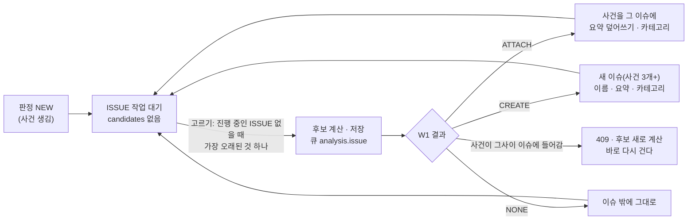

# Jira 40 — ISSUE 단계: 새 사건을 이슈에 붙이거나 새 이슈를 만든다

2026-10-29 계획. 계약은 `docs/api-internal.md` 3 · 4 · 5절의 `ISSUE`(제안)이고, AI 워커가 오기 전에 BE 쪽을 그 모양대로 채운다.

## 무엇을 / 왜

판정(MATCH_EVENT)이 새 사건을 만들면 지금은 `ISSUE` 작업이 「걸 차례를 기다리는」 표시로만 쌓이고, 이슈는 하나도 생기지 않는다. 이 작업으로 대기 중인 `ISSUE` 를 한 번에 하나씩 골라 후보를 계산해 큐에 넣고, W1 결과(`ATTACH` · `CREATE` · `NONE`)를 저장한다. 그러면 F07 사건 중심 이슈 에볼루션 맵의 이슈가 실제로 생기고, 운영 전 기반 만들기(발행순 재실행, `SSOT.md` 2절)의 ISSUE 판단을 돌릴 수 있다.

## 이번에 정한 것 (2026-10-29 사용자)

- **후보 사건은 이번 사건보다 먼저 생긴 것만**(`event.id < 이번 사건`). 판정 줄은 지금처럼 따로 돌고, ISSUE 는 「그때까지 생긴 사건」만 보고 판단한다. 다시 돌려도 같은 결과가 나와 발행순 재실행과 맞는다. 계약 4절 `candidateEvents` 에 한 줄 더한다
- **`issue_category` 는 이슈 기사들의 대표 카테고리 중 가장 많은 것 하나**(같으면 카테고리 `sort_order` 가 앞선 것). 이슈를 만들 때와 사건을 붙일 때마다 다시 계산한다. 대표 카테고리가 없는 기사는 셈에서 뺀다

## 바꿀 파일

계약 · 스펙 (MR → dev, 코드보다 먼저)
- `docs/api-internal.md`
  - 3절: ISSUE 고르기 규칙. 대기 = `QUEUED` 이고 `candidates` 가 빔. 진행 중 = 후보가 있는 `QUEUED`, 또는 다시 걸 예정인 `FAILED`. 작업 번호 순서(= 사건이 생긴 순서). 판정과 다른 잠금. 40분 WARN. 못 넣은 작업 넣기는 대기 작업을 읽지 않음. 워커는 ISSUE 도 실패여도 반드시 W1. 92 · 93줄의 「Jira 40 몫」을 이 규칙으로 바꾼다
  - 4절 `analysis.issue`: 후보 고르기(판정 후보와 같은 정확 검색, 질의 벡터 = 사건을 만든 기사), `candidateEvents` 는 먼저 생긴 사건만, `events[]` 는 최근 5개를 발생 시점 순서로, `candidates` 칸 모양 `{ issues: [{ issueId, similarity }], events: [{ eventId, similarity }] }`, 다시 걸 때마다 새로 계산
  - 5절: 「API 가 ISSUE 결과를 받을 때」 표(아래 「받을 때 보는 것」)와 409 뒤 처리
- `docs/api.md`: 2절 작업 실패 코드 표에 `JOB_STATE_CONFLICT`(API 가 적음, ISSUE 만, 바로 다시 — 시도 3까지), 4절 Jira 표의 40 줄
- `docs/data-model.md`: `analysis_job.candidates` 의 ISSUE 모양, `published_at` 의 「Jira 40 전」 문구, issue 절의 `issue_category` 규칙, 5절 2번 답
- 새 스펙 `docs/specs/F07-issue-assign.md` — 아래 성공 기준 AC-1 ~ AC-10
- `SSOT.md` 2절: 이슈 붙이기 성공 기준 스펙을 가리키는 한 줄
- `docs/specs/F06-event-match.md` · `F03-F07-analysis-job-queue.md` · `F03-F04-mindmap.md`: 「Jira 40 몫」 줄을 새 스펙으로 가리키게

코드 (MR → backend, `feat/backend/S15P31A102-40-issue-stage`)
- `issue/IssueCandidateFinder.java`(새) — 후보 이슈 최대 5개 · 이슈마다 최근 사건 5개 · 이슈 밖 먼저 생긴 사건 최대 10개. 상수로 둔다(`CandidateEventFinder.LIMIT` 와 같은 방식, 시작값)
- `analysis/issue/IssueDispatcher.java`(새) — `MatchDispatcher` 와 같은 모양. advisory lock 키 40, 진행 중이면 기다림, 대기 작업 하나를 골라 후보 계산 · 저장. 이번 사건이 이미 이슈 안이면 묻지 않고 끝냄(방어)
- `analysis/issue/IssueMessageFactory.java`(새) — `analysis.issue` 메시지. 저장된 후보로 만든다(못 넣은 작업 다시 넣기도 같은 후보)
- `issue/IssueResult.java`(새) — 결과 읽기 · 검사(`MatchEventResult` 와 같은 모양)
- `issue/IssueResultHandler.java`(새) — 저장. 사건 이슈 붙이기는 조건부 UPDATE 한 줄(`issue_id is null` 인 행만, 바뀐 행 수가 다르면 충돌), 이슈 요약 덮어쓰기, 카테고리 다시 계산
- `analysis/ResultConflictException.java`(새) — 처리기가 「그사이 상태가 바뀜」을 알릴 때
- `analysis/AnalysisJobService.java` — 충돌을 잡아 `JOB_STATE_CONFLICT` 로 실패를 남기고 409. 새 시도를 걸 때(바로 다시 · 스케줄러 다시 걸기) 공장의 `requeueNow` 를 물어, ISSUE 는 큐에 바로 넣지 않고 고르기에 돌려보낸다. W1 뒤 · 스케줄러에서 ISSUE 고르기
- `analysis/queue/AnalysisMessageFactory.java` — 기본 메서드 `requeueNow`(기본은 true — 바로 넣기, 판정은 같은 후보 유지). ISSUE 공장은 후보를 비우고 false — 고르기가 다시 골라 그때 후보를 새로 계산한다(구현 중 정함: 「새 시도 준비」로 후보를 그 자리에서 다시 계산하는 대신, 고르기 한 곳에서만 계산하고 「사건이 이미 이슈 안이면 묻지 않음」도 같이 거치게)
- `analysis/RetryPolicy.java` — `JOB_STATE_CONFLICT` 바로 다시, 시도 3까지
- `analysis/AnalysisJobRepository.java` — ISSUE 진행 중 · 다음 대기 작업 쿼리, 못 넣은 작업 쿼리에서 ISSUE 대기 작업(`candidates` 빔) 빼기
- `analysis/AnalysisJobScheduler.java` — 1분마다 ISSUE 고르기
- `event/EventRepository.java` — 이슈 붙이기 조건부 UPDATE
- `issue/Issue.java` — 요약 덮어쓰기 메서드
- `event/CandidateEventFinder.java` — 유사도 계산(`similarity`)을 공개로 — ISSUE 후보가 같이 쓴다
- 주석만: `AnalysisResultHandler`(409 줄), `MatchEventResultHandler`(ISSUE 작업 만들기), `MatchDispatcher`(advisory lock 이 하나라는 줄)
- 시험(새): `IssueStageIntegrationTest`(고르기 · 메시지 · 결과 · 409 · 카테고리), 필요하면 `issue/IssueResultTest`(검사 표 단위 시험)

마이그레이션은 없다. `analysis_job.candidates` · `result` 와 `issue` · `issue_category` · `event.issue_id` 가 이미 있다. V10 은 쓰지 않는다.

## 받을 때 보는 것 (계약 5절에 표로)

| 경우 | API |
|---|---|
| `decision` 이 없거나 `ATTACH` · `CREATE` · `NONE` 이 아님(소문자 포함) | 400 |
| `ATTACH` 인데 `issueId` 가 없거나 정수가 아니거나 보낸 후보에 없음 | 400 |
| `CREATE` 인데 `eventIds` 가 배열이 아니거나, 정수가 아닌 값 · 중복 · 이번 사건 없음 · 보낸 후보 밖 사건이 있거나, 합쳐 3개 미만 | 400 |
| `CREATE` 의 `issueTitle` · `issueSummary`, `ATTACH` 의 `issueSummary` 가 없거나 공백뿐 | 400 — 화면에 그릴 글이다(판정의 빈 이름 · 요약과 같은 기준) |
| `reason` 이 없거나 공백뿐 | 400 |
| 저장하는 글자(`reason` · `issueTitle` · `issueSummary` · 봉투 `model` · `promptVersion`)에 U+0000 | 400 |
| 맞지 않는 짝 칸(`ATTACH` 의 `eventIds` · `issueTitle`, `CREATE` 의 `issueId`, `NONE` 의 나머지) | 읽지 않는다 |
| 봉투 `model` · `promptVersion` 이 없음 | 받는다 — 판정 기록에 null |
| 이번 사건이나 `eventIds` 의 사건이 이미 이슈 안, `ATTACH` 의 이슈가 없어짐 | 409 `JOB_STATE_CONFLICT`. 그 시도를 `FAILED` · `JOB_STATE_CONFLICT` 로 적고 후보를 새로 계산해 바로 다시 건다(시도 3까지) |

## 작업 순서

- [x] 계약 · 스펙 문서 → dev MR — 문서끼리 어긋난 곳이 없는지 `Jira 40` · `ISSUE` 로 다시 찾아 확인
- [x] 시험 먼저 — 새 시험이 단언에서 실패하는 것을 확인
- [x] 후보 · 고르기 · 메시지 · 스케줄러 — 고르기 · 메시지 시험 통과
- [x] 결과 저장 · 409 다시 걸기 · 카테고리 — 나머지 시험 통과, 전체 시험 · 린트
- [x] reviewer 조수 리뷰 → 반영 → backend MR — 고칠 것 1(고를 때 `queued_at` 을 지금으로) · 시험 빈틈 2 · 「다시 돌려도 같은 후보」를 위해 거리를 그때까지 묶인 기사로만 재기
- [x] (사용자 지시 뒤) backend → dev → 태그 MR → 사이트 확인, Jira 40 결과 댓글 · 완료 — 2026-10-29 09:48 태그 !365(backend a52e2d09), Jira 40 완료

## 안 바꿀 것

- 판정(MATCH_EVENT)의 고르기 · 후보 · 결과 저장 — ISSUE 를 기다리게 하지 않는다
- 계약의 `ISSUE` 메시지 · 결과 칸 이름과 모양(더하는 칸 없음, 「제안」 표시는 그대로). 바뀌는 것은 `candidateEvents` 범위 한 줄과 받을 때 표
- 화면 API(A1 ~ A5 · A25)와 그 계약 — 이슈가 생기면 지금 쿼리 그대로 보인다
- 마이그레이션 · 이미 적용된 V1 ~ V9
- 반응 대상 번호(`reactsToEventId`) · role 기본값 · 깨끗하게 되돌리기 도구 · 하루 처리 상한(SSOT 8절 미정)
- 사건이 붙은 뒤 판정 `EXISTING` 으로 기사가 늘 때 카테고리 다시 계산 — 다음 `ATTACH` 때 다시 계산된다
- 인증 · 보안 설정, 인프라

## 리스크

- `receiveResult` 와 못 넣은 작업 쿼리는 모든 단계가 지난다 — 기존 시험(358개)이 그대로 통과해야 한다
- 잠금: ISSUE W1 은 작업 행 → 사건 행 여러 개(UPDATE 한 줄), 판정 W1 은 작업 행 → 사건 행 하나. 판정은 사건 행을 하나만 잡아 서로 기다릴 수는 있어도 교착은 없다
- 계약이 아직 「제안」이다. AI 가 모양을 바꾸면 메시지 · 처리기를 다시 고친다
- ISSUE 마다 정확 검색 두 번(약 77ms × 2, 1만 7천 건 기준) — 한 번에 하나씩이라 괜찮다
- 같은 날 A19 세션이 `api.md` · `data-model.md` · `SSOT.md` 의 다른 절을 고친다 — 먼저 머지된 쪽 위로 올리고 충돌은 손으로 푼다

## 어떻게 검증하나

성공 기준(새 스펙 AC)마다 시험 하나 이상, 모두 W1 을 MockMvc 로 실제 호출하고 Testcontainers(pgvector · Redis)에서 확인한다.
- AC-1 판정 NEW 뒤 ISSUE 가 하나만 큐에 들어가고, 진행 중이면 다음 대기 작업은 기다린다. 다시 걸 예정인 실패도 진행 중, 멈춘 실패는 다음으로 넘어간다
- AC-2 대기 작업은 작업 번호 순서로 고른다. 1분 스케줄러의 못 넣은 작업 넣기는 대기 작업을 넣지 않고, 후보가 있는데 못 넣은 작업은 넣는다
- AC-3 후보: 이슈 최대 5 · 이슈마다 최근 사건 5 · 이슈 밖 사건 최대 10, 이번 사건보다 나중에 생긴 사건과 이슈 안 사건은 빠짐, 가까운 순서
- AC-4 메시지 모양이 계약 4절과 같다(`event` · `candidateIssues[].events` · `candidateEvents[].similarity`)
- AC-5 `ATTACH` — 사건의 `issue_id` · 이슈 요약이 바뀌고 이름은 그대로, 판정 기록 저장
- AC-6 `CREATE` — 사건 3개 이상으로 새 이슈(이름 · 요약), 사건들의 `issue_id`
- AC-7 `NONE` — 사건은 이슈 밖 그대로
- AC-8 받을 때 표의 400 경우마다 거절 · 한 번 다시 건다
- AC-9 그사이 이슈에 들어간 사건 · 없어진 이슈 → 409, `JOB_STATE_CONFLICT` 로 적고 후보를 새로 계산해 attempt + 1
- AC-10 `issue_category` 는 가장 많은 대표 카테고리 하나, 같으면 `sort_order`, 붙일 때 다시 계산
- 되돌림 확인: 구현 파일을 고치기 전으로 돌리면 새 시험이 단언에서 실패
- 전체 시험 수 · 린트(javac · Error Prone · NullAway) 통과 숫자를 적는다. `/verify`, reviewer 조수
- 사이트 반영 때: 새 Pod 재시작 0, 시작 로그 · 1분 스케줄러 로그에 ISSUE 고르기 오류 없음, health 1초 재기. 워커가 없어 실제 ISSUE 결과는 사이트에서 못 본다 — 그 사실을 보고에 적는다

## 되돌리는 법

- 마이그레이션이 없어 MR 을 revert 하면 코드는 그대로 돌아간다
- 이미 생긴 이슈 · `event.issue_id` · `issue_category` 는 revert 로 지워지지 않는다. 사이트에는 워커가 없어 지금은 생길 일이 없다. 기반 만들기 뒤라면 깨끗하게 되돌리기(SSOT 2절)로 지운다
- 문서 MR 은 revert 하면 계약이 「Jira 40 몫」 문구로 돌아간다

## 사용자가 할 것

- AI 팀에 알리기: `analysis.issue` 의 `candidateEvents` 는 먼저 생긴 사건만, ISSUE 메시지도 실패여도 반드시 W1, 409 뒤 API 가 다시 건다
