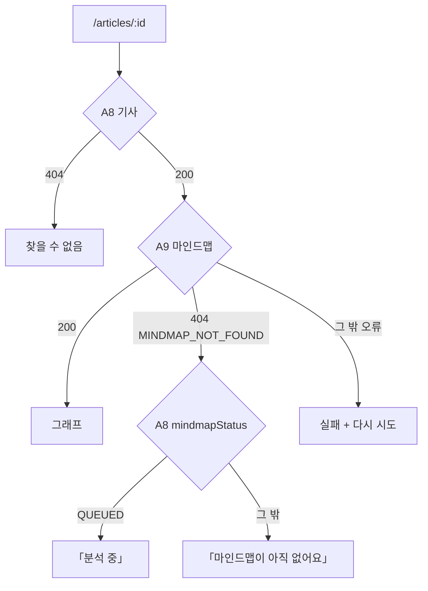

# S15P31A102-58 기사 마인드맵 1차 — 화면 뼈대와 마인드맵 보기

## 무엇을 / 왜

기사 행(홈 최신 기사 · 사건 패널 관련 기사)을 누르면 `/articles/:id` 로 가는데, 지금은 찾을 수 없음 화면이다. 그 자리에 기사 마인드맵 화면을 만든다. 1차는 **화면 뼈대(헤더 · 보기 탭 · 상태)와 마인드맵 보기**(F04 기사 마인드맵 생성의 그래프)다. 흐름지도 보기는 2차 MR 이다.
2026-10-30 사용자와 정한 것: 그래프부터, 가지 색은 프로토타입 4색, 가지 토글은 범례 칩 + 탐색 설정은 「라벨 표시」, 노드는 정해진 자리에 놓는다(force · 끌기 없음).

A8(기사) · A9(마인드맵)는 함께 부른다. 화면은 이렇게 갈린다.



## 정한 것 (사용자가 볼 것)

| 무엇 | 정한 값 | 근거 |
| --- | --- | --- |
| 주소 | `/articles/:articleId`. 보기는 `?view=map` · `?view=flow`. **1차 동안은 `view` 가 없으면 마인드맵**이고, 2차에서 흐름지도를 기본으로 바꾼다. 탭을 바꿔도 기록은 쌓지 않는다 | EXP 62 · 74 `[가정]` |
| 헤더 | 「경제 · 이슈 제목」 한 줄(이슈가 없으면 분야만) · 제목 h1 · 「바른신문 · 2026.10.06 14:30 · 기자」(00:00 이면 날짜만, 기자가 없으면 뺀다) · *원문 보기*(새 탭) · 이슈 보기 | 프로토타입 `MindmapScreen` |
| 이슈 보기 | `issue` 가 있으면 버튼 → `/issues/:id?event=:eventId`. `QUEUED` 면 「사건을 찾는 중이에요」, `SUCCEEDED` 인데 `issue` 가 없으면 「아직 이슈로 묶이지 않았어요」. `NONE` · `FAILED` · `NO_EVENT` 면 아무것도 두지 않는다 | EXP 158 `[가정]`. 마지막 줄은 내가 정함 |
| 보기 탭 | 「흐름지도」 · 「마인드맵」 (SEED Tabs). 탭 줄 오른쪽에 「AI 생성」 표시 | 프로토타입 · EXP 101 |
| 흐름지도 탭 (1차) | 「흐름지도 보기는 준비 중이에요」 | 2차 MR 에서 채운다 |
| 그래프 배치 | 가운데 기사 제목(민트 원). 가지 원 네 방향 — 핵심 오른쪽 위 · 원인 왼쪽 위 · 반응 오른쪽 아래 · 전망 왼쪽 아래. 가지는 x ±220, y ±max(140, (잎 수−1)×29+72). 잎은 가지에서 바깥으로 230, 위아래 58 간격. 잎 글은 바깥쪽 13px, 3줄까지 줄바꿈 | 프로토타입 `buildMindmapGraph` 의 목표 좌표에 바로 놓는다 |
| 가지 이름 | 분류명(핵심 내용 · 원인·배경 · 반응 · 전망) 14px 굵게 + 질문(무슨 일이? …) 12px | 프로토타입 · api-screen 3절 |
| 색 | 가지마다 채움 · 테두리 · 선 · 글자 4색(프로토타입 `MM_TONE`). 테마 토큰 16개로 더하고 DESIGN.md 에 적는다. 글자색 4개는 흰 바탕 대비 약 5.1~7.2:1 (어림 계산, 구현 때 다시 잰다) | 사용자 결정 |
| 확대 · 이동 | 휠 · 끌기로 0.25~3배. 왼쪽 아래에 축소 · 확대 · *화면에 맞추기*(여백 24, 1.15배까지). 처음 열 때와 그래프 영역 크기가 바뀔 때 화면에 맞춘다 | 프로토타입 `ZoomControls` · EXP 132 |
| 가지 포커스 | 가지 원을 누르면 그 가지만 화면에 맞추고(여백 64, 1.7배까지) 나머지는 흐리게 한다. 다시 누르기 · 빈 곳 · Esc · *화면에 맞추기* 로 전체로 돌아간다 | 프로토타입 · EXP 132 |
| 잎 강조 | 잎을 누르면 채워서 강조하고, 다시 누르면 풀린다. 상세 카드는 띄우지 않는다 | EXP 132 (상세는 -59) |
| 가지 토글 | 그래프 위 범례에 가지 칩(있는 가지만, `aria-pressed`). 누르면 그 가지와 잎을 숨기고 다시 누르면 되살린다. 하나라도 숨겼으면 「모두 보기」 | Jira 58 완료 기준 · 사용자 결정 |
| 전망 · 해석 | 전망 가지의 잎은 점선 원. 범례에 「점선 · 전망·해석」 | Jira 58. A9 에 잎마다의 표시가 없어 전망 가지 전체로 정함 |
| 탐색 설정 | 그래프 오른쪽 위 톱니 버튼 → 아래로 열리는 팝오버에 「라벨 표시」 스위치(기본 켬). 끄면 잎 글을 숨기고, 강조 · 키보드 포커스 · 마우스를 올린 잎만 글을 보인다 | 프로토타입 「그래프 설정」 중 라벨 표시만. 자리는 프로토타입(오른쪽 아래)과 달리 위 — 개발 도구 버튼 · 스낵바와 겹쳐서 (6단계에서 바꿈) |
| 키보드 | 노드마다 Tab 으로 가고 Enter · Space 로 누른다. 포커스 테두리가 보인다. Esc 는 설정 팝오버 → 포커스 · 강조 순으로 닫는다 | EXP 171 · 172 · 193 |
| 동작 줄이기 | 켜져 있으면 확대 · 이동에 애니메이션을 쓰지 않는다 | EXP 183 |
| 상태 | 헤더: 스켈레톤 · 「기사를 불러오지 못했어요」+ 다시 시도. 그래프: 스켈레톤 · 「마인드맵을 불러오지 못했어요」+ 다시 시도 · 분석 중 「기사를 분석하고 있어요」 · 그 밖 「이 기사의 마인드맵이 아직 없어요」 · 모르는 판 「이 마인드맵은 지금 보여 드릴 수 없어요」 · 가지가 0개 「이 기사에서 정리한 내용이 없어요」. 기사 404 는 찾을 수 없음 「기사를 찾을 수 없어요」 | EXP 142 ~ 145 · 157. 미정 문구(EXP 258)는 내가 정함 `[가정]` |

## 만들 구조

```
frontend/src/
├─ pages/ArticlePage.tsx (+test)                🆕 `/articles/:articleId` — A8 · A9, 보기 탭(?view=), 상태 분기
├─ components/article/ArticleHeader.tsx (+test) 🆕 분야 · 이슈 줄 · h1 · 언론사 · 일시 · 기자 · 원문 보기 · 이슈 보기
├─ components/article/branches.ts               🆕 가지 이름(분류명 · 질문) · 색 클래스 — api-screen 3절
├─ components/article/mindmapLayout.ts (+test)  🆕 정해진 자리 · 잎 글 줄바꿈 · 경계 상자(화면에 맞추기용) — 순수 함수
├─ components/article/MindmapGraph.tsx (+test)  🆕 SVG 그래프 — d3-zoom · 화면에 맞추기 · 가지 포커스 · 잎 강조 · 키보드
├─ components/article/MindmapView.tsx (+test)   🆕 범례 · 가지 토글 · 모두 보기 · 탐색 설정 팝오버 + 그래프
├─ lib/date.ts (+test)                          ✏️ 기사 일시 「2026.10.06 14:30」
├─ lib/motion.ts                                🆕 동작 줄이기 판정 — Timeline.tsx 에 있던 것을 옮겨 둘이 함께 쓴다
├─ components/issue/Timeline.tsx                ✏️ 위 함수를 import 로만 바꾼다
├─ routes.tsx (+test)                           ✏️ `/articles/:articleId` (셸 안, 손님 가드 안)
├─ newlearn-theme.css · newlearn-theme.test.ts  ✏️ 가지 4색 토큰 16개와 그 값 검사
frontend/seed-design/ui/switch.tsx              🆕 SEED CLI 로 들여온다 (라벨 표시)
_bmad-output/…/DESIGN.md                        ✏️ 가지 4색(새 역할), 「아직 정하지 않은 것」의 F04 줄
_bmad-output/…/EXPERIENCE.md                    ✏️ 기사 마인드맵 · 보기 탭 행 — 가지 토글 · 라벨 표시 · 1차 기본 보기
```

가짜 API(A8 · A9)는 이미 있다 — 잎 2개 가지(11901), 가지가 빠진 기사, 분석 중 기사(119번 사건 마지막 기사). 테스트에서 더 필요한 모양은 `server.use` 로 만든다.

## 안 바꿀 것

- 흐름지도 보기(2차 MR) · 노드 상세 패널과 원문 근거(-59) · 생성 진행 · 실패 화면(-61) · 북마크 버튼(-67)
- 프로토타입에만 있는 전체 화면 · TIP · 노드 끌기 · 노드 간격 · 다시 정렬 · 호버로 나머지 흐리기
- 기사를 열 때 사이드바 접기 — EXPERIENCE 에 규칙이 없다
- 백엔드 · `docs/api*.md` · mvp-overview · 가짜 API 응답 모양

## 리스크

- **원인 · 배경 가지 색(#8DBF3F · #4F7A12)이 DESIGN.md 「올리브색 쓰지 않기」에 걸릴 수 있다.** 사용자가 프로토타입 4색을 골랐으니 그대로 쓰고 MR 에 짚는다
- 잎 문장이 길면 3줄에서 자른다 — 전체 글은 `aria-label` 과 `title` 에 둔다. 잎이 많으면 가지가 위아래로 길어진다(잎 수 상한 없음)
- jsdom 은 SVG 크기를 못 잰다 — 타임라인처럼 크기를 직접 주고, 배치 계산은 순수 함수로 따로 테스트한다
- d3-zoom 의 끌기와 노드 · 빈 곳 클릭이 겹친다 — 끌고 난 뒤의 클릭이 포커스를 풀지 않게 타임라인과 같은 방식으로 가린다
- 1차 동안 기본 보기가 마인드맵이라 EXPERIENCE(흐름지도 기본)와 다르다 — EXPERIENCE 에 1차 임시 규칙으로 적고 2차에서 되돌린다
- 빌드 크기 — SEED Switch 와 새 화면만큼 는다. d3 는 이미 들어 있다

## 어떻게 검증하나

- `frontend/` 포맷 · 린트 · 타입 · 테스트(Node 26) · 빌드
- 새 테스트
  - 배치: 가지 네 자리 · 잎 간격 · 없는 가지는 그리지 않음 · 잎이 많아도 위아래 가지가 겹치지 않음 · 줄바꿈 · 경계 상자
  - 일시: 00:00 이면 날짜만
  - 헤더: 경로 줄 · 메타 · 원문 보기 새 탭 · 이슈 보기 네 경우
  - 그래프: 가지 · 잎 이름, 전망 점선, 가지 포커스와 풀기(다시 누르기 · 빈 곳 · Esc · 화면에 맞추기), 잎 강조와 풀기, Enter · Space, 확대 · 축소 버튼
  - 범례 · 설정: 가지 토글과 되살리기 · 모두 보기, 라벨 끄기, 팝오버 Esc 가 먼저 닫힘
  - 화면: `?view=` 와 기록 안 쌓기, 로딩 · 분석 중 · 없음 · 실패와 다시 시도 · 모르는 판 · 가지 0개 · 기사 404, 탭 제목, 셸 안 · 손님 가드
  - 테마: 가지 토큰이 DESIGN.md 값과 같다
- 되돌림 확인: 가지 토글 · 포커스 풀기 · 기록 안 쌓기 · 이슈 보기 분기 · 분석 중 분기를 깨면 그 테스트가 실패하는지
- 화면: `dev:mock` 을 Chrome 으로 1280 · 900 · 375px — 기사 11901 · 가지가 빠진 기사 · 분석 중 기사, 확대 · 포커스 · 토글 · 라벨 끄기 → `.notes/mr/S15P31A102-58/`
- 리뷰: `reviewer` 조수

## 되돌리는 법

이 MR 을 revert 하면 `/articles/:id` 가 다시 찾을 수 없음 화면이 된다. 토큰 · DESIGN.md · EXPERIENCE.md 변경도 같이 되돌아간다. 데이터 · 배포 · 인증과는 상관없다.

## 작업 순서

브랜치: `git nb feat frontend 58 article-mindmap`

- [x] `feat(frontend)`: 가지 4색 토큰 — 테마 · 테마 테스트 · DESIGN.md — `a07d1d0`. 테두리색 셋이 흰 바탕 3:1 에 못 미쳐(2.2 ~ 2.6) DESIGN.md 에 「노드는 가지 이름과 함께」를 적음
- [x] `feat(frontend)`: 기사 일시 표기 (`lib/date.ts`) — `90cf4e8`. 커밋 게이트에서 기존 사건 패널 첫 테스트가 PC 가 느릴 때 흔들려(Node 24 전체에서만) 그 대기를 3초로 — `0b98a50`, SSOT 8절에 기록 — `8ab1730` (계획에 없던 일, 사용자 결정)
- [x] `feat(frontend)`: 마인드맵 배치 계산 (`mindmapLayout.ts`) — `3e03beb`. 가지 표 `branches.ts` 도 여기서. 한 줄은 가운데 제목 · 잎 모두 14자. 변이 5가지(가지 높이 · 잎 방향 · 글 폭 · 포커스 가지 · 「…」)를 각각 테스트가 잡음
- [x] `feat(frontend)`: 마인드맵 그래프 — 그리기 · 확대 · 화면에 맞추기 · 가지 포커스 · 잎 강조 · 키보드 (동작 줄이기 판정을 `lib/motion.ts` 로) — `071b371`. 계획에 없던 것: 「키보드로 받은 포커스에만 테두리」도 타임라인에서 `components/useKeyboardInput.ts` 로 빼 함께 쓴다. 잎을 누르면 강조만 한다(프로토타입은 가지로 확대까지 — EXPERIENCE 「세부 노드는 강조」를 따름). 변이 8가지를 테스트가 잡음
- [x] `feat(frontend)`: 범례 · 가지 토글 · 라벨 표시 설정 (SEED Switch 스니펫) — `e439d6a` 스니펫, `97d3176` 기능. 그래프의 「포커스가 바뀌면 맞추기」를 한 효과로 모았다(가지를 끄면 포커스가 풀리며 전체로). 라벨을 끄면 강조 · 키보드 포커스 · 마우스를 올린 잎만 글을 보인다. 변이 7가지를 테스트가 잡음
- [x] `feat(frontend)`: 기사 화면 — 라우트 · 헤더 · 보기 탭 · 상태 — `f83ebb3`. 주소 id 읽기를 `lib/id.ts` 로 옮겨 이슈 화면과 함께 쓴다(계획에 없던 것). 화면 확인에서 찾아 고친 것 — `be3825e`: SEED 탭이 안 고른 내용에 `aria-hidden` 만 달아 빈 흐름지도 자리가 높이를 반 차지함, `left-x4` 같은 위치 클래스가 SEED 테마에 없어 확대 버튼이 안 보임, 설정 톱니가 개발 도구 버튼에 가려 오른쪽 위로 옮김. 변이 8가지를 테스트가 잡음
- [x] 계획에 없던 일 — 테스트 기본 대기 1초 → 3초(`cdec191`, SSOT 7절 `5331a1e`). PC 가 바쁠 때 여러 파일의 첫 테스트가 돌아가며 실패해서(사용자 결정). 사건 패널 하나에 달았던 3초(`0b98a50`)는 되돌림
- [x] `docs(frontend)`: EXPERIENCE 기사 마인드맵 · 보기 탭 행 — `81e14fc`. IA · 보기 탭 · 분석 중 · 사건 연결 상태 줄, 「아직 정하지 않은 것」의 문구 줄을 줄이고 좁은 화면 마인드맵 줄을 더함
- [x] 화면 확인 · `/verify` · `reviewer` 반영 — `26b716b`. 리뷰는 위험한 네 파일만(그래프 · 범례와 설정 · 화면 · 헤더, 사용자 결정). 꼭 고칠 것 3건(「모두 보기」 뒤 포커스가 사라짐 · 설정 창 Esc 가 서랍 안 Esc 까지 가로챔 · 기사 실패 + 결과 없음이면 끝없이 불러오는 중)과 선택 6건(탭 순서 · 가지 묶음 이름 · 가운데 제목 낭독 빼기 · 3px 안 움직임은 클릭 · AI 생성은 그릴 때만 · 이 표 39행)을 고침. 「글자도 누르기」는 사용자 결정 — 줄 사이 틈이 빈 곳으로 잡혀 글 영역에 누르는 면을 깔았고 브라우저로 확인(jsdom 은 CSS 를 몰라 단위 테스트로 못 지킴)
- [x] 이 계획 파일을 `docs/plans/2026-10-30-article-mindmap.md` 로 옮기고 체크 — `438fae2`

## 하지 않은 것 · 남은 것

- 흐름지도 보기(2차 MR) — 그때 기본 보기를 흐름지도로 되돌린다. 좁은 화면 마인드맵(26%)도 그때 정한다 (EXPERIENCE 「아직 정하지 않은 것」)
- 리뷰 선택 중 남긴 것 — 확대 코드를 타임라인과 함께 쓰는 훅으로 빼기, 설정 창을 SEED Popover 로, 다시 시도 버튼이 자기를 지워 포커스를 잃는 것(앱 전체 패턴), 탭을 바꾸면 그래프 설정이 처음으로 돌아가는 것(2차), 잘린 잎 글이 두 번 읽히는 것
- 분석 중(`QUEUED`) 상태가 저절로 바뀌지 않는다 — 생성 진행은 S15P31A102-61
- DESIGN.md 에 마인드맵 노드 모양 · 배치 옮기기
- 실제 스크린 리더 · Safari · Firefox · 터치 기기로는 보지 않았다
