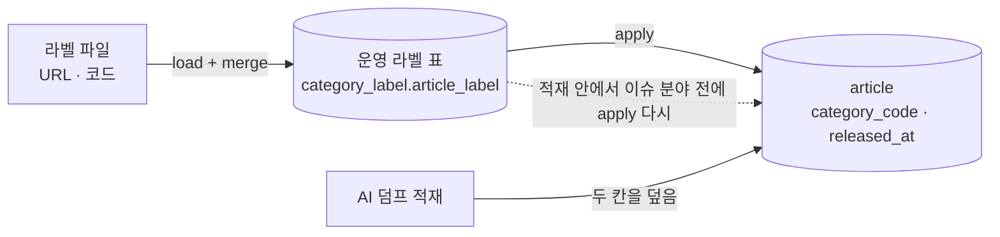

# 기사 분야 라벨을 운영에 넣고, 스포츠 · 문화/연예를 화면에서 빼기 · 제목 조각 고치기

Jira S15P31A102-177(A) · 178(B) · 179(C), 171 과 연결. 2026-11-05 사용자 승인. A 는 같은 날 운영 반영(`SSOT.md` 10절).

## 무엇을 / 왜

정치 탭에 뉴욕 증시 · 연예 · 축구 기사가 섞여 있다. NewsData 값이 흔들려 규칙을 더 붙여도 한계가 있어, 79,335건 제목을 Sonnet 으로 읽어 7개 분야 라벨을 만들었다(언론사 URL 섹션과 일치 77.3%, 지금 분류 68.2%).

**일은 셋으로 나누고, 이번에 승인받을 것은 A · B 다.**

| | 무엇 | 언제 | 바꾸는 것 |
|---|---|---|---|
| A | 라벨을 운영에 넣고 기사 3,407건을 숨긴다 | 오늘 | SQL · 문서. 앱 코드 없음 |
| B | 제목의 `quot;` 같은 조각을 고친다 | 11/8 까지 운영 반영(못 하면 적재 뒤) | backend · V13 |
| C | 기사가 모두 숨겨진 이슈 · 사건을 화면에서 뺀다 | 11/13 적재 전 | backend. 코드 전에 따로 계획 |

운영에 이슈 · 사건이 아직 0건이라 A 는 C 를 기다리지 않아도 된다.



## 반영 뒤 모습 (A 의 기대값)

| 분야 | 지금 | 반영 뒤 |
|---|---|---|
| 사회 | 16,872 | 26,954 |
| 경제 | 25,817 | 26,720 |
| 정치 | 16,720 | 11,499 |
| 국제 | 6,662 | 6,856 |
| IT·과학 | 12,094 | 3,899 |
| 분야 없음 | 1,171 | 1 (시험 기사 2번) |
| **공개 합** | **79,336** | **75,929** |

숨김 3,407건 — 문화/연예 2,859 · 스포츠 538 · 제목이 깨진 기사 10. 시험 기사 1 · 2 는 덤프 적재 때 지워진다(`infra/server/data-load.md` 6절).

## A. 라벨 반영

### 정한 것과 까닭

| 물음 | 정한 것 | 까닭 |
|---|---|---|
| 숨기는 법 | `released_at` · `category_code` 를 비운다 | 기사 쪽 조회(A1 분야 목록 수 · A7 최신 기사 · A8 기사 상세 · A9 마인드맵 · A6 사건 관련 기사 · A13 통합 검색의 기사 · 북마크)가 코드 변경 없이 빠진다. `category` 에 두 행을 더하면 A1 분야 목록 · 회원 가입에 나타나 2026-10-20 「5개」 결정을 뒤집는다. 이슈 · 사건은 안 빠진다 — C |
| 라벨을 어디에 두나 | 운영 DB 스키마 `category_label` 의 표 하나(`url` · `label` · `run` · 옛 `category_code` · 옛 `released_at`). Flyway 밖 | 79,335줄 데이터라 마이그레이션 · 저장소에 안 맞는다. `load_undo` 와 같은 방식이고 매일 백업에 같이 들어간다 |
| 덤프가 덮으면 | 적재 트랜잭션에서 이슈 분야 계산 자리에 `apply` 를 부른다. 끝에 「라벨이 T · C · X 인데 공개된 기사 0」을 단언해 어기면 통째로 되돌린다 | AI 의 덤프 약속을 바꾸지 않는다. 라벨이 늘 이긴다 |
| 이슈 분야 | `apply` 안에서 다시 계산한다(`IssueCategoryRepository.java` 와 같은 식). `data-load.md` 의 계산 단계는 이 파일을 가리킨다 | 덤프 뒤 라벨을 돌려도 A2 이슈 목록의 분야 탭 · A1 이슈 수가 낡지 않는다 |
| 11/4 뒤 기사 | 지금 라벨링하지 않는다. **공개된 뒤** 「라벨 없는 공개 기사」를 같은 절차로 돌린다(적재 직후 한 번, 11/16 뒤 그때그때) | 공개 안 될 기사는 읽을 까닭이 없다. 사용자 결정 「수집하고나서 매번 … 매일 할 것도 아니고」. 스크립트 · 뽑는 SQL 은 적재 전 작은 MR 로 |
| 깨진 제목 10건 | 코드 `X` 로 숨긴다. 기준은 U+00C0 ~ U+024F 글자 6자 이상(문턱 3 ~ 8 모두 같은 10건) | 본문은 멀쩡하지만 제목이 읽히지 않는다(조세일보 9 · 노컷 1). 10건 때문에 인코딩을 되살리는 코드를 만들지 않는다 |
| V12 제목 규칙 | 그대로 둔다 | 라벨 전 새 기사의 첫 값으로 쓰인다 |

### 바꿀 파일

| 경로 | 무엇을 |
|---|---|
| `infra/server/category-labels.md` (새) | 절차 · 조수 지시문 · 되돌리기. 이 일의 단일 문서 |
| `infra/server/category-labels-load.sql` (새) | 스키마 · 표 · 임시 표를 만들고, 마지막 문장이 `COPY … FROM STDIN`(텍스트 형식) |
| `infra/server/category-labels-merge.sql` (새) | 받은 줄 수 = `:expected` 단언, 처음 보는 URL 만 옛 값 저장, 라벨 합치기 |
| `infra/server/category-labels-apply.sql` (새) | **코드 → 분야 대응의 단일 자리.** `article` 갱신 · 숨김, 이슈 분야 다시 계산, 수 출력(기사가 모두 숨겨진 사건 수 포함). 스키마 이름을 모두 붙이고 트랜잭션 명령을 쓰지 않는다 — 적재 안에서도 불리고, 그때 `search_path` 가 비어 있다 |
| `infra/server/category-labels-undo.sql` (새) | `-v run=` 으로 그 실행분만 옛 값으로 |
| `infra/server/data-load.md` | 3절 `category_code` 행 · 5절 검사 · 알림 · 6절 R1(라벨 먼저) · 5단계 · 적재 뒤 확인(A8 기사 상세 표본은 숨기지 않은 기사로) · 2절 목록(10/21 ~ 11/3 날짜를 주면 숨긴 기사가 나온다) · 7절 · 8절 B1 경고 |
| `infra/server/ingest.md` | 176줄 · 「15분 모드」 절 |
| `docs/api-internal.md` | 108줄 — 숨긴 기사에 작업 행이 없으면 B1 분석 투입이 409 가 아니라 202, GMS 를 부르고 다시 공개된다 |
| `docs/data-model.md` | `category_code` · `released_at`(249줄 「다시 분석해도 그대로」), 214줄(대응 표로 다시 계산하면 라벨이 덮인다 → `apply` 다시) |
| `docs/api.md` | 52줄 공개 전 기사에 숨김 추가, 변경 표 한 줄 |
| `docs/specs/F01-article-ingest-api.md` | AC-8 — B2 기사 적재가 고르는 값은 첫 값이고 라벨이 덮는다 |
| `SSOT.md` | 9절(대표 카테고리 · 화면 범위) · 6절 · 10절(잰 값) |

표의 숫자 · 코드 대응은 위 단일 자리와 이 계획에만 두고, 문서는 가리킨다.

### 넣는 순서 (운영은 사용자 몫, 파일 카드로)

1. **일회용 DB 시험** — `compose.yaml` DB + 마이그레이션 + B2 기사 적재로 약 200건. 맞춤 · 숨김 · 두 번째는 0건 변경 · 되돌리기 · 빈 `search_path` 에서 `apply` · 줄 수가 틀리면 멈춤 · 끝이 `rollback` 이면 아무것도 안 남음
2. **MR 머지** — SQL · 문서를 dev 에
3. **숨김 목록** — `labels.tsv` 를 만든다(`URL<탭>코드`, `C:/tmp/labels/all-labels.tsv` 에 `X` 를 덮음, 일회용 스크립트). SQL 과 함께 서버로 보낸다
4. **백업** — 수동 백업 Job(`C:\tmp\169-steps\01-preload.md` ②)
5. **`rollback` 실행** — 위 표와 대조, 같이 숨는 북마크 수(지금 0 예상), 걸린 시간, DB 크기 전후
6. **`commit` 실행** — 10:00 ~ 10:30 을 피한다
7. **화면 확인 · 캡처**, 서버의 `labels.tsv` 지우기
8. **AI 팀에 숨김 URL 목록 전달(사용자, 11/9 견본 전 필수)** — 10/21 ~ 11/3 숨긴 기사는 분석에서 빼 달라는 부탁. 약 3,400건 × 8 크레딧을 아끼고 스포츠 이슈가 덜 생긴다. 알림 초안 `C:\tmp\169-steps\02-notices.md` 를 고쳐 드린다

```bash
{ echo 'begin;'; cat category-labels-load.sql labels.tsv; printf '\\.\n'; cat category-labels-merge.sql category-labels-apply.sql; echo 'rollback;'; } | kubectl -n data exec -i postgres-0 -- psql -X -v ON_ERROR_STOP=1 -v expected=79335 -v run=first -U newlearn -d newlearn
```

끝의 `echo 'rollback;'` 을 `echo 'commit;'` 으로 바꾼 것이 6번이다. `begin` 이 없으면 `rollback` 이 경고만 내고 앞 문장이 커밋되므로(리뷰가 로컬에서 실측) 맨 앞에 둔다.

## B. 제목 조각 고치기

**운영 반영은 11/8 까지, 못 하면 dev 머지부터 덤프 적재 뒤로 미룬다.** 배포 태그 머지는 수집 시간(10:00 ~)과 도는 Job 을 피한다. 교체 중 옛 Pod 가 B2 를 받으면 조각 든 제목이 남으니, 반영 뒤 「V13 식으로 바뀌는 행」을 세고 남았으면 V13 과 같은 UPDATE 를 돌린다. 11/10 ~ 적재 사이에 오르면 견본은 V12 로 통과하고 최종 덤프가 판 검사에서 멈춘다.

### 바꿀 파일

| 경로 | 무엇을 |
|---|---|
| `backend/.../ingest/ArticleTitleCleaner.java` (새) | 아래 표로만 되돌린다 |
| `backend/.../ingest/ArticleIngestService.java` | `insert` 에서 고친 제목으로 저장 · 규칙 판단 |
| `backend/.../db/migration/V13__article_title_html_fragments.sql` (새) | 이미 들어온 제목에 같은 표 |
| `backend/src/test/...` | `ArticleTitleCleanerTest`(V13 파일과 표가 같은지, `ForeignPoliticsTitleRuleTest` 방식) · 적재 통합 시험 · 마이그레이션 시험 · `InterestIssueSchemaTest` 판 목록 13 |
| `docs/api-internal.md` · `docs/specs/F01-article-ingest-api.md` | B2 기사 적재의 `title` 처리, 새 성공 기준 번호 |
| `docs/data-model.md` · `docs/api.md` · `infra/server/data-load.md` · `SSOT.md` | 제목 처리 · 변경 표 · 판 V13 · 잰 값 |

### 표

운영 전체 91,775건의 세미콜론 앞 낱말을 전수로 읽은 결과, 아래 말고는 없다. 없는 조각은 넣지 않는다.

| 조각 | 글자 | | 조각 | 글자 |
|---|---|---|---|---|
| `quot;` | `"` | | `rdquo;` | `”` |
| `hellip;` | `…` | | `rarr;` | `→` |
| `middot;` | `·` | | `uarr;` | `↑` |
| `lsquo;` | `‘` | | `ndash;` | `–` |
| `rsquo;` | `’` | | 앞이 영문 아닌 `lt;` · `gt;` | `<` · `>` |
| `ldquo;` | `“` | | 대문자 사이 `amp;` (`Ramp;D`) | `&` |

영어 낱말 끝(`result;` · `camp;`)은 앞 글자 조건으로 건드리지 않는다. 리뷰가 표 후보를 79,335건 · 무작위 6만 건에 돌려 적용 순서 차이 0, 두 번 돌린 차이 0, 바뀐 제목 824건, 남은 조각 0, V12 규칙 결과 변화 0건을 확인했다(Java 실제 코드 대조는 시험으로).

## C. 기사가 모두 숨겨진 이슈 · 사건 (따로 계획)

A2 이슈 목록 · A4 이슈 타임라인 · A5 사건 패널 · A13 통합 검색의 이슈 · 사건 제목은 `released_at` 으로 걸러지지 않는다(`IssueQueryRepository.java:26-42` · `IssueService.java:76` · `EventService.java:42` · `SearchQueryRepository.java:26-45`). 화면은 기사 수 0 을 그리지 않아 스포츠 이슈가 평범한 카드로 보인다.

**방향: 공개 기사가 하나도 없는 이슈 · 사건은 조회에서 없는 것으로 본다.** 지우지 않는다(되돌릴 수 있고 북마크 · 관심 이슈가 안 사라진다). A3 이슈 헤더까지 포함해 범위는 코드를 읽고 따로 계획한다. 11/13 적재 전 완료, 견본 덤프로 시험한다.

## 안 바꿀 것

- 프런트엔드 — 「준비 중」 칩은 화면이 붙인다(`frontend/src/api/categories.ts`)
- `category` 5행 · `category_mapping` · V11 · V12 · `ForeignPoliticsTitleRule`
- 판정 스케줄러(`AnalysisJobRepository.java`) — 숨긴 기사도 판정이 멈추지는 않는다(리스크)
- 수집 배치 · 넣기만 설정 · `sqlite_to_b2.py` · 크롤링(계획에 없음 그대로)
- 기사 본문 · 덤프 표 목록 · 맞춤 열쇠(URL) · 덤프 행 규칙
- `docs/mvp-overview.md` · PRD(PM 문서, 바뀐 점은 알림 초안에만)
- IT·과학 다시 라벨링(사용자가 이대로로 정함), 언론사 이름 39곳

## 리스크

- **라벨도 틀린다.** 언론사 URL 섹션과 약 23% 다르다. 경제는 조금 낮고(82 → 79%), IT·과학은 12,094 → 3,899건으로 좁아진다. 경계 기사가 숨겨질 수 있다(예: 체육공단 지원 사업이 스포츠)
- **`apply` 는 라벨 없는 기사를 건드리지 않고, 공개는 절대 하지 않는다.** 숨기기만 한다. 임시 공개에서 내린 기사를 되살리지 않으려는 것이다. 잘못 숨긴 기사를 되살리는 일은 그 실행분 되돌리기나 손 SQL 이다
- **숨긴 기사에 B1 분석 투입을 걸면 다시 공개된다.** 작업 행이 없으면 202 로 GMS 를 부르고 EXTRACT 저장 때 공개한다(`ArticleReleaseService.java:33`, `Article.java:98`). 수집 배치의 B1 은 그 실행에서 받은 기사에 걸리고, 지난 기사는 8절의 날짜 범위 경고로 막는다. 어겨도 `apply` 를 다시 돌리면 숨겨진다
- **11/16 뒤 새 기사는 라벨 전까지 NewsData 값이다.** 라벨을 돌리기 전까지 어긋난 기사 · 스포츠가 잠시 보이고, 숨겨도 줄에서 기다리던 판정은 GMS 를 쓴다
- **11/4 뒤 기사는 분석 전에 라벨이 없다.** 덤프에 스포츠 기사가 들어와 이슈가 생길 수 있어 C 가 필요하다. 섞인 이슈는 숨긴 기사만 빠진다
- **B 와 덤프** — 로컬 DB 가 V13 전이면 제목이 달라 적재가 멈춘다 → AI 팀에 알리고 견본에서 잡는다
- **운영 갱신** — 약 3만 6천 행. 조회는 막히지 않는다. 시간 · 죽은 행은 5번 실행에서 잰다
- 라벨링 토큰 — 공개되는 만큼 든다. 실측 2,000건에 약 20만 토큰, 약 100만 토큰에 주간 한도 1점

## 어떻게 검증하나

**A**
- 일회용 DB — 「넣는 순서」 1번 전부. 빈 `search_path` · 줄 수 틀림 · `rollback` 뒤 표 없음 포함
- 운영 `rollback` 실행 — 라벨 79,335, 위 표의 분야별 수(맞춘 수는 시험 기사 1번 때문에 단언하지 않고 본다)
- 운영 `commit` 뒤
  - A1 분야 목록의 `articleCount` 다섯이 표와 같다
  - 사용자가 든 제목: 테네리페 · 김종서는 A13 통합 검색에 없고 A8 기사 상세 404, 뉴욕 증시 · 제네시스는 경제, 수감 부모는 사회
  - 정치 탭 첫 화면 캡처, 앱 Healthy · health 200

**B**
- `./gradlew test` 전체, 고친 코드를 되돌려 새 시험이 단언에서 빨개지는지
- V13 ↔ Java 가 같은 제목 표로 같은 결과(시험)
- 운영 — V13 식으로 바뀌는 행 0건(글자 검색이 아니라 같은 식으로 잰다), 「권영세」 제목이 `"당대표 나설 생각 있다"…` 로 보임

**A · B 공통** — MR reviewer 조수 · `/feature-done` · Jira 완료.

## 되돌리는 법

- **A, 적재 전** — `category-labels-undo.sql`(`run=first`) 로 옛 `category_code` · `released_at` 으로 돌리고 라벨 표를 지운다
- **A, 적재 뒤** — `data-load.md` 7절 → undo(`run=first`) → 표 지우기 순서를 지킨다. 표를 먼저 지우면 3,407건의 옛 값이 백업에만 남는다. **덤프는 두고 라벨만 되돌리기는 지원하지 않는다.** 라벨을 바꾸려면 새 라벨 파일을 넣는다
- **B** — 🔴 **V13 은 되돌릴 수 없다.** 고치기 전 제목은 V13 직전 백업과 원본 JSONL 에만 남는다. 코드는 호출만 빼는 MR 로 되돌리고 V13 파일은 둔다. V13 이전 이미지로 돌려도 backend 는 뜬다 — Flyway 는 새 판 파일이 없어도 통과한다(리뷰가 Flyway 12.4.0 일회용 DB 로 잼, 앱으로는 안 돌려 봄). 다만 옛 이미지가 조각 든 제목을 다시 넣고, 다시 올려도 V13 은 안 돈다. 그때는 같은 UPDATE 를 손으로 돌린다
