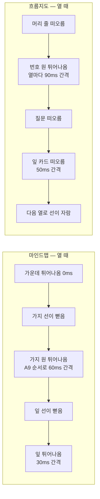

# 기사 마인드맵 두 보기 — 등장 · 호버 애니메이션

Jira 번호는 아직 없다(임시 `000`) — 티켓을 만들려다 권한에 막혀 사용자에게 맡겼다. 2026-11-05 사용자가 「흐름지도 · 마인드맵 부분 좀 더 예쁘게, 프로토타입처럼 애니메이션도 넣자, 쭈욱 진행해줘」라고 맡겼다. 커밋만 하고 푸시 · MR 은 요청 때.

## 무엇을 / 왜

F04 기사 마인드맵 생성의 두 보기는 모양은 프로토타입 v21 을 따랐지만 움직임이 없다 — 열면 다 그려진 채로 뜨고, 마우스를 올려도 잎 글만 보인다. 프로토타입의 움직임(노드가 가운데부터 튀어나옴 · 열이 차례로 떠오름 · 호버하면 커지고 이웃만 또렷 · 포커스 밖은 흐림 + 번짐)을 옮긴다. 배치 · 가지 색 · 데이터는 그대로다. 겉모양이 바뀐 것은 하나 — 마인드맵 잎 글을 프로토타입처럼 한 단계 옅게(`fg-neutral-muted`) 두고 호버 · 강조 때 진하게 했다.

하나하나의 길이는 EXPERIENCE 「모션」 숫자를 지킨다 — 큰 움직임(튀어나옴 · 떠오름 · 선)은 300ms, 작은 움직임(호버 커짐 · 강조 튐 · 호버 흐림)은 200ms. 가지 포커스 흐림 + 번짐은 250ms(프로토타입 260ms). 프로토타입 길이(460 · 720 · 340ms)는 따르지 않고, 차례(지연)로 퍼져 나가는 느낌을 낸다.

## 바꿀 파일

- `frontend/src/newlearn-theme.css` — 키프레임 7개(튀어나옴 · 선 뻗기 · 짧게 떠오름 · 가로 · 세로로 자람 · 나타남 · 한 번 튐)
- `frontend/src/components/article/motion.ts` (새 파일) — 두 보기가 같이 쓰는 애니메이션 클래스(`motion-safe:animate-[…]`)와 지연 style
- `frontend/src/components/article/FlowView.tsx` — 등장 차례, 잎 카드 눌림 축소, 강조한 잎 원 튐
- `frontend/src/components/article/MindmapGraph.tsx` — 등장(노드 튀어나옴 · 선 뻗기), 호버(노드 1.12배 · 가지 원 둘레 채움 · 이어진 것만 또렷 · 이어진 선 진하게 · 잎 글 진하게), 가지 포커스 밖 흐림에 1.5px 번짐, 강조한 잎 원 튐
- `frontend/src/components/article/MindmapView.tsx` — 범례 칩 눌림 축소 · 색 전환
- 시험: `FlowView.test.tsx` · `MindmapGraph.test.tsx` 에 등장 차례 · 호버 · 강조 튐 · 「움직임은 모두 motion-safe」
- 문서: EXPERIENCE 「모션」 한 줄, DESIGN 「기사 마인드맵 두 보기」 표의 마인드맵 강조 · 흐리기 행과 새 호버 행. 같은 사실을 두 곳에 적지 않으려고 EXPERIENCE 보기 탭 행 · DESIGN 흐름지도 상태 행은 그대로 뒀다(카드 눌림은 「호버 · 눌림」 공통 규칙이 덮는다)

## 작업 순서

- [x] 계획 — 이 파일
- [x] 키프레임 · `motion.ts` · 흐름지도 등장 · 눌림 · 튐 (시험 먼저) — `FlowView.test.tsx`
- [x] 마인드맵 등장 · 호버 · 흐림 · 튐, 범례 칩 (시험 먼저) — `MindmapGraph.test.tsx`
- [x] 문서 — EXPERIENCE · DESIGN
- [x] 화면 확인 — 등장 중간 프레임 · 호버 · 동작 줄이기 캡처 (1440 · 393)

## 안 바꿀 것

- 배치(좌표 · 크기 · 4열/세로 기준) · 가지 색 · A9 데이터 · 상태 분기(불러오는 중 · 없음 · 실패)
- 프로토타입의 카드 그림자 · 카드 요약 줄 · 가로/세로 전환 · 힘 시뮬레이션(끌어 옮기기 · 노드 간격) — DESIGN 「카드에 그림자 넣지 않기」, A9 에 요약이 없음, 2026-10-30 「열 때마다 같은 모양」 결정
- 다른 화면(홈 · 이슈 · 목록)의 애니메이션 — 「전반적으로」가 앱 전체였는지 사용자에게 따로 묻는다

## 리스크

- 열고 1초 가까이 노드가 차례로 나온다. 그동안에도 누를 수 있다 — 늦게 나오는 잎은 잠깐 투명한 채 눌린다
- 선 뻗기는 `pathLength` 를 쓴다. 이를 모르는 브라우저는 뻗는 300ms 동안 선이 점선으로 보였다 이어진다
- 호버로 흐리기는 마우스 · 펜에서만 한다 — 터치는 누르면 마우스 흉내(`mouseenter`)가 와서 강조와 겹쳐 흐려진 채 남기 때문이다. 포인터 이벤트의 `pointerType` 으로 가른다
- 범례로 가지를 숨기면 그 가지에 걸린 호버도 푼다 — 숨긴 노드에서는 `pointerleave` 가 오지 않는다
- 흐림에 번짐(blur 필터)을 더한다. 노드가 30개 안팎이라 무겁지 않을 것으로 보지만 폰에서 끊기는지 본다

## 어떻게 검증하나

- 시험(새로): 흐름지도 — 머리 줄 → 열 차례 · 열 안 번호 원 → 질문 → 카드 차례, 강조한 원만 튐. 마인드맵 — 가운데 → 가지 선 → 가지 원 → 잎 선 → 잎 차례 · 가지는 A9 순서, 가지 · 잎 호버 때 이어진 것만 또렷 · 이어진 선 진하게, 터치는 흐리지 않음, 호버한 가지를 숨기면 흐림이 풀림, 강조한 잎 원만 튐 · 그 선 진하게. 두 보기 모두 애니메이션 · 크기 변화 클래스가 전부 `motion-safe:` 다
- 기존 시험 그대로 통과
- 화면: `dev:mock` 기사 11901 을 1440 · 393 에서 열고 등장 120 · 300 · 600ms 프레임, 호버, 가지 포커스를 찍는다. `reducedMotion: "reduce"` 로 열면 첫 프레임이 다 그린 모양이다
- 게이트: 포맷 · 린트 · 시험(Node 26) · 빌드

## 되돌리는 법

- 이 브랜치 커밋을 revert 하면 움직임만 빠지고 모양은 그대로다. 데이터 · 배포 · 인증과는 상관없다

## 한 일

- 화면 확인은 애니메이션을 시각마다 멈춰(`document.getAnimations()` 의 `currentTime`) 찍었다 — 마인드맵 80 · 220 · 400 · 600 · 1000ms, 흐름지도 100 · 300 · 500 · 800ms(1440), 폰 393 도 같다. Chrome 에서 `pathLength` 선 뻗기가 된다
- 동작 줄이기로 열면 남는 애니메이션은 SEED 탭 밑줄과 카드 테두리 색 전환뿐이다(키프레임 0개)
- 호버로 흐리는 값은 프로토타입 16% 대신 25% 로 했다 — 흐린 잎 글이 비쳐야 어디로 갈지 보인다
- 프로토타입처럼 가운데가 흐려지게 하지 않고, 잎에 마우스를 올리면 가운데 → 가지 → 그 잎 길을 함께 또렷이 둔다
- reviewer 조수 리뷰 반영(빨강 먼저): 가지 포커스 중 흐린 가지에 마우스를 올리면 포커스한 가지까지 흐려졌다 → 포커스한 가지 안의 호버만 친다. 키보드 포커스 링이 흐림 · 번짐 안에 들어가 안 보였다 → 키보드로 옮긴 노드의 가지는 흐리지 않고 마우스 호버를 놓는다. 잎이 많으면 1초를 넘었다 → 차례 지연에 상한(마인드맵 잎 5 · 흐름지도 카드 4). 꾸밈(호버 커짐 · 잎 글 진해짐 · 선 자람 · 카드 눌림)을 지우면 실패하는 단언을 더했다
- 남긴 것: 흐름지도 자리가 1024px 를 넘나들면(사이드바 접기 · 창 크기) 번호 원 사이 선만 다시 자란다. Safari · 실제 폰은 못 봤다

## 2차 — 더 풍성하게 (같은 날, 사용자 「애니메이션 효과들이 부족해, 전반적으로 밋밋해」)

1차는 EXPERIENCE 「모션」 숫자(하나 300ms 이하)에 맞춰 작게만 움직였다. 기사 화면을 그 숫자의 예외로 두고(랜딩 인사 · 홈 배경처럼) 키웠다. 데이터 · 배치 · 색은 그대로다.

- 마인드맵 — 노드가 부모 자리(가운데 · 가지)에서 날아 나와 넘쳤다 자리 잡고(650ms), 선이 그 노드를 따라 뻗는다. 가운데 원은 튀어나오며 파문, 다 나온 뒤 3초마다 파문. 잎은 둥실. 호버한 길 위로 점선이 흐른다. 강조한 잎에 파문
- 흐름지도 — 열 간격 300ms 로 1 → 2 → 3 → 4 차례. 번호 원이 튀어나오며 파문, 선이 자라며 그 끝을 따라 점이 다음 번호로 달려간다. 카드 호버는 2px 들림 + 원 1.25배(그림자 없음). 강조한 원에 파문. 머리 줄 점은 3초마다 파문
- 기사 머리 — 분야 → 제목 → 정보 → 버튼이 떠오른다 (`ArticleHeader.tsx`)
- 다 나오기까지 2초 안(차례 간격 상한). 꾸밈(파문 · 달리는 점 · 흐르는 점선)은 늘 opacity 0 이고 애니메이션 동안만 보여서 동작 줄이기면 안 보인다
- 시험(빨강 먼저): 날아 나오는 출발점 = 부모 자리, 선과 노드가 같은 때, 파문 · 둥실 · 흐르는 점선 · 강조 파문, 흐름지도 달리는 점 · 파문 · 카드 들림, 기사 머리 차례, 2초 안
- 확인: 40ms 씩 넘긴 프레임으로 GIF(`.notes/mr/S15P31A102-000/demo-map.gif` · `demo-flow.gif`). 영상(webm)은 Playwright ffmpeg 를 내려받아야 해서 하지 않았다. 동작 줄이기로 열면 키프레임 0개
- 리스크: 계속 도는 꾸밈(파문 · 둥실)이 글 읽기를 방해한다고 느끼면 끈다. 폰 성능은 아직 못 쟀다

## 3차 — 이슈 화면 (같은 날, 사용자 「이슈 흐름 저 부분도 애니메이션 넣어줘」)

같은 브랜치에서 이어 했다 — 움직임 클래스를 두 화면이 같이 쓰도록 `components/article/motion.ts` 를 `components/motion/screenMotion.ts` 로 옮겼다. 티켓이 정해지면 브랜치 이름을 「기사 · 이슈 화면 애니메이션」으로 바꾼다.

- 이슈 흐름(`Timeline.tsx`) — 레인 이름(막대가 자라고 글자가 나타남) → 메인 흐름 선이 왼쪽에서 오른쪽으로 같은 빠르기로 뻗고(사건 140ms 씩, 1초까지), 선 끝이 지나는 자리의 사건이 튀어나온다. 서브 흐름은 100ms 늦게, 라벨은 사건 120ms 뒤에, 달 눈금 · 이름은 그 자리를 따라. 호버 1.15배, 고르면 파문 + 바탕 · 날짜 표시가 튀어나옴, 툴팁이 나타남
- 사건이 나오는 때는 메인 흐름 처음 ~ 끝 사이 비율로 잰다 — 배치가 폭에 맞춰 늘어나도 비율이 같아 차례가 흔들리지 않는다
- 사건 패널(`EventPanel.tsx`) — 사건마다 속한 이슈 → 제목 → 날짜 → 요약 → 관련 기사(한 줄씩 50ms)를 새로 그려 떠오르게. h2 는 포커스 자리라 안의 글만, 이전 · 다음 버튼은 포커스를 지키려고 새로 그리지 않는다. 관련 기사 행은 `ArticleRow` 에 `enterDelay` 를 줄 때만 떠오른다(홈은 그대로)
- 이슈 머리(`IssueHeader.tsx`) — 분야 → 제목 → 요약
- 시험(빨강 먼저): 선 · 사건 차례와 같은 시각 사건, 서브 흐름 · 레인 이름 차례, 사건 40개도 2초 안, 고른 사건 파문 · 날짜, 호버 · 툴팁, 패널 차례 · 이전 · 다음 때 다시 그림, 이슈 머리 차례, motion-safe
- 확인: `.notes/mr/S15P31A102-000/demo-issue.gif` (열기 → 호버 → 고르기 · 패널). 전체 시험 중 마이페이지 2개가 PC 부하로 시간 초과가 났다가 따로 돌리면 통과했다(이번 변경과 상관없는 파일)
