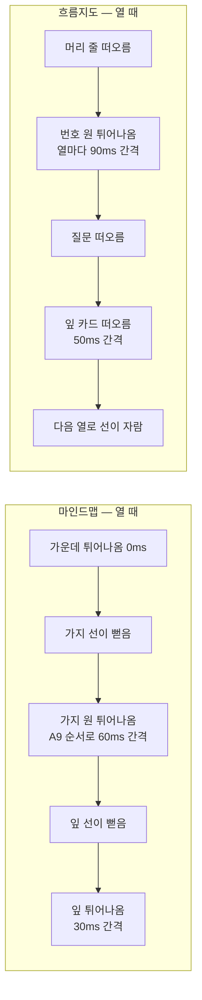

# 기사 마인드맵 두 보기 — 등장 · 호버 애니메이션

Jira 번호는 아직 없다(임시 `000`) — 티켓을 만들려다 권한에 막혀 사용자에게 맡겼다. 2026-11-05 사용자가 「흐름지도 · 마인드맵 부분 좀 더 예쁘게, 프로토타입처럼 애니메이션도 넣자, 쭈욱 진행해줘」라고 맡겼다. 커밋만 하고 푸시 · MR 은 요청 때.

## 무엇을 / 왜

F04 기사 마인드맵 생성의 두 보기는 모양은 프로토타입 v21 을 따랐지만 움직임이 없다 — 열면 다 그려진 채로 뜨고, 마우스를 올려도 잎 글만 보인다. 프로토타입의 움직임(노드가 가운데부터 튀어나옴 · 열이 차례로 떠오름 · 호버하면 커지고 이웃만 또렷 · 포커스 밖은 흐림 + 번짐)을 옮긴다. 배치 · 색 · 데이터는 그대로다.

하나하나의 길이는 EXPERIENCE 「모션」 숫자를 지킨다 — 큰 움직임(튀어나옴 · 떠오름 · 선)은 300ms, 작은 움직임(호버 커짐 · 강조 튐 · 흐림)은 200ms. 프로토타입 길이(460 · 720 · 340ms)는 따르지 않고, 차례(지연)로 퍼져 나가는 느낌을 낸다.

## 바꿀 파일

- `frontend/src/newlearn-theme.css` — 키프레임 7개(튀어나옴 · 선 뻗기 · 짧게 떠오름 · 가로 · 세로로 자람 · 나타남 · 한 번 튐)
- `frontend/src/components/article/motion.ts` (새 파일) — 두 보기가 같이 쓰는 애니메이션 클래스(`motion-safe:animate-[…]`)와 지연 style
- `frontend/src/components/article/FlowView.tsx` — 등장 차례, 잎 카드 눌림 축소, 강조한 잎 원 튐
- `frontend/src/components/article/MindmapGraph.tsx` — 등장(노드 튀어나옴 · 선 뻗기), 호버(노드 1.12배 · 가지 원 둘레 채움 · 이어진 것만 또렷 · 이어진 선 진하게 · 잎 글 진하게), 가지 포커스 밖 흐림에 1.5px 번짐, 강조한 잎 원 튐
- `frontend/src/components/article/MindmapView.tsx` — 범례 칩 눌림 축소 · 색 전환
- 시험: `FlowView.test.tsx` · `MindmapGraph.test.tsx` 에 등장 차례 · 호버 · 강조 튐 · 「움직임은 모두 motion-safe」
- 문서: EXPERIENCE 「모션」 한 줄 · 보기 탭 행의 호버, DESIGN 「기사 마인드맵 두 보기」 표의 마인드맵 · 흐름지도 상태 행

## 작업 순서

- [ ] 계획 — 이 파일
- [ ] 키프레임 · `motion.ts` · 흐름지도 등장 · 눌림 · 튐 (시험 먼저) — `FlowView.test.tsx`
- [ ] 마인드맵 등장 · 호버 · 흐림 · 튐, 범례 칩 (시험 먼저) — `MindmapGraph.test.tsx`
- [ ] 문서 — EXPERIENCE · DESIGN
- [ ] 화면 확인 — 등장 중간 프레임 · 호버 · 동작 줄이기 캡처 (1440 · 393)

## 안 바꿀 것

- 배치(좌표 · 크기 · 4열/세로 기준) · 가지 색 · A9 데이터 · 상태 분기(불러오는 중 · 없음 · 실패)
- 프로토타입의 카드 그림자 · 카드 요약 줄 · 가로/세로 전환 · 힘 시뮬레이션(끌어 옮기기 · 노드 간격) — DESIGN 「카드에 그림자 넣지 않기」, A9 에 요약이 없음, 2026-10-30 「열 때마다 같은 모양」 결정
- 다른 화면(홈 · 이슈 · 목록)의 애니메이션 — 「전반적으로」가 앱 전체였는지 사용자에게 따로 묻는다

## 리스크

- 열고 1초 가까이 노드가 차례로 나온다. 그동안에도 누를 수 있다 — 늦게 나오는 잎은 잠깐 투명한 채 눌린다
- 선 뻗기는 `pathLength` 를 쓴다. 이를 모르는 브라우저는 뻗는 300ms 동안 선이 점선으로 보였다 이어진다
- 호버로 흐리기는 마우스 · 펜에서만 한다 — 터치는 누르면 마우스 흉내(`mouseenter`)가 와서 강조와 겹쳐 흐려진 채 남기 때문이다. 포인터 이벤트의 `pointerType` 으로 가른다
- 범례로 가지를 숨기면 그 가지에 걸린 호버도 푼다 — 숨긴 노드에서는 `pointerleave` 가 오지 않는다
- 흐림에 번짐(blur 필터)을 더한다. 노드가 30개 안팎이라 무겁지 않을 것으로 보지만 폰에서 끊기는지 본다

## 어떻게 검증하나

- 시험(새로): 흐름지도 — 머리 줄 → 열 차례 · 열 안 번호 원 → 질문 → 카드 차례, 강조한 원만 튐. 마인드맵 — 가운데 → 가지 선 → 가지 원 → 잎 선 → 잎 차례 · 가지는 A9 순서, 가지 · 잎 호버 때 이어진 것만 또렷 · 이어진 선 진하게, 터치는 흐리지 않음, 호버한 가지를 숨기면 흐림이 풀림, 강조한 잎 원만 튐 · 그 선 진하게. 두 보기 모두 애니메이션 · 크기 변화 클래스가 전부 `motion-safe:` 다
- 기존 시험 그대로 통과
- 화면: `dev:mock` 기사 11901 을 1440 · 393 에서 열고 등장 120 · 300 · 600ms 프레임, 호버, 가지 포커스를 찍는다. `reducedMotion: "reduce"` 로 열면 첫 프레임이 다 그린 모양이다
- 게이트: 포맷 · 린트 · 시험(Node 26) · 빌드

## 되돌리는 법

- 이 브랜치 커밋을 revert 하면 움직임만 빠지고 모양은 그대로다. 데이터 · 배포 · 인증과는 상관없다
