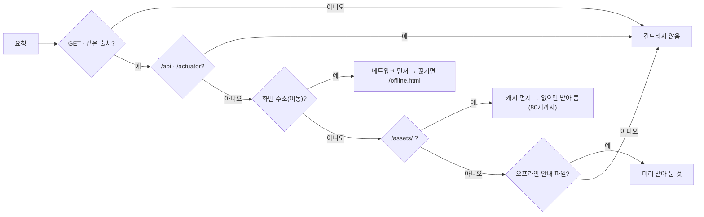

# S15P31A102-176 PWA — 폰 홈 화면에 앱처럼 설치

S15P31A102-176. 2026-11-05 사용자가 「모바일 그거 PWA 해줘」라고 맡겼다(오늘은 묻지 말고 진행). 커밋만 하고 푸시 · MR 은 요청 때.

## 무엇을 / 왜

발표 시연을 폰으로도 하려면 홈 화면에 아이콘으로 두고 주소창 없이 열리는 편이 낫다. 문서(SSOT · EXPERIENCE · PRD)에는 PWA 이야기가 없어서 범위를 아래로 정했다 — 설치 · 오프라인 안내까지, 푸시 알림 · 백그라운드 동기화 · 화면 캐시(오프라인으로 기사 보기)는 하지 않는다.

## 바꿀 파일

- `frontend/public/manifest.webmanifest` — 이름 · 짧은 이름 「NEW:LEARN」, `start_url` `/home`(손님은 로그인 화면으로), `display` `standalone`, 흰 바탕 · 흰 위 막대, 아이콘 192 · 512 · maskable 512
- `frontend/public/icons/` — 로고(favicon.svg)를 흰 바탕 가운데에 그린 PNG 넷. maskable 은 안드로이드가 잘라도 남게 로고를 56% 로, 나머지는 72%. iOS 용 180
- `frontend/public/sw.js` — 위 그림대로. 버전 이름이 바뀐 옛 캐시는 지운다
- `frontend/public/offline.html` — 「인터넷에 연결되지 않았어요」 · *다시 시도*(`/home` 링크). 스크립트 없음, 색은 브랜드 토큰 값
- `frontend/src/pwa/registerServiceWorker.ts` · `main.tsx` — 운영 빌드에서만, 페이지가 다 뜬 뒤 등록. 실패해도 조용히
- `frontend/index.html` — manifest · `theme-color` · `apple-touch-icon` · 앱 이름 메타 · 설명. **인라인 스크립트는 더하지 않는다** — CSP 가 해시가 맞는 것만 받는다
- `frontend/nginx.conf` — `sw.js` · manifest · `offline.html` 은 캐시하지 않는다(이름이 그대로라 새 배포를 바로 받게). manifest 형식을 직접 적는다
- 시험: `src/pwa/registerServiceWorker.test.ts` · `serviceWorker.test.ts`(sw.js 를 가짜 워커 환경에서 돌림) · `manifest.test.ts`
- 문서: EXPERIENCE Responsive & Platform 한 줄, SSOT 1절 화면 행

## 안 바꿀 것

- CSP(`infra/k8s/services/app/routes.yaml`) — `default-src 'self'` 라 같은 출처 manifest · 워커 · 아이콘이 이미 된다
- 푸시 알림 · 설치 권유 배너 · 오프라인 기사 보기
- `dev:mock` — MSW 워커(`mockServiceWorker.js`)가 같은 범위(/)를 쓰므로 개발에서는 우리 워커를 등록하지 않는다

## 리스크

- **배포 뒤 옛 화면 파일**: `/assets/` 는 이름에 해시가 있어 새 배포면 새 이름이라 섞이지 않는다. 화면 주소는 네트워크 먼저라 새 `index.html` 을 받는다. 워커 파일 자체는 nginx 가 캐시하지 않게 했다
- **iOS 설치 앱에는 뒤로 가기 버튼이 없다** — 앱 안에서 헤더 로고 · 서랍 · 패널 닫기로 다닌다
- 로그인 쿠키 · API 는 그대로 네트워크라 설치 앱도 같은 세션 규칙이다
- 캐시는 해시 붙은 파일 80개까지만 남긴다(글꼴 조각이 많다)

## 어떻게 검증하나

- 시험: 등록은 운영에서만 · 못 쓰는 브라우저 · 실패해도 조용히, sw.js 가 API · 다른 출처 · POST 를 건드리지 않음 · 이동은 네트워크 먼저 · 끊기면 오프라인 안내 · assets 캐시 · 오프라인 로고, manifest 칸 · 아이콘 파일과 크기 · index.html 연결 · 인라인 스크립트 없음
- 운영 빌드를 사이트와 같은 강제 CSP 머리로 띄워서(scratchpad `prod-server.cjs`) Chrome: 서비스 워커가 화면을 맡음 · manifest 오류 0 · 설치 막는 까닭 0(`Page.getInstallabilityErrors`) · CSP 위반 0 · 캐시에 API 없음. 서버를 끄고 화면 주소를 열면 오프라인 안내
- `dev:mock` 에서 등록된 워커가 `mockServiceWorker.js` 하나이고 가짜 로그인이 된다

## 한 일

- 처음 오프라인 안내를 띄우니 로고가 깨졌다 — 설치 때 받아 둔 `favicon.svg` 를 요청 때 캐시에서 주지 않았다. 시험을 먼저 더하고(빨강) 고쳤다
- Playwright 의 `setOffline` 은 서비스 워커의 요청까지는 막지 않아 오프라인을 흉내 내지 못했다 → 서버를 실제로 끄고 봤다
- 되돌림 확인: 운영 확인을 빼면 「개발이면 등록 안 함」, `/api` 조건을 끄면 「이동처럼 보이는 API」, 오프라인 대체를 빼면 「끊기면 안내」 시험이 단언에서 실패한다. 이동이 아닌 API GET 은 원래 어느 분기에도 안 걸려서 그 시험은 지킴 시험이다
- 시험 파일에서 `new URL("…/public/…", import.meta.url)` 꼴은 Vite 가 정적 자산 주소로 바꿔 버린다 — 테스트 파일 위치에서 경로를 만든다

## 되돌리는 법

- 이 MR 을 revert 한다. **이미 한 번 열어 본 브라우저에는 워커가 남는다** — `sw.js` 가 404 여도 브라우저는 옛 워커를 지우지 않는다. 화면 주소는 네트워크 먼저이고 새 배포 파일은 이름이 달라 캐시에 없으니 화면이 틀어지지는 않지만, 깨끗이 지우려면 `sw.js` 를 「캐시를 지우고 스스로 등록을 푸는」 판으로 한 번 배포한 뒤 지운다
