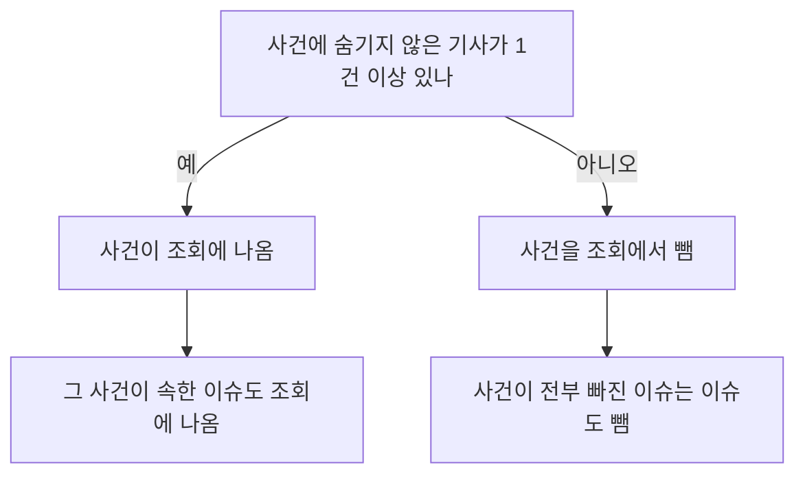

# 기사가 모두 숨겨진 이슈 · 사건을 조회에서 빼기 (Jira S15P31A102-179)

공개 기사가 하나도 없는 이슈와 사건을 화면 조회 API 전부에서 **없는 것으로** 처리합니다. 행은 지우지 않고 마이그레이션도 넣지 않아서, 숨긴 기사를 다시 공개하면 이슈 · 사건 · 관심 이슈가 그대로 돌아옵니다.

## 왜

책장에서 책(기사)은 치웠는데 안내판(이슈 카드 · 사건 패널)은 그대로 둔 상태입니다. 안내판을 보고 찾아가면 빈 칸만 있습니다.

예를 들어 스포츠 이슈 하나에 사건 3개, 기사 9건이 있고 기사 9건을 전부 숨겼다고 합시다. 숨기는 일은 공개 시각(`article.released_at`)을 비우는 것이라 DB 에는 이슈 · 사건 · 기사가 그대로 있습니다. 조회 코드는 숨긴 기사만 세지 않으므로 카드는 「사건 3개 · 기사 0건」으로 나오고, 눌러도 읽을 기사가 없습니다.

여기서 숨긴 기사는 덤프를 기다리는 기사(분석 전이라 사건에 안 묶임)가 아니라, 스포츠 · 문화/연예 · 제목이 깨진 기사 · 잘못된 본문 기사처럼 서비스에서 일부러 뺀 기사입니다(Jira 177 · 183, 3,500건).

지금 운영은 이슈 · 사건이 0건이라 드러나지 않았습니다. AI 결과 덤프를 적재하는 날(최종 덤프 11/13 수령)에 그런 기사로 만든 이슈가 섞여 들어오면 보이기 시작하고, 몇 건일지는 덤프를 받아야 압니다. 11/16 뒤 새 기사는 분석 · 공개가 먼저고 라벨이 나중이라 운영에서도 계속 생깁니다.

## 승인 때 봐 주실 것

1. **기사가 전부 숨겨진 이슈 · 사건은 「찾을 수 없음」으로 답합니다.** 지금은 주소로 직접 열면 정상 응답(200)에 기사 0건이 옵니다. 앞으로는 404 입니다. `docs/api-screen.md` 에 예전 규칙이 적혀 있어(2026-10-23 · 10-26 결정) 고치고, 바꾼 사실을 `SSOT.md` 9절에 남깁니다.
2. **DB 표는 고치지 않습니다.** 조회가 조금 느려집니다. 덤프 규모를 짐작해 만든 가짜 데이터로 재 보니 A2 이슈 목록 한 번이 약 0.12초 → 0.2초이고, 나머지는 각각 0.1초 아래입니다(맨 아래 표). 표에 인덱스(찾기용 목차)를 더해도 가장 무거운 목록은 거의 빨라지지 않고, 표 판이 바뀌면 AI 팀 덤프도 맞춰야 합니다(`infra/server/data-load.md` 「판」 검사). 적재 뒤 느리면 그때 넣습니다.
3. **화면 코드와 FE 문서는 고치지 않습니다.** 화면은 「찾을 수 없음」을 이미 처리합니다. 「아직 이 이슈에 정리된 사건이 없어요」 · 「아직 이 사건을 다룬 기사가 없어요」 문구는 앞으로 나올 일이 없어지니, 머지 뒤 Jira 댓글로 FE 담당에게 알립니다(`EXPERIENCE.md` · `docs/user-flow.md` 는 FE 몫).

## 규칙

일부 기사만 숨겨진 사건은 그대로 두고 숨긴 기사만 셈에서 빠집니다(2026-11-05 계획의 「섞인 이슈는 숨긴 기사만 빠진다」). 이슈는 남아도 그 안에서 기사가 전부 숨겨진 사건은 타임라인 · 사건 수 · 기간 · 최근 사건에서 빠집니다.

| API | 지금 | 바뀐 뒤 |
|---|---|---|
| A1 카테고리 `issueCount` | `issue_category` 행 전부 | 공개 이슈만 |
| A2 이슈 목록 | 이슈 전부, 사건 수는 숨은 사건까지 | 공개 이슈만. `totalElements` · 쪽 수도 맞춤. 사건 수 · 기간 · `lastEvent` · 정렬은 공개 사건 기준 |
| A3 이슈 헤더 | 200, 수 0 | 기사가 전부 숨겨진 이슈면 404 `ISSUE_NOT_FOUND` |
| A4 이슈 타임라인 | 사건 전부, 수 0 | 공개 사건만, 기사가 전부 숨겨진 이슈면 404. 반응 대상이 기사가 전부 숨겨진 사건이면 `reactsToEventId` null |
| A5 사건 패널 | 200, 수 0 | 기사가 전부 숨겨진 사건이면 404 `EVENT_NOT_FOUND`. 이전 · 다음 사건은 공개 사건 중에서 |
| A6 사건 관련 기사 | 200, 빈 목록 | 기사가 전부 숨겨진 사건이면 404 |
| A13 통합 검색 | 이슈 · 사건 전부 | 공개 이슈 · 공개 사건만 |
| A23 관심 이슈 저장 | 200 | 기사가 전부 숨겨진 이슈면 404 |
| A24 관심 이슈 해제 | 200 | 그대로 (저장된 행을 뺄 수 있게) |
| A25 관심 이슈 목록 | 이슈 전부 | 공개 이슈만. 저장 행은 남아 다시 공개되면 돌아옴 |

A8 기사 상세의 이슈 · 사건 참조는 고치지 않습니다. 공개 기사가 묶인 사건은 규칙상 늘 공개입니다. 화면은 404 를 이미 찾을 수 없음으로 그립니다(`IssuePage.tsx` · `EventPanel.tsx`).

## 바꿀 파일

판정 조각은 새 파일 한 곳에 둡니다. SQL 두 벌(사건 · 이슈)과 JPQL 한 벌이고, 여러 기능이 같이 쓰므로 `common` 에 넣습니다(`docs/backend-convention.md` 1절). 수를 세야 하는 A2 · A3 · A25 는 `inner join` 으로, A5 · A6 은 이미 읽는 공개 기사 수로 같은 규칙을 따릅니다.

- `backend/.../common/PublicEventSql.java` (새) — 공개 사건 · 공개 이슈 판정 조각
- `backend/.../issue/IssueQueryRepository.java` — 집계를 `left join` 에서 `inner join` 으로, 총수 · 최근 사건에 규칙
- `backend/.../issue/IssueService.java` — 타임라인을 공개 사건으로, 없으면 404
- `backend/.../event/EventRepository.java` · `EventService.java` — 타임라인 조회 · 이전 · 다음 사건, A5 · A6 404. A5 의 공개 기사 수는 먼저 변수로 한 번만 읽어 쿼리 수를 늘리지 않습니다
- `backend/.../search/SearchQueryRepository.java` — 이슈 · 사건 두 쿼리
- `backend/.../category/CategoryQueryRepository.java` — `issueCount`
- `backend/.../interest/InterestIssueRepository.java` · `InterestIssueService.java` — A23 저장 조건, 빠지는 이유 주석
- 컨트롤러의 Swagger 설명 — A3 · A4 · A5 · A6 · A13 · A23 · A25 (`[확정]` 문구가 「사건 0개도 200」이라 FE 가 그대로 믿습니다)
- 낡아지는 주석 — `IssueQueryRepository` 의 「사건이 없는 이슈」, `IssueService` 의 반응 대상, `SearchQueryRepository` 의 「모든 이슈」
- 시험 — 새 `HiddenIssueEventApiIntegrationTest`, 옛 계약을 단언하는 시험 · 픽스처(`CategoryIssueFixtures` · `CategoryIssue*Test` · `IssueTimeline*` · `EventApi*` · `InterestIssueApi*` · `InterestIssueConcurrency*` · `SearchApi*` · `IssueServiceTest` · `EventServiceTest`). `BookmarkApiIntegrationTest` 는 A6 쿼리 수 5 → 4. 픽스처를 같이 쓰는 `EventReactsToSchemaTest` · `InterestIssueSchemaTest` 는 예전 스키마에서 돌아 그 판의 칸으로만 넣습니다
- 계약 문서 — `docs/api.md` 1절(규칙은 여기 한 곳) · 118줄 오류 코드 뜻 · 티켓 표 · 252줄, `docs/api-screen.md` 해당 API, `docs/data-model.md` issue · event(가리키기만), `docs/specs/` F02-category-issue-api · F02-search-api · F07-issue-timeline-api · F08-event-panel-api · F12-bookmark-interest-api
- `SSOT.md` 9절(뒤집은 것) · 10절(잰 것), `infra/server/category-labels.md`, `infra/server/data-load.md`(94줄 — 사건에 묶인 기사가 모두 비면 사건 · 이슈가 통째로 안 보임, 「Jira 179 전이면」 문구, 적재 뒤 표본은 공개 기사가 있는 이슈 · 사건으로 고르기)

승인 뒤 이 계획은 worktree 의 `docs/plans/2026-11-09-hidden-issues-events.md` 로 옮겨 같이 올립니다.

## 작업 순서

- [x] 새 시험을 먼저 써서 빨간 것 확인 → 구현 → 옛 계약 시험 고침 → 커밋 1 — `/verify` backend
- [x] 계약 문서 · SSOT · infra 문서 → 커밋 2 — 코드와 대조
- [ ] MR → `backend` → `dev` → 분야 브랜치 맞추기 → 배포 태그(태그 MR · 운영 명령은 자동 권한 검사가 막으면 사용자 몫)
- [ ] 사이트 확인 → `/feature-done` → Jira 댓글(FE 알림 포함) · 완료. 마감은 11/13 적재 전이고, 견본 확인은 적재 시험(Jira 152 R1) 몫으로 넘겨 Jira 179 완료를 막지 않습니다

## 안 바꿀 것

- 저장된 행과 표 구조, 마이그레이션, `issue_category` 를 채우는 식(`fillMostCommon` · `category-labels-apply.sql`)
- 판정 후보(`CandidateEventFinder` · `IssueCandidateFinder` · `IssueMessageFactory`), 스케줄러 — AI 판정은 지금처럼 모든 사건을 봅니다
- 응답 모양과 타입 — `firstEventAt` · `lastEventAt` · `lastEvent` 의 null 허용은 그대로 둡니다(`lastEvent` 는 쿼리 사이에 숨겨질 수 있어 실제로 비기도 합니다)
- 프런트엔드, FE 문서(`EXPERIENCE.md` · `docs/user-flow.md`), `docs/mvp-overview.md` · PRD
- 이슈 · 사건 제목과 요약 — 숨긴 기사를 보고 만들어진 문장이 섞여 있어도 다시 만들지 않습니다

## 리스크

- **A2 가 느려집니다.** 한 번에 쪽 · 총수 · 최근 사건 세 쿼리를 합쳐 약 119 → 201ms 입니다(관리자 PC 의 가짜 데이터). 운영 DB 는 CPU 요청 100m · 메모리 상한 1Gi 라 더 걸릴 수 있습니다. 적재 뒤 사이트에서 재 보고 느리면 인덱스를 따로 넣습니다. 덤프 판 맞춤이 끝난 뒤라 그때는 V14 를 더해도 AI 팀에 영향이 없습니다.
- **숨긴 사건이 판정 후보로 남습니다.** 새 공개 기사가 그 사건에 붙으면 사건 · 이슈가 다시 보입니다. 공개 기사가 생겼으니 맞는 동작입니다.
- **기존 시험 픽스처를 많이 고칩니다.** 공개 기사 없는 사건을 전제한 픽스처가 많아서, 픽스처를 바꾸다 시험의 뜻이 달라질 수 있습니다. MR 리뷰 조수에게 이 부분을 짚어 달라고 합니다.
- **`apply` 실행 중 조회는 잠시 어긋날 수 있습니다.** 한 요청의 쿼리 사이에 숨겨지면 카드의 `lastEvent` 가 null 일 수 있고, 새로 고치면 맞습니다.
- **견본 덤프로는 아직 못 봅니다.** 티켓은 「견본 덤프로 시험」이라 했는데 견본이 아직 없습니다. MR 은 시험 · 일회용 DB 로 먼저 끝내고, 견본이 오면 적재 시험(R1)에서 A2 를 확인해 Jira 에 남깁니다.

## 어떻게 검증하나

- 새 통합 시험이 한 픽스처로 위 표의 모든 줄을 단언합니다. 섞인 이슈(공개 사건 · 일부 숨긴 사건 · 전부 숨긴 사건), 전부 숨긴 이슈, 이슈 밖 사건을 둡니다. A2 는 `category` · `sort=createdAt` 도 봅니다. 시험 데이터에만 있는 「빈 이슈」 단언은 새 규칙(404)으로 고칩니다.
- 숨긴 기사를 다시 공개하면 A2 · A3 · A25 에 돌아오는지 단언합니다(지우지 않는다는 증거).
- 되돌림 확인 — 고친 자리를 하나씩 되돌려(A1 · 총수 · 집계 · 최근 사건 · 타임라인 · A5 · 이전 · 다음 · A6 · A13 이슈 · A13 사건 · A23) 그 단언에서 빨개지는지 봅니다.
- `/verify` — `.claude/stack.md` §3 의 backend 포맷 · 린트 · 시험 · 빌드 전부.
- 사이트 배포 뒤 A1 · A2 · A13 200, 없는 번호의 A3 404, Flyway 판 V13 그대로. 운영은 이슈 0건이라 동작 자체는 위 시험이 증거입니다.

## 되돌리는 법

MR 을 되돌리고 배포 태그를 이전 값으로 돌립니다. DB 를 건드리지 않아 데이터 복구는 필요 없고, 조회만 예전대로 돌아갑니다.

## 근거 — 잰 숫자

일회용 PostgreSQL(운영과 같은 `pgvector/pgvector:0.8.7-pg18`, V1 ~ V13)에 가짜 데이터를 넣어 `EXPLAIN ANALYZE` 실행 시간을 쟀습니다. 기사 116,000 · 사건 50,000 · 이슈 8,000 · 기사-사건 90,000, 숨김은 무작위 약 3.5% + 이슈 300개 전부입니다. 관리자 PC Docker 에서 같은 묶음을 두 번 돌린 뒤 두 번째 값이고, 사건 · 이슈 수는 덤프를 받기 전이라 짐작입니다. 「인덱스 두 개」는 `event(issue_id)` · `article_event(event_id)` 입니다. 운영 서버에서 잰 값이 아닙니다.

| 조회 | 지금 | 규칙 적용(인덱스 없음) | 규칙 적용(인덱스 두 개) |
|---|---|---|---|
| A1 이슈 수 | 0.8ms | 75ms | 64ms |
| A2 총수 | 0.3ms | 61ms | 51ms |
| A2 한 쪽 | 116ms | 98ms | 85ms |
| A3 헤더 | 7ms | 7ms | 0.1ms |
| A2 최근 사건(20개) | 3ms | 42ms | 0.2ms |
| A5 이전 사건 | 2ms | 33ms | 0.04ms |
| A13 이슈(흔한 낱말) | 3ms | 63ms | 29ms |
| A13 사건(흔한 낱말) | 17ms | 65ms | 58ms |
