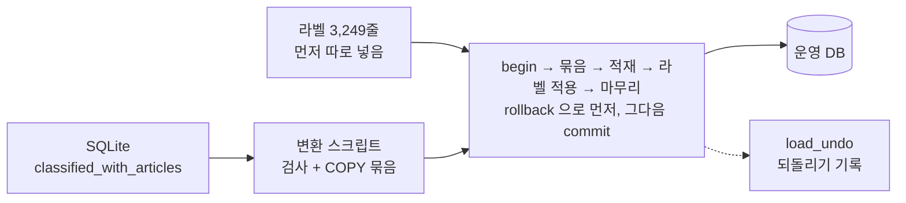

# AI 기반 분석 SQLite 를 운영 DB 에 적재 (Jira S15P31A102-152)

2026-11-10 사용자 승인.

## 무엇을 / 왜

AI 팀이 10/21 ~ 11/8 기사를 이슈 162 · 사건 825 · 기사 연결 12,717 로 나눈 결과를 pg_dump 가 아니라 SQLite(`data/classified_with_articles_1021_1108.sqlite`, sha256 `f11083b6…`)로 올렸다. `infra/server/data-load.md` 의 덤프 적재(pg_restore 길)로는 못 넣으니, **이 SQLite 를 읽어 한 트랜잭션으로 넣는 길**을 만들어 R1 을 거쳐 바로 운영에 넣는다. 11/12 최종 파일(11/9 ~ 11/11 추가분)이 오면 되돌리고 통째로 다시 넣는다.

대조는 끝났다(곁 세션 보고 `side-session-notes/…/2026-11-10-classified-vs-dump-load.md`): URL 12,710건이 운영 기사와 같고 발행 시각 · 본문 md5 도 같다. 7건은 운영에 없지만 본문 · 언론사가 있다. 마인드맵은 사건을 만든 기사 825건뿐, 임베딩 · 작업 행은 없다.

## 승인 때 봐 주실 것 (2026-11-10 사용자가 정함)

| | 정한 것 | 결과 |
|---|---|---|
| ① | 마인드맵 없는 사건 기사 11,885건도 공개 | 사건 패널 · 관련 기사에 기사가 다 보이고, 그 기사 화면은 「이 기사의 마인드맵이 아직 없어요」(A9 404). 문서의 「공개 = EXTRACT 결과를 처음 저장한 때」(`docs/data-model.md` 250줄 · `docs/api-internal.md` 97줄)를 적재 데이터에 한해 뒤집는다 — `SSOT.md` 9절에 남긴다 |
| ② | 사건 없는 공개 기사(약 66,430건)는 내림 | 공개 75,901 → 12,716(사건 기사 전부, 잘못된 본문 1건은 숨김). 나중에 마인드맵이 오면 그 기사만 다시 공개 |
| ③ | 이슈 162개 그대로(「주제 모음」 16개 포함) | AI 팀장이 빼자고 하면 이슈 16개만 내리는 SQL 을 따로 |
| ④ | R1 통과 뒤 바로 적재, 11/12 최종 파일은 되돌리고 다시 적재 | **그 사이 운영에서 B1 · EMBED 켜기 · 수집하며 분석(`full`)을 하지 않는다** — 하면 되돌리기가 깔끔하지 않다(`data-load.md` 7절) |

**임베딩은 기능에 필요하다 — 발표 전에만 쉰다.** 팀 결정(AI 팀장 11-10 글 1번, 「발표 전 새 기사는 마인드맵까지만」)으로 발표 전엔 사건 · 이슈 연결(판정)을 하지 않고, 운영에서 임베딩을 쓰는 곳은 그 판정 · ISSUE 후보 계산과 판정 고르기다(`CandidateEventFinder.java` · `IssueCandidateFinder.java` · `AnalysisJobRepository.java` 91줄). 그래서 이렇게 한다.

- **지금 파일엔 임베딩이 없어 이번 적재에는 안 들어간다.** 다만 적재 길은 열어 둔다 — SQLite 에 `article_embedding` 표가 있으면 임베딩과 EMBED 성공 행을 같이 넣는다. AI 팀에 11/12 파일에 기존 사건 기사 벡터(이미 만들어 둔 것)를 같이 넣어 달라고 한다. 없으면 발표 뒤 연결을 켤 때 그 사건들이 새 기사 후보에서 빠진다
- **새 기사는 마인드맵 · 임베딩을 실시간으로 만든다.** 11/12 다시 적재 뒤 EMBED 워커를 켜고(계획 `docs/plans/2026-11-09-embed-worker.md` 「켜는 조건」) 수집하며 분석(`full`)을 켠다 — 이 둘은 따로 계획. EMBED 를 켜도 판정 워커가 없어 판정 작업은 하나만 대기하고 연결 · GMS 는 없다(`findMatchInFlight`)

## 흐름



## 바꿀 파일

- `infra/server/classified_to_load.py`(새) — SQLite 를 읽어 검사하고 `load` 스키마로 넣는 COPY 묶음 SQL 하나를 쓴다. 표준 라이브러리만
  - 칸 목록이 다르거나, `meta` 건수와 다르거나, 시각 · JSON · 역할 · 참조가 이상하거나, 새 기사 후보 제목에 HTML 조각(`quot;` 등)이 있으면 아무것도 쓰지 않고 멈춘다
  - COPY 텍스트 형식 규칙대로 역슬래시 · 탭 · CR · LF 를 바꿔 쓴다. 본문은 운영에 없을 수 있는 기사 몫만 싣고, 맞춘 기사는 본문 md5 만 싣는다(묶음이 수 MB 로 준다)
  - `article_embedding` 표(`article_url` · `model` · `vector` float32 1024개)는 있으면 읽고 없으면 건너뛴다. 있으면 `model` 이 `dragonkue/BGE-m3-ko` 하나뿐 · 1024차원 · 사건 기사 전부에 있는지 본다(`data-load.md` 3절 「article_embedding」)
  - 끝에 줄 수 · sha256 · 표별 건수를 JSON 한 줄로 찍는다(`sqlite_to_b2.py` 와 같은 모양)
- `infra/ci/test_classified_to_load.py`(새) — 작은 SQLite 를 지어 시험(`test_sqlite_to_b2.py` 모양). 모든 글 칸에 역슬래시 · 탭 · CR/LF · `\.` 한 줄을 넣어 왕복이 같은지
- `infra/server/classified-load.sql`(새) — 검사 → 시험 기사 1 ~ 3 지우기 → 넣기 → 사건 기사 공개
- `infra/server/classified-load-finish.sql`(새) — 라벨 적용 뒤: 사건 없는 공개 기사 내리기 → 사건 · 이슈 시퀀스 → 단언 → `load_undo` 기록 → `load` 스키마 지움
- `infra/server/classified-undo.sql`(새) — `load_undo` 로 되돌리고 끝에 `load_undo` 를 지움
- `infra/server/data-load.md` — 「AI 결과가 SQLite 로 올 때」 절: 아래 명령 모양 · 끝 표시 · 정한 것 ① ~ ④ · 임베딩 뺀 까닭 · 11/12 다시 적재. 기존 pg_dump 절은 그대로
- `SSOT.md` — 8절 덤프 줄(SQLite 길 · 적재한 날), 9절(① · 팀 결정 「새 기사는 마인드맵까지만」), 10절(R1 에서 잰 시간 · 건수 · A2 응답 시간)
- `docs/data-model.md` 250줄 — 9절 줄을 가리키는 한 줄

### 명령 모양 (한 트랜잭션 — `category-labels.md` 77줄과 같은 꼴)

```bash
{ echo 'begin;'; cat <묶음>.sql infra/server/classified-load.sql infra/server/category-labels-apply.sql infra/server/classified-load-finish.sql; echo 'rollback;'; } | kubectl -n data exec -i postgres-0 -- psql -X -v ON_ERROR_STOP=1 -U newlearn -d newlearn
```

`begin;` 이 없으면 라벨 적용 파일 앞 문장이 이미 커밋된 뒤 멈춘다(`category-labels.md` 82줄). `psql -1` 은 쓰지 않는다. 수를 본 뒤 끝만 `commit;` 으로.

### 적재가 넣는 값 (같은 사실은 `data-load.md` 6절을 가리키고 다른 점만)

| 표 | 넣는 값 |
|---|---|
| `issue` · `event` | SQLite 값, 번호 그대로(이슈 1 ~ 162 · 사건 1001 ~ 1894). 덧붙은 칸(`source_issue_key` · `creator_url` · `reason` · `prompt_version`)은 버린다 |
| `article` 새 기사(지금 7건) | `source` NEWSDATA, 언론사는 B2 처럼 `press_mapping`(NEWSDATA, `source_value` = `publisher_code`)으로 — 없으면 언론사 · 대응을 `ON CONFLICT DO NOTHING` 으로 먼저. 제목 · 본문 · 발행 시각(`+09:00`), 분야 원문은 `sqlite_to_b2.py` 규칙대로 배열, `created_at` 은 적재 시각, 분야는 라벨로 덮음 |
| 맞춘 기사(지금 12,710건) | `released_at` 만 — 빈 것(11/4 ~ 11/8 3,242건)은 채우고 찬 것은 둔다. 사건을 만든 기사는 마인드맵 저장 시각, 나머지는 적재 시각 |
| `article_event` · `article_mindmap` | URL 을 운영 번호로 바꿔 그대로 |
| `article_embedding` | SQLite 에 있을 때만(지금 파일은 없음) — URL 을 운영 번호로 바꿔 `model` · 벡터 그대로 |
| `analysis_job` | 마인드맵 있는 기사에 EXTRACT, 임베딩 있는 기사에 EMBED, 사건 기사에 MATCH_EVENT — `SUCCEEDED` · `BATCH` · 시도 1, 시각은 마인드맵 저장 · 연결 시각(EMBED 는 적재 시각), 후보 · 결과 비움. **번호는 identity 기본값**(지운 시험 작업 번호와 안 겹침). ISSUE 는 만들지 않는다 |
| `issue_category` | `category-labels-apply.sql` 이 다시 계산 |
| 시퀀스 | 사건 · 이슈 둘을 최댓값으로 |

스케줄러가 이 작업 행을 다시 읽는 길은 없다 — 다시 넣기는 `QUEUED` 만, 재시도는 `retry_at` 있는 `FAILED` 만, 판정 고르기는 임베딩과 EMBED 성공이 있어야 한다(`AnalysisJobRepository.java` 60 ~ 120줄, reviewer 조수 확인). `EVENT_CLUSTER_TOO_SMALL` 행은 0건 — 사건 없는 기사는 마인드맵이 없고 내려간다.

## 작업 순서

- [x] 1. 변환 스크립트 시험 먼저(빨강) → 스크립트 → 초록. 진짜 파일로 돌려 건수 · sha256 확인 — 시험 25개, 역슬래시 바꾸기를 빼면 왕복 시험 3개가 실패하는 것 확인, infra 시험 전체 253개 통과
- [x] 2. 적재 · 마무리 · 되돌리기 SQL
- [x] 3. **R1(관리자 PC 일회용 DB)** — 오늘 04:00 운영 백업을 받아 따로 띄운 DB 에 되살린다(`docker compose -p newlearn-r1`, 포트를 바꿔 지금 로컬 개발 DB 와 겹치지 않게, 값은 시험용 env 파일 — `.env` 는 읽지 않음)
  1. 기준 표를 뜬다 — 시험 기사 1 ~ 3 과 그 행을 뺀 상태(기사 · 공개 여부 · 분석 표 · 북마크)
  2. 라벨 넣기 → 적재 `rollback` → 적재 `commit` → 검사 → 같은 적재를 한 번 더 넣어 통째로 실패하는지
  3. backend(dev) 를 붙여 API · 3분 동안 작업 행 0, A2 응답 시간 기록
  4. 되돌리기(+ 라벨 적용) → 기준 표와 `EXCEPT` 양쪽 0 → 「되돌리기 + 다시 적재」를 한 트랜잭션으로
  5. **Jira 179 시나리오는 마지막에** — 라벨 표에 T 로 넣고 라벨 적용(실제 숨김 길). 이 뒤 R1 DB 는 버린다
  6. 정리 — `docker compose -p newlearn-r1 down -v`, 받은 백업 파일 지움(회원 정보, `db-backup.md` 5줄)
  - 결과는 `SSOT.md` 10절 2026-11-10 줄. 운영에 없는 7건의 라벨은 메인 세션이 제목을 읽어 정했다(7줄이라 조수를 띄우지 않음)
- [ ] 4. `data-load.md` · `SSOT.md` · `data-model.md` · 계획 이름 → reviewer 조수 → MR(`infra`) → 맞추기 MR(`dev`). 머지 직전 원격 SHA · 열린 MR 을 같은 스크립트에서 확인
- [ ] 5. **운영 적재(사용자가 명령 카드로)** — 10:00 ~ 10:30 수집 밖, 손 실행 Job 없음 확인
  - 라벨 넣기(`C:/tmp/labels-1110-linked/put-labels.md`, 7건 더한 3,249줄로 다시 만듦, 실행 이름 `linked-1110`)
  - 백업(매일 · S3 손 실행) → R2(서버 일회용 DB, `db-backup.md` 「되살리기 연습」)
  - 적재 `rollback` 으로 수 보기 → `commit` → 적재 뒤 확인
- [ ] 6. 큐 확인 · 정리(사용자) — `embed` 그룹의 남은 시험 메시지 3건을 `XGROUP SETID`, `extract` 그룹 밀림 · 미확인 0, `analysis.match_event` · `analysis.issue` 길이 0. EMBED 켜기 · 수집 `full` 은 이 계획 밖(11/12 다시 적재 뒤)
- [ ] 7. Jira 152 댓글, AI 팀장 · FE 에 결과와 함께 넘김, 이슈 화면 CSP 한 번(Jira 120 남은 확인), 기록(메인 세션 zoo_docs)
- [ ] 8. **11/12** — 추가분 사건 기사 라벨(새 실행 이름) → 최종 파일로 R1(최소 `rollback` 실행, 임베딩이 오면 그것까지) → 백업 → 「되돌리기 + 다시 적재」 한 트랜잭션 → 그 뒤 EMBED 켜기 · 수집 `full` 은 따로 계획

## 안 바꿀 것

- backend · ai · frontend 코드, 마이그레이션(표 모양 그대로)
- 기존 pg_dump 적재 절(`data-load.md` 3 ~ 6절) — 11/12 에 덤프로 오면 그대로 쓴다
- 라벨 스크립트(`category-labels-*.sql` · `category_labels.py`) — 그대로 부른다
- 수집 배치 설정(`INGEST_MODE=load-only` 그대로), AI 워커 설정(`EMBED_WORKER_ENABLED=false` 그대로) — 켜는 것은 11/12 다시 적재 뒤 따로 계획
- 「주제 모음」 거르기

## 리스크

- 🔴 **시험 기사 1 ~ 3 과 그 북마크 1건은 지우면 백업으로만 돌아온다.** 셋 다 사건 기사가 아니다(SQLite 에 없음)
- **공개 기사가 75,901 → 12,717 로 준다.** 목록 · 검색 · 분야 탭이 그만큼 작아진다(② 결정). 되돌리기로 원래대로
- **명령에서 `begin;` 을 빠뜨리면** 라벨 적용 파일 앞까지 커밋되고 멈춰 1순위 되돌리기를 못 쓴다 → 명령 모양을 문서에 못 박고 카드에 그대로
- **11/12 다시 적재 전에 B1 · EMBED 를 켜면** 되돌릴 때 그 뒤 공개된 기사 · 작업 행 · 큐 메시지가 남는다 → ④ 에서 막는다
- **11/12 파일 모양이 바뀌거나 처음 보는 언론사가 오면** — 모양은 변환 스크립트가 멈추고(맞는 쪽), 언론사는 대응 표로 넣는다
- **COPY 글자 바꾸기를 틀리면** 제목 · 본문이 조용히 바뀌거나 `\.` 한 줄이 묶음을 끊는다 → 시험의 모든 글 칸에 넣고, 새 기사 본문은 md5 로 단언
- **라벨 넣기와 적재 사이에 10:00 수집이 끼면** 같은 URL 에서 적재가 실패해 통째로 되돌아간다(해는 없음) — 수집 시간 밖에서
- **적재 시간** — 지우고 바꾸는 행이 수만 개다. R1 에서 잰 시간으로 판단하고 사이트 health 를 같이 본다

## 어떻게 검증하나

- `python -B -m unittest discover -s infra/ci` — 새 시험 포함 통과. 단언 하나를 깨 일부러 빨개지는지 본다
- 변환 스크립트를 진짜 파일에 — 이슈 162 · 사건 825 · 연결 12,717 · 마인드맵 825 · 새 기사 후보 본문 12,717, sha256 을 명령 카드에 적음
- 적재 SQL 안 단언(하나라도 걸리면 예외로 통째로 되돌림)
  - 운영 판 13, `load_undo` 가 없음(이전 적재 기록이 남아 있으면 되돌리기부터), 시험 기사를 지운 뒤 분석 표 일곱 0
  - 맞춘 기사의 발행 시각 · 본문 md5 같음, 새 기사의 발행 시각이 SQLite 값(`+09:00`)과 같음 · 본문 md5 같음
  - 고아 0, `QUEUED` 0, 마인드맵 있는데 EXTRACT 성공 없는 기사 0, 사건 기사인데 MATCH_EVENT 성공 없는 기사 0, 판정 걸 기사 0(`findNextMatchArticle` 조건 그대로)
  - 공개 기사 수 = 사건 기사 수 − 숨김 라벨 기사(상수가 아니라 `load` 표로 계산), 공개됐는데 숨김 라벨 0, 사건 기사 중 라벨 없는 것 0
  - 임베딩이 들어오면: `model` 한 가지 · 1024차원, 임베딩 있는데 EMBED 성공 없는 기사 0. 변환 스크립트 시험에 「표 있음 · 없음」 둘 다
  - 알림: 분야가 빈 공개 기사 수, 기사가 모두 숨겨진 사건 수(라벨 적용 출력)
- 적재 뒤(R1 · 운영): 행 수 = 표 건수, 시퀀스 ≥ 최댓값, 3분 동안 작업 행 새로 0 · 스트림 셋 길이 그대로, 사이트 health 실패 0
- API(R1 은 로컬 backend, 운영은 사이트): A2 이슈 목록 162(응답 시간 기록) · A3 이슈 헤더 · A4 이슈 타임라인 · A5 사건 패널 · A6 사건 관련 기사 · A7 최신 기사 · A8 기사 상세(사건 기사 `eventMatchStatus` `SUCCEEDED`) · A9 마인드맵(사건을 만든 기사 200, 나머지 사건 기사 404) · A13 통합 검색이 200
- Jira 179(R1 만, 마지막)
  - 이슈 87 기사를 모두 숨김 → A2 에서 빠짐 · A1 이슈 수 1 줆 · A3 · A4 404 · A13 에서 빠짐
  - 사건 1016 을 숨김 → A5 · A6 404 · 이슈 2 타임라인 사건 5 → 4 · 반응 사건 1096 의 `reactsToEventId` null
  - 이슈 밖 사건 1034 를 숨김 → A5 · A6 404
  - 사건 1001 기사 2건만 숨김 → 사건은 남고 기사 6 → 4
- 되돌리기(R1): 기준 표(시험 기사 뺀 것)와 `EXCEPT` 양쪽 0
- 끝나면 `/verify`

## 되돌리는 법

- **1순위 — `classified-undo.sql` + 라벨 적용(한 트랜잭션)**: 분석 표 일곱을 `DELETE` 로 비우고(시험 기사를 지운 뒤에는 비어 있었다), 새로 넣은 기사를 지우고, 공개로 바꾼 기사는 다시 비우고, 내린 기사는 옛 `released_at` 으로, 끝에 라벨 적용으로 그 사이 숨긴 기사를 다시 숨기고 `load_undo` 를 지운다
  - `TRUNCATE` 는 쓰지 않는다 — 관심 이슈가 같이 지워지는 것은 `DELETE` 일 때뿐이고(`V9__interest_issue.sql` 4줄), 강한 잠금이 조회를 멈춘다
  - 그 기사 · 이슈를 담은 북마크 · 관심 이슈는 같이 지워진다 — 지우기 전에 수를 본다
  - 11/12 다시 적재는 「되돌리기 + 묶음 + 적재 + 라벨 적용 + 마무리」를 한 트랜잭션으로(라벨 적용은 한 번만) — 사이에 이슈 0 화면이 생기지 않는다
- 라벨은 따로 — `category-labels.md` 6절(실행 이름 `linked-1110`)
- **마지막 수단** — 적재 직전 백업 되살리기(`db-backup.md` 「사고 때 되살리기」). 그 뒤 수집 기사 · 가입은 잃는다
- 🔴 되돌릴 수 없는 것: 시험 기사 1 ~ 3 과 북마크 1건(백업에만), 되돌릴 때 같이 지워지는 회원의 북마크 · 관심 이슈

## 계획에서 바뀐 것 (reviewer 조수 검토 반영)

- 꼭 고칠 것 두 가지: R1 되돌리기 비교 기준을 「시험 기사 뺀 상태」로, Jira 179 시나리오를 R1 마지막으로 옮김. 세 파일을 묶는 명령 모양(`begin;` … `rollback;`)을 못 박음
- 새 기사: `created_at` 채움, 언론사는 대응 표로, HTML 조각이 있으면 변환 스크립트가 멈춤
- 11/12: 추가분 라벨 단계 · 최종 파일 R1 · 「되돌리기 + 다시 적재」 한 트랜잭션, 기대값은 상수 대신 계산, 되돌리기 끝에 라벨 적용 · `load_undo` 지움, `DELETE` 로
- 179 시험 보강(A1 · A13 · 이슈 밖 사건 · A2 응답 시간), 빠진 검사(판정 걸 기사 · 새 기사 발행 시각 · 손 실행 Job · 큐 셋 · CSP · 분야 빈 기사)
- COPY 글자 바꾸기 시험, 맞춘 기사는 본문 대신 md5, 작업 번호는 identity, R1 볼륨까지 지움
- 문서 사실: 임베딩을 쓰는 곳에 ISSUE 후보 · 판정 고르기를 더함, ① 이 `data-model.md` 250줄과 어긋나는 것을 SSOT 9절로
- 사용자(승인 화면): 「임베딩은 발표를 위해 빼 두는 것일 뿐, 마인드맵은 실시간으로 계속, 기능적으로는 있어야 한다」 → 임베딩을 「안 넣음」에서 「지금 파일엔 없음 · 적재 길은 열어 둠 · 11/12 파일에 부탁 · 새 기사는 EMBED 워커로 실시간」으로 고침. 승인 뒤 AI 팀장 답장 초안에도 「11/12 파일에 기존 사건 기사 벡터를 같이」를 다시 넣는다

## 구현 뒤 바뀐 것 (변경 리뷰 반영, 2026-11-10)

- **새 기사 7건 중 뉴스핌 1건(`20261106001304`)은 다른 기사 본문을 달고 왔다** — 운영에서 X 로 숨긴 두 기사와 본문이 같다. 라벨을 X 로 넣어 그 기사는 들어가되 숨는다 → 공개 12,716, 사건 1826 공개 기사 43. 적재 SQL 에 「새 기사 본문 = 운영 X 기사 본문인데 X 라벨이 없으면 멈춤」 가드와 「본문이 같은 새 기사」 알림을 더했다(연합뉴스TV 1건은 짝이 사건에 안 묶여 적재가 내리므로 둘 다 보이지 않는다)
- **11/12 다시 적재 목록** — 적재 뒤 운영 URL 전체를 쓰면 적재가 넣은 기사 본문이 묶음에서 빠져 멈춘다. 다시 적재 때는 `load_undo.new_article` 을 뺀 목록으로(`data-load.md` 9절 2번)
- **트랜잭션 밖 실행 막기** — 묶음 첫 줄과 적재 · 되돌리기 파일 첫 문장이 `transaction_timestamp() = statement_timestamp()` 면 멈춘다. 명령은 `begin; && cat … && commit;` 으로 이어 파일 하나가 없으면 커밋이 나가지 않게
- **되돌리기 가드** — 적재 기록이 온전한지(`max_job_id` 있음 · 한 줄), 적재 뒤 따로 공개된 기사가 없는지 본다. 언론사 행 · 시퀀스는 되돌리지 않는다고 문서에 적음
- **변환 스크립트 검사** — NUL, meta 건수 키 빠짐, 마인드맵 가지 종류 넷 · 겹침 · 빈 잎 · `primary_core_index` 가 CORE 잎 수 안인지. 새 기사 빈 본문과 HTML 조각(낱말 중간 제외)은 SQL 이 본다
- 두 번째 R1 로 위를 모두 확인(`SSOT.md` 10절 2026-11-10 줄)
