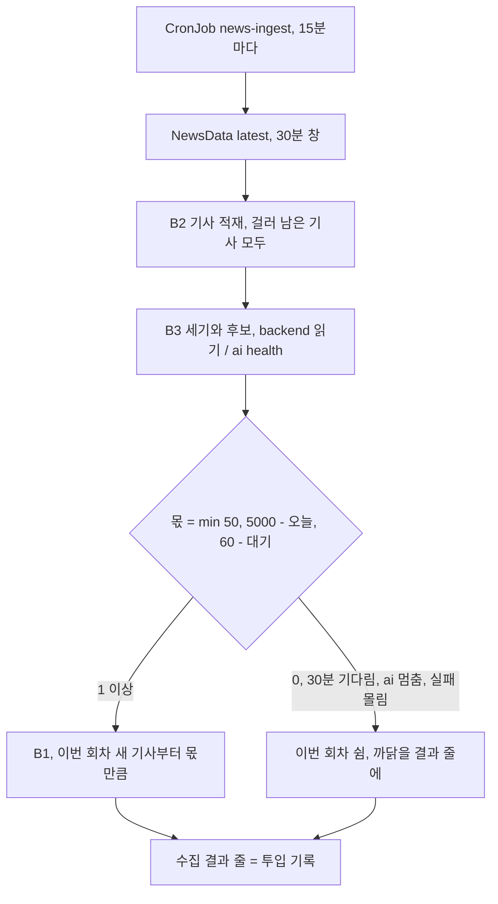

# 11/12 적재 뒤 15분 수집 + 수집 안 자동 분석(EXTRACT) (Jira S15P31A102-156)

> 상태: 2026-11-10 사용자 승인 — 고를 것 여섯은 추천대로(2판, AI 팀장 11-10 답 반영). 2026-11-11 사용자가 고를 것 2(전환 시각)만 「11/12 적재 · 확인 직후」로 바로잡음(3판)
>
> 대체하는 계획: !755 의 `2026-11-09-ingest-15min.md`(11/16 15분 수집) · `2026-11-09-ingest-full-when-ai-ready.md`(보류한 `full` 켜기)

## 무엇을 / 왜

**11/12 최종 파일 적재 · 확인이 끝나면 수집을 15분마다 최근 30분으로 바꾸고, 같은 CronJob 이 회차마다 AI 팀장이 준 몫 공식으로 B1(마인드맵 분석)을 자동으로 건다.** 지금은 매일 10시에 전날치를 넣기만 한다. AI 팀장 A안(발표 전 새 기사는 EXTRACT 만, 하루 5,000)과 11-10 답(몫 공식 · 쉬는 기준), 사용자 결정(손으로 돌리는 도구가 아니라 CronJob 안에서, 적재 때도 CronJob 은 멈추지 않음)을 따른다. 운영은 이 계획을 승인받은 뒤 MR 로만 바꾼다.

## 정해진 것 (다시 묻지 않음)

사용자 · AI 팀장(2026-11-10 오후)

- 최종 파일 적재 · 확인 전까지는 지금처럼 매일 10시 넣기만. 수집 CronJob 은 적재 때도 멈추지 않는다
- 적재가 끝난 뒤 15분 수집 + 자동 분석으로 바꾼다. 빈 구간은 메우지 않는다(전환 시각은 고를 것 2)
- 후보는 덤프 마감 다음 날(11/12) 이후 발행 · 공개 전 · 작업 행 없음 · 사건 연결 없음 · 라벨 T · C · X 아님. 끝난 뒤 분야 라벨 다시 적용, 투입 기록
- 발표 전 새 기사는 EXTRACT 만 — `EMBED_WORKER_ENABLED=false`, 판정 · 이슈 워커가 들어와도 플래그 false
- 크레딧(NewsData · GMS)은 AI 팀장이 본다 — GMS 는 A26 과 EXTRACT 를 나눠서

AI 팀장 11-10 답(회차 몫, 읽기 전용 쿼리 `b1_state.sql` 을 운영과 같은 PostgreSQL 18.6 · V1 ~ V13 임시 DB 에서 경계 12가지로 확인)

- **이번 회차 몫 = min(50, 5,000 − 오늘 건 수, 60 − EXTRACT 대기).** 0 이면 그 회차는 쉰다
- 오늘 건 수 = 오늘(KST) 처음 만들어진 EXTRACT 작업 수, 기사 발행이 11/12 이후인 것만(적재 작업은 `created_at` 이 마인드맵 생성 시각이라). 재시도는 같은 행이라 다시 안 센다
- EXTRACT 대기 = `QUEUED` + 다시 걸 예정인 `FAILED`(`retry_at` 있음). EMBED 대기 · 스트림 길이는 뺀다
- `QUEUED` 중 가장 오래 기다린 것이 30분 이상이면 몫 0 + 알림. ai `/health` 가 BLOCKED 여도 쉰다
- 60 은 처음 값 — 최근 완료 수로 자동으로 바꾸지 않고, 첫 24 ~ 48시간 실측(완료 속도 · 대기 추이)을 보고 같이 정한다
- 걸 때: 그 회차 새 기사를 먼저, 몫이 남으면 지난 회차에 못 건 기사를 최근 시간대부터
- 연결 실패 · 5xx 면 다시 걸기 전에 그 기사 작업 행이 이미 있는지 먼저 본다(서버는 받고 응답만 잃었을 수 있음). 401 · 403 이면 자동 투입을 멈추고 알린다
- 손으로 소량 걸 때도 같은 몫 계산을 거쳐 하루 합계가 한 군데로 모이게
- 운영 규모 속도는 못 쟀다 — 첫 실행 때 걸린 시간을 본다

## 고를 것 — 추천대로면 이 계획의 승인으로 정한다

### 1. 세기 · 고르기를 어디서 하나 → backend 읽기 전용 내부 API(B3) + 지금 B1 추천

수집 배치는 DB 에 직접 붙지 않고 HTTP 만 쓴다(`docs/api-internal.md` 2절, 길 정책도 backend 8080 만). 오늘 수 · 대기 · 못 건 기사는 DB 에만 있다.

| | B3 읽기 API + 지금 B1 (추천) | backend 가 한 번에 고르고 건다 | 수집 Pod 가 DB 를 직접 |
|---|---|---|---|
| backend | GET 하나, 읽기만. 보안 코드는 그대로(`/internal/v1/articles/**` 가 이미 배치 키만) — 배치 키가 여는 주소가 하나 는다 | POST 하나에 다 | 그대로 |
| 몫 숫자(50 · 5,000 · 60 · 30분) | 수집 yaml env — backend 배포 없이 바꾼다. 24 ~ 48시간 뒤 60 을 고칠 때 편하다 | 요청 본문 — 검사가 두 곳 | yaml |
| 분석을 거는 길 | 지금 B1(기사 행 잠금 · 409) 그대로 | 서비스 안에서 | B1 HTTP |
| 대가 | 손 Job 이 회차와 같은 때 돌면 하루 상한을 최대 50 넘을 수 있다(회차끼리는 `Forbid` 로 안 겹침) | 쓰기 길이 는다 | 표준 라이브러리만 원칙 · DB 비밀값 · 길 정책 |

### 2. 전환 시각 → 11/12 적재 · 확인 직후 (2026-11-11 사용자, AI 팀장에게 알린 대로)

2판은 11/13 10:00 수집 뒤를 추천했다. 사용자가 AI 팀장 글(11-10)에 이미 「최종 파일 적재 · 확인이 끝나면 그때 바꾼다, 11/12 0시 ~ 전환은 빈 채로」라고 알렸고, 자동 분석이 반나절 넘게 일찍 시작하는 쪽이 낫다고 바로잡았다.

| | 11/12 적재 · 확인 직후 (고름) | 11/13 10:00 수집 뒤 (2판 추천) |
|---|---|---|
| 자동 분석 시작 | 11/12 저녁(적재가 끝나는 때) | 11/13 10:30 |
| 발표 전 더 분석되는 새 기사 | 약 16시간 × 회차 50 ≈ 3,000건 더(18시 전환 어림, 재지 않음) | — |
| 받지 않는 기사 | 11/12 0시 ~ 전환 — 하루 상한 때문에 어차피 대부분 분석되지 않았을 기사 | 11/13 0시 ~ 10시 |
| 적재 날 일 | 적재 확인 뒤 머지 · 첫 회차 확인(30분쯤) | 없음 |
| 경보 | 머지 직후 한 번 울릴 수 있다(리스크) | 안 울림 |

- 빈 구간은 손으로 메우지 않는다. 적재가 11/13 으로 밀리면 그날 적재 · 확인 직후에 머지한다
- AI 팀장 답장의 〔준비 시점〕 — 「11/12 적재 · 확인 직후」(이미 보낸 글과 같음)

### 3. ai `/health` 를 어떻게 보나 → 길 정책에 「수집 → ai 8000」 하나 추천

지금 ai 로 들어오는 길은 모든 Pod 에 닫혀 있다(`infra/k8s/services/ai/netpol.yaml` — 「AI 워커는 아무도」, `SSOT.md` 6절). 수집 Pod 는 `/health` 를 부를 수 없다.

| | 길 하나 열기 (추천) | 그대로 |
|---|---|---|
| 하는 일 | `ai-ingress` 에 이름표 `app: news-ingest` → 8000 만. 회차마다 `http://ai.ai.svc:8000/health` — 503(BLOCKED · Redis DOWN) · 연결 실패(준비된 Pod 없음)면 그 회차 쉼 | `/health` 를 안 본다 |
| BLOCKED 때 | 바로 쉼 | 큐가 안 줄어 대기가 60 에 닿으면 몫 0, 30분이면 몫 0 + 알림. 그때까지 최대 60건이 줄에 선다(GMS 는 안 씀 — 워커가 안 읽음) |
| 경보 | 둘 다 `NewlearnServiceDown` 이 3분에 따로 운다(ai 준비 0, `/health` 503 이면 준비 안 됨) | 같음 |
| 대가 | 보안 정책 한 줄 · 시험 Pod 로 확인 | AI 팀장 요청과 다르다 |

### 4. AI 팀장 기준에 하나 더 — GMS 실패가 몰리면 쉼(`failing`) 추천, 답장에 알림

- 까닭: GMS 장애 · 속도 제한(`LLM_TIMEOUT` · `LLM_RATE_LIMITED` · `LLM_UNAVAILABLE`)이면 워커는 빨리 실패를 낸다. 시도 3 을 넘긴 작업은 멈춤으로 끝나 대기에서 빠지고(`RetryPolicy.java`), 몫이 다시 생겨 다음 기사가 또 실패한다. 끝내 실패한 기사는 작업 행이 있어 다시 후보가 되지 않는다. `/health` 는 이 경우 BLOCKED 가 아니다
- 규칙: 최근 15분 EXTRACT 실패가 10건 이상이고 성공보다 많으면 몫 0 + 알림. 10 은 회차 50 의 1/5 — 빈 본문 몇 건의 `INPUT_NOT_ANALYZABLE` 로는 걸리지 않게(코드 상수). 60 을 완료 수로 바꾸는 것이 아니라 멈추는 조건이라 AI 팀장의 「60 은 자동으로 안 바꿈」과 부딪히지 않는다
- 다른 안: 넣지 않음 — 장애 한 시간이면 새 기사 약 100 ~ 150건이 끝내 실패로 남을 수 있다(reviewer 어림, 재지 않음)

### 5. 「끝난 뒤 라벨 다시 적용」 → 감지는 매일 · 고치기는 이미 있는 `apply` 추천

- 분석이 걸린 뒤 끝나기 전(회차 50건이 약 5 ~ 7분)에 숨김 라벨을 넣으면 결과 저장이 다시 공개한다(`infra/server/category-labels.md` 5절). 라벨은 공개된 기사에 붙이니(같은 문서 3절) 드물다
- 매일 확인 때 `apply` 를 `rollback` 으로 돌려 첫 `UPDATE` 수를 보고, 0 이 아니면 `commit` 으로(같은 문서 5절 명령). 코드 → 분야 대응이 `category-labels-apply.sql` 한 곳에 남는다. 다른 안(backend 가 다시 숨김)은 숨김 코드가 backend 에 한 번 더 적힌다

### 6. 늦게 올라온 기사 · 30분 창의 같은 본문 → 재지 않는다 (2026-11-13 사용자 — 처음 추천은 「재 보고 정한다」)

- 30분 창에서는 잘못된 본문 규칙 (a) · (c)(같은 본문 묶음)가 덜 잡히고(`infra/server/ingest.md`), 새 기사부터 걸어 새어 들어온 기사는 15분 안에 분석 · 공개될 수 있다. 발행 뒤 30분이 지나 올라온 기사는 받지 못한다. 둘 다 잰 적 없다
- 재지 않는다(2026-11-13 사용자 「재기 빼기」) — 처음에는 하루를 넣기만으로 다시 받아 `b2.created`(놓친 기사)와 「본문 불일치로 뺌」 URL 중 운영에 있던 수를 재려 했다(NewsData 약 240 ~ 330요청). 재기는 빈 날을 채우는 일이 아니라 세는 일이고, 그 수로 정할 일이 아래 셋이었다. 놓친 기사를 채워도 분석은 하루 상한 4,800건에 막히고(평일 수집 1만 건 넘음), 발표까지 나흘이다
- 하지 않는다: 매일 「전날 쓸어 담기」(하루 약 240 ~ 330요청), 후보 SQL 에 같은 본문 빼기, 「발행 뒤 15분이 지난 후보만」
- 같은 본문은 매일 확인 SQL(같은 언론사 · 같은 본문 500자 이상 · 제목 둘 이상)로 찾아 라벨 X

## 설계 — 15분 회차 한 번



### backend — B3 `GET /internal/v1/articles/release-candidates?publishedFrom=2026-11-12&limit=50`

배치 키만 연다(이미 있는 규칙). 읽기만 한다. 세는 법은 AI 팀장 `b1_state.sql` 과 같다. 시각은 +09:00(`docs/api.md` 1절 「시간」).

```json
{
  "releasedToday": 1234,
  "extract": {
    "queued": 12,
    "retryPending": 1,
    "oldestQueuedAt": "2026-11-13T10:31:05+09:00",
    "succeededLast15Minutes": 45,
    "failedLast15Minutes": 2
  },
  "candidates": [{ "articleId": 140001, "publishedAt": "2026-11-13T10:40:00+09:00" }]
}
```

| 칸 | 뜻 |
|---|---|
| `releasedToday` | 오늘(DB 시각, KST 0시부터) 만든 EXTRACT 작업 수, 기사 발행이 `publishedFrom` 이후인 것만. 손 Job 도 센다. B1 건수다 — 실패 뒤 다시 거는 GMS 호출은 따로 든다 |
| `extract.queued` · `retryPending` | EXTRACT `QUEUED` 수 · `FAILED` 인데 `retry_at` 있는 수. EMBED 는 세지 않는다 — 워커가 꺼져 늘 대기다 |
| `extract.oldestQueuedAt` | `QUEUED` 중 가장 이른 `queued_at`. 없으면 null |
| `extract.succeededLast15Minutes` · `failedLast15Minutes` | 최근 15분에 끝난(`finished_at`) EXTRACT 의 성공 · 실패 수 — 고를 것 4 와 기록용. 실패도 `finished_at` 을 채우므로 따로 센다 |
| `candidates` | 발행이 `publishedFrom` KST 0시 이후 · `released_at` 빔 · 작업 행 없음 · `article_event` 없음 · 라벨 표에 행 없음. **넣은 시각(`article.created_at`) 최신 순** — 그 회차 B2 가 방금 넣은 기사가 맨 앞, 그다음 지난 회차에 못 건 기사가 최근부터. 같은 회차 안에서는 발행 순으로 넣으니 발행 최신 순과 같다. `limit` 건 |

- 라벨: 라벨은 공개된 기사에서 뽑아 붙이고(`category-labels-export.sql`), 숨긴 T · C 와 적재가 라벨을 넣는 사건 기사는 작업 행이 있다. 그래서 후보 범위에 라벨 행이 있으면 손으로 넣은 X 뿐이다 — 코드를 보지 않고 「라벨 표 `category_label.article_label` 에 URL 이 있으면 뺀다」
- 라벨 표는 인프라 SQL 이 만든 스키마다(운영엔 2026-11-05 부터, 주인은 backend 와 같은 DB 사용자 — 2026-11-10 `information_schema.schemata`, `backend.yaml` 98줄). 없으면 B3 500. 시험은 표를 만들어 돈다
- 400: `publishedFrom` 모양이 틀림 · `limit` 이 1 ~ 500 밖

### 수집 배치 — 새 모드 `auto` · `release-only`

- `INGEST_MODE=auto` — 받은 기사를 모두 B2 로 넣은 뒤 회차 끝에 B3 → (ai `/health`) → 몫 → B1
- `INGEST_MODE=release-only` — NewsData · B2 없이 B3 → 몫 → B1. **손으로 소량 걸 때 이것으로 건다**(손 Job, `INGEST_RELEASE_PER_RUN` 을 작게). curl 로 B1 을 직접 부르지 않는다 — 하루 합계가 한 군데(작업 행)로 모이고 같은 몫 계산을 거친다
- `full` 은 없앤다 — 그 회차에 넣은 기사를 상한 없이 모두 B1 하는 길이라서다. 이름을 새로 두는 것은 옛 계획 · 9절 기록 · 로그의 `mode: full` 과 뜻이 섞이지 않게. `full` 을 주면 `설정 오류`(「`auto` 를 쓴다」) · 종료 2

새 env — `auto` · `release-only` 에서만 읽고 모두 필수. 빠졌거나 범위 밖이면 NewsData 를 부르기 전에 `설정 오류` · 종료 2. **`load-only` · `fetch-only` · `file` 은 읽지도 검사하지도 않는다** — 손 실행이 CronJob env 를 물려받아도 `INGEST_MODE=load-only` 하나만 덮으면 돈다.

| env | 값 | 받는 값 | 뜻 |
|---|---|---|---|
| `INGEST_RELEASE_FROM` | `2026-11-12` | `YYYY-MM-DD` | 후보 발행 KST 날짜의 시작 = 덤프 마감 다음 날 |
| `INGEST_RELEASE_PER_RUN` | `50` | 1 ~ 500(B3 `limit` 상한) | 회차 최대 |
| `INGEST_RELEASE_PER_DAY` | `5000` | 1 ~ 20000 | 하루 상한 |
| `INGEST_RELEASE_CAPACITY` | `60` | 1 ~ 10000 | 대기(`queued` + `retryPending`) 상한 — 처음 값, 24 ~ 48시간 실측 뒤 AI 팀장과 yaml MR |
| `INGEST_RELEASE_MAX_WAIT_MINUTES` | `30` | 1 ~ 1440 | 가장 오래 기다린 `QUEUED` 가 이 분 이상이면 몫 0 + 알림 |
| `AI_HEALTH_URL` | `http://ai.ai.svc:8000/health` | `http(s)://…/health` | 고를 것 3 을 추천대로 할 때 |

판단 순서 — 위에서부터 처음 맞는 줄

| 차례 | 조건 | `release.skippedBy` | 투입 쪽 종료 코드 |
|---|---|---|---|
| 1 | B3 · B1 401 · 403 | `auth` | 2 — 그 회차 멈춤. 배치 키는 B2 와 같아 고칠 때까지 회차마다 수집 · 투입이 같이 멈추고 30분 경보 |
| 2 | B3 400(설정이 틀림) | `bad_request` | 2 |
| 3 | B3 연결 실패 · 5xx · 응답 모양이 다름 | `status_error` | 1 |
| 4 | ai `/health` 가 200 이 아님 · 연결 실패 | `ai_down` | 0 — `NewlearnServiceDown` 이 따로 운다 |
| 5 | 오늘 건 수 ≥ `PER_DAY` | `daily_cap` | 0 |
| 6 | 가장 오래 기다린 `QUEUED` ≥ `MAX_WAIT_MINUTES` | `wait` | 1 — 알림 |
| 7 | 최근 15분 실패 ≥ 10 이고 성공보다 많음(고를 것 4) | `failing` | 1 — 알림 |
| 8 | 몫 = max(0, min(`PER_RUN`, `PER_DAY` − 오늘, `CAPACITY` − `queued` − `retryPending`)) 이 0 | `capacity` | 0 |
| 9 | 몫 ≥ 1 | 없음 — 후보 앞에서부터 몫만큼 B1 | 고른 기사가 있는데 하나도 못 걸면 1, 아니면 0 |

- 5 · 6 · 8 은 AI 팀장 `b1_state.sql` 의 `budget` 식과 같은 차례다
- 「알림」은 종료 1 → 두 회차 넘게 이어지면 30분 경보(`NewlearnIngestMissing`, 머지 뒤 약 35분). EXTRACT 줄을 보는 다른 경보는 없다(backend 의 멈춤 WARN 은 판정 · ISSUE 에만)
- B1 결과: 202 걸음 · 409 이미 · 그 밖 실패. 연결 실패 · 5xx 는 그 회차에 다시 걸지 않는다 — 다음 회차 B3 가 「작업 행 없음」만 후보로 주니, 서버가 받았으면 빠지고 못 받았으면 다시 나온다(AI 팀장의 「다시 걸기 전에 작업 행 확인」). 그래서 지금 `full` 의 「끝에 한 번 더」와 「B1 실패 번호 남기기」는 없앤다
- 분석이 끝내 실패한 기사(시도 3 넘김)는 작업 행이 있어 다시 후보가 되지 않는다. **발표 전에는 다시 걸지 않는다** — 매일 그 수를 세어 사용자 · AI 팀장에게
- 흐름: NewsData 가 실패하거나(첫 요청 포함) NewsData 키가 거절돼도 자동 투입은 돈다. backend 연결이 이어서 셋 끊기거나 배치 키가 거절되면 멈춘다
- 종료 코드 = 수집 쪽 코드(상한 · 출입증 2, NewsData 실패 · B2 하나도 못 감 1)와 투입 쪽 코드 중 큰 값. 지금 `full` 의 「B1 202 · 409 가 0 이면 1」은 없앤다 — 쉼이 정상 회차를 실패로 만들지 않게
- 투입 기록: `수집 결과` 줄의 `b1`(released · already · failed)과 `release`(from · today · queued · retryPending · oldestWaitMinutes · succeeded15m · failed15m · ai · budget · candidates · picked · skippedBy · b3Ms). Loki 14일(`SSOT.md` 6절), 작업 행은 기사마다 남는다. `b3Ms` 는 B3 응답 시간 — AI 팀장이 본다고 한 첫 실행 속도

### 하루 몫으로 빠지는 것 (어림, 재지 않음)

회차 50 × 96 = 4,800 < 5,000 이라 하루 상한은 손 Job 을 더할 때나 닿는다. 평일 하루 수집은 1만 건이 넘는다(11/5 분 11,770 · 11/9 분 10,155, `SSOT.md` 10절). 11/12 은 저녁부터라(18시 전환이면 24회차) 약 1,200건, 11/13 · 11/16 · 11/17 평일은 4,800건씩 걸고 남는 몫이 없다. 11/14 · 15 주말은 들어오는 2,772 · 4,476건(11/7 · 11/8 분)보다 4,800 이 커 하루 약 300 ~ 2,000건씩 밀린 것을 메운다. **그래서 평일 기사는 절반 넘게 발표 전에 분석되지 않는다.** 못 건 기사는 공개 전이라 화면에 없다.

### 15분 수집 — !755 에서 가져올 것과 바꿀 것

- 가져옴: `*/15` · `INGEST_TIMEFRAME=30m` · `INGEST_DAYS` 뺌 · 요청 40 · 기사 2,000 · 실행 상한 840초 · 시작 마감 300초 · 다시 시도 0 · 경보 `NewlearnIngestMissing` 30분 기준과 그 시험
- 바꿈: 날짜(11/16 → 11/12 적재 · 확인 직후), `INGEST_MODE: auto` + 새 env, !755 「11/16 순서」 4번(그날 0시부터 메우기) 뺌, 「B1 은 같이 안 켠다」 문장들, 경보 summary 「수집 또는 자동 투입」
- !755 가 놓친 것: `SSOT.md` 6절 수집 줄의 「경보(예약 뒤 3시간 · 25시간)」 · 「요청 500 · 기사 20,000」

## 바꿀 파일

**MR ① 지금 참인 문서** (`infra` → `dev`, 11/11 오전. 적재 쪽 세션이 같은 절을 고치는지 먼저 본다)

- `docs/plans/2026-11-10-ingest-15min-auto-b1.md` — 이 계획
- `SSOT.md` 9절 2026-11-10 셋째 줄 — 「EMBED 워커로 계속 만든다(켜는 것은 11/12 다시 적재 뒤 따로 계획)」를 「EMBED 워커는 발표 뒤까지 끈다(AI 팀장 A안)」로. 새 줄 둘 — 11/16 15분 + 분석 → 적재 확인 뒤 15분 + 수집 안 자동 투입(AI 팀장 몫 공식) / 마감 뒤 기사를 날짜 범위 손 B1 · `full` 로 → 자동 투입 후보로, 몫 안에서만. 8절 Jira 156 줄(정한 것 · 남은 것 — 60 은 24 ~ 48시간 뒤), Jira 152 줄의 「마감 뒤 기사에 B1 을 거는 법과 하루 분석 상한」, 「운영 하루 처리 상한」 줄(1,500 ~ 3,000 검토 → 5,000 · 몫 공식)
- `infra/server/data-load.md` 9절 — 「다시 적재 · 확인 뒤에도 EMBED 는 발표 뒤까지 끈다. 새 기사 분석은 수집 안 자동 투입(EXTRACT 만)」. 8절 · 2절의 「11/12 ~ 11/15 분은 운영 B1 로 분석」을 「자동 투입 후보, 몫 안에서 — 다 걸리지는 않는다」로
- `docs/data-model.md` 5절 9번 「하루 상한을 검토한다」
- `infra/k8s/services/ai/ai.yaml` — `EMBED_WORKER_ENABLED` 주석의 켜는 때를 「발표 뒤」로(값 `"false"` 그대로)

**MR ② 운영 확인 도구** (`infra` → `dev`, 11/11)

- `infra/server/export-articles.sql` — `-v all=1`(공개 여부 상관없이 그날 전부, AI 팀장 매일 검증용). 줄 모양 같음
- `infra/server/b1-state.sql`(새) — AI 팀장 `b1_state.sql` 의 세는 부분(오늘 건 수 · 대기 · 가장 오래 기다린 분). 몫 식은 수집 스크립트 한 곳에만 둔다. 게이트 · 매일 확인에서 B3 값과 대조
- `infra/server/data-load.md` 2절 — `all` 명령 한 줄

**MR ③ backend B3** (`backend` → `dev`, 11/11)

- `backend/src/main/java/kr/io/newlearn/ingest/ArticleReleaseInternalController.java` — GET 하나
- `backend/src/main/java/kr/io/newlearn/ingest/ReleaseCandidateQuery.java`(새) — SQL 셋(후보 · 오늘 수 · EXTRACT 상태)
- `backend/src/main/java/kr/io/newlearn/ingest/dto/ReleaseCandidatesResponse.java`(새)
- `backend/src/test/java/kr/io/newlearn/ReleaseCandidatesIntegrationTest.java`(새)
- `backend/src/main/java/kr/io/newlearn/common/security/InternalApiSecurityConfig.java` — 주석만(배치 키가 여는 것에 B3). 인증 · 권한 파일이라 MR 본문에 「사람 최종 확인」(AGENTS.md)
- `docs/api-internal.md` 2절 — B3 계약. `docs/api.md` — 56줄 「배치 키는 B2 · B1 만」, 주소 목록 그림 · 표에 B3

**MR ④ 수집 → ai `/health` 길** (`infra` → `dev`, 11/11 — 고를 것 3 을 추천대로 할 때)

- `infra/k8s/services/ai/netpol.yaml` — `ai-ingress` 에 `app: news-ingest` → 8000 하나
- `SSOT.md` 6절 들어오는 길 줄 — 「AI 워커는 아무도」 → 「수집 배치의 8000 만」

**MR ⑤ 15분 수집 + 자동 투입** (!755 를 고쳐 `infra` → `dev`, 전환 때)

- `infra/k8s/services/ingest/news_ingest.py` — `auto` · `release-only`, B3 · `/health` · 몫 · 결과 줄 · env 검사, `full` 과 그 다시 걸기 · 실패 번호 지움, 흐름 · 종료 코드 합치기
- `infra/ci/test_news_ingest.py` — 시험 기본 env 를 `load-only` 로, `auto_env()` 따로(지금 기본이 `full` 이라 그대로면 50곳쯤 깨진다), 옛 `full` 시험을 `auto` 로, 판단 갈래마다, `daily_env` 를 새 yaml 값으로 하고 `load-only` 만 덮어 도는지
- `infra/k8s/services/ingest/news-ingest.yaml` — !755 값 + `auto` + 새 env, 머리 주석
- `infra/k8s/alerts/rules.yaml` · `infra/ci/alert_rules_test.yaml` — !755 + summary 문구
- `infra/server/ingest.md` — 머리 · 설정 표 · 「매일 실행」 → 「15분 실행」 · 손 실행마다 넣기만 · 상한 · 기한 덮어쓰기와 「결과 줄은 Loki 로」 · 「15분 모드로 바꾸기」 · 「B1 켜기」 → 「자동 투입」(몫 공식 · 쉼 까닭 · 손으로 소량 = `release-only` · 날짜별 수 SQL · 매일 확인) · 「경보가 오면」(`skippedBy` 가 `wait` · `failing` 이면 AI 워커 · GMS) · 「B1 이 끝내 실패한 기사」 · 「늦은 기사 · 같은 본문은 재지 않음」
- `infra/server/category-labels.md` 3 · 5절, `infra/server/ai-worker.md` 31 · 56줄(B1 을 거는 곳 — 손 B1 은 `release-only`)
- `infra/server/data-load.md` 16 · 27 · 117 · 174줄(「B1 켜기」 링크), 9절 — 켠 뒤에는 「되돌리고 다시 적재」가 멈춘다. 그 뒤 파일을 넣을 덧붙이기 절차는 아직 없다(7절 「B1 을 켠 뒤라면」)
- `SSOT.md` 2 · 6절의 「매일 10시」 · 「넣기만」 · 경보 · 상한, 8절 Jira 156 줄을 6절로 옮기고 지움
- `docs/specs/F01-article-ingest-api.md` · `docs/api-internal.md` 1 · 2절 · `docs/data-model.md` · `docs/glossary.md` — !755 가 고친 자리 + `full` → `auto`
- `docs/plans/2026-11-09-ingest-15min.md` · `docs/plans/2026-11-09-ingest-full-when-ai-ready.md` — 맨 위에 「대체: 2026-11-10-ingest-15min-auto-b1.md」

Jira 156 설명은 남은 일을 이 계획 순서로 고친다.

## 작업 순서

- [x] MR ① — 파이프라인 success (!809 → !812, 2026-11-11)
- [x] MR ② — 운영 읽기로 내보내기 `all` · `b1-state.sql` 대조 (!810 → !812)
- [x] MR ③ — 시험 먼저(빨강 확인) → 구현 → backend 검사 → `backend` → `dev` → 배포 태그 MR(10:00 ~ 10:30 피함) (!813 → !820, 배포 태그 !821, 2026-11-11)
- [x] MR ④ — 머지 → 시험 Pod 로 확인 (!811 → !812, 200 · 시간 초과)
- [x] MR ⑤ — 시험 먼저 → 구현 → infra 검사 → 로컬 E2E → Draft (!818)
- [x] 11/11 받기만 30분 창 한 번 — `timeframe=30m` 을 처음 보낸다(1요청) → 받아 줌(`SSOT.md` 10절 2026-11-11)
- [ ] 11/12 적재 · 확인 직후 게이트 → MR ⑤ 머지 → 첫 회차 · 1시간 확인 → `SSOT.md` 10절 · Jira
- [ ] 11/13 · 11/14 확인 · 24 ~ 48시간 실측 정리(AI 팀장과 60 조정) → `SSOT.md` 10절 · Jira

## 날짜별 실행 카드

**적재가 11/13 으로 하루 밀렸다**(사용자 「적재 먼저」, 그날 10:00 수집은 infra !896 으로 멈춤) — 아래 카드는 하루씩 뒤로 읽는다. 「11/12 적재 날 · 전환」 → 11/13, 「11/13 첫 온전한 하루」 → 11/14. 11/12 하루와 11/13 0시 ~ 전환 시각 기사는 받지 않는다.

사람 몫(클러스터에 Job · Pod 를 만드는 명령)은 그날 파일 카드로 다시 준다. 읽기 확인과 MR 머지는 Claude — 머지는 파이프라인 success 뒤 원격 `dev` SHA · 열린 MR 을 같은 스크립트에서 확인하고. 배포 태그 MR 은 사용자 확인 뒤 머지. 손 Job 은 CronJob 기록 상한(3)에 같이 세일 수 있어(확인 안 함) 결과 줄은 Loki 로도 읽는다.

### 11/11(수)

| 언제 | 누가 | 어디서 | 한 줄 | 끝 표시 |
|---|---|---|---|---|
| 오전 | Claude | GitLab | MR ① · ② · ④ 머지 | `dev` 에 커밋, 파이프라인 success |
| MR ② 뒤 | Claude | 관리자 PC 저장소 맨 위 | `scp infra/server/export-articles.sql infra/server/b1-state.sql newlearn:infra/server/` | 오류 없음 |
| 그 뒤 | Claude(읽기) | EC2 | 11/10 분 `-v all=1` 줄 수 · `select count(*)` 대조, 다 보면 서버 JSONL 지움. `b1-state.sql` 한 번 | 두 수 같음. `released_today` 0 · `queued` · `retry_pending` 이 DB 와 같음 |
| MR ④ 뒤 | 사용자 | EC2 셸(`ssh newlearn`) | 시험 Pod 둘(이름표 `app: news-ingest` · 다른 이름표)에서 `ai.ai.svc:8000/health` — 명령은 카드 | 앞은 200, 뒤는 시간 초과 |
| 10:30 뒤 | Claude(권한 검사가 막으면 사용자) | EC2 셸 | `kubectl -n app create job --from=cronjob/news-ingest news-ingest-check-30m-$(date +%H%M) --dry-run=client -o yaml \| kubectl set env --local -f - INGEST_MODE=fetch-only INGEST_TIMEFRAME=30m INGEST_DAYS- -o yaml \| kubectl patch --local -f - --type merge -p '{"spec":{"backoffLimit":0}}' -o yaml \| kubectl -n app create -f -` | `created`. Claude 가 로그: `requests` 1, `pubDates` 가 최근 30분 안 |
| 오후 | Claude | GitLab | MR ③ `backend` → `dev`, 배포 태그 MR(사용자 확인) | backend 새 태그 Ready, health 200 |
| 저녁 | Claude | 관리자 PC | MR ⑤ Draft + 로컬 E2E | 아래 「검증」 로컬 줄 |

### 11/12(목) — 적재 날 · 전환

적재 순서는 `infra/server/data-load.md` 9절(적재 쪽 세션). 이 계획의 일은 적재 · 확인이 끝난 뒤에만 한다 — 그 전에는 수집 설정 · 머지를 하지 않는다.

| 언제 | 누가 | 어디서 | 한 줄 | 끝 표시 |
|---|---|---|---|---|
| 10:10 | Claude(읽기) | EC2 | 10:00 수집(11/11 분, 마지막 매일 실행) 결과 줄 | 종료 0 — 덤프(11/11 까지)와 이어진다 |
| 적재 중 | Claude | GitLab | MR ⑤ 를 최신 `infra` 와 합쳐 MR 파이프라인을 초록으로 | success |
| 적재 · 확인 끝 | 사용자 | — | 게이트: ① 적재 쪽 「적재 · 확인 끝」 ② AI 팀장에 「지금부터 15분 수집 · 자동 분석」 알림 | 사용자 「됐어」 |
| 그 뒤 | Claude(읽기) | EC2 | `b1-state.sql`, 11/12 이후 발행 기사 수, backend 이미지 태그 | `released_today` 0 · `queued` 0 · `retry_pending` 0, 11/12 뒤 기사 0(아니면 11/11 이전 기사가 새는 것 — 머지 안 함), 태그가 MR ③ 을 포함 |
| 정각 3분 전(:12 · :27 · :42 · :57) | Claude | GitLab | MR ⑤ → `infra` → `dev`(그 사이 `infra` 가 바뀌었으면 다시 합침) | `dev` 에 커밋. 동기화 뒤 5분 안에 첫 회차가 성공하면 경보가 안 운다 |
| 머지 직후 | Claude(읽기) | EC2 | Argo CD `ingest` · CronJob · Prometheus `/api/v1/rules` | Synced, `*/15`, env 가 yaml 과 같음, 새 경보 식 |
| 첫 회차 + 2분 | Claude(읽기) | EC2 | 첫 회차 결과 줄, B3 후보 SQL + `EXPLAIN ANALYZE` | 종료 0 · `requests` ≤ 40 · `stoppedBy` `end` · `release.today` 0 · `ai` UP · `budget` 50 · `b1.released` = 30분 창의 새 기사 수(최대 50), `b3Ms`, 실행 시간(1초를 넘으면 색인을 본다 — `article.published_at` · `created_at` 에 색인 없음) |
| 둘째 · 셋째 회차 | Claude(읽기) | EC2 | 결과 줄의 `queued` · `retryPending` · 성공 · 실패, 공개 수 | 대기가 다음 회차 전에 준다, 실패 0 근처 |
| 1시간 뒤 | Claude(읽기) | EC2 | 1시간 확인 | 성공 Job 3 · 실패 0, 경보 0, `releasedToday` ≤ 50 × 지난 회차 수, Redis 사용량 |

### 11/13(금) — 첫 온전한 하루

- 오전, Claude(읽기): 밤새 회차의 실패 Job · 경보, `releasedToday`, `skippedBy` 분포 · 마지막으로 `b1.released` > 0 이던 회차(Loki), 회차별 대기 · 완료 추이(AI 팀장과 60 조정용 — 사용자가 전달), 끝내 실패한 새 기사 수, Redis 사용량, NewsData 요청 합, `apply` `rollback` 첫 `UPDATE` 수, 같은 본문 확인 SQL. 0 이 아닌 것은 사용자에게
- 오전, Claude: 11/12 분 기사 목록 `-v all=1`(AI 팀장 매일 검증용, 전달은 사용자). 매일 10시 수집은 없어졌으니 「10시 결과 줄」 대신 위 확인
- 저녁, Claude: 날짜별 수 SQL — AI 팀장에게 넘길 숫자(전달은 사용자)

### 11/14(토) · 11/15(일)

- 오전, Claude(읽기): 11/13 과 같은 확인
- 24 ~ 48시간 실측(11/13 전환 ~ 11/15) 정리 → AI 팀장과 대기 상한 60 다시 정하기(사용자 전달)

### 11/16(월) ~ 11/18(수)

- 매일 오전 11/14 와 같은 확인. 발표 뒤 서버를 끄는 일은 이 계획 밖

## 안 바꿀 것

- `EMBED_WORKER_ENABLED`(false) · 판정 · 이슈 워커 · ai 이미지 · ai `/health` 코드
- AI 파트 계획 `docs/plans/2026-11-09-embed-worker.md` 「켜는 조건」 — 고치지 않는다. EMBED 를 발표 뒤까지 끄는 것은 AI 팀장 답장(사용자)이 알린다
- 11/12 적재 SQL · 순서(Jira 152, 적재 쪽 세션), 마인드맵 없는 기사 숨기기(적재 쪽)
- B1 · B2 계약, 내부 보안 코드(주석 말고), DB 마이그레이션
- 라벨 SQL과 코드 대응
- 빈 구간 메우기, 덤프 기간 기사 다시 분석, 끝내 실패한 새 기사 다시 걸기(발표 전)
- 몫 숫자를 완료 수로 자동으로 바꾸기
- 잘못된 본문 규칙(`wrong_body_findings`), 크레딧 감시(AI 팀장)

## 리스크

- 🔴 **켜면 덤프 「되돌리고 다시 적재」가 멈춘다** — `classified-undo.sql` 이 적재 뒤 생긴 작업을 보면 멈춘다. 전환 뒤 파일을 넣을 덧붙이기 절차는 아직 없다. 그래서 게이트 ① 뒤에만 머지한다
- **크레딧은 돌아오지 않는다** — GMS 하루 최대 4,800건 + 손 Job + 실패 뒤 다시 거는 호출. NewsData 15분 모드 하루 약 184 ~ 613요청(!755 어림)
- **평일 기사는 절반 넘게 발표 전 분석되지 않는다** — 「하루 몫으로 빠지는 것」. 몫과 순서의 결과다
- **GMS 장애 때** — 고를 것 4 를 넣어도 막기 전 한두 회차는 걸린다. 끝내 실패한 기사는 발표 전 다시 걸지 않으니 그만큼 빠진다. GMS 쪽 속도 제한은 미확인, A26 과 키를 같이 쓴다
- **쉼이 이어져도 경보는 `wait` · `failing` · `auth` · `status_error` 만** — `daily_cap` · `capacity` · `ai_down`(ServiceDown 이 대신) 이 이어지는 것은 매일 오전 확인으로 안다. 「알림」은 두 회차 넘게 이어져야 운다(약 35분)
- **EMBED 메시지가 Redis 에 쌓인다** — `embed` 그룹이 안 읽어 `ACKED` 자르기가 못 지운다. 하루 최대 4,800건. 11-10 저녁 `used_memory` 2.13M · `maxmemory` 1G · `analysis.released` 길이 3(`redis-cli`), 11/9 분 본문 평균 3,153바이트(`octet_length`) — 본문만 하루 약 15MB, 11/18 까지 약 90MB 어림. 다 차면 쓰기를 막는다(로그인 세션 포함). 매일 재고 512MB 를 넘으면 AI 팀장과
- **30분 창이 잘못된 본문을 덜 잡고 늦은 기사를 놓친다** — 잰 적 없고 재지 않는다(2026-11-13 사용자). 같은 본문은 매일 확인 SQL 로 X, 놓친 기사는 그대로 둔다
- **backend 가 인프라가 만든 라벨 표를 읽는다** — 없으면 B3 500 → 종료 1 → 경보. 운영에는 있다
- **길 정책을 하나 연다**(고를 것 3) — 수집 Pod 가 ai 8000 의 모든 주소에 닿는다. ai 가 여는 주소는 `/health` 하나와 FastAPI 기본 문서(`/docs` · `/redoc` · `/openapi.json`, `ai/app/main.py` 190 · 209줄 — 끄지 않음)뿐이고 모두 읽기다
- **전환 직후 경보가 한 번 울릴 수 있다** — 11/12 은 마지막 성공이 10:00 수집이라 새 규칙(마지막 성공 뒤 30분)이 동기화되자마자 참이 된다. 동기화 뒤 5분(`for`) 안에 첫 회차가 성공하도록 정각 3분 전쯤(:12 · :27 · :42 · :57) `dev` 에 머지한다. 놓치면 한 번 울리고 첫 성공에 풀린다
- **손 실행이 CronJob env 를 물려받는다**(`auto` · 요청 40 · 기사 2,000 · 840초) — 손 실행 명령마다 덮어쓰기를 적는다. 잊어도 몫 계산이 하루 상한을 지킨다. 손 Job 과 회차가 겹치면 같은 후보에 B1 이 두 번 가 하나는 409, 하루 상한은 최대 50 넘을 수 있다
- **회차 시간** — B3 · `/health` 하나씩 + B1 최대 50번. 840초에 여유가 있을 것이다. 잰 적 없다
- **`timeframe=30m`** — 11/11 받기만으로 NewsData 가 받아 주는 것을 확인했다(`SSOT.md` 10절). 한 회차 요청 수는 평일 10시 무렵 한 창만 쟀다
- **11/11 MR ① 이 `data-load.md` 9절을 고친다** — 적재 쪽 세션과 겹칠 수 있다. 머지 전에 원격을 보고 맞춘다

## 어떻게 검증하나

- MR ①: 파이프라인 success
- MR ②: 운영 읽기로 11/10 분 `all` 줄 수 = `select count(*)`(`source = 'NEWSDATA'`, 발행 KST 11/10), 옵션 없는 줄 수 = 공개 전 수. `b1-state.sql` 이 AI 팀장 원본과 같은 수를 낸다(같은 날 같이 돌려 대조)
- MR ③: `ReleaseCandidatesIntegrationTest` — AI 팀장이 본 경계를 B3 로 다시: 적재 모양 작업 빠짐(발행 11/11 · `created_at` 오늘), KST 0시 경계, 재시도 행은 한 번, EMBED 대기 무시, `QUEUED` 만 가장 오래 기다림, `FAILED` + `retry_at` 은 `retryPending`. 그리고 공개 · 작업 · 사건 · 라벨 행 있는 기사 빠짐, 넣은 시각 최신 순 · `limit`, 15분 성공 · 실패 따로, 시각 +09:00, 배치 키 200 · 워커 키 403 · 키 없음 401, 모양 틀림 400. 고친 코드를 되돌려 단언에서 빨개지는지. `.claude/stack.md` §3 backend 검사
- MR ④: 시험 Pod 둘 — `app: news-ingest` 200, 다른 이름표 시간 초과
- MR ⑤: `infra/ci/test_news_ingest.py` — env 검사(빠짐 · 범위 밖 → 종료 2 · NewsData 안 부름, `full` → 종료 2), 다른 모드는 `INGEST_RELEASE_*` 를 안 봄, 판단 아홉 갈래, 몫 식 경계(상한 근접 · 도달, 대기 59 · 60, 기다림 29.9 · 30분, `failing` 실패 9 · 10건), 202 · 409 · 실패 세기, 연결 실패 · 5xx 를 그 회차에 다시 안 검, NewsData 실패 · 키 거절이어도 투입은 돎, 종료 코드 합치기(쉼 + B2 정상 → 0), `release-only` 는 NewsData · B2 를 안 부름, `load-only` · `fetch-only` · `file` 은 B3 · `/health` 를 안 부름, 물려받은 yaml env 에 `load-only` 만 덮어 돎. `bash ci/alert_rules.sh test`, `.claude/stack.md` §3 infra 검사
- 로컬 E2E(11/11): compose 로 db · redis · backend(MR ③ 판) · ai(mock). 라벨 표를 만들고 발행 11/12 뒤 기사 몇 건을 B2 로 넣은 뒤, 스크립트 `main()` 을 NewsData 만 가짜로 · backend 와 ai `/health` 는 진짜로 부른다. 끝 표시: `b1.released` = 몫, DB 에 EXTRACT 작업 · mock 이 끝내 공개, `CAPACITY` 를 낮추면 `capacity`, ai 를 멈추면 `ai_down`, 라벨 행 기사는 후보에서 빠짐, `release-only` 손 Job 모양으로 한 번
- 운영(전환 뒤 읽기): 카드의 끝 표시. 첫 회차 B3 값과 같은 때 `b1-state.sql` 값이 맞는지
- 볼 수 없는 것: GMS 사용량(AI 팀장 화면), NewsData 크레딧 차감(대시보드, AI 팀장)

## 되돌리는 법

- 자동 투입만 끄기: yaml `INGEST_MODE: load-only` MR — 15분 수집은 그대로. 급하면 `infra/server/ingest.md` 「급히 멈추기」(CronJob 정지)
- 15분 수집까지: MR ⑤ 를 되돌리는 MR — 매일 10시 넣기만으로. 그 사이 낮 기사는 다음 날 10시가 받는다
- 길 정책: MR ④ 되돌리기(⑤ 를 먼저 되돌리거나 `AI_HEALTH_URL` 검사를 끈 뒤 — 아니면 회차마다 `ai_down` 으로 쉰다)
- backend B3: MR ⑤ 를 먼저 되돌린 뒤 MR ③
- MR ① · ②: 되돌리는 MR
- 🔴 이미 큐에 든 작업은 워커가 처리하고, 쓴 GMS · NewsData 크레딧은 돌아오지 않는다. 생긴 작업 행 때문에 덤프 「되돌리고 다시 적재」는 계속 멈춘다. 급하면 AI 워커를 멈춘다(`infra/server/ai-worker.md`). 공개된 기사를 내리는 것은 라벨 X(`category-labels.md` 2절)

## 계획에서 바뀐 것

reviewer 조수(1판 → 1.5판)

- 실패가 몰릴 때를 막는 규칙, 11/13 카드 기대값(09:30 후보 0 · 측정은 10:10), 다른 모드는 새 env 를 안 읽음, 종료 코드 합치기, `full` 대신 새 모드, 바꿀 파일 더함(`docs/api.md` · 보안 주석 · `SSOT.md` 8절 두 줄 · `data-model.md` 5절 · `data-load.md` 링크 · `SSOT.md` 6절 수집 줄), 시험 기본 env, 빠지는 수 어림, 내보내기 MR 나눔

AI 팀장 11-10 답(1.5판 → 2판)

- 몫 공식 `min(50, 5,000 − 오늘, 60 − 대기)` · 30분이면 0 + 알림 · `/health` BLOCKED 쉼으로 판단 표를 바꿈. 내가 제안했던 「진행 중 100 · 기다림 30분 · 최근 성공 1」 중 100 · 최근 성공을 뺌(60 은 완료 수로 자동으로 안 바꿈)
- 대기를 `queued` · `retryPending` 으로 나누고 가장 오래 기다림은 `QUEUED` 만 — `b1_state.sql` 과 같게
- 순서: 「발행 최신 순」 고를 것을 지우고 AI 팀장 순서(그 회차 새 기사 → 지난 회차 최근부터) = 넣은 시각 최신 순
- 손 소량 투입을 `release-only` 손 Job 으로 — 같은 몫 계산
- 새 고를 것 둘: `/health` 길(고를 것 3), `failing` 을 더할지(고를 것 4)
- `b1-state.sql`(세는 부분)을 MR ② 에, 길 정책을 MR ④ 로, B3 응답 시간 `b3Ms` 기록, 24 ~ 48시간 실측 정리를 카드에

사용자 11-11(2판 → 3판)

- 전환 시각: 11/13 10:00 수집 뒤(2판 추천) → 11/12 적재 · 확인 직후 — AI 팀장 글과 같게, 자동 분석을 반나절 넘게 일찍. 카드를 11/12 저녁으로 옮기고, 늦은 기사 재기를 11/14(11/13 분)로 당기고, 머지 시각을 정각 3분 전쯤으로(경보)

사용자 11-11 오후 · 11-12(3판 → 3.1판)

- 안내문뿐인 본문 거르기를 MR ⑤ 에 더함 — 새 칸 `skipped.notice_only`, 규칙 `screen_text`(경향 화면 문구로 시작) · `video_only`(SBS 동영상 안내로 끝남), 둘 다 600자 이하. AI 팀장 11/10 파일 확인 답 · 11-12 제안, 사용자 「내일 수집스크립트 적용하자」(11-11) · 「156 세션에 넘겨」(11-12). 15분 수집은 묶음 규칙이 덜 잡아 자동 투입 후보에 그대로 들어갈 기사였다. 까닭 · 잰 값은 `SSOT.md` 9절 2026-11-12

사용자 11-13(3.1판 → 3.2판)

- 늦은 기사 재기(고를 것 6)를 뺌 — 사용자 「재기 빼기」. 적재 날 10:00 수집을 멈추고(!896) 전환이 11/13 적재 · 확인 뒤로 밀려 11/14 10:20(11/13 분) → 11/15 10:20(11/14 분)으로 먼저 옮겼다(11/13 은 0시 ~ 전환 기사가 안 들어가 놓친 수가 부푼다). 그 뒤 사용자가 재기 자체를 뺐다 — 재기는 세는 일이고, 그 수로 정할 쓸어 담기 · 같은 본문 빼기는 하루 상한 4,800건 · 발표까지 나흘이라 하지 않는다. 같은 본문은 매일 확인 SQL 로 X
- 전환이 11/13 적재 · 확인 직후로 밀림 — 날짜별 카드는 하루씩 뒤로(카드 절 머리), 문서의 전환 날짜를 2026-11-13 으로
