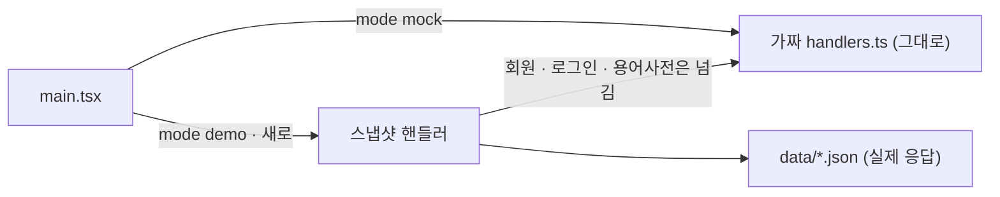

# Vercel 데모를 실제 기사 스냅샷으로 채운다 (Jira S15P31A102-220 이어서)

## 무엇을 / 왜

서버를 내리면 Vercel 데모만 남는다. 지금 데모는 지어낸 데이터(이슈 11개, 마인드맵은 2개만 손으로 씀)라 발표 · 포트폴리오로 보여 주기 어렵다.
2026-11-16 실제 서비스 공개 API 에서 받은 스냅샷(홈 이슈 16개 · 기사 1,938건 · 마인드맵)으로 **Vercel 데모만** 채운다.
`npm run dev:mock` 과 테스트 906개는 지금 가짜 데이터 그대로 둔다 (사용자 결정 2026-11-16).

## 바꿀 파일

- `frontend/src/mocks/snapshot/data/*.json` — 새로. 받은 응답을 종류별로 묶은 것: 이슈 상세 · 흐름 · 사건 상세 · 기사 상세 · 사건별 기사 id 순서 · 마인드맵. 손으로 고치지 않는 생성물 (약 3MB)
- `frontend/src/mocks/snapshot/db.ts` — 새로. JSON 을 `?raw` 로 읽어 `JSON.parse` (큰 JSON 을 TS 가 추론하느라 `tsc` 가 느려지지 않게). 목록 · 쪽 나누기 · 정렬 · 검색 · 분야 수 계산을 하는 순수 함수. 마인드맵 파일은 첫 마인드맵 요청 때 따로 불러 첫 화면을 가볍게 한다
- `frontend/src/mocks/snapshot/db.test.ts` — 새로. 아래 「검증」의 테스트
- `frontend/src/mocks/snapshot/handlers.ts` — 새로. `createSnapshotHandlers()`: A1~A9 · A13 · A20~A25 를 스냅샷으로 답한다. 북마크 · 관심 이슈는 페이지를 열 때마다 비어 있는 메모리 상태 (`src/mocks/session.ts` 와 같은 방식). 없는 것은 404 로 답해 가짜 데이터로 새지 않게 한다
- `frontend/src/main.tsx` — mode `demo` 면 [로그인 상태 → 스냅샷 → 가짜(회원 · 로그인 · 용어사전만 닿음)] 순서로 켠다. mode 비교는 `import.meta.env.MODE === "…"` 로 직접 써서 운영 빌드에서 목 코드가 빠지게 한다
- `frontend/src/pwa/registerServiceWorker.ts` · `.test.ts` — `demo` 도 `/sw.js` 를 등록하지 않는다 (테스트 하나 더)
- `frontend/package.json` — `dev:demo` (`vite --mode demo`)
- `frontend/vercel.json` — 빌드 명령 `--mode mock` → `--mode demo`
- `frontend/.prettierignore` — `src/mocks/snapshot/data/` (생성물. 포맷하면 크기가 두 배)
- `frontend/README.md` · `vite.config.ts` 주석 — 「가짜 API」 표에 demo 줄 · 스냅샷 출처(언제 · 무엇을 받았나)

받기 · 변환 스크립트와 원본 응답(`raw/`)은 저장소에 넣지 않는다 — `.notes/demo-snapshot/` 에 둔다. 서버를 내리면 다시 받을 수 없어 스크립트가 쓸모없고, 출처는 README 에 적는다.

## 작업 순서

브랜치: `git nb feat frontend 220 demo-snapshot` (220 은 머지됨 · 같은 티켓 이어서). 새 작업 폴더에서 한다.

- [ ] 1. `registerServiceWorker` 가 `demo` 도 빼게 — 실패 테스트 먼저 → 고침
- [ ] 2. `.notes` 의 변환 스크립트로 `data/*.json` 생성 + `.prettierignore` — 변환하면서 검사: 내가 만든 이슈 목록 항목이 받은 홈 목록 응답과 같다, 기사 요약이 받은 사건 기사 목록 항목과 같다
- [ ] 3. `db.ts` + `db.test.ts` — 실패 테스트 먼저
- [ ] 4. `handlers.ts` + `main.tsx` + `package.json` + `vercel.json` — `npm run build -- --mode demo` 를 띄워 브라우저로 확인
- [ ] 5. README · vite 주석

## 안 바꿀 것

- 가짜 데이터 `src/mocks/handlers.ts` · `session.ts` · `node.ts` 와 테스트 906개 — 그대로. `npm run dev:mock` 화면도 그대로
- 운영 빌드 · nginx · Dockerfile — 그대로. 스냅샷은 운영 빌드에 들어가지 않는다
- 랜딩의 샘플(`landingSample.ts`) — 그대로
- 회원 · 로그인 — 가짜 회원 「김뉴런」 그대로
- 용어사전 — 가짜 그대로 넘긴다. 가짜가 아는 경제 용어 8개(기준금리 · 유동성 …)만 풀고 나머지는 「풀이 불가」. 실제 뜻풀이를 담는 건 이번에 안 한다
- 화면 코드(`pages/` · `components/` · `api/`) — 안 건드린다

## 리스크

- **데이터가 공개된다.** 제목 · 요약 · AI 마인드맵 · 원문 링크(본문 없음)가 공개 GitHub · Vercel 에 올라간다. 지금 newlearn.io.kr 에서 누구나 보는 것과 같은 범위다
- **저장소가 약 3MB 커진다.** 🔴 한 번 푸시하면 MR 을 되돌려도 git 기록에는 남는다 (강제 푸시는 팀 설정으로 막혀 있다)
- **데모 첫 화면이 느려질 수 있다.** 스냅샷을 다 받은 뒤 화면을 그린다. 마인드맵은 따로 미뤄도 1MB 대(압축 전)일 수 있다 — 빌드 결과의 크기를 재서 MR 에 적는다
- **mode 이름(`mock` · `demo`) 비교가 두 곳에 있다** (`main.tsx` · `registerServiceWorker.ts`). 운영 빌드에서 목 코드가 빠지려면 상수 비교여야 해서 함수로 못 묶는다. 서로 가리키는 주석을 단다
- 스냅샷 밖 이슈 · 기사는 데모에 없다. 목록 · 검색 · 분야 수도 스냅샷 기준으로 다시 센다 (이슈 16개)

## 어떻게 검증하나

- 테스트 (`db.test.ts`)
  - 사건 흐름에 나오는 사건은 모두 사건 상세가 있고, 사건 기사 id 는 모두 기사 상세가 있다
  - 이슈 목록: 분야로 거르고 `lastEventAt` · `createdAt` 최신순, 쪽을 나눈다. 항목의 `lastEvent` 는 흐름의 마지막 사건이다
  - 사건 기사: 기본 오래된 순, `latest` 면 뒤집는다, 쪽을 나눈다
  - 최신 기사: 분야로 거르고 발행 최신순
  - 분야 수는 스냅샷 기준이다
  - 검색: 제목에 든 것, 유형마다 20개까지
  - 북마크 · 관심 이슈를 담으면 목록과 상세의 `bookmarked` · `interested` 가 바뀌고, 빼면 돌아온다
  - `registerServiceWorker`: `demo` 는 운영 빌드여도 등록하지 않는다
- 기계 검사 (Node 26): 포맷 · 린트 · 테스트 · 빌드 — verifier
- 운영 빌드에 목이 안 섞였나: `npm run build` 결과에 `mockServiceWorker.js` · 스냅샷 파일이 없다
- 실제로 띄워 봄: `npm run build -- --mode demo` → `vite preview` → Playwright
  - 홈에 실제 이슈(예: 「스마트안경 시험 부정행위 대응」), 이슈 흐름 · 사건 패널 기사 목록 · 더 보기, 기사 마인드맵, 검색 「스마트안경」, 북마크 → 나의 뉴스함
  - 워커는 `mockServiceWorker.js` 하나, 콘솔 오류는 손님일 때의 401 말고 없음. 스크린샷 → `.notes/mr/S15P31A102-220-demo-snapshot/`
- `npm run dev:mock` 은 그대로: 홈에 가짜 이슈 「한빛반도체 미국 공장 건설」
- 머지 · GitHub 푸시 뒤: Vercel 주소에서 같은 확인 + 깊은 주소(`/issues/104`)로 바로 열기

## 되돌리는 법

- MR 을 revert 하면 `vercel.json` 이 `--mode mock` 으로 돌아가 데모가 가짜 데이터로 돌아간다. 운영 배포에는 영향이 없다
- 🔴 스냅샷 JSON 은 git 기록에 남는다 — 지우려면 기록을 다시 써야 하는데 강제 푸시가 막혀 있어 사실상 되돌릴 수 없다
