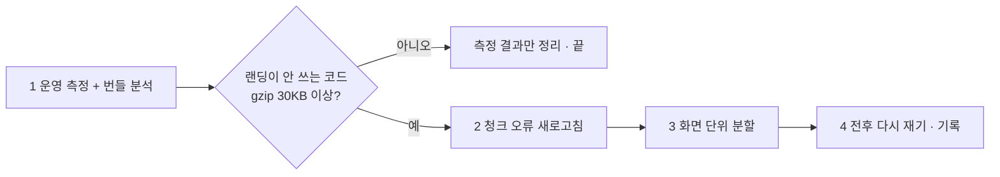

# Jira S15P31A102-218 Lighthouse 로 프론트 첫 화면을 재고, 화면 단위 코드 분할을 하나 넣는다

작업 폴더 `S15P31A102-218`, 브랜치 `perf/frontend/S15P31A102-218-lighthouse-code-splitting`(origin/frontend 기준). 216 디자인 피드백이 frontend 에 머지된 뒤 시작했다(2026-11-16).

운영에는 GA4 · Clarity 사용 분석(Jira 217)이 이미 올라가 있다. 측정은 이 상태 그대로 하고, 전후 비교도 둘 다 사용 분석이 들어간 빌드끼리 한다.

## 무엇을 / 왜

발표에서 프론트 성능을 숫자로 말할 거리는 11-06 gzip(첫 화면 6.6초 → 2.5초) 하나뿐이고, Lighthouse 보고서는 아직 없다. 운영 사이트의 손님 화면을 Lighthouse 로 재서 점수와 지적 항목을 남긴다.

JS 가 한 덩어리(원본 약 850KB, gzip 약 270KB)로 나간다. 라우트 목록이 화면 11개를 모두 처음부터 불러와서, 랜딩만 열어도 마인드맵 · 이슈 흐름 화면 코드와 D3 까지 받는다(`frontend/src/routes.tsx:1-14`). 떼어 낼 몫이 크면 **화면 단위 코드 분할**을 넣는다. 화면 코드를 따로 묶어 두고 그 화면에 들어갈 때 받는 방식이다. 넣은 뒤 다시 재서 전후를 비교한다.

30KB 는 랜딩 작업 때 「gzip 30KB 넘게 늘면 랜딩을 lazy 로」라고 정한 기준을 그대로 쓴다(`docs/plans/nested-hugging-peacock.md:74`). 1단계가 끝나면 결과 표를 보여 드리고 멈춰서 2단계로 갈지 함께 정한다.

## 발표에서 말할 것

- **이미 있는 숫자:** gzip 을 켜서 느린 4G 폰의 첫 화면이 6.6초에서 2.5초로, JS 가 829KB 에서 260KB 로 줄었다(Jira 32, `.notes/mr/S15P31A102-32-gzip.md`)
- **1단계에서 생기는 숫자:** 화면 다섯 개의 Lighthouse 성능 · 접근성 · 권장사항 · SEO 점수와 LCP · TBT · CLS. LCP 는 가장 큰 내용이 뜨기까지 걸린 시간, TBT 는 JS 때문에 화면이 입력을 못 받은 시간, CLS 는 화면이 덜컥 밀린 정도다
- **3 · 4단계까지 가면:** 랜딩이 받는 JS 가 몇 KB 줄었고 LCP 가 몇 초 줄었는지
- **같이 말할 단서:** 실험실에서 잰 값이다. Lighthouse 가 느린 4G(왕복 150ms · 1.6Mbps)와 CPU 4배 느림을 흉내 낸 조건이고, 실제 사용자에게서 모은 값은 아니다. 화면마다 3번 잰 가운데 값을 쓴다

## 후보 기술과 고른 까닭

| 후보 | 기대 효과 | 이번에 하나 |
| --- | --- | --- |
| 화면 단위 코드 분할 (React Router `lazy`) | 첫 화면 JS 가 준다. Lighthouse 의 「사용하지 않는 JavaScript 줄이기」에 바로 잡힌다 | ✅ 1단계 결과가 기준을 넘으면 |
| 미리 받기 (prefetch) | 이슈 → 사건 패널에서 요청이 차례로 이어져 4.1초 걸린다(`.notes/real-check/2026-11-12/README.md:38-44`). 누르기 전에 받으면 줄어든다 | 다음. 시간이 남으면 따로 계획 |
| 확대 · 이동 때 다시 그리기 줄이기 | 확대 한 번에 마인드맵 · 이슈 흐름 전체가 다시 그려진다(`MindmapGraph.tsx:262` · `Timeline.tsx:199`) | ❌ Lighthouse 는 첫 로딩만 본다. 지금 규모(사건 14개 · 잎 15개)에서는 차이가 안 보일 것이다 |
| brotli · 미리 압축 | gzip 보다 더 작게 보낸다 | ❌ 기본 nginx 이미지에 brotli 모듈이 없어 infra 를 바꿔야 한다 |
| CI 번들 크기 예산 | 번들이 다시 커지는 것을 막는다 | ❌ 팀 훅(pre-commit)을 바꾸는 일이라 팀과 먼저 정한다 |

## 바꿀 파일

1단계는 저장소 파일을 바꾸지 않는다. 보고서는 `.notes/lighthouse/<날짜>/` 에 둔다(커밋 안 함).

- `frontend/src/routes.tsx` — 기사 · 이슈 · 분야별 이슈 · 마이페이지 · 나의 뉴스함 화면을 route `lazy` 로 바꾼다. 랜딩 · 로그인 · 가입 · 홈 · 셸은 첫 화면으로 들어오는 곳이라 그대로 둔다. lazy 로 하면 첫 화면 전에 요청이 한 번 더 이어진다. D3 는 기사 · 이슈 화면만 쓰므로 함께 빠진다
- 새 `frontend/src/lib/reload-on-chunk-error.ts` + 시험 — 배포 뒤 옛 화면에서 없어진 청크를 부르다 실패하면(Vite 의 `vite:preloadError` 사건) 한 번 새로고침한다. 연달아 새로고침하지 않게 sessionStorage 에 표시를 남기고, 읽기 · 쓰기는 try/catch 로 감싼다
- `frontend/src/main.tsx` — 위 함수를 한 번 등록한다
- 화면 시험(`renderRoute` 를 쓰는 18개 중 깨지는 것) — 화면이 한 박자 늦게 뜨므로 `getBy` 를 `findBy` 로 바꾼다. 기대값은 바꾸지 않는다
- `SSOT.md` 10절 「잰 것」 — 전후 숫자 한 줄
- 이 계획 파일 — 위 이름으로 옮긴다

## 작업 순서

- [x] 0. Jira 새 티켓을 만든다. `git nb perf frontend <번호> lighthouse-code-splitting` 으로 새 작업 폴더 `S15P31A102-<번호>` 를 만든다. 지금 폴더는 216 이 쓰고 있다. 이 계획 파일을 옮겨 커밋한다
- [ ] 1. 측정 (커밋 없음) — `npx -y lighthouse@13.6.0`(2026-10-27 배포판)을 이 PC 의 Chrome 으로 돌린다. 화면은 `/` · `/login` · `/home` · `/issues/<id>` · `/articles/<id>` 다섯 개다. id 는 운영 API 를 GET 으로 불러 공개된 것을 하나씩 고른다. 모바일 기본 조건으로 화면마다 3번 돌린다. 번들 구성은 `vite build --sourcemap` 을 scratchpad 에 내고 `npx source-map-explorer` 로 본다. **결과 표를 보여 드리고 멈춘다**
- [ ] 2. 청크 오류 새로고침 — 시험을 먼저 써서 실패를 본 뒤 구현한다(커밋)
- [ ] 3. 화면 단위 분할 — `routes.tsx` 와 깨진 시험을 고친다(커밋). 빌드 결과에 화면별 청크가 따로 생기는지 본다
- [ ] 4. 전후 다시 재기 — Node 시험 서버를 scratchpad 에 만든다(gzip 레벨 5, `/api` 는 운영으로 넘김. 11-06 gzip 때 쓴 방법). 같은 서버로 지금 `origin/frontend` 빌드와 이 브랜치 빌드를 차례로 내주고 Lighthouse 를 3번씩 돌린다. SSOT 10절에 적는다(커밋)
- [ ] 5. `/verify` → MR(대상 `frontend`) → dev 머지 · 배포 뒤 운영에서 다시 잰다

## 안 바꿀 것

- 랜딩 · 로그인 · 가입 · 홈 · 셸(AppShell · Header)의 import 방식과 코드
- `vite.config.ts`(manualChunks 같은 build 옵션을 넣지 않는다), `package.json` 의존성. Lighthouse 와 source-map-explorer 는 npx 로만 부른다
- `nginx.conf` · infra · `public/sw.js`
- 화면 모양 · 동작, 시험의 기대값
- 위 표에서 ❌ 이거나 「다음」으로 둔 것

## 리스크

- **배포 뒤 옛 화면을 띄운 채로 다른 화면에 가면 실패할 수 있다.** 옛 청크 파일이 서버에서 없어져 404 가 나고 오류 화면이 뜬다. 2단계의 새로고침으로 막는다. 서비스 워커가 `/assets/` 를 캐시에서 먼저 꺼내서 대부분은 캐시로 넘어갈 것으로 보지만 확인하지 않았다
- 공유 링크로 기사 · 이슈 화면에 바로 들어오면 첫 화면 전에 요청이 하나 더 이어져 조금 늦어질 수 있다. 4단계에서 두 화면도 전후를 잰다. 나빠지면 그 화면은 lazy 에서 뺀다
- 처음 들어온 화면이 lazy 이면 청크를 받는 동안 React Router 가 개발 콘솔에 HydrateFallback 경고를 낼 수 있다. 나오면 빈 대체 화면을 준다
- **발표 이틀 전에 모든 화면의 로딩 방식을 바꾼다.** 발표 전 배포가 불안하면 운영에는 올리지 않는다. 그때는 「이 브랜치 빌드로 잰 숫자」로만 말한다. 11-06 gzip 때도 이렇게 했다. 4단계 뒤 함께 정한다
- npx 가 Lighthouse 를 npm 에서 받을 때 자동 모드가 막을 수 있다. 막히면 승인을 부탁드린다
- 다른 브랜치의 GA4 · Clarity(`analytics.js`)가 붙으면 점수가 내려간다. 그래서 전후 비교는 같은 조건에서 잰 것끼리만 한다
- 화면 시험이 비동기로 바뀌어 커밋 게이트에서 시간 초과가 날 수 있다(부하가 있으면 3초에 걸렸다). 커밋 전에 띄워 둔 vite 를 끈다

## 어떻게 검증하나

- 1단계: 화면 다섯 개 × 3번의 HTML · JSON 보고서가 `.notes/lighthouse/` 에 있다. 표의 숫자는 JSON 에서 꺼낸다
- 2단계: 새 시험이 구현 전에 실패하고 구현 뒤 통과한다. 한 번만 새로고침하고 두 번째 실패에서는 새로고침하지 않는지도 본다
- 3단계: `npm run build` 결과에 화면별 청크가 생긴다. 랜딩이 받는 JS(gzip)가 준다. 전체 vitest 를 Node 26 으로 돌려 통과한다(CI 가 Node 26 이다)
- 3단계 화면 확인: dev:mock 에서 `/` → `/home` → 이슈 → 기사 → `/me` 로 옮겨 다니며 스크린샷을 찍고 콘솔 오류가 0인지 본다
- 4단계: 랜딩 · 홈은 JS 받은 양과 LCP 가 준다. 기사 · 이슈는 LCP 가 잡음 범위를 넘게 나빠지지 않는다. 잡음 범위는 그 화면 3번 값의 최소 ~ 최대 폭으로 본다
- 옛 청크 404 재현: 시험 서버에 전 빌드를 띄워 화면을 연다. 서버를 후 빌드로 바꾼 뒤 다른 화면으로 옮긴다. 한 번 새로고침되고 화면이 떠야 한다
- 배포 뒤: 운영에서 Lighthouse 를 다시 돌리고, CSP 위반이 0인지 11-03 방식대로 본다(`SSOT.md:461`)

## 되돌리는 법

- 1단계는 저장소를 바꾸지 않는다
- 2 · 3단계는 커밋을 revert 한다. 바뀌는 것은 `routes.tsx` · `main.tsx` · 새 파일 하나 · 시험뿐이다. 데이터와 배포 설정은 건드리지 않아서 되돌릴 수 없는 것이 없다
- 운영에서 문제가 나면 dev 에서 MR 을 revert 하고 다시 배포한다
