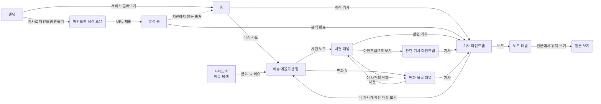
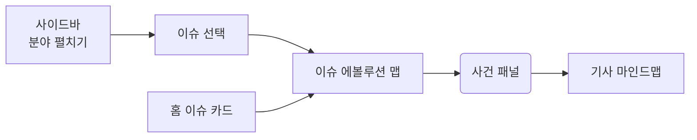
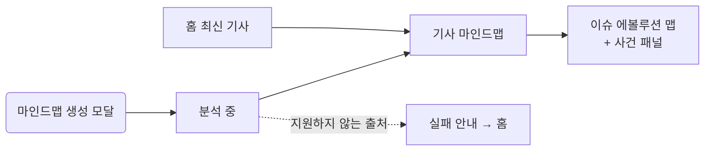
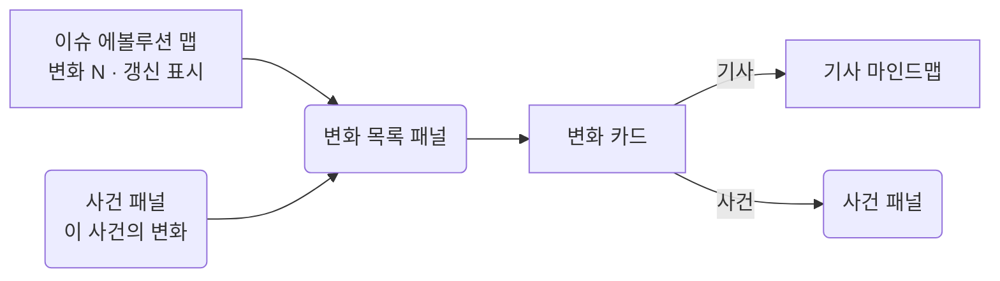
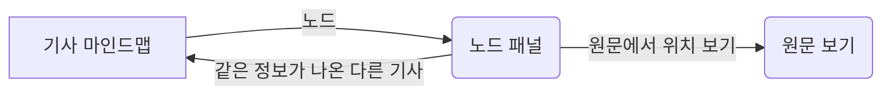

# NEW:LEARN 유저 플로우

[프로토타입 v12](<prototype/NEW-LEARN 프로토타입 v12.html>)를 기준으로 사용자가 화면을 어떻게 오가는지 정리한 문서입니다. 범위와 우선순위는 [MVP 개요](mvp-overview.md)와 PRD를 따릅니다.

- **MVP 핵심 흐름은 두 개입니다.** Flow A(카테고리 → 이슈 → 기사)와 Flow B(기사 → 마인드맵 → 이슈)입니다. 두 흐름은 기사 마인드맵과 이슈 에볼루션 맵에서 만납니다.
- 프로토타입에는 MVP 이후 기능(로그인, 북마크, 관점 등)도 들어 있습니다. 이 기능들은 [7장](#7-mvp-이후-흐름-프로토타입에만-있음)에 따로 모았습니다.
- 프로토타입과 MVP·PRD가 다른 부분은 [8장](#8-확인이-필요한-부분)에 모았습니다.

---

## 1. 한눈에 보기

네모는 탭으로 열리는 화면이고, 둥근 상자는 그 위에 뜨는 패널·모달입니다. 점선은 실패 경로입니다.

---

## 2. 화면 목록

| 화면 | 형태 | 들어오는 길 | 여기서 하는 일 | 범위 |
| --- | --- | --- | --- | --- |
| 랜딩 | 전체 화면 | 첫 방문 | 서비스 소개, 둘러보기·마인드맵 만들기로 진입 | PRD에 없음 |
| 홈 | 탭 | 로고, 사이드바 *홈* | 검색, 이슈 카드, 최신 기사 | P0 (추천 이슈 카드는 MVP 이후) |
| 이슈 에볼루션 맵 | 탭 | 홈 이슈 카드, 사이드바, 검색, 마인드맵 | 사건을 발생 시점 순으로 보기 | P0 |
| 사건 패널 | 오른쪽 패널 | 이슈 에볼루션 맵의 사건 노드 | 사건 요약, 관련 기사, 이전·다음 사건 | P0 |
| 변화 목록 패널 | 오른쪽 패널 | *변화 N* 버튼, 갱신 표시, 사건 패널 | 이전·이후 근거를 나란히 비교 | P0 |
| 관련 기사 마인드맵 | 모달 | 사건 패널 *마인드맵으로 보기* | 이 사건과 앞뒤 사건의 기사를 한 맵에 | QA 때 결정 |
| 기사 마인드맵 | 탭 | 최신 기사, 관련 기사, 분석 완료 | 기사 핵심 정보를 노드로 보기 | P0 |
| 노드 패널 | 오른쪽 패널 | 마인드맵 노드 | 노드 요약과 근거 문장 | P0 |
| 원문 보기 | 모달 | 노드 패널 *원문에서 위치 보기* | 근거 문장이 원문 어디에 있는지 확인 | P0 |
| 마인드맵 생성 모달 | 모달 | 상단 *생성* 버튼, 랜딩 | 기사 URL 입력 | P0 |
| 분석 중 | 탭 | URL 제출 | 분석 진행 표시, 실패 안내 | P0 (단계별 표시는 P1) |

---

## 3. Flow A. 카테고리 → 이슈 → 기사

**MVP 흐름:** 홈 → 카테고리 선택 → 이슈 목록 → 이슈 에볼루션 맵 → 사건 선택 → 관련 기사 → 기사 마인드맵

| 단계 | 사용자가 하는 일 | 화면에서 보이는 것 |
| --- | --- | --- |
| 1 | 사이드바 *이슈 탐색*에서 분야를 펼친다 | 7개 분야 아래 이슈 목록, 이슈 아래 사건 목록 |
| 2 | 이슈를 고른다 (홈 이슈 카드의 *흐름 보기*로도 들어올 수 있다) | 이슈 에볼루션 맵 탭이 열린다. 로딩 중엔 스켈레톤이 보인다 |
| 3 | 사건 흐름을 훑어본다 | 이슈 헤더(사건·기사·언론사 수), 날짜순 타임라인, *변화 N* 버튼, 확대·축소·*전체 보기*·범례 |
| 4 | 사건 노드를 누른다 | 오른쪽에 사건 패널이 열린다. 사건 발생일, 사건 요약과 근거 문단, 관련 기사(발행일 순), 이전·다음 사건 |
| 5 | 관련 기사를 고른다 | 기사 마인드맵 탭이 열린다 → [Flow D](#5-2-flow-d-마인드맵에서-근거-확인) |

- 같은 날 사건이 여러 개면 묶음으로 보이고, 누르면 펼쳐진다.
- 사건 패널의 *마인드맵으로 보기*를 누르면 관련 기사 마인드맵 모달이 열린다. *이 사건만*과 *연결된 사건 포함*을 고를 수 있고, 기사를 누르면 그 기사의 마인드맵이 열린다.

---

## 4. Flow B. 기사 → 마인드맵 → 이슈

**MVP 흐름:** 기사 선택 또는 지원 URL 입력 → AI 분석 → 기사 마인드맵 → 관련 이슈 → 이슈 에볼루션 맵

| 단계 | 사용자가 하는 일 | 화면에서 보이는 것 |
| --- | --- | --- |
| 1 | 상단 *생성* 버튼을 누른다 (랜딩의 *기사로 마인드맵 만들기*도 같다) | 마인드맵 생성 모달: URL 입력란, 지원 언론사 3곳 안내, "demo"로 체험 안내 |
| 2 | URL을 넣고 *마인드맵 만들기*를 누른다 | 분석 중 탭: 기사 본문 확인 → 인물·기관·사건 추출 → 마인드맵 구조 생성 → 관련 기사·이슈 연결 |
| 3a | (성공) | 같은 탭이 기사 마인드맵으로 바뀐다. 처음 분석한 이슈면 "나의 뉴스함에 '…' 이슈가 추가됐어요" 토스트 |
| 3b | (지원하지 않는 출처) | "지원하지 않는 출처의 기사입니다", 지원 언론사 목록, *홈으로 돌아가기* |
| 4 | 마인드맵에서 노드를 눌러 근거를 본다 | [Flow D](#5-2-flow-d-마인드맵에서-근거-확인) |
| 5 | *이 기사가 속한 이슈 보기*를 누른다 | 이슈 에볼루션 맵이 열리고, 이 기사의 사건이 선택된 채 사건 패널이 열린다 |

- **저장된 기사로 바로 들어가기:** 홈 *최신 기사*에서 분야를 고르고 기사를 누르면 분석 단계 없이 마인드맵이 열린다.

---

## 5. 확인 흐름

Flow A·B 중간에서 들어가는 두 흐름입니다. 서비스의 핵심인 "무엇이 달라졌나"와 "근거가 뭔가"를 확인합니다.

### 5-1. Flow C. 무엇이 달라졌는지 확인

| 단계 | 사용자가 하는 일 | 화면에서 보이는 것 |
| --- | --- | --- |
| 1 | 이슈 헤더의 *변화 N*, 타임라인의 갱신 표시, 사건 패널의 *이 사건의 변화* 중 하나를 누른다 | 오른쪽에 변화 목록 패널이 열린다. 갱신 표시로 들어오면 그 카드로 바로 이동한다 |
| 2 | 관계 유형으로 거른다 | *전체 · 갱신 · 새 정보 · 반복 · 상충 후보* 필터. 같은 내용을 반복한 보도는 숨기고 몇 건인지 알려 준다. *판단 불가*는 따로 펼친다 |
| 3 | 변화 카드를 읽는다 | 바뀐 값(이전 → 이후), 이전 근거와 이후 근거 문장을 나란히. 상충 후보면 "어느 쪽이 맞는지 판정한 결과가 아니에요" 안내 |
| 4 | 카드에서 기사나 사건으로 이동한다 | 기사 → 기사 마인드맵, 사건 → 타임라인에서 그 사건으로 이동하고 사건 패널이 열린다 |

### 5-2. Flow D. 마인드맵에서 근거 확인

| 단계 | 사용자가 하는 일 | 화면에서 보이는 것 |
| --- | --- | --- |
| 1 | 기사 마인드맵을 연다 | 가운데 기사, 둘레에 인물·기관·사건·시점·배경·결과 노드. 상단에 *원문 보기*, *이 기사가 속한 이슈 보기* |
| 2 | 노드를 누른다 | 오른쪽 노드 패널: 노드 요약, 근거 문장과 문단 위치, 같은 정보가 나온 다른 기사 |
| 3 | *원문에서 위치 보기*를 누른다 | 원문 보기 모달: 기사 본문에서 근거 문장이 강조된다. *언론사 원문으로 이동* |

---

## 6. 공통 규칙

### 화면 이동

- 이슈·기사·분석은 **탭**으로 열린다. 이미 열린 대상이면 그 탭으로 돌아간다. 탭을 닫으면 왼쪽 탭으로 간다.
- 다른 탭으로 옮기면 열려 있던 오른쪽 패널은 닫힌다.
- 오른쪽 패널이 열리면 화면이 넓을 때(1024px 초과) 사이드바가 자동으로 접힌다.
- 화면이 좁을 때(1024px 이하) 사이드바는 메뉴 버튼으로 여는 서랍이 된다.

### 검색과 단축키

- `⌘K`(또는 `Ctrl+K`)나 사이드바 *검색*을 누르면 홈 검색창으로 간다. 결과는 이슈·사건·기사로 나뉘고, 결과를 고르면 해당 화면이 열린다.
- `Ctrl+\`는 사이드바를 접고 편다.
- `Esc`는 위에 뜬 것부터 하나씩 닫는다: 검색 → 생성 모달 → 원문 보기 → 관련 기사 마인드맵 → 오른쪽 패널 → 서랍.

### 상태와 예외

| 상황 | 보이는 것 | 다음 행동 |
| --- | --- | --- |
| 이슈 불러오는 중 | 스켈레톤 | 자동으로 화면 표시 |
| 이슈 불러오기 실패 | "타임라인을 불러오지 못했어요" | *다시 시도* |
| 데이터가 아직 없는 이슈 | "이 이슈의 상세 데이터는 준비 중이에요" + 사건·기사 수 | 다른 이슈로 이동 |
| 지원하지 않는 출처 | 실패 안내 + 지원 언론사 목록 | *홈으로 돌아가기* |
| 분야에 이슈·기사가 없음 | "이 분야의 이슈가 아직 없어요" 등 | 다른 분야 선택 |
| 검색 결과 없음 | "'…'에 맞는 이슈·사건·기사가 없어요" | 다른 검색어 |
| MVP 이후 기능 버튼 (*관점 비교*, 알림) | 비활성 버튼 + "곧 제공" 표시 | 누르면 "MVP 이후 제공 예정인 기능이에요" 토스트 |
| 외부 링크 (*원문 보기* 등) | — | 프로토타입에서는 비활성 토스트 |

---

## 7. MVP 이후 흐름 (프로토타입에만 있음)

프로토타입에서는 동작하지만 PRD 기준으로 MVP 이후(P2)인 흐름입니다. MVP 시연 흐름이 여기에 기대면 안 됩니다.

| 흐름 | 프로토타입 동작 | PRD |
| --- | --- | --- |
| 로그인 | 북마크·관심 이슈 별표·나의 뉴스함·마이페이지를 쓰려 하면 로그인 모달이나 안내가 뜬다. 로그인하면 하려던 동작을 이어서 한다. 둘러보기는 로그인 없이 된다 | FR-17 |
| 북마크 | 기사 옆 북마크 → 나의 뉴스함에 모인다 | FR-18 |
| 관심 이슈 재방문 | 이슈에 별표 → 다시 열면 "지난 방문 이후 새 사건 N"과 점선 고리 표시 | FR-19 |
| 홈 추천 이슈 | 관심 분야 탭별 추천 이슈 카드, 마이페이지에서 관심 분야·언론사 편집 | FR-28 |
| 논점·관점 | 타임라인의 ◆ 논점이나 사건 패널 *관점* 탭 → 논점 패널에서 언론사별 관점 | FR-24~26 |
| 여러 탭 | 화면을 탭으로 여러 개 열어 두기 | FR-27 |

---

## 8. 확인이 필요한 부분

프로토타입과 MVP 개요·PRD가 다른 곳입니다. 팀에서 정하면 프로토타입이나 이 문서를 고칩니다.

1. **"카테고리 선택 → 이슈 목록" 화면이 따로 없음.** MVP Flow A는 카테고리를 고르고 이슈 목록을 보는 단계가 있는데, 프로토타입은 사이드바 아코디언과 홈 이슈 카드로 대신합니다. 홈의 분야 탭은 관심 분야만 보여 주고, *최신 기사*의 분야 탭은 이슈가 아니라 기사로 이어집니다. 7개 분야를 모두 고를 수 있는 진입점을 홈에 둘지 정해야 합니다(FR-3, FR-4).
2. **홈 구성이 MVP와 다름.** MVP 홈은 카테고리 선택과 최신 기사입니다. 프로토타입 홈은 인사말, 검색, 이슈 카드(관심 이슈·추천 이슈)까지 있습니다. 추천 이슈 카드는 MVP 이후입니다.
3. **분석 실패 후 갈 곳.** 프로토타입은 *홈으로 돌아가기*만 있습니다. PRD FR-32는 저장된 기사로 가는 길을 안내하도록 했습니다.
4. **사건 관계선 4종.** 타임라인이 후속·원인·반응·반박으로 사건을 잇습니다. MVP 개요는 시간순 연결을 우선하고 관계 종류는 논의 중입니다(Q25, FR-22는 P1).
5. **노드 패널의 변화 라벨.** "새로 확인된 사실·입장 변화·수치 변경"이 남아 있습니다. PRD는 #새 정보·#갱신·#상충 후보 세 가지로 바꿨습니다.
6. **랜딩 페이지.** PRD 화면 목록에 없습니다. 시연에 쓸지 정해야 합니다.
7. **관련 기사 마인드맵.** MVP에 넣을지 QA 때 정하기로 했습니다(PRD FR-11 메모).
