# 4. 시연 시나리오

최종 발표(2026-11-18) 시연과 같은 순서입니다. 시연은 목데이터가 아니라 **실시간 운영 서버**에서 합니다. 홈에서 검색해 보고, 이슈 하나를 골라 사건 흐름을 따라간 뒤, 기사 한 편을 AI 가 정리한 흐름지도 · 마인드맵으로 엽니다. 모르는 낱말은 그 자리에서 드래그해 뜻을 봅니다.

| 접속 길 | 주소 | 되는 범위 |
|---|---|---|
| 운영 사이트 | https://newlearn.io.kr | 전부. 발표 뒤 서버를 내리기 전까지 |
| 로컬 실행 + 3장 덤프 | http://localhost:5173 | 서버를 내린 뒤에도 같은 데이터(2026-11-17 07:24 백업까지). 이슈 · 사건 수를 운영과 같게 보려면 목록 기준값을 켭니다(3장). 용어사전 문맥 뜻은 GMS 키 · 주소를 `backend/.env` 에 넣어야 나옵니다(1-3) — 없으면 502 |

- 브라우저는 PC 크롬(웹)으로 합니다. 폰에서도 열리고 홈 화면에 설치할 수 있지만(PWA), 발표 시연은 웹으로 합니다.
- **로그인하지 않아도 시연 흐름은 모두 됩니다.** 손님도 홈 · 검색 · 이슈 · 기사 · 용어사전을 씁니다(2026-11-13 Jira S15P31A102-205 부터. `docs/mvp-overview.md` 는 아직 F13 용어사전을 「로그인한 회원이 쓴다」고 적고 있어 이 한 곳은 코드가 맞습니다). 회원만 하는 것은 저장(북마크 · 관심 이슈 · 관심 분야)과 그 목록 화면입니다(⑬ ~ ⑮). 발표에서는 로그인한 상태로 시연해 머리 오른쪽에 「나의 뉴스함 · 마이페이지」가 보이고, 손님이면 그 자리에 「로그인」이 보입니다.
- 캡처는 2026-11-17 에 찍었습니다(1440 × 900). ① ~ ⑫ 는 운영 사이트에서 손님으로, ⑬ ~ ⑮ 는 3장 덤프를 넣은 로컬 실행에서 로컬 전용 시험 계정으로 찍었습니다 — 운영 계정을 쓰지 않으려고서입니다. 로컬 캡처 왼쪽 아래의 둥근 단추는 로컬 개발 서버에만 보이는 개발 도구입니다.
- 사이트가 15분마다 새 기사를 넣어 홈의 추천 이슈 · 개수는 그때그때 다를 수 있습니다. 아래 예시 이슈는 사건이 끝난 이슈라 잘 바뀌지 않습니다.

| 단계 | 화면 | 주소 | 하는 일 |
|---|---|---|---|
| ① ~ ② | 첫 화면 → 로그인 | `/` → `/login` | 서비스 시작하기 → 로그인 없이 시작하기 |
| ③ ~ ④ | 홈 · 검색 | `/home` | 「스마트안경」 검색 → 이슈 · 사건 · 기사 결과 |
| ⑤ | 분야별 이슈 | `/issues?category=it_science` | 추천 이슈 IT·과학 → 전체보기 → 이슈 카드 |
| ⑥ ~ ⑧ | 이슈 화면 · 사건 패널 | `/issues/231?event=…` | 이슈 흐름(타임라인) → 사건 「접속 장애」 → 「34시간 만 복구」 |
| ⑨ ~ ⑪ | 기사 화면 | `/articles/162025` | 흐름지도 → 「MS365」 드래그 → 마인드맵 |
| ⑫ | 이슈로 돌아가기 | `/issues/231?event=4303` | 이 기사가 속한 이슈 보기 |
| ⑬ ~ ⑮ | 가입 · 저장 · 나의 뉴스함 · 마이페이지 | `/signup` · `/bookmarks` · `/me` | 회원 기능 (발표 시연 밖) |

---

## ① 첫 화면 (랜딩)

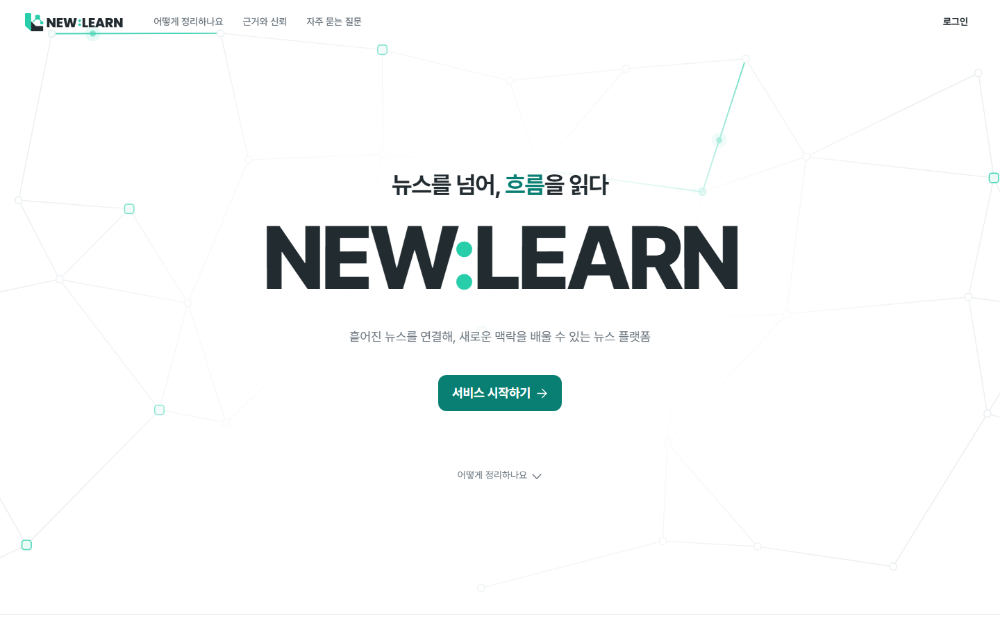

- 가운데 큰 「NEW:LEARN」 아래 **[서비스 시작하기]** 를 누릅니다. 머리 오른쪽 **[로그인]** 을 눌러도 같은 곳으로 갑니다.
- 아래로 내리면 서비스 소개(어떻게 정리하나요 · 근거와 신뢰 · 자주 묻는 질문)가 이어집니다.

## ② 로그인 화면

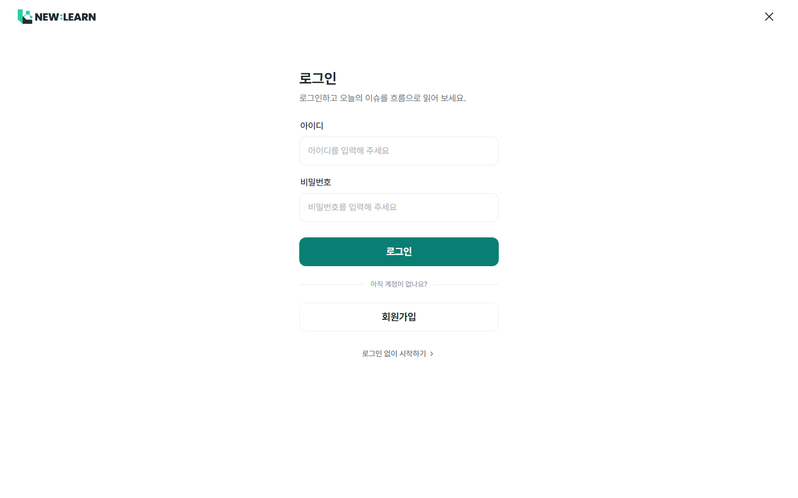

- 회원은 아이디 · 비밀번호로 로그인합니다. 계정이 없으면 **[회원가입]**(⑬).
- 손님으로 둘러보려면 맨 아래 글자 버튼 **[로그인 없이 시작하기]** 를 누릅니다. 홈으로 갑니다.

## ③ 홈 — 처음 열면 뜨는 안내

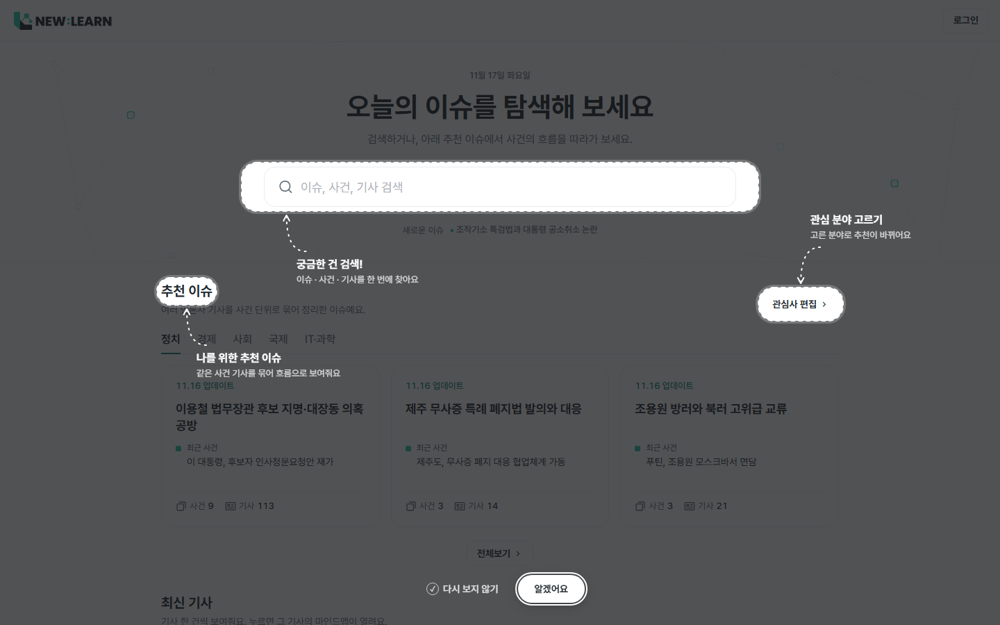

- 처음 홈을 열면 화면을 어둡게 덮고(「화면 안내」) 검색창 · 추천 이슈 · 관심사 편집을 짚어 줍니다.
- 아래 **[알겠어요]** 로 닫습니다. **[다시 보지 않기]** 를 고르면 이 브라우저에서는 다시 뜨지 않습니다.
- 이슈 화면 · 기사 화면도 처음 열 때 같은 안내가 한 번 뜹니다. 닫아야 아래 화면을 누를 수 있습니다. 아래 캡처는 안내를 닫은 뒤 찍었습니다.

## ④ 홈 — 검색

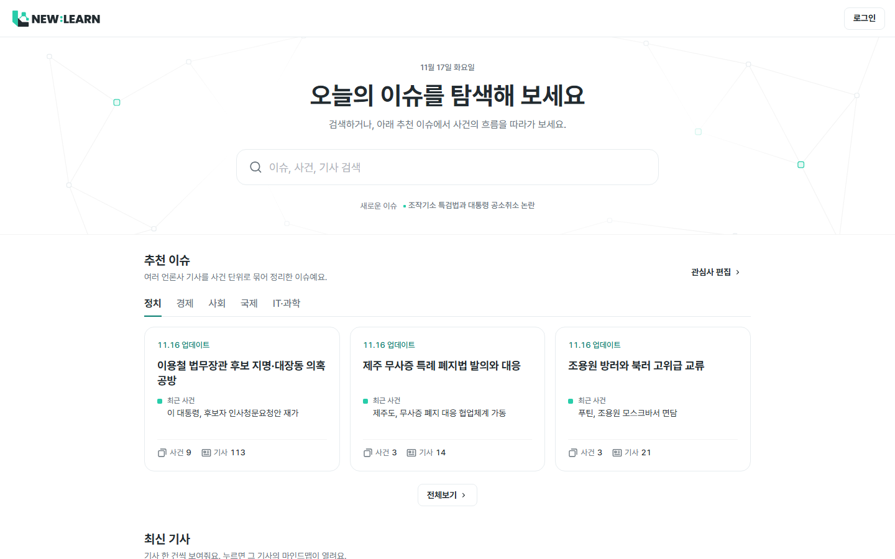

1. 가운데 검색창 「이슈, 사건, 기사 검색」을 누르고 **스마트안경** 을 칩니다.
2. 결과가 **이슈 · 사건 · 기사** 셋으로 나뉘어 바로 뜹니다. 맨 위 이슈 「스마트안경 시험 부정행위 대응」에 관련 보도가 하나의 이슈로 모여 있습니다.
3. ↑ ↓ 로 오가고 Enter 나 클릭으로 엽니다. Esc 로 닫습니다.

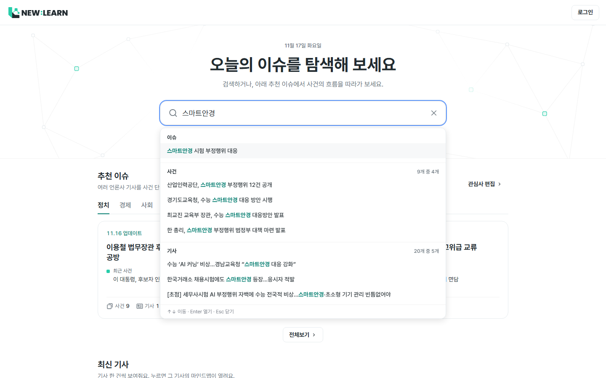

- 검색은 제목에서만 찾고 띄어쓰기를 구분합니다. 「스마트 안경」(띄어 씀)으로 치면 이슈 없이 기사만 나옵니다.
- 사이트는 15분마다 기사를 수집해서 결과가 계속 늘어납니다.
- 어느 화면에서든 ⌘/Ctrl + K 를 누르면 홈 검색창으로 갑니다.

## ⑤ 추천 이슈 → 분야별 이슈

1. 홈 아래 「추천 이슈」의 분야 탭에서 **IT·과학** 을 누릅니다. 탭마다 마지막 사건이 최근인 이슈 3개가 카드로 보입니다(회원은 관심 이슈가 먼저).
2. 카드 아래 **[전체보기]** 를 누르면 그 분야의 이슈 전체가 나옵니다.
3. 두 번째 줄 왼쪽 카드 **「마이크로소프트 서비스 장애와 영향·수습」**(사건 4 · 기사 47)을 누릅니다.

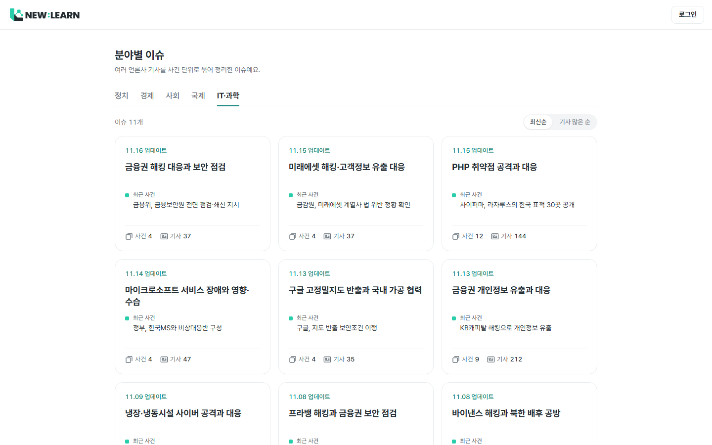

- 카드에는 마지막 업데이트 날짜, 최근 사건, 사건 · 기사 수가 있습니다. 오른쪽 위에서 「최신순 · 기사 많은 순」을 고릅니다.

## ⑥ 이슈 화면 — 이슈 흐름(타임라인)

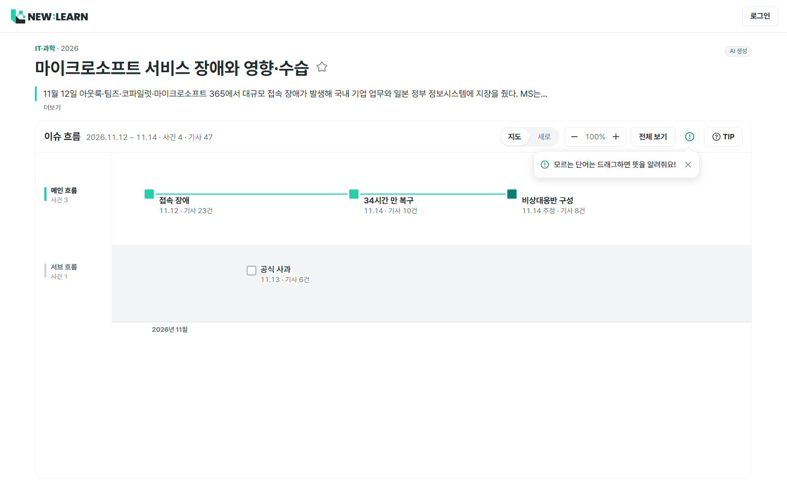

- 위에 이슈 제목과 AI 가 쓴 요약(「AI 생성」 표시), 아래에 **이슈 흐름** 이 있습니다. 같은 사건을 다룬 기사들이 사건 하나로 묶여 시간순으로 놓입니다.
- **메인 흐름**(위 줄)은 주요 전개입니다: 11.12 접속 장애 → 11.14 34시간 만 복구 → 11.14 비상대응반 구성.
- **서브 흐름**(아래 회색 줄)은 사건에 대한 반응 · 평가입니다: 11.13 공식 사과.
- 도구줄: **[지도 · 세로]** 보기 바꾸기, **[− · +]** 확대 · 축소, **[전체 보기]** 모든 사건을 한 화면에, **[TIP]** 쓰는 법. 「!」 아이콘의 말풍선은 용어사전 안내입니다(⑩).
- 제목 옆 별(☆)은 관심 이슈 저장입니다. 손님이 누르면 가입 권유 창이 뜹니다.

## ⑦ 첫 사건 「접속 장애」

지도에서 첫 사건 **「접속 장애」**(11.12 · 기사 23건)를 누릅니다.

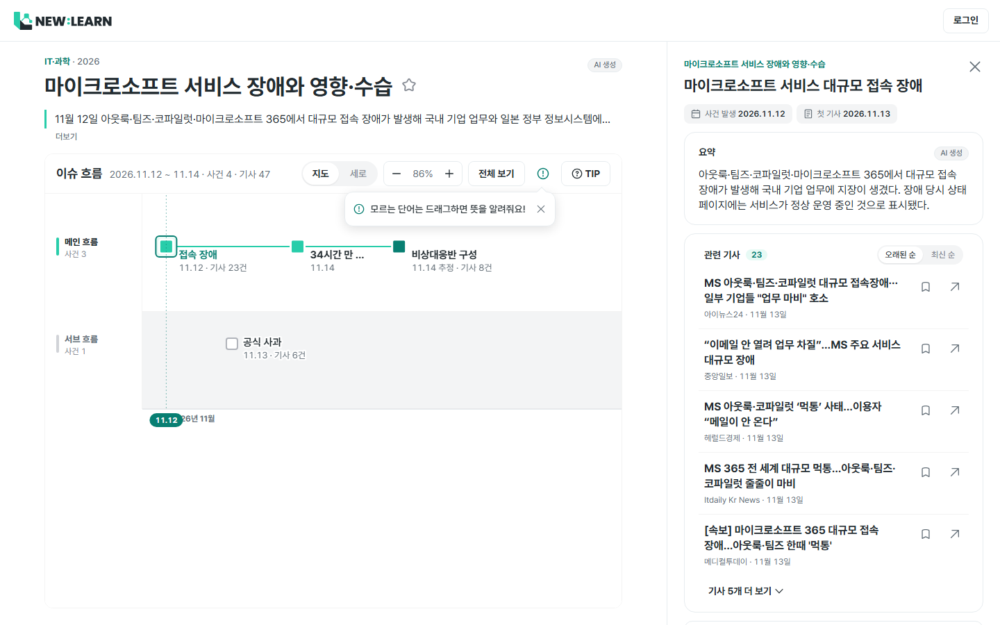

- 오른쪽에 **사건 패널** 이 열립니다. 사건 발생일(11.12)과 첫 기사 날짜(11.13), AI 요약, 관련 기사 23건이 보입니다.
- 요약: 11월 12일 아웃룩 · 팀즈 · 코파일럿 · 마이크로소프트 365 에서 대규모 접속 장애가 나 국내 기업 업무에 지장이 생겼습니다.
- 관련 기사는 처음 5건이 보이고 **[기사 5개 더 보기]** 로 늘립니다. 오른쪽 위 「오래된 순 · 최신 순」, 기사마다 북마크 · 원문 링크가 있습니다.
- 패널 맨 아래 **[이전 사건 · 다음 사건]** 으로 사건을 넘깁니다. X · Esc · 지도 빈 곳을 누르면 닫힙니다.

## ⑧ 지도를 따라 — 사과 → 복구

지도에서 날짜를 따라갑니다. 다음 날(11.13) 서브 흐름에 **「공식 사과」**, 11.14 메인 흐름에 **「34시간 만 복구」** 가 있습니다. 「34시간 만 복구」를 누릅니다.

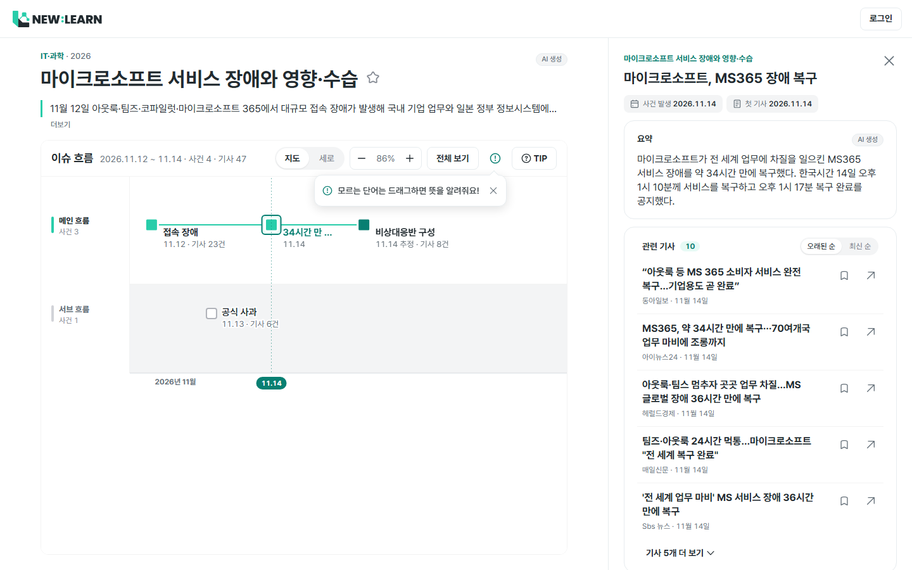

- 요약: 마이크로소프트가 MS365 장애를 약 34시간 만에 복구했습니다(한국시간 14일 오후 1시 10분 복구, 1시 17분 복구 완료 공지).
- 관련 기사 10건 중 두 번째 **「MS365, 약 34시간 만에 복구⋯70여개국 업무 마비에 조롱까지」**(아이뉴스24)를 누릅니다.

## ⑨ 기사 화면 — 흐름지도

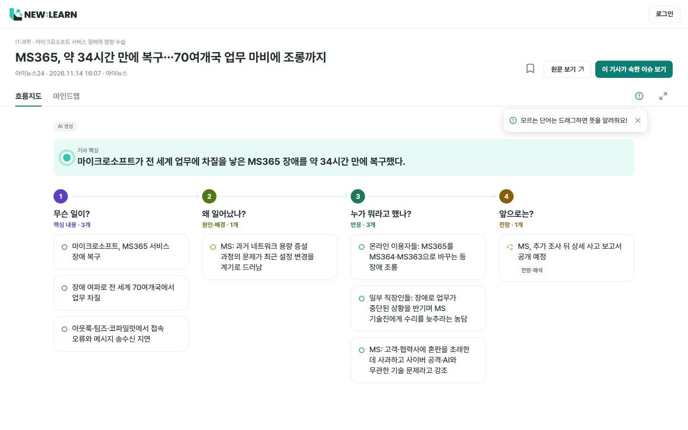

- 기사 하나를 AI 가 정리한 **흐름지도** 입니다. 맨 위 「기사 핵심」 한 줄 아래에 네 가지 관점이 차례로 놓입니다.

| 번호 | 관점 | 이 기사에서 |
|---|---|---|
| 1 | 무슨 일이? (핵심 내용) | 마이크로소프트, MS365 서비스 장애 복구 · 70여 개국 업무 차질 · 아웃룩 · 팀즈 · 코파일럿 접속 오류 |
| 2 | 왜 일어났나? (원인·배경) | 과거 네트워크 용량 증설 과정의 문제가 최근 설정 변경을 계기로 드러남 |
| 3 | 누가 뭐라고 했나? (반응) | 온라인 이용자들의 조롱 · 직장인들의 반응 · MS 의 사과 |
| 4 | 앞으로는? (전망) | 추가 조사 뒤 상세 사고 보고서 공개 예정 |

- 오른쪽 위 **[원문 보기 ↗]** 는 언론사 원문을 새 탭으로, **[이 기사가 속한 이슈 보기]** 는 이슈 화면으로 갑니다(⑫). 북마크 아이콘은 나의 뉴스함에 담기입니다.
- 근거 문장은 AI 가 지어 쓰지 않고 원문 문장을 그대로 가져옵니다.

## ⑩ 모르는 낱말 — 용어사전

1. 제목의 **MS365** 를 마우스로 드래그합니다.
2. 고른 자리 아래 **[의미]** 버튼을 누릅니다.
3. 그 기사 문맥에 맞는 뜻 하나가 말풍선으로 뜹니다. 바깥을 누르면 닫힙니다.

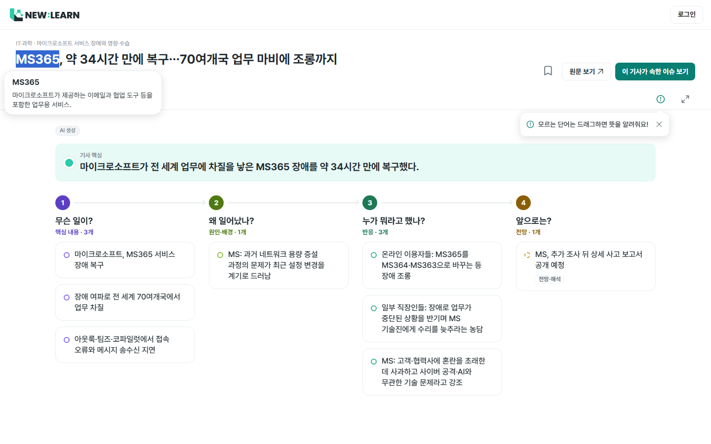

- 뜻은 SSAFY GMS(LLM)가 그 글의 문맥으로 풀어 줍니다(2-1). 같은 글의 같은 말은 하루 동안 저장해 두고 다시 부르지 않습니다.
- 기사 · 이슈 · 사건 화면의 본문 글에서 다 됩니다.

## ⑪ 마인드맵 — 원인과 배경

본문 위 탭에서 **[마인드맵]** 을 누릅니다.

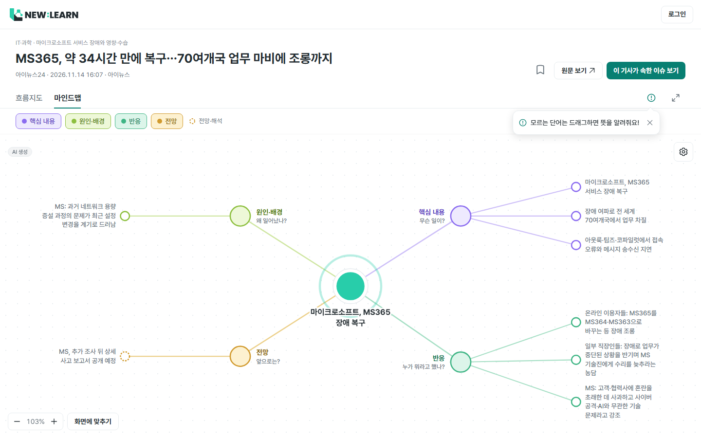

- 가운데 대표 사건 「마이크로소프트, MS365 장애 복구」에서 가지 4개(핵심 내용 · 원인·배경 · 반응 · 전망)가 뻗습니다.
- 왼쪽 위 「원인·배경」 가지에서 장애가 왜 일어났는지 바로 봅니다.
- 위의 가지 이름 칩(핵심 내용 · 원인·배경 · 반응 · 전망)을 누르면 그 가지를 켜고 끕니다. 왼쪽 아래 **[− · +]** · **[화면에 맞추기]** 로 크기를 맞추고, 오른쪽 위 톱니바퀴(탐색 설정)에서 라벨 표시를 켜고 끕니다.

## ⑫ 이슈로 돌아가기

**[이 기사가 속한 이슈 보기]** 를 누르면 ⑧ 의 이슈 화면이 「34시간 만 복구」 사건 패널을 연 채로 열립니다(`/issues/231?event=4303`). 처음 「메일이 먹통이 됐다」는 소식에서 시작해, 왜 멈췄고 언제 복구됐고 정부가 어떻게 대응했는지(11.14 「비상대응반 구성」)까지 지도 하나로 이어 봅니다.

여기까지가 발표 시연입니다.

---

## 회원 기능 — 발표 시연 밖

로그인한 회원만 쓰는 기능입니다. 시연용 계정은 문서에 적지 않습니다 — 직접 가입해서 봅니다. 3장 덤프에는 회원 정보가 없어 로컬에서도 새로 가입합니다.

### ⑬ 가입

손님이 기사 북마크 · 관심 이슈 별 같은 저장 버튼을 누르면 가입 권유 창이 뜹니다. **[가입하기]** 를 누르거나 로그인 화면에서 **[회원가입]** 을 누릅니다.

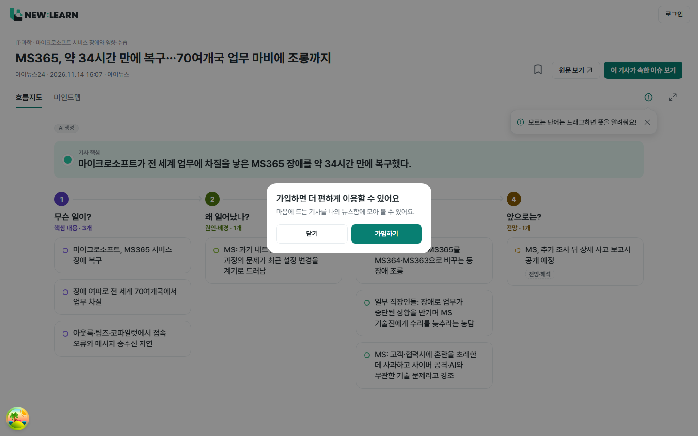

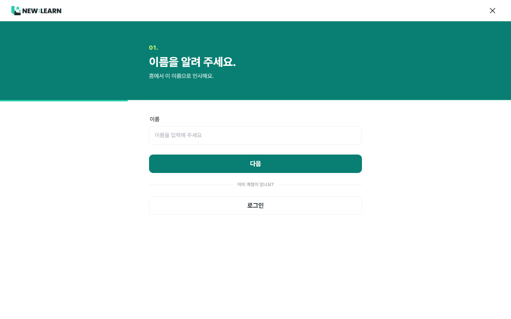

한 화면에 질문 하나씩 네 단계로 묻습니다. 위 진행 막대가 단계만큼 찹니다.

1. 이름 — 홈에서 이 이름으로 인사합니다
2. 아이디(영문 소문자 · 숫자 · `_` 4 ~ 20자) · 비밀번호(8자 이상) · 비밀번호 확인
3. 관심 분야 — 정치 · 경제 · 사회 · 국제 · IT·과학 중에서
4. 사용 목적 — 취업 준비 · 업무·업계 동향 · 시사 공부 · 그 밖에 (고르지 않아도 됩니다)

마지막 **[가입하기]** 를 누르면 바로 로그인돼 홈으로 가고 「가입을 마쳤어요」가 뜹니다. 처음 들어온 홈에서는 검색창 → 추천 이슈 → 최신 기사 → 용어사전을 차례로 비추는 안내(「1 / 4」 · **[다음]** · **[건너뛰기]**)가 뜹니다.

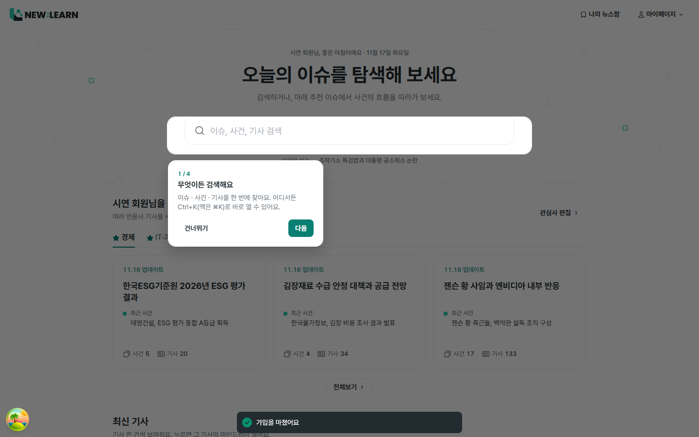

### ⑭ 회원 홈 · 저장

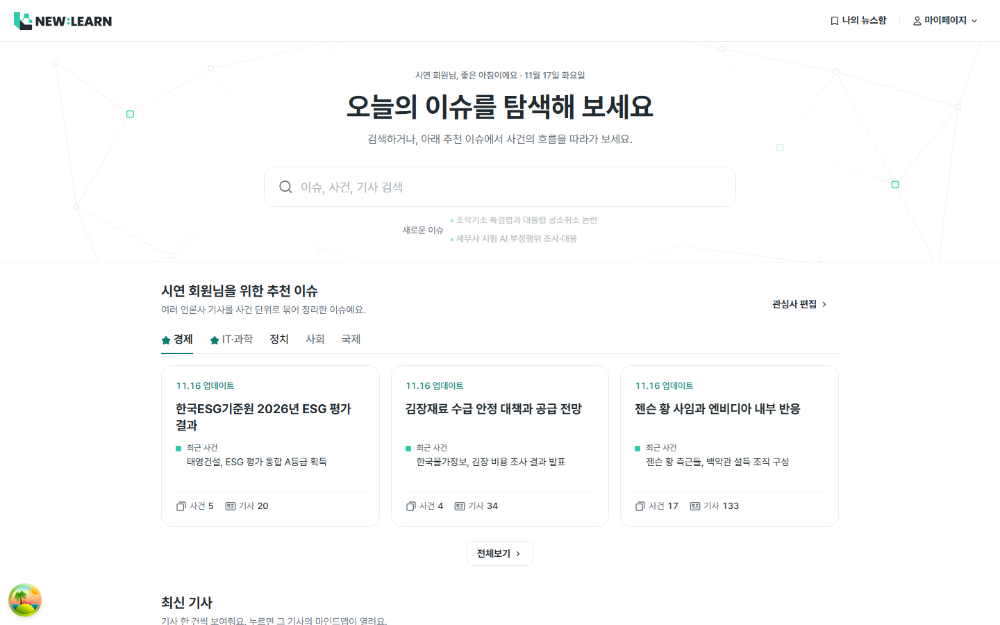

- 머리 오른쪽에 **[나의 뉴스함]** · **[마이페이지 ▾]** 가 생기고, 홈 인사에 이름이 들어갑니다. 추천 이슈의 분야 탭은 고른 관심 분야(별 표시)가 앞에 옵니다.

| 무엇 | 누르는 곳 | 모이는 곳 |
|---|---|---|
| 기사 북마크 | 기사 화면 제목 오른쪽 북마크 아이콘, 사건 패널 · 최신 기사 목록의 기사마다 북마크 아이콘 | 나의 뉴스함 「북마크한 기사」 |
| 관심 이슈 | 이슈 화면 제목 옆 별(☆) — 누르면 「관심 이슈로 저장했어요」 | 나의 뉴스함 「관심 이슈」, 홈 추천 이슈에서 먼저 보임 |
| 관심 분야 | 홈 **[관심사 편집]** 또는 마이페이지 | 홈 추천 이슈의 분야 탭 순서 |

### ⑮ 나의 뉴스함 · 마이페이지 · 로그아웃

- 머리 **[나의 뉴스함]**(`/bookmarks`): 별표로 저장한 「관심 이슈」와 「북마크한 기사」(최근에 담은 순)가 모입니다. 이슈를 누르면 이슈 화면으로 갑니다.

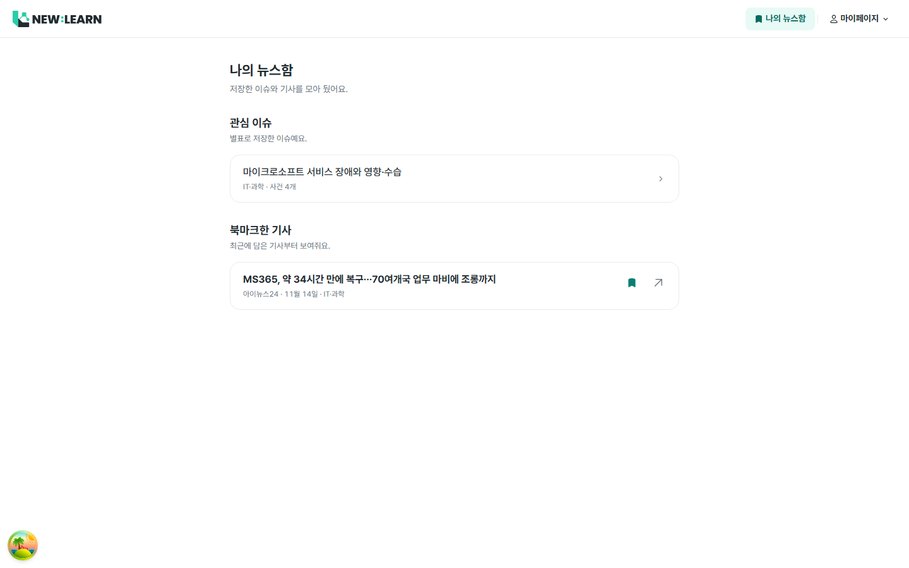

- 머리 **[마이페이지 ▾]** 를 누르면 **[마이페이지]** · **[로그아웃]** 메뉴가 열립니다.

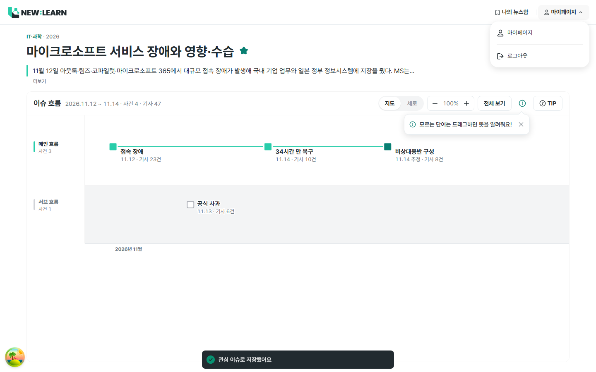

- **[마이페이지]**(`/me`): 이름 아래 「관심 분야 N개 · 관심 이슈 N개 · 북마크 N개」, 개인정보(이름 · 아이디, 바꿀 수 없음), 관심 분야 칩. 칩을 고친 뒤 아래 **[변경사항 저장하기]** 를 눌러야 저장됩니다(바뀐 것이 없으면 누를 수 없음). 고친 채 나가려 하면 「저장하지 않고 나갈까요?」를 묻습니다.

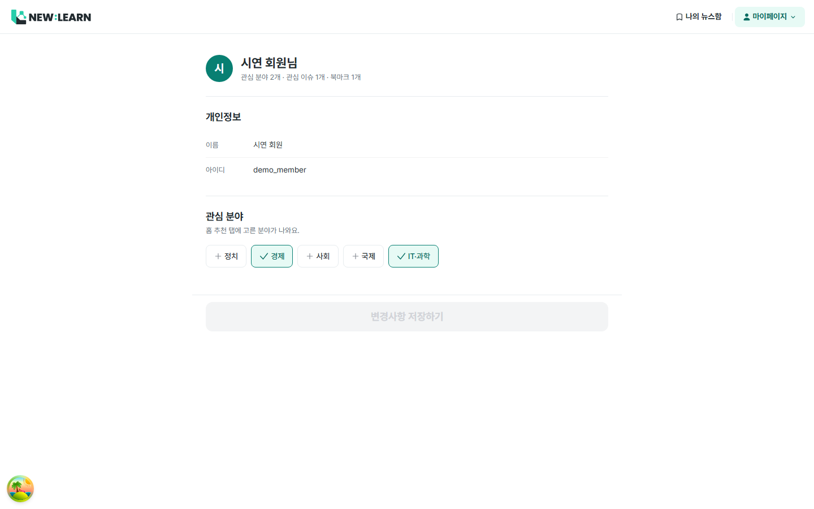

- **[로그아웃]** 을 누르면 첫 화면(랜딩)으로 돌아갑니다.

---

## 시연할 때 알아 둘 점

- 화면의 이슈 · 사건 · 요약은 AI 가 만들어 「AI 생성」 표시가 붙습니다. 새 기사는 15분마다 들어와 분석을 거쳐 기존 사건 · 이슈에 붙습니다(한 회차 50건, 하루 5,000건 상한).
- 용어사전 문맥 뜻은 하루 3,000번까지입니다. 넘으면 그날은 뜻이 나오지 않습니다.
- 입구에서 요청 수를 막습니다: 로그인 분당 300, 가입 · 용어사전 분당 100 (출발 IP마다). 넘으면 잠시 뒤 다시 합니다.
- 화면 이름 · 주소 · 문구의 원본은 `_bmad-output/planning-artifacts/ux-designs/ux-S15P31A102-2026-10-15/EXPERIENCE.md` 이고, 이 문서와 다르면 실제 사이트가 맞습니다.
