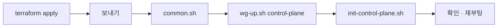
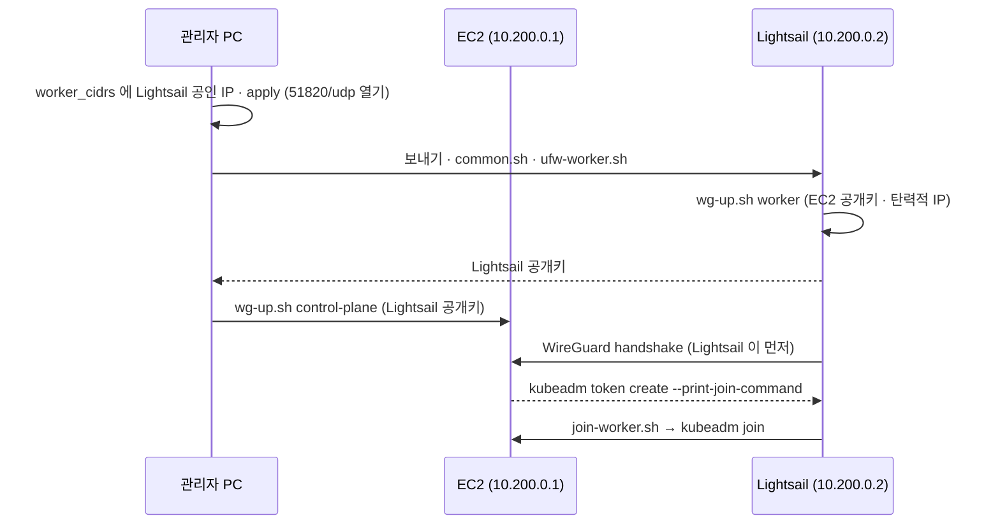
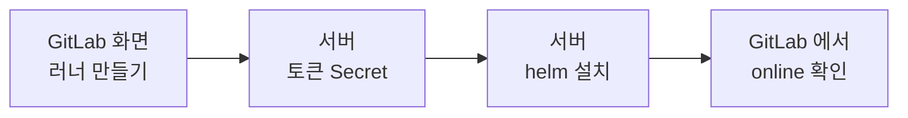

# infra/server — 서버를 받은 날 돌리는 스크립트

**EC2 는 apply 한 날 컨트롤 플레인을 Cilium 까지 올리고, Lightsail 은 받는 날 WireGuard 연결 · join 만 한다.**
설계(터널 주소 · MTU · 왜 WireGuard 인지)는 `SSOT.md` 6절 「노드 사이 — 호스트 WireGuard」, 계획은 `docs/plans/2026-10-20-pre-server-infra.md` 작업 C · D.

| 파일 | 하는 일 | 어디서 |
|---|---|---|
| `common.sh` | swap 끄기 · 커널 모듈 · IP 포워딩 · containerd 2.x · kubeadm/kubelet/kubectl 고정 · wireguard-tools | 두 노드 |
| `wg-up.sh` | `wg0` 터널 (EC2 10.200.0.1 · Lightsail 10.200.0.2, MTU 1420), kubelet 을 wg0 뒤에 띄우는 순서 | 두 노드 |
| `init-control-plane.sh` | kubeadm init → kubeconfig → Helm · Cilium → CoreDNS Running | EC2 |
| `ufw-worker.sh` | Lightsail 방화벽 — 22 · 80 · 443 · wg0 들이기, Pod 주소 범위 포워딩 | Lightsail |
| `join-worker.sh` | 컨트롤 플레인이 찍은 토큰으로 kubeadm join | Lightsail |

설정 값은 스크립트 밖에 있다 — kubeadm 은 `infra/k8s/kubeadm/`, Cilium 은 `infra/k8s/bootstrap/cilium-values.yaml` 위에 `cilium-values.prod.yaml`, GitLab Runner 는 `infra/k8s/bootstrap/gitlab-runner-values.yaml`, 모니터링은 `monitoring-values.yaml` · `prometheus-pv.yaml` · `ci-exporter/`.
쿠버네티스 판은 `infra/k8s/kubeadm/init.yaml` 의 `kubernetesVersion` 한 곳에만 적는다. `common.sh` 가 그 값을 읽어 패키지를 고정한다.

모든 스크립트는 다시 돌려도 된다. 이미 된 단계는 건너뛰거나 같은 값으로 다시 쓴다.

## 서버로 보내기

저장소를 서버에 클론하지 않는다(GitLab 토큰이 서버에 남는다). 관리자 PC 의 작업 트리에서 필요한 폴더만 보낸다.
`infra/terraform/` 은 보내지 않는다 — `terraform.tfvars` 에 관리자 IP · 메일이 있다.

```bash
tar -C infra -cf - server k8s/kubeadm k8s/bootstrap | ssh ubuntu@<서버 공인 IP> 'mkdir -p infra && tar -C infra -xf -'
```

서버에서는 `sudo bash infra/server/<스크립트>` 로 돌린다. 실행 권한이 안 넘어와도 된다.

## EC2 (컨트롤 플레인) — terraform apply 한 날



서버 공인 IP 는 `terraform -chdir=infra/terraform output control_plane_public_ip`.

1. 공통 준비

   ```bash
   sudo bash infra/server/common.sh
   ```

2. 터널 주소만 먼저 올린다. 워커가 아직 없어도 init 전에 `wg0` 에 10.200.0.1 이 있어야 한다 — etcd 와 API 서버가 이 주소에서 기다린다. 마지막 줄의 공개키를 적어 둔다 (공개키는 비밀이 아니다. 개인키는 서버 밖으로 나오지 않는다)

   ```bash
   sudo bash infra/server/wg-up.sh control-plane
   ```

3. 클러스터를 만든다. Argo CD 는 아직 깔지 않는다 — 워커가 없어 컨트롤 플레인에 뜨게 된다

   ```bash
   sudo bash infra/server/init-control-plane.sh
   ```

4. 아래 「확인」의 EC2 줄을 본다. 그리고 한 번 재부팅해서 kubelet 이 `wg0` 뒤에 떠 노드가 다시 Ready 가 되는지 본다

   ```bash
   sudo reboot
   ```

## Lightsail (워커) — 받는 날



1. 관리자 PC 에서 `infra/terraform/terraform.tfvars` 의 `worker_cidrs` 에 Lightsail 공인 IP(`/32`)를 넣고 plan · apply 한다. 보안 그룹에 51820/udp 가 열린다
2. Lightsail 에 보내고 공통 준비 · 방화벽. 방화벽은 SSH(22)를 먼저 열고 켠다. ufw 는 포워딩을 기본으로 막아서 Pod 주소 범위(10.244.0.0/16)만 포워딩을 연다 — 까닭은 스크립트 주석

   ```bash
   sudo bash infra/server/common.sh
   ```

   ```bash
   sudo bash infra/server/ufw-worker.sh
   ```

3. Lightsail 터널. EC2 공개키는 EC2 에서 `sudo cat /etc/wireguard/wg0.pub`

   ```bash
   sudo bash infra/server/wg-up.sh worker <EC2 공개키> <EC2 탄력적 IP>
   ```

4. 마지막 줄의 Lightsail 공개키를 EC2 에 넣는다 (EC2 에서). 떠 있는 `wg0` 를 내리지 않고 상대만 더한다

   ```bash
   sudo bash infra/server/wg-up.sh control-plane <Lightsail 공개키>
   ```

5. 터널이 붙었는지 본다 (Lightsail 에서). `latest handshake` 가 찍히고 ping 이 가야 한다. 🔴 **여기서 막히면 join 하지 않는다** — Lightsail 방화벽이 돌아오는 UDP 를 받아 주는지는 문서로 확인하지 못했다 (`SSOT.md` 8절)

   ```bash
   sudo wg show wg0
   ```

   ```bash
   ping -c 3 10.200.0.1
   ```

6. join 명령을 찍는다 (EC2 에서). 토큰은 24시간 뒤 사라진다

   ```bash
   sudo kubeadm token create --print-join-command
   ```

7. 찍힌 줄을 그대로 붙여 join 한다 (Lightsail 에서)

   ```bash
   sudo bash infra/server/join-worker.sh kubeadm join 10.200.0.1:6443 --token <토큰> --discovery-token-ca-cert-hash sha256:<해시>
   ```

8. 「확인」의 Lightsail 줄을 본다. 그 뒤 Argo CD · 루트 Application 을 깐다 — 다음 작업이다 (`infra/k8s/bootstrap/argocd-values.yaml` · `root-app.yaml`)

## 확인

| 무엇을 | 명령 (어디서) | 기대 |
|---|---|---|
| 터널 MTU | `ip -d link show wg0` (두 노드) | `mtu 1420` |
| 터널 안 큰 패킷 | `ping -c 2 -M do -s 1392 10.200.0.1` (Lightsail) | 지나간다. `-s 1393` 은 「message too long」 — 1392 = 1420 − IP·ICMP 머리 28 |
| handshake | `sudo wg show wg0` (두 노드) | `latest handshake` 가 2분 안 |
| 노드 주소 | `kubectl get nodes -o wide` (EC2) | INTERNAL-IP 가 10.200.0.1 · 10.200.0.2, 둘 다 Ready |
| Cilium | `kubectl -n kube-system exec ds/cilium -- cilium-dbg status --brief` (EC2) | `OK` |
| Cilium 인터페이스 | `kubectl -n kube-system exec ds/cilium -- cilium-dbg status \| grep KubeProxyReplacement` (EC2) | 공인 쪽(ens5 등)과 wg0 이 보이고 wg0 이 노드 사이 길(Direct Routing) |
| kube-system | `kubectl -n kube-system get pods -o wide` (EC2) | 전부 Running. CoreDNS · cilium-operator 는 컨트롤 플레인에 있다 |
| Pod MTU · 노드 사이 Pod | `kubectl run mtu --rm -it --image=busybox:1.37 --restart=Never -- sh -c 'cat /sys/class/net/eth0/mtu; nslookup kubernetes.default'` (EC2, 워커 join 뒤) | 이름이 풀린다 — 워커의 Pod 가 컨트롤 플레인의 CoreDNS 에 닿는다. MTU 는 설계가 `1370`(1420 − VXLAN 50)을 기대했지만 실제는 `1420` 이다(2026-10-22, `SSOT.md` 8절) |
| 재부팅 뒤 | `sudo reboot` 뒤 위 줄 다시 (각 노드) | 같은 결과 |

## 관리자 PC 에서 kubectl

6443 은 밖에 열지 않는다. SSH 터널로 붙는다. kubeconfig 는 내 `~/.kube/config`(다른 클러스터가 있다)와 섞지 않고 따로 둔다.

```bash
ssh ubuntu@<EC2 탄력적 IP> 'cat ~/.kube/config' > ~/.kube/newlearn.conf
```

```bash
kubectl --kubeconfig ~/.kube/newlearn.conf config set-cluster kubernetes --server=https://127.0.0.1:6443
```

```bash
ssh -N -L 6443:10.200.0.1:6443 ubuntu@<EC2 탄력적 IP>
```

```bash
KUBECONFIG=~/.kube/newlearn.conf kubectl get nodes -o wide
```

API 서버 인증서에 127.0.0.1 을 넣어 두었다 (`infra/k8s/kubeadm/init.yaml` 의 `certSANs`). 이 kubeconfig 는 클러스터 관리자 권한이라 저장소에 넣지 않는다.

## GitLab Runner (EC2)

러너를 서버에 Docker 로 깔지 않고 클러스터 안 Pod 로 띄운다(Kubernetes executor). 잡도 잡마다 Pod 로 떴다 사라진다. 왜 이렇게 했는지 · 상한 값의 근거는 `SSOT.md` 6절, 계획은 `docs/plans/2026-10-20-gitlab-runner.md`.



1. **GitLab 화면에서 러너 만들기** (Maintainer) — Settings › CI/CD › Runners › Create project runner

   | 칸 | 값 |
   |---|---|
   | Tags | `newlearn-k8s` |
   | Run untagged jobs | 켬 — 다른 러너가 없어서 태그 없는 잡도 받는다 |
   | Runner description | `newlearn-ec2-k8s` |
   | Lock to current projects | 켬 |
   | Maximum job timeout | `3600` — 멈춘 잡이 관리 서버를 붙잡지 않게 |

   「Create runner」 뒤 화면의 `glrt-` 토큰을 복사한다. 그 화면의 `gitlab-runner register` 명령은 치지 않는다 — helm 이 이 토큰으로 등록한다.

2. **토큰 Secret** (EC2, 사람이 친다) — 토큰은 저장소 · 채팅 · 명령 기록에 남기지 않는다. `read -s` 라 화면에도 안 찍힌다

   ```bash
   kubectl create namespace gitlab-runner
   ```

   ```bash
   read -rsp 'runner token: ' T && echo && kubectl -n gitlab-runner create secret generic gitlab-runner-token --from-literal=runner-registration-token= --from-literal=runner-token="$T"; unset T # secret-scan:allow — 값이 아니라 변수 이름
   ```

   `runner-registration-token` 은 옛 등록 방식용이라 빈 값으로 둔다(차트가 두 키를 다 읽는다).

3. **설치** (EC2) — 「서버로 보내기」로 `k8s/bootstrap` 이 가 있어야 한다

   ```bash
   helm repo add gitlab https://charts.gitlab.io
   ```

   ```bash
   helm upgrade --install gitlab-runner gitlab/gitlab-runner --version 0.88.4 -n gitlab-runner -f infra/k8s/bootstrap/gitlab-runner-values.yaml --wait --timeout 5m
   ```

4. **확인**

   | 무엇을 | 명령 (어디서) | 기대 |
   |---|---|---|
   | 러너 Pod | `kubectl -n gitlab-runner get pods -o wide` (EC2) | Running, 노드는 컨트롤 플레인 |
   | 등록 | `kubectl -n gitlab-runner logs deploy/gitlab-runner` (EC2) | `FATAL` 없이 `Initializing executor providers` 까지 |
   | GitLab | Settings › CI/CD › Runners | `newlearn-ec2-k8s` 가 Online |
   | 잡 Pod 상한 | 잡이 도는 동안 `kubectl -n gitlab-runner get pod <runner-…> -o yaml` (EC2) | build 컨테이너 상한 1 · 2Gi 이하, `automountServiceAccountToken: false`. 잡이 변수를 안 주면 요청 500m · 1Gi |
   | 갈래별 자원 | 잡이 도는 동안 `kubectl -n gitlab-runner get pods -L newlearn.io/workload` (EC2) | 이름표가 잡 갈래(w0 · w12 · w3)이고, 요청이 `.gitlab-ci.yml` 의 그 갈래 값이다. 값 파일의 `*_overwrite_max_allowed` 가 빠지면 변수가 무시되고 기본값으로 뜬다 |

- **CI 캐시** (EC2, 러너를 처음 깔 때 한 번) — 잡 Pod 마다 이 폴더를 `/ci-cache` 로 붙여 npm · uv · Gradle 이 받은 것을 다시 쓴다. PVC 가 없으면 잡 Pod 가 Pending 에 멈추므로 러너 `helm upgrade` 전에 만든다

   ```bash
   sudo install -d -m 0755 /var/lib/newlearn/ci-cache
   ```

   ```bash
   kubectl apply -f infra/k8s/bootstrap/ci-cache-pv.yaml
   ```

   크기는 `sudo du -sh /var/lib/newlearn/ci-cache/*` 로 본다(2026-10-20 약 1.7 GB). 비울 때는 그 안의 폴더를 지운다 — 다음 잡이 다시 받는다
- 값 파일의 `[runners.kubernetes.node_selector]` · `node_tolerations` 표는 맨 끝에 둔다. TOML 은 표 머리 뒤의 키를 다음 머리까지 그 표에 넣어서, 가운데 두면 뒤의 키가 엉뚱한 표로 들어가 러너가 `FATAL: Could not handle configuration merging` 로 등록하지 못한다 (2026-10-20 겪음)
- 판 올리기: GitLab 이 오르면 같은 major.minor 의 차트로 `--version` 만 바꿔 다시 `helm upgrade` 한다. 차트 판 ↔ 러너 판은 `helm search repo -l gitlab/gitlab-runner`
- 값을 바꾼 뒤에도 같은 `helm upgrade` 한 줄. 러너 Pod 가 새로 뜨면서 같은 토큰으로 다시 붙는다

## 모니터링 (EC2)

kube-prometheus-stack(Prometheus · Grafana · node-exporter · kube-state-metrics)을 관리 서버에 올린다. 왜 · 무엇을 보나는 `SSOT.md` 6절 「모니터링」, 계획은 `docs/plans/2026-10-20-monitoring.md`.

1. **저장 폴더 · 저장소 종류 · PV** (EC2) — Prometheus 사용자(uid 1000 · gid 2000)가 쓰게 폴더 주인을 맞춘다

   ```bash
   sudo install -d -m 0750 -o 1000 -g 2000 /var/lib/newlearn/prometheus
   ```

   ```bash
   kubectl create namespace monitoring
   ```

   ```bash
   kubectl apply -f infra/k8s/bootstrap/prometheus-pv.yaml
   ```

2. **Grafana 관리자 계정** (EC2, 사람이 친다) — 아이디는 화면에 보이고 비밀번호는 안 보인다. 저장소 · 채팅에 남기지 않는다

   ```bash
   read -rp 'Grafana 아이디: ' U && read -rsp 'Grafana 비밀번호: ' P && echo && kubectl -n monitoring create secret generic grafana-admin --from-literal=admin-user="$U" --from-literal=admin-password="$P"; unset U P # secret-scan:allow — 값이 아니라 변수 이름
   ```

3. **설치** (EC2)

   ```bash
   helm upgrade --install kps oci://ghcr.io/prometheus-community/charts/kube-prometheus-stack --version 92.10.1 -n monitoring -f infra/k8s/bootstrap/monitoring-values.yaml --wait --timeout 10m
   ```

   러너 지표의 ServiceMonitor 는 이 차트의 CRD 가 있어야 만들어진다 — 설치 뒤 「GitLab Runner」 3번의 `helm upgrade` 를 한 번 더 한다.

4. **열기** (관리자 PC) — 공인 IP 에 열지 않고 SSH 터널로. 서버는 Cilium 덕에 Service 주소(ClusterIP)로 바로 닿는다

   ```bash
   ssh newlearn 'kubectl -n monitoring get svc kps-grafana -o jsonpath="{.spec.clusterIP}"'
   ```

   ```bash
   ssh -N -L 127.0.0.1:3000:<위 주소>:80 newlearn
   ```

   브라우저에서 `http://localhost:3000/grafana/` → 로그인. 「Node Exporter / Nodes」(노드 CPU · 메모리), 「Kubernetes / Compute Resources / Pod」(Pod CPU · **CPU Throttling**)를 본다. CI 잡은 6번의 「CI 병목」(`/grafana/d/newlearn-ci-bottleneck`).

5. **확인**

   | 무엇을 | 명령 (어디서) | 기대 |
   |---|---|---|
   | Pod | `kubectl -n monitoring get pods -o wide` (EC2) | 전부 Running, 노드는 컨트롤 플레인 |
   | 저장소 | `kubectl -n monitoring get pvc` (EC2) | Bound — `prometheus-local` |
   | 수집 대상 | `kubectl get --raw "/api/v1/namespaces/monitoring/services/kps-kube-prometheus-stack-prometheus:9090/proxy/api/v1/targets?state=active"` (EC2) | 모두 `"health":"up"` — apiserver · coredns · gitlab-runner · kubelet · node-exporter · kube-state-metrics · operator · prometheus · grafana |
   | 노드 자리 | `kubectl describe node` 의 Allocated resources (EC2) | CPU 예약 + CI 잡 550m ≤ 2000m |

6. **CI 잡 지표** (Jira S15P31A102-98) — gitlab-ci-pipelines-exporter 가 GitLab API 에서 잡마다 기다림 · 걸린 시간 · 받은 러너를 읽어 지표로 바꾼다. 대시보드 「CI 병목」이 같이 올라간다. 값은 `infra/k8s/bootstrap/ci-exporter/`, 왜 이렇게 두었나는 `SSOT.md` 6절 「모니터링」

   ① **GitLab 화면에서 읽기 토큰 만들기** (Maintainer) — Settings › Access tokens › Add new token

   | 칸 | 값 |
   |---|---|
   | Token name | `newlearn-ci-exporter` |
   | Expiration date | `2026-11-30` |
   | Select a role | `Reporter` |
   | Select scopes | `read_api` 하나 |

   「Create project access token」 뒤 화면 위에 한 번만 보이는 토큰을 복사한다.

   ② **토큰 Secret** (EC2, 사람이 친다) — 저장소 · 채팅 · 명령 기록에 남기지 않는다

   ```bash
   read -rsp 'GitLab 읽기 토큰: ' T && echo && kubectl -n monitoring create secret generic gitlab-ci-exporter --from-literal=gitlab-token="$T"; unset T # secret-scan:allow — 값이 아니라 변수 이름
   ```

   ③ **설치** (EC2) — 잡 Pod 를 잡 이름으로 보는 kube-state-metrics 허용 목록은 `monitoring-values.yaml` 에 있다. 3번 `helm upgrade` 를 이 값으로 한 번 돌려 둔다

   ```bash
   kubectl apply -k infra/k8s/bootstrap/ci-exporter
   ```

   ④ **확인**

   | 무엇을 | 명령 (어디서) | 기대 |
   |---|---|---|
   | exporter | `kubectl -n monitoring logs deploy/gitlab-ci-exporter` (EC2) | `discovered new ref … ref=dev` 와 열린 MR 번호, `level=error` 없음 |
   | 수집 | 5번의 수집 대상 명령 (EC2) | `gitlab-ci-exporter` 까지 모두 up |
   | 값 | Grafana 「CI 병목」 잡 표 | 잡 ID 를 눌러 연 GitLab 잡 화면의 Queued · Duration · Runner 와 같다 |
   | 요청 수 | 「CI 병목」 오른쪽 위 「GitLab 으로 보낸 요청 (시간당)」 | 3600(초당 1회 상한)보다 한참 아래. 붙으면 `config.yml` 의 읽는 범위를 줄인다 |

   - 설정(`config.yml`)이나 대시보드(`ci-dashboard.json`)를 바꾼 뒤에도 같은 `apply -k` 한 줄. 설정이 바뀌면 ConfigMap 이름이 바뀌어 Pod 가 새로 뜨고 처음부터 다시 모은다. 옛 `gitlab-ci-exporter-config-<해시>` 는 남으니 `kubectl -n monitoring delete configmap` 으로 지운다
   - 토큰이 만료되거나 취소되면 로그에 401 이 찍힌다. 새 토큰으로 Secret 을 지우고 다시 만든 뒤 `kubectl -n monitoring rollout restart deploy/gitlab-ci-exporter`

- StorageClass 를 이름으로만 적고 만들지 않으면 Prometheus 가 「storage class … does not exist」로 뜨지 않는다 — `prometheus-pv.yaml` 이 StorageClass 와 PV 를 같이 만든다 (2026-10-20 겪음)
- Grafana 를 `/grafana` 하위 경로로 두면 Grafana 자기 지표도 `/grafana/metrics` 에 있다 — 값 파일의 `grafana.serviceMonitor.path` (2026-10-20 겪음)
- 공개할 때(Jira 93): `grafana.ini` 의 `root_url` 을 `https://newlearn.io.kr/grafana/` 로 바꾸고 정문에 경로 규칙을 더한다. Prometheus 는 공개하지 않는다

## 서버 없이 확인한 것 · 서버에서 확인할 것

서버 없이 확인했다 (2026-10-20, Jira S15P31A102-86).

- 스크립트 문법 `bash -n` · shellcheck 0.11.0
- `kubeadm config validate` — kind 노드 이미지의 kubeadm 1.36.4 와 `common.sh` 가 까는 1.36.5 둘 다 통과. join.yaml 은 자리를 임시 값으로 채워서
- `helm template` — Cilium 1.20.3 차트에 두 값 파일을 겹쳐 MTU · devices · API 서버 주소가 설정에 들어간다
- ubuntu:24.04 컨테이너에서 `common.sh --packages-only` 두 번 — 패키지 고정 · containerd 설정 두 곳만 바뀜 · 두 번째도 같은 결과
- 컨테이너 두 개(Docker Desktop 커널의 WireGuard)로 `wg-up.sh` 두 역할 — handshake, 터널 안 ping, MTU 1420 경계, 다시 돌려도 키 · 상대 그대로
- 같은 워커 컨테이너에 `ufw-worker.sh` — 켠 뒤에도 워커가 먼저 연 터널이 새로 붙고, 터널 안 10250 은 열리고 터널 밖 10250 은 막히고 80 은 열린다. 다시 돌리면 규칙 10개를 모두 건너뛴다

서버 생성 후 확인 — 아직 못 봤다.

- Pod MTU 를 1370 으로 맞추는 법 — 실제 Pod 는 1420 이다(소스로 읽은 「Cilium 이 VXLAN 머리 50바이트를 뺀다」가 맞지 않았다, `SSOT.md` 8절)
- ufw 를 켠 채로 hostPort 80 이 들어오는지 (Jira 91). 2026-10-22 서버에서 확인한 것 — join · 노드 주소 · Cilium(`wg0` Direct Routing) · 노드 사이 Pod · Pod 가 밖으로 나가기 · 재부팅 뒤 순서 · `common.sh` — 은 `SSOT.md` 6절 「현재 상태」

## 되돌리기

| 무엇을 | 명령 |
|---|---|
| 클러스터만 다시 | `sudo kubeadm reset` 뒤 `init-control-plane.sh` · `join-worker.sh` |
| 터널 내리기 | `sudo systemctl disable --now wg-quick@wg0` |
| 모니터링 내리기 | `helm uninstall kps -n monitoring` → `kubectl get crd -o name \| grep monitoring.coreos.com \| xargs kubectl delete` → `kubectl delete namespace monitoring` → `kubectl delete -f infra/k8s/bootstrap/prometheus-pv.yaml` → `sudo rm -r /var/lib/newlearn/prometheus`. 러너 지표는 값을 되돌려 `helm upgrade` |
| CI 잡 지표 내리기 | `kubectl delete -k infra/k8s/bootstrap/ci-exporter` → `kubectl -n monitoring delete secret gitlab-ci-exporter` → GitLab 화면 Settings › Access tokens 에서 토큰 Revoke |
| 러너 내리기 | `helm uninstall gitlab-runner -n gitlab-runner` → `kubectl delete namespace gitlab-runner` → GitLab 화면에서 러너 삭제. 서버 패키지는 바꾸지 않아서 이걸로 원래대로 |
| 서버째 | 관리자 PC 에서 `terraform destroy` (EC2). 🔴 서버 안의 클러스터 · WireGuard 키도 같이 사라진다 |
