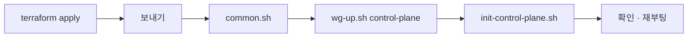
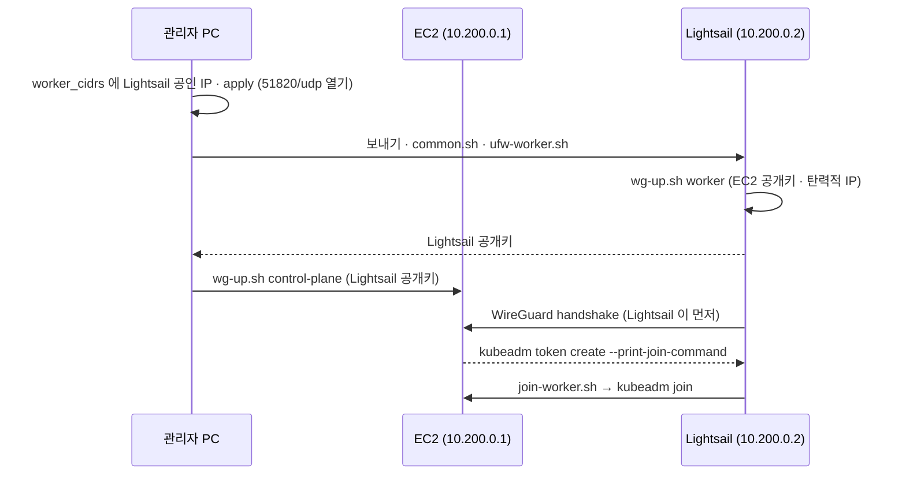

# infra/server — 서버를 받은 날 돌리는 스크립트

**EC2 는 apply 한 날 컨트롤 플레인을 Cilium 까지 올리고, Lightsail 은 받는 날 WireGuard 연결 · join 만 한다.**
설계(터널 주소 · MTU · 왜 WireGuard 인지)는 `SSOT.md` 6절 「노드 사이 — 호스트 WireGuard」, 계획은 `docs/plans/2026-10-20-pre-server-infra.md` 작업 C · D.

| 파일 | 하는 일 | 어디서 |
|---|---|---|
| `common.sh` | swap 끄기 · 커널 모듈 · IP 포워딩 · containerd 2.x · kubeadm/kubelet/kubectl 고정 · wireguard-tools | 두 노드 |
| `wg-up.sh` | `wg0` 터널 (EC2 10.200.0.1 · Lightsail 10.200.0.2, MTU 1420), kubelet 을 wg0 뒤에 띄우는 순서 | 두 노드 |
| `init-control-plane.sh` | kubeadm init → kubeconfig → Helm · Cilium → CoreDNS Running | EC2 |
| `ufw-worker.sh` | Lightsail 방화벽 — 22 · 80 · 443 · wg0 들이기, Pod 주소 범위 포워딩 | Lightsail |
| `join-worker.sh` | 컨트롤 플레인이 찍은 토큰으로 kubeadm join | Lightsail |

설정 값은 스크립트 밖에 있다 — kubeadm 은 `infra/k8s/kubeadm/`, Cilium 은 `infra/k8s/bootstrap/cilium-values.yaml` 위에 `cilium-values.prod.yaml`.
쿠버네티스 판은 `infra/k8s/kubeadm/init.yaml` 의 `kubernetesVersion` 한 곳에만 적는다. `common.sh` 가 그 값을 읽어 패키지를 고정한다.

모든 스크립트는 다시 돌려도 된다. 이미 된 단계는 건너뛰거나 같은 값으로 다시 쓴다.

## 서버로 보내기

저장소를 서버에 클론하지 않는다(GitLab 토큰이 서버에 남는다). 관리자 PC 의 작업 트리에서 필요한 폴더만 보낸다.
`infra/terraform/` 은 보내지 않는다 — `terraform.tfvars` 에 관리자 IP · 메일이 있다.

```bash
tar -C infra -cf - server k8s/kubeadm k8s/bootstrap | ssh ubuntu@<서버 공인 IP> 'mkdir -p infra && tar -C infra -xf -'
```

서버에서는 `sudo bash infra/server/<스크립트>` 로 돌린다. 실행 권한이 안 넘어와도 된다.

## EC2 (컨트롤 플레인) — terraform apply 한 날



서버 공인 IP 는 `terraform -chdir=infra/terraform output control_plane_public_ip`.

1. 공통 준비

   ```bash
   sudo bash infra/server/common.sh
   ```

2. 터널 주소만 먼저 올린다. 워커가 아직 없어도 init 전에 `wg0` 에 10.200.0.1 이 있어야 한다 — etcd 와 API 서버가 이 주소에서 기다린다. 마지막 줄의 공개키를 적어 둔다 (공개키는 비밀이 아니다. 개인키는 서버 밖으로 나오지 않는다)

   ```bash
   sudo bash infra/server/wg-up.sh control-plane
   ```

3. 클러스터를 만든다. Argo CD 는 아직 깔지 않는다 — 워커가 없어 컨트롤 플레인에 뜨게 된다

   ```bash
   sudo bash infra/server/init-control-plane.sh
   ```

4. 아래 「확인」의 EC2 줄을 본다. 그리고 한 번 재부팅해서 kubelet 이 `wg0` 뒤에 떠 노드가 다시 Ready 가 되는지 본다

   ```bash
   sudo reboot
   ```

## Lightsail (워커) — 받는 날



1. 관리자 PC 에서 `infra/terraform/terraform.tfvars` 의 `worker_cidrs` 에 Lightsail 공인 IP(`/32`)를 넣고 plan · apply 한다. 보안 그룹에 51820/udp 가 열린다
2. Lightsail 에 보내고 공통 준비 · 방화벽. 방화벽은 SSH(22)를 먼저 열고 켠다. ufw 는 포워딩을 기본으로 막아서 Pod 주소 범위(10.244.0.0/16)만 포워딩을 연다 — 까닭은 스크립트 주석

   ```bash
   sudo bash infra/server/common.sh
   ```

   ```bash
   sudo bash infra/server/ufw-worker.sh
   ```

3. Lightsail 터널. EC2 공개키는 EC2 에서 `sudo cat /etc/wireguard/wg0.pub`

   ```bash
   sudo bash infra/server/wg-up.sh worker <EC2 공개키> <EC2 탄력적 IP>
   ```

4. 마지막 줄의 Lightsail 공개키를 EC2 에 넣는다 (EC2 에서). 떠 있는 `wg0` 를 내리지 않고 상대만 더한다

   ```bash
   sudo bash infra/server/wg-up.sh control-plane <Lightsail 공개키>
   ```

5. 터널이 붙었는지 본다 (Lightsail 에서). `latest handshake` 가 찍히고 ping 이 가야 한다. 🔴 **여기서 막히면 join 하지 않는다** — Lightsail 방화벽이 돌아오는 UDP 를 받아 주는지는 문서로 확인하지 못했다 (`SSOT.md` 8절)

   ```bash
   sudo wg show wg0
   ```

   ```bash
   ping -c 3 10.200.0.1
   ```

6. join 명령을 찍는다 (EC2 에서). 토큰은 24시간 뒤 사라진다

   ```bash
   sudo kubeadm token create --print-join-command
   ```

7. 찍힌 줄을 그대로 붙여 join 한다 (Lightsail 에서)

   ```bash
   sudo bash infra/server/join-worker.sh kubeadm join 10.200.0.1:6443 --token <토큰> --discovery-token-ca-cert-hash sha256:<해시>
   ```

8. 「확인」의 Lightsail 줄을 본다. 그 뒤 Argo CD · 루트 Application 을 깐다 — 다음 작업이다 (`infra/k8s/bootstrap/argocd-values.yaml` · `root-app.yaml`)

## 확인

| 무엇을 | 명령 (어디서) | 기대 |
|---|---|---|
| 터널 MTU | `ip -d link show wg0` (두 노드) | `mtu 1420` |
| 터널 안 큰 패킷 | `ping -c 2 -M do -s 1392 10.200.0.1` (Lightsail) | 지나간다. `-s 1393` 은 「message too long」 — 1392 = 1420 − IP·ICMP 머리 28 |
| handshake | `sudo wg show wg0` (두 노드) | `latest handshake` 가 2분 안 |
| 노드 주소 | `kubectl get nodes -o wide` (EC2) | INTERNAL-IP 가 10.200.0.1 · 10.200.0.2, 둘 다 Ready |
| Cilium | `kubectl -n kube-system exec ds/cilium -- cilium-dbg status --brief` (EC2) | `OK` |
| Cilium 인터페이스 | `kubectl -n kube-system exec ds/cilium -- cilium-dbg status \| grep KubeProxyReplacement` (EC2) | 공인 쪽(ens5 등)과 wg0 이 보이고 wg0 이 노드 사이 길(Direct Routing) |
| kube-system | `kubectl -n kube-system get pods -o wide` (EC2) | 전부 Running. CoreDNS · cilium-operator 는 컨트롤 플레인에 있다 |
| Pod MTU · 노드 사이 Pod | `kubectl run mtu --rm -it --image=busybox:1.37 --restart=Never -- sh -c 'cat /sys/class/net/eth0/mtu; nslookup kubernetes.default'` (EC2, 워커 join 뒤) | `1370`(1420 − VXLAN 50) · 이름이 풀린다 — 워커의 Pod 가 컨트롤 플레인의 CoreDNS 에 닿는다 |
| 재부팅 뒤 | `sudo reboot` 뒤 위 줄 다시 (각 노드) | 같은 결과 |

## 관리자 PC 에서 kubectl

6443 은 밖에 열지 않는다. SSH 터널로 붙는다. kubeconfig 는 내 `~/.kube/config`(다른 클러스터가 있다)와 섞지 않고 따로 둔다.

```bash
ssh ubuntu@<EC2 탄력적 IP> 'cat ~/.kube/config' > ~/.kube/newlearn.conf
```

```bash
kubectl --kubeconfig ~/.kube/newlearn.conf config set-cluster kubernetes --server=https://127.0.0.1:6443
```

```bash
ssh -N -L 6443:10.200.0.1:6443 ubuntu@<EC2 탄력적 IP>
```

```bash
KUBECONFIG=~/.kube/newlearn.conf kubectl get nodes -o wide
```

API 서버 인증서에 127.0.0.1 을 넣어 두었다 (`infra/k8s/kubeadm/init.yaml` 의 `certSANs`). 이 kubeconfig 는 클러스터 관리자 권한이라 저장소에 넣지 않는다.

## 서버 없이 확인한 것 · 서버에서 확인할 것

서버 없이 확인했다 (2026-10-20, Jira S15P31A102-86).

- 스크립트 문법 `bash -n` · shellcheck 0.11.0
- `kubeadm config validate` — kind 노드 이미지의 kubeadm 1.36.4 와 `common.sh` 가 까는 1.36.5 둘 다 통과. join.yaml 은 자리를 임시 값으로 채워서
- `helm template` — Cilium 1.20.3 차트에 두 값 파일을 겹쳐 MTU · devices · API 서버 주소가 설정에 들어간다
- ubuntu:24.04 컨테이너에서 `common.sh --packages-only` 두 번 — 패키지 고정 · containerd 설정 두 곳만 바뀜 · 두 번째도 같은 결과
- 컨테이너 두 개(Docker Desktop 커널의 WireGuard)로 `wg-up.sh` 두 역할 — handshake, 터널 안 ping, MTU 1420 경계, 다시 돌려도 키 · 상대 그대로
- 같은 워커 컨테이너에 `ufw-worker.sh` — 켠 뒤에도 워커가 먼저 연 터널이 새로 붙고, 터널 안 10250 은 열리고 터널 밖 10250 은 막히고 80 은 열린다. 다시 돌리면 규칙 10개를 모두 건너뛴다

서버 생성 후 확인 — 아직 못 봤다.

- 실제 `kubeadm init` · `join`, 노드 INTERNAL-IP 가 터널 주소인지
- Cilium 이 `wg0` 위로 VXLAN 을 보내 노드 사이 Pod 가 통하는지, Pod MTU 가 1370 인지 (VXLAN 머리 50바이트를 Cilium 이 빼는 것은 소스로만 확인 — `infra/k8s/bootstrap/cilium-values.prod.yaml` 주석)
- Cilium 이 `wg0`(이더넷 머리가 없는 인터페이스)에 eBPF 를 붙여도 문제가 없는지
- systemd 순서 — 재부팅 뒤 kubelet 이 `wg0` 뒤에 뜨는지
- Lightsail 의 인터페이스 이름 · ufw 기본 상태 · 돌아오는 UDP · 443, ufw 를 켠 채로 Pod 가 밖으로 나가고 hostPort 80 이 들어오는지
- `common.sh` 의 swap · 모듈 · sysctl · systemctl 부분 (컨테이너에서는 건너뛰었다)

## 되돌리기

| 무엇을 | 명령 |
|---|---|
| 클러스터만 다시 | `sudo kubeadm reset` 뒤 `init-control-plane.sh` · `join-worker.sh` |
| 터널 내리기 | `sudo systemctl disable --now wg-quick@wg0` |
| 서버째 | 관리자 PC 에서 `terraform destroy` (EC2). 🔴 서버 안의 클러스터 · WireGuard 키도 같이 사라진다 |
