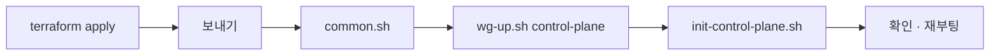
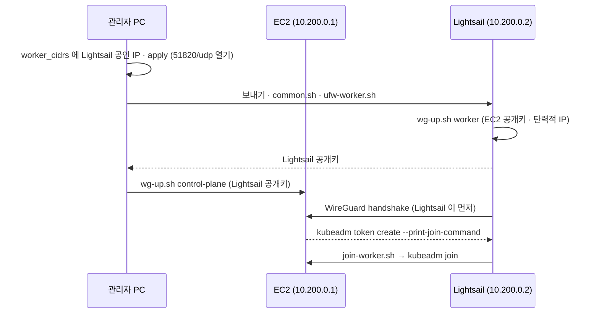
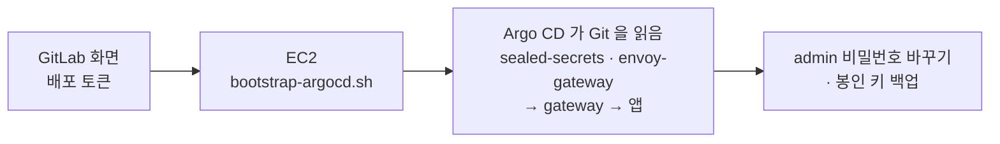
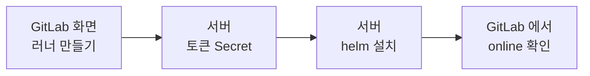

# infra/server — 서버를 받은 날 돌리는 스크립트

**EC2 는 apply 한 날 컨트롤 플레인을 Cilium 까지 올리고, Lightsail 은 받는 날 WireGuard 연결 · join 만 한다.**
설계(터널 주소 · MTU · 왜 WireGuard 인지)는 `SSOT.md` 6절 「노드 사이 — 호스트 WireGuard」, 계획은 `docs/plans/2026-10-20-pre-server-infra.md` 작업 C · D.

| 파일 | 하는 일 | 어디서 |
|---|---|---|
| `common.sh` | swap 끄기 · 커널 모듈 · IP 포워딩 · containerd 2.x · kubeadm/kubelet/kubectl 고정 · wireguard-tools | 두 노드 |
| `wg-up.sh` | `wg0` 터널 (EC2 10.200.0.1 · Lightsail 10.200.0.2, MTU 1420), kubelet 을 wg0 뒤에 띄우는 순서 | 두 노드 |
| `init-control-plane.sh` | kubeadm init → kubeconfig → Helm · Cilium → CoreDNS Running | EC2 |
| `ufw-worker.sh` | Lightsail 방화벽 — 22 · 80 · 443 · wg0 들이기, Pod 주소 범위 포워딩 | Lightsail |
| `join-worker.sh` | 컨트롤 플레인이 찍은 토큰으로 kubeadm join | Lightsail |
| `bootstrap-argocd.sh` | Argo CD → 저장소 읽기 Secret(배포 토큰) → kubeseal → 루트 Application. 그 뒤는 Argo CD 가 Git 을 따라 깐다 | EC2 (워커 join 뒤) |
| `seal-secrets.sh` | 비밀값을 봉인해 저장소에 넣을 SealedSecret 파일로 만든다 — `basic-auth`(관리 화면 팝업 계정) · `db`(DB 계정, 무작위) · `ghcr`(이미지 받기 토큰) · `gms`(AI 워커의 GMS 키) · `internal-api`(직원용 문 출입증, 무작위) · `stdict`(용어사전의 표준국어대사전 키) 등 — 전체는 스크립트 머리 | EC2 |

설정 값은 스크립트 밖에 있다 — kubeadm 은 `infra/k8s/kubeadm/`, Cilium 은 `infra/k8s/bootstrap/cilium-values.yaml` 위에 `cilium-values.prod.yaml`, Argo CD 는 `argocd-values.yaml` 위에 `argocd-values.prod.yaml`, GitLab Runner 는 `infra/k8s/bootstrap/gitlab-runner-values.yaml`, 모니터링은 `monitoring-values.yaml` · `prometheus-pv.yaml` · `ci-exporter/`.
쿠버네티스 판은 `infra/k8s/kubeadm/init.yaml` 의 `kubernetesVersion` 한 곳에만 적는다. `common.sh` 가 그 값을 읽어 패키지를 고정한다.

모든 스크립트는 다시 돌려도 된다. 이미 된 단계는 건너뛰거나 같은 값으로 다시 쓴다.

## 서버로 보내기

저장소를 서버에 클론하지 않는다(GitLab 토큰이 서버에 남는다). 관리자 PC 의 작업 트리에서 필요한 폴더만 보낸다.
`infra/terraform/` 은 보내지 않는다 — `terraform.tfvars` 에 관리자 IP · 메일이 있다.

```bash
tar -C infra -cf - server k8s/kubeadm k8s/bootstrap | ssh ubuntu@<서버 공인 IP> 'mkdir -p infra && tar -C infra -xf -'
```

서버에서는 `sudo bash infra/server/<스크립트>` 로 돌린다. 실행 권한이 안 넘어와도 된다.

## EC2 (컨트롤 플레인) — terraform apply 한 날



서버 공인 IP 는 `terraform -chdir=infra/terraform output control_plane_public_ip`.

1. 공통 준비

   ```bash
   sudo bash infra/server/common.sh
   ```

2. 터널 주소만 먼저 올린다. 워커가 아직 없어도 init 전에 `wg0` 에 10.200.0.1 이 있어야 한다 — etcd 와 API 서버가 이 주소에서 기다린다. 마지막 줄의 공개키를 적어 둔다 (공개키는 비밀이 아니다. 개인키는 서버 밖으로 나오지 않는다)

   ```bash
   sudo bash infra/server/wg-up.sh control-plane
   ```

3. 클러스터를 만든다. Argo CD 는 아직 깔지 않는다 — 워커가 없어 컨트롤 플레인에 뜨게 된다

   ```bash
   sudo bash infra/server/init-control-plane.sh
   ```

4. 아래 「확인」의 EC2 줄을 본다. 그리고 한 번 재부팅해서 kubelet 이 `wg0` 뒤에 떠 노드가 다시 Ready 가 되는지 본다

   ```bash
   sudo reboot
   ```

## Lightsail (워커) — 받는 날



1. 관리자 PC 에서 `infra/terraform/terraform.tfvars` 의 `worker_cidrs` 에 Lightsail 공인 IP(`/32`)를 넣고 plan · apply 한다. 보안 그룹에 51820/udp 가 열린다
2. Lightsail 에 보내고 공통 준비 · 방화벽. 방화벽은 SSH(22)를 먼저 열고 켠다. ufw 는 포워딩을 기본으로 막아서 Pod 주소 범위(10.244.0.0/16)만 포워딩을 연다 — 까닭은 스크립트 주석

   ```bash
   sudo bash infra/server/common.sh
   ```

   ```bash
   sudo bash infra/server/ufw-worker.sh
   ```

3. Lightsail 터널. EC2 공개키는 EC2 에서 `sudo cat /etc/wireguard/wg0.pub`

   ```bash
   sudo bash infra/server/wg-up.sh worker <EC2 공개키> <EC2 탄력적 IP>
   ```

4. 마지막 줄의 Lightsail 공개키를 EC2 에 넣는다 (EC2 에서). 떠 있는 `wg0` 를 내리지 않고 상대만 더한다

   ```bash
   sudo bash infra/server/wg-up.sh control-plane <Lightsail 공개키>
   ```

5. 터널이 붙었는지 본다 (Lightsail 에서). `latest handshake` 가 찍히고 ping 이 가야 한다. 🔴 **여기서 막히면 join 하지 않는다** — Lightsail 방화벽이 돌아오는 UDP 를 받아 주는지는 문서로 확인하지 못했다 (`SSOT.md` 8절)

   ```bash
   sudo wg show wg0
   ```

   ```bash
   ping -c 3 10.200.0.1
   ```

6. join 명령을 찍는다 (EC2 에서). 토큰은 24시간 뒤 사라진다

   ```bash
   sudo kubeadm token create --print-join-command
   ```

7. 찍힌 줄을 그대로 붙여 join 한다 (Lightsail 에서)

   ```bash
   sudo bash infra/server/join-worker.sh kubeadm join 10.200.0.1:6443 --token <토큰> --discovery-token-ca-cert-hash sha256:<해시>
   ```

8. 「확인」의 Lightsail 줄을 본다. 그 뒤 아래 「Argo CD 깔기」

## 확인

| 무엇을 | 명령 (어디서) | 기대 |
|---|---|---|
| 터널 MTU | `ip -d link show wg0` (두 노드) | `mtu 1420` |
| 터널 안 큰 패킷 | `ping -c 2 -M do -s 1392 10.200.0.1` (Lightsail) | 지나간다. `-s 1393` 은 「message too long」 — 1392 = 1420 − IP·ICMP 머리 28 |
| handshake | `sudo wg show wg0` (두 노드) | `latest handshake` 가 2분 안 |
| 노드 주소 | `kubectl get nodes -o wide` (EC2) | INTERNAL-IP 가 10.200.0.1 · 10.200.0.2, 둘 다 Ready |
| Cilium | `kubectl -n kube-system exec ds/cilium -- cilium-dbg status --brief` (EC2) | `OK` |
| Cilium 인터페이스 | `kubectl -n kube-system exec ds/cilium -- cilium-dbg status \| grep KubeProxyReplacement` (EC2) | 공인 쪽(ens5 등)과 wg0 이 보이고 wg0 이 노드 사이 길(Direct Routing) |
| kube-system | `kubectl -n kube-system get pods -o wide` (EC2) | 전부 Running. CoreDNS · cilium-operator 는 컨트롤 플레인에 있다 |
| 노드 사이 Pod | `kubectl run dns --rm -it --image=busybox:1.37 --restart=Never -- nslookup kubernetes.default` (EC2, 워커 join 뒤) | 이름이 풀린다 — 워커의 Pod 가 컨트롤 플레인의 CoreDNS 에 닿는다 |
| Pod MTU | netshoot Pod 안에서 `ip route` · `ping -M do -s 1342 <상대 노드 Pod IP>` (EC2) | 인터페이스는 1420, 기본 경로에 `mtu 1370`(Cilium 이 VXLAN 50바이트를 뺌). 1342 는 지나가고 1343 은 보내기 전에 거절된다. busybox 의 `ip route` 는 경로 mtu 를 안 찍는다 — 2026-10-22 에 그걸 보고 1420 으로 잘못 읽었다 |
| 재부팅 뒤 | `sudo reboot` 뒤 위 줄 다시 (각 노드) | 같은 결과 |

## Argo CD 깔기 (EC2) — 워커 join 뒤 한 번

Argo CD 를 helm 으로 깔고 루트 Application 하나만 건다. 그 뒤 Sealed Secrets · Envoy Gateway · Gateway · 앱은 Argo CD 가 Git 의 `infra/k8s/apps/` 를 읽어 순서대로(sync-wave) 깐다. 설계는 `SSOT.md` 6절 「배포 설정」 · 「Secret」.



1. **배포 토큰** (Maintainer, GitLab 화면) — Settings › Repository › Deploy tokens › Add token

   | 칸 | 값 |
   |---|---|
   | Name | `argocd` — `gitlab-deploy-token` 이라는 이름은 피한다. 그 이름이면 모든 CI 잡에 토큰이 들어간다 |
   | Expiration date | `2026-11-30` |
   | Username | 비워 둔다 (`gitlab+deploy-token-<번호>`) |
   | Scopes | `read_repository` 만 |

   「Create deploy token」 뒤 한 번만 보이는 사용자 이름 · 토큰을 다음 단계에서 붙여 넣는다. 저장소 · 채팅에 남기지 않는다.

2. **깔기** (관리자 PC 에서 — 토큰을 물어서 터미널이 붙어 있어야 한다) — 「서버로 보내기」로 `server` · `k8s/bootstrap` 이 가 있어야 한다

   ```bash
   ssh -t ubuntu@<EC2 탄력적 IP> "bash infra/server/bootstrap-argocd.sh"
   ```

   브랜치 인자를 안 주면 `dev` 를 읽는다. 작업 브랜치를 머지 전에 서버에서 확인할 때만 `bash infra/server/bootstrap-argocd.sh <브랜치>`, 머지 뒤 인자 없이 다시 돌려 `dev` 로 돌린다(토큰은 다시 묻지 않는다). 끝에 앱 목록이 모두 `Synced · Healthy` 로 찍힌다

3. **admin 비밀번호 바꾸기** (사람이) — 화면을 열고, 첫 비밀번호로 들어가 User Info › Update Password. 그 뒤 첫 비밀번호 Secret 을 지운다

   ```bash
   ssh -L 8080:localhost:8080 ubuntu@<EC2 탄력적 IP> "kubectl -n argocd port-forward svc/argocd-server 8080:80"
   ```

   ```bash
   ssh ubuntu@<EC2 탄력적 IP> "kubectl -n argocd get secret argocd-initial-admin-secret -o jsonpath='{.data.password}' | base64 -d; echo"
   ```

   브라우저에서 `http://localhost:8080/argocd`. 바꾼 뒤

   ```bash
   ssh ubuntu@<EC2 탄력적 IP> "kubectl -n argocd delete secret argocd-initial-admin-secret"
   ```

4. **확인** — 관리자 PC 에서 워커 공인 주소의 80 으로 시험 앱이 응답한다 (`curl http://<SSAFY 도메인>/` → `hello v1`)

### Sealed Secrets 키 — 백업 · 복구

컨트롤러의 개인키가 클러스터 밖에 없으면, 서버를 다시 만들 때 저장소의 SealedSecret 을 하나도 못 푼다. 깐 날 한 번 관리자 PC 로 받아 둔다 — 저장소 밖, 다른 사람과 나누지 않는다. 키는 하나다(`keyrenewperiod: "0"`, `infra/k8s/apps/templates/sealed-secrets.yaml`).

```bash
ssh ubuntu@<EC2 탄력적 IP> "kubectl -n sealed-secrets get secret -l sealedsecrets.bitnami.com/sealed-secrets-key -o yaml" > ~/newlearn-sealed-secrets-key.yaml
```

복구 — 새 클러스터에서 Argo CD 를 깔기 **전에** 키를 먼저 넣는다. 컨트롤러가 먼저 뜨면 새 키를 만든다 (그때는 넣은 뒤 컨트롤러 Pod 를 지워 다시 띄운다)

```bash
kubectl create namespace sealed-secrets && kubectl apply -f ~/newlearn-sealed-secrets-key.yaml
```

봉인하기 (EC2) — Secret 을 파일로 만들지 않고 바로 봉인한다. 평문은 명령 인자로 넘기지 않는다(`ps` 에 보인다)

```bash
kubectl create secret generic <이름> -n <네임스페이스> --from-file=<키>=/dev/stdin --dry-run=client -o yaml | kubeseal --controller-namespace sealed-secrets --format yaml > sealed-<이름>.yaml
```

봉인은 이름 · 네임스페이스에 묶인다(기본 strict). 다른 이름 · 네임스페이스로 옮기면 못 푼다.

### 관리 화면 팝업 계정 — `/argocd` · `/grafana`

두 화면은 Envoy 앞단의 브라우저 팝업(HTTP 기본 인증) 하나로 잠근다. 계정은 둘이 같이 쓰는 하나다. 설계는 `SSOT.md` 6절 「도메인 · HTTPS」.

1. **계정 봉인** (관리자 PC 에서 — 값을 물어서 터미널이 붙어 있어야 한다). 아이디는 영문 소문자로 시작하는 3~32자, 비밀번호는 16자 이상(Envoy 기본 인증이 SHA1 해시만 받는다). 무작위 값이 필요하면 관리자 PC PowerShell 에서 `$b = New-Object byte[] 15; [Security.Cryptography.RandomNumberGenerator]::Create().GetBytes($b); [Convert]::ToBase64String($b) | Set-Clipboard` (화면에 안 찍히고 클립보드로)

   ```bash
   ssh -t ubuntu@<EC2 탄력적 IP> "bash infra/server/seal-secrets.sh basic-auth"
   ```

2. **저장소로 가져오기** — 봉인 파일은 컨트롤러만 풀 수 있어 저장소에 둬도 된다

   ```bash
   for ns in argocd monitoring; do ssh ubuntu@<EC2 탄력적 IP> "cat ~/sealed/sealed-basic-auth-$ns.yaml" > infra/k8s/admin-ui/sealed-basic-auth-$ns.yaml; done
   ```

3. 커밋 · MR. Argo CD 가 풀어 `basic-auth` Secret 을 만들고, Envoy 가 바뀐 계정을 바로 쓴다. 아이디 · 비밀번호는 팀에 저장소 · 채팅이 아닌 곳으로 알린다

- 계정을 바꿀 때도 같은 1 ~ 3. 바꾸면 브라우저가 기억한 옛 계정으로 401 이 나서 팝업이 다시 뜬다
- 내장 브라우저(앱 미리보기 창)에는 팝업이 안 뜰 수 있다 — Chrome · Edge 로 연다 (2026-10-22 Claude 데스크톱 앱의 브라우저 창에서 401 본문만 보임)
- Grafana 관리자(`grafana-admin`)로 들어갈 일이 있으면 SSH 터널(`kubectl -n monitoring port-forward svc/kps-grafana 3000:80`)로 — 팝업 머리가 없어 로그인 화면이 나온다. 로그인 뒤 공개 주소로 넘어간다(`root_url`)
- 🔴 **팝업 아이디는 Grafana 관리자 아이디와 달라야 한다.** 같으면 프록시 로그인이 그 관리자 계정으로 들여보내 팝업 계정을 아는 사람이 모두 Grafana 서버 관리자가 된다 (2026-10-22 겪음 — 관리자 아이디를 바꾸고 Grafana 를 다시 띄워 고침). 확인: 팝업 계정으로 `/grafana/api/user` 의 `isGrafanaAdmin` 이 `false`, `/grafana/api/user/orgs` 의 `role` 이 `Viewer`
- Grafana 관리자 아이디 · 비밀번호를 바꿀 때 (EC2 에 접속해서) — 비밀번호는 표준 입력으로 넘긴다. 그 뒤 `kubectl -n monitoring rollout restart deploy/kps-grafana`(Grafana 는 디스크가 없어 다시 뜰 때 관리자를 새로 만든다)

  ```bash
  read -rp 'Grafana 관리자 아이디 (팝업 아이디와 다르게): ' U && read -rsp 'Grafana 관리자 비밀번호: ' P && echo && printf '%s' "$P" | kubectl -n monitoring create secret generic grafana-admin --from-literal=admin-user="$U" --from-file=admin-password=/dev/stdin --dry-run=client -o yaml | kubectl replace -f - ; unset U P # secret-scan:allow — 값이 아니라 변수 이름
  ```

### GitLab 웹훅 · Mattermost 배포 알림

push 를 바로 반영하는 웹훅과 배포 알림. 설계는 `SSOT.md` 6절 「배포 흐름」.

1. **봉인** (EC2): `bash infra/server/seal-secrets.sh argocd-webhook`(무작위, 묻지 않음) · `ssh -t … "bash infra/server/seal-secrets.sh mattermost"`(「A102 배포알림」 채널의 들어오는 웹훅 주소를 묻고, 채널에 연결 시험 글을 쓴 뒤 봉인) → `~/sealed/` 의 두 파일을 `infra/k8s/admin-ui/` 로 가져와 커밋
2. **반영**: Argo CD 가 두 Secret 을 푼 뒤(`kubectl -n argocd get secret argocd-webhook --show-labels` 에 `app.kubernetes.io/part-of=argocd`) `bash infra/server/bootstrap-argocd.sh` → `kubectl -n argocd rollout restart deploy/argocd-server`(토큰을 뜰 때 한 번 읽는다)
3. **GitLab** (Maintainer): Settings › Webhooks — URL `https://newlearn.io.kr/argocd/api/webhook`, Secret token 은 `kubectl -n argocd get secret argocd-webhook -o jsonpath='{.data.gitlab}' | base64 -d` 로 본 값, Push events 하나(Wildcard `dev`), SSL 켬 → Test › Push events 가 200

- 확인: `kubectl -n argocd logs deploy/argocd-server | grep "Received push event"`. 토큰이 틀리면 `X-Gitlab-Token validation failed`. 알림 트리거 조건을 바꾸면 구독한 앱마다 지금 상태로 한 번씩 다시 울린다(「이미 보냄」 기록의 키가 바뀜)
- 바꿀 때: 웹훅 토큰은 `~/sealed/sealed-argocd-webhook.yaml` 을 지우고 1 ~ 3(GitLab 값도). Mattermost 주소가 샜으면 Mattermost 에서 지우고 새로 만든 뒤 `sealed-argocd-notifications.yaml` 을 지우고 1 · 2. 🔴 같은 주소가 경보용 `alertmanager-mattermost` 에도 있다 — `infra/server/alerts.md` 「켜는 순서」 1 도 다시(안 하면 경보가 지운 주소로 가 소리 없이 사라진다). 알림 시험 방법은 `SSOT.md` 10절 2026-10-23

## 서비스 배포 — Argo CD 가 깐다

PostgreSQL · Redis(`infra/k8s/services/data`) · backend · frontend(`app`) · ai(`ai`)는 Argo CD 앱이다. 사람이 하는 일은 처음 한 번 Secret 을 봉인하는 것과 태그를 바꾸는 MR 뿐이다. 설계는 `SSOT.md` 6절 「클러스터 구성」 · 「저장소·백업」.

1. **DB 계정 · 직원용 문 출입증** (EC2, 묻지 않음) — 무작위 값으로 봉인한다. DB 비밀번호는 `data` · `app` 에, 출입증(Jira 30)은 워커 · 배치 키 둘을 `app` 에 · 워커 키를 `ai` 에도. 봉인 파일이 이미 있으면 건너뛴다(PostgreSQL 은 처음 초기화 때만 읽고, 출입증은 한쪽만 바뀌면 backend 와 워커가 어긋난다). 출입증 봉인 전에는 backend 가 `/internal/v1` 을 모두 막는다

   ```bash
   bash infra/server/seal-secrets.sh db && bash infra/server/seal-secrets.sh internal-api
   ```

2. **이미지 받기 토큰** (관리자 PC 에서 — 값을 묻는다). GitHub › Settings › Developer settings › Personal access tokens › **Tokens (classic)** — `read:packages` 하나, 만료 2026-11-30. 사용자 이름은 이미지 창고 주인(`.gitlab-ci.yml` 의 `IMAGE_PREFIX`). 스크립트가 그 토큰으로 GHCR 에서 받을 수 있는지 먼저 본 뒤 `app` · `ai` 에 봉인한다. fine-grained 토큰은 GHCR 이 받지 않는다

   ```bash
   ssh -t ubuntu@<EC2 탄력적 IP> "bash infra/server/seal-secrets.sh ghcr"
   ```

3. **저장소로 가져오기** — `~/sealed/sealed-postgres-auth-data.yaml` → `infra/k8s/services/data/sealed-postgres-auth.yaml`, `…-app.yaml` → `services/app/`, `sealed-ghcr-pull-app.yaml` · `-ai.yaml` → `services/app/sealed-ghcr-pull.yaml` · `services/ai/sealed-ghcr-pull.yaml`, `sealed-internal-api-app.yaml` · `-ai.yaml` → `services/app/sealed-internal-api.yaml` · `services/ai/sealed-internal-api.yaml`(두 `kustomization.yaml` 의 `resources` 에도 한 줄씩). 커밋 · MR. 출입증은 서비스가 뜬 뒤에 넣는 것이라 풀린 뒤 `kubectl -n app rollout restart deploy/backend` · `kubectl -n ai rollout restart deploy/ai`(env 는 뜰 때만 읽는다)

- **태그 바꾸기**: 보통은 CI 가 한다 — dev 에서 이미지를 구우면 `w5:deploy-mr` 잡이 `deploy/app` · `deploy/ai` 로 태그 MR 을 연다(`SSOT.md` 6절 「배포 흐름」). 사람은 그 MR 을 확인하고 머지한다. 손으로 바꿀 때는 `infra/k8s/services/app · ai/kustomization.yaml` 의 `newTag` 를 바꾸는 MR — 태그는 **dev push 파이프라인이 GHCR 에 올린 것만** 쓴다(MR 파이프라인은 굽기만 하고 올리지 않는다, 2026-10-22 MR 의 커밋을 적었다가 ImagePullBackOff). 되돌리기는 그 MR 을 Revert
- **태그 MR 토큰** (Maintainer, GitLab 화면): Settings › Access tokens — 이름 `deploy-mr-bot` · 역할 Developer · 범위 `api` · 만료 2026-11-30 → Settings › CI/CD › Variables 에 `DEPLOY_MR_TOKEN`(Masked and hidden · Protect). 토큰이 만료되면 dev 파이프라인의 `w5:deploy-mr` 가 401 로 빨개진다
- **떠 있는 판 · backend 로그 · env**: 판은 `kubectl -n app get deploy backend -o jsonpath='{.spec.template.spec.containers[0].image}'`, 로그는 `kubectl -n app logs deploy/backend --since=10m`(재시작했으면 `--previous` 로 직전 하나). Argo CD 화면에서는 app 앱 → backend Pod → LOGS. 로그는 그 Pod 가 사는 동안만 있다 — 배포로 Pod 가 바뀌면 옛 로그는 없다. 넣는 env 는 `infra/k8s/services/app/backend.yaml` 이 원본이고 비밀값은 봉인 Secret 에서 온다(위 1번). 사이트 전용 설정 파일(스프링 프로필)은 두지 않는다 — backend `application.yaml` 의 빈칸을 env 로 채운다(2026-10-28, Jira S15P31A102-29)
- **ai 임베딩 모델 · GMS 키 · 용어사전 키** — 모델 캐시 확인 · 판 바꾸기 · GMS 키 봉인은 `infra/server/ai-worker.md`. 용어사전(A19)의 표준국어대사전 키(사전 누리집 「오픈 API 사용 신청」 화면, 계정당 하나)는 바뀐 스크립트를 보낸 뒤(위 「서버로 보내기」) `ssh -t ubuntu@<EC2 탄력적 IP> "bash infra/server/seal-secrets.sh stdict"` — 그 키로 「나무」를 찾아 결과가 와야 `app` 에 봉인하고(틀린 키는 빈 본문이라 backend 가 못 가린다) 가져올 자리 · 다시 띄우는 명령을 찍는다. 봉인 전에는 용어사전이 502 다(Jira 102)
- **DB · Redis 데이터 살리기**: PVC 를 지워도 PV 와 워커 폴더(`/var/lib/newlearn/local-path/pvc-…`)는 남는다(Retain) — 새 PVC 는 그것을 쓰지 않고 빈 DB 로 뜬다. 살리려면 PV 의 `spec.claimRef` 를 지워(`kubectl patch pv <이름> --type json -p '[{"op":"remove","path":"/spec/claimRef"}]'`) 새 PVC 가 그 PV 를 잡게 한다(PVC 에 `volumeName: <이름>`)
- 백업(pg_dump) — 매일 관리 서버에 남긴다. 처음 한 번 · 확인 · 되살리는 법은 `infra/server/db-backup.md`

## 관리자 PC 에서 kubectl

6443 은 밖에 열지 않는다. SSH 터널로 붙는다. kubeconfig 는 내 `~/.kube/config`(다른 클러스터가 있다)와 섞지 않고 따로 둔다.

```bash
ssh ubuntu@<EC2 탄력적 IP> 'cat ~/.kube/config' > ~/.kube/newlearn.conf
```

```bash
kubectl --kubeconfig ~/.kube/newlearn.conf config set-cluster kubernetes --server=https://127.0.0.1:6443
```

```bash
ssh -N -L 6443:10.200.0.1:6443 ubuntu@<EC2 탄력적 IP>
```

```bash
KUBECONFIG=~/.kube/newlearn.conf kubectl get nodes -o wide
```

API 서버 인증서에 127.0.0.1 을 넣어 두었다 (`infra/k8s/kubeadm/init.yaml` 의 `certSANs`). 이 kubeconfig 는 클러스터 관리자 권한이라 저장소에 넣지 않는다.

## GitLab Runner (EC2)

러너를 서버에 Docker 로 깔지 않고 클러스터 안 Pod 로 띄운다(Kubernetes executor). 잡도 잡마다 Pod 로 떴다 사라진다. 왜 이렇게 했는지 · 상한 값의 근거는 `SSOT.md` 6절, 계획은 `docs/plans/2026-10-20-gitlab-runner.md`.



1. **GitLab 화면에서 러너 만들기** (Maintainer) — Settings › CI/CD › Runners › Create project runner

   | 칸 | 값 |
   |---|---|
   | Tags | `newlearn-k8s` |
   | Run untagged jobs | 켬 — 다른 러너가 없어서 태그 없는 잡도 받는다 |
   | Runner description | `newlearn-ec2-k8s` |
   | Lock to current projects | 켬 |
   | Maximum job timeout | `3600` — 멈춘 잡이 관리 서버를 붙잡지 않게 |

   「Create runner」 뒤 화면의 `glrt-` 토큰을 복사한다. 그 화면의 `gitlab-runner register` 명령은 치지 않는다 — helm 이 이 토큰으로 등록한다.

2. **토큰 Secret** (EC2, 사람이 친다) — 토큰은 저장소 · 채팅 · 명령 기록에 남기지 않는다. `read -s` 라 화면에도 안 찍힌다

   ```bash
   kubectl create namespace gitlab-runner
   ```

   ```bash
   read -rsp 'runner token: ' T && echo && kubectl -n gitlab-runner create secret generic gitlab-runner-token --from-literal=runner-registration-token= --from-literal=runner-token="$T"; unset T # secret-scan:allow — 값이 아니라 변수 이름
   ```

   `runner-registration-token` 은 옛 등록 방식용이라 빈 값으로 둔다(차트가 두 키를 다 읽는다).

3. **설치** (EC2) — 「서버로 보내기」로 `k8s/bootstrap` 이 가 있어야 한다

   ```bash
   helm repo add gitlab https://charts.gitlab.io
   ```

   ```bash
   helm upgrade --install gitlab-runner gitlab/gitlab-runner --version 0.88.4 -n gitlab-runner -f infra/k8s/bootstrap/gitlab-runner-values.yaml --wait --timeout 5m
   ```

4. **확인**

   | 무엇을 | 명령 (어디서) | 기대 |
   |---|---|---|
   | 러너 Pod | `kubectl -n gitlab-runner get pods -o wide` (EC2) | Running, 노드는 컨트롤 플레인 |
   | 등록 | `kubectl -n gitlab-runner logs deploy/gitlab-runner` (EC2) | `FATAL` 없이 `Initializing executor providers` 까지 |
   | GitLab | Settings › CI/CD › Runners | `newlearn-ec2-k8s` 가 Online |
   | 잡 Pod 상한 | 잡이 도는 동안 `kubectl -n gitlab-runner get pod <runner-…> -o yaml` (EC2) | build 컨테이너 상한 1 · 2Gi 이하, `automountServiceAccountToken: false`. 잡이 변수를 안 주면 요청 500m · 1Gi |
   | 갈래별 자원 | 잡이 도는 동안 `kubectl -n gitlab-runner get pods -L newlearn.io/workload` (EC2) | 이름표가 잡 갈래(w0 · w12 · w3)이고, 요청이 `.gitlab-ci.yml` 의 그 갈래 값이다. 값 파일의 `*_overwrite_max_allowed` 가 빠지면 변수가 무시되고 기본값으로 뜬다 |

- **CI 캐시** (EC2, 러너를 처음 깔 때 한 번) — 잡 Pod 마다 이 폴더를 `/ci-cache` 로 붙여 npm · uv · Gradle 이 받은 것을 다시 쓴다. PVC 가 없으면 잡 Pod 가 Pending 에 멈추므로 러너 `helm upgrade` 전에 만든다

   ```bash
   sudo install -d -m 0755 /var/lib/newlearn/ci-cache
   ```

   ```bash
   kubectl apply -f infra/k8s/bootstrap/ci-cache-pv.yaml
   ```

   크기는 `sudo du -sh /var/lib/newlearn/ci-cache/*` 로 본다(2026-10-20 약 1.7 GB). 비울 때는 그 안의 폴더를 지운다 — 다음 잡이 다시 받는다
- 값 파일의 `[runners.kubernetes.node_selector]` · `node_tolerations` 표는 맨 끝에 둔다. TOML 은 표 머리 뒤의 키를 다음 머리까지 그 표에 넣어서, 가운데 두면 뒤의 키가 엉뚱한 표로 들어가 러너가 `FATAL: Could not handle configuration merging` 로 등록하지 못한다 (2026-10-20 겪음)
- 판 올리기: GitLab 이 오르면 같은 major.minor 의 차트로 `--version` 만 바꿔 다시 `helm upgrade` 한다. 차트 판 ↔ 러너 판은 `helm search repo -l gitlab/gitlab-runner`
- 값을 바꾼 뒤에도 같은 `helm upgrade` 한 줄. 러너 Pod 가 새로 뜨면서 같은 토큰으로 다시 붙는다

### 굽기 러너 — 이미지 굽기(w4)만, 잡은 워커에서

매니저 Pod 는 EC2, 잡 Pod 는 워커(Lightsail). 왜 · 상한 · 격리는 `SSOT.md` 6절 「굽기 러너」.

1. **GitLab** (Maintainer): Settings › CI/CD › Runners › New project runner — Tags `newlearn-build`, Run untagged 끔, Protected 끔(켜면 MR 굽기가 영영 기다린다)
2. **토큰** (EC2, 값을 물어서 `ssh -t`): `kubectl create namespace gitlab-runner-build && read -rsp "runner token: " T && echo && printf "%s" "$T" | kubectl -n gitlab-runner-build create secret generic gitlab-runner-build-token --from-literal=runner-registration-token= --from-file=runner-token=/dev/stdin; unset T` <!-- secret-scan:allow — 값이 아니라 변수 이름 -->
3. **정책 먼저, 그다음 러너** (EC2): `kubectl apply -f infra/k8s/bootstrap/build-netpol.yaml` → `helm upgrade --install gitlab-runner-build gitlab/gitlab-runner --version 0.88.4 -n gitlab-runner-build -f infra/k8s/bootstrap/gitlab-runner-build-values.yaml --wait`

- 확인: GitLab Runners 화면에 online. 정책은 같은 노드에서 대조 — 굽기 네임스페이스와 `default` 에 busybox Pod 를 띄워 `nc -w 3 postgres.data.svc 5432` 가 앞은 막히고 뒤는 열리는지(curl `telnet://` 은 열린 곳도 막힌 것처럼 나왔다). 2026-10-27 뒤로는 data 정책(Jira 121) 때문에 postgres 는 어디서든 막혀 원인을 가르지 못한다 — 대상을 들어오는 길 정책이 없는 `argocd-server.argocd 80` 으로 바꿔 같은 대조(굽기 쪽 막힘 · `default` 열림)를 한다
- 러너가 죽으면 w4 가 기다린다. 급하면 `.gitlab-ci.yml` 의 `.w4` 태그를 빼고 **자원도 CPU 1 · 메모리 2Gi 로 같이** 내린다 — 다른 러너의 상한을 넘으면 잡이 실패한다
- 내리기: `helm uninstall gitlab-runner-build -n gitlab-runner-build` → `kubectl delete namespace gitlab-runner-build` → GitLab 에서 러너 삭제

## 모니터링 (EC2)

kube-prometheus-stack(Prometheus · Grafana · node-exporter · kube-state-metrics)을 관리 서버에 올린다. 왜 · 무엇을 보나는 `SSOT.md` 6절 「모니터링」, 계획은 `docs/plans/2026-10-20-monitoring.md`. 로그 창고(Loki · Alloy)는 `infra/server/logging.md`, 경보(Alertmanager → Mattermost)는 `infra/server/alerts.md`.

1. **저장 폴더 · 저장소 종류 · PV** (EC2) — Prometheus 사용자(uid 1000 · gid 2000)가 쓰게 폴더 주인을 맞춘다

   ```bash
   sudo install -d -m 0750 -o 1000 -g 2000 /var/lib/newlearn/prometheus
   ```

   ```bash
   kubectl create namespace monitoring
   ```

   ```bash
   kubectl apply -f infra/k8s/bootstrap/prometheus-pv.yaml
   ```

2. **Grafana 관리자 계정** (EC2, 사람이 친다) — 아이디는 화면에 보이고 비밀번호는 안 보인다. 저장소 · 채팅에 남기지 않는다

   ```bash
   read -rp 'Grafana 아이디: ' U && read -rsp 'Grafana 비밀번호: ' P && echo && kubectl -n monitoring create secret generic grafana-admin --from-literal=admin-user="$U" --from-literal=admin-password="$P"; unset U P # secret-scan:allow — 값이 아니라 변수 이름
   ```

3. **설치** (EC2)

   ```bash
   helm upgrade --install kps oci://ghcr.io/prometheus-community/charts/kube-prometheus-stack --version 92.10.1 -n monitoring -f infra/k8s/bootstrap/monitoring-values.yaml --wait --timeout 10m
   ```

   러너 지표의 ServiceMonitor 는 이 차트의 CRD 가 있어야 만들어진다 — 설치 뒤 「GitLab Runner」 3번의 `helm upgrade` 를 한 번 더 한다.

4. **열기** (관리자 PC) — 공인 IP 에 열지 않고 SSH 터널로. 서버는 Cilium 덕에 Service 주소(ClusterIP)로 바로 닿는다

   ```bash
   ssh newlearn 'kubectl -n monitoring get svc kps-grafana -o jsonpath="{.spec.clusterIP}"'
   ```

   ```bash
   ssh -N -L 127.0.0.1:3000:<위 주소>:80 newlearn
   ```

   브라우저에서 `http://localhost:3000/grafana/` → 로그인. 「Node Exporter / Nodes」(노드 CPU · 메모리), 「Kubernetes / Compute Resources / Pod」(Pod CPU · **CPU Throttling**)를 본다. CI 잡은 6번의 「CI 병목」(`/grafana/d/newlearn-ci-bottleneck`).

5. **확인**

   | 무엇을 | 명령 (어디서) | 기대 |
   |---|---|---|
   | Pod | `kubectl -n monitoring get pods -o wide` (EC2) | 전부 Running, 노드는 컨트롤 플레인 |
   | 저장소 | `kubectl -n monitoring get pvc` (EC2) | Bound — `prometheus-local` |
   | 수집 대상 | `kubectl get --raw "/api/v1/namespaces/monitoring/services/kps-kube-prometheus-stack-prometheus:9090/proxy/api/v1/targets?state=active"` (EC2) | 모두 `"health":"up"` — apiserver · coredns · gitlab-runner · kubelet · node-exporter · kube-state-metrics · operator · prometheus · grafana |
   | 노드 자리 | `kubectl describe node` 의 Allocated resources (EC2) | CPU 예약 + CI 잡 550m ≤ 2000m |

6. **CI 잡 지표** (Jira S15P31A102-98) — gitlab-ci-pipelines-exporter 가 GitLab API 에서 잡마다 기다림 · 걸린 시간 · 받은 러너를 읽어 지표로 바꾼다. 대시보드 「CI 병목」이 같이 올라간다. 값은 `infra/k8s/bootstrap/ci-exporter/`, 왜 이렇게 두었나는 `SSOT.md` 6절 「모니터링」

   ① **GitLab 화면에서 읽기 토큰 만들기** (Maintainer) — Settings › Access tokens › Add new token

   | 칸 | 값 |
   |---|---|
   | Token name | `newlearn-ci-exporter` |
   | Expiration date | `2026-11-30` |
   | Select a role | `Reporter` |
   | Select scopes | `read_api` 하나 |

   「Create project access token」 뒤 화면 위에 한 번만 보이는 토큰을 복사한다.

   ② **토큰 Secret** (EC2, 사람이 친다) — 저장소 · 채팅 · 명령 기록에 남기지 않는다

   ```bash
   read -rsp 'GitLab 읽기 토큰: ' T && echo && kubectl -n monitoring create secret generic gitlab-ci-exporter --from-literal=gitlab-token="$T"; unset T # secret-scan:allow — 값이 아니라 변수 이름
   ```

   ③ **설치** (EC2) — 잡 Pod 를 잡 이름으로 보는 kube-state-metrics 허용 목록은 `monitoring-values.yaml` 에 있다. 3번 `helm upgrade` 를 이 값으로 한 번 돌려 둔다

   ```bash
   kubectl apply -k infra/k8s/bootstrap/ci-exporter
   ```

   ④ **확인**

   | 무엇을 | 명령 (어디서) | 기대 |
   |---|---|---|
   | exporter | `kubectl -n monitoring logs deploy/gitlab-ci-exporter` (EC2) | `discovered new ref … ref=dev` 와 열린 MR 번호, `level=error` 없음 |
   | 수집 | 5번의 수집 대상 명령 (EC2) | `gitlab-ci-exporter` 까지 모두 up |
   | 값 | Grafana 「CI 병목」 잡 표 | 잡 ID 를 눌러 연 GitLab 잡 화면의 Queued · Duration · Runner 와 같다 |
   | 요청 수 | 「CI 병목」 오른쪽 위 「GitLab 으로 보낸 요청 (시간당)」 | 3600(초당 1회 상한)보다 한참 아래. 붙으면 `config.yml` 의 읽는 범위를 줄인다 |

   - 설정(`config.yml`)이나 대시보드(`ci-dashboard.json`)를 바꾼 뒤에도 같은 `apply -k` 한 줄. 설정이 바뀌면 ConfigMap 이름이 바뀌어 Pod 가 새로 뜨고 처음부터 다시 모은다. 옛 `gitlab-ci-exporter-config-<해시>` 는 남으니 `kubectl -n monitoring delete configmap` 으로 지운다
   - 토큰이 만료되거나 취소되면 로그에 401 이 찍힌다. 새 토큰으로 Secret 을 지우고 다시 만든 뒤 `kubectl -n monitoring rollout restart deploy/gitlab-ci-exporter`

- StorageClass 를 이름으로만 적고 만들지 않으면 Prometheus 가 「storage class … does not exist」로 뜨지 않는다 — `prometheus-pv.yaml` 이 StorageClass 와 PV 를 같이 만든다 (2026-10-20 겪음)
- Grafana 를 `/grafana` 하위 경로로 두면 Grafana 자기 지표도 `/grafana/metrics` 에 있다 — 값 파일의 `grafana.serviceMonitor.path` (2026-10-20 겪음)
- 2026-10-22 공개했다(Jira 93): `grafana.ini` 의 `root_url` 을 `https://newlearn.io.kr/grafana/` 로, 프록시 로그인(`auth.proxy`)을 켜고 위 「설치」의 `helm upgrade` 를 같은 판으로 한 번 더. 입구 · 잠금은 Argo CD 의 admin-ui 앱(`infra/k8s/admin-ui/grafana.yaml`). Prometheus 는 공개하지 않는다

## 서버 없이 확인한 것 · 서버에서 확인할 것

서버 없이 확인했다 (2026-10-20, Jira S15P31A102-86).

- 스크립트 문법 `bash -n` · shellcheck 0.11.0
- `kubeadm config validate` — kind 노드 이미지의 kubeadm 1.36.4 와 `common.sh` 가 까는 1.36.5 둘 다 통과. join.yaml 은 자리를 임시 값으로 채워서
- `helm template` — Cilium 1.20.3 차트에 두 값 파일을 겹쳐 MTU · devices · API 서버 주소가 설정에 들어간다
- ubuntu:24.04 컨테이너에서 `common.sh --packages-only` 두 번 — 패키지 고정 · containerd 설정 두 곳만 바뀜 · 두 번째도 같은 결과
- 컨테이너 두 개(Docker Desktop 커널의 WireGuard)로 `wg-up.sh` 두 역할 — handshake, 터널 안 ping, MTU 1420 경계, 다시 돌려도 키 · 상대 그대로
- 같은 워커 컨테이너에 `ufw-worker.sh` — 켠 뒤에도 워커가 먼저 연 터널이 새로 붙고, 터널 안 10250 은 열리고 터널 밖 10250 은 막히고 80 은 열린다. 다시 돌리면 규칙 10개를 모두 건너뛴다

서버에서 확인한 것(join · 노드 주소 · Cilium · 노드 사이 Pod · Pod MTU 1370 · 재부팅 뒤 순서 · ufw 를 켠 채 hostPort 80 · Argo CD · 봉인 Secret)은 `SSOT.md` 6절 「현재 상태」 · 10절.

hostPort 443 · HTTPS · 관리 화면 잠금도 서버에서 확인했다(2026-10-22, `SSOT.md` 6절 「도메인 · HTTPS」 · 10절).

## 되돌리기

| 무엇을 | 명령 |
|---|---|
| 클러스터만 다시 | `sudo kubeadm reset` 뒤 `init-control-plane.sh` · `join-worker.sh` |
| 터널 내리기 | `sudo systemctl disable --now wg-quick@wg0` |
| 모니터링 내리기 | `helm uninstall kps -n monitoring` → `kubectl get crd -o name \| grep monitoring.coreos.com \| xargs kubectl delete` → `kubectl delete namespace monitoring` → `kubectl delete -f infra/k8s/bootstrap/prometheus-pv.yaml` → `sudo rm -r /var/lib/newlearn/prometheus`. 러너 지표는 값을 되돌려 `helm upgrade` |
| CI 잡 지표 내리기 | `kubectl delete -k infra/k8s/bootstrap/ci-exporter` → `kubectl -n monitoring delete secret gitlab-ci-exporter` → GitLab 화면 Settings › Access tokens 에서 토큰 Revoke |
| 서비스만 내리기 | `infra/k8s/apps/templates/` 의 `app.yaml` · `ai.yaml` 을 지우는 MR — Argo CD 가 Deployment · 길을 지운다. `data.yaml` 을 지워도 PostgreSQL · Redis 는 남는다(`Delete=false`) — 정말 지울 때는 `kubectl -n data delete statefulset,pvc --all` 뒤 PV · 워커 폴더를 손으로 |
| 관리 화면만 닫기 | `infra/k8s/admin-ui/` 에서 `grafana-netpol.yaml` 만 남기고 나머지 파일을 지우는 MR(앱 `admin-ui.yaml` 은 남긴다) — Argo CD 가 `/argocd` · `/grafana` 라우트 · 잠금 · 계정 Secret 을 지운다. Grafana 값은 그대로여도 공개 입구가 없어진다. 정책은 Grafana 프록시 로그인(`auth.proxy`)이 켜져 있는 동안 남긴다 — 앱째 지우면 정책도 지워져 클러스터 안 Pod 가 머리를 꾸미는 길이 다시 열린다(Jira S15P31A102-119) |
| HTTPS 되돌리기 | `cert-manager` 앱 · `infra/k8s/gateway/` 의 443 리스너 · 넘기기 · 발급자 · 인증서를 되돌리는 MR. 발급된 인증서는 그대로 둬도 해가 없다. 가비아 레코드는 사람이 지운다 |
| Argo CD 와 그 앱 내리기 | `kubectl -n argocd delete application root` (finalizer 가 자식 앱 · 그 자원을 지운다, 끝날 때까지 기다린다) → `helm uninstall argocd -n argocd` → `kubectl delete namespace argocd` → `kubectl get crd -o name \| grep argoproj.io \| xargs kubectl delete`. `sealed-secrets` 네임스페이스(개인키)는 남는다 — 지우기 전에 백업이 있는지 본다. GitLab 배포 토큰은 화면에서 Revoke |
| 러너 내리기 | `helm uninstall gitlab-runner -n gitlab-runner` → `kubectl delete namespace gitlab-runner` → GitLab 화면에서 러너 삭제. 서버 패키지는 바꾸지 않아서 이걸로 원래대로 |
| 서버째 | 관리자 PC 에서 `terraform destroy` (EC2). 🔴 서버 안의 클러스터 · WireGuard 키도 같이 사라진다 |
