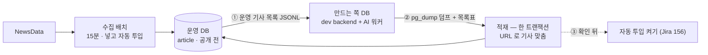

# AI 결과 덤프 적재 — 기사는 운영에 먼저, 결과는 덤프로

**기사는 수집 배치가 운영 DB 에 먼저 넣는다(`infra/server/ingest.md` — 11/13 전환까지 넣기만, 그 뒤 15분 · 자동 투입). AI 결과(마인드맵 · 임베딩 · 작업 행 · 사건 · 이슈)는 만드는 쪽이 이 문서의 약속대로 DB 덤프를 만들어 넘기고, 인프라가 운영 DB 에 넣는다(Jira S15P31A102-152).** 덤프의 기사는 **URL** 로 운영 기사와 맞춘다 — 만드는 쪽의 기사 번호는 아무래도 좋다. 사건 · 이슈 · 작업 번호는 덤프 번호를 그대로 쓴다.

**2026-11-10 — AI 결과가 pg_dump 가 아니라 SQLite 로 왔다. 그 적재는 9절이다.** 1 ~ 8절은 덤프로 올 때의 약속이고, 9절은 그와 다른 점만 적는다.

정한 것과 까닭은 계획 `docs/plans/2026-11-04-ingest-load-only-data-load.md` 「덤프 가이드라인」, 표 정의는 `backend/src/main/resources/db/migration/`(V2 ~ V11), 스케줄러 조건은 `backend/src/main/java/kr/io/newlearn/analysis/AnalysisJobRepository.java`(60 ~ 120줄). 적재 SQL 은 견본 덤프로 일회용 DB 시험(R1)을 하며 만든다 — 이 문서에는 절차와 검사 기준까지 있다.



## 1. 누가 무엇을

| 단계 | 누가 | 무엇 |
|---|---|---|
| 기사 넣기 | 인프라 — 수집 배치 | 15분마다 최근 30분(11/11 분까지는 매일 10시 전날치), 지난 날짜는 손 실행, 10/21 ~ 11/3 최종 기사는 파일로 한 번(`ingest.md`) |
| 운영 기사 목록 | 인프라 | 아래 2절 JSONL 을 뽑아 넘긴다 |
| 결과 만들기 · 덤프 | 만드는 쪽(AI 결과 담당) | 3절 약속대로. 서버 안에서 만들면 4절 |
| 적재 · 확인 · 되돌리기 | 인프라 | 5 · 6 · 7절 |
| 자동 투입 켜기 | 인프라 + AI 팀 | 적재를 확인한 뒤(`ingest.md` 「15분 수집 + 자동 투입으로 바꾸기」) |

**덤프가 들어갈 때까지 운영에서 B1 을 걸지 않는다(손으로도).** 적재는 「운영 분석 표가 비어 있음」을 전제로 한다(6절).

## 2. 운영 기사 목록 받기

인프라가 **매일** 뽑아 넘긴다 — 10:00 수집(`ingest.md`)이 끝난 뒤 전날 하루치(2026-11-04 팀 결정). 한 줄이 기사 하나이고, `id`(운영 번호)를 뺀 나머지가 그대로 B2 요청 본문이다(`docs/api-internal.md` 2절). 만드는 쪽은 각 줄을 자기 로컬 backend 의 B2 로 보내면 운영과 같은 기사 행이 생긴다 — 발행 시각 · 언론사 규칙이 B2 코드 한 곳에서 같다. NewsData 를 두 번 받지 않아 크레딧도 안 든다.

뽑는 SQL 은 `infra/server/export-articles.sql` 이다(발행 시각의 KST 날짜 `from` ~ `to`, 넣기만 기사만). 서버에서 돌리고 파일은 scp 로 받는다 — PowerShell 은 `<` 를 못 쓰고 `>` 가 바이트를 바꿀 수 있어서, 리다이렉트는 서버 셸 안에서만 한다. SQL 이 바뀌면 그 파일을 서버로 한 번 보낸다(관리자 PC 의 저장소 맨 위에서).

```bash
scp infra/server/export-articles.sql newlearn:infra/server/
```

매일(예: 11/5 10:00 수집 뒤 11/4 분) — 날짜 둘만 바꾼다

```bash
ssh newlearn "kubectl -n data exec -i postgres-0 -- psql -X -q -U newlearn -d newlearn -At -v from=2026-11-04 -v to=2026-11-04 < infra/server/export-articles.sql > articles-2026-11-04.jsonl && wc -l articles-2026-11-04.jsonl && sha256sum articles-2026-11-04.jsonl"
```

```bash
scp newlearn:articles-2026-11-04.jsonl .
```

```bash
ssh newlearn "rm articles-2026-11-04.jsonl"
```

- 공개 여부와 상관없이 그 날짜의 수집 기사 전부를 뽑을 때(AI 팀장 매일 검증용, 2026-11-10)는 위 첫 명령의 `psql` 에 `-v all=1` 을 더한다. 줄 모양은 같다
- 줄 수와 sha256 을 같이 넘긴다(받은 쪽이 `sha256sum` 으로 견줌). 그날 `수집 결과` 의 `b2.created` 와 줄 수가 대개 같다(그 뒤 공개된 기사가 있으면 그만큼 적음). 기사 본문이라 저장소 · 팀 전체 방에 올리지 않고 받는 사람에게 메신저 파일 첨부로 넘긴다(2026-11-05 인프라 담당 — 정해 둔 공유 드라이브가 없다). 넘긴 뒤 PC 사본은 저장소 폴더에 남기지 않는다 — 추적 안 된 파일이라 `git add -A` 에 섞인다. 같은 명령으로 다시 뽑을 수 있다(그 사이 공개된 기사는 빠지고, 라벨로 숨긴 기사는 나온다 — 아래 11/4 줄)
- **최종 덤프는 11/12(목)에 받아 그날 적재 · 확인한다**(2026-11-09 팀 일정표 — 처음 「11/14 기사까지 · 11/15 오전」, 2026-11-04 에 11/13 으로 당겼다가 다시 당김). 덤프의 기사는 11/11 분까지다 — 11/12 10:00 수집 뒤 넘기는 11/11 분 목록이 마지막이고, 실제 마감은 만드는 쪽이 목록표에 적는다. 그 뒤 기사(11/12 분부터)는 적재 · 확인 뒤 15분 수집 CronJob 의 자동 투입이 회차 몫 안에서 분석을 건다 — 다 걸리지는 않는다(8절)
- 2026-11-04 일회용 DB(운영과 같은 `pgvector/pgvector:0.8.7-pg18`, 마이그레이션 V1 ~ V10)에서 확인 — KST 하루 경계(UTC 전날 15:00 들어감 · 그날 15:00 빠짐), 공개된 기사 빠짐, 따옴표 · 줄바꿈 · 역슬래시 본문이 JSON 으로 그대로
- `pressSourceId` 는 운영 `press.code` 다. B2 가 처음 보는 언론사를 `source_id` 로 등록해 두 값이 같다. 사람이 다르게 묶은 대응이 없는지 뽑기 전에 본다 — `select source_value, press_code from press_mapping where source = 'NEWSDATA' and source_value <> press_code` 가 11-02 시험 기사 SQL 이 넣은 표기 대응 셋(`뉴시스` · `Mbn` · `연합뉴스tv`, 같은 언론사)뿐이어야 한다. 목록의 `pressSourceId` 는 `press_code` 를 그대로 쓰므로 이 셋은 영향이 없다
- 11/4(KST) 기사부터는 수집 배치가 넣는다. 10/21 ~ 11/3 최종 기사는 팀원이 NewsData 로 받아 저장소에 둔 `data/newsdata_2026-10-21_2026-11-03.sqlite`(Git LFS, 표 · sha256 은 `data/README.md`)에서 인프라가 운영에 먼저 넣는다(Jira 169, `ingest.md` 「지난 기사 파일로 넣기」). 덤프 적재 때까지 임시로 공개해 두므로(`SSOT.md` 9절) 이 목록(넣기만 기사만)에는 나오지 않는다(라벨로 숨긴 기사는 공개 전이라 날짜에 들면 나온다 — 10/21 ~ 11/3 은 이 명령으로 뽑지 않고, 11/4 로 뽑으면 잘못된 본문 기사 66건이 같이 나와 그 URL 을 빼고 넘긴다, `category-labels.md`) — 만드는 쪽은 그 넣기에 쓴 JSONL(변환 `infra/server/sqlite_to_b2.py` 의 출력, 인프라가 줄 수 · sha256 과 함께 넘김)을 로컬 B2 로 넣는다. 그러면 운영 기사와 값이 같아 적재가 URL 로 맞춘다

## 3. 덤프 약속 (만드는 쪽)

### 만드는 길

- DB 는 `compose.yaml` 의 PostgreSQL(운영과 같은 `pgvector/pgvector:0.8.7-pg18`)에 **dev 판 backend** 를 붙여 Flyway 로 만든다. 판은 적재 날의 운영 판과 같아야 한다 — V13(제목의 HTML 조각 고치기, Jira 178)이 운영에 반영된 뒤로는 V13. dev 가 운영보다 앞서 있어도 운영 판에 맞춘다. V12 로 만든 DB 는 backend 를 V13 판으로 띄우면 제목도 같이 고쳐져 기사를 다시 넣지 않아도 된다. 인프라가 운영 판을 알려 준다(`select max(version::int) from flyway_schema_history`)
- 기사는 2절 목록(11/4 부터)과 10/21 ~ 11/3 JSONL(2절)을 로컬 B2(`POST http://localhost:8080/internal/v1/articles`, 머리 `X-Internal-Key` = 로컬 `.env` 의 `INTERNAL_BATCH_KEY`)로 넣는다. 분석은 로컬 B1(`POST /internal/v1/articles/{id}/release`, 같은 키)으로 걸고 — 이때 작업 행이 생긴다 — 결과는 AI 워커가 **W1 으로** 로컬 backend 에 보내 저장한다. 그래야 마인드맵 `content` 모양(A9 가 이 모양으로 읽는다), 작업 행, `article_event.linked_at`, 이슈가 운영 코드와 같은 모양이 된다. SQL 로 직접 넣은 표가 있으면 무엇을 어떻게 넣었는지 목록표에 적는다
- SQLite 칸을 B2 칸으로 바꾸는 규칙은 `infra/server/sqlite_to_b2.py` 한 곳(머리말)에 있다 — SQLite 를 따로 바꿔 넣으면 운영 기사와 값이 달라 적재가 멈출 수 있다
- 덤프를 뜨기 전에 5절 검사 가운데 「작업 행」 · 「판정 걸 기사」 · 「공개 기사」 · 「사건에 묶인 기사」를 자기 DB 에 돌려 모두 0 인지 본다 — 견본이 오가는 횟수가 준다

### 표

| 넣는다 | 넣지 않는다 |
|---|---|
| `press` · `press_mapping` · `article` · `article_mindmap` · `article_embedding` · `analysis_job` · `event` · `article_event` · `issue` · `issue_category` | 회원 표(`member` · `member_category` · `bookmark` · `interest_issue`), `category`(마이그레이션이 넣음), `category_mapping`(NewsData 행은 마이그레이션 V11 이 넣음 — 다른 대응이 필요하면 BE 에), `ingest_run`, `flyway_schema_history` |

`issue_category` 는 넣어도 적재가 쓰지 않고, 들어간 기사 분야로 backend 와 같은 식(`IssueCategoryRepository.java` — 이슈 기사들의 `category_code` 중 가장 많은 것)으로 다시 계산한다. 계산은 `category-labels-apply.sql` 이 한다.

### 형식

DB 컨테이너 **안에서 파일로** 쓰고 꺼낸다 — 표 데이터만, 소유자 없이. `>` 로 받으면 Windows PowerShell 이 바이너리를 글자로 다시 써 파일이 깨질 수 있다. 사용자 · DB 이름은 compose 의 `.env` 값이 그대로 들어간다. 뜰 때 나온 경고를 같이 보낸다.

```bash
docker compose exec db sh -c 'pg_dump -U "$POSTGRES_USER" -d "$POSTGRES_DB" -Fc --data-only --no-owner -t press -t press_mapping -t article -t article_mindmap -t article_embedding -t analysis_job -t event -t article_event -t issue -t issue_category -f /tmp/newlearn-ai.dump'
```

```bash
docker compose cp db:/tmp/newlearn-ai.dump ./newlearn-ai-YYYYMMDD.dump
```

### 행 규칙

| 표 · 칸 | 규칙 | 어기면 |
|---|---|---|
| `article.url` | 운영 기사면 **운영 URL 과 글자까지 같다**(2절 목록 그대로, 정규화하지 않음) — 맞추는 열쇠다 | 같은 기사가 둘이 된다(새 기사로 들어감) |
| `article.published_at` | NewsData `pubDate`(시간대 없음, `pubDateTZ` UTC)를 **UTC 로 읽은 시각**. `2026-11-03 01:02:03` 이면 `2026-11-03 01:02:03+00` = KST 10:02:03. 2절 목록(`publishedAt` 이 `Z`)과 10/21 ~ 11/3 JSONL 을 그대로 B2 로 넣었으면 저절로 맞다 — SQLite `published` 는 KST 라 변환이 값은 그대로 두고 `+09:00` 을 붙였다(`infra/server/sqlite_to_b2.py`) | 운영 기사와 다르면 적재가 멈춘다(10/21 ~ 11/3 최종 기사도 운영 기사다). 운영에 없는 기사는 견줄 짝이 없어 검사가 못 잡고, 9시간 어긋나면 A7 최신 기사 정렬 · 발생 시점이 틀린다 |
| `article.released_at` | 화면에 보일 기사는 차 있다(EXTRACT 결과를 처음 저장한 때). **찬 기사는 `article_mindmap` 행과 EXTRACT `SUCCEEDED` 행이 꼭 있다**. 사건에 묶인 기사도 차 있어야 한다 — 사건의 기사가 모두 비면 그 사건이, 이슈의 사건이 모두 그러면 그 이슈가 화면에서 통째로 빠진다(`docs/api.md` 1절) | 비면 화면 어디에도 없다. 찼는데 마인드맵이 없으면 목록에는 나오고 A9 마인드맵은 404 다 |
| `article.category_code` | 공개 기사는 채운다 — 운영 값을 덮는다. B2 가 고른 값(제목 규칙 포함)을 그대로 두면 운영과 같다. 비우면 운영 값을 그대로 둔다. 라벨이 있는 기사는 적재 안에서 라벨로 다시 덮인다(`category-labels.md` 4절) | 둘 다 비면 카테고리 탭 · 이슈 분야에 안 나온다 |
| 운영에 없는 기사 | **로컬 B1 을 건 기사(작업 행이 있는 기사)만** 넣는다 — B2 로만 넣고 분석하지 않은 기사(SQLite 의 `extra` · 뺀 기사 등)는 운영 화면에 안 보이는 행으로만 남으니, 처음부터 넣지 않거나 덤프 전에 지운다(2026-11-04). 작업 행이 없는 기사에는 마인드맵 · 임베딩 · 기사-사건 행도 없다(SQL 로 넣었어도). 칸은 모두 운영 규칙대로 — `source` `NEWSDATA`, `press_code`, 제목 · 본문 · 발행 시각. 적재가 새 운영 번호로 넣는다 | 작업 행이 없는 기사는 적재가 넣지 않고 건너뛴 수만 알린다(덤프만 커진다). 그 기사에 딸린 행이 있으면 적재가 멈춘다 |
| `press.code` | NewsData `source_id`(예: `newsis` · `news1_kr`). `press_mapping` 의 NEWSDATA 행은 `source_value` = `source_id`, `press_code` = 그 코드 | 같은 언론사가 둘로 세어진다 |
| `analysis_job.status` | 모두 `SUCCEEDED`, 또는 `retry_at` 이 빈 `FAILED`. **`QUEUED` 없음**. `requested_by` 는 `BATCH` | 운영 1분 스케줄러가 다시 큐에 넣거나 다시 걸어 GMS 를 부른다. 큐에 들어간 판정 · ISSUE 작업은 운영에 소비자가 없어(ai 워커는 EXTRACT 만) 판정 줄 전체를 막는다 |
| 판정 걸 기사 | 마인드맵(`primary_core_index` 있음) · 임베딩 · EXTRACT · EMBED `SUCCEEDED` 가 다 있는 기사는 MATCH_EVENT 작업 행이나 `article_event` 가 꼭 있다 | 운영 스케줄러가 판정을 걸어 위처럼 막힌다 |
| 판정에서 일부러 뺀 기사 | 기반 분석의 묶음이 기사 5건 미만이라 사건을 만들지 않은 기사. MATCH_EVENT 작업 행을 `status=FAILED` · `retry_at` 비움 · `error_code=EVENT_CLUSTER_TOO_SMALL` 로 넣고 `article_event` 는 넣지 않는다(2026-11-09 인프라 담당). 진짜 실패와 코드로 구분한다 | 행이 없으면 운영 스케줄러가 발행 순서대로 한 건씩 다시 판정해 새 사건을 만들고 GMS 를 쓰며, 새 기사 판정이 그 뒤로 밀린다 |
| 사건에 묶인 기사 | MATCH_EVENT `SUCCEEDED` 행과 임베딩 행이 있다 | 화면 판정 상태가 「사건을 찾는 중」(`NONE`). 임베딩이 없으면 그 사건이 새 기사의 후보에서 빠진다 |
| `article_embedding` | `dragonkue/BGE-m3-ko` 판 `7074d66aa46562342193ca4feb3d89bf9dad71b4`(`infra/k8s/services/ai/ai.yaml`), 입력은 제목 + 줄바꿈 + 본문 앞 800자, 1024차원(`SSOT.md` 3절). `model` 칸은 `dragonkue/BGE-m3-ko` — 운영 EMBED 워커가 W1 결과 `model` 로 보내는 값과 같게(2026-11-09 AI, Jira S15P31A102-185) | 운영은 모델 이름을 대조하지 않고 차원만 본다 — 다른 모델이면 11-16 새 기사가 엉뚱한 사건 후보를 받는다 |
| `event` | `role` 이 `MAIN` · `REACTION`(비울 수 없음), `reacts_to_event_id` · `issue_id` 는 덤프 안의 번호이거나 비움 | 적재가 고아 검사에서 멈춘다 |
| 번호 | 사건 · 이슈 · 작업 번호는 아무 수나 좋지만 덤프 밖을 가리키지 않는다. `analysis_job.candidates` 안의 사건 · 이슈 번호도 덤프 번호 그대로 둔다(적재가 바꾸지 않는다) | — |

### 함께 보낼 것

- 덤프 파일과 sha256, 뜰 때의 경고
- 목록표 — Flyway 판, 표마다 행 수, 기사 발행 날짜 범위(KST), 공개 기사 수 · 그중 `category_code` 빈 수, 판정에서 일부러 뺀 기사 수, 임베딩 `model` 문자열, SQL 로 직접 넣은 것
- 공유 드라이브 · 메신저로. 저장소에는 올리지 않는다
- 먼저 사건 몇 개 분량의 **견본 덤프**를 받아 R1(6절)을 한 번 돈 뒤 최종 덤프를 받는다. 견본은 **11/9(월) 전후, 늦어도 11/10(화)** — 적재 SQL 을 만들어 시험하는 데 하루, 견본에서 약속과 다른 곳이 나오면 만드는 쪽이 고쳐 다시 뽑을 이틀(11/10 ~ 11)이 11/12 전에 있어야 한다. 기사 50 ~ 100건이면 되고, 운영에 있는 기사(10/21 ~ 11/3 JSONL 과 11/4 · 11/5 목록)와 운영에 없는 기사 한두 건(로컬에서만 넣은 것), 사건 여럿을 묶은 이슈 하나, 반응 사건(`REACTION`) 하나, `retry_at` 없는 `FAILED` 작업 하나를 섞는다

## 4. 서버 안에서 만들 때

- **운영 AI 워커로 만들면** 덤프가 없다 — 이 문서 대신 `ingest.md` 「자동 투입」. 운영 GMS 를 쓰고, 지금 운영 ai 워커는 EXTRACT 만 소비한다(판정 · 이슈는 그 워커가 생겨야)
- **서버의 따로 둔 DB 에서 만들면**(같은 PostgreSQL 의 다른 DB, 그 DB 에 붙인 backend · 워커는 인프라와 따로 정함) 3절 약속이 그대로다. Redis 도 따로 둔다 — 운영 Redis 를 같이 쓰면 운영 EXTRACT 워커가 그 작업을 가져가 운영 GMS 를 부른다. 덤프 파일이 서버 밖으로 나가지 않는 것만 다르다

## 5. 받는 쪽 검사

적재 SQL 이 운영에 옮기기 전에 임시 스키마 `load` 에서 돌리고, 하나라도 걸리면 예외로 통째로 되돌린다. 숫자는 목록표와 견준다.

| 검사 | 기준 |
|---|---|
| 판 | 목록표의 Flyway 판 = 운영 판. 그리고 덤프의 `COPY` 칸 목록이 운영 표 칸(`information_schema.columns`)과 똑같다 — 이 대조만은 트랜잭션 **앞에** 따로 한다(`load` 표는 운영 표를 `LIKE` 로 본떠 늘 같게 보인다): 6절 5단계에서 풀린 SQL 의 `COPY public.<표> (…)` 줄을 운영 칸 목록과 견준다. 칸이 많으면 `COPY` 가 실패하지만, 낡은 판이라 칸이 적으면 `COPY` 는 통과하고 빠진 칸이 조용히 빈다(V5 전 덤프면 `primary_core_index` 가 모두 비어 모든 기사가 「사건 없음」) |
| 행 수 | 표마다 목록표와 같다 |
| 작업 행 | `QUEUED` 0, `retry_at` 이 있는 `FAILED` 0 |
| 공개 기사 | `released_at` 이 찼는데 마인드맵이나 EXTRACT `SUCCEEDED` 행이 없는 기사 0 |
| 판정 걸 기사 | 0 — 위 「행 규칙」 조건(`AnalysisJobRepository.java` 88 ~ 101줄)을 `load` 표에 그대로 |
| 일부러 뺀 기사 | `EVENT_CLUSTER_TOO_SMALL` 작업 수 = 목록표, 그 기사의 `article_event` 0, `MATCH_EVENT` 가 아닌 단계 · `FAILED` 가 아닌 상태 0 |
| 사건에 묶인 기사 | MATCH_EVENT `SUCCEEDED` 없는 것 0, 임베딩 없는 것 0, `released_at` 빈 것 0 |
| 임베딩 | `model` 문자열이 약속한 하나뿐, 차원 1024 |
| 고아 | 덤프 안에서 0 — 마인드맵 · 임베딩 · 작업 · 기사-사건의 기사, 기사-사건의 사건, 사건의 이슈 · 반응 대상 |
| 건너뛸 기사 | 운영에 없고 작업 행이 없는 기사에 딸린 마인드맵 · 임베딩 · 기사-사건 행 0 — 건너뛰면 가리킬 운영 번호가 없다 |
| 운영과 맞춘 기사 | 발행 시각 · 제목 · 본문(`md5(body)`)이 운영과 같다 — 근거는 본문 문단 번호를 가리키는데 적재는 운영 본문을 둔다. 그 기사에 운영 분석 행 0 |
| 운영 분석 표 | 시험 기사 1 ~ 3 을 지운 뒤 일곱 표(`article_mindmap` · `article_embedding` · `analysis_job` · `event` · `article_event` · `issue` · `issue_category`) 모두 0 |
| 알림만 | 공개 기사 중 `category_code` 빈 수(덤프 · 운영 둘 다 빔). 운영에 없는데 작업 행이 없는 기사 수(넣지 않고 건너뜀 — 3절 「행 규칙」) |

적재 뒤(운영)

- 행 수 = 적재 전(시험 기사 1 ~ 3 을 지운 뒤) + 덤프(새로 넣은 기사 · 결과 — 건너뛴 기사는 빼고), 세 시퀀스(사건 · 이슈 · 작업) ≥ 최댓값
- 3분 동안 `analysis_job` 새 행 0, 스트림 셋(`analysis.released` · `analysis.match_event` · `analysis.issue`) 길이 그대로
- 사이트에서 A2 이슈 목록 · A3 이슈 헤더 · A4 이슈 타임라인 · A5 사건 패널 · A6 사건 관련 기사 · A7 최신 기사 · A8 기사 상세 · A9 기사 마인드맵 · A13 통합 검색이 200, 사건에 묶인 기사의 A8 `eventMatchStatus` 가 `SUCCEEDED`. 표본은 라벨로 숨기지 않은 기사와, 공개 기사가 있는 이슈 · 사건으로 고른다 — 숨긴 기사의 A8, 기사가 모두 숨겨진 이슈 · 사건의 A3 · A4 · A5 · A6 은 404 다
- 라벨 없는 공개 기사를 한 번 돌린다(`category-labels.md` 3절). 기사가 모두 숨겨진 사건 수는 `category-labels-apply.sql` 출력에서 본다 — 그 사건과, 사건이 모두 그런 이슈는 화면에서 빠진다(`docs/api.md` 1절)
- 적재 동안 사이트 health 실패 0

## 6. 적재 절차 (인프라)

1. **R1 — 관리자 PC 일회용 DB**: `compose.yaml` 의 DB · Redis + backend 마이그레이션 → 2절 목록 · 10/21 ~ 11/3 JSONL 일부를 B2 로 넣고 10/21 ~ 11/3 분은 `released_at` 을 채워 「운영 흉내」(임시 공개까지) → 분야 라벨을 먼저 넣는다(`category-labels.md` 2절) → 견본 덤프로 적재 SQL 을 만들고 돌림 → 덤프에 없던 임시 공개 기사가 내려갔는지 → 운영에 없는 견본 기사의 발행 시각을 원본과 대조(운영 짝이 없어 5절 검사가 못 잡는다) → 같은 덤프를 한 번 더 넣으면 통째로 실패하고 행 수 그대로인지 → backend 를 붙여 5절 API · 스케줄러. 최종 덤프로 한 번 더
2. **적재 시각 고르기** — 적재 날은 11/12(2026-11-09 팀 일정표). 10시 수집과 겹치지 않게(겹쳐도 같은 URL 에서 트랜잭션이 실패해 되돌아갈 뿐이지만), 손 실행 Job 이 없는지(`kubectl -n app get jobs`). 팀에 알린다
3. **백업** — 매일 백업 잡과 S3 잡을 손으로 하나씩, 매일 잡이 끝난 뒤에 S3 잡(`infra/server/db-backup.md` 「매주 S3 사본」). 파일 이름 · 크기 · sha256 을 남기고 PC 에도 받아 둔다
4. **R2 — 서버 일회용 DB**: 그 백업을 같은 Pod 의 일회용 DB 에 되살려(`db-backup.md` 「되살리기 연습」) 적재 SQL 을 그대로 돌린 뒤 지운다
5. **적재 — 한 psql 트랜잭션**(`psql -1 -v ON_ERROR_STOP=1`)
   - 덤프를 SQL 로 풀 때 **표 데이터만** — `pg_restore -l` 목록에서 `TABLE DATA` 줄만 남겨 `pg_restore -L <목록> --data-only -f -`. 덤프 쪽 시퀀스 값을 박는 `setval` 줄이 따라오면 운영 `article_id_seq` 가 내려가 다음 B2 가 기본 키에서 500 이 된다
   - `COPY public.` → `COPY load.` 로 바꿔 임시 스키마에 담는다(`LIKE` 로 만든 표 — 외래 키 없음). 풀린 SQL 앞머리가 `search_path` 를 비우니 뒤 SQL 은 스키마 이름을 모두 붙인다
   - 시험 기사 1 ~ 3 과 딸린 행을 지운다(URL 과, 같이 지워질 북마크 · 관심 이슈 행 수를 먼저 본다) → 5절 검사 → 언론사 · 언론사 대응(`ON CONFLICT DO NOTHING`) → 기사(운영에 없는 URL 은 작업 행이 있는 것만 새로 넣고, 맞춘 기사는 `released_at` · `category_code` 만) → 이슈 → 사건(자기 참조는 한 `INSERT … SELECT` 안이라 문장 끝에 검사돼 트리거를 끄지 않는다) → 기사-사건 · 마인드맵 · 임베딩 · 작업(기사 번호는 URL 로 바꾼 운영 번호) → 분야 라벨 다시 적용 · 이슈 분야 다시 계산(`category-labels-apply.sql` 을 그대로 부른다, `category-labels.md` 4절) → **임시 공개 내리기** — `released_at` 이 찼는데 `article_mindmap` 행이 없는 기사의 `released_at` 을 비운다(덤프에 없는 10/21 ~ 11/3 기사, `SSOT.md` 9절) → 세 시퀀스 `setval` → 라벨이 숨김인데 공개된 기사 0 단언(적재 SQL 에 따로 둔다 — `apply` 를 빠뜨려도 커밋 전에 걸린다). 맞춘 기사의 `released_at` 을 덤프 쪽이 비었을 때 덮을지 둘지는 R1 에서 정한다
   - 되돌리기 스키마 `load_undo` 에 적재 시각 · 「새로 넣은 기사 번호」 · 「맞춘 기사의 옛 `released_at` · `category_code`」 · 「내린 기사 번호와 옛 `released_at`」을 남기고, `load` 스키마는 지운다
6. **큐 정리** — 지운 시험 작업의 메시지가 큐에 남으면 같은 번호의 덤프 작업으로 읽힌다(메시지에 작업 번호가 들어 있다). `embed` 그룹이 안 읽은 메시지는 `XRANGE` 로 확인한 마지막 ID 로 `XGROUP SETID`, `extract` 그룹 lag · 미ACK 0. `analysis.match_event` · `analysis.issue` 는 길이를 보고, 0 이 아니면 그 그룹들도 `XGROUP SETID` 로 넘긴다 — backend 가 그룹을 `0` 위치에 만들어(`StreamGroupsInitializer.java`) 판정 · ISSUE 워커가 나중에 뜨면 처음부터 읽는다
7. **확인 · 넘기기** — 5절 「적재 뒤」 → AI 팀장 · FE 에 결과와 함께 넘긴다. 이슈 화면이 생기면 화면 CSP 강제 상태에서 `/issues/:id` 를 한 번 본다(Jira 120 남은 확인)

## 7. 되돌리기

- **1순위 — `load_undo` 로 SQL**(한 트랜잭션): 분석 표 일곱을 비우고, 새로 넣은 기사를 지우고, 맞춘 기사의 `released_at` · `category_code` 를 옛 값으로, 내린 기사는 옛 `released_at` 으로 다시 공개. 그 기사 · 이슈를 담은 북마크 · 관심 이슈는 같이 지워진다(`on delete cascade`) — 지우기 전에 행 수를 본다
- 이 되돌리기는 분야 라벨을 되돌리지 않는다 — 라벨 반영 뒤 상태로 돌아간다. 라벨까지 되돌리면 `category-labels.md` 6절 순서로
- **B1 을 켠 뒤라면** 위만으로는 모자란다 — 적재 시각 뒤에 공개된 기사는 `released_at` 이 남아 목록에는 나오고 마인드맵은 404 가 되고, B1 을 다시 걸어도 409 다. 그 기사들(`released_at` > 적재 시각)의 `released_at` 도 비우고, 지운 작업 번호의 큐 메시지를 6절처럼 넘긴다
- **마지막 수단 — 적재 직전 백업 되살리기**(`db-backup.md` 「사고 때 되살리기」). 그 뒤 들어온 수집 기사 · 가입 · 북마크를 잃는다 — 수집 기사는 48시간 안이면 손 실행으로 다시 받는다
- 🔴 되돌릴 수 없는 것: 적재 때 지운 시험 기사 1 ~ 3 과 그 행 · 북마크(백업에만 있다), 큐에서 건너뛴 메시지, 되돌릴 때 같이 지워지는 회원의 북마크 · 관심 이슈
- 적재가 새로 넣은 언론사 · 언론사 대응 행은 남는다(가리키는 기사가 없어도 화면에 안 보인다)
- 확인이 끝나면 `load_undo` 스키마를 지운다

## 8. 그 뒤

- 자동 투입 · 하루 분석 상한 — `ingest.md` 「자동 투입」(Jira 156)
- 덤프 마감 뒤 운영 기사(11/12 분부터, 공개 전 · 작업 없음)는 적재 · 확인 뒤 15분 수집 CronJob 의 자동 투입이 회차 몫 안에서 건다(2026-11-10 AI 팀장 · 사용자 — 처음 2026-11-04 「운영 B1 로 분석」). 하루 5,000건(`SSOT.md` 3절 예산) · 새 기사부터라 평일엔 다 걸리지 않는다. 후보는 **발행이 11/12 이후인 기사만** 고른다 — 임시 공개에서 내린 10/21 ~ 11/3 기사도 「공개 전 · 작업 없음」이라 상태만으로 고르면 그 기사들까지 GMS 로 간다. 라벨로 숨긴 기사도 같은 상태라 걸면 다시 공개되니 라벨 행이 있는 기사는 뺀다(`category-labels.md` 5절). 켜는 날 · 몫 공식은 계획 `docs/plans/2026-11-10-ingest-15min-auto-b1.md`(Jira 156)

## 9. AI 결과가 SQLite 로 올 때 (2026-11-10)

AI 팀이 이슈 · 사건 분류를 pg_dump 대신 SQLite(`data/classified_with_articles_*.sqlite`, 표는 `data/README.md` 「이슈 · 사건 분류」)로 줬다. 그 파일을 읽어 한 트랜잭션으로 넣는다(Jira S15P31A102-152, 계획 `docs/plans/2026-11-10-classified-sqlite-load.md`). 기사를 URL 로 맞추고 사건 · 이슈 번호를 그대로 쓰는 것, 적재 뒤 확인(5절 「적재 뒤」) · 큐 정리(6절 6단계)는 위와 같다.

**정한 것**(2026-11-10 사용자, 까닭은 `SSOT.md` 9절)

- 마인드맵이 있는 기사만 공개하고, 마인드맵이 없는 기사는 사건에 묶였어도 내린다(같은 날 저녁 사용자 — 낮의 「사건 기사는 마인드맵 없이도 공개」를 뒤집음). 10/21 ~ 11/3 임시 공개분 중 마인드맵이 안 온 기사도 여기서 내려간다
- 이슈는 AI 팀이 준 대로 넣는다(「주제 모음」 16개 포함)
- 지금 파일로 먼저 넣고, 11/12 최종 파일이 오면 되돌리고 다시 넣는다. **그 사이 운영에서 B1 · EMBED 켜기 · 수집 `full` 을 하지 않는다** — 되돌리기가 적재 뒤 생긴 작업을 보면 멈춘다. 다시 적재 · 확인 뒤에도 EMBED 워커는 발표 뒤까지 끈다(AI 팀장 A안, `SSOT.md` 9절). 새 기사 분석은 수집 안 자동 투입(EXTRACT 만, 8절)
- 임베딩은 SQLite 에 `article_embedding` 표(`article_url` · `model` · `vector` float32 1024개)가 있을 때만 넣는다. 판정 · ISSUE 후보 계산에 쓰여 기능에는 필요하고, 발표 전에는 판정을 하지 않는다(팀 결정 2026-11-10) — 없으면 그 사건들이 발표 뒤 새 기사 후보에서 빠진다
- 작업 행은 적재가 만든다 — 마인드맵 → EXTRACT, 임베딩 → EMBED, 사건 연결 → MATCH_EVENT, 모두 `SUCCEEDED` · `BATCH` · 시도 1, 번호는 identity 기본값. ISSUE 는 만들지 않는다. 사건 없는 기사는 마인드맵이 없고 내려가 `EVENT_CLUSTER_TOO_SMALL` 행은 0건

| 파일 | 하는 일 |
|---|---|
| `classified_to_load.py` | SQLite 검사(칸 · 건수 · 시각 · 역할 · 참조 · 마인드맵 JSON · 임베딩) → `load` 스키마를 채우는 COPY 묶음. 운영 URL 목록을 주면 그 기사는 본문 대신 md5 만 싣는다 |
| `classified-load.sql` | 판(13 · 14 · 15 — V14 는 기사 부분 인덱스, V15 는 기사-사건 · 사건 인덱스와 기사 표 자동 VACUUM 기준만 더해 표 · 칸이 같다, Jira S15P31A102-190 · 194) · 이전 기록 검사 → 시험 기사 1 ~ 3 지우기 → 분석 표 일곱이 빈지 → URL 로 맞춤(발행 시각 · 본문 md5) → 새 기사 · 이슈 · 사건 · 기사-사건 · 마인드맵 · 임베딩 · 작업 → 마인드맵 있는 기사 공개 |
| `category-labels-apply.sql` | 라벨 다시 적용 · 이슈 분야 계산 — 그대로 부른다 |
| `classified-load-finish.sql` | 사건 없는 공개 기사 내리기 → 사건 · 이슈 시퀀스 → 단언 → `load_undo` 마무리 → `load` 지움 |
| `classified-undo.sql` | `load_undo` 로 되돌리기. 뒤에 라벨 적용을 붙인다 |

**순서** — 관리자 PC 의 저장소 맨 위에서, 10:00 ~ 10:30 수집 밖에서, 손 실행 Job 이 없을 때(`kubectl -n app get jobs`)

1. **사건 기사 라벨 먼저**(`category-labels.md` 2 · 3절) — 적재 단언이 「라벨 없는 사건 기사 0」을 본다. 운영에 없는 기사도 URL 로 미리 넣어 둔다(적재 안의 라벨 적용이 덮는다). 새 기사 본문이 운영의 X(잘못된 본문) 기사와 같으면 그 기사도 X 로 넣는다 — 아니면 적재가 멈춘다. 라벨을 백업보다 먼저 넣어야 R2 가 운영과 같은 라벨로 돈다
2. **운영 URL 목록 → 묶음** — 끝 표시: 묶음 JSON 줄의 `counts` 가 README 건수와 같다(`body_included` 는 운영에 없는 기사 수)

```bash
mkdir C:/tmp/load-152
```

```bash
ssh newlearn "kubectl -n data exec -i postgres-0 -- psql -X -q -U newlearn -d newlearn -At -c 'copy (select url from public.article order by id) to stdout' > known-urls.txt && wc -l known-urls.txt"
```

```bash
scp newlearn:known-urls.txt C:/tmp/load-152/known-urls.txt
```

```bash
python -X utf8 -I infra/server/classified_to_load.py data/classified_with_articles_1021_1111.sqlite C:/tmp/load-152/load.sql --known-urls C:/tmp/load-152/known-urls.txt
```

- 다시 적재(아래) 때는 목록에서 앞 적재가 넣은 기사를 뺀다 — 한 트랜잭션 안에서 되돌리기가 그 기사를 먼저 지우니 본문이 묶음에 있어야 한다. 위 첫 명령의 SQL 만 `select url from public.article where id not in (select id from load_undo.new_article) order by id` 로 바꾼다

3. **서버로** — 묶음은 저장소 폴더 밖(홈)에

```bash
scp C:/tmp/load-152/load.sql newlearn:load-152.sql
```

```bash
scp infra/server/classified-load.sql infra/server/classified-load-finish.sql infra/server/classified-undo.sql infra/server/category-labels-apply.sql newlearn:infra/server/
```

4. **백업 → R2** — 6절 3 · 4단계. R2 는 백업을 `newlearn_restore_check` 에 되살린 뒤(`db-backup.md` 「되살리기 연습」) 아래 5번 명령의 `-d newlearn` 만 `-d newlearn_restore_check` 로 바꿔 `rollback` 으로 돌리고 그 DB 를 지운다
5. **수 보기(`rollback`) → `commit`** — 서버 셸에서. 끝 표시: 마지막 줄 `ROLLBACK`, 그 앞에 넣은 수 표(이슈 · 사건 · 기사-사건 · 마인드맵 · 임베딩 · 작업 · 새 기사 · 공개한 기사 · 내린 기사), 「분야 빈 공개 기사」, 「본문이 같은 새 기사」 알림. 수가 맞으면 끝만 `commit;` 으로

```bash
{ echo 'begin;' && cat load-152.sql infra/server/classified-load.sql infra/server/category-labels-apply.sql infra/server/classified-load-finish.sql && echo 'rollback;'; } | kubectl -n data exec -i postgres-0 -- psql -X -v ON_ERROR_STOP=1 -U newlearn -d newlearn
```

- `&&` 로 잇는다 — 파일 하나가 없으면 `cat` 이 실패해 끝의 `commit;` 이 나가지 않고 통째로 되돌아간다
- `begin;` 없이 돌리면 묶음 첫 줄에서 「트랜잭션 밖이다」로 멈춘다(아무것도 안 남음). `psql -1` 은 쓰지 않는다
- 같은 적재를 두 번 넣으면 「이전 적재 기록(load_undo)이 남아 있다」로 통째로 실패한다

6. **적재 뒤** — 5절 「적재 뒤」. 공개 기사는 모두 마인드맵이 있어 A9 마인드맵이 200 이다. 마인드맵 없이 들어온 사건 기사는 작업 행이 있어 B1 이 409 라, 마인드맵은 파일로 다시 적재해야 붙는다. 큐는 6절 6단계(`embed` 그룹에 남은 시험 메시지). 끝나면 서버 `load-152.sql` · `known-urls.txt` 를 지운다

**되돌리기 · 다시 적재** — 끝이 `rollback;` 인 실행으로 먼저 본다

```bash
{ echo 'begin;' && cat infra/server/classified-undo.sql infra/server/category-labels-apply.sql && echo 'rollback;'; } | kubectl -n data exec -i postgres-0 -- psql -X -v ON_ERROR_STOP=1 -U newlearn -d newlearn
```

```bash
{ echo 'begin;' && cat infra/server/classified-undo.sql load-152.sql infra/server/classified-load.sql infra/server/category-labels-apply.sql infra/server/classified-load-finish.sql && echo 'rollback;'; } | kubectl -n data exec -i postgres-0 -- psql -X -v ON_ERROR_STOP=1 -U newlearn -d newlearn
```

- 첫째가 「되돌리기만」 — 끝 표시: 마지막 줄 `ROLLBACK`, 그 앞에 지운 새 기사 · 다시 내린 기사 · 다시 공개한 기사 · 공개 기사 수와 라벨 적용 표. 둘째가 「되돌리고 다시 적재」(11/12 최종 파일 — 묶음을 2번 「다시 적재」 목록으로 새로 만든다) — 끝 표시: 되돌리기 수 표 뒤에 5번과 같은 넣은 수 표. 한 트랜잭션이라 사이에 이슈 0 화면이 생기지 않는다. 라벨 적용은 한 트랜잭션에 한 번
- 되돌리기는 분석 표 일곱을 `DELETE` 로 비우고(적재 전에 비어 있었다), 새로 넣은 기사를 지우고, 공개한 기사를 다시 비우고, 내린 기사를 옛 `released_at` 으로. 그 기사 · 이슈를 담은 북마크 · 관심 이슈는 같이 지워진다(수를 먼저 찍는다)
- 적재 뒤 분석 작업이 생겼거나(B1 · EMBED) 되돌리기가 모르는 공개가 있으면 멈춘다 — 7절 「B1 을 켠 뒤라면」. 자동 투입을 켠 뒤(11/13 전환)에는 회차마다 작업 행이 생기니 「되돌리고 다시 적재」를 쓸 수 없다. 그 뒤 오는 파일을 넣을 덧붙이기 절차는 아직 없다
- 🔴 시험 기사 1 ~ 3 과 그 북마크는 되돌리지 않는다(백업에만). 적재가 넣은 언론사 · 대응 행과 사건 · 이슈 시퀀스도 남는다(해는 없다). 라벨은 따로 되돌린다(`category-labels.md` 6절)

**R1** — 오늘 운영 백업을 관리자 PC 의 따로 띄운 DB 에 되살려 돈다: `docker compose -p newlearn-r1 --env-file <시험용 값> up -d db redis`(포트를 바꿔 로컬 개발 DB 와 겹치지 않게, `.env` 는 읽지 않음) → 백업 `pg_restore --no-owner` → 위 1 · 2 · 5 → backend 를 붙여 API → 되돌리기 → 다시 적재. 끝나면 `down -v` 와 받은 백업 파일 삭제(회원 정보, `db-backup.md`). 잰 값은 `SSOT.md` 10절
