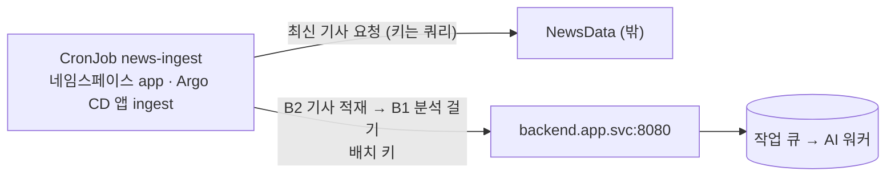

# 뉴스 수집 배치 — CronJob `news-ingest`

**NewsData 최신 기사를 받아 B2 기사 적재로 넣고 B1 으로 분석을 거는 CronJob 이다. 지금은 멈춘 채(`suspend: true`) 받기만(`INGEST_MODE=fetch-only`) 설정이다.** 켜기는 팀이 하루 건수 · 시각 · 고르는 조건을 정한 뒤 Jira S15P31A102-156 에서 한다.

정한 것과 까닭은 계획 `docs/plans/2026-11-03-news-ingest-batch.md`(Jira 154 · 155), B2 · B1 계약은 `docs/api-internal.md` 2절, 설정 값은 `infra/k8s/services/ingest/news-ingest.yaml`(주석), 거르는 조건 · 칸 맞추기는 같은 폴더의 `news_ingest.py` 에 있다.



- 자리는 app 네임스페이스지만 Argo CD 앱은 `ingest` 로 따로다. 까닭은 `SSOT.md` 6절 「클러스터 구성」
- DB · Redis 에는 직접 붙지 않는다. backend 로 들어가는 길은 `infra/k8s/services/app/netpol.yaml` 의 `backend-ingress`(이름표 `app: news-ingest`)
- 키는 둘이다 — NewsData 키(봉인 Secret `newsdata-api`, `seal-secrets.sh newsdata`)와 배치 키(`internal-api` 의 `INTERNAL_BATCH_KEY` 하나만)

## 손으로 받기만 돌리기 (EC2)

NewsData 요청 하나만 보낸다(크레딧 1 안팎). B2 · B1 은 부르지 않는다. 이름은 겹치지 않게 날짜 · 시각을 붙인다.

```bash
kubectl -n app create job --from=cronjob/news-ingest news-ingest-manual-$(date +%m%d-%H%M)
```

```bash
kubectl -n app get jobs
```

```bash
kubectl -n app logs job/<이름>
```

- 다 봤으면 지운다 — `kubectl -n app delete job <이름>`
- 손으로 돌린 잡도 CronJob 의 「마지막 성공 시각」을 바꾼다. 경보는 예약 시각과 견줘 여기에 속지 않는다(아래 「경보가 오면」)
- CronJob 이 `full` 로 바뀐 뒤 손으로 돌리면 실제로 B2 · B1 을 부르고 GMS 를 쓴다

## 로그 읽기

줄마다 JSON 하나다. 키는 모두 `***` 로 가려 찍는다. Grafana › Explore › Loki 에서는 `{namespace="app", container="ingest"} | json`.

| `msg` | 뜻 |
|---|---|
| `NewsData 요청` | 보낸 주소(`apikey=***`) |
| `받은 칸` | 첫 응답의 `totalResults` 와 첫 기사의 칸 이름 — NewsData 응답 모양이 바뀌면 여기서 보인다 |
| `견본` | 받기만일 때 처음 3건의 B2 요청 모양(본문은 `bodyChars` 글자 수만) |
| `NewsData 연결 실패` · `NewsData 실패` | NewsData 에 닿지 못함 · 200 과 `"status":"success"` 가 아닌 답(본문 앞 300자) — 종료 1 |
| `B2 거절` · `B2 실패` · `B2 연결 실패` · `B1 실패` | 기사 하나의 실패 — 링크 · 기사 번호 · 상태 |
| `backend 연결 실패 — 멈춘다` | backend 연결이 세 번 이어서 실패해 남은 기사를 보내지 않았다 — 종료 1. 들어오는 길 정책(`backend-ingress`)과 backend Pod 를 본다 |
| `출입증 오류 — 멈춘다` | NewsData 키(401 · 403) 또는 배치 키를 받지 않았다 — 종료 2 |
| `설정 오류` | 모드 · 키 · 상한 env 가 틀림 — 종료 2 |
| `예상 못 한 오류` | 스크립트가 못 다룬 오류의 traceback(키는 가림) — 종료 1 |
| `수집 결과` | 실행 한 번의 요약 — 아래 표 |

`수집 결과` 의 칸

| 칸 | 뜻 |
|---|---|
| `requests` · `fetched` · `kept` | NewsData 요청 수 · 받은 기사 수 · 걸러 남아 보낼(받기만이면 보낼 수 있는) 기사 수 |
| `skipped` | 거른 까닭별 수 — `bad_item` 기사 모양이 아님(링크가 글자가 아님 등), `no_body` 본문 없음, `category` 연예 · 스포츠, `timezone` `pubDateTZ` 가 UTC 아님, `bad_date` 시각 모양이 다름, `duplicate` 같은 실행 안 같은 링크, `over_limit` 기사 상한을 넘음 |
| `b2` (full) | `created` 새로 넣음(201) · `existing` 이미 있음(200) · `rejected` 입력 오류(400) · `failed` 그 밖 |
| `b1` (full) | `released` 걸었음(202) · `already` 이미 걸림(409) · `failed` 끝내 실패 · `retried` 실행 끝에 한 번 더 건 수 |

| 종료 코드 | 뜻 | Job |
|---|---|---|
| 0 | 끝까지 돌았다 — 기사 몇 건의 실패는 `수집 결과` 에 세어 둠 | 성공 |
| 1 | NewsData 요청 실패, backend 연결이 이어서 실패, 또는 보낼 기사가 있었는데 하나도 B1 까지 못 감(202 · 409 가 「감」) | 한 번 다시 시도 |
| 2 | 다시 해도 같다 — 설정(모드 · 키 · 상한), NewsData · backend 의 401 · 403 | 다시 시도 없이 실패 |

## 켜기 (Jira 156)

1. 팀이 하루 건수 · 시각 · 고르는 조건(분야 · 언론사)을 정한다
2. AI 팀에 미리 알린다 — 기사마다 GMS 크레딧을 쓴다(`infra/server/ai-worker.md` 「기사에 분석 걸기」의 약속)
3. MR 하나 — `news-ingest.yaml` 의 `suspend: false` · `INGEST_MODE` `full` · 상한 둘, 시각을 바꾸면 `schedule` 과 `infra/k8s/alerts/rules.yaml` 의 `NewlearnIngestMissing` 13시간 기준, 고르는 조건은 `news_ingest.py` 의 `NEWSDATA_QUERY`. `SSOT.md` 2 · 6 · 8절
4. `startingDeadlineSeconds` 가 1시간이라, 예약 시각 뒤 1시간 안에 머지되면 그 자리에서 한 번 돈다 — 머지 시각을 그 밖으로 잡거나 바로 도는 것으로 보고 지켜본다
5. 첫 실행 로그의 `수집 결과`, 경보, GMS(AI 팀장 화면)를 같이 본다

## 급히 멈추기

- 기본 — `news-ingest.yaml` 의 `suspend: true` MR
- MR 을 기다릴 수 없을 때(서버에서) — Argo CD 자동 동기화를 **루트 앱 → `ingest` 앱** 순서로 끈 뒤 `kubectl -n app patch cronjob news-ingest -p '{"spec":{"suspend":true}}'`. 두 앱 모두 selfHeal 이라 `ingest` 만 끄면 루트가 앱 정의를 되돌린다. 다시 켤 때는 MR 이 머지된 뒤 **`ingest` 앱 → 루트 앱**. 그동안 backend · frontend 배포(app 앱)는 그대로 돈다
- 이미 넣은 기사는 남는다. 공개 전 기사는 화면에 없고, 공개된 기사를 내리려면 따로 SQL(백업 뒤)

## 경보가 오면 (`NewlearnIngestMissing`)

멈추지 않았는데 ① 마지막 예약 실행 뒤 2시간이 지나도 그 뒤 성공이 없거나 ② 예약 실행이 13시간 넘게 없을 때 울린다. 식과 한계는 `infra/k8s/alerts/rules.yaml` 주석.

1. `kubectl -n app get jobs` · `kubectl -n app logs job/<이름>` 으로 마지막 실행의 종료 코드와 `수집 결과` 를 본다
2. 종료 1 — `NewsData 실패` 면 응답 `status` 와 본문(크레딧 · 요청 수 한도). `NewsData 연결 실패` 면 바깥으로 나가는 길(DNS · 인터넷). `backend 연결 실패 — 멈춘다` 나 B2 · B1 이 하나도 못 감이면 backend 상태(`kubectl -n app get pod`, health)와 들어오는 길 정책(`kubectl -n app get cnp backend-ingress`)
3. 종료 2 — `설정 오류` 면 env · Secret(`kubectl -n app get secret newsdata-api internal-api`). `출입증 오류` 가 NewsData 면 키(구독이 끝났는지 포함 — 「키 바꾸기」), backend 면 배치 키가 backend 와 같은 Secret 인지
4. Job 이 아예 없으면 예약이 안 생긴 것 — `kubectl -n app describe cronjob news-ingest` 의 이벤트(시작 마감을 넘김 등)
5. 오래 멈췄다 다시 켜면 첫 예약 실행 전까지 ②가 울릴 수 있다 — 첫 예약이 성공하면 저절로 풀린다

## B1 이 끝내 실패한 기사

다시 걸기 규칙은 `docs/api-internal.md` 2절 B2 끝 문단이다. 끝내 실패하면 `B1 실패` 줄에 기사 번호(`articleId`)가 남는다 — 그 번호로 손으로 건다(`infra/server/ai-worker.md` 「기사에 분석 걸기」).

## 키 바꾸기

NewsData 키 — 바뀐 서버 스크립트를 보낸 뒤(`infra/server/README.md` 「서버로 보내기」) 터미널에서 다시 봉인한다. 봉인 전에 그 키로 최신 기사 요청 하나를 보내(크레딧 1 안팎) 통과해야 봉인한다.

```bash
ssh -t newlearn "bash infra/server/seal-secrets.sh newsdata"
```

```bash
ssh newlearn 'cat ~/sealed/sealed-newsdata-api.yaml' > infra/k8s/services/ingest/sealed-newsdata-api.yaml
```

그 파일을 바꾸는 MR 을 머지하면 된다. CronJob 은 실행마다 Pod 를 새로 띄워 그때 env 를 읽어 다시 띄울 것이 없다.
