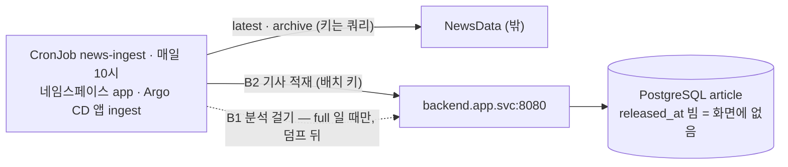

# 뉴스 수집 배치 — CronJob `news-ingest`

**매일 10:00(KST)에 NewsData latest 를 36시간 창으로 받아, 발행 시각(KST)이 전날인 기사만 B2 기사 적재로 넣는다. B1 분석 걸기는 하지 않는다(「넣기만」, `INGEST_MODE=load-only`).** 기사는 운영 DB 에 먼저 쌓이고, 마인드맵 · 사건 · 이슈는 AI 결과 덤프로 나중에 들어온다. 넣기만 한 기사는 `released_at` 이 비어 화면에 나오지 않는다 — 의도다. B1 은 덤프가 들어간 뒤 켠다(Jira S15P31A102-156, 아래 「B1 켜기」).

정한 것과 까닭은 계획 `docs/plans/2026-11-04-ingest-load-only-data-load.md`(Jira 156)와 `docs/plans/2026-11-03-news-ingest-batch.md`(Jira 154 · 155), B2 · B1 계약은 `docs/api-internal.md` 2절, 설정 값은 `infra/k8s/services/ingest/news-ingest.yaml`(주석), 거르는 조건 · 칸 맞추기는 같은 폴더의 `news_ingest.py` 에 있다.



- 자리는 app 네임스페이스지만 Argo CD 앱은 `ingest` 로 따로다. 까닭은 `SSOT.md` 6절 「클러스터 구성」
- DB · Redis 에는 직접 붙지 않는다. backend 로 들어가는 길은 `infra/k8s/services/app/netpol.yaml` 의 `backend-ingress`(이름표 `app: news-ingest`)
- 키는 둘이다 — NewsData 키(봉인 Secret `newsdata-api`, `seal-secrets.sh newsdata`)와 배치 키(`internal-api` 의 `INTERNAL_BATCH_KEY` 하나만)

## 설정

모두 `news-ingest.yaml` 의 env 다. 틀린 값이면 스크립트가 NewsData 를 부르기 전에 `설정 오류` 를 찍고 종료 2 로 끝낸다(크레딧 0).

| env | 매일 값 | 받는 값 | 뜻 |
|---|---|---|---|
| `INGEST_MODE` | `load-only` | `fetch-only` · `load-only` · `full` | `fetch-only` 는 NewsData 요청 하나만 보내고 받은 수 · 견본을 찍는다(B2 · B1 안 부름). `load-only` 는 B2 만. `full` 은 B2 뒤 B1 |
| `INGEST_SOURCE` | `latest` | `latest`(비우면) · `archive` · `file` | latest 는 요청마다 1크레딧 · 최근 48시간까지, archive 는 5크레딧 · 지난 날짜(NewsData 「API credit usage」 문서). `file` 은 NewsData 대신 표준 입력의 B2 요청 모양 JSONL — `load-only` 에서만, 아래 NewsData 설정(키 · timeframe · days · query · 상한)은 있어도 무시한다(아래 「지난 기사 파일로 넣기」) |
| `INGEST_TIMEFRAME` | `36` | `1` ~ `48`(시간) · `1m` ~ `2880m`(분) · 비움 | latest 의 창. archive 와 같이 주면 종료 2 |
| `INGEST_DAYS` | `yesterday` | 비움 · `yesterday` · `2026-11-03` · `2026-10-29..2026-11-02` | `pubDate`(UTC)를 KST 날짜로 바꿔 이 날짜만 넣는다. `yesterday` 는 실행 시각(KST)의 전날. 비우면 거르지 않는다 |
| `INGEST_ARCHIVE_FROM` · `INGEST_ARCHIVE_TO` | 없음 | `YYYY-MM-DD` · `YYYY-MM-DD HH:MM:SS` | archive 의 `from_date` · `to_date` 에 그대로 실린다(둘 다, 처음 ≤ 끝). latest 에 주면 종료 2 |
| `INGEST_QUERY` | `country=kr&language=ko&removeduplicate=1&excludecategory=sports,entertainment,lifestyle,food,tourism&sort=pubdateasc`(팀원이 10/29 ~ 11/3 을 받은 쿼리 + 오래된 순) | `키=값&키=값` | 고르는 조건(분야 · 언론사). 받는 키는 `news_ingest.py` 의 `QUERY_KEYS`(`category` · `domainurl` · `sort` 등). 키 · 쪽 · 기간 · 시간대 · 모르는 키 · 빈 값 · 겹친 키는 종료 2. Basic 은 요청 하나에 분야 · 언론사 각 5개까지(팀장 공지) |
| `INGEST_REQUEST_INTERVAL` | 없음(0) | `0` ~ `60` 초 | NewsData 요청 사이 쉬기. 유료 요금제 한도가 15분에 1,800크레딧이라 archive 는 3(15분에 많아야 300번 × 5 = 1,500) |
| `INGEST_MAX_REQUESTS` | `500` | `1` ~ `500` | 한 번 실행의 NewsData 요청 = latest 크레딧 상한 |
| `INGEST_MAX_ARTICLES` | `20000` | `1` ~ `20000` | B2 로 보낼 기사 상한 |
| `INGEST_FILE_LINES` | 없음 | 비움 · `1` ~ `1000000` | `file` 일 때 기대 줄 수. 읽은 줄과 다르면 끝까지 넣고 종료 1(덜 올라간 파일 · 다른 파일 · 끊긴 스트림) |
| `BACKEND_URL` | `http://backend.app.svc:8080` | `http(s)://<호스트>` | B2 · B1 을 부를 곳(load-only · full) |

- 같은 실행 안의 중복은 링크와 NewsData `article_id` 로 거르고, 실행 사이 중복은 B2 가 URL 로 막는다(200)
- 거르는 순서: 기사 모양 → 본문 없음 → 분야(스포츠 · 연예 · 생활 · 음식 · 여행 — 쿼리의 `excludecategory` 와 같은 다섯) → NewsData 가 `duplicate=true` 로 표시 → 시간대 → 시각 모양 → **날짜 범위 밖** → 같은 실행 안 중복 → 기사 상한. 범위 밖(10시 실행의 그날 0 ~ 10시)이 상한을 먹지 않는다
- 쿼리에 `sort=pubdateasc`(오래된 순)가 있고 `INGEST_DAYS` 가 있으면, 시각을 믿을 수 있는 기사(UTC · 모양이 맞음)가 **쪽 전체에서 모두 범위 뒤**일 때 멈춘다(`stoppedBy: past_range`, 종료 0). 범위 뒤 기사가 한 건 끼인 쪽에서는 멈추지 않는다 — 정렬이 조금 어긋나도 어제 기사를 잃지 않게 요청 하나를 더 쓴다. 상한에 걸린 기사가 있으면 그쪽(종료 2)이 먼저다 — 그날 0 ~ 10시 쪽을 안 받아 요청이 준다(평균 약 330 → 240, 팀장 어림). 정렬은 2026-11-04 받기만으로 첫 쪽이 창 시작 바로 뒤인 것을 확인했다(`SSOT.md` 10절)
- 다음 쪽이 남았는데 요청 · 기사 상한에 닿으면 받은 데까지 넣고 종료 2 — 빠진 구간이 있다는 뜻이고 경보 ①이 울린다(아래 「경보가 오면」)

## 매일 실행

- 10:00 에 돈다. 시작 마감이 1시간이라 그 사이 서버가 멈췄다 돌아오면 11시 전까지는 늦게라도 돈다. 10:00 ~ 11:00 에 CronJob 을 바꾸는 MR 이 머지되면 그 자리에서 한 번 돈다
- 크레딧 어림 — 지금 조건으로 36시간 창이 평균 약 330요청, 평일 최대 약 462요청(팀장 2026-11-04, 10/21 ~ 28 기준). 그날 0 ~ 10시 기사는 받은 뒤 버린다(최신부터 오고 latest 에 끝 시각 조건이 없다)
- 매일 공유 — 실행마다 `수집 결과` 줄 전체와 종료 코드를 팀장에게 넘긴다(팀장이 `credits` 를 NewsData 대시보드 차감과 견줌, 2026-11-04). 예약 실행 Job 은 이름이 `news-ingest-<숫자>` 다(손 실행은 `-check-` · `-manual-` 처럼 글자가 섞임). 다시 시도가 있었으면 Pod 가 둘이다

  ```bash
  ssh newlearn 'j=$(kubectl -n app get jobs -o name --sort-by=.metadata.creationTimestamp | grep -E "/news-ingest-[0-9]+$" | tail -1); echo "$j"; kubectl -n app get pods -l job-name=${j#job.batch/} -o jsonpath="{range .items[*]}{.metadata.name} exit={.status.containerStatuses[0].state.terminated.exitCode}{\"\n\"}{end}"; kubectl -n app get $j -o jsonpath="{.status.startTime} ~ {.status.completionTime}{\"\n\"}"; kubectl -n app logs "$j" | tail -1'
  ```

  같은 날 운영 기사 목록 JSONL 도 넘긴다(`infra/server/data-load.md` 2절)
- 팀장이 매일 적는 항목은 `수집 결과` 한 줄에서 나온다 — 요청 `requests` · 크레딧 `credits` · 받은 수 `fetched` · 새 기사 `b2.created` · 본문 정상 `fetched` − `skipped.no_body` · 빠진 구간 `stoppedBy` 와 `pubDates`. `fetched` · `no_body` 는 36시간 창 전체(그날 0 ~ 10시 · 그제 밤 포함, 절반 가까이)를 센다 — 「전날 기사 수」는 `kept`(날짜 범위 안 · 거른 뒤). 수집 시각은 `article.created_at`(B2 가 넣은 때)
- 손 실행은 10시를 피한다 — 겹치면 둘이 같이 돌아 크레딧을 두 번 쓰거나 예약이 건너뛰어질 수 있다(손으로 만든 Job 을 CronJob 이 어떻게 세는지는 클러스터에서 확인하지 않았다)

## 손 실행 (EC2)

CronJob 에서 Job 을 만들며 env 와 다시 시도만 바꾼다. **손 실행은 매일 설정(요청 500 · 기사 20,000 · timeframe 36 · 다시 시도 1 · 실행 상한 1시간)을 물려받으니 상한 · timeframe 을 꼭 같이 준다.** 다시 시도는 0 으로 둔다 — 중간에 실패해 처음부터 다시 돌면 크레딧을 그만큼 또 쓴다. `INGEST_QUERY` 처럼 `&` 가 든 값은 따옴표로 감싼다. 마지막이 `create` 라 같은 이름이 있으면 실패하고 끝난다. 이름은 겹치지 않게 날짜 · 시각을 붙인다.

먼저 받기만 한 번(요청 1, latest 1 · archive 5크레딧)으로 `pubDates` · `totalResults` · `out_of_range` 를 보고, 생각대로면 넣기만으로 돌린다.

**지난 하루(latest)** — 예: 11/3 을 11-04 14시에. `INGEST_TIMEFRAME` = 지금 − 그날 0시 + 1시간(최대 48 — 48시간이 지난 날은 archive)

```bash
kubectl -n app create job --from=cronjob/news-ingest news-ingest-1103-$(date +%H%M) --dry-run=client -o yaml | kubectl set env --local -f - INGEST_DAYS=2026-11-03 INGEST_TIMEFRAME=39 -o yaml | kubectl patch --local -f - --type merge -p '{"spec":{"backoffLimit":0}}' -o yaml | kubectl -n app create -f -
```

- 받기만 먼저 보려면 `INGEST_MODE=fetch-only` 를 더한다

**archive** — 예: 10/29 ~ 11/2(KST). 이 구간과 11/3 은 2026-11-04 팀원이 따로 받기로 해 인프라는 돌리지 않았다 — 놓친 날을 채울 때 같은 방법으로 쓴다. KST 하루는 UTC 두 날짜에 걸쳐(KST 10/29 0시 = UTC 10/28 15시) 날짜만 주면 앞뒤를 더 받고 `INGEST_DAYS` 로 거른다. 요청은 UTC 이틀씩 세 구간으로 나눠 같은 날짜를 두 번 받지 않는다 — `2026-10-28` ~ `2026-10-29`, `2026-10-30` ~ `2026-10-31`, `2026-11-01` ~ `2026-11-02`. 한 구간은 요청 약 280 · 범위 안 기사 약 1만 2천(하루 7,000건 어림)이라 상한(요청 500 · 기사 2만)에 여유가 있다. 쉬기 3초면 15분에 1,500크레딧이라 구간을 이어 돌려도 한도(1,800) 안이다. 한 구간이 끝난 뒤 다음을 돌린다. 실행 상한은 2시간으로 올린다 — 넘기면 결과 줄 없이 죽고 다시 돌지 않아, 받는 중이었으면 그 구간 크레딧(약 1,400)이 그냥 사라진다

```bash
kubectl -n app create job --from=cronjob/news-ingest news-ingest-archive-1-$(date +%H%M) --dry-run=client -o yaml | kubectl set env --local -f - INGEST_SOURCE=archive INGEST_TIMEFRAME- INGEST_ARCHIVE_FROM=2026-10-28 INGEST_ARCHIVE_TO=2026-10-29 INGEST_DAYS=2026-10-29..2026-11-02 INGEST_REQUEST_INTERVAL=3 INGEST_MAX_REQUESTS=500 INGEST_MAX_ARTICLES=20000 -o yaml | kubectl patch --local -f - --type merge -p '{"spec":{"backoffLimit":0,"activeDeadlineSeconds":7200}}' -o yaml | kubectl -n app create -f -
```

- 다음 구간은 이름(`archive-2` · `archive-3`)과 `INGEST_ARCHIVE_FROM` · `INGEST_ARCHIVE_TO` 만 바꾼다
- 첫 구간 받기만에서 `pubDates.max` 가 `2026-10-29 2x:…` 까지 오는지 본다 — `to_date` 가 그날 끝까지 들어간다는 가정이다. 아니면 구간 끝을 하루씩 늘려 잡는다
- 크레딧 어림 — 하루 7,000건이면 UTC 하루 약 140요청 × 5 = 700. 날짜만이면 UTC 6일치라 약 4,200. NewsData 가 `YYYY-MM-DD HH:MM:SS`(UTC)도 받으면 `2026-10-28 15:00:00` ~ `2026-11-02 14:59:59` 로 5일치(약 3,500)만 받는다 — 받는지는 문서로 확인 못 했으니 받기만으로 `pubDates` 를 보고 정한다
- 요청 · 기사 상한에 닿아 종료 2 면 그 구간이 다 안 들어온 것이다. `stoppedBy` 와 `pubDates` 를 보고 구간을 더 잘게 나눠 다시 돌린다(같은 기사는 B2 200)

**보기 · 지우기**

```bash
kubectl -n app get jobs
```

```bash
kubectl -n app logs job/<이름> | tail -3
```

- 다 봤으면 지운다 — `kubectl -n app delete job <이름>`
- 손 실행도 CronJob 의 「마지막 성공 시각」을 바꾼다. 경보는 예약 시각과 견줘 여기에 속지 않는다(아래 「경보가 오면」)

## 지난 기사 파일로 넣기 (`INGEST_SOURCE=file`, Jira 169)

AI 팀원이 받아 둔 10/21 ~ 11/3 최종 기사(`data/newsdata_2026-10-21_2026-11-03.sqlite`, 표는 `data/README.md`)를 B2 로 넣은 길이다. 덤프 적재 때까지 화면에 보이게 한 임시 공개는 `SSOT.md` 9절, 덤프 적재 때 마인드맵 없는 기사를 내리는 단계는 `data-load.md` 6절에 있다. 계획 `docs/plans/2026-11-04-preload-1021-1103-articles.md`.

- 값 변환은 `infra/server/sqlite_to_b2.py` 한 곳(규칙은 그 파일 머리말). AI 팀도 같은 출력 파일(같은 sha256)을 로컬 B2 로 넣는다
- 보내기는 CronJob 틀로 띄운 Job 안에서 `kubectl exec -i … < 파일` — 이미지 · 이름표 · Secret 이 매일 수집과 같고 배치 키가 클러스터 밖으로 나가지 않는다. 결과는 exec 의 표준 출력이라 `kubectl logs` · Loki 에 남지 않는다 — 서버의 로그 파일이 기록이다
- 같은 URL 은 B2 가 200 이라(위 「설정」 아래) 끊기면 같은 명령을 다시 돌린다
- 그날 10시 예약 Job 이 끝난 뒤 시작한다 — 손 Job 은 CronJob 의 동시 실행 막기(`Forbid`)에 세어지지 않는 것으로 본다(위 「매일 실행」 끝 줄처럼 클러스터에서 확인하지는 않았다)

**1. 넣기 전 백업** (EC2) — `db-backup.md` 「확인 · 손으로 돌리기」의 손 백업 한 번. 끝에 남긴 파일 이름 · 크기를 적어 둔다

**2. 변환 · 올리기** (관리자 PC, LFS 파일을 받은 본 클론의 저장소 맨 위 — worktree 에는 가리킴 파일만 있다) — SQLite sha256 이 `data/README.md` 값과 같은지 먼저 본다(PowerShell `Get-FileHash data/newsdata_2026-10-21_2026-11-03.sqlite`). 출력 폴더(`C:/tmp/preload`)는 미리 만들고, 출력 파일은 스크립트가 직접 쓴다(PowerShell 의 `>` 를 쓰지 않는다)

```bash
python -I infra/server/sqlite_to_b2.py data/newsdata_2026-10-21_2026-11-03.sqlite C:/tmp/preload/articles-1021-1103.jsonl
```

```bash
scp C:/tmp/preload/articles-1021-1103.jsonl newlearn:
```

- 변환이 찍은 `lines` · `sha256` 을 적어 둔다. EC2 에서 `sha256sum articles-1021-1103.jsonl` · `wc -l articles-1021-1103.jsonl` 이 같아야 한다

**3. Job 띄우기** (EC2) — ConfigMap 에 file 모드가 들어갔는지(1 이 나와야) 보고, Job 은 `sleep` 으로 띄운다. 이름에 글자가 섞여 「매일 실행」의 `news-ingest-[0-9]+$` 에 안 걸린다

```bash
kubectl -n app get configmap news-ingest -o jsonpath='{.data.news_ingest\.py}' | grep -c 'FILE_SOURCE = "file"'
```

```bash
kubectl -n app create job --from=cronjob/news-ingest news-ingest-preload --dry-run=client -o yaml | kubectl set env --local -f - INGEST_SOURCE=file -o yaml | kubectl patch --local -f - --type json -p '[{"op":"replace","path":"/spec/template/spec/containers/0/command","value":["sleep","infinity"]}]' -o yaml | kubectl patch --local -f - --type merge -p '{"spec":{"backoffLimit":0,"activeDeadlineSeconds":10800}}' -o yaml | kubectl -n app create -f -
```

```bash
kubectl -n app wait --for=condition=Ready pod -l job-name=news-ingest-preload --timeout=120s && kubectl -n app get job news-ingest-preload -o jsonpath='{range .spec.template.spec.containers[0].env[*]}{.name}{" "}{end}{"\n"}'
```

- env 는 이름만 찍는다(값은 찍지 않는다). `INGEST_MODE` · `INGEST_SOURCE` · `INTERNAL_BATCH_KEY` · `BACKEND_URL` 이 있어야 한다. 아래 exec 도 `INGEST_SOURCE=file` 을 한 번 더 준다 — Job 을 다시 띄우다 `set env` 를 빠뜨려도 latest 로 돌지 않게
- 시간 상한(3시간)이 되면 Pod 가 끝나 exec 도 같이 죽는다. 상한에 잘린 Job 은 실패로 남아 같은 이름으로 다시 만들려면 먼저 지운다

넣기 전 숫자를 적어 둔다 — 이 조건의 기사 수는 0 이어야 한다(아니면 같은 링크가 이미 있어 아래 수가 79,334 와 달라진다 — 파일은 79,335줄이지만 시험 기사 1번과 같은 URL 1건은 `existing` 으로 세어져 새로 안 들어간다)

```bash
kubectl -n data exec postgres-0 -- psql -X -q -U newlearn -d newlearn -At -c "select count(*) from article where source = 'NEWSDATA' and created_at >= '2026-11-04 00:00+09' and published_at < '2026-11-04 00:00+09'" -c "select count(*) from analysis_job" -c "select count(*) from press" -c "select pg_size_pretty(pg_database_size('newlearn'))"
```

**4. 카나리 100건** (EC2) — 시각 · 걸린 시간을 먼저 본다

```bash
head -n 100 articles-1021-1103.jsonl > articles-canary.jsonl && time kubectl -n app exec -i -c ingest job/news-ingest-preload -- env INGEST_SOURCE=file INGEST_FILE_LINES=100 python -I -B -u /opt/ingest/news_ingest.py < articles-canary.jsonl > canary.log; echo "exit=$?"; tail -1 canary.log
```

```bash
head -n 1 articles-canary.jsonl | grep -o '"publishedAt":"[^"]*"'; tail -n 1 articles-canary.jsonl | grep -o '"publishedAt":"[^"]*"'; kubectl -n data exec postgres-0 -- psql -X -q -U newlearn -d newlearn -At -c "select count(*), min(id), max(id), to_char(min(published_at) at time zone 'Asia/Seoul', 'YYYY-MM-DD\"T\"HH24:MI:SS'), to_char(max(published_at) at time zone 'Asia/Seoul', 'YYYY-MM-DD\"T\"HH24:MI:SS') from article where source = 'NEWSDATA' and created_at >= '2026-11-04 00:00+09' and published_at < '2026-11-04 00:00+09'"
```

- `exit=0`, 결과 줄 `lines` 100 · `badLines` 0 · `b2.created` 100. DB 의 수 · 최소 · 최대 시각이 파일의 첫 줄 · 끝 줄 `publishedAt`(`+09:00` 앞)과 같아야 한다 — 9시간 어긋나면 그 100건(위 `min(id)` ~ `max(id)`)만 지우고(아래 「되돌리기」) 변환을 고친다
- 걸린 시간 × 793 이 전체 어림이다. 2시간 반을 넘으면 시간 상한(3시간)에 걸리니 전체로 가지 말고 멈춘다

**5. 전체** (EC2) — `nohup` 이라 관리자 PC 가 끊겨도 이어진다. 앞 100건은 `existing` 으로 센다

```bash
nohup sh -c 'kubectl -n app exec -i -c ingest job/news-ingest-preload -- env INGEST_SOURCE=file INGEST_FILE_LINES=79335 python -I -B -u /opt/ingest/news_ingest.py < articles-1021-1103.jsonl; echo "exit=$?"' > preload.log 2>&1 &
```

- 지켜보기: `tail -2 preload.log` — 5,000줄마다 `진행` 줄. 사이트 health 도 본다
- 끝 표시: `exit=` 줄이 생긴다(`grep '"msg": "수집 결과"' preload.log | tail -1; tail -1 preload.log`). 성공이면 `exit=0` 과 결과 줄 `lines` 79,335 · `badLines` 0 · `b2.created + b2.existing` 79,335 · `rejected` · `failed` 0. 실패면 kubectl 이 `command terminated with exit code N` 을 결과 줄 뒤에 찍는다. 첫 줄은 `nohup: ignoring input` 이다

**6. 번호 범위 · 확인** (EC2) — 넣은 기사의 id 최소 · 최대 · 수를 적어 둔다. 공개 · 되돌리기는 이 범위로 한다

```bash
kubectl -n data exec postgres-0 -- psql -X -q -U newlearn -d newlearn -At -c "select min(id), max(id), count(*) from article where source = 'NEWSDATA' and created_at >= '2026-11-04 00:00+09' and published_at < '2026-11-04 00:00+09'" -c "select count(*) from analysis_job" -c "select pg_size_pretty(pg_database_size('newlearn'))"
```

- 수 79,334(위 「넣기 전」의 까닭). 분석 작업 행 수는 3의 「넣기 전」과 같아야 한다 — 작업 행이 없으면 큐 메시지도 생기지 않는다(GMS 를 안 부름). DB 크기를 넣기 전과 견준다

**7. 임시 공개** (EC2) — `<최소>` · `<최대>` 는 6의 값. `UPDATE 79334` 가 나와야 한다

```bash
kubectl -n data exec postgres-0 -- psql -X -U newlearn -d newlearn -v ON_ERROR_STOP=1 -c "update article set released_at = now() where id between <최소> and <최대> and released_at is null and published_at < '2026-11-04 00:00+09'"
```

- 공개만으로는 분석이 걸리지 않는다 — 스케줄러는 작업 행 · 마인드맵이 있는 기사만 본다. 그 기사에 B1 을 부르면 409 다
- 확인: `curl -fsS 'https://newlearn.io.kr/api/v1/articles?size=1'` 의 `totalElements` 가 늘어난 수만큼, 넣은 기사의 A8 기사 상세는 200 · A9 기사 마인드맵은 404 `MINDMAP_NOT_FOUND`

**8. 치우기** (EC2) — Job 을 바로 지운다. 손 Job 이 성공으로 끝나면 CronJob 마지막 성공 시각이 바뀌어 경보 ①이 가려질 수 있다. 서버의 기사 파일도 지운다(로그 파일은 결과를 옮겨 적은 뒤)

```bash
kubectl -n app delete job news-ingest-preload && rm articles-1021-1103.jsonl articles-canary.jsonl
```

**되돌리기**

- 임시 공개만: `update article set released_at = null where id between <최소> and <최대> and not exists (select 1 from article_mindmap m where m.article_id = article.id)`
- 넣은 기사까지(덤프 적재 **전에만**): 먼저 `select count(*) from bookmark where article_id between <최소> and <최대>` 로 같이 지워질 북마크 수를 본 뒤 `delete from article where id between <최소> and <최대>`. 관심 이슈는 이슈를 가리켜 영향 없다. 새로 생긴 언론사 행은 남는다(가리키는 기사가 없으면 안 보인다). 또는 1의 백업 되살리기(`db-backup.md` 「사고 때 되살리기」). 덤프 적재 뒤에는 분석 행이 붙어 지우기가 외래 키에 걸린다 — `data-load.md` 7절

## 로그 읽기

줄마다 JSON 하나다. 키는 모두 `***` 로 가려 찍는다. Grafana › Explore › Loki 에서는 `{namespace="app", container="ingest"} | json`(`file` 은 exec 로 돌려 Loki 에 없다 — 서버 로그 파일).

| `msg` | 뜻 |
|---|---|
| `NewsData 요청` | 보낸 주소(`apikey=***`) |
| `받은 칸` | 첫 응답의 `totalResults` 와 첫 기사의 칸 이름 — NewsData 응답 모양이 바뀌면 여기서 보인다 |
| `견본` | 받기만일 때 처음 3건의 B2 요청 모양(본문은 `bodyChars` 글자 수만) |
| `NewsData 연결 실패` · `NewsData 실패` | NewsData 에 닿지 못함 · 200 과 `"status":"success"` 가 아닌 답(본문 앞 300자). 첫 요청이면 아무것도 안 넣고, 뒤 요청이면 받은 데까지 넣은 뒤 종료 1 |
| `B2 거절` · `B2 실패` · `B2 연결 실패` · `B1 실패` | 기사 하나의 실패 — 링크 · 기사 번호 · 상태 |
| `backend 연결 실패 — 멈춘다` | backend 연결이 세 번 이어서 실패해 남은 기사를 보내지 않았다 — 종료 1. 들어오는 길 정책(`backend-ingress`)과 backend Pod 를 본다 |
| `상한에 닿아 멈춤 — 빠진 구간이 있다` | 다음 쪽이 남았는데 요청 · 기사 상한에서 멈췄다. 받은 데까지는 넣었다 — 종료 2 |
| `출입증 오류 — 멈춘다` | NewsData 키(401 · 403, 첫 요청) 또는 배치 키를 받지 않았다 — 종료 2 |
| `NewsData 출입증 오류 — 받은 데까지 넣고 멈춘다` | 둘째 요청부터 401 · 403(구독 · 크레딧이 끝났을 수 있다) — 받은 쪽은 넣고 종료 2 |
| `설정 오류` | env 가 틀림(위 「설정」) — 종료 2 |
| `예상 못 한 오류` | 스크립트가 못 다룬 오류의 traceback(키는 가림) — 종료 1 |
| `진행` · `못 읽은 줄` · `줄 수가 다르다` | `file` 만 — 5,000줄마다 읽은 줄 · `b2`, UTF-8 · JSON 객체가 아니거나 필수 칸(`url` · `title` · `body` · `pressSourceId` · `pressName` · `publishedAt`)이 빈 줄의 번호(B2 를 안 부름), `INGEST_FILE_LINES` 와 읽은 줄이 다름 |
| `수집 결과` | 실행 한 번의 요약 — 아래 표 |

`수집 결과` 의 칸

| 칸 | 뜻 |
|---|---|
| `mode` · `source` · `days` | 모드 · latest/archive · 넣은 KST 날짜 범위(`[첫날, 끝날]`, 거르지 않으면 `null`) |
| `requests` · `credits` | NewsData 요청 수 · 깎인 크레딧 어림(요청 × 1, archive 는 × 5) |
| `fetched` · `kept` | 받은 기사 수 · 걸러 남아 보낼(받기만이면 보낼 수 있는) 기사 수 |
| `skipped` | 거른 까닭별 수 — `bad_item` 기사 모양이 아님, `no_body` 본문 없음, `category` 스포츠 · 연예 · 생활 · 음식 · 여행, `marked_duplicate` NewsData 가 `duplicate=true` 로 표시, `timezone` `pubDateTZ` 가 UTC 아님, `bad_date` 시각 모양이 다름, `out_of_range` 날짜 범위 밖, `duplicate` 같은 실행 안 같은 링크 · `article_id`, `over_limit` 기사 상한을 넘음 |
| `pubDates` | 받은 기사 `pubDate`(UTC) 의 `min` · `max` — 창 · archive 날짜가 생각대로 먹었는지 |
| `stoppedBy` | `end` 끝까지 받음 · `past_range` 오래된 순으로 받다 범위를 지나 멈춤(정상) · `max_requests` · `max_articles` 상한(다음 쪽이 남음 — 받기만은 늘 요청 1이라 정상) · `newsdata_error` 중간 실패 · `newsdata_auth` 중간에 키를 안 받음 |
| `b2` (load-only · full) | `created` 새로 넣음(201) · `existing` 이미 있음(200) · `rejected` 입력 오류(400) · `failed` 그 밖 |
| `b1` (full) | `released` 걸었음(202) · `already` 이미 걸림(409) · `failed` 끝내 실패 · `retried` 실행 끝에 한 번 더 건 수 |
| `lines` · `badLines` · `expectedLines` (`file`) | 읽은 줄 · 못 읽은 줄 · `INGEST_FILE_LINES`. `file` 의 결과 줄에는 이 셋과 `mode` · `source` · `b2` 만 있다 |

| 종료 코드 | 뜻 | Job |
|---|---|---|
| 0 | 끝까지 돌았다 — 기사 몇 건의 실패는 `수집 결과` 에 세어 둠. `file` 은 못 읽은 줄 · 거절 · 실패 0 이고 줄 수가 맞을 때만 | 성공 |
| 1 | NewsData 요청 실패(받은 데까지는 넣음), backend 연결이 이어서 실패, 또는 보낼 기사가 있었는데 하나도 못 감(load-only 는 B2 201 · 200, full 은 B1 202 · 409 가 「감」). `file` 은 못 읽은 줄 · 거절 · 실패가 하나라도 있거나 줄 수가 다름 · 빈 파일 | 한 번 다시 시도(처음부터) |
| 2 | 다시 해도 같다 — 설정, NewsData · backend 의 401 · 403(NewsData 는 받은 데까지 넣음), 요청 · 기사 상한(빠진 구간) | 다시 시도 없이 실패 |

## 15분 모드로 바꾸기 (11-16 뒤, Jira 156)

MR 하나 — `news-ingest.yaml` 의 `schedule: "*/15 * * * *"` · `INGEST_TIMEFRAME=30m`(앞 실행과 15분 겹침) · `INGEST_DAYS` 비움 · 상한(한 번에 몇 쪽인지 첫날 보고) · `activeDeadlineSeconds` 14분 안쪽(겹쳐 돌지 않게 — `concurrencyPolicy: Forbid` 라 길어지면 다음 실행을 건너뛴다), 그리고 `infra/k8s/alerts/rules.yaml` 의 `NewlearnIngestMissing` ①(시작 마감 + 실행 상한보다 길게) · ②(25시간 → 예: 1시간)와 그 시험. B1 을 같이 켤지는 아래 「B1 켜기」. 실시간 예산은 팀장 공지의 하루 약 200 을 넘지 않게 본다.

## B1 켜기 (덤프 뒤, Jira 156)

- **덤프가 들어갈 때까지는 손으로도 B1 을 걸지 않는다.** 걸면 그 기사에 분석 행이 생겨 덤프 적재(`infra/server/data-load.md`)가 「운영 분석 표가 비어 있음」 검사에서 통째로 되돌아간다
- 켜기 — 팀이 하루 분석 상한(GMS, `SSOT.md` 8절)을 정하고 AI 팀에 미리 알린 뒤(`infra/server/ai-worker.md` 「기사에 분석 걸기」의 약속) `INGEST_MODE=full` MR. 첫 실행 로그의 `b1` 과 GMS(AI 팀장 화면)를 같이 본다
- 덤프 마감 뒤 운영 기사(공개 전 · 작업 없음 — 대략 11/13 ~ 11/15 분)는 적재 뒤 운영 B1 로 분석하기로 했다(2026-11-04 팀 결정, `data-load.md` 8절). B1 이 저절로 걸리지 않으니(최신 기사만 다시 받는다) 따로 건다

## 급히 멈추기

- 기본 — `news-ingest.yaml` 의 `suspend: true` MR
- MR 을 기다릴 수 없을 때(서버에서) — Argo CD 자동 동기화를 **루트 앱 → `ingest` 앱** 순서로 끈 뒤 `kubectl -n app patch cronjob news-ingest -p '{"spec":{"suspend":true}}'`. 두 앱 모두 selfHeal 이라 `ingest` 만 끄면 루트가 앱 정의를 되돌린다. 다시 켤 때는 MR 이 머지된 뒤 **`ingest` 앱 → 루트 앱**. 그동안 backend · frontend 배포(app 앱)는 그대로 돈다
- 이미 넣은 기사는 남는다. 공개 전 기사는 화면에 없고, 공개된 기사를 내리려면 따로 SQL(백업 뒤)

## 경보가 오면 (`NewlearnIngestMissing`)

멈추지 않았는데 ① 마지막 예약 실행 뒤 3시간이 지나도 그 뒤 성공이 없거나 ② 예약 실행이 25시간 넘게 없을 때 울린다. 식과 한계는 `infra/k8s/alerts/rules.yaml` 주석.

1. `kubectl -n app get jobs` · `kubectl -n app logs job/<이름> | tail -3` 으로 마지막 실행의 종료 코드와 `수집 결과` 를 본다
2. 종료 1 — `NewsData 실패` 면 응답 `status` 와 본문(크레딧 · 15분 한도). `NewsData 연결 실패` 면 바깥으로 나가는 길(DNS · 인터넷). `backend 연결 실패 — 멈춘다` 나 하나도 못 감이면 backend 상태(`kubectl -n app get pod`, health)와 들어오는 길 정책(`kubectl -n app get cnp backend-ingress`)
3. 종료 2 — `상한에 닿아 멈춤` 이면 `stoppedBy` · `pubDates` 로 빠진 구간을 본다. 최신부터 받으니 `pubDates.min` 이 범위 첫날 0시(KST — UTC 로는 전날 15:00)보다 이르면 범위 안은 다 받은 것이고 빠진 것이 없다(남은 쪽이 모두 범위 밖이었다). 아니면 48시간 안이면 「손 실행」 latest 로(상한을 올려), 지났으면 archive 로 그 구간만 다시 받는다. 자주 닿으면 매일 상한이나 고르는 조건을 MR 로. `설정 오류` 면 env · Secret(`kubectl -n app get secret newsdata-api internal-api`). `출입증 오류` 가 NewsData 면 키(구독이 끝났는지 포함 — 「키 바꾸기」), backend 면 배치 키가 backend 와 같은 Secret 인지
4. 하루치를 놓쳤으면(두 번 다 실패) 같은 날 안에 손 실행 latest 로 다시 받는다. latest 는 48시간까지라 그 뒤는 archive(5배)
5. Job 이 아예 없으면 예약이 안 생긴 것 — `kubectl -n app describe cronjob news-ingest` 의 이벤트(시작 마감을 넘김 등)
6. 오래 멈췄다 다시 켜면 첫 예약 실행 전까지 ②가 울릴 수 있다 — 첫 예약이 성공하면 저절로 풀린다

## B1 이 끝내 실패한 기사 (full)

다시 걸기 규칙은 `docs/api-internal.md` 2절 B2 끝 문단이다. 끝내 실패하면 `B1 실패` 줄에 기사 번호(`articleId`)가 남는다 — 그 번호로 손으로 건다(`infra/server/ai-worker.md` 「기사에 분석 걸기」).

## 키 바꾸기

NewsData 키 — 바뀐 서버 스크립트를 보낸 뒤(`infra/server/README.md` 「서버로 보내기」) 터미널에서 다시 봉인한다. 봉인 전에 그 키로 최신 기사 요청 하나를 보내(크레딧 1 안팎) 통과해야 봉인한다.

```bash
ssh -t newlearn "bash infra/server/seal-secrets.sh newsdata"
```

```bash
ssh newlearn 'cat ~/sealed/sealed-newsdata-api.yaml' > infra/k8s/services/ingest/sealed-newsdata-api.yaml
```

그 파일을 바꾸는 MR 을 머지하면 된다. CronJob 은 실행마다 Pod 를 새로 띄워 그때 env 를 읽어 다시 띄울 것이 없다.
