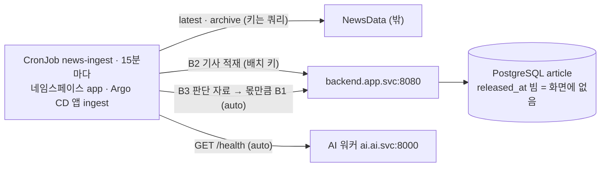

# 뉴스 수집 배치 — CronJob `news-ingest`

**15분마다 NewsData latest 를 30분 창으로 받아 B2 기사 적재로 넣고(앞 실행과 15분 겹침, 같은 기사는 B2 가 URL 로 막는다), 같은 회차에서 몫만큼 B1 분석을 자동으로 건다(`INGEST_MODE=auto`, 2026-11-12 최종 파일 적재 · 확인 직후부터).** 몫 = min(회차 50, 하루 5,000 − 오늘 건 수, 60 − EXTRACT 대기)이고 AI 팀장이 정했다(2026-11-10, 아래 「자동 투입」). 발표 전 새 기사는 마인드맵(EXTRACT)까지만이다 — EMBED · 판정 · 이슈는 발표 뒤(`SSOT.md` 9절). B1 을 안 건 기사는 `released_at` 이 비어 화면에 나오지 않는다 — 마인드맵이 생긴 기사부터 보인다(Jira S15P31A102-156).

정한 것과 까닭은 계획 `docs/plans/2026-11-10-ingest-15min-auto-b1.md`(15분 · 자동 투입, Jira 156) · `docs/plans/2026-11-04-ingest-load-only-data-load.md`(매일 넣기만) · `docs/plans/2026-11-03-news-ingest-batch.md`(Jira 154 · 155), B2 · B1 · B3 계약은 `docs/api-internal.md` 2절, 설정 값은 `infra/k8s/services/ingest/news-ingest.yaml`(주석), 거르는 조건 · 칸 맞추기는 같은 폴더의 `news_ingest.py` 에 있다.



- 자리는 app 네임스페이스지만 Argo CD 앱은 `ingest` 로 따로다. 까닭은 `SSOT.md` 6절 「클러스터 구성」
- DB · Redis 에는 직접 붙지 않는다. backend 로 들어가는 길은 `infra/k8s/services/app/netpol.yaml` 의 `backend-ingress`(이름표 `app: news-ingest`), AI 워커 `/health` 로 가는 길은 `infra/k8s/services/ai/netpol.yaml` 의 `ai-ingress`
- 키는 둘이다 — NewsData 키(봉인 Secret `newsdata-api`, `seal-secrets.sh newsdata`)와 배치 키(`internal-api` 의 `INTERNAL_BATCH_KEY` 하나만)

## 설정

모두 `news-ingest.yaml` 의 env 다. 틀린 값이면 스크립트가 NewsData 를 부르기 전에 `설정 오류` 를 찍고 종료 2 로 끝낸다(크레딧 0).

| env | 15분 값 | 받는 값 | 뜻 |
|---|---|---|---|
| `INGEST_MODE` | `auto` | `fetch-only` · `load-only` · `auto` · `release-only` | `fetch-only` 는 NewsData 요청 하나만 보내고 받은 수 · 견본을 찍는다(B2 · B1 안 부름). `load-only` 는 B2 만. `auto` 는 B2 뒤 회차 끝에 자동 투입. `release-only` 는 NewsData · B2 없이 자동 투입만(손으로 소량 걸 때). `full`(넣은 기사를 상한 없이 모두 B1)은 없앴다 — 주면 종료 2 |
| `INGEST_SOURCE` | `latest` | `latest`(비우면) · `archive` · `file` | latest 는 요청마다 1크레딧 · 최근 48시간까지, archive 는 5크레딧 · 지난 날짜(NewsData 「API credit usage」 문서). `file` 은 NewsData 대신 표준 입력의 B2 요청 모양 JSONL — `load-only` 에서만, 아래 NewsData 설정(키 · timeframe · days · query · 상한)은 있어도 무시한다(아래 「지난 기사 파일로 넣기」) |
| `INGEST_TIMEFRAME` | `30m` | `1` ~ `48`(시간) · `1m` ~ `2880m`(분) · 비움 | latest 의 창. archive 와 같이 주면 종료 2 |
| `INGEST_DAYS` | 없음 | 비움 · `yesterday` · `2026-11-03` · `2026-10-29..2026-11-02` | `pubDate`(UTC)를 KST 날짜로 바꿔 이 날짜만 넣는다. `yesterday` 는 실행 시각(KST)의 전날. 비우면 거르지 않는다 |
| `INGEST_ARCHIVE_FROM` · `INGEST_ARCHIVE_TO` | 없음 | `YYYY-MM-DD` · `YYYY-MM-DD HH:MM:SS` | archive 의 `from_date` · `to_date` 에 그대로 실린다(둘 다, 처음 ≤ 끝). latest 에 주면 종료 2 |
| `INGEST_QUERY` | `country=kr&language=ko&removeduplicate=1&excludecategory=sports,entertainment,lifestyle,food,tourism&sort=pubdateasc`(팀원이 10/29 ~ 11/3 을 받은 쿼리 + 오래된 순) | `키=값&키=값` | 고르는 조건(분야 · 언론사). 받는 키는 `news_ingest.py` 의 `QUERY_KEYS`(`category` · `domainurl` · `sort` 등). 키 · 쪽 · 기간 · 시간대 · 모르는 키 · 빈 값 · 겹친 키는 종료 2. Basic 은 요청 하나에 분야 · 언론사 각 5개까지(팀장 공지) |
| `INGEST_REQUEST_INTERVAL` | 없음(0) | `0` ~ `60` 초 | NewsData 요청 사이 쉬기. 유료 요금제 한도가 15분에 1,800크레딧이라 archive 는 3(15분에 많아야 300번 × 5 = 1,500) |
| `INGEST_MAX_REQUESTS` | `40` | `1` ~ `500` | 한 번 실행의 NewsData 요청 = latest 크레딧 상한 |
| `INGEST_MAX_ARTICLES` | `2000` | `1` ~ `20000` | 기사 상한(다른 기사 본문을 빼기 전 수) |
| `INGEST_FILE_LINES` | 없음 | 비움 · `1` ~ `1000000` | `file` 일 때 기대 줄 수. 읽은 줄과 다르면 끝까지 넣고 종료 1(덜 올라간 파일 · 다른 파일 · 끊긴 스트림) |
| `BACKEND_URL` | `http://backend.app.svc:8080` | `http(s)://<호스트>` | B2 · B3 · B1 을 부를 곳(load-only · auto · release-only) |
| `INGEST_RELEASE_FROM` | `2026-11-12` | `YYYY-MM-DD` | 자동 투입 후보의 발행 KST 날짜 시작 = 덤프 마감 다음 날 |
| `INGEST_RELEASE_PER_RUN` | `50` | `1` ~ `500` | 회차 최대 B1(B3 `limit`) |
| `INGEST_RELEASE_PER_DAY` | `5000` | `1` ~ `20000` | 하루 상한(KST 접수일, 정기 + 손) |
| `INGEST_RELEASE_CAPACITY` | `60` | `1` ~ `10000` | EXTRACT 대기(`QUEUED` + 다시 걸 예정 `FAILED`) 상한. 처음 값 — 첫 24 ~ 48시간 실측 뒤 AI 팀장과 정한다 |
| `INGEST_RELEASE_MAX_WAIT_MINUTES` | `30` | `1` ~ `1440` | 가장 오래 기다린 `QUEUED` EXTRACT 가 이 분 이상이면 그 회차는 쉬고 종료 1(경보) |
| `AI_HEALTH_URL` | `http://ai.ai.svc:8000/health` | `http(s)://<호스트>/<경로>` · `off` | 200 이 아니거나 닿지 않으면 그 회차는 쉰다. `off` 면 보지 않는다 |


- `INGEST_RELEASE_*` · `AI_HEALTH_URL` 은 `auto` · `release-only` 에서만 읽고 모두 필수다. 다른 모드는 읽지도 검사하지도 않는다 — 손 실행이 CronJob env 를 물려받아도 `INGEST_MODE` 하나만 덮으면 돈다
- 같은 실행 안의 중복은 링크와 NewsData `article_id` 로 거르고, 실행 사이 중복은 B2 가 URL 로 막는다(200)
- 거르는 순서: 기사 모양 → 본문 없음 → 분야(스포츠 · 연예 · 생활 · 음식 · 여행 — 쿼리의 `excludecategory` 와 같은 다섯) → NewsData 가 `duplicate=true` 로 표시 → 시간대 → 시각 모양 → **날짜 범위 밖** → 같은 실행 안 중복 → 기사 상한. 범위 밖(10시 실행의 그날 0 ~ 10시)이 상한을 먹지 않는다
- **다른 기사 본문을 달고 온 기사는 다 받은 뒤 뺀다**(`skipped.wrong_body`, Jira S15P31A102-183). NewsData `content` 가 본문이 짧거나 사진뿐인 기사에 다른 기사 묶음이나 언론사 안내문을 준다. 본문을 되살리지 않고 그 기사를 넣지 않는다. 규칙은 셋이다 — (a) 한 번 수집 안에서 같은 언론사 · 같은 본문(앞뒤 공백 뺌, 500자 이상)을 제목이 다른 기사 3건 이상이 쓴다 (b) 단신 제목(`news_ingest.py` 의 `BRIEF_TITLE_RE`) + 본문 5,000자 이상 + 제목 낱말이 본문에 나오는 비율 50% 이하 (c) (a) 와 같은 묶음을 제목 정확히 2개가 쓰고 두 제목 모두 낱말 비율 20% 이하. 제목 · 언론사가 글자가 아니면 판정하지 않고 B2 가 판단한다. 파일 넣기(`INGEST_SOURCE=file`)는 거르지 않는다. 기사 상한은 빼기 전 수로 센다. 잰 값 · 못 잡는 것은 계획 `docs/plans/2026-11-05-ingest-wrong-body.md`, (c) 는 `docs/plans/2026-11-09-ingest-wrong-body-pair.md`
- **본문이 언론사 안내문뿐인 기사는 받자마자 뺀다**(`skipped.notice_only`, Jira S15P31A102-156). 기사 하나만 보고 판단하고, 본문을 공백 한 칸으로 줄여 600자 이하일 때만 본다 — 긴 실제 본문에 같은 문구가 붙은 기사를 버리지 않게. `screen_text` 본문이 언론사 화면 문구(`SCREEN_TEXT_PREFIXES` — 지금은 경향의 설정 · 뉴스레터 · 개인정보 안내)로 시작한다 — 경향 날씨 · 만평이 478자로 온다. 같은 문구가 실제 본문 뒤에 붙어 오는 경향 단신 · 사진 기사는 남는다. `video_only` 본문이 구분선(`-` 10개 이상) 뒤 「자세한 내용은 동영상으로 확인하실 수 있습니다 · 이 기사의 전체 내용 확인하기」로 끝난다(`VIDEO_ONLY_RE`) — SBS 「클로징」 · 「여담야담」이 RSS 안내와 동영상 안내만 달고 온다. 같은 안내 뒤에 본문이 이어지는 SBS 기사는 남는다. 잰 값은 `SSOT.md` 9절 2026-11-12. 파일 넣기는 거르지 않는다
- NewsData 가 중간에 실패한 날은 받은 데까지로 판정한다. 같은 본문 기사가 일부만 모여 들어간 뒤 다시 시도에서 묶음이 차면, `본문 불일치로 뺌` 이 찍혀도 앞서 넣은 기사는 DB 에 있다. 그날 Pod 가 둘이면 그 URL 을 DB 와 대조해 숨긴다(`category-labels.md`)
- 쿼리에 `sort=pubdateasc`(오래된 순)가 있고 `INGEST_DAYS` 가 있으면, 시각을 믿을 수 있는 기사(UTC · 모양이 맞음)가 **쪽 전체에서 모두 범위 뒤**일 때 멈춘다(`stoppedBy: past_range`, 종료 0). 범위 뒤 기사가 한 건 끼인 쪽에서는 멈추지 않는다 — 정렬이 조금 어긋나도 어제 기사를 잃지 않게 요청 하나를 더 쓴다. 상한에 걸린 기사가 있으면 그쪽(종료 2)이 먼저다 — 그날 0 ~ 10시 쪽을 안 받아 요청이 준다(평균 약 330 → 240, 팀장 어림). 정렬은 2026-11-04 받기만으로 첫 쪽이 창 시작 바로 뒤인 것을 확인했다(`SSOT.md` 10절)
- 다음 쪽이 남았는데 요청 · 기사 상한에 닿으면 받은 데까지 넣고 종료 2 — 빠진 구간이 있다는 뜻이다. 30분 넘게 이어지면 경보 ①이 울린다(아래 「경보가 오면」)

## 15분 실행 (2026-11-12 적재 · 확인 직후 ~)

- 15분마다 돈다. 시작 마감 5분, 실행 상한 14분, 다시 시도 없음 — 실패해도 다음 실행이 30분 창을 다시 받아 한 번의 실패는 메워진다. 두 번 연속 실패부터 기사가 빠진다(「경보가 오면」)
- 크레딧 어림 — 평일 하루 약 520 ~ 610요청, 주말 약 180 ~ 270요청. 창 하나 최대 약 15요청(2026-11-05 ~ 08 운영 DB 발행 시각으로 30분 창 96번을 계산, 받는 수는 넣은 수의 1.2배로 어림)
- 마지막 예약 실행의 종료 코드 · `수집 결과` 줄. 예약 실행 Job 은 이름이 `news-ingest-<숫자>` 다(손 실행은 글자가 섞임)

  ```bash
  ssh newlearn 'j=$(kubectl -n app get jobs -o name --sort-by=.metadata.creationTimestamp | grep -E "/news-ingest-[0-9]+$" | tail -1); echo "$j"; kubectl -n app get pods -l job-name=${j#job.batch/} -o jsonpath="{range .items[*]}{.metadata.name} exit={.status.containerStatuses[0].state.terminated.exitCode}{\"\n\"}{end}"; kubectl -n app get $j -o jsonpath="{.status.startTime} ~ {.status.completionTime}{\"\n\"}"; kubectl -n app logs "$j" | tail -1'
  ```

- 수집 시각은 `article.created_at`(B2 가 넣은 때). 줄의 칸은 아래 「로그 읽기」
- 손 실행은 예약 실행과 겹치지 않을 때 — 겹치면 크레딧을 두 번 쓰거나 예약이 건너뛰어질 수 있다(손으로 만든 Job 을 CronJob 이 어떻게 세는지는 클러스터에서 확인하지 않았다). 손으로 만든 Job 도 성공 · 실패 기록 상한(3)에 같이 세여 금방 지워질 수 있으니 결과 줄은 Loki 로도 읽는다(`{namespace="app", container="ingest"} |= "수집 결과"`)

## 손 실행 (EC2)

CronJob 에서 Job 을 만들며 env 와 다시 시도만 바꾼다. **손 실행은 15분 설정(`auto` · 요청 40 · 기사 2,000 · timeframe 30m · 실행 상한 14분)을 물려받으니 아래 명령처럼 `INGEST_MODE=load-only` · 상한 · timeframe · 실행 상한을 꼭 같이 준다.** `load-only` 를 빠뜨리면 그 손 실행도 자동 투입을 한다 — 몫 계산이 하루 상한은 지키지만 회차와 겹치면 같은 후보에 B1 이 두 번 가 최대 50건 넘을 수 있다. `INGEST_QUERY` 처럼 `&` 가 든 값은 따옴표로 감싼다. 마지막이 `create` 라 같은 이름이 있으면 실패하고 끝난다. 이름은 겹치지 않게 날짜 · 시각을 붙인다.

먼저 받기만 한 번(요청 1, latest 1 · archive 5크레딧)으로 `pubDates` · `totalResults` · `out_of_range` 를 보고, 생각대로면 넣기만으로 돌린다.

**지난 하루(latest)** — 예: 11/3 을 11-04 14시에. `INGEST_TIMEFRAME` = 지금 − 그날 0시 + 1시간(최대 48 — 48시간이 지난 날은 archive)

```bash
kubectl -n app create job --from=cronjob/news-ingest news-ingest-1103-$(date +%H%M) --dry-run=client -o yaml | kubectl set env --local -f - INGEST_MODE=load-only INGEST_DAYS=2026-11-03 INGEST_TIMEFRAME=39 INGEST_MAX_REQUESTS=500 INGEST_MAX_ARTICLES=20000 -o yaml | kubectl patch --local -f - --type merge -p '{"spec":{"backoffLimit":0,"activeDeadlineSeconds":3600}}' -o yaml | kubectl -n app create -f -
```

- 받기만 먼저 보려면 `INGEST_MODE=fetch-only` 로 바꾼다

**archive** — 예: 10/29 ~ 11/2(KST). 이 구간과 11/3 은 2026-11-04 팀원이 따로 받기로 해 인프라는 돌리지 않았다 — 놓친 날을 채울 때 같은 방법으로 쓴다. KST 하루는 UTC 두 날짜에 걸쳐(KST 10/29 0시 = UTC 10/28 15시) 날짜만 주면 앞뒤를 더 받고 `INGEST_DAYS` 로 거른다. 요청은 UTC 이틀씩 세 구간으로 나눠 같은 날짜를 두 번 받지 않는다 — `2026-10-28` ~ `2026-10-29`, `2026-10-30` ~ `2026-10-31`, `2026-11-01` ~ `2026-11-02`. 한 구간은 요청 약 280 · 범위 안 기사 약 1만 2천(하루 7,000건 어림)이라 상한(요청 500 · 기사 2만)에 여유가 있다. 쉬기 3초면 15분에 1,500크레딧이라 구간을 이어 돌려도 한도(1,800) 안이다. 한 구간이 끝난 뒤 다음을 돌린다. 실행 상한은 2시간으로 올린다 — 넘기면 결과 줄 없이 죽고 다시 돌지 않아, 받는 중이었으면 그 구간 크레딧(약 1,400)이 그냥 사라진다

```bash
kubectl -n app create job --from=cronjob/news-ingest news-ingest-archive-1-$(date +%H%M) --dry-run=client -o yaml | kubectl set env --local -f - INGEST_MODE=load-only INGEST_SOURCE=archive INGEST_TIMEFRAME- INGEST_ARCHIVE_FROM=2026-10-28 INGEST_ARCHIVE_TO=2026-10-29 INGEST_DAYS=2026-10-29..2026-11-02 INGEST_REQUEST_INTERVAL=3 INGEST_MAX_REQUESTS=500 INGEST_MAX_ARTICLES=20000 -o yaml | kubectl patch --local -f - --type merge -p '{"spec":{"backoffLimit":0,"activeDeadlineSeconds":7200}}' -o yaml | kubectl -n app create -f -
```

- 다음 구간은 이름(`archive-2` · `archive-3`)과 `INGEST_ARCHIVE_FROM` · `INGEST_ARCHIVE_TO` 만 바꾼다
- 첫 구간 받기만에서 `pubDates.max` 가 `2026-10-29 2x:…` 까지 오는지 본다 — `to_date` 가 그날 끝까지 들어간다는 가정이다. 아니면 구간 끝을 하루씩 늘려 잡는다
- 크레딧 어림 — 하루 7,000건이면 UTC 하루 약 140요청 × 5 = 700. 날짜만이면 UTC 6일치라 약 4,200. NewsData 가 `YYYY-MM-DD HH:MM:SS`(UTC)도 받으면 `2026-10-28 15:00:00` ~ `2026-11-02 14:59:59` 로 5일치(약 3,500)만 받는다 — 받는지는 문서로 확인 못 했으니 받기만으로 `pubDates` 를 보고 정한다
- 요청 · 기사 상한에 닿아 종료 2 면 그 구간이 다 안 들어온 것이다. `stoppedBy` 와 `pubDates` 를 보고 구간을 더 잘게 나눠 다시 돌린다(같은 기사는 B2 200)

**보기 · 지우기**

```bash
kubectl -n app get jobs
```

```bash
kubectl -n app logs job/<이름> | tail -3
```

- 다 봤으면 지운다 — `kubectl -n app delete job <이름>`
- 손 실행 성공도 CronJob 의 「마지막 성공 시각」을 바꾼다. 예약 실행이 계속 실패해도 경보가 최대 30분 늦을 수 있다(아래 「경보가 오면」)

## 지난 기사 파일로 넣기 (`INGEST_SOURCE=file`, Jira 169)

AI 팀원이 받아 둔 10/21 ~ 11/3 최종 기사(`data/newsdata_2026-10-21_2026-11-03.sqlite`, 표는 `data/README.md`)를 B2 로 넣은 길이다. 덤프 적재 때까지 화면에 보이게 한 임시 공개는 `SSOT.md` 9절, 덤프 적재 때 마인드맵 없는 기사를 내리는 단계는 `data-load.md` 6절에 있다. 계획 `docs/plans/2026-11-04-preload-1021-1103-articles.md`.

- 값 변환은 `infra/server/sqlite_to_b2.py` 한 곳(규칙은 그 파일 머리말). AI 팀도 같은 출력 파일(같은 sha256)을 로컬 B2 로 넣는다
- 보내기는 CronJob 틀로 띄운 Job 안에서 `kubectl exec -i … < 파일` — 이미지 · 이름표 · Secret 이 매일 수집과 같고 배치 키가 클러스터 밖으로 나가지 않는다. 결과는 exec 의 표준 출력이라 `kubectl logs` · Loki 에 남지 않는다 — 서버의 로그 파일이 기록이다
- 같은 URL 은 B2 가 200 이라(위 「설정」 아래) 끊기면 같은 명령을 다시 돌린다
- 그날 10시 예약 Job 이 끝난 뒤 시작한다 — 손 Job 은 CronJob 의 동시 실행 막기(`Forbid`)에 세어지지 않는 것으로 본다(위 「매일 실행」 끝 줄처럼 클러스터에서 확인하지는 않았다)

**1. 넣기 전 백업** (EC2) — `db-backup.md` 「확인 · 손으로 돌리기」의 손 백업 한 번. 끝에 남긴 파일 이름 · 크기를 적어 둔다

**2. 변환 · 올리기** (관리자 PC, LFS 파일을 받은 본 클론의 저장소 맨 위 — worktree 에는 가리킴 파일만 있다) — SQLite sha256 이 `data/README.md` 값과 같은지 먼저 본다(PowerShell `Get-FileHash data/newsdata_2026-10-21_2026-11-03.sqlite`). 출력 폴더(`C:/tmp/preload`)는 미리 만들고, 출력 파일은 스크립트가 직접 쓴다(PowerShell 의 `>` 를 쓰지 않는다)

```bash
python -I infra/server/sqlite_to_b2.py data/newsdata_2026-10-21_2026-11-03.sqlite C:/tmp/preload/articles-1021-1103.jsonl
```

```bash
scp C:/tmp/preload/articles-1021-1103.jsonl newlearn:
```

- 변환이 찍은 `lines` · `sha256` 을 적어 둔다. EC2 에서 `sha256sum articles-1021-1103.jsonl` · `wc -l articles-1021-1103.jsonl` 이 같아야 한다

**3. Job 띄우기** (EC2) — ConfigMap 에 file 모드가 들어갔는지(1 이 나와야) 보고, Job 은 `sleep` 으로 띄운다. 이름에 글자가 섞여 「매일 실행」의 `news-ingest-[0-9]+$` 에 안 걸린다

```bash
kubectl -n app get configmap news-ingest -o jsonpath='{.data.news_ingest\.py}' | grep -c 'FILE_SOURCE = "file"'
```

```bash
kubectl -n app create job --from=cronjob/news-ingest news-ingest-preload --dry-run=client -o yaml | kubectl set env --local -f - INGEST_MODE=load-only INGEST_SOURCE=file -o yaml | kubectl patch --local -f - --type json -p '[{"op":"replace","path":"/spec/template/spec/containers/0/command","value":["sleep","infinity"]}]' -o yaml | kubectl patch --local -f - --type merge -p '{"spec":{"backoffLimit":0,"activeDeadlineSeconds":10800}}' -o yaml | kubectl -n app create -f -
```

```bash
kubectl -n app wait --for=condition=Ready pod -l job-name=news-ingest-preload --timeout=120s && kubectl -n app get job news-ingest-preload -o jsonpath='{range .spec.template.spec.containers[0].env[*]}{.name}{" "}{end}{"\n"}'
```

- env 는 이름만 찍는다(값은 찍지 않는다). `INGEST_MODE` · `INGEST_SOURCE` · `INTERNAL_BATCH_KEY` · `BACKEND_URL` 이 있어야 한다. 아래 exec 도 `INGEST_MODE=load-only` · `INGEST_SOURCE=file` 을 한 번 더 준다 — Job 을 다시 띄우다 `set env` 를 빠뜨려도 latest 로 돌지 않게(2026-11-12 전환부터 CronJob 은 `auto`)
- 시간 상한(3시간)이 되면 Pod 가 끝나 exec 도 같이 죽는다. 상한에 잘린 Job 은 실패로 남아 같은 이름으로 다시 만들려면 먼저 지운다

넣기 전 숫자를 적어 둔다 — 이 조건의 기사 수는 0 이어야 한다(아니면 같은 링크가 이미 있어 아래 수가 79,334 와 달라진다 — 파일은 79,335줄이지만 시험 기사 1번과 같은 URL 1건은 `existing` 으로 세어져 새로 안 들어간다)

```bash
kubectl -n data exec postgres-0 -- psql -X -q -U newlearn -d newlearn -At -c "select count(*) from article where source = 'NEWSDATA' and created_at >= '2026-11-04 00:00+09' and published_at < '2026-11-04 00:00+09'" -c "select count(*) from analysis_job" -c "select count(*) from press" -c "select pg_size_pretty(pg_database_size('newlearn'))"
```

**4. 카나리 100건** (EC2) — 시각 · 걸린 시간을 먼저 본다

```bash
head -n 100 articles-1021-1103.jsonl > articles-canary.jsonl && time kubectl -n app exec -i -c ingest job/news-ingest-preload -- env INGEST_MODE=load-only INGEST_SOURCE=file INGEST_FILE_LINES=100 python -I -B -u /opt/ingest/news_ingest.py < articles-canary.jsonl > canary.log; echo "exit=$?"; tail -1 canary.log
```

```bash
head -n 1 articles-canary.jsonl | grep -o '"publishedAt":"[^"]*"'; tail -n 1 articles-canary.jsonl | grep -o '"publishedAt":"[^"]*"'; kubectl -n data exec postgres-0 -- psql -X -q -U newlearn -d newlearn -At -c "select count(*), min(id), max(id), to_char(min(published_at) at time zone 'Asia/Seoul', 'YYYY-MM-DD\"T\"HH24:MI:SS'), to_char(max(published_at) at time zone 'Asia/Seoul', 'YYYY-MM-DD\"T\"HH24:MI:SS') from article where source = 'NEWSDATA' and created_at >= '2026-11-04 00:00+09' and published_at < '2026-11-04 00:00+09'"
```

- `exit=0`, 결과 줄 `lines` 100 · `badLines` 0 · `b2.created` 100. DB 의 수 · 최소 · 최대 시각이 파일의 첫 줄 · 끝 줄 `publishedAt`(`+09:00` 앞)과 같아야 한다 — 9시간 어긋나면 그 100건(위 `min(id)` ~ `max(id)`)만 지우고(아래 「되돌리기」) 변환을 고친다
- 걸린 시간 × 793 이 전체 어림이다. 2시간 반을 넘으면 시간 상한(3시간)에 걸리니 전체로 가지 말고 멈춘다

**5. 전체** (EC2) — `nohup` 이라 관리자 PC 가 끊겨도 이어진다. 앞 100건은 `existing` 으로 센다

```bash
nohup sh -c 'kubectl -n app exec -i -c ingest job/news-ingest-preload -- env INGEST_MODE=load-only INGEST_SOURCE=file INGEST_FILE_LINES=79335 python -I -B -u /opt/ingest/news_ingest.py < articles-1021-1103.jsonl; echo "exit=$?"' > preload.log 2>&1 &
```

- 지켜보기: `tail -2 preload.log` — 5,000줄마다 `진행` 줄. 사이트 health 도 본다
- 끝 표시: `exit=` 줄이 생긴다(`grep '"msg": "수집 결과"' preload.log | tail -1; tail -1 preload.log`). 성공이면 `exit=0` 과 결과 줄 `lines` 79,335 · `badLines` 0 · `b2.created + b2.existing` 79,335 · `rejected` · `failed` 0. 실패면 kubectl 이 `command terminated with exit code N` 을 결과 줄 뒤에 찍는다. 첫 줄은 `nohup: ignoring input` 이다

**6. 번호 범위 · 확인** (EC2) — 넣은 기사의 id 최소 · 최대 · 수를 적어 둔다. 공개 · 되돌리기는 이 범위로 한다

```bash
kubectl -n data exec postgres-0 -- psql -X -q -U newlearn -d newlearn -At -c "select min(id), max(id), count(*) from article where source = 'NEWSDATA' and created_at >= '2026-11-04 00:00+09' and published_at < '2026-11-04 00:00+09'" -c "select count(*) from analysis_job" -c "select pg_size_pretty(pg_database_size('newlearn'))"
```

- 수 79,334(위 「넣기 전」의 까닭). 분석 작업 행 수는 3의 「넣기 전」과 같아야 한다 — 작업 행이 없으면 큐 메시지도 생기지 않는다(GMS 를 안 부름). DB 크기를 넣기 전과 견준다

**7. 임시 공개** (EC2) — `<최소>` · `<최대>` 는 6의 값. `UPDATE 79334` 가 나와야 한다

```bash
kubectl -n data exec postgres-0 -- psql -X -U newlearn -d newlearn -v ON_ERROR_STOP=1 -c "update article set released_at = now() where id between <최소> and <최대> and released_at is null and published_at < '2026-11-04 00:00+09'"
```

- 공개만으로는 분석이 걸리지 않는다 — 스케줄러는 작업 행 · 마인드맵이 있는 기사만 본다. 그 기사에 B1 을 부르면 409 다. 그 뒤 분야 라벨로 숨긴 기사는 공개 전이라 202 로 걸리고 다시 공개된다(`category-labels.md` 5절)
- 확인: `curl -fsS 'https://newlearn.io.kr/api/v1/articles?size=1'` 의 `totalElements` 가 늘어난 수만큼, 넣은 기사의 A8 기사 상세는 200 · A9 기사 마인드맵은 404 `MINDMAP_NOT_FOUND`

**8. 치우기** (EC2) — Job 을 바로 지운다. 손 Job 이 성공으로 끝나면 CronJob 마지막 성공 시각이 바뀌어 경보 ①이 가려질 수 있다. 서버의 기사 파일도 지운다(로그 파일은 결과를 옮겨 적은 뒤)

```bash
kubectl -n app delete job news-ingest-preload && rm articles-1021-1103.jsonl articles-canary.jsonl
```

**되돌리기**

- 임시 공개만: `update article set released_at = null where id between <최소> and <최대> and not exists (select 1 from article_mindmap m where m.article_id = article.id)`
- 넣은 기사까지(덤프 적재 **전에만**): 먼저 `select count(*) from bookmark where article_id between <최소> and <최대>` 로 같이 지워질 북마크 수를 본 뒤 `delete from article where id between <최소> and <최대>`. 관심 이슈는 이슈를 가리켜 영향 없다. 새로 생긴 언론사 행은 남는다(가리키는 기사가 없으면 안 보인다). 또는 1의 백업 되살리기(`db-backup.md` 「사고 때 되살리기」). 덤프 적재 뒤에는 분석 행이 붙어 지우기가 외래 키에 걸린다 — `data-load.md` 7절

## 로그 읽기

줄마다 JSON 하나다. 키는 모두 `***` 로 가려 찍는다. Grafana › Explore › Loki 에서는 `{namespace="app", container="ingest"} | json`(`file` 은 exec 로 돌려 Loki 에 없다 — 서버 로그 파일).

| `msg` | 뜻 |
|---|---|
| `NewsData 요청` | 보낸 주소(`apikey=***`) |
| `받은 칸` | 첫 응답의 `totalResults` 와 첫 기사의 칸 이름 — NewsData 응답 모양이 바뀌면 여기서 보인다 |
| `견본` | 받기만일 때 처음 3건의 B2 요청 모양(본문은 `bodyChars` 글자 수만) |
| `NewsData 연결 실패` · `NewsData 실패` | NewsData 에 닿지 못함 · 200 과 `"status":"success"` 가 아닌 답(본문 앞 300자). 첫 요청이면 아무것도 안 넣고, 뒤 요청이면 받은 데까지 넣은 뒤 종료 1 |
| `B2 거절` · `B2 실패` · `B2 연결 실패` · `B1 실패` | 기사 하나의 실패 — 링크 · 기사 번호 · 상태 |
| `backend 연결 실패 — 멈춘다` | backend 연결이 세 번 이어서 실패해 남은 기사를 보내지 않았다 — 종료 1. 들어오는 길 정책(`backend-ingress`)과 backend Pod 를 본다 |
| `상한에 닿아 멈춤 — 빠진 구간이 있다` | 다음 쪽이 남았는데 요청 · 기사 상한에서 멈췄다. 받은 데까지는 넣었다 — 종료 2 |
| `출입증 오류 — 멈춘다` | NewsData 키(401 · 403, 첫 요청) 또는 배치 키를 받지 않았다 — 종료 2 |
| `NewsData 출입증 오류 — 받은 데까지 넣고 멈춘다` | 둘째 요청부터 401 · 403(구독 · 크레딧이 끝났을 수 있다) — 받은 쪽은 넣고 종료 2 |
| `설정 오류` | env 가 틀림(위 「설정」) — 종료 2 |
| `예상 못 한 오류` | 스크립트가 못 다룬 오류의 traceback(키는 가림) — 종료 1 |
| `진행` · `못 읽은 줄` · `줄 수가 다르다` | `file` 만 — 5,000줄마다 읽은 줄 · `b2`, UTF-8 · JSON 객체가 아니거나 필수 칸(`url` · `title` · `body` · `pressSourceId` · `pressName` · `publishedAt`)이 빈 줄의 번호(B2 를 안 부름), `INGEST_FILE_LINES` 와 읽은 줄이 다름 |
| `본문 불일치로 뺌` | 다른 기사 본문이라 뺀 기사 하나 — `rule`(`same_body` · `long_brief` · `same_body_pair`) · `url` · `title` · `pressSourceId` · `bodyChars` · `titleWordShare` · `sameBodyTitles`. 본문은 안 남긴다. 정상 기사가 걸렸는지 이 줄로 본다 |
| `안내문뿐이라 뺌` | 본문이 언론사 안내문뿐이라 뺀 기사 하나 — `rule`(`screen_text` · `video_only`) · `url` · `title` · `pressSourceId` · `bodyChars`. 본문은 안 남긴다. 정상 기사가 걸렸는지 이 줄로 본다 |
| `자동 투입 쉼` | 그 회차는 B1 을 걸지 않았다 — `skippedBy`(아래 「자동 투입」 표)와 B3 응답(실패면 `status` · `body`) |
| `B1 실패` · `B1 연결 실패` | 자동 투입의 기사 하나 — 기사 번호 · 상태. 그 회차에 다시 걸지 않는다 |
| `수집 결과` | 실행 한 번의 요약 — 아래 표 |

`수집 결과` 의 칸

| 칸 | 뜻 |
|---|---|
| `mode` · `source` · `days` | 모드 · latest/archive · 넣은 KST 날짜 범위(`[첫날, 끝날]`, 거르지 않으면 `null`) |
| `requests` · `credits` | NewsData 요청 수 · 깎인 크레딧 어림(요청 × 1, archive 는 × 5) |
| `fetched` · `kept` | 받은 기사 수 · 걸러 남아 보낼(받기만이면 보낼 수 있는) 기사 수 |
| `skipped` | 거른 까닭별 수 — `bad_item` 기사 모양이 아님, `no_body` 본문 없음, `notice_only` 본문이 언론사 안내문뿐(위 「본문이 언론사 안내문뿐인 기사」), `category` 스포츠 · 연예 · 생활 · 음식 · 여행, `marked_duplicate` NewsData 가 `duplicate=true` 로 표시, `timezone` `pubDateTZ` 가 UTC 아님, `bad_date` 시각 모양이 다름, `out_of_range` 날짜 범위 밖, `duplicate` 같은 실행 안 같은 링크 · `article_id`, `over_limit` 기사 상한을 넘음, `wrong_body` 다른 기사 본문을 달고 옴(규칙은 위 「다른 기사 본문을 달고 온 기사」). 받기만은 한 쪽(50건)만 봐서 `wrong_body` 를 매일 수와 견줄 수 없다 |
| `pubDates` | 받은 기사 `pubDate`(UTC) 의 `min` · `max` — 창 · archive 날짜가 생각대로 먹었는지 |
| `stoppedBy` | `end` 끝까지 받음 · `past_range` 오래된 순으로 받다 범위를 지나 멈춤(정상) · `max_requests` · `max_articles` 상한(다음 쪽이 남음 — 받기만은 늘 요청 1이라 정상) · `newsdata_error` 중간 실패 · `newsdata_auth` 중간에 키를 안 받음 |
| `b2` (load-only · auto) | `created` 새로 넣음(201) · `existing` 이미 있음(200) · `rejected` 입력 오류(400) · `failed` 그 밖 |
| `b1` (auto · release-only) | `released` 걸었음(202) · `already` 이미 걸림(409) · `failed` 그 밖(그 회차에 다시 걸지 않는다 — 아래 「B1 · 분석이 끝내 실패한 기사」) |
| `release` (auto · release-only) | 자동 투입 기록 — `from` 후보 발행 시작, `today` 오늘 건 수, `queued` · `retryPending` EXTRACT 대기, `oldestWaitMinutes` 가장 오래 기다린 `QUEUED`(분), `succeeded15m` · `failed15m` 최근 15분 성공 · 실패, `ai` `/health`(`UP` · `DOWN` · `off`), `candidates` B3 후보 수, `budget` 몫, `picked` 건 수, `skippedBy` 쉰 까닭(아래 「자동 투입」 표, 쉬지 않았으면 null), `b3Ms` B3 응답 시간. 배치 키가 B2 에서 거절돼 투입을 안 했으면 `null` |
| `lines` · `badLines` · `expectedLines` (`file`) | 읽은 줄 · 못 읽은 줄 · `INGEST_FILE_LINES`. `file` 의 결과 줄에는 이 셋과 `mode` · `source` · `b2` 만 있다 |

| 종료 코드 | 뜻 | Job |
|---|---|---|
| 0 | 끝까지 돌았다 — 기사 몇 건의 실패는 `수집 결과` 에 세어 둠. `file` 은 못 읽은 줄 · 거절 · 실패 0 이고 줄 수가 맞을 때만 | 성공 |
| 1 | NewsData 요청 실패(받은 데까지는 넣음), backend 연결이 이어서 실패, 보낼 기사가 있었는데 하나도 못 감(B2 201 · 200 이 「감」), auto 의 자동 투입이 `status_error` · `wait` · `failing` 이거나 고른 기사를 하나도 못 걸었음(B1 202 · 409 가 「감」). `file` 은 못 읽은 줄 · 거절 · 실패가 하나라도 있거나 줄 수가 다름 · 빈 파일 | 한 번 다시 시도(처음부터) |
| 2 | 다시 해도 같다 — 설정, NewsData · backend 의 401 · 403(NewsData 는 받은 데까지 넣음), B3 400, 요청 · 기사 상한(빠진 구간) | 다시 시도 없이 실패 |

auto 는 수집 쪽 코드와 자동 투입 쪽 코드 중 큰 값으로 끝난다 — NewsData 가 실패해도(첫 요청 포함) 밀린 후보는 건다. 쉼(`daily_cap` · `capacity` · `ai_down`)은 0 이라 정상 회차를 실패로 만들지 않는다.

## 15분 수집 + 자동 투입으로 바꾸기 (2026-11-12, Jira 156)

계획 `docs/plans/2026-11-10-ingest-15min-auto-b1.md`. 이 절이 들어온 MR 이 값을 바꾼다. 날짜별 실행 카드는 계획에 있다. 그날 순서:

1. 10:00 수집(11/11 분, 마지막 매일 실행)이 종료 0 으로 끝남 — 덤프(11/11 까지)와 이어진다
2. 게이트 — 11/12 최종 파일 적재 · 확인 끝(`data-load.md` 9절), AI 팀장에 알림, `b1-state.sql`(아래)이 `released_today` 0 · `queued` 0 · `retry_pending` 0, 11/12 뒤 발행 기사 0
3. MR 을 최신 `infra` 와 합쳐 파이프라인 → `infra` → `dev`. **정각 3분 전쯤(:12 · :27 · :42 · :57) `dev` 에 머지한다** — 그날은 마지막 성공이 10:00 수집이라 새 경보 규칙(마지막 성공 뒤 30분)이 동기화되자마자 참이 된다. 동기화 뒤 5분(`for`) 안에 첫 회차가 성공하면 울리지 않고, 놓치면 한 번 울리고 첫 성공에 풀린다
4. Argo CD `ingest` Synced, CronJob `*/15` · env, Prometheus 에 새 경보 식
5. 첫 회차 결과 줄 — 종료 0 · `requests` ≤ 40 · `stoppedBy` `end` · `release.today` 0 · `ai` `UP` · `budget` 50 · `b1.released` = 30분 창의 새 기사 수(최대 50)

**빈 구간은 메우지 않는다** — 11/12 0시 ~ 전환 기사는 받지 않는다(2026-11-10 사용자, AI 팀장에게 알림). 되돌리기는 그 MR 을 되돌리는 MR 이다 — 매일 10시 넣기만으로 돌아가고, 그날 낮 기사는 다음 날 10시가 받는다. 자동 투입만 끄려면 yaml `INGEST_MODE: load-only` MR.

15분 모드의 새 기사는 라벨 전까지 NewsData 값이다. 라벨은 그때그때 돌린다(`category-labels.md` 3절).

## 자동 투입 (`auto` · `release-only`, Jira 156)

정한 것은 AI 팀장(2026-11-10) — 몫 공식 · 쉬는 기준 · 순서 · 손 소량도 같은 계산. 세는 법은 backend B3(`docs/api-internal.md` 2절)와 `infra/server/b1-state.sql` 이 같다. 몫 식은 `news_ingest.py` 한 곳에 있다.

회차 끝에 B3(오늘 건 수 · EXTRACT 대기 · 후보) → AI 워커 `/health` → 위에서부터 처음 맞는 줄

| 차례 | 조건 | `skippedBy` | 투입 쪽 종료 코드 |
|---|---|---|---|
| 1 | B3 · B1 401 · 403 | `auth` | 2 — 배치 키는 B2 와 같아 고칠 때까지 회차마다 수집 · 투입이 같이 멈추고 경보 |
| 2 | B3 400 | `bad_request` | 2 |
| 3 | B3 연결 실패 · 5xx · 응답 모양이 다름 | `status_error` | 1 |
| 4 | `/health` 가 200 이 아님 · 닿지 않음 | `ai_down` | 0 — `NewlearnServiceDown` 이 따로 운다 |
| 5 | 오늘 건 수 ≥ `PER_DAY` | `daily_cap` | 0 |
| 6 | 가장 오래 기다린 `QUEUED` ≥ `MAX_WAIT_MINUTES` | `wait` | 1 — 경보 |
| 7 | 최근 15분 EXTRACT 실패 ≥ 10 이고 성공보다 많음(GMS 장애 · 속도 제한 — AI 팀장 기준에 더함) | `failing` | 1 — 경보 |
| 8 | 몫 = max(0, min(`PER_RUN`, `PER_DAY` − 오늘 건 수, `CAPACITY` − `queued` − `retryPending`)) 이 0 | `capacity` | 0 |
| 9 | 몫 ≥ 1 — 후보 앞에서부터 몫만큼 B1 | 없음 | 고른 기사를 하나도 못 걸면 1 |

- 후보는 B3 가 고른다 — 발행이 `INGEST_RELEASE_FROM` 이후 · 공개 전 · 작업 행 없음 · 사건 연결 없음 · 분야 라벨 행 없음, 넣은 시각 최신 순(그 회차 새 기사가 맨 앞, 그다음 지난 회차에 못 건 기사가 최근부터)
- 평일엔 하루 수집(1만 건 넘음)이 하루 최대 4,800건(50 × 96회차)보다 많아 다 걸리지 않는다. 남은 기사는 공개 전이라 화면에 없다
- **손으로 소량 걸 때도 같은 몫 계산을 거친다**(AI 팀장) — curl 로 B1 을 직접 부르지 않고 `release-only` 손 Job 으로. 끝 표시: 결과 줄 `mode` `release-only` · `b1.released`

  ```bash
  kubectl -n app create job --from=cronjob/news-ingest news-ingest-release-$(date +%H%M) --dry-run=client -o yaml | kubectl set env --local -f - INGEST_MODE=release-only INGEST_RELEASE_PER_RUN=10 -o yaml | kubectl patch --local -f - --type merge -p '{"spec":{"backoffLimit":0}}' -o yaml | kubectl -n app create -f -
  ```

**매일 확인**(서버 셸, 읽기만 — 10시쯤)

- 세기 대조 — `b1-state.sql`. 결과 줄의 `release.today` · `queued` · `retryPending` 과 같은 때 값이 맞는지

  ```bash
  kubectl -n data exec -i postgres-0 -- psql -X -q -U newlearn -d newlearn -v cutoff=2026-11-12 < infra/server/b1-state.sql
  ```

- 날짜별 투입 수(AI 팀장에게 넘김) — 접수일마다 EXTRACT 작업 · 성공 · 끝내 실패

  ```bash
  kubectl -n data exec -i postgres-0 -- psql -X -q -U newlearn -d newlearn -c "select (j.created_at at time zone 'Asia/Seoul')::date as 접수일, count(*) as 건_수, count(*) filter (where j.status = 'SUCCEEDED') as 성공, count(*) filter (where j.status = 'FAILED' and j.retry_at is null) as 끝내_실패 from analysis_job j join article a on a.id = j.article_id where j.stage = 'EXTRACT' and a.published_at >= '2026-11-12 00:00+09' group by 1 order by 1"
  ```

- 쉼 분포 · 마지막으로 건 회차 — Loki `{namespace="app", container="ingest"} |= "수집 결과" | json`. `release.skippedBy` 가 이어서 `daily_cap` · `capacity` 면 경보 없이 쉬는 중이다
- 숨김 라벨인데 공개된 기사 — 걸린 뒤 끝나기 전에 숨김 라벨을 넣으면 결과 저장이 다시 공개한다(`category-labels.md` 5절). 그 절의 `apply` 를 끝만 `rollback;` 으로 돌려 첫 `UPDATE` 수를 보고, 0 이 아니면 `commit;` 으로
- 30분 창이 놓친 같은 본문 — 같은 언론사 · 같은 본문(500자 이상)을 제목 둘 이상이 쓰는 묶음. 잘못된 본문이면 라벨 X(`category-labels.md` 2절)

  ```bash
  kubectl -n data exec -i postgres-0 -- psql -X -q -U newlearn -d newlearn -c "select a.press_code, count(*) as 기사, count(distinct a.title) as 제목, min(a.id) as 첫_id, max(a.id) as 끝_id, count(*) filter (where a.released_at is not null) as 공개 from article a where a.created_at >= now() - interval '1 day' and length(btrim(a.body)) >= 500 group by a.press_code, md5(btrim(a.body)) having count(distinct a.title) >= 2 order by 3 desc"
  ```

**늦게 올라온 기사 · 같은 본문 재기**(2026-11-14 10:20 한 번) — 15분 수집은 발행 뒤 30분이 지나 올라온 기사를 받지 못하고, 잘못된 본문 규칙 (a) · (c) 는 묶음이 한 회차에 다 안 모여 덜 잡힌다. 첫 온전한 하루(11/13)를 넣기만으로 한 번 더 받아 `b2.created`(놓친 기사)와 「본문 불일치로 뺌」 URL 중 운영에 있던 수를 잰다(NewsData 약 240 ~ 330요청). 그 수로 매일 쓸어 담기 · 후보 SQL 의 같은 본문 빼기를 할지 정한다(계획 고를 것 6)

```bash
kubectl -n app create job --from=cronjob/news-ingest news-ingest-1113-$(date +%H%M) --dry-run=client -o yaml | kubectl set env --local -f - INGEST_MODE=load-only INGEST_DAYS=2026-11-13 INGEST_TIMEFRAME=35 INGEST_MAX_REQUESTS=500 INGEST_MAX_ARTICLES=20000 -o yaml | kubectl patch --local -f - --type merge -p '{"spec":{"backoffLimit":0,"activeDeadlineSeconds":3600}}' -o yaml | kubectl -n app create -f -
```

## 급히 멈추기

- 기본 — `news-ingest.yaml` 의 `suspend: true` MR
- MR 을 기다릴 수 없을 때(서버에서) — Argo CD 자동 동기화를 **루트 앱 → `ingest` 앱** 순서로 끈 뒤 `kubectl -n app patch cronjob news-ingest -p '{"spec":{"suspend":true}}'`. 두 앱 모두 selfHeal 이라 `ingest` 만 끄면 루트가 앱 정의를 되돌린다. 다시 켤 때는 MR 이 머지된 뒤 **`ingest` 앱 → 루트 앱**. 그동안 backend · frontend 배포(app 앱)는 그대로 돈다
- 이미 넣은 기사는 남는다. 공개 전 기사는 화면에 없고, 공개된 기사를 내리려면 따로 SQL(백업 뒤)

## 경보가 오면 (`NewlearnIngestMissing`)

멈추지 않았는데 ① 마지막 성공이 30분 넘게 없거나 ② 예약 실행이 30분 넘게 없거나 ③ 성공 기록이 아예 없으면 5분 뒤 울린다. 창이 30분이라 두 번 연속 실패부터 기사가 빠진다 — 빠졌으면 「손 실행」 latest 로 그 시간대를 받는다. 식과 한계는 `infra/k8s/alerts/rules.yaml` 주석.

1. `kubectl -n app get jobs` · `kubectl -n app logs job/<이름> | tail -3` 으로 마지막 실행의 종료 코드와 `수집 결과` 를 본다
2. 결과 줄 `release.skippedBy` 가 `wait` · `failing` 이면 수집은 됐고 분석 줄이 막힌 것이다 — AI 워커(`kubectl -n ai get pod`, 로그의 `EXTRACT job=`)와 GMS(AI 팀장). `status_error` 면 backend B3(500 이면 backend 로그 — 라벨 표 `category_label.article_label` 이 있는지). `auth` 면 배치 키
3. 종료 1 — `NewsData 실패` 면 응답 `status` 와 본문(크레딧 · 15분 한도). `NewsData 연결 실패` 면 바깥으로 나가는 길(DNS · 인터넷). `backend 연결 실패 — 멈춘다` 나 하나도 못 감이면 backend 상태(`kubectl -n app get pod`, health)와 들어오는 길 정책(`kubectl -n app get cnp backend-ingress`)
4. 종료 2 — `상한에 닿아 멈춤` 이면 `stoppedBy` · `pubDates` 로 빠진 구간을 본다. 오래된 순(`sort=pubdateasc`)으로 받으니 상한에 닿으면 끝쪽이 빠진다 — `skipped.over_limit` 이 0 이고 `pubDates.max` 가 범위 마지막 날 24시(KST — UTC 로는 그날 15:00)를 넘었으면 범위 안은 다 받은 것이고, 아니면 빠진 것이 있다 — `pubDates.max` 뒤와, `over_limit` 이 있으면 상한에 닿은 그 쪽의 뒷부분까지(쿼리에 그 정렬이 없으면 최신부터라 반대로 `pubDates.min` 을 본다). 빠졌으면 48시간 안이면 「손 실행」 latest 로(상한을 올려), 지났으면 archive 로 그 구간만 다시 받는다. 자주 닿으면 상한이나 고르는 조건을 MR 로. `설정 오류` 면 env · Secret(`kubectl -n app get secret newsdata-api internal-api`). `출입증 오류` 가 NewsData 면 키(구독이 끝났는지 포함 — 「키 바꾸기」), backend 면 배치 키가 backend 와 같은 Secret 인지
5. 몇 시간을 놓쳤으면 손 실행 latest 로 다시 받는다. latest 는 48시간까지라 그 뒤는 archive(5배)
6. Job 이 아예 없으면 예약이 안 생긴 것 — `kubectl -n app describe cronjob news-ingest` 의 이벤트(시작 마감을 넘김 등)
7. 오래 멈췄다 다시 켜면 첫 성공 전까지 ① · ②가 울릴 수 있다 — 첫 성공이면 저절로 풀린다

## B1 · 분석이 끝내 실패한 기사

- B1 이 연결 실패 · 5xx 로 끝나면 그 회차에 다시 걸지 않는다. 다음 회차 B3 가 작업 행이 없는 기사만 후보로 주니 — 서버가 받았으면 빠지고 못 받았으면 다시 나온다(AI 팀장 「다시 걸기 전에 작업 행 확인」)
- 분석(EXTRACT)이 시도 3을 넘겨 끝내 실패한 기사는 작업 행이 있어 다시 후보가 되지 않는다. **발표 전에는 다시 걸지 않는다** — 수는 위 「매일 확인」 날짜별 투입 수의 `끝내_실패` 로 세어 AI 팀장에게 넘긴다

## 키 바꾸기

NewsData 키 — 바뀐 서버 스크립트를 보낸 뒤(`infra/server/README.md` 「서버로 보내기」) 터미널에서 다시 봉인한다. 봉인 전에 그 키로 최신 기사 요청 하나를 보내(크레딧 1 안팎) 통과해야 봉인한다.

```bash
ssh -t newlearn "bash infra/server/seal-secrets.sh newsdata"
```

```bash
ssh newlearn 'cat ~/sealed/sealed-newsdata-api.yaml' > infra/k8s/services/ingest/sealed-newsdata-api.yaml
```

그 파일을 바꾸는 MR 을 머지하면 된다. CronJob 은 실행마다 Pod 를 새로 띄워 그때 env 를 읽어 다시 띄울 것이 없다.
