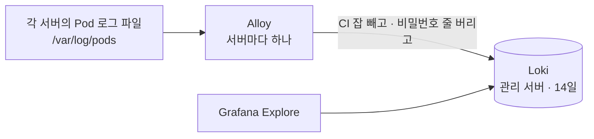

# 로그 창고 — Loki · Alloy (관리 서버)

Pod 가 출력한 로그를 관리 서버의 Loki 에 14일 모으고 Grafana 에서 찾는다. 지금 Pod 로그는 그 Pod 가 사는 동안만 있어서, 배포로 Pod 가 바뀌면 옛 로그가 사라진다. 왜 · 무엇을 모으나는 `SSOT.md` 6절 「모니터링」의 로그 줄, 계획은 `docs/plans/2026-10-28-loki.md` (Jira S15P31A102-128).



| 무엇 | 차트 · 판 | 값 |
|---|---|---|
| Loki (창고) | `grafana/loki` 7.5.0 — 이미지는 차트가 고정한 3.6.11 | `infra/k8s/bootstrap/loki-values.yaml` · PV `loki-pv.yaml` |
| Alloy (수집기) | `grafana/alloy` 1.14.3 (Alloy v1.21.2) | `infra/k8s/bootstrap/alloy-values.yaml` (수집 설정 포함) |
| Grafana 자료원 | kube-prometheus-stack 92.10.1 | `infra/k8s/bootstrap/monitoring-values.yaml` 의 `additionalDataSources` |

다른 모니터링처럼 Argo CD 가 아니라 사람이 EC2 에서 helm 으로 깐다. 값 파일을 고쳐도 아래 명령을 다시 쳐야 반영된다. 파일은 `infra/server/README.md` 「서버로 보내기」대로 보낸다.

## 1. 폴더 · PV (EC2, 처음 한 번)

Loki 사용자(uid · gid 10001)가 쓰게 폴더 주인을 맞춘다. StorageClass `newlearn-local-manual` 은 `prometheus-pv.yaml` 이 이미 만들었다.

```bash
sudo install -d -m 0750 -o 10001 -g 10001 /var/lib/newlearn/loki
```

```bash
kubectl apply -f infra/k8s/bootstrap/loki-pv.yaml
```

## 2. 차트 창고 (EC2, 처음 한 번)

```bash
helm repo add grafana https://grafana.github.io/helm-charts && helm repo update grafana
```

## 3. 설치 · 값을 바꾼 뒤 (EC2)

깔기 전에 무엇이 만들어지는지 보려면 `install` 대신 `template` 으로 펼친다(클러스터는 안 건드림) — `helm template loki grafana/loki --version 7.5.0 -n monitoring -f infra/k8s/bootstrap/loki-values.yaml`.

```bash
helm upgrade --install loki grafana/loki --version 7.5.0 -n monitoring -f infra/k8s/bootstrap/loki-values.yaml --wait --timeout 10m
```

```bash
helm upgrade --install alloy grafana/alloy --version 1.14.3 -n monitoring -f infra/k8s/bootstrap/alloy-values.yaml --wait --timeout 5m
```

Grafana 자료원(Loki)은 kps 를 같은 판으로 한 번 더 올려 넣는다 — Grafana Pod 가 다시 떠 화면이 잠깐 끊긴다.

```bash
helm upgrade --install kps oci://ghcr.io/prometheus-community/charts/kube-prometheus-stack --version 92.10.1 -n monitoring -f infra/k8s/bootstrap/monitoring-values.yaml --wait --timeout 10m
```

## 4. 확인

| 무엇을 | 명령 (EC2) | 기대 |
|---|---|---|
| Pod | `kubectl -n monitoring get pods -o wide -l 'app.kubernetes.io/name in (loki,alloy)'` | `loki-0` 은 관리 서버, `alloy-…` 는 서버마다 하나. 모두 Running · 재시작 0 |
| 저장소 | `kubectl -n monitoring get pvc` | `storage-loki-0` Bound — `loki-local` |
| Loki 준비 | `kubectl get --raw /api/v1/namespaces/monitoring/services/loki:3100/proxy/ready` | `ready` |
| 모이는 네임스페이스 | `kubectl get --raw /api/v1/namespaces/monitoring/services/loki:3100/proxy/loki/api/v1/label/namespace/values` | app · ai · data · argocd 등. `gitlab-runner` 는 없다 |
| 쌓인 양 | `sudo du -sh /var/lib/newlearn/loki` | 하루 수 MB — 14일 지나면 compactor 가 지운다 |
| 이력 | `helm history loki -n monitoring` · `helm list -n monitoring` | 판 · 바꾼 때 |

## 5. 로그 찾기 (Grafana › Explore › 자료원 Loki)

중괄호 `{}` 안은 라벨로 고르기(빠름), `|=` 는 글자로 거르기다. 라벨은 `namespace` · `pod` · `container` · `app` · `node` · `stream`(stdout · stderr). 아래는 2026-10-28 실제로 돌려 본 것이다.

| 무엇을 | LogQL |
|---|---|
| backend 로그 | `{namespace="app", container="backend"}` |
| 사라진 Pod 의 로그 — 이름을 알면 | `{namespace="app", pod="backend-577656b48b-5ttpw"}` |
| 글자로 거르기 | `{namespace="app", container="backend"} \|= "Started BackendApplication"` |
| 수준으로 거르기 — 스프링 글자 로그 | ``{namespace="app", container="backend"} \| regexp `^\S+\s+(?P<level>[A-Z]+)\s` \| level="WARN"`` |
| 수준별 줄 수 | ``sum by (level) (count_over_time({namespace="app", container="backend"} \| regexp `^\S+\s+(?P<level>TRACE\|DEBUG\|INFO\|WARN\|ERROR)\s` [3h]))`` |

- 스프링은 수준을 5칸에 오른쪽으로 맞춰 찍어(` INFO` · `ERROR`) 공백 수가 줄마다 달라서 `pattern` 은 맞지 않는다 — `regexp` 를 쓴다. 정규식은 역따옴표(`` ` ``)로 감싸야 역슬래시가 그대로 간다
- Loki 가 스스로 붙이는 `detected_level` 은 스프링 글자 로그의 WARN 을 잡지 못했다(`unknown`) — 쓰지 않는다
- 그래서 로그 모양은 글자 그대로 둔다(JSON 으로 바꾸지 않아도 수준으로 거를 수 있다)

## 6. 되돌리기

모은 로그만 사라지고 서비스 데이터에는 영향이 없다.

```bash
helm uninstall alloy -n monitoring && helm uninstall loki -n monitoring
```

그다음 `monitoring-values.yaml` 의 `additionalDataSources` 를 빼고 3번의 kps 명령을 다시 친다. 로그까지 지우려면 `kubectl -n monitoring delete pvc storage-loki-0` → `kubectl delete pv loki-local` → `sudo rm -r /var/lib/newlearn/loki`.

## 겪은 것 (2026-10-28)

- Loki 차트 기본값은 나눠 띄우는 구성(SimpleScalable)에 캐시(memcached) · gateway · canary 까지 켠다 — 값 파일로 끄고 `helm template` 자원 목록으로 확인했다
- Loki 의 규칙 감시 보조 컨테이너(`loki-sc-rules`)는 기본으로 켜져 있고, 켜 두면 **클러스터의 모든 ConfigMap · Secret 을 읽는 ClusterRole** 이 붙는다 — `sidecar.rules.enabled: false`. 끄면 ClusterRole 은 이름만 남고 규칙이 빈다
- Alloy 차트 기본 권한도 Secret 을 읽는다 — Pod 읽기만 남겼다. 차트 틀이 `rbac.rules` 와 `rbac.clusterRules` 를 이어 붙여서 한쪽을 `[]` 로 두면 YAML 이 깨진다(같은 규칙을 양쪽에)
- Loki 차트 7.5.0 은 앱 판이 3.6.16 으로 적혀 있지만 이미지 태그는 3.6.11 로 고정돼 있다 — 차트가 함께 시험한 판이라 그대로 쓴다(`helm list` · 설치 NOTES 에는 3.6.16 이 찍힌다)
- 처음 켜면 Alloy 가 서버에 남은 옛 로그 파일을 처음부터 훑는다. 7일보다 오래된 줄은 Loki 가 400 으로 거절한다(`reject_old_samples_max_age: 168h`) — 관리 서버 Alloy 에 처음 1분 동안 오류 4줄, 그 뒤로는 없음
- 수집기는 라벨에 `filename`(로그 파일 경로)과 `service_name` 을 더 붙인다 — Loki 3 기본 동작
- 팝업 계정은 Grafana Viewer 라 기본값으로는 Explore 에 들어가지 못하고 첫 화면으로 돌아온다 — `grafana.ini` 의 `users.viewers_can_edit: true`(`monitoring-values.yaml`)로 열었다. Viewer 가 대시보드를 화면에서 잠깐 고쳐 볼 수는 있지만 저장은 못 한다(사용자 결정)
